[« 多元复合函数与隐函数求导](17-chain-implicit.md)　　[二重积分 »](19-double-integrals.md)

# 高等数学 · 多元函数极值与最值

> **全章 13 题｜本表头已点名 13 题｜未归类 0 题。**\
> **必会 4 题·按此顺序**：[2020-17](#q2020-17)（驻点与二阶判别） → [2026-19](#q2026-19)（区分极值与鞍点） → [2025-19](#q2025-19)（先还原函数再求极值） → [2018-19](#q2018-19)（带约束的实际最值）\
> **补练 6 题·按薄弱点选做**：[2024-12](#q2024-12)、[2023-18](#q2023-18)、[2015-17](#q2015-17)、[2014-06](#q2014-6)、[2012-16](#q2012-16)、[2011-05](#q2011-5)\
> **冲一冲 2 题**：[2016-17](#q2016-17)（隐函数极值） → [2022-20](#q2022-20)（变量替换接求函数与极值）\
> **见识 1 题·先会开题**：[2013-19](#q2013-19)（隐式约束下距离先改求平方）\
> **首轮过关**：驻点不等于极值；有约束先查范围与边界，不能只解偏导为零。

---

## 2026年

### 01 · 2026-19 · 解答题 ·【必会】

> 二元极值大题。求一阶偏导令其为 0 解驻点，别漏掉退化点；对每个驻点求二阶偏导算 ，正负性判断要仔细。

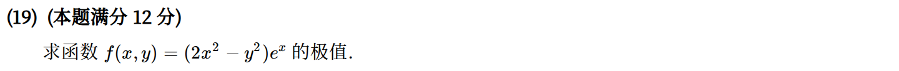

---

## 2025年

### 02 · 2025-19 · 解答题 ·【必会】

> 全微分求原函数加极值。全微分条件  积分定出 ，再按二元极值二阶充分条件检验驻点。

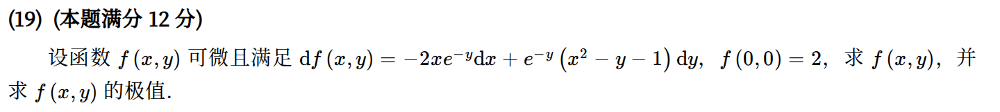

*关联章节：[多元函数极限、偏导与全微分](16-multivariable-basics.md)*

---

## 2024年

### 03 · 2024-12 · 填空题 ·【补练】

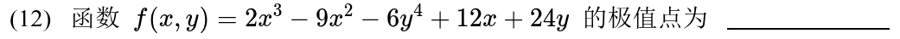

---

## 2023年

### 04 · 2023-18 · 解答题 ·【补练】

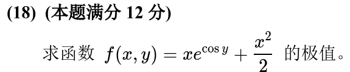

---

## 2022年

### 05 · 2022-20 · 解答题 ·【冲一冲】

> 变量代换与极值综合大题。第一问链式法则求复合偏导；第二问积分恢复出  的具体表达式，求驻点并算 Hessian 判别式。

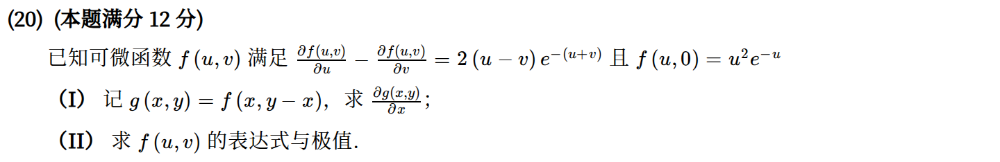

*关联章节：[多元复合函数与隐函数求导](17-chain-implicit.md) · [多元函数极限、偏导与全微分](16-multivariable-basics.md)*

---

## 2020年

### 06 · 2020-17 · 解答题 ·【必会】

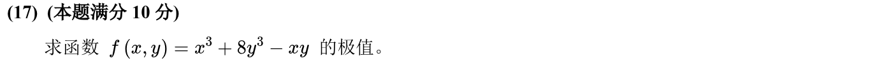

---

## 2018年

### 07 · 2018-19 · 解答题 ·【必会】

> 周长受限的几何面积最值。三个图形边长设为变量，周长和为定值，列出面积目标函数。既可用拉格朗日乘数法，也可用柯西不等式秒杀。

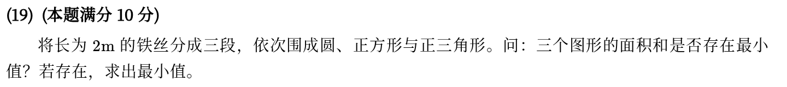

---

## 2016年

### 08 · 2016-17 · 解答题 ·【冲一冲】

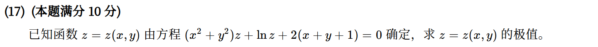

*关联章节：[多元复合函数与隐函数求导](17-chain-implicit.md)*

---

## 2015年

### 09 · 2015-17 · 解答题 ·【补练】

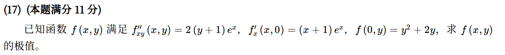

*关联章节：[多元函数极限、偏导与全微分](16-multivariable-basics.md)*

---

## 2014年

### 10 · 2014-06 · 选择题 ·【补练】

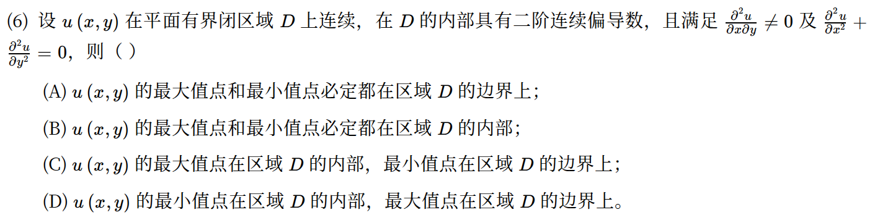

---

## 2013年

### 11 · 2013-19 · 解答题 ·【见识】

> 隐式曲线到原点距离极值。目标函数设为距离平方 ，约束条件是隐式方程，拉格朗日乘数法对称性极强，注意端点非负限制。

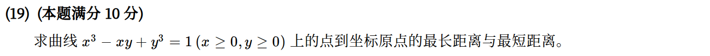

*关联章节：[多元复合函数与隐函数求导](17-chain-implicit.md)*

---

## 2012年

### 12 · 2012-16 · 解答题 ·【补练】

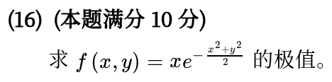

---

## 2011年

### 13 · 2011-05 · 选择题 ·【补练】

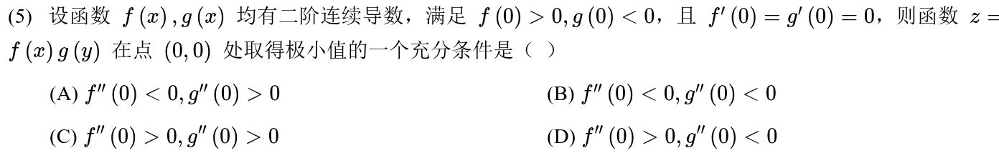

---

[« 多元复合函数与隐函数求导](17-chain-implicit.md)　　[二重积分 »](19-double-integrals.md)
