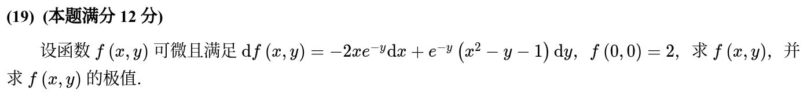
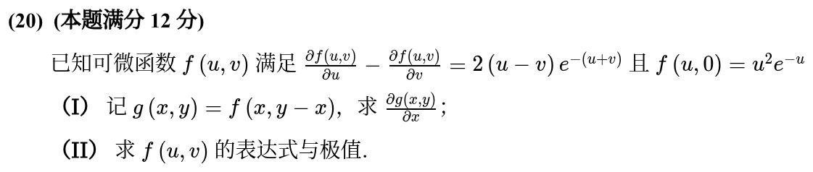
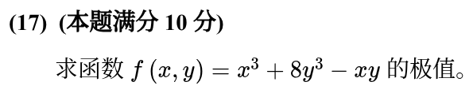
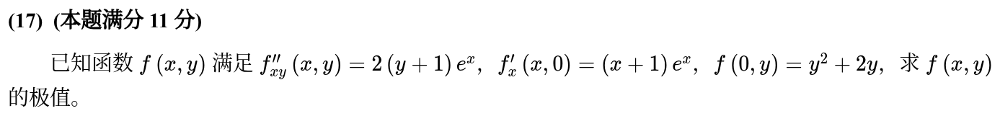
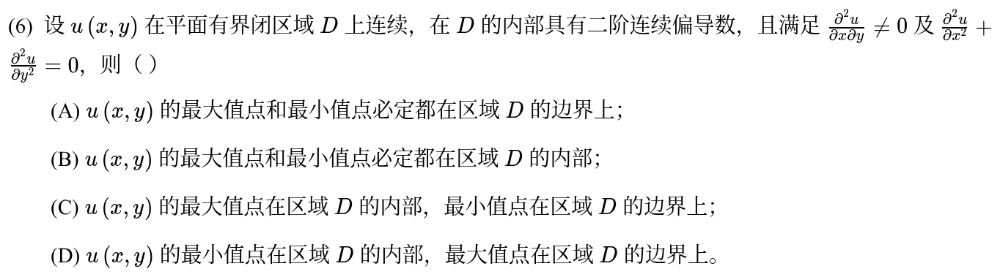
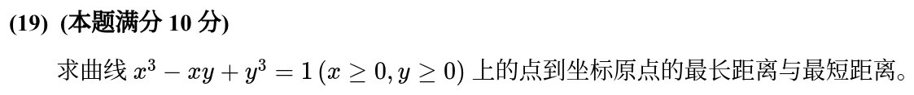
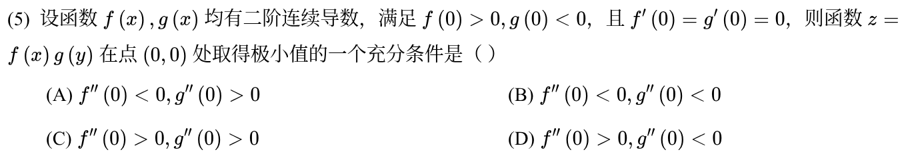

[« 多元复合函数与隐函数求导](17-chain-implicit.md)　　[二重积分 »](19-double-integrals.md)

# 高等数学 · 多元函数极值与最值

> **本章共 13 题**
> 
> - **核心必做（建议按顺序攻克关键方法）**：  
>   [第 06 题](#q06)（驻点与二阶判别） → [第 01 题](#q01)（区分极值与鞍点） → [第 02 题](#q02)（先还原函数再求极值） → [第 07 题](#q07)（带约束的实际最值）
> 
> - **分流与刷题建议**：  
>   - **较难挑战**：[第 08 题](#q08)（隐函数极值）、[第 05 题](#q05)（变量替换接求函数与极值）  
>   - **重在看思路**：[第 11 题](#q11)（隐式约束下距离先改求平方）  
> 
> - **过关目标**：驻点不等于极值；有约束先查范围与边界，不能只解偏导为零。

---

### 01 · 2026年

> *二元极值大题。求一阶偏导令其为 0 解驻点，别漏掉退化点；对每个驻点求二阶偏导算 $AC-B^2$，正负性判断要仔细。*

答案与解析

**触发条件与第一步**

多项式乘以 $e^x$ 的经典结构。求偏导时始终把公因子 $e^x$ 提在外面——因为 $e^x > 0$ 恒成立，解驻点时直接约掉 $e^x$，并且求二阶偏导时也只需套“$(P e^x)' = (P + P')e^x$”口诀，极不易算错。

**完整推演**

1. **求一阶偏导并找驻点**：
   $$\begin{cases} f_x(x,y) = (2x^2 + 4x - y^2)e^x = 0, \\ f_y(x,y) = -2y e^x = 0. \end{cases}$$
   因为 $e^x > 0$ 恒成立，由第二式立刻得 $y = 0$。代入第一式得
   $$2x^2 + 4x = 2x(x+2) = 0 \implies x = 0 \text{ 或 } x = -2.$$
   故共有两个驻点：$P_1(0, 0)$ 与 $P_2(-2, 0)$。
2. **求二阶偏导数**（利用 $(Pe^x)' = (P+P')e^x$）：
   $$f_{xx} = (2x^2 + 8x + 4 - y^2)e^x, \qquad f_{xy} = -2y e^x, \qquad f_{yy} = -2e^x.$$
3. **逐点判别**：
   - 在 $P_1(0,0)$ 处：$A = 4,\; B = 0,\; C = -2$，
     $$AC - B^2 = 4\cdot(-2) - 0 = -8 < 0,$$
     故 $(0,0)$ **不是极值点**。
   - 在 $P_2(-2,0)$ 处：$A = (8 - 16 + 4)e^{-2} = -4e^{-2},\; B = 0,\; C = -2e^{-2}$，
     $$AC - B^2 = (-4e^{-2})(-2e^{-2}) - 0 = 8e^{-4} > 0, \quad \text{且 } A = -4e^{-2} < 0,$$
     故 $(-2, 0)$ 是**极大值点**。
4. **计算极大值**：
   $$f(-2, 0) = \big(2(-2)^2 - 0^2\big)e^{-2} = 8e^{-2}.$$

结论：函数在点 $(-2, 0)$ 处取得极大值 $8e^{-2}$，无极小值。

---

### 02 · 2025年

> *全微分求原函数加极值。全微分条件 $\mathrm{d}f = P\mathrm{d}x + Q\mathrm{d}y$ 积分定出 $f(x,y)$，再按二元极值二阶充分条件检验驻点。*

答案与解析

- **第一步还原 $f(x,y)$**（偏积分法）：
  由 $f_x = -2x e^{-y}$ 对 $x$ 积分得 $f(x,y) = -x^2 e^{-y} + \varphi(y)$。
  再对 $y$ 求偏导与已知 $f_y$ 对照：
  $$x^2 e^{-y} + \varphi'(y) = e^{-y}(x^2 - y - 1) \implies \varphi'(y) = -(y+1)e^{-y}.$$
  分部积分得 $\varphi(y) = (y+2)e^{-y} + C$。由 $f(0,0)=2$ 得 $2 + C = 2 \implies C = 0$，故
  $$f(x,y) = (y + 2 - x^2)e^{-y}.$$
- **第二步求极值**（直接利用题干给定的 $f_x, f_y$ 找驻点）：
  - $f_x = -2x e^{-y} = 0 \implies x = 0$；
  - $f_y = (x^2 - y - 1)e^{-y} = 0 \implies y = -1$。唯一驻点 $(0, -1)$。
  - 二阶偏导：$f_{xx} = -2e^{-y}$，$f_{xy} = 2x e^{-y}$，$f_{yy} = (y - x^2)e^{-y}$。
  - 在 $(0,-1)$ 处：$A = -2e < 0,\; B = 0,\; C = -e < 0$，$AC - B^2 = 2e^2 > 0$，故 $(0,-1)$ 为**极大值点**，极大值 $f(0,-1) = e$。
- **答案**：$f(x,y) = (y + 2 - x^2)e^{-y}$；在 $(0,-1)$ 处取得极大值 $e$，无极小值。

---

### 03 · 2024年

答案与解析

**答案 $(1,1)$，为极大值点。** $f_x=6(x-1)(x-2)$，$f_y=24(1-y^3)$，驻点为 $(1,1),(2,1)$。交叉项为零，$f_{yy}=-72$，$f_{xx}$ 在这两点分别为 $-6,6$。前者 Hessian 负定，后者不定、为鞍点。

---

### 04 · 2023年

答案与解析

**解。** 驻点满足 $x=-e^{\cos y}$，再由 $f_y=-xe^{\cos y}\sin y=0$ 得 $y=k\pi$。配方
$$
f=\tfrac12(x+e^{\cos y})^2-\tfrac12e^{2\cos y}.
$$
在 $y=2k\pi,\ x=-e$ 取全局极小值 $-e^2/2$。在奇数倍 $\pi$ 对应的驻点，固定 $y$ 改 $x$ 会增大函数值，而沿 $x=-e^{\cos y}$ 扰动 $y$ 会减小函数值，故为鞍点。不存在极大值。

---

### 05 · 2022年

> *变量代换与极值综合大题。第一问链式法则求复合偏导；第二问积分恢复出 $f(u,v)$ 的具体表达式，求驻点并算 Hessian 判别式。*

答案与解析

**解。** （I）链式法则给 $g_x=f_u-f_v=2(2x-y)e^{-y}$。

（II）对 $x$ 积分并代入 $g(y,y)=f(y,0)=y^2e^{-y}$，得 $g(x,y)=(2x^2-2xy+y^2)e^{-y}$，还原为 $f(u,v)=(u^2+v^2)e^{-(u+v)}$。两偏导为零要求 $2u=2v=u^2+v^2$，驻点只有 $(0,0),(1,1)$。原点取全局极小值 0。沿 $u=v$，$(1,1)$ 附近函数值变小；沿 $u+v=2$ 函数值变大，故该点为鞍点，无极大值。

---

### 06 · 2020年

答案与解析

**触发条件与第一步**

多项式函数在 $\mathbb{R}^2$ 上处处具有任意阶连续偏导数，无边界约束。第一笔直接算 $f_x, f_y$ 并令其为 $0$，利用一次项直接消元解出全部驻点。

**完整推演**

1. **求驻点**：
   $$\begin{cases} f_x(x,y) = 3x^2 - y = 0, \\ f_y(x,y) = 24y^2 - x = 0. \end{cases}$$
   由第一式得 $y = 3x^2$，代入第二式：
   $$24(3x^2)^2 - x = 216x^4 - x = x(216x^3 - 1) = 0.$$
   因为 $216 = 6^3$，解得两个实根：
   - $x = 0 \implies y = 0$，得驻点 $P_1(0, 0)$；
   - $x = \frac{1}{6} \implies y = 3\cdot\frac{1}{36} = \frac{1}{12}$，得驻点 $P_2\left(\frac{1}{6}, \frac{1}{12}\right)$。
2. **求二阶偏导数**：
   $$A = f_{xx} = 6x, \qquad B = f_{xy} = -1, \qquad C = f_{yy} = 48y.$$
3. **逐点判别**：
   - 在 $P_1(0,0)$ 处：$A = 0,\; B = -1,\; C = 0$，
     $$AC - B^2 = 0 - (-1)^2 = -1 < 0,$$
     故 $(0,0)$ **不是极值点**。
   - 在 $P_2\left(\frac{1}{6}, \frac{1}{12}\right)$ 处：$A = 6\cdot\frac{1}{6} = 1,\; B = -1,\; C = 48\cdot\frac{1}{12} = 4$，
     $$AC - B^2 = 1\cdot 4 - (-1)^2 = 3 > 0, \quad \text{且 } A = 1 > 0,$$
     故 $\left(\frac{1}{6}, \frac{1}{12}\right)$ 是**极小值点**。
4. **计算极小值**：
   $$f\left(\frac{1}{6}, \frac{1}{12}\right) = \left(\frac{1}{6}\right)^3 + 8\left(\frac{1}{12}\right)^3 - \frac{1}{6}\cdot\frac{1}{12} = \frac{1}{216} + \frac{1}{216} - \frac{3}{216} = -\frac{1}{216}.$$

结论：函数在点 $\left(\frac{1}{6}, \frac{1}{12}\right)$ 处取得极小值 $-\frac{1}{216}$，无极大值。

---

### 07 · 2018年

> *周长受限的几何面积最值。三个图形边长设为变量，周长和为定值，列出面积目标函数。既可用拉格朗日乘数法，也可用柯西不等式秒杀。*

答案与解析

**存在最小值 $\frac4{4\pi+16+12\sqrt3}$。** 设三段长度为 $p,q,r$，对应面积和为 $p^2/(4\pi)+q^2/16+r^2/(12\sqrt3)$。由柯西不等式，乘以 $4\pi+16+12\sqrt3$ 后不小于 $(p+q+r)^2=4$。当三段长度比例为 $4\pi:16:12\sqrt3$ 时取等号，三段都严格为正。

---

### 08 · 2016年

答案与解析

**解。** 对每个 $(x,y)$，方程左侧关于 $z>0$ 严格递增并从 $-\infty$ 到 $+\infty$，因此有唯一可微解。把方程配方为
$$
z[(x+1/z)^2+(y+1/z)^2]+\ln z+2-2/z=0.
$$
后面的 $\ln z+2-2/z$ 严格递增且在 $z=1$ 为零，所以 $z\le1$，等号恰在 $x=y=-1$。任一驻点也必须有 $x=y=-1/z$（隐式求偏导），故这是唯一极值点，极大值为 1。

---

### 09 · 2015年

答案与解析

**解。** 先沿 $y$ 积分并用 $f_x(x,0)$，得 $f_x=e^x[x+(y+1)^2]$。再沿 $x$ 积分并用 $f(0,y)$，得 $f=e^x[x+(y+1)^2-1]$。

$f_y=2(y+1)e^x$，唯一驻点为 $(0,-1)$。固定 $x$，在 $y=-1$ 取最小；再看 $e^x(x-1)$ 的导数 $xe^x$，在 0 变号，故全局最小值为 $-1$，无极大值。

---

### 10 · 2014年

答案与解析

**答案 A。** 内点极值必须是驻点，但 Hessian 行列式为 $u_{xx}u_{yy}-u_{xy}^2=-u_{xx}^2-u_{xy}^2<0$，所以每个内点驻点都是鞍点。函数在有界闭区域上连续，最大、最小值都能取到，因此只能在边界。

---

### 11 · 2013年

> *隐式曲线到原点距离极值。目标函数设为距离平方 $x^2+y^2$，约束条件是隐式方程，拉格朗日乘数法对称性极强，注意端点非负限制。*

答案与解析

**解。** 极值等价于求 $x^2+y^2$ 的极值。约束在第一象限闭且有界，因为 $x^3+y^3\ge(x+y)^3/4$、$xy\le(x+y)^2/4$。坐标轴交点 $(1,0),(0,1)$ 给距离 1。正象限内的拉格朗日条件给 $xF_y-yF_x=(y-x)(x+y+3xy)=0$，其中 $F=x^3-xy+y^3$，且 $\nabla F$ 在约束上不为零。故 $x=y$，代回得唯一正解 $x=y=1$，距离 $\sqrt2$。比较后，最短距离为 1，最长距离为 $\sqrt2$。

---

### 12 · 2012年

答案与解析

**解。** $f_x=(1-x^2)e^{-(x^2+y^2)/2}$、$f_y=-xye^{-(x^2+y^2)/2}$，唯一两个驻点是 $(\pm1,0)$。对任意 $x,y$，$|f(x,y)|\le |x|e^{-x^2/2}\le e^{-1/2}$，后一不等式由对 $|x|\ge0$ 求导得到。故 $(1,0)$ 取全局极大值 $e^{-1/2}$，$(-1,0)$ 取全局极小值 $-e^{-1/2}$。

---

### 13 · 2011年

答案与解析

**答案 A。** 驻点处混合二阶导为 $f'(0)g'(0)=0$。两个对角元为 $f''(0)g(0),f(0)g''(0)$。使两者都严格为正便保证严格极小，结合 $g(0)<0<f(0)$ 得所选符号。

---

[« 多元复合函数与隐函数求导](17-chain-implicit.md)　　[二重积分 »](19-double-integrals.md)
