[« 多元函数极值与最值](18-multivariable-extrema.md)

# 高等数学 · 二重积分

> **本章共 29 题**
> 
> - **核心必做（建议按顺序攻克关键方法）**：  
>   [第 24 题](#q24)（画区域并定上下限） → [第 05 题](#q05)（交换积分次序） → [第 17 题](#q17)（换序后才能顺利积分） → [第 15 题](#q15)（对称性消去奇函数项） → [第 02 题](#q02)（极坐标完整计算） → [第 22 题](#q22)（交换变量的对称性）
> 
> - **分流与刷题建议**：  
>   - **较难挑战**：[第 04 题](#q04)（交圆区域分段）、[第 06 题](#q06)（双曲线边界的换元）  
>   - **重在看思路**：[第 01 题](#q01)（双重求和中的取点与区域）  
>   - **首轮可跳过**：[第 07 题](#q07)、[第 09 题](#q09)、[第 16 题](#q16)、[第 28 题](#q28)、[第 29 题](#q29)（技巧较偏或综合度高，首轮不必死磕）  
>   - **题面存疑暂缓**：[第 03 题](#q03)（内层上下限与选项不一致，待核）（原卷转写存疑，首轮暂不安排）  
> 
> - **过关目标**：先画域再写限；极坐标别漏半径因子，对称性必须连积分域一起核对。

---

### 01 · 2026年

> *轮换对称性选择题。区域 $D$ 关于 $y=x$ 对称且 $f(x,y)=f(y,x)$，直接用轮换对称性将积分拆半，结合积分定义秒定选项。*

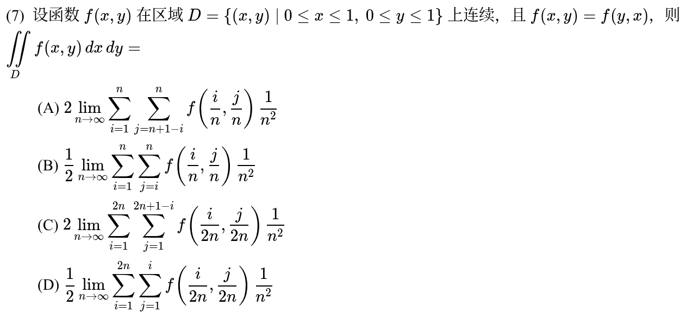

答案与解析

**答案 D。** 交换 $x,y$ 把对角线两侧互换，故正方形的积分是三角形 $0\le y\le x\le1$ 上积分的两倍。该三角形用 $2n$ 等分时，面积元为 $1/(4n^2)$，取 $1\le j\le i\le 2n$，乘 2 后就是 D。A 使用另一条对角线，题设并未给相应的对称性。

---

### 02 · 2026年

> *二重积分计算大题。区域含 $|x|$ 且被积函数含 $\sqrt{x^2+y^2}$，画出图形明显是环形扇区，果断换极坐标，角度和半径范围切忌写错。*

答案与解析

**触发条件与第一步**

积分上限是 $\sqrt{2 - x^2}$（圆 $x^2+y^2=2$ 的上半圆），下限是 $|x|$（射线 $\theta = \frac{\pi}{4}$ 与 $\theta = \frac{3\pi}{4}$），被积函数又含 $\sin\sqrt{x^2+y^2}$——**区域与被积函数双重指向极坐标**！第一笔画出扇形草图，确认交点 $(-1,1)$ 与 $(1,1)$ 恰好落在圆 $x^2+y^2=2$ 上，从而整个区域就是一个完整扇形。

**完整推演**

1. **画出积分区域 $D$ 并转极坐标**：
   原区域为 $D = \{(x,y) \mid -1 \le x \le 1,\; |x| \le y \le \sqrt{2-x^2}\}$。
   联立 $y = |x|$ 与 $x^2+y^2 = 2$ 得交点 $(1,1)$ 与 $(-1,1)$，正好对应 $x = \pm 1$。
   因此 $D$ 是圆心在原点、半径为 $\sqrt{2}$、极角从 $\frac{\pi}{4}$ 到 $\frac{3\pi}{4}$ 的扇形：
   $$D = \left\{(r,\theta) \;\middle|\; \frac{\pi}{4} \le \theta \le \frac{3\pi}{4},\; 0 \le r \le \sqrt{2}\right\}.$$
2. **极坐标下分离变量**（注意 $y = r\sin\theta$，且 $\mathrm{d}x\mathrm{d}y = r\,\mathrm{d}r\mathrm{d}\theta$，合并得 $r^2$）：
   $$I = \int_{\frac{\pi}{4}}^{\frac{3\pi}{4}} \mathrm{d}\theta \int_0^{\sqrt{2}} (r\sin\theta)\sin r \cdot r\,\mathrm{d}r = \left(\int_{\frac{\pi}{4}}^{\frac{3\pi}{4}} \sin\theta\,\mathrm{d}\theta\right)\left(\int_0^{\sqrt{2}} r^2\sin r\,\mathrm{d}r\right).$$
3. **分别计算两个定积分**：
   - 极角部分：
     $$\int_{\frac{\pi}{4}}^{\frac{3\pi}{4}} \sin\theta\,\mathrm{d}\theta = \Big[-\cos\theta\Big]_{\frac{\pi}{4}}^{\frac{3\pi}{4}} = \frac{\sqrt{2}}{2} - \left(-\frac{\sqrt{2}}{2}\right) = \sqrt{2}.$$
   - 极径部分（两次分部积分）：
     $$\begin{aligned}
     \int_0^{\sqrt{2}} r^2\sin r\,\mathrm{d}r &= \Big[-r^2\cos r\Big]_0^{\sqrt{2}} + 2\int_0^{\sqrt{2}} r\cos r\,\mathrm{d}r \\
     &= -2\cos\sqrt{2} + 2\Big[r\sin r + \cos r\Big]_0^{\sqrt{2}} \\
     &= -2\cos\sqrt{2} + 2\sqrt{2}\sin\sqrt{2} + 2\cos\sqrt{2} - 2 \\
     &= 2\sqrt{2}\sin\sqrt{2} - 2.
     \end{aligned}$$
     （注意 $-2\cos\sqrt{2}$ 与 $+2\cos\sqrt{2}$ 恰好完全抵消！）
4. **相乘得最终结果**：
   $$I = \sqrt{2}\big(2\sqrt{2}\sin\sqrt{2} - 2\big) = 4\sin\sqrt{2} - 2\sqrt{2}.$$

---

### 03 · 2025年

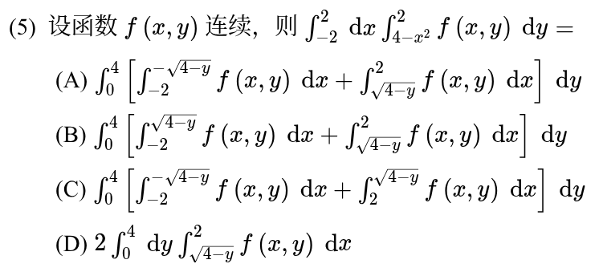

答案与解析

**题面待核。** 按当前图中上限 $2$，$4-x^2$ 与 $2$ 在 $x=\pm\sqrt2$ 相交，中央部分必须带负号。令 $L(y)=\int_{-2}^{-\sqrt{4-y}}f\,dx+\int_{\sqrt{4-y}}^2 f\,dx$，$M(y)=\int_{-\sqrt{4-y}}^{\sqrt{4-y}}f\,dx$，实际换序得 $\int_0^2L(y)\,dy-\int_2^4M(y)\,dy$。若独立原卷确认上限为 $4$，才得到 $\int_0^4L(y)\,dy$（A）。

---

### 04 · 2025年

> *双圆相交二重积分。被积函数含 $x,y$，区域关于 $y=x$ 对称，先用轮换对称性将被积函数化简，再换极坐标分段定限。*

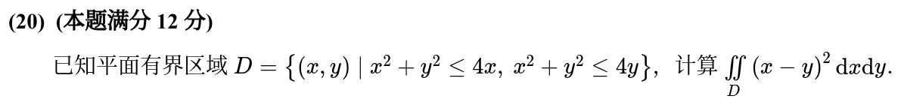

答案与解析

**答案 $12\pi-\tfrac{112}{3}$。** 区域在第一象限且关于 $y=x$ 对称。极坐标在 $0\le\theta\le\pi/4$ 有 $0\le r\le4\sin\theta$，积上另一半的两倍。由于 $(x-y)^2=r^2(1-\sin2\theta)$，积分为
$$
128\int_0^{\pi/4}\sin^4\theta(1-\sin2\theta)\,d\theta
=128\left(\frac{3\pi}{32}-\frac14-\frac1{24}\right).
$$
其中 $\sin^4\theta$ 用降幂，$\sin^4\theta\sin2\theta=2\sin^5\theta\cos\theta$ 直接凑微分。

---

### 05 · 2024年

答案与解析

**触发条件与第一步**

抽象连续函数 $f(x,y)$，选项全是先 $x$ 后 $y$ 的累次积分，属于纯换序题。第一笔先把原积分限翻译成区域不等式并标出端点：$\frac{\pi}{6} \le x \le \frac{\pi}{2}$，$\sin x \le y \le 1$。

**完整推演**

1. **画出区域 $D$ 并标关键点**：
   在 $\left[\frac{\pi}{6}, \frac{\pi}{2}\right]$ 上，$y = \sin x$ 严格单调递增，从左端点 $\left(\frac{\pi}{6}, \frac{1}{2}\right)$ 上升到右端点 $\left(\frac{\pi}{2}, 1\right)$。
   区域 $D$ 位于曲线 $y = \sin x$ 的**上方**、水平直线 $y = 1$ 的**下方**、竖直直线 $x = \frac{\pi}{6}$ 的**右侧**。
2. **确定外层 $y$ 的范围**：
   $D$ 的最低点纵坐标为 $\sin\frac{\pi}{6} = \frac{1}{2}$，最高点纵坐标为 $1$，故 $\frac{1}{2} \le y \le 1$。
3. **水平向右穿线确定内层 $x$ 的范围**：
   对任意固定的 $y \in \left[\frac{1}{2}, 1\right]$，水平线从左边界 $x = \frac{\pi}{6}$ 穿入，从右边界 $y = \sin x$（在 $\left[\frac{\pi}{6}, \frac{\pi}{2}\right] \subset \left[-\frac{\pi}{2}, \frac{\pi}{2}\right]$ 上反解为 $x = \arcsin y$）穿出，故 $\frac{\pi}{6} \le x \le \arcsin y$。
4. **写出换序结果**：
   $$\int_{\frac{1}{2}}^{1}\mathrm{d}y \int_{\frac{\pi}{6}}^{\arcsin y} f(x,y)\,\mathrm{d}x.$$

故正确选项为 **（A）**。

**选择题干扰项拆解**

- **（B）$\int_{1/2}^1 \mathrm{d}y \int_{\arcsin y}^{\pi/2} f(x,y)\,\mathrm{d}x$**：水平穿线左右边界写反，取成了曲线 $y=\sin x$ 右侧那块补集区域。
- **（C）$\int_0^{1/2}\mathrm{d}y \int_{\pi/6}^{\arcsin y} f(x,y)\,\mathrm{d}x$**：误把 $y$ 的下限当成 $0$，忘了左边界 $x=\frac{\pi}{6}$ 对应的最低点是 $y = \frac{1}{2}$。
- **（D）**：同时犯了 $y$ 范围错写为 $[0, \frac{1}{2}]$ 和 $x$ 穿线写反两个错误。

---

### 06 · 2024年

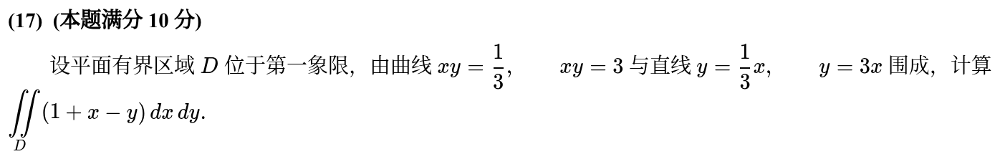

答案与解析

**答案 $\tfrac83\ln3$。** 区域在交换 $x,y$ 下不变，$x-y$ 部分积分为零。取 $u=xy$、$v=y/x$，第一象限中该映射一一对应，$|\partial(u,v)/\partial(x,y)|=2v$。新区域为 $[1/3,3]^2$，故面积为 $\int_{1/3}^3du\int_{1/3}^3(2v)^{-1}\,dv=\tfrac83\ln3$。

---

### 07 · 2023年

> *斜椭圆环状区域积分。曲线方程含 $x^2+y^2-xy$，换极坐标后把 $1 - \sin\theta\cos\theta$ 提到分母，先积 $r$ 再积 $\theta$ 会非常丝滑。*

答案与解析

**答案 $\dfrac{\pi\ln 2}{8\sqrt3}$。** 取极坐标。对固定 $\theta\in[0,\pi/3]$，令 $p=1-\sin\theta\cos\theta$，径向范围是 $1/\sqrt p\le r\le\sqrt{2/p}$，积分 $dr/r$ 恒为 $\ln2/2$。角向积分令 $t=\tan\theta$，得 $\int_0^{\sqrt3}dt/(3+t^2)=\pi/(4\sqrt3)$。

---

### 08 · 2022年

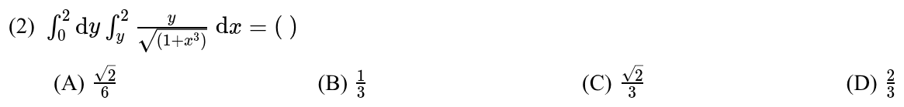

答案与解析

**答案 D，$2/3$。** 区域 $0\le y\le x\le2$，先对 $y$ 积分得到 $\frac12\int_0^2 x^2/\sqrt{1+x^3}\,dx$。令 $u=1+x^3$，结果为 $(\sqrt9-\sqrt1)/3=2/3$。

---

### 09 · 2022年

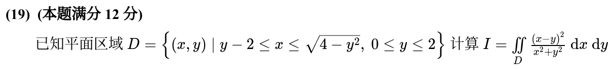

答案与解析

- **第一步拆被积函数 + 拆区域**：
  把被积函数化为 $\frac{(x-y)^2}{x^2+y^2} = 1 - \frac{2xy}{x^2+y^2}$。
  区域 $D$ 由 $x=0$ 拆成两块：
  - $D_1$（第一象限四分之一圆）：$0 \le \theta \le \frac{\pi}{2},\; 0 \le r \le 2$，面积为 $\pi$；
  - $D_2$（第二象限等腰直角三角形，边界 $y-x=2$）：$\frac{\pi}{2} \le \theta \le \pi,\; 0 \le r \le \frac{2}{\sin\theta-\cos\theta}$，面积为 $2$。
  故常数项积分 $\iint_D 1\,\mathrm{d}x\mathrm{d}y = \pi + 2$。
- **第二步在极坐标下算 $J = \iint_D \frac{2xy}{x^2+y^2}\,\mathrm{d}x\mathrm{d}y = J_1 + J_2$**（注意 $\frac{2xy}{x^2+y^2} = \sin 2\theta$）：
  - $J_1 = \int_0^{\frac{\pi}{2}}\sin 2\theta\,\mathrm{d}\theta \int_0^2 r\,\mathrm{d}r = 1 \cdot 2 = 2$；
  - $J_2 = \int_{\frac{\pi}{2}}^{\pi} \sin 2\theta\,\mathrm{d}\theta \int_0^{\frac{2}{\sin\theta-\cos\theta}} r\,\mathrm{d}r = \int_{\frac{\pi}{2}}^{\pi} \frac{2\sin 2\theta}{1 - \sin 2\theta}\,\mathrm{d}\theta$。
    令 $t = \theta - \frac{\pi}{2} \in \left[0, \frac{\pi}{2}\right]$（则 $\sin 2\theta = -\sin 2t$）：
    $$J_2 = \int_0^{\frac{\pi}{2}} \frac{-2\sin 2t}{1 + \sin 2t}\,\mathrm{d}t = \int_0^{\frac{\pi}{2}}\left(-2 + \frac{2}{1+\sin 2t}\right)\mathrm{d}t = -\pi + 2.$$
    （其中 $\int_0^{\frac{\pi}{2}}\frac{2}{1+\sin 2t}\,\mathrm{d}t \xlongequal{u=2t} \int_0^\pi \frac{\mathrm{d}u}{1+\sin u} = 2\int_0^{\frac{\pi}{2}}\frac{\mathrm{d}w}{1+\cos w} = 2\big[\tan\frac{w}{2}\big]_0^{\frac{\pi}{2}} = 2$。）
- **第三步合并**：$I = (\pi + 2) - (J_1 + J_2) = (\pi + 2) - (4 - \pi) = 2\pi - 2$。
- **答案**：$2\pi - 2$。

---

### 10 · 2021年

> *双纽线区域二重积分。方程 $\left(x^2+y^2\right)^2 = x^2-y^2$ 是标准双纽线，直接换极坐标 $r^2 = \cos 2\theta$，半径积分一眼出结果。*

答案与解析

**答案 $\tfrac1{48}$。** 第一象限内 $r^2=\cos2\theta$，故 $0\le\theta\le\pi/4,\ 0\le r\le\sqrt{\cos2\theta}$。被积式连面积元是 $r^3\sin\theta\cos\theta\,dr\,d\theta$。积去 $r$ 后令 $u=\cos2\theta$，即 $\frac1{16}\int_0^1u^2du=1/48$。

---

### 11 · 2020年

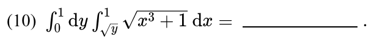

答案与解析

**答案 $\tfrac29(2\sqrt2-1)$。** 区域为 $0\le x\le1,\ 0\le y\le x^2$。换序得 $\int_0^1x^2\sqrt{1+x^3}\,dx$，换元 $u=1+x^3$ 积分。

---

### 12 · 2020年

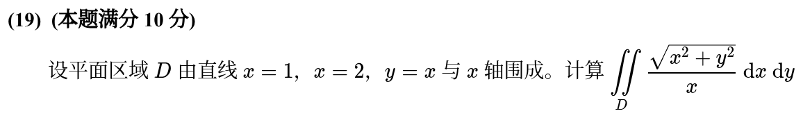

答案与解析

**答案 $\tfrac34[\sqrt2+\ln(1+\sqrt2)]$。** 写成 $\int_1^2dx\int_0^x\sqrt{1+(y/x)^2}\,dy$。内层令 $t=y/x$，得到 $(\int_1^2 x\,dx)(\int_0^1\sqrt{1+t^2}\,dt)$。两个因子分别为 $3/2$ 和 $[\sqrt2+\ln(1+\sqrt2)]/2$。

---

### 13 · 2019年

答案与解析

**答案 A。** 记 $r=\sqrt{x^2+y^2}\le|x|+|y|\le\pi/2$。在 $0<r<\pi/2$ 内，$1-\cos r<\sin r<r$，其中左半由 $\sin r+\cos r>1$ 得到。对同一区域积分，严格不等式保留。

---

### 14 · 2019年

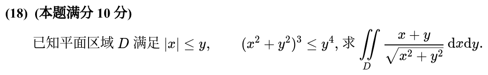

答案与解析

**答案 $43\sqrt2/120$。** 极坐标下 $\pi/4\le\theta\le3\pi/4$，且 $0\le r\le\sin^2\theta$。被积函数的 $\cos\theta$ 项因关于 $y$ 轴反对称而积分为零。余下为 $\frac12\int_{\pi/4}^{3\pi/4}\sin^5\theta\,d\theta$。令 $u=\cos\theta$，得到 $\int_0^{1/\sqrt2}(1-u^2)^2du$，代入结果。

---

### 15 · 2018年

答案与解析

**触发条件与第一步**

两个积分的被积函数完全相同（都是 $1 - xy$），区间分别是 $[-1, 0]$ 与 $[0, 1]$，上边界都是 $2-x^2$，下边界分别是 $-x$ 与 $x$（合起来就是 $|x|$）。第一笔立刻**合并为一个二重积分**，利用区域关于 $y$ 轴对称把 $-xy$ 直接划掉！

**完整推演**

1. **合并积分区域**：
   两块区域拼接成完整区域
   $$D = \{(x,y) \mid -1 \le x \le 1,\; |x| \le y \le 2 - x^2\}.$$
   显然 $D$ **关于 $y$ 轴对称**。
2. **利用奇偶对称性化简**：
   - $-xy$ 关于 $x$ 是**奇函数** $\implies \iint_D (-xy)\,\mathrm{d}x\mathrm{d}y = 0$；
   - $1$ 关于 $x$ 是**偶函数** $\implies$ 只需算右半区域 $D_1 = \{(x,y) \mid 0 \le x \le 1,\; x \le y \le 2-x^2\}$ 的面积再乘以 $2$：
   $$\begin{aligned}
   \iint_D (1 - xy)\,\mathrm{d}x\mathrm{d}y &= \iint_D 1\,\mathrm{d}x\mathrm{d}y = 2\int_0^1 (2 - x^2 - x)\,\mathrm{d}x \\
   &= 2\left[2x - \frac{x^3}{3} - \frac{x^2}{2}\right]_0^1 = 2\left(2 - \frac{1}{3} - \frac{1}{2}\right) = 2\cdot\frac{7}{6} = \frac{7}{3}.
   \end{aligned}$$

故正确选项为 **（C）**。

**选择题干扰项拆解**

- **（D）$\frac{7}{6}$（最高频错选）**：用对称性只算了右半区域 $[0,1]$ 的积分，**最后忘了乘以 $2$**。
- **（A）$\frac{5}{3}$ / （B）$\frac{5}{6}$**：计算定积分时把 $2 - \frac{1}{3} - \frac{1}{2}$ 算错（例如漏算 $2$ 或把下限 $x$ 的符号弄反）。

---

### 16 · 2018年

答案与解析

**答案 $3\pi^2+5\pi$。** 区域关于 $x=\pi$ 对称，所以 $\iint_D x\,dA=\pi\int_0^{2\pi}y(t)x'(t)dt=3\pi^2$。剩下 $\iint_D2y\,dA=\int_0^{2\pi}y(t)^2x'(t)dt=\int_0^{2\pi}(1-\cos t)^3dt=5\pi$。这里 $x'=y=1-\cos t$。

---

### 17 · 2017年

答案与解析

**触发条件与第一步**

内层积分 $\int_y^1 \frac{\tan x}{x}\,\mathrm{d}x$ **没有初等原函数**——这是最经典的“强迫换序”信号。第一笔立刻把积分区域写成不等式并交换次序为“先 $y$ 后 $x$”，让内层积分乘出一个 $x$ 把分母约掉！

**完整推演**

1. **翻译并改写积分区域**：
   原区域为 $0 \le y \le 1,\; y \le x \le 1$（顶点为 $(0,0), (1,0), (1,1)$ 的直角三角形）。
   换成先 $y$ 后 $x$：$0 \le x \le 1,\; 0 \le y \le x$。
2. **换序计算**：
   $$\begin{aligned}
   \int_0^1 \mathrm{d}y \int_y^1 \frac{\tan x}{x}\,\mathrm{d}x &= \int_0^1 \mathrm{d}x \int_0^x \frac{\tan x}{x}\,\mathrm{d}y \\
   &= \int_0^1 \frac{\tan x}{x} \cdot x\,\mathrm{d}x = \int_0^1 \tan x\,\mathrm{d}x \\
   &= \Big[-\ln|\cos x|\Big]_0^1 = -\ln(\cos 1).
   \end{aligned}$$
   （因为 $0 < 1 < \frac{\pi}{2}$，$\cos 1 > 0$，绝对值可直接去掉；写成 $\ln(\sec 1)$ 亦等价。）

故应填 **$-\ln(\cos 1)$**。

---

### 18 · 2017年

答案与解析

**答案 $5\pi/4$。** 区域为以 $(0,1)$ 为圆心、半径 1 的圆盘。$2x$ 因关于 $y$ 轴反对称而消失，常数积分为 $\pi$。圆心平移后 $x=r\cos\theta$，故 $x^2$ 的积分为 $\int_0^1r^3dr\int_0^{2\pi}\cos^2\theta d\theta=\pi/4$。

---

### 19 · 2016年

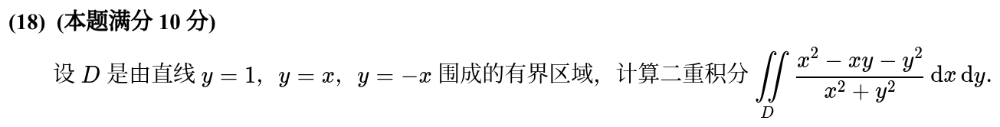

答案与解析

**答案 $1-\pi/2$。** 区域关于 $y$ 轴对称，$-xy$ 项积分为零。极坐标下 $\pi/4\le\theta\le3\pi/4$、$0\le r\le1/\sin\theta$，剩余积分为 $\frac12\int_{\pi/4}^{3\pi/4}(\cot^2\theta-1)d\theta$。用 $\cot^2\theta-1=\csc^2\theta-2$ 积分即可。

---

### 20 · 2015年

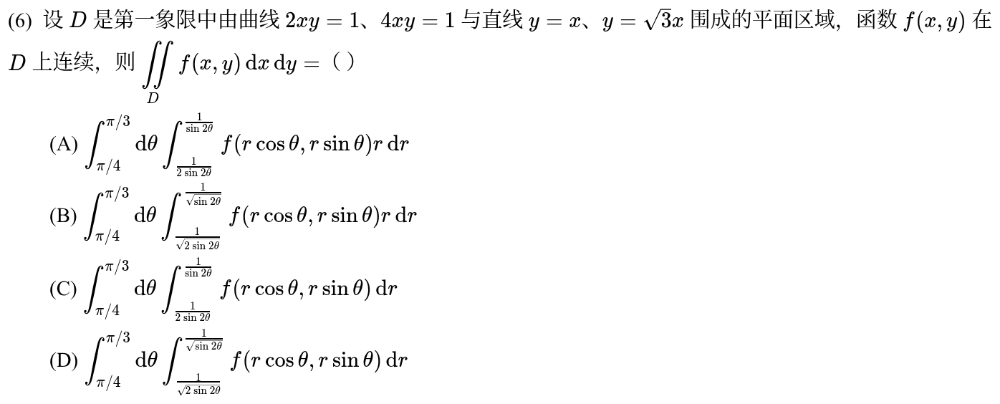

答案与解析

**答案 B。** 极坐标下 $2xy=r^2\sin2\theta$，所以角在 $\pi/4$ 到 $\pi/3$，半径从 $1/\sqrt{2\sin2\theta}$ 到 $1/\sqrt{\sin2\theta}$。面积元还要乘 $r$。

---

### 21 · 2015年

答案与解析

**答案 $\pi/4-2/5$。** 关于 $y$ 轴对称，积分中的 $xy$ 消掉。交点横坐标是 $\pm1$，故剩余为 $2\int_0^1x^2[\sqrt{2-x^2}-x^2]dx$。第一项用 $x=\sqrt2\sin t$，化为 $2\int_0^{\pi/4}\sin^2(2t)dt=\pi/4$，第二项为 $2/5$。

---

### 22 · 2014年

答案与解析

- **第一步用轮换对称性消分母 $x+y$**：
  区域 $D$ 是第一象限的圆环（$1 \le r \le 2,\; 0 \le \theta \le \frac{\pi}{2}$），关于直线 $y = x$ 对称。
  交换 $x, y$ 得 $I = \iint_D \frac{y\sin(\pi\sqrt{x^2+y^2})}{x+y}\,\mathrm{d}x\mathrm{d}y$，两式相加得
  $$2I = \iint_D \sin\left(\pi\sqrt{x^2+y^2}\right)\mathrm{d}x\mathrm{d}y.$$
- **第二步切极坐标 + 分部积分**：
  $$I = \frac{1}{2}\int_0^{\frac{\pi}{2}}\mathrm{d}\theta \int_1^2 r\sin(\pi r)\,\mathrm{d}r = \frac{\pi}{4}\left[-\frac{r\cos(\pi r)}{\pi} + \frac{\sin(\pi r)}{\pi^2}\right]_1^2 = \frac{\pi}{4}\left(-\frac{2}{\pi} - \frac{1}{\pi}\right) = -\frac{3}{4}.$$
- **答案**：$-\dfrac{3}{4}$。

---

### 23 · 2013年

答案与解析

**答案 B。** 第二象限 $x<0<y$，所以 $y-x>0$，积分为正。第四象限反号，第一和第三象限关于 $x=y$ 对称，因交换坐标后被积函数变号，积分为 0。

---

### 24 · 2013年

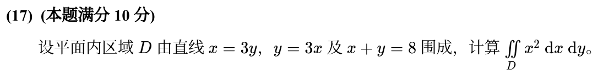

答案与解析

**触发条件与第一步**

三条直线围成三角形，被积函数是纯 $x^2$。第一笔**两两联立求三个顶点**，并选择“先 $y$ 后 $x$”——这样内层对 $y$ 积分直接把 $x^2$ 提出来，完全避免 $\left[(8-y)^3 - (y/3)^3\right]$ 的繁琐展开。

**完整推演**

1. **求三角形区域 $D$ 的三个顶点**：
   - $x = 3y$ 与 $y = 3x$ 交于 $O(0, 0)$；
   - $y = 3x$ 与 $x + y = 8$ 交于 $A(2, 6)$；
   - $x = 3y$ 与 $x + y = 8$ 交于 $B(6, 2)$。
2. **按 $X$-型切分区域**（以顶点 $A$ 的横坐标 $x=2$ 为分界）：
   - $D_1$：$0 \le x \le 2$，$\frac{x}{3} \le y \le 3x$；
   - $D_2$：$2 \le x \le 6$，$\frac{x}{3} \le y \le 8 - x$。
3. **分块计算**：
   $$\begin{aligned}
   \iint_D x^2\,\mathrm{d}x\mathrm{d}y &= \int_0^2 x^2\,\mathrm{d}x \int_{\frac{x}{3}}^{3x} \mathrm{d}y + \int_2^6 x^2\,\mathrm{d}x \int_{\frac{x}{3}}^{8-x} \mathrm{d}y \\
   &= \int_0^2 x^2\cdot\frac{8}{3}x\,\mathrm{d}x + \int_2^6 x^2\left(8 - \frac{4}{3}x\right)\mathrm{d}x \\
   &= \left[\frac{2}{3}x^4\right]_0^2 + \left[\frac{8}{3}x^3 - \frac{1}{3}x^4\right]_2^6 \\
   &= \frac{32}{3} + \frac{1}{3}\Big(8(216 - 8) - (1296 - 16)\Big) \\
   &= \frac{32}{3} + \frac{1664 - 1280}{3} = \frac{32}{3} + \frac{384}{3} = \frac{416}{3}.
   \end{aligned}$$

---

### 25 · 2012年

答案与解析

**答案 D，$-\pi$。** 先对 $y$ 积分，得 $x^5(1-\sin^2x)/2-(1-\sin x)$。在对称的 $x$ 区间上，$x^5\cos^2x$ 与 $\sin x$ 是奇函数，只有常数 $-1$ 的积分留下。

---

### 26 · 2012年

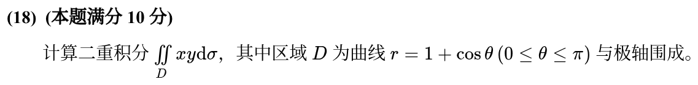

答案与解析

**答案 $16/15$。** 极坐标下面积元连 $xy$ 给 $r^3\cos\theta\sin\theta\,dr\,d\theta$。先对 $r$ 从 0 积到 $1+\cos\theta$，再用 $u=\cos\theta$，得 $\frac14\int_{-1}^1u(1+u)^4du=16/15$。积分区域只取极轴上方，且左右两侧的径向上界不同，不能直接消掉 $xy$。

---

### 27 · 2011年

答案与解析

**答案 $7/12$。** 在 $y$ 轴和 $y=x$ 间的右侧扇形，$\pi/4\le\theta\le\pi/2,\ 0\le r\le2\sin\theta$。先积分 $r^3\sin\theta\cos\theta$ 的径向部分，得 $4\int_{\pi/4}^{\pi/2}\sin^5\theta\cos\theta\,d\theta=7/12$。

---

### 28 · 2011年

答案与解析

**答案 $a$。** 先对 $x$ 分部积分，边界项因 $x=0$ 或 $f_y(1,y)=0$ 消失，得 $I=-\int_0^1\int_0^1y f_y(x,y)\,dx\,dy$。换序后对 $y$ 分部积分，边界项由 $f(x,1)=0$ 消失，得 $I=\iint_D f=a$。

---

### 29 · 2010年

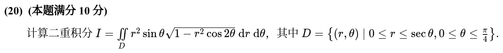

答案与解析

**答案 $1/3-\pi/16$。** 令 $x=r\cos\theta,y=r\sin\theta$，题给积分转成 $\int_0^1dx\int_0^x y\sqrt{1-x^2+y^2}\,dy$，其中一个 $r$ 已包含在面积元。内层积分得 $\frac13[1-(1-x^2)^{3/2}]$。再用 $x=\sin t$，$\int_0^1(1-x^2)^{3/2}dx=\int_0^{\pi/2}\cos^4t\,dt=3\pi/16$。

---

[« 多元函数极值与最值](18-multivariable-extrema.md)
