[« 多元函数极值与最值](18-multivariable-extrema.md)

# 高等数学 · 二重积分

> **本章共 29 题**
> 
> - **核心必做（建议按顺序攻克关键方法）**：  
>   [第 24 题](#q24)（画区域并定上下限） → [第 05 题](#q05)（交换积分次序） → [第 17 题](#q17)（换序后才能顺利积分） → [第 15 题](#q15)（对称性消去奇函数项） → [第 02 题](#q02)（极坐标完整计算） → [第 22 题](#q22)（交换变量的对称性）
> 
> - **分流与刷题建议**：  
>   - **较难挑战**：[第 04 题](#q04)（交圆区域分段）、[第 06 题](#q06)（双曲线边界的换元）  
>   - **重在看思路**：[第 01 题](#q01)（双重求和中的取点与区域）  
>   - **首轮可跳过**：[第 07 题](#q07)、[第 09 题](#q09)、[第 16 题](#q16)、[第 28 题](#q28)、[第 29 题](#q29)（技巧较偏或综合度高，首轮不必死磕）  
>   - **题面存疑暂缓**：[第 03 题](#q03)（内层上下限与选项不一致，待核）（原卷转写存疑，首轮暂不安排）  
> 
> - **过关目标**：先画域再写限；极坐标别漏半径因子，对称性必须连积分域一起核对。

---

### 01 · 2026年

> *轮换对称性选择题。区域 $D$ 关于 $y=x$ 对称且 $f(x,y)=f(y,x)$，直接用轮换对称性将积分拆半，结合积分定义秒定选项。*

答案与解析

**答案**：**（D）** $\dfrac{1}{2}\lim\limits_{n\to\infty}\sum\limits_{i=1}^{2n}\sum\limits_{j=1}^{i} f\!\left(\dfrac{i}{2n},\dfrac{j}{2n}\right)\dfrac{1}{n^2}$

- **切入点与推演**：利用轮换对称性 $f(x,y) = f(y,x)$ 将正方形 $D = [0,1]^2$ 沿主对角线 $y = x$ 对半切分，再用二重积分的黎曼和定义对照各选项的剖分步长与求和区域。
  1. 记下三角区域 $D_1 = \{(x,y)\mid 0 \le y \le x \le 1\}$，由 $f(x,y) = f(y,x)$ 得
     $$\iint_D f(x,y)\,\mathrm{d}x\mathrm{d}y = 2\iint_{D_1} f(x,y)\,\mathrm{d}x\mathrm{d}y.$$
  2. 将 $[0,1]^2$ 按横纵各 $2n$ 等分，每个小正方形的面积为 $\Delta\sigma = \dfrac{1}{2n}\cdot\dfrac{1}{2n} = \dfrac{1}{4n^2}$，取右上角样点 $\left(\dfrac{i}{2n},\dfrac{j}{2n}\right)$。落在 $D_1$（$y \le x$）内的指标满足 $1 \le j \le i \le 2n$，故
     $$\iint_{D_1} f(x,y)\,\mathrm{d}x\mathrm{d}y = \lim_{n\to\infty}\sum_{i=1}^{2n}\sum_{j=1}^{i} f\!\left(\frac{i}{2n},\frac{j}{2n}\right)\frac{1}{4n^2}.$$
  3. 两边同乘 $2$，因 $2\cdot\dfrac{1}{4n^2} = \dfrac{1}{2}\cdot\dfrac{1}{n^2}$，即得
     $$\iint_D f(x,y)\,\mathrm{d}x\mathrm{d}y = \frac{1}{2}\lim_{n\to\infty}\sum_{i=1}^{2n}\sum_{j=1}^{i} f\!\left(\frac{i}{2n},\frac{j}{2n}\right)\frac{1}{n^2},$$
     选 **（D）**。
- **干扰项 / 易错提示**：（A）（C）用的是副对角线 $x + y = 1$ 一侧的三角形，但题设只给了关于 $y = x$ 对称而非关于 $x+y=1$ 对称；（B）按 $n$ 等分时系数应为 $2$ 而非 $\frac{1}{2}$。

---

### 02 · 2026年

> *二重积分计算大题。区域含 $|x|$ 且被积函数含 $\sqrt{x^2+y^2}$，画出图形明显是环形扇区，果断换极坐标，角度和半径范围切忌写错。*

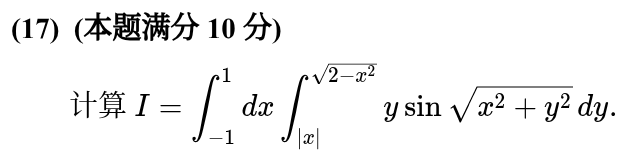

答案与解析

**触发条件与第一步**

积分上限是 $\sqrt{2 - x^2}$（圆 $x^2+y^2=2$ 的上半圆），下限是 $|x|$（射线 $\theta = \frac{\pi}{4}$ 与 $\theta = \frac{3\pi}{4}$），被积函数又含 $\sin\sqrt{x^2+y^2}$——**区域与被积函数双重指向极坐标**！第一笔画出扇形草图，确认交点 $(-1,1)$ 与 $(1,1)$ 恰好落在圆 $x^2+y^2=2$ 上，从而整个区域就是一个完整扇形。

**完整推演**

1. **画出积分区域 $D$ 并转极坐标**：
   原区域为 $D = \{(x,y) \mid -1 \le x \le 1,\; |x| \le y \le \sqrt{2-x^2}\}$。
   联立 $y = |x|$ 与 $x^2+y^2 = 2$ 得交点 $(1,1)$ 与 $(-1,1)$，正好对应 $x = \pm 1$。
   因此 $D$ 是圆心在原点、半径为 $\sqrt{2}$、极角从 $\frac{\pi}{4}$ 到 $\frac{3\pi}{4}$ 的扇形：
   $$D = \left\{(r,\theta) \;\middle|\; \frac{\pi}{4} \le \theta \le \frac{3\pi}{4},\; 0 \le r \le \sqrt{2}\right\}.$$
2. **极坐标下分离变量**（注意 $y = r\sin\theta$，且 $\mathrm{d}x\mathrm{d}y = r\,\mathrm{d}r\mathrm{d}\theta$，合并得 $r^2$）：
   $$I = \int_{\frac{\pi}{4}}^{\frac{3\pi}{4}} \mathrm{d}\theta \int_0^{\sqrt{2}} (r\sin\theta)\sin r \cdot r\,\mathrm{d}r = \left(\int_{\frac{\pi}{4}}^{\frac{3\pi}{4}} \sin\theta\,\mathrm{d}\theta\right)\left(\int_0^{\sqrt{2}} r^2\sin r\,\mathrm{d}r\right).$$
3. **分别计算两个定积分**：
   - 极角部分：
     $$\int_{\frac{\pi}{4}}^{\frac{3\pi}{4}} \sin\theta\,\mathrm{d}\theta = \Big[-\cos\theta\Big]_{\frac{\pi}{4}}^{\frac{3\pi}{4}} = \frac{\sqrt{2}}{2} - \left(-\frac{\sqrt{2}}{2}\right) = \sqrt{2}.$$
   - 极径部分（两次分部积分）：
     $$\begin{aligned}
     \int_0^{\sqrt{2}} r^2\sin r\,\mathrm{d}r &= \Big[-r^2\cos r\Big]_0^{\sqrt{2}} + 2\int_0^{\sqrt{2}} r\cos r\,\mathrm{d}r \\
     &= -2\cos\sqrt{2} + 2\Big[r\sin r + \cos r\Big]_0^{\sqrt{2}} \\
     &= -2\cos\sqrt{2} + 2\sqrt{2}\sin\sqrt{2} + 2\cos\sqrt{2} - 2 \\
     &= 2\sqrt{2}\sin\sqrt{2} - 2.
     \end{aligned}$$
     （注意 $-2\cos\sqrt{2}$ 与 $+2\cos\sqrt{2}$ 恰好完全抵消！）
4. **相乘得最终结果**：
   $$I = \sqrt{2}\big(2\sqrt{2}\sin\sqrt{2} - 2\big) = 4\sin\sqrt{2} - 2\sqrt{2}.$$

---

### 03 · 2025年

答案与解析

**题面待核**：按当前转写内层上限为 $2$，与四个选项均不一致；若按 2025 年原卷内层上限应为 $4$（即 $\int_{-2}^{2}\mathrm{d}x\int_{4-x^2}^{4} f(x,y)\,\mathrm{d}y$），则选 **（A）**。

- **按当前转写的推演（矛盾所在）**：
  抛物线 $y = 4 - x^2$ 在 $x\in[-2,2]$ 上的值域为 $[0,4]$，与水平线 $y = 2$ 交于 $x = \pm\sqrt{2}$。
  - 当 $\sqrt{2}\le |x|\le 2$ 时，$4 - x^2 \le 2$，积分区域在 $0 \le y \le 2$ 处取正号；
  - 当 $|x| < \sqrt{2}$ 时，$4 - x^2 > 2$，内层积分 $\int_{4-x^2}^{2} f\,\mathrm{d}y = -\int_{2}^{4-x^2} f\,\mathrm{d}y$ 在 $2 \le y \le 4$ 处取负号。

  记 $L(y) = \int_{-2}^{-\sqrt{4-y}} f\,\mathrm{d}x + \int_{\sqrt{4-y}}^{2} f\,\mathrm{d}x$，$M(y) = \int_{-\sqrt{4-y}}^{\sqrt{4-y}} f\,\mathrm{d}x$，则当前题面换序后应为 $\int_0^2 L(y)\,\mathrm{d}y - \int_2^4 M(y)\,\mathrm{d}y$，与（A）–（D）均不符。
- **按原卷意图（内层上限为 $4$）的推导**：
  若原积分为 $\int_{-2}^{2}\mathrm{d}x\int_{4-x^2}^{4} f(x,y)\,\mathrm{d}y$，则积分区域为 $D = \{(x,y)\mid -2\le x\le 2,\; 4-x^2\le y\le 4\}$（抛物线 $y=4-x^2$ 上方、直线 $y=4$ 下方、$x=\pm 2$ 之间）。
  对任意固定 $y\in[0,4]$，水平穿线被抛物线 $x = \pm\sqrt{4-y}$ 分为左右两段：$[-2, -\sqrt{4-y}]$ 与 $[\sqrt{4-y}, 2]$，故换序得
  $$\int_0^4 \left[\int_{-2}^{-\sqrt{4-y}} f(x,y)\,\mathrm{d}x + \int_{\sqrt{4-y}}^{2} f(x,y)\,\mathrm{d}x\right]\mathrm{d}y,$$
  对应 **（A）**。

---

### 04 · 2025年

> *双圆相交二重积分。被积函数含 $x,y$，区域关于 $y=x$ 对称，先用轮换对称性将被积函数化简，再换极坐标分段定限。*

答案与解析

**结论速览**：$12\pi - \dfrac{112}{3}$。

- **完整解答**：
  1. **利用对称性折半并转极坐标**：区域 $D = \{(x,y)\mid x^2+y^2\le 4x,\; x^2+y^2\le 4y\}$ 是两个圆盘 $(x-2)^2+y^2\le 4$ 与 $x^2+(y-2)^2\le 4$ 在第一象限的交集，显然关于直线 $y = x$ 对称，且被积函数 $(x-y)^2$ 也在交换 $x,y$ 下不变。
     故只需在下半部分 $D_1 = \{(r,\theta)\mid 0\le\theta\le\frac{\pi}{4},\; 0\le r\le 4\sin\theta\}$ 上积分再乘以 $2$（当 $0\le\theta\le\frac{\pi}{4}$ 时，$\sin\theta\le\cos\theta$，故 $r\le 4\sin\theta$ 为紧边界）。
  2. **化为极坐标累次积分**：$(x - y)^2 = r^2(\cos\theta - \sin\theta)^2 = r^2(1 - \sin 2\theta)$，故
     $$\begin{aligned}
     I &= 2\int_0^{\frac{\pi}{4}}(1 - \sin 2\theta)\,\mathrm{d}\theta \int_0^{4\sin\theta} r^3\,\mathrm{d}r \\
     &= 2\int_0^{\frac{\pi}{4}}(1 - \sin 2\theta)\cdot\frac{(4\sin\theta)^4}{4}\,\mathrm{d}\theta \\
     &= 128\int_0^{\frac{\pi}{4}}\sin^4\theta(1 - \sin 2\theta)\,\mathrm{d}\theta.
     \end{aligned}$$
  3. **分两项计算定积分**：
     - 第一项降幂：$\sin^4\theta = \left(\dfrac{1-\cos 2\theta}{2}\right)^2 = \dfrac{1}{4}\left(1 - 2\cos 2\theta + \dfrac{1+\cos 4\theta}{2}\right) = \dfrac{3}{8} - \dfrac{1}{2}\cos 2\theta + \dfrac{1}{8}\cos 4\theta$，故
       $$\int_0^{\frac{\pi}{4}}\sin^4\theta\,\mathrm{d}\theta = \left[\frac{3}{8}\theta - \frac{1}{4}\sin 2\theta + \frac{1}{32}\sin 4\theta\right]_0^{\frac{\pi}{4}} = \frac{3\pi}{32} - \frac{1}{4}.$$
     - 第二项凑微分：$\sin^4\theta\sin 2\theta = 2\sin^5\theta\cos\theta$，故
       $$\int_0^{\frac{\pi}{4}}2\sin^5\theta\cos\theta\,\mathrm{d}\theta = \left[\frac{1}{3}\sin^6\theta\right]_0^{\frac{\pi}{4}} = \frac{1}{3}\left(\frac{\sqrt{2}}{2}\right)^6 = \frac{1}{24}.$$
  4. **合并得最终结果**：
     $$I = 128\left(\frac{3\pi}{32} - \frac{1}{4} - \frac{1}{24}\right) = 128\left(\frac{3\pi}{32} - \frac{7}{24}\right) = 12\pi - \frac{112}{3}.$$
- **核心思路与避坑**：双圆交集在极坐标下必须按角平分线 $\theta = \frac{\pi}{4}$ 分段，切忌把 $r$ 的上限写成 $4\cos\theta$（在 $[0,\frac{\pi}{4}]$ 上 $4\sin\theta \le 4\cos\theta$，交集应取较小者）。

---

### 05 · 2024年

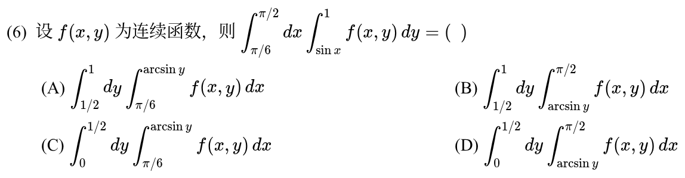

答案与解析

**触发条件与第一步**

抽象连续函数 $f(x,y)$，选项全是先 $x$ 后 $y$ 的累次积分，属于纯换序题。第一笔先把原积分限翻译成区域不等式并标出端点：$\frac{\pi}{6} \le x \le \frac{\pi}{2}$，$\sin x \le y \le 1$。

**完整推演**

1. **画出区域 $D$ 并标关键点**：
   在 $\left[\frac{\pi}{6}, \frac{\pi}{2}\right]$ 上，$y = \sin x$ 严格单调递增，从左端点 $\left(\frac{\pi}{6}, \frac{1}{2}\right)$ 上升到右端点 $\left(\frac{\pi}{2}, 1\right)$。
   区域 $D$ 位于曲线 $y = \sin x$ 的**上方**、水平直线 $y = 1$ 的**下方**、竖直直线 $x = \frac{\pi}{6}$ 的**右侧**。
2. **确定外层 $y$ 的范围**：
   $D$ 的最低点纵坐标为 $\sin\frac{\pi}{6} = \frac{1}{2}$，最高点纵坐标为 $1$，故 $\frac{1}{2} \le y \le 1$。
3. **水平向右穿线确定内层 $x$ 的范围**：
   对任意固定的 $y \in \left[\frac{1}{2}, 1\right]$，水平线从左边界 $x = \frac{\pi}{6}$ 穿入，从右边界 $y = \sin x$（在 $\left[\frac{\pi}{6}, \frac{\pi}{2}\right] \subset \left[-\frac{\pi}{2}, \frac{\pi}{2}\right]$ 上反解为 $x = \arcsin y$）穿出，故 $\frac{\pi}{6} \le x \le \arcsin y$。
4. **写出换序结果**：
   $$\int_{\frac{1}{2}}^{1}\mathrm{d}y \int_{\frac{\pi}{6}}^{\arcsin y} f(x,y)\,\mathrm{d}x.$$

故正确选项为 **（A）**。

**选择题干扰项拆解**

- **（B）$\int_{1/2}^1 \mathrm{d}y \int_{\arcsin y}^{\pi/2} f(x,y)\,\mathrm{d}x$**：水平穿线左右边界写反，取成了曲线 $y=\sin x$ 右侧那块补集区域。
- **（C）$\int_0^{1/2}\mathrm{d}y \int_{\pi/6}^{\arcsin y} f(x,y)\,\mathrm{d}x$**：误把 $y$ 的下限当成 $0$，忘了左边界 $x=\frac{\pi}{6}$ 对应的最低点是 $y = \frac{1}{2}$。
- **（D）**：同时犯了 $y$ 范围错写为 $[0, \frac{1}{2}]$ 和 $x$ 穿线写反两个错误。

---

### 06 · 2024年

答案与解析

**结论速览**：$\dfrac{8}{3}\ln 3$。

- **完整解答**：
  1. **用轮换对称性化简被积函数**：区域 $D$ 位于第一象限，边界 $xy=\frac{1}{3},\; xy=3$ 及 $y=\frac{1}{3}x,\; y=3x$ 在交换 $x,y$ 下保持不变，故 $D$ 关于直线 $y = x$ 对称。因此 $\iint_D (x - y)\,\mathrm{d}x\mathrm{d}y = 0$，原积分化为
     $$I = \iint_D 1\,\mathrm{d}x\mathrm{d}y.$$
  2. **做二重积分换元（贴合边界）**：令 $u = xy,\; v = \dfrac{y}{x}$（第一象限内一一对应），则新区域为矩形 $D_{uv} = \left[\dfrac{1}{3}, 3\right]\times\left[\dfrac{1}{3}, 3\right]$。
     计算雅可比行列式：
     $$\frac{\partial(u,v)}{\partial(x,y)} = \begin{vmatrix} y & x \\ -\dfrac{y}{x^2} & \dfrac{1}{x} \end{vmatrix} = \frac{2y}{x} = 2v \implies \left|\frac{\partial(x,y)}{\partial(u,v)}\right| = \frac{1}{2v}.$$
  3. **在 $(u,v)$ 矩形上计算积分**：
     $$I = \int_{\frac{1}{3}}^{3}\mathrm{d}u \int_{\frac{1}{3}}^{3}\frac{1}{2v}\,\mathrm{d}v = \left(3 - \frac{1}{3}\right)\cdot\frac{1}{2}\Big[\ln v\Big]_{\frac{1}{3}}^{3} = \frac{8}{3}\cdot\frac{1}{2}\cdot 2\ln 3 = \frac{8}{3}\ln 3.$$
- **核心思路与避坑**：看到四条边界恰好是两族曲线 $xy = c$ 与 $y/x = k$，直接取 $u = xy,\; v = y/x$ 把曲边四边形拉直为矩形；注意 $\left|\frac{\partial(x,y)}{\partial(u,v)}\right|$ 是 $\left|\frac{\partial(u,v)}{\partial(x,y)}\right|$ 的**倒数** $\frac{1}{2v}$，切勿写反。

---

### 07 · 2023年

> *斜椭圆环状区域积分。曲线方程含 $x^2+y^2-xy$，换极坐标后把 $1 - \sin\theta\cos\theta$ 提到分母，先积 $r$ 再积 $\theta$ 会非常丝滑。*

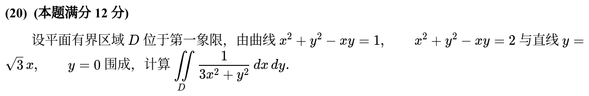

答案与解析

**结论速览**：$\dfrac{\pi\ln 2}{8\sqrt{3}}$。

- **完整解答**：
  1. **极坐标表示区域 $D$**：在第一象限中，射线 $y = 0$ 与 $y = \sqrt{3}x$ 对应极角 $0 \le \theta \le \dfrac{\pi}{3}$。
     将曲线方程 $x^2 + y^2 - xy = c$（$c = 1, 2$）化为极坐标：$r^2(1 - \sin\theta\cos\theta) = c$。记 $p(\theta) = 1 - \sin\theta\cos\theta > 0$，则极径范围为
     $$\frac{1}{\sqrt{p(\theta)}} \le r \le \frac{\sqrt{2}}{\sqrt{p(\theta)}}.$$
  2. **先对 $r$ 积分消去 $p(\theta)$**：被积函数 $\dfrac{1}{3x^2+y^2} = \dfrac{1}{r^2(3\cos^2\theta + \sin^2\theta)}$，连同面积元 $r\,\mathrm{d}r\mathrm{d}\theta$ 得
     $$\begin{aligned}
     I &= \int_0^{\frac{\pi}{3}} \frac{\mathrm{d}\theta}{3\cos^2\theta + \sin^2\theta} \int_{\frac{1}{\sqrt{p(\theta)}}}^{\frac{\sqrt{2}}{\sqrt{p(\theta)}}} \frac{1}{r}\,\mathrm{d}r \\
     &= \int_0^{\frac{\pi}{3}} \frac{\mathrm{d}\theta}{3\cos^2\theta + \sin^2\theta} \cdot \left(\ln\frac{\sqrt{2}}{\sqrt{p(\theta)}} - \ln\frac{1}{\sqrt{p(\theta)}}\right) \\
     &= \frac{\ln 2}{2} \int_0^{\frac{\pi}{3}} \frac{\mathrm{d}\theta}{3\cos^2\theta + \sin^2\theta}.
     \end{aligned}$$
  3. **万能代换 $t = \tan\theta$ 算角向积分**：分子分母同除以 $\cos^2\theta$，令 $t = \tan\theta$（$\theta: 0\to\frac{\pi}{3}$ 对应 $t: 0\to\sqrt{3}$）：
     $$\begin{aligned}
     I &= \frac{\ln 2}{2}\int_0^{\sqrt{3}} \frac{\mathrm{d}t}{3 + t^2} = \frac{\ln 2}{2}\cdot\frac{1}{\sqrt{3}}\left[\arctan\frac{t}{\sqrt{3}}\right]_0^{\sqrt{3}} \\
     &= \frac{\ln 2}{2\sqrt{3}}\cdot\frac{\pi}{4} = \frac{\pi\ln 2}{8\sqrt{3}}.
     \end{aligned}$$
- **核心思路与避坑**：本题最精妙之处在于径向积分 $\int_{a/\sqrt{p}}^{b/\sqrt{p}}\frac{\mathrm{d}r}{r} = \ln\frac{b}{a}$ 与 $p(\theta)$ 完全无关！遇到齐次 $-2$ 次被积函数与相似二次曲线环带时，极坐标几乎都能一举消去径向的角因子。

---

### 08 · 2022年

答案与解析

**答案**：**（D）** $\dfrac{2}{3}$

- **切入点与推演**：内层积分 $\int_y^2 \frac{y}{\sqrt{1+x^3}}\,\mathrm{d}x$ 无法用初等函数直接积出，必须交换积分次序：
  1. **改写积分区域**：原区域 $0 \le y \le 2,\; y \le x \le 2$，换序为 $0 \le x \le 2,\; 0 \le y \le x$。
  2. **先对 $y$ 积分再换元**：
     $$\begin{aligned}
     \int_0^2 \mathrm{d}y \int_y^2 \frac{y}{\sqrt{1+x^3}}\,\mathrm{d}x &= \int_0^2 \frac{\mathrm{d}x}{\sqrt{1+x^3}} \int_0^x y\,\mathrm{d}y = \frac{1}{2}\int_0^2 \frac{x^2}{\sqrt{1+x^3}}\,\mathrm{d}x \\
     &\xlongequal{u=1+x^3} \frac{1}{6}\int_1^9 u^{-\frac{1}{2}}\,\mathrm{d}u = \frac{1}{3}\Big[\sqrt{u}\Big]_1^9 = \frac{3 - 1}{3} = \frac{2}{3}.
     \end{aligned}$$
  故正确选项为 **（D）**。
- **干扰项 / 易错提示**：换元 $\mathrm{d}u = 3x^2\,\mathrm{d}x$ 后别忘了 $\int u^{-1/2}\,\mathrm{d}u = 2\sqrt{u}$ 会乘出一个 $2$，漏乘系数 $2$ 会错选（B）$\frac{1}{3}$。

---

### 09 · 2022年

答案与解析

- **第一步拆被积函数 + 拆区域**：
  把被积函数化为 $\frac{(x-y)^2}{x^2+y^2} = 1 - \frac{2xy}{x^2+y^2}$。
  区域 $D$ 由 $x=0$ 拆成两块：
  - $D_1$（第一象限四分之一圆）：$0 \le \theta \le \frac{\pi}{2},\; 0 \le r \le 2$，面积为 $\pi$；
  - $D_2$（第二象限等腰直角三角形，边界 $y-x=2$）：$\frac{\pi}{2} \le \theta \le \pi,\; 0 \le r \le \frac{2}{\sin\theta-\cos\theta}$，面积为 $2$。
  故常数项积分 $\iint_D 1\,\mathrm{d}x\mathrm{d}y = \pi + 2$。
- **第二步在极坐标下算 $J = \iint_D \frac{2xy}{x^2+y^2}\,\mathrm{d}x\mathrm{d}y = J_1 + J_2$**（注意 $\frac{2xy}{x^2+y^2} = \sin 2\theta$）：
  - $J_1 = \int_0^{\frac{\pi}{2}}\sin 2\theta\,\mathrm{d}\theta \int_0^2 r\,\mathrm{d}r = 1 \cdot 2 = 2$；
  - $J_2 = \int_{\frac{\pi}{2}}^{\pi} \sin 2\theta\,\mathrm{d}\theta \int_0^{\frac{2}{\sin\theta-\cos\theta}} r\,\mathrm{d}r = \int_{\frac{\pi}{2}}^{\pi} \frac{2\sin 2\theta}{1 - \sin 2\theta}\,\mathrm{d}\theta$。
    令 $t = \theta - \frac{\pi}{2} \in \left[0, \frac{\pi}{2}\right]$（则 $\sin 2\theta = -\sin 2t$）：
    $$J_2 = \int_0^{\frac{\pi}{2}} \frac{-2\sin 2t}{1 + \sin 2t}\,\mathrm{d}t = \int_0^{\frac{\pi}{2}}\left(-2 + \frac{2}{1+\sin 2t}\right)\mathrm{d}t = -\pi + 2.$$
    （其中 $\int_0^{\frac{\pi}{2}}\frac{2}{1+\sin 2t}\,\mathrm{d}t \xlongequal{u=2t} \int_0^\pi \frac{\mathrm{d}u}{1+\sin u} = 2\int_0^{\frac{\pi}{2}}\frac{\mathrm{d}w}{1+\cos w} = 2\big[\tan\frac{w}{2}\big]_0^{\frac{\pi}{2}} = 2$。）
- **第三步合并**：$I = (\pi + 2) - (J_1 + J_2) = (\pi + 2) - (4 - \pi) = 2\pi - 2$。
- **答案**：$2\pi - 2$。

---

### 10 · 2021年

> *双纽线区域二重积分。方程 $\left(x^2+y^2\right)^2 = x^2-y^2$ 是标准双纽线，直接换极坐标 $r^2 = \cos 2\theta$，半径积分一眼出结果。*

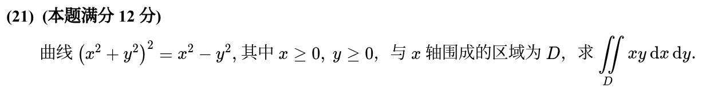

答案与解析

**结论速览**：$\dfrac{1}{48}$。

- **完整解答**：
  1. **将双纽线化为极坐标定区域**：代入 $x = r\cos\theta,\; y = r\sin\theta$，方程 $(x^2+y^2)^2 = x^2 - y^2$ 化为
     $$r^4 = r^2\cos 2\theta \implies r^2 = \cos 2\theta.$$
     因 $x \ge 0,\; y \ge 0$ 且 $\cos 2\theta \ge 0$，极角范围为 $0 \le \theta \le \dfrac{\pi}{4}$，极径范围为 $0 \le r \le \sqrt{\cos 2\theta}$。
  2. **化为极坐标累次积分并计算**：注意 $xy = r^2\sin\theta\cos\theta$ 及面积元 $r\,\mathrm{d}r\mathrm{d}\theta$，
     $$\begin{aligned}
     \iint_D xy\,\mathrm{d}x\mathrm{d}y &= \int_0^{\frac{\pi}{4}} \sin\theta\cos\theta\,\mathrm{d}\theta \int_0^{\sqrt{\cos 2\theta}} r^3\,\mathrm{d}r \\
     &= \int_0^{\frac{\pi}{4}} \frac{1}{2}\sin 2\theta \cdot \frac{\cos^2 2\theta}{4}\,\mathrm{d}\theta \\
     &= \frac{1}{8}\int_0^{\frac{\pi}{4}} \cos^2 2\theta\sin 2\theta\,\mathrm{d}\theta \\
     &\xlongequal{u=\cos 2\theta} \frac{1}{16}\int_0^1 u^2\,\mathrm{d}u = \frac{1}{16}\cdot\frac{1}{3} = \frac{1}{48}.
     \end{aligned}$$
- **核心思路与避坑**：第一象限内 $r^2 = \cos 2\theta \ge 0$ 要求 $2\theta \le \frac{\pi}{2}$ 即 $\theta \le \frac{\pi}{4}$，切勿误把极角上限写成 $\frac{\pi}{2}$。

---

### 11 · 2020年

答案与解析

**答案**：$\dfrac{2}{9}\left(2\sqrt{2} - 1\right)$

- **切入点与推演**：被积函数 $\sqrt{x^3+1}$ 关于 $x$ 无初等原函数，直接交换积分次序：
  1. 原区域 $0 \le y \le 1,\; \sqrt{y} \le x \le 1$，改写为先 $y$ 后 $x$：$0 \le x \le 1,\; 0 \le y \le x^2$。
  2. 换序后换元 $u = x^3 + 1$：
     $$\begin{aligned}
     \int_0^1 \mathrm{d}y \int_{\sqrt{y}}^1 \sqrt{x^3 + 1}\,\mathrm{d}x &= \int_0^1 \sqrt{x^3 + 1}\,\mathrm{d}x \int_0^{x^2}\mathrm{d}y = \int_0^1 x^2\sqrt{x^3 + 1}\,\mathrm{d}x \\
     &\xlongequal{u=x^3+1} \frac{1}{3}\int_1^2 u^{\frac{1}{2}}\,\mathrm{d}u = \frac{1}{3}\cdot\frac{2}{3}\Big[u^{\frac{3}{2}}\Big]_1^2 = \frac{2}{9}\left(2\sqrt{2} - 1\right).
     \end{aligned}$$
- **易错点**：换序时 $x = \sqrt{y}$ 反解得 $y = x^2$，注意上限是 $x^2$ 而非 $\sqrt{x}$；代入下限 $u = 1$ 时别漏减 $-1$。

---

### 12 · 2020年

答案与解析

**结论速览**：$\dfrac{3}{4}\Big[\sqrt{2} + \ln\left(1 + \sqrt{2}\right)\Big]$。

- **完整解答**：
  1. **写成 $X$-型累次积分并内层换元**：区域 $D = \{(x,y)\mid 1 \le x \le 2,\; 0 \le y \le x\}$（梯形），因 $x > 0$，将被积函数写为 $\dfrac{\sqrt{x^2+y^2}}{x} = \sqrt{1 + \left(\frac{y}{x}\right)^2}$：
     $$I = \int_1^2 \mathrm{d}x \int_0^x \sqrt{1 + \left(\frac{y}{x}\right)^2}\,\mathrm{d}y.$$
     对内层积分令 $t = \dfrac{y}{x}$（$\mathrm{d}y = x\,\mathrm{d}t$，$y: 0\to x$ 对应 $t: 0\to 1$），积分分离为两个定积分之积：
     $$I = \left(\int_1^2 x\,\mathrm{d}x\right)\left(\int_0^1 \sqrt{1 + t^2}\,\mathrm{d}t\right).$$
  2. **分别计算两个定积分**：
     - $\displaystyle\int_1^2 x\,\mathrm{d}x = \left[\frac{x^2}{2}\right]_1^2 = \frac{3}{2}$；
     - 利用常用积分公式 $\displaystyle\int \sqrt{1+t^2}\,\mathrm{d}t = \frac{1}{2}\Big[t\sqrt{1+t^2} + \ln\left(t + \sqrt{1+t^2}\right)\Big] + C$（或令 $t = \tan u$ 分部积分）：
       $$\int_0^1 \sqrt{1+t^2}\,\mathrm{d}t = \frac{1}{2}\Big[\sqrt{2} + \ln\left(1 + \sqrt{2}\right)\Big].$$
  3. **相乘得结果**：
     $$I = \frac{3}{2}\cdot\frac{1}{2}\Big[\sqrt{2} + \ln\left(1 + \sqrt{2}\right)\Big] = \frac{3}{4}\Big[\sqrt{2} + \ln\left(1 + \sqrt{2}\right)\Big].$$
- **核心思路与避坑**：本题也可用极坐标（$0\le\theta\le\frac{\pi}{4},\; \sec\theta\le r\le 2\sec\theta$），化为 $\frac{3}{2}\int_0^{\frac{\pi}{4}}\sec^3\theta\,\mathrm{d}\theta$，结果完全一致；无论哪种方法，熟记 $\int\sqrt{1+t^2}\,\mathrm{d}t$ 或 $\int\sec^3\theta\,\mathrm{d}\theta$ 都能大幅省时。

---

### 13 · 2019年

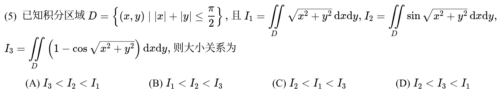

答案与解析

**答案**：**（A）** $I_3 < I_2 < I_1$

- **切入点与推演**：三个积分的区域完全相同，比较大小只需比较被积函数在 $D$ 内部的逐点大小。
  1. 记 $r = \sqrt{x^2 + y^2}$。在 $D = \left\{(x,y)\mid |x| + |y| \le \frac{\pi}{2}\right\}$ 的内部，恒有
     $$0 < r = \sqrt{x^2 + y^2} < |x| + |y| \le \frac{\pi}{2}.$$
  2. 在区间 $\left(0, \dfrac{\pi}{2}\right)$ 上逐点比较 $1 - \cos r,\; \sin r,\; r$：
     - 由经典不等式知 $\sin r < r$；
     - 又 $\sin r + \cos r = \sqrt{2}\sin\left(r + \dfrac{\pi}{4}\right) > \sqrt{2}\cdot\dfrac{\sqrt{2}}{2} = 1$（因 $r + \frac{\pi}{4} \in \left(\frac{\pi}{4},\frac{3\pi}{4}\right)$），即 $1 - \cos r < \sin r$。
  3. 故在 $D$ 内部恒有 $1 - \cos r < \sin r < r$，由二重积分的保号性得 $I_3 < I_2 < I_1$，选 **（A）**。
- **干扰项 / 易错提示**：关键是确认区域 $D$ 内 $r$ 的上界恰好不超过 $\frac{\pi}{2}$（因 $\sqrt{x^2+y^2} \le |x|+|y| \le \frac{\pi}{2}$），否则超过 $\frac{\pi}{2}$ 后 $1-\cos r$ 与 $\sin r$ 的大小关系会反转。

---

### 14 · 2019年

答案与解析

**结论速览**：$\dfrac{43\sqrt{2}}{120}$。

- **完整解答**：
  1. **利用对称性消去奇项并转极坐标**：区域 $D = \{(x,y)\mid |x| \le y,\; (x^2+y^2)^3 \le y^4\}$ 关于 $y$ 轴对称。
     - $\dfrac{x}{\sqrt{x^2+y^2}}$ 关于 $x$ 为奇函数，故 $\iint_D \dfrac{x}{\sqrt{x^2+y^2}}\,\mathrm{d}x\mathrm{d}y = 0$。
     - 极坐标下：$|x| \le y \iff \dfrac{\pi}{4} \le \theta \le \dfrac{3\pi}{4}$；$(x^2+y^2)^3 \le y^4 \iff r^6 \le r^4\sin^4\theta \iff 0 \le r \le \sin^2\theta$（因 $\sin\theta > 0$）。
  2. **化为极坐标累次积分并计算**：剩余被积函数为 $\dfrac{y}{\sqrt{x^2+y^2}} = \sin\theta$，连同面积元 $r\,\mathrm{d}r\mathrm{d}\theta$ 得
     $$\begin{aligned}
     I &= \int_{\frac{\pi}{4}}^{\frac{3\pi}{4}} \sin\theta\,\mathrm{d}\theta \int_0^{\sin^2\theta} r\,\mathrm{d}r = \frac{1}{2}\int_{\frac{\pi}{4}}^{\frac{3\pi}{4}} \sin^5\theta\,\mathrm{d}\theta \\
     &= \int_{\frac{\pi}{4}}^{\frac{\pi}{2}} \sin^5\theta\,\mathrm{d}\theta \xlongequal{u=\cos\theta} \int_0^{\frac{\sqrt{2}}{2}} (1 - u^2)^2\,\mathrm{d}u \\
     &= \int_0^{\frac{\sqrt{2}}{2}} (1 - 2u^2 + u^4)\,\mathrm{d}u = \left[u - \frac{2}{3}u^3 + \frac{1}{5}u^5\right]_0^{\frac{\sqrt{2}}{2}} \\
     &= \frac{\sqrt{2}}{2}\left(1 - \frac{2}{3}\cdot\frac{1}{2} + \frac{1}{5}\cdot\frac{1}{4}\right) = \frac{\sqrt{2}}{2}\left(1 - \frac{1}{3} + \frac{1}{20}\right) = \frac{43\sqrt{2}}{120}.
     \end{aligned}$$
- **核心思路与避坑**：化简 $(x^2+y^2)^3 \le y^4$ 得 $r^2 \le \sin^4\theta \implies r \le \sin^2\theta$，注意 $\int_0^{\sin^2\theta} r\,\mathrm{d}r = \frac{1}{2}\sin^4\theta$，乘以外层的 $\sin\theta$ 恰好是奇数次幂 $\sin^5\theta$，用 $u = \cos\theta$ 凑微分最不易算错。

---

### 15 · 2018年

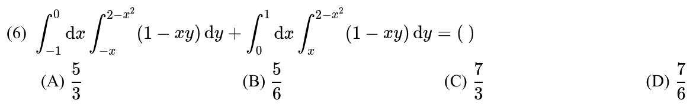

答案与解析

**触发条件与第一步**

两个积分的被积函数完全相同（都是 $1 - xy$），区间分别是 $[-1, 0]$ 与 $[0, 1]$，上边界都是 $2-x^2$，下边界分别是 $-x$ 与 $x$（合起来就是 $|x|$）。第一笔立刻**合并为一个二重积分**，利用区域关于 $y$ 轴对称把 $-xy$ 直接划掉！

**完整推演**

1. **合并积分区域**：
   两块区域拼接成完整区域
   $$D = \{(x,y) \mid -1 \le x \le 1,\; |x| \le y \le 2 - x^2\}.$$
   显然 $D$ **关于 $y$ 轴对称**。
2. **利用奇偶对称性化简**：
   - $-xy$ 关于 $x$ 是**奇函数** $\implies \iint_D (-xy)\,\mathrm{d}x\mathrm{d}y = 0$；
   - $1$ 关于 $x$ 是**偶函数** $\implies$ 只需算右半区域 $D_1 = \{(x,y) \mid 0 \le x \le 1,\; x \le y \le 2-x^2\}$ 的面积再乘以 $2$：
   $$\begin{aligned}
   \iint_D (1 - xy)\,\mathrm{d}x\mathrm{d}y &= \iint_D 1\,\mathrm{d}x\mathrm{d}y = 2\int_0^1 (2 - x^2 - x)\,\mathrm{d}x \\
   &= 2\left[2x - \frac{x^3}{3} - \frac{x^2}{2}\right]_0^1 = 2\left(2 - \frac{1}{3} - \frac{1}{2}\right) = 2\cdot\frac{7}{6} = \frac{7}{3}.
   \end{aligned}$$

故正确选项为 **（C）**。

**选择题干扰项拆解**

- **（D）$\frac{7}{6}$（最高频错选）**：用对称性只算了右半区域 $[0,1]$ 的积分，**最后忘了乘以 $2$**。
- **（A）$\frac{5}{3}$ / （B）$\frac{5}{6}$**：计算定积分时把 $2 - \frac{1}{3} - \frac{1}{2}$ 算错（例如漏算 $2$ 或把下限 $x$ 的符号弄反）。

---

### 16 · 2018年

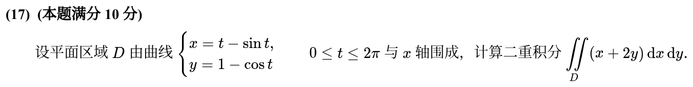

答案与解析

**结论速览**：$3\pi^2 + 5\pi$。

- **完整解答**：
  1. **化为 $X$-型累次积分并利用对称性**：摆线 $x(t) = t - \sin t,\; y(t) = 1 - \cos t$（$t\in[0,2\pi]$）在 $x\in[0,2\pi]$ 上单调递增（$x'(t) = 1 - \cos t \ge 0$），且关于直线 $x = \pi$ 对称（因 $x(2\pi-t) = 2\pi - x(t),\; y(2\pi-t) = y(t)$）。
     由对称性，对 $x$ 积分满足 $\iint_D (x - \pi)\,\mathrm{d}x\mathrm{d}y = 0$，即 $\iint_D x\,\mathrm{d}x\mathrm{d}y = \pi\iint_D \mathrm{d}x\mathrm{d}y$。
  2. **先对 $y$ 积分再换参 $t$**：记上边界为 $y = y(x)$，
     $$\iint_D (x + 2y)\,\mathrm{d}x\mathrm{d}y = \pi\int_0^{2\pi} y(x)\,\mathrm{d}x + \int_0^{2\pi}\mathrm{d}x\int_0^{y(x)} 2y\,\mathrm{d}y = \pi\int_0^{2\pi} y(t)x'(t)\,\mathrm{d}t + \int_0^{2\pi} y(t)^2 x'(t)\,\mathrm{d}t.$$
     代入 $y(t) = x'(t) = 1 - \cos t$：
     - 面积项：
       $$\int_0^{2\pi}(1 - \cos t)^2\,\mathrm{d}t = \int_0^{2\pi}\left(1 - 2\cos t + \frac{1 + \cos 2t}{2}\right)\mathrm{d}t = 3\pi \implies \pi\iint_D\mathrm{d}x\mathrm{d}y = 3\pi^2.$$
     - 二次项：
       $$\int_0^{2\pi}(1 - \cos t)^3\,\mathrm{d}t = \int_0^{2\pi}\big(1 - 3\cos t + 3\cos^2 t - \cos^3 t\big)\,\mathrm{d}t = 2\pi + 3\pi = 5\pi.$$
       （其中 $\int_0^{2\pi}\cos t\,\mathrm{d}t = \int_0^{2\pi}\cos^3 t\,\mathrm{d}t = 0$，$\int_0^{2\pi}\cos^2 t\,\mathrm{d}t = \pi$。）
  3. **合并得最终结果**：$\iint_D(x + 2y)\,\mathrm{d}x\mathrm{d}y = 3\pi^2 + 5\pi$。
- **核心思路与避坑**：参数方程围成的区域先对 $y$ 积分转化为关于 $x$ 的定积分，再换元 $\mathrm{d}x = x'(t)\,\mathrm{d}t$；利用关于 $x = \pi$ 的对称性把 $\iint_D x\,\mathrm{d}\sigma$ 替换为 $\pi S_D$，可省去繁琐的 $t\cos^k t$ 分部积分。

---

### 17 · 2017年

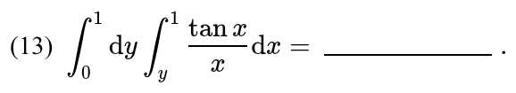

答案与解析

**触发条件与第一步**

内层积分 $\int_y^1 \frac{\tan x}{x}\,\mathrm{d}x$ **没有初等原函数**——这是最经典的“强迫换序”信号。第一笔立刻把积分区域写成不等式并交换次序为“先 $y$ 后 $x$”，让内层积分乘出一个 $x$ 把分母约掉！

**完整推演**

1. **翻译并改写积分区域**：
   原区域为 $0 \le y \le 1,\; y \le x \le 1$（顶点为 $(0,0), (1,0), (1,1)$ 的直角三角形）。
   换成先 $y$ 后 $x$：$0 \le x \le 1,\; 0 \le y \le x$。
2. **换序计算**：
   $$\begin{aligned}
   \int_0^1 \mathrm{d}y \int_y^1 \frac{\tan x}{x}\,\mathrm{d}x &= \int_0^1 \mathrm{d}x \int_0^x \frac{\tan x}{x}\,\mathrm{d}y \\
   &= \int_0^1 \frac{\tan x}{x} \cdot x\,\mathrm{d}x = \int_0^1 \tan x\,\mathrm{d}x \\
   &= \Big[-\ln|\cos x|\Big]_0^1 = -\ln(\cos 1).
   \end{aligned}$$
   （因为 $0 < 1 < \frac{\pi}{2}$，$\cos 1 > 0$，绝对值可直接去掉；写成 $\ln(\sec 1)$ 亦等价。）

故应填 **$-\ln(\cos 1)$**。

---

### 18 · 2017年

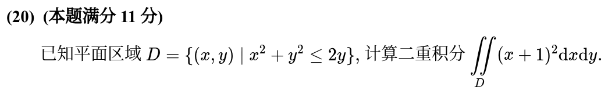

答案与解析

**结论速览**：$\dfrac{5\pi}{4}$。

- **完整解答**：
  1. **展开被积函数并利用对称性**：区域 $D: x^2 + (y - 1)^2 \le 1$ 是以 $(0,1)$ 为圆心、半径为 $1$ 的圆盘，关于 $y$ 轴对称。展开 $(x+1)^2 = x^2 + 2x + 1$：
     - $2x$ 关于 $x$ 为奇函数 $\implies \iint_D 2x\,\mathrm{d}x\mathrm{d}y = 0$；
     - 常数项：$\iint_D 1\,\mathrm{d}x\mathrm{d}y = \pi\cdot 1^2 = \pi$。
  2. **平移圆心算 $\iint_D x^2\,\mathrm{d}x\mathrm{d}y$**：令 $u = x,\; v = y - 1$，则新区域为单位圆盘 $D': u^2 + v^2 \le 1$。由圆盘的轮换对称性（$\iint_{D'} u^2 = \iint_{D'} v^2$）并切极坐标：
     $$\iint_D x^2\,\mathrm{d}x\mathrm{d}y = \iint_{D'} u^2\,\mathrm{d}u\mathrm{d}v = \frac{1}{2}\iint_{D'} (u^2 + v^2)\,\mathrm{d}u\mathrm{d}v = \frac{1}{2}\int_0^{2\pi}\mathrm{d}\theta\int_0^1 r^3\,\mathrm{d}r = \frac{1}{2}\cdot 2\pi\cdot\frac{1}{4} = \frac{\pi}{4}.$$
  3. **合并得结果**：$\iint_D(x+1)^2\,\mathrm{d}x\mathrm{d}y = \pi + \dfrac{\pi}{4} = \dfrac{5\pi}{4}$。
- **核心思路与避坑**：偏心圆 $x^2 + (y-1)^2 \le 1$ 上对只含 $x$ 的多项式积分时，做平移 $v = y - 1$ 回到标准单位圆盘比直接用 $r = 2\sin\theta$ 算 $\sin^4\theta\cos^2\theta$ 简单得多。

---

### 19 · 2016年

答案与解析

**结论速览**：$1 - \dfrac{\pi}{2}$。

- **完整解答**：
  1. **利用对称性消去奇项并转极坐标**：区域 $D$ 是顶点为 $(0,0),\; (1,1),\; (-1,1)$ 的等腰直角三角形，关于 $y$ 轴对称。
     - $\dfrac{-xy}{x^2+y^2}$ 关于 $x$ 为奇函数，故 $\iint_D \dfrac{-xy}{x^2+y^2}\,\mathrm{d}x\mathrm{d}y = 0$。
     - 极坐标下，$D = \left\{(r,\theta)\;\middle|\; \dfrac{\pi}{4}\le\theta\le\dfrac{3\pi}{4},\; 0\le r\le\dfrac{1}{\sin\theta}\right\}$，且 $\dfrac{x^2-y^2}{x^2+y^2} = \cos^2\theta - \sin^2\theta$。
  2. **化为极坐标累次积分并计算**：
     $$\begin{aligned}
     I &= \int_{\frac{\pi}{4}}^{\frac{3\pi}{4}} (\cos^2\theta - \sin^2\theta)\,\mathrm{d}\theta \int_0^{\frac{1}{\sin\theta}} r\,\mathrm{d}r \\
     &= \frac{1}{2}\int_{\frac{\pi}{4}}^{\frac{3\pi}{4}} \frac{\cos^2\theta - \sin^2\theta}{\sin^2\theta}\,\mathrm{d}\theta = \frac{1}{2}\int_{\frac{\pi}{4}}^{\frac{3\pi}{4}} (\cot^2\theta - 1)\,\mathrm{d}\theta \\
     &= \frac{1}{2}\int_{\frac{\pi}{4}}^{\frac{3\pi}{4}} (\csc^2\theta - 2)\,\mathrm{d}\theta = \frac{1}{2}\Big[-\cot\theta - 2\theta\Big]_{\frac{\pi}{4}}^{\frac{3\pi}{4}} \\
     &= \frac{1}{2}\left[\left(1 - \frac{3\pi}{2}\right) - \left(-1 - \frac{\pi}{2}\right)\right] = 1 - \frac{\pi}{2}.
     \end{aligned}$$
- **核心思路与避坑**：利用恒等式 $\cot^2\theta = \csc^2\theta - 1$ 且 $(-\cot\theta)' = \csc^2\theta$ 一步积出，注意 $\cot\frac{3\pi}{4} = -1$、$-\cot\frac{3\pi}{4} = +1$ 的符号。

---

### 20 · 2015年

答案与解析

**答案**：**（B）** $\displaystyle\int_{\pi/4}^{\pi/3}\mathrm{d}\theta\int_{\frac{1}{\sqrt{2\sin 2\theta}}}^{\frac{1}{\sqrt{\sin 2\theta}}} f(r\cos\theta, r\sin\theta)r\,\mathrm{d}r$

- **切入点与推演**：将四条边界方程逐一化为极坐标（$x = r\cos\theta,\; y = r\sin\theta$）：
  1. **极角范围**：在第一象限中，$y = x \implies \theta = \dfrac{\pi}{4}$，$y = \sqrt{3}x \implies \theta = \dfrac{\pi}{3}$，故 $\dfrac{\pi}{4} \le \theta \le \dfrac{\pi}{3}$。
  2. **极径范围**：由 $2xy = r^2\sin 2\theta$ 得：
     - $4xy = 1 \iff 2r^2\sin 2\theta = 1 \iff r = \dfrac{1}{\sqrt{2\sin 2\theta}}$（内边界）；
     - $2xy = 1 \iff r^2\sin 2\theta = 1 \iff r = \dfrac{1}{\sqrt{\sin 2\theta}}$（外边界）。
  3. **补上面积元 $r\,\mathrm{d}r\mathrm{d}\theta$**：即得
     $$\iint_D f(x,y)\,\mathrm{d}x\mathrm{d}y = \int_{\frac{\pi}{4}}^{\frac{\pi}{3}}\mathrm{d}\theta \int_{\frac{1}{\sqrt{2\sin 2\theta}}}^{\frac{1}{\sqrt{\sin 2\theta}}} f(r\cos\theta, r\sin\theta)r\,\mathrm{d}r,$$
     选 **（B）**。
- **干扰项 / 易错提示**：（A）（C）忘记对 $r^2$ 开平方；（C）（D）漏乘极坐标面积元因子 $r$。

---

### 21 · 2015年

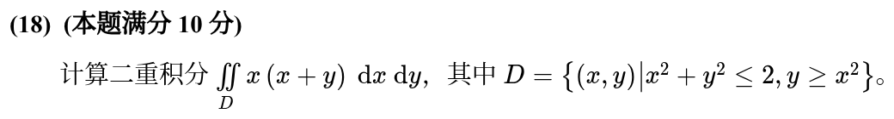

答案与解析

**结论速览**：$\dfrac{\pi}{4} - \dfrac{2}{5}$。

- **完整解答**：
  1. **确定区域交点并利用对称性**：区域 $D = \{(x,y)\mid x^2 + y^2 \le 2,\; y \ge x^2\}$ 关于 $y$ 轴对称。联立 $x^2 + y^2 = 2$ 与 $y = x^2$ 得 $y^2 + y - 2 = 0 \implies y = 1$（$y \ge 0$），故交点为 $(-1,1)$ 与 $(1,1)$。
     展开 $x(x+y) = x^2 + xy$：
     - $xy$ 关于 $x$ 为奇函数 $\implies \iint_D xy\,\mathrm{d}x\mathrm{d}y = 0$；
     - $x^2$ 关于 $x$ 为偶函数 $\implies$ 取右半部分 $0 \le x \le 1,\; x^2 \le y \le \sqrt{2-x^2}$ 积分并乘以 $2$：
       $$I = 2\int_0^1 x^2\,\mathrm{d}x \int_{x^2}^{\sqrt{2-x^2}}\mathrm{d}y = 2\int_0^1 x^2\sqrt{2 - x^2}\,\mathrm{d}x - 2\int_0^1 x^4\,\mathrm{d}x.$$
  2. **分两项计算定积分**：
     - 第一项令 $x = \sqrt{2}\sin t$（$x: 0\to 1$ 对应 $t: 0\to\frac{\pi}{4}$）：
       $$\begin{aligned}
       2\int_0^1 x^2\sqrt{2-x^2}\,\mathrm{d}x &= 2\int_0^{\frac{\pi}{4}} (2\sin^2 t)(\sqrt{2}\cos t)(\sqrt{2}\cos t\,\mathrm{d}t) \\
       &= 8\int_0^{\frac{\pi}{4}} \sin^2 t\cos^2 t\,\mathrm{d}t = 2\int_0^{\frac{\pi}{4}} \sin^2 2t\,\mathrm{d}t \\
       &= \int_0^{\frac{\pi}{4}} (1 - \cos 4t)\,\mathrm{d}t = \left[t - \frac{\sin 4t}{4}\right]_0^{\frac{\pi}{4}} = \frac{\pi}{4}.
       \end{aligned}$$
     - 第二项：$2\int_0^1 x^4\,\mathrm{d}x = \dfrac{2}{5}$。
  3. **相减得最终结果**：$I = \dfrac{\pi}{4} - \dfrac{2}{5}$。
- **核心思路与避坑**：本题也可将 $D$ 拆为扇形 $x^2+y^2\le 2,\; y\ge|x|$ 与两个弓形 $x^2\le y\le|x|$，但直接按 $X$-型积分再三角换元只需一次拆分，不易漏算系数 $2$。

---

### 22 · 2014年

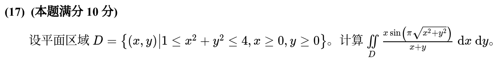

答案与解析

- **第一步用轮换对称性消分母 $x+y$**：
  区域 $D$ 是第一象限的圆环（$1 \le r \le 2,\; 0 \le \theta \le \frac{\pi}{2}$），关于直线 $y = x$ 对称。
  交换 $x, y$ 得 $I = \iint_D \frac{y\sin(\pi\sqrt{x^2+y^2})}{x+y}\,\mathrm{d}x\mathrm{d}y$，两式相加得
  $$2I = \iint_D \sin\left(\pi\sqrt{x^2+y^2}\right)\mathrm{d}x\mathrm{d}y.$$
- **第二步切极坐标 + 分部积分**：
  $$I = \frac{1}{2}\int_0^{\frac{\pi}{2}}\mathrm{d}\theta \int_1^2 r\sin(\pi r)\,\mathrm{d}r = \frac{\pi}{4}\left[-\frac{r\cos(\pi r)}{\pi} + \frac{\sin(\pi r)}{\pi^2}\right]_1^2 = \frac{\pi}{4}\left(-\frac{2}{\pi} - \frac{1}{\pi}\right) = -\frac{3}{4}.$$
- **答案**：$-\dfrac{3}{4}$。

---

### 23 · 2013年

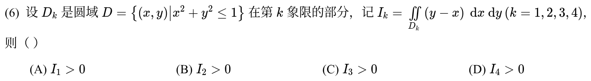

答案与解析

**答案**：**（B）** $I_2 > 0$

- **切入点与推演**：逐一考察四个象限的扇形 $D_k$ 上被积函数 $y - x$ 的符号与轮换对称性：
  - **第一、三象限（$D_1, D_3$）**：区域关于直线 $y = x$ 对称，交换 $x,y$ 后 $y - x$ 变为 $-(y - x)$，故由轮换对称性得 $I_1 = 0,\; I_3 = 0$；
  - **第二象限（$D_2$）**：区域内部满足 $x < 0 < y$，故 $y - x > 0$ 恒成立，由保号性得 $I_2 > 0$；
  - **第四象限（$D_4$）**：区域内部满足 $y < 0 < x$，故 $y - x < 0$ 恒成立，得 $I_4 < 0$。

  因此只有（B）正确。
- **干扰项 / 易错提示**：第二象限内 $x$ 为负、$y$ 为正，切勿看反 $y - x$ 的符号而误选（D）。

---

### 24 · 2013年

答案与解析

**触发条件与第一步**

三条直线围成三角形，被积函数是纯 $x^2$。第一笔**两两联立求三个顶点**，并选择“先 $y$ 后 $x$”——这样内层对 $y$ 积分直接把 $x^2$ 提出来，完全避免 $\left[(8-y)^3 - (y/3)^3\right]$ 的繁琐展开。

**完整推演**

1. **求三角形区域 $D$ 的三个顶点**：
   - $x = 3y$ 与 $y = 3x$ 交于 $O(0, 0)$；
   - $y = 3x$ 与 $x + y = 8$ 交于 $A(2, 6)$；
   - $x = 3y$ 与 $x + y = 8$ 交于 $B(6, 2)$。
2. **按 $X$-型切分区域**（以顶点 $A$ 的横坐标 $x=2$ 为分界）：
   - $D_1$：$0 \le x \le 2$，$\frac{x}{3} \le y \le 3x$；
   - $D_2$：$2 \le x \le 6$，$\frac{x}{3} \le y \le 8 - x$。
3. **分块计算**：
   $$\begin{aligned}
   \iint_D x^2\,\mathrm{d}x\mathrm{d}y &= \int_0^2 x^2\,\mathrm{d}x \int_{\frac{x}{3}}^{3x} \mathrm{d}y + \int_2^6 x^2\,\mathrm{d}x \int_{\frac{x}{3}}^{8-x} \mathrm{d}y \\
   &= \int_0^2 x^2\cdot\frac{8}{3}x\,\mathrm{d}x + \int_2^6 x^2\left(8 - \frac{4}{3}x\right)\mathrm{d}x \\
   &= \left[\frac{2}{3}x^4\right]_0^2 + \left[\frac{8}{3}x^3 - \frac{1}{3}x^4\right]_2^6 \\
   &= \frac{32}{3} + \frac{1}{3}\Big(8(216 - 8) - (1296 - 16)\Big) \\
   &= \frac{32}{3} + \frac{1664 - 1280}{3} = \frac{32}{3} + \frac{384}{3} = \frac{416}{3}.
   \end{aligned}$$

---

### 25 · 2012年

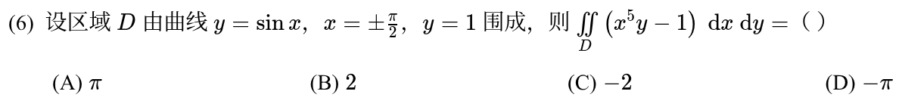

答案与解析

**答案**：**（D）** $-\pi$

- **切入点与推演**：注意下边界 $y = \sin x$ 不是偶函数，区域 $D$ **并不关于 $y$ 轴对称**，不能直接划掉 $x^5 y$！应先写出“先 $y$ 后 $x$”的累次积分，积完内层后再对对称区间 $\left[-\frac{\pi}{2}, \frac{\pi}{2}\right]$ 用奇偶性：
  $$\begin{aligned}
  \iint_D (x^5 y - 1)\,\mathrm{d}x\mathrm{d}y &= \int_{-\frac{\pi}{2}}^{\frac{\pi}{2}}\mathrm{d}x \int_{\sin x}^{1} (x^5 y - 1)\,\mathrm{d}y \\
  &= \int_{-\frac{\pi}{2}}^{\frac{\pi}{2}} \left[\frac{1}{2}x^5(1 - \sin^2 x) - (1 - \sin x)\right]\mathrm{d}x \\
  &= \int_{-\frac{\pi}{2}}^{\frac{\pi}{2}} \left(\frac{1}{2}x^5\cos^2 x + \sin x - 1\right)\mathrm{d}x.
  \end{aligned}$$
  在对称区间 $\left[-\frac{\pi}{2}, \frac{\pi}{2}\right]$ 上，$\frac{1}{2}x^5\cos^2 x$ 与 $\sin x$ 均为奇函数，积分均为 $0$，故原式等于
  $$\int_{-\frac{\pi}{2}}^{\frac{\pi}{2}} (-1)\,\mathrm{d}x = -\pi,$$
  选 **（D）**。
- **干扰项 / 易错提示**：千万不要未检查区域对称性就凭直觉把 $x^5 y$ 划掉（虽然本题化简后仍为奇函数，但必须先积完内层 $y$ 才能合法使用一元奇偶性）。

---

### 26 · 2012年

答案与解析

**结论速览**：$\dfrac{16}{15}$。

- **完整解答**：
  1. **直接写极坐标累次积分**：区域 $D = \{(r,\theta)\mid 0 \le \theta \le \pi,\; 0 \le r \le 1 + \cos\theta\}$（心形线的上半部分，关于 $y$ 轴不对称，不能消去 $xy$）。被积函数 $xy = r^2\cos\theta\sin\theta$，连同面积元 $r\,\mathrm{d}r\mathrm{d}\theta$ 得
     $$\begin{aligned}
     \iint_D xy\,\mathrm{d}\sigma &= \int_0^\pi \cos\theta\sin\theta\,\mathrm{d}\theta \int_0^{1+\cos\theta} r^3\,\mathrm{d}r \\
     &= \frac{1}{4}\int_0^\pi (1 + \cos\theta)^4\cos\theta\sin\theta\,\mathrm{d}\theta.
     \end{aligned}$$
  2. **换元 $u = \cos\theta$ 计算定积分**：令 $u = \cos\theta$（$\mathrm{d}u = -\sin\theta\,\mathrm{d}\theta$，$\theta: 0\to\pi$ 对应 $u: 1\to -1$），
     $$\begin{aligned}
     \iint_D xy\,\mathrm{d}\sigma &= \frac{1}{4}\int_{-1}^{1} u(1 + u)^4\,\mathrm{d}u \\
     &= \frac{1}{4}\int_{-1}^{1} \big(u + 4u^2 + 6u^3 + 4u^4 + u^5\big)\,\mathrm{d}u.
     \end{aligned}$$
     由对称区间 $[-1,1]$ 上的奇偶性，奇次幂项积分为 $0$，仅留偶次幂项：
     $$\frac{1}{4}\cdot 2\int_0^1 (4u^2 + 4u^4)\,\mathrm{d}u = 2\left(\frac{1}{3} + \frac{1}{5}\right) = \frac{16}{15}.$$
- **核心思路与避坑**：心形线 $r = 1 + \cos\theta$ 左右不对称（右侧最远到 $r=2$，左侧回到原点 $r=0$），切勿误以为 $D$ 关于 $y$ 轴对称而把积分错算成 $0$。

---

### 27 · 2011年

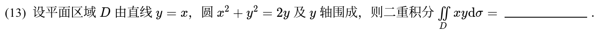

答案与解析

**答案**：$\dfrac{7}{12}$

- **切入点与推演**：圆 $x^2 + y^2 = 2y$ 化为极坐标即 $r = 2\sin\theta$，与射线 $y = x$（$\theta = \frac{\pi}{4}$）及 $y$ 轴（$\theta = \frac{\pi}{2}$）在第一象限围成区域 $D = \left\{(r,\theta)\;\middle|\; \frac{\pi}{4}\le\theta\le\frac{\pi}{2},\; 0\le r\le 2\sin\theta\right\}$：
  $$\begin{aligned}
  \iint_D xy\,\mathrm{d}\sigma &= \int_{\frac{\pi}{4}}^{\frac{\pi}{2}} \cos\theta\sin\theta\,\mathrm{d}\theta \int_0^{2\sin\theta} r^3\,\mathrm{d}r \\
  &= \int_{\frac{\pi}{4}}^{\frac{\pi}{2}} \cos\theta\sin\theta\cdot\frac{16\sin^4\theta}{4}\,\mathrm{d}\theta \\
  &= 4\int_{\frac{\pi}{4}}^{\frac{\pi}{2}} \sin^5\theta\,\mathrm{d}(\sin\theta) = \frac{2}{3}\Big[\sin^6\theta\Big]_{\frac{\pi}{4}}^{\frac{\pi}{2}} \\
  &= \frac{2}{3}\left(1 - \frac{1}{8}\right) = \frac{7}{12}.
  \end{aligned}$$
- **易错点**：$\left(\frac{\sqrt{2}}{2}\right)^6 = \frac{1}{8}$，同时注意极角范围是 $\left[\frac{\pi}{4}, \frac{\pi}{2}\right]$（由 $y = x$ 与 $y$ 轴围成）而非 $\left[0, \frac{\pi}{4}\right]$。

---

### 28 · 2011年

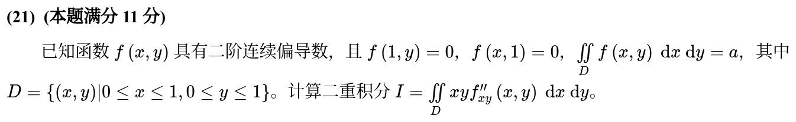

答案与解析

**结论速览**：$a$。

- **完整解答**：
  1. **提取隐藏的边界导数条件**：由 $f(1, y) = 0$ 对一切 $y\in[0,1]$ 恒成立，两边关于 $y$ 求导得
     $$f_y'(1, y) = 0 \qquad (0 \le y \le 1).$$
  2. **先对 $x$ 分部积分**：将 $I$ 写成累次积分并对内层 $x$ 用分部积分（$\dfrac{\partial}{\partial x}f_y'(x,y) = f_{xy}''(x,y)$）：
     $$\begin{aligned}
     I &= \int_0^1 y\,\mathrm{d}y \int_0^1 x\,f_{xy}''(x,y)\,\mathrm{d}x \\
     &= \int_0^1 y\left(\Big[x f_y'(x,y)\Big]_{x=0}^{x=1} - \int_0^1 f_y'(x,y)\,\mathrm{d}x\right)\mathrm{d}y \\
     &= -\int_0^1\mathrm{d}y \int_0^1 y f_y'(x,y)\,\mathrm{d}x,
     \end{aligned}$$
     其中边界项 $1\cdot f_y'(1,y) - 0 = 0$。
  3. **交换积分次序再对 $y$ 分部积分**：
     $$\begin{aligned}
     I &= -\int_0^1\mathrm{d}x \int_0^1 y f_y'(x,y)\,\mathrm{d}y \\
     &= -\int_0^1\left(\Big[y f(x,y)\Big]_{y=0}^{y=1} - \int_0^1 f(x,y)\,\mathrm{d}y\right)\mathrm{d}x \\
     &= \int_0^1\mathrm{d}x \int_0^1 f(x,y)\,\mathrm{d}y = \iint_D f(x,y)\,\mathrm{d}x\mathrm{d}y = a,
     \end{aligned}$$
     其中边界项 $1\cdot f(x,1) - 0 = 0$。
- **核心思路与避坑**：第一步边界项消零需要显式说明“由 $f(1,y)\equiv 0$ 对 $y$ 求导得 $f_y'(1,y)=0$”，这是考场关键得分点，不能直接跳步。

---

### 29 · 2010年

答案与解析

**结论速览**：$\dfrac{1}{3} - \dfrac{\pi}{16}$。

- **完整解答**：
  1. **逆向化为直角坐标下的二重积分**：注意到被积式可改写为
     $$r^2\sin\theta\sqrt{1 - r^2\cos 2\theta}\,\mathrm{d}r\mathrm{d}\theta = (r\sin\theta)\sqrt{1 - r^2(\cos^2\theta - \sin^2\theta)}\cdot (r\,\mathrm{d}r\mathrm{d}\theta).$$
     令 $x = r\cos\theta,\; y = r\sin\theta$，则面积元 $r\,\mathrm{d}r\mathrm{d}\theta = \mathrm{d}x\mathrm{d}y$，且：
     - $0 \le \theta \le \dfrac{\pi}{4}$ 对应 $0 \le y \le x$；
     - $0 \le r \le \sec\theta \iff r\cos\theta \le 1 \iff 0 \le x \le 1$。

     因此区域 $D_{xy} = \{(x,y)\mid 0 \le x \le 1,\; 0 \le y \le x\}$，原积分化为
     $$I = \iint_{D_{xy}} y\sqrt{1 - x^2 + y^2}\,\mathrm{d}x\mathrm{d}y = \int_0^1\mathrm{d}x \int_0^x y\sqrt{1 - x^2 + y^2}\,\mathrm{d}y.$$
  2. **先对 $y$ 凑微分，再三角换元求外层积分**：
     - 内层积分：
       $$\int_0^x y\sqrt{1 - x^2 + y^2}\,\mathrm{d}y = \frac{1}{2}\int_0^x \sqrt{1 - x^2 + y^2}\,\mathrm{d}(1 - x^2 + y^2) = \frac{1}{3}\Big[(1 - x^2 + y^2)^{\frac{3}{2}}\Big]_0^x = \frac{1}{3}\Big[1 - (1 - x^2)^{\frac{3}{2}}\Big].$$
     - 外层积分（令 $x = \sin t$，$t\in\left[0,\frac{\pi}{2}\right]$，套用华里士公式）：
       $$\begin{aligned}
       I &= \frac{1}{3}\int_0^1 \Big[1 - (1 - x^2)^{\frac{3}{2}}\Big]\mathrm{d}x = \frac{1}{3} - \frac{1}{3}\int_0^{\frac{\pi}{2}} \cos^4 t\,\mathrm{d}t \\
       &= \frac{1}{3} - \frac{1}{3}\cdot\frac{3}{4}\cdot\frac{1}{2}\cdot\frac{\pi}{2} = \frac{1}{3} - \frac{\pi}{16}.
       \end{aligned}$$
- **核心思路与避坑**：极坐标反转为直角坐标时，务必从 $r^2\sin\theta$ 中拆出一个 $r$ 凑成面积元 $r\,\mathrm{d}r\mathrm{d}\theta = \mathrm{d}x\mathrm{d}y$，剩下的 $r\sin\theta$ 才是直角坐标下的被积因子 $y$，切忌多留或少留一个 $r$。

---

[« 多元函数极值与最值](18-multivariable-extrema.md)
