[« 多元函数极值与最值](18-multivariable-extrema.md)

# 高等数学 · 二重积分

> **全章 29 题｜本表头已点名 29 题｜未归类 0 题。**\
> **必会 6 题·按此顺序**：[2013-17](#q2013-17)（画区域并定上下限） → [2024-06](#q2024-6)（交换积分次序） → [2017-13](#q2017-13)（换序后才能顺利积分） → [2018-06](#q2018-6)（对称性消去奇函数项） → [2026-17](#q2026-17)（极坐标完整计算） → [2014-17](#q2014-17)（交换变量的对称性）\
> **补练 14 题·按薄弱点选做**：[2022-02](#q2022-2)、[2021-21](#q2021-21)、[2020-10](#q2020-10)、[2020-19](#q2020-19)、[2019-05](#q2019-5)、[2019-18](#q2019-18)、[2017-20](#q2017-20)、[2016-18](#q2016-18)、[2015-06](#q2015-6)、[2015-18](#q2015-18)、[2013-06](#q2013-6)、[2012-06](#q2012-6)、[2012-18](#q2012-18)、[2011-13](#q2011-13)\
> **冲一冲 2 题**：[2025-20](#q2025-20)（交圆区域分段） → [2024-17](#q2024-17)（双曲线边界的换元）\
> **见识 1 题·先会开题**：[2026-07](#q2026-7)（双重求和中的取点与区域）\
> **首轮后放 5 题·本轮可跳过**：[2023-20](#q2023-20)、[2022-19](#q2022-19)、[2018-17](#q2018-17)、[2011-21](#q2011-21)、[2010-20](#q2010-20)\
> **待核 1 题·暂不训练**：[2025-05](#q2025-5)（内层上下限与选项不一致，待核）\
> **首轮过关**：先画域再写限；极坐标别漏半径因子，对称性必须连积分域一起核对。

---

## 2026年

### 01 · 2026-07 · 选择题 ·【见识】

> 轮换对称性选择题。区域  关于  对称且 ，直接用轮换对称性将积分拆半，结合积分定义秒定选项。

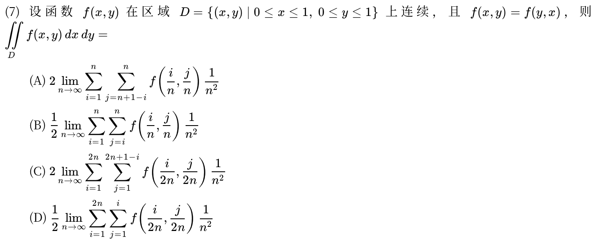

---

### 02 · 2026-17 · 解答题 ·【必会】

> 二重积分计算大题。区域含  且被积函数含 ，画出图形明显是环形扇区，果断换极坐标，角度和半径范围切忌写错。

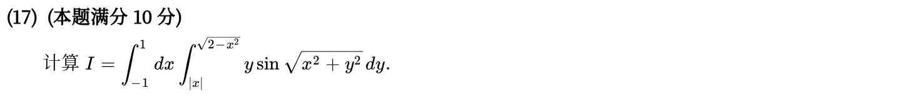

---

## 2025年

### 03 · 2025-05 · 选择题 ·【待核】

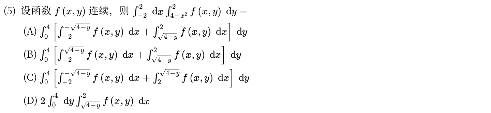

---

### 04 · 2025-20 · 解答题 ·【冲一冲】

> 双圆相交二重积分。被积函数含 ，区域关于  对称，先用轮换对称性将被积函数化简，再换极坐标分段定限。

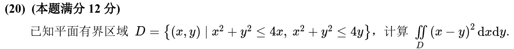

---

## 2024年

### 05 · 2024-06 · 选择题 ·【必会】

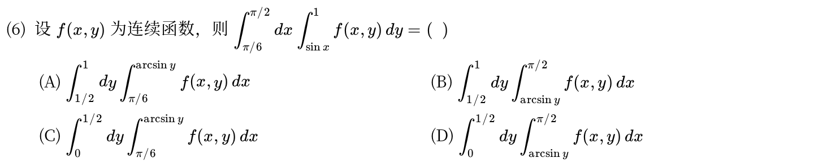

---

### 06 · 2024-17 · 解答题 ·【冲一冲】

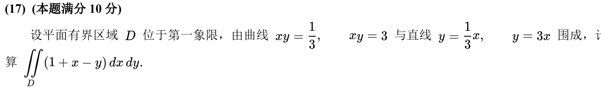

---

## 2023年

### 07 · 2023-20 · 解答题 ·【首轮后放】

> 斜椭圆环状区域积分。曲线方程含 ，换极坐标后把  提到分母，先积  再积  会非常丝滑。

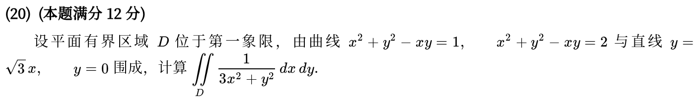

---

## 2022年

### 08 · 2022-02 · 选择题 ·【补练】

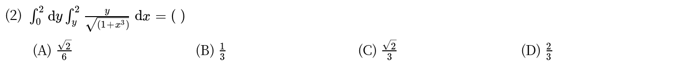

---

### 09 · 2022-19 · 解答题 ·【首轮后放】

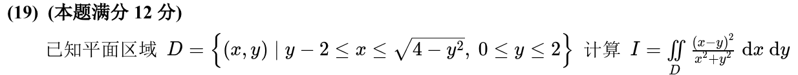

---

## 2021年

### 10 · 2021-21 · 解答题 ·【补练】

> 双纽线区域二重积分。方程  是标准双纽线，直接换极坐标 ，半径积分一眼出结果。

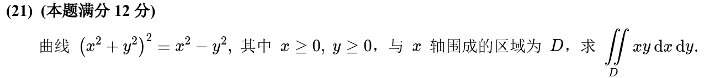

---

## 2020年

### 11 · 2020-10 · 填空题 ·【补练】

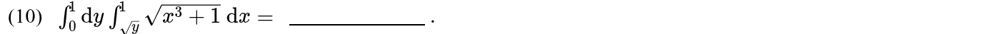

---

### 12 · 2020-19 · 解答题 ·【补练】

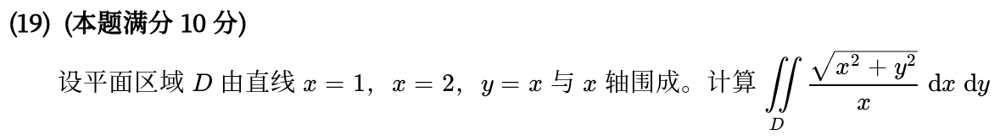

---

## 2019年

### 13 · 2019-05 · 选择题 ·【补练】

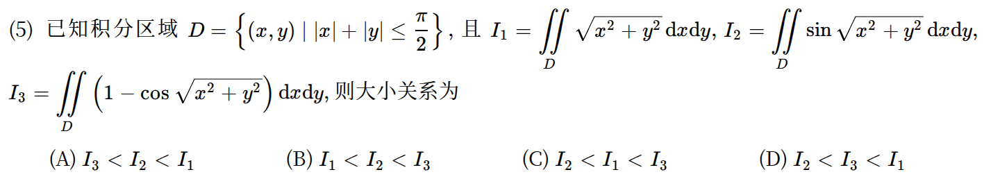

---

### 14 · 2019-18 · 解答题 ·【补练】

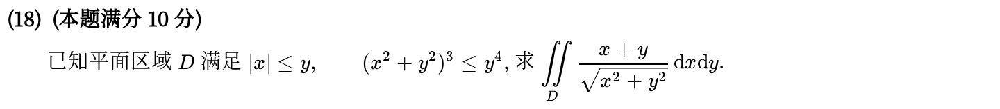

---

## 2018年

### 15 · 2018-06 · 选择题 ·【必会】

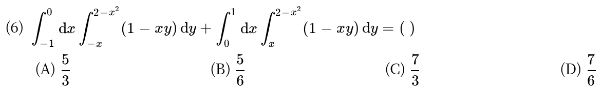

---

### 16 · 2018-17 · 解答题 ·【首轮后放】

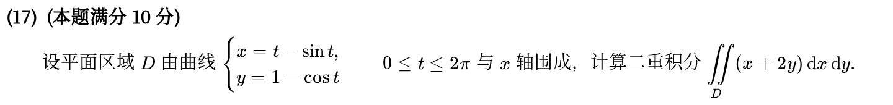

---

## 2017年

### 17 · 2017-13 · 填空题 ·【必会】

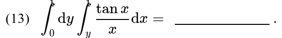

---

### 18 · 2017-20 · 解答题 ·【补练】

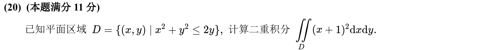

---

## 2016年

### 19 · 2016-18 · 解答题 ·【补练】

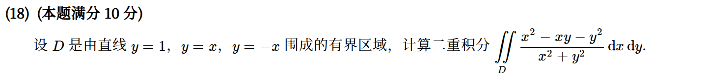

---

## 2015年

### 20 · 2015-06 · 选择题 ·【补练】

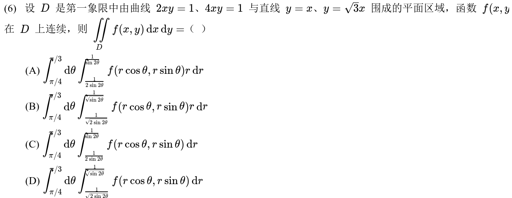

---

### 21 · 2015-18 · 解答题 ·【补练】

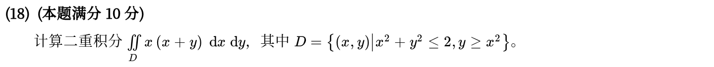

---

## 2014年

### 22 · 2014-17 · 解答题 ·【必会】

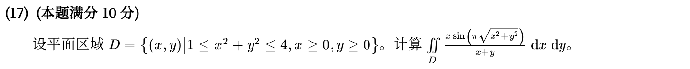

---

## 2013年

### 23 · 2013-06 · 选择题 ·【补练】

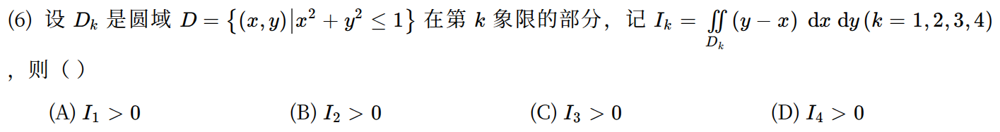

---

### 24 · 2013-17 · 解答题 ·【必会】

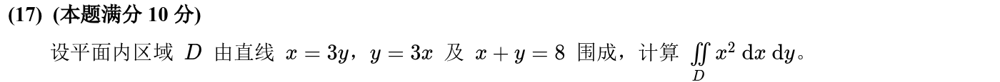

---

## 2012年

### 25 · 2012-06 · 选择题 ·【补练】

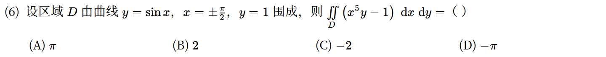

---

### 26 · 2012-18 · 解答题 ·【补练】

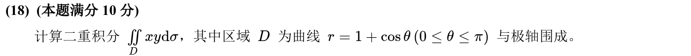

---

## 2011年

### 27 · 2011-13 · 填空题 ·【补练】

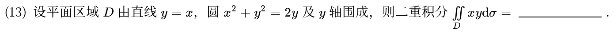

---

### 28 · 2011-21 · 解答题 ·【首轮后放】

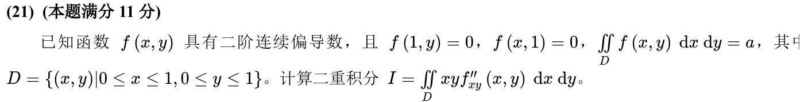

*关联章节：[多元复合函数与隐函数求导](17-chain-implicit.md)*

---

## 2010年

### 29 · 2010-20 · 解答题 ·【首轮后放】

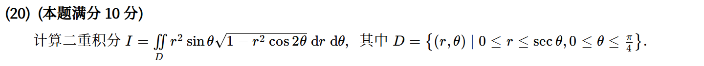

---

## 交叉考点索引

以下题目主归其他章节，点击跳转到对应章节题目；不计入本章主收录题数：

- [2021年 · 第14题](11-definite-integrals.md)（主章节：定积分、变上限积分与积分性质）
- [2010年 · 第6题](02-sequences.md)（主章节：数列极限与求和极限）

[« 多元函数极值与最值](18-multivariable-extrema.md)
