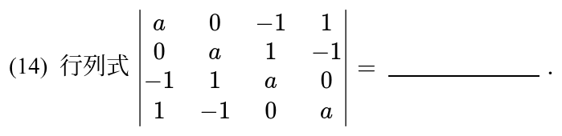
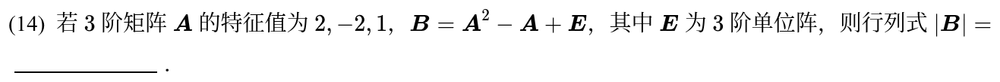
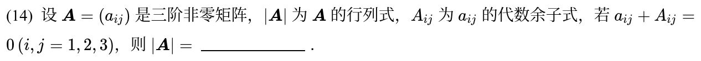
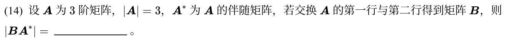

[矩阵运算、逆矩阵与初等变换 »](02-matrices.md)

# 线性代数 · 行列式

> **本章共 10 题**
> 
> - **核心必做（建议按顺序攻克关键方法）**：  
>   [第 09 题](#q09)（行交换与伴随行列式） → [第 07 题](#q07)（行列变换算行列式） → [第 04 题](#q04)（余子式组合） → [第 10 题](#q10)（提矩阵因子）
> 
> - **分流与刷题建议**：  
>   - **较难挑战**：[第 02 题](#q02)（多项式行列式取系数）  
>   - **重在看思路**：[第 01 题](#q01)（方程组提供行关系）  
>   - **首轮可跳过**：[第 08 题](#q08)（技巧较偏或综合度高，首轮不必死磕）  
> 
> - **过关目标**：会变形和按行展开，不能只会整式硬算。

---

### 01 · 2023年

> *方程组可解与行列式填空。方程组有解且方程数大于未知数数，增广矩阵行列式必为 0。利用按行展开与行列式性质建立两个行列式的倍数联系。*

答案与解析

**答案**：$8$

- **切入点与推演**：方程组含 $4$ 个方程、$3$ 个未知数且有解，故增广矩阵的最后一列可由前三列线性表示，从而 $4$ 阶增广矩阵行列式为 $0$：
  $$\begin{vmatrix} a & 0 & 1 & 1 \\ 1 & a & 1 & 0 \\ 1 & 2 & a & 0 \\ a & b & 0 & 2 \end{vmatrix} = 0.$$
  按第 $4$ 列展开（仅有 $(1,4)$ 与 $(4,4)$ 两个非零元）：
  $$1\cdot (-1)^{1+4}\begin{vmatrix} 1 & a & 1 \\ 1 & 2 & a \\ a & b & 0 \end{vmatrix} + 2\cdot (-1)^{4+4}\begin{vmatrix} a & 0 & 1 \\ 1 & a & 1 \\ 1 & 2 & a \end{vmatrix} = 0.$$
  代入已知条件 $\begin{vmatrix} a & 0 & 1 \\ 1 & a & 1 \\ 1 & 2 & a \end{vmatrix} = 4$，得
  $$-\begin{vmatrix} 1 & a & 1 \\ 1 & 2 & a \\ a & b & 0 \end{vmatrix} + 2\times 4 = 0 \implies \begin{vmatrix} 1 & a & 1 \\ 1 & 2 & a \\ a & b & 0 \end{vmatrix} = 8.$$
- **易错点**：按第 $4$ 列展开时，$(1,4)$ 元的代数余子式符号为 $(-1)^{1+4}=-1$，$(4,4)$ 元为 $(-1)^{4+4}=+1$，漏掉负号会错算成 $-8$。

---

### 02 · 2021年

> *4阶多项式行列式系数。求 $x^3$ 项系数，根据行列式定义，只有主对角线或次对角线包含 $x$ 的乘积项才可能贡献 $x^3$，按项分析最快。*

答案与解析

**答案**：$-5$

- **切入点与推演**：利用行列式定义 $f(x)=\sum (-1)^{\tau(j_1j_2j_3j_4)} a_{1j_1}a_{2j_2}a_{3j_3}a_{4j_4}$ 直接锁定含 $x^3$ 的项。观察各行含 $x$ 的位置：第 $2,3,4$ 行仅主对角元 $(2,2),(3,3),(4,4)$ 含 $x$，第 $1$ 行有 $(1,1),(1,2),(1,4)$ 含 $x$。
  要凑出 $x^3$，必须在第 $2,3,4$ 行中至少取 $2$ 个主对角元：
  1. 若第 $2,3,4$ 行全取主对角元，则第 $1$ 行只能取 $(1,1)=x$，得到主对角乘积 $x^4$（不含 $x^3$）；
  2. 若第 $2,3,4$ 行恰取 $2$ 个主对角元，则第 $1$ 行必须取含 $x$ 的非对角元 $(1,2)$ 或 $(1,4)$：
     - 取 $(1,2)=x$，余下第 $2$ 行只能取 $(2,1)=1$，第 $3,4$ 行取主对角 $(3,3)=x,\ (4,4)=x$，列标排列为 $(2,1,3,4)$，逆序数 $\tau(2,1,3,4)=1$，贡献
       $$(-1)^1 \cdot x \cdot 1 \cdot x \cdot x = -x^3;$$
     - 取 $(1,4)=2x$，余下第 $4$ 行只能取 $(4,1)=2$，第 $2,3$ 行取主对角 $(2,2)=x,\ (3,3)=x$，列标排列为 $(4,2,3,1)$（仅交换 $1,4$ 一次对换），逆序数 $\tau(4,2,3,1)=5$ 为奇数，贡献
       $$(-1)^5 \cdot (2x) \cdot x \cdot x \cdot 2 = -4x^3.$$
  合并得 $x^3$ 项为 $-x^3 - 4x^3 = -5x^3$，故系数为 $-5$。
- **易错点**：排列 $(4,2,3,1)$ 的逆序数是 $5$（奇数，对应负号），且 $(1,4)$ 元系数为 $2$、$(4,1)$ 元为 $2$，切勿漏乘系数或搞错奇偶性。

---

### 03 · 2020年

答案与解析

**答案**：$a^2(a^2-4)$

- **切入点与推演**：行列式呈对称分块结构 $\begin{pmatrix} aE & C \\ C & aE \end{pmatrix}$，其中 $C = \begin{pmatrix} -1 & 1 \\ 1 & -1 \end{pmatrix}$。利用分块行、列变换（将第 $3,4$ 行加到第 $1,2$ 行，再将第 $1,2$ 列减去第 $3,4$ 列），或直接利用 $aE$ 与 $C$ 可交换的性质：
  $$\begin{vmatrix} aE & C \\ C & aE \end{vmatrix} = |aE+C|\cdot |aE-C|.$$
  分别计算两个 $2$ 阶行列式：
  $$|aE+C| = \begin{vmatrix} a-1 & 1 \\ 1 & a-1 \end{vmatrix} = (a-1)^2 - 1 = a(a-2),$$
  $$|aE-C| = \begin{vmatrix} a+1 & -1 \\ -1 & a+1 \end{vmatrix} = (a+1)^2 - 1 = a(a+2).$$
  两者相乘即得
  $$D = a(a-2)\cdot a(a+2) = a^2(a^2-4).$$
- **易错点**：用分块公式 $\begin{vmatrix} A & B \\ B & A \end{vmatrix} = |A+B|\cdot|A-B|$ 时，要求 $A,B$ 同阶方阵（此处 $A=aE,\ B=C$ 均为 $2$ 阶），算 $|aE-C|$ 时注意 $C$ 整体取负。

---

### 04 · 2019年

答案与解析

- **第一笔观察**：先别急着分别算 $A_{11}$ 和 $A_{12}$！直接看 $A$ 的第一行元素：$(1, -1, 0, 0)$。
- **按第一行展开定理**：
  $$|A| = 1\cdot A_{11} + (-1)\cdot A_{12} + 0\cdot A_{13} + 0\cdot A_{14} = A_{11} - A_{12}.$$
  因此题目要算的 $A_{11}-A_{12}$ **就是 $|A|$ 本身**！
- **计算 $|A|$**：
  $$|A| = \begin{vmatrix}1&-1&0&0\\-2&1&-1&1\\3&-2&2&-1\\0&0&3&4\end{vmatrix} \xrightarrow{c_2+c_1} \begin{vmatrix}1&0&0&0\\-2&-1&-1&1\\3&1&2&-1\\0&0&3&4\end{vmatrix} = \begin{vmatrix}-1&-1&1\\1&2&-1\\0&3&4\end{vmatrix} \xrightarrow{r_2+r_1} \begin{vmatrix}-1&-1&1\\0&1&0\\0&3&4\end{vmatrix} = (-1)\cdot 1 \cdot 4 = -4.$$
- **答案**：$-4$。

---

### 05 · 2018年

答案与解析

**答案**：$6$

- **切入点与推演**：把三个矩阵向量等式拼成列分块矩阵方程。记 $P = (\boldsymbol\alpha_1, \boldsymbol\alpha_2, \boldsymbol\alpha_3)$，则条件等价于
  $$AP = (\boldsymbol\alpha_1, \boldsymbol\alpha_2, \boldsymbol\alpha_3)\begin{pmatrix} 2 & 0 & 0 \\ 1 & 1 & -1 \\ 1 & 2 & 1 \end{pmatrix} = PB.$$
  因为 $\boldsymbol\alpha_1, \boldsymbol\alpha_2, \boldsymbol\alpha_3$ 线性无关，所以 $3$ 阶方阵 $P$ 可逆，从而 $A = PBP^{-1}$（即 $A \sim B$）。相似矩阵行列式相等，故
  $$|A| = |B| = \begin{vmatrix} 2 & 0 & 0 \\ 1 & 1 & -1 \\ 1 & 2 & 1 \end{vmatrix} = 2\cdot\begin{vmatrix} 1 & -1 \\ 2 & 1 \end{vmatrix} = 2\times(1 + 2) = 6.$$
- **易错点**：写过渡矩阵 $B$ 时，每个 $A\boldsymbol\alpha_j$ 的展开系数应**按列**排入 $B$ 的第 $j$ 列（虽然本题转置不改行列式，但后续求特征向量或解方程时若按行写会出错）。

---

### 06 · 2015年

> *特征值映射性质题。$A$ 的特征值代入多项式直接算得 $B$ 的三个特征值为 3, 7, 1，矩阵行列式等于全部特征值之积，乘起来得 21。*

答案与解析

**答案**：$21$

- **切入点与推演**：已知 $A$ 的全部特征值，求矩阵多项式 $B = f(A)$ 的行列式，直接利用特征值映射定理：若 $\lambda$ 是 $A$ 的特征值，则 $f(\lambda) = \lambda^2 - \lambda + 1$ 是 $B = A^2 - A + E$ 的对应特征值。
  将 $\lambda_1 = 2,\ \lambda_2 = -2,\ \lambda_3 = 1$ 分别代入 $f(\lambda) = \lambda^2 - \lambda + 1$：
  - $\lambda_1 = 2 \implies 2^2 - 2 + 1 = 3$；
  - $\lambda_2 = -2 \implies (-2)^2 - (-2) + 1 = 7$；
  - $\lambda_3 = 1 \implies 1^2 - 1 + 1 = 1$。
  由行列式等于特征值之积，得
  $$|B| = 3 \times 7 \times 1 = 21.$$
- **易错点**：代入负特征值 $\lambda_2 = -2$ 时注意符号：$(-2)^2 - (-2) + 1 = 4 + 2 + 1 = 7$，切勿误算为 $4 - 2 + 1 = 3$。

---

### 07 · 2014年

答案与解析

**第一步怎么落笔**

- **触发条件**：4 阶行列式每行恰有 2 个非零元，且第 1、3 行的非零元都在第 2、3 列，第 2、4 行的非零元都在第 1、4 列。
- **第一笔**：**用行列互换把同列结构的行聚到一起，化成 2×2 分块对角行列式**，每换一次立刻在外面记一个负号。

**完整推演**

记原行列式为 $D$：
1. **交换第 1 行与第 2 行**（第 1 次交换，乘 $-1$）：
   $$D = -\begin{vmatrix} a & 0 & 0 & b \\ 0 & a & b & 0 \\ 0 & c & d & 0 \\ c & 0 & 0 & d \end{vmatrix}.$$
2. **交换第 2 行与第 4 行**（第 2 次交换，再乘 $-1$，累计符号 $+1$）：
   $$D = +\begin{vmatrix} a & 0 & 0 & b \\ c & 0 & 0 & d \\ 0 & c & d & 0 \\ 0 & a & b & 0 \end{vmatrix}.$$
3. **交换第 2 列与第 4 列**（第 3 次交换，再乘 $-1$，累计符号 $-1$）：
   $$D = -\begin{vmatrix} a & b & 0 & 0 \\ c & d & 0 & 0 \\ 0 & 0 & d & c \\ 0 & 0 & b & a \end{vmatrix}.$$
4. **套分块对角行列式公式**：
   $$D = -\begin{vmatrix} a & b \\ c & d \end{vmatrix}\begin{vmatrix} d & c \\ b & a \end{vmatrix} = -(ad-bc)(da-cb) = -(ad-bc)^2.$$
   故应选 **（B）**。

> **速验技巧（特值法）**：取 $a=d=1,\ b=c=0$，原行列式变成 $\begin{vmatrix}0&1&0&0\\1&0&0&0\\0&0&1&0\\0&0&0&1\end{vmatrix}$，只需交换第 1、2 行即得单位阵，值为 $-1$，立刻排除值为 $1$ 的（A）（C）；再取 $a=b=d=1,\ c=-1$，此时（D）$= -a^2d^2+b^2c^2 = 0$，而原行列式等于 $-4$（与（B）$=-(ad-bc)^2=-4$ 一致），瞬间锁定（B）。

**选择题关键干扰项拆解**

- **（A）$(ad-bc)^2$（最高频错选）**：算出了两个 $2\times 2$ 子块都是 $ad-bc$，但**漏算了归块过程中的奇数次行列互换**（共 3 次交换，带出一个负号）。
- **（C）$a^2d^2 - b^2c^2$ 与（D）$-a^2d^2 + b^2c^2$**：错把两块分别算成了 $ad-bc$ 和 $ad+bc$，或按第一行展开时把余子式的正负号标错。

---

### 08 · 2013年

答案与解析

**答案**：$-1$

- **切入点与推演**：将元素关系 $a_{ij} + A_{ij} = 0$（即 $A_{ij} = -a_{ij}$）翻译为矩阵方程。由于伴随矩阵 $A^*$ 的 $(i,j)$ 元是 $A_{ji}$，故
  $$A^* = -A^T.$$
  两边左乘 $A$，利用 $AA^* = |A|E$，得
  $$|A|E = -AA^T \implies AA^T = -|A|E.$$
  1. **先判 $|A| \ne 0$**：因 $A$ 为非零矩阵，必有某元素 $a_{ij} \ne 0$。考察 $AA^T$ 的第 $i$ 个主对角元：
     $$\sum_{k=1}^3 a_{ik}^2 = -|A| > 0 \implies |A| < 0,$$
     特别地 $|A| \ne 0$。
  2. **再取行列式定值**：对 $3$ 阶等式 $AA^T = -|A|E$ 两边取行列式，得
     $$|A|\cdot|A^T| = (-|A|)^3 \implies |A|^2 = -|A|^3.$$
     因为 $|A| \ne 0$，两边同除以 $|A|^2$，得 $|A| = -1$。
- **易错点**：$A^*$ 的定义带转置，所以 $A_{ij}=-a_{ij}$ 对应 $A^*=-A^T$ 而非 $-A$；同时别忘了用非零条件排除 $|A|=0$ 的增根。

---

### 09 · 2012年

答案与解析

**第一步怎么落笔**

- **触发条件**：已知 3 阶矩阵的 $|A|=3$，求 $|BA^*|$，且 $B$ 由 $A$ 经一次初等行变换得到。
- **第一笔**：直接套行列式乘法公式拆分目标式，把 $|B|$ 与 $|A^*|$ 分别表达为 $|A|$ 的函数：
  $$|BA^*| = |B|\cdot |A^*|.$$

**完整推演**

1. **求 $|B|$**：交换 $A$ 的第一行与第二行得到 $B$，等价于 $B = E(1,2)A$。互换两行行列式变号，故
   $$|B| = -|A| = -3.$$
2. **求 $|A^*|$**：对 $n$ 阶矩阵有 $|A^*| = |A|^{n-1}$。本题 $n=3$，故
   $$|A^*| = |A|^{3-1} = 3^2 = 9.$$
3. **合并**：
   $$|BA^*| = |B|\cdot |A^*| = (-3)\times 9 = -27.$$
   （也可直接用矩阵乘法视角：$B = E(1,2)A \implies BA^* = E(1,2)AA^* = E(1,2)(|A|E) = 3E(1,2)$，再取 3 阶行列式得 $|3E(1,2)| = 3^3 |E(1,2)| = 27\times(-1) = -27$，两条路完全一致。）

---

### 10 · 2010年

答案与解析

**答案**：$3$

- **切入点与推演**：已知 $|A|=3 \ne 0,\ |B|=2 \ne 0$，故 $A, B$ 均可逆。观察目标式 $A + B^{-1}$ 与已知式 $A^{-1} + B$，通过右乘 $A$、左提 $B$ 将两者挂钩：
  $$(A^{-1} + B)A = E + BA = B(B^{-1} + A) = B(A + B^{-1}).$$
  对等式两边取行列式，利用 $|XY|=|X||Y|$：
  $$|A^{-1} + B|\cdot |A| = |B|\cdot |A + B^{-1}|.$$
  代入 $|A|=3,\ |B|=2,\ |A^{-1}+B|=2$，得
  $$2 \times 3 = 2|A + B^{-1}| \implies |A + B^{-1}| = 3.$$
- **易错点**：矩阵乘法不可交换，提取 $A, B$ 时必须严格保持左右顺序（若左乘 $A$ 得 $E+AB$，则需右提 $B$ 写成 $(B^{-1}+A)B$，结果同样成立）。

---

[矩阵运算、逆矩阵与初等变换 »](02-matrices.md)
