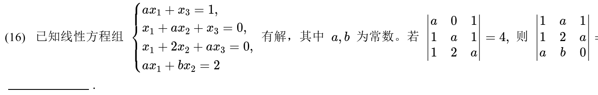
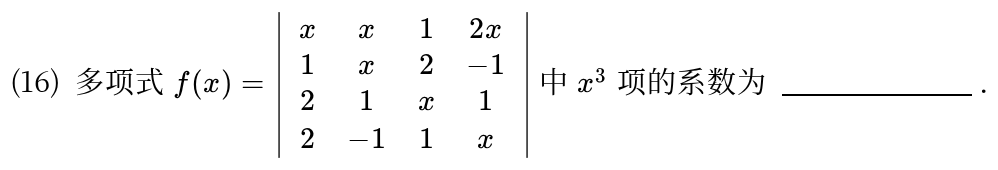
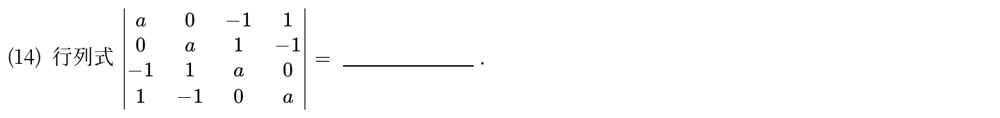
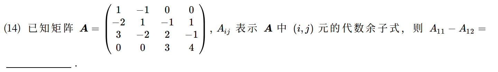
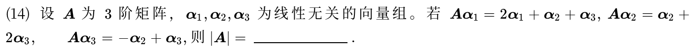
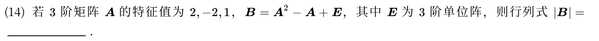
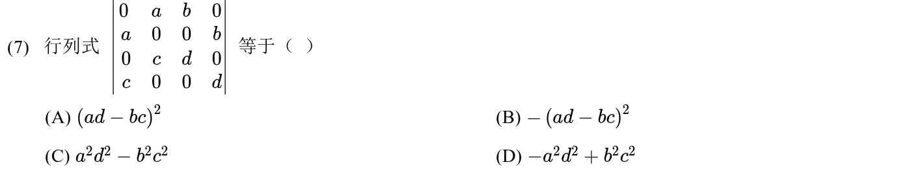
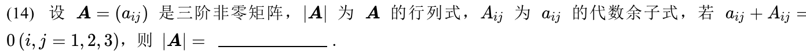
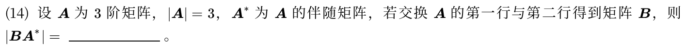
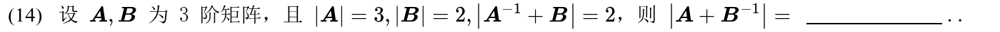

[矩阵运算、逆矩阵与初等变换 »](02-matrices.md)

# 线性代数 · 行列式

> **全章 10 题｜本表头已点名 10 题｜未归类 0 题。**\
> **必会 4 题·按此顺序**：[2012-14](#q2012-14)（行交换与伴随行列式） → [2014-07](#q2014-7)（行列变换算行列式） → [2019-14](#q2019-14)（余子式组合） → [2010-14](#q2010-14)（提矩阵因子）\
> **补练 3 题·按薄弱点选做**：[2020-14](#q2020-14)、[2018-14](#q2018-14)、[2015-14](#q2015-14)\
> **冲一冲 1 题**：[2021-16](#q2021-16)（多项式行列式取系数）\
> **见识 1 题·先会开题**：[2023-16](#q2023-16)（方程组提供行关系）\
> **首轮后放 1 题·本轮可跳过**：[2013-14](#q2013-14)\
> **首轮过关**：会变形和按行展开，不能只会整式硬算。

---

## 2023年

### 01 · 2023-16 · 填空题 ·【见识】

> 方程组可解与行列式填空。方程组有解且方程数大于未知数数，增广矩阵行列式必为 0。利用按行展开与行列式性质建立两个行列式的倍数联系。

*关联章节：[线性方程组](04-linear-systems.md)*

---

## 2021年

### 02 · 2021-16 · 填空题 ·【冲一冲】

> 4阶多项式行列式系数。求  项系数，根据行列式定义，只有主对角线或次对角线包含  的乘积项才可能贡献 ，按项分析最快。

---

## 2020年

### 03 · 2020-14 · 填空题 ·【补练】

---

## 2019年

### 04 · 2019-14 · 填空题 ·【必会】

---

## 2018年

### 05 · 2018-14 · 填空题 ·【补练】

*关联章节：[向量组、线性相关与秩](03-vectors-rank.md) · [特征值、特征向量与相似](05-eigenvalues-similarity.md)*

---

## 2015年

### 06 · 2015-14 · 填空题 ·【补练】

> 特征值映射性质题。 的特征值代入多项式直接算得  的三个特征值为 3, 7, 1，矩阵行列式等于全部特征值之积，乘起来得 21。

*关联章节：[特征值、特征向量与相似](05-eigenvalues-similarity.md)*

---

## 2014年

### 07 · 2014-07 · 选择题 ·【必会】

---

## 2013年

### 08 · 2013-14 · 填空题 ·【首轮后放】

---

## 2012年

### 09 · 2012-14 · 填空题 ·【必会】

---

## 2010年

### 10 · 2010-14 · 填空题 ·【必会】

---

## 交叉考点索引

以下题目主归其他章节，点击跳转到对应章节题目；不计入本章主收录题数：

- [2026年 · 第8题](02-matrices.md)（主章节：矩阵运算、逆矩阵与初等变换）
- [2025年 · 第8题](05-eigenvalues-similarity.md)（主章节：特征值、特征向量与相似）
- [2015年 · 第23题](05-eigenvalues-similarity.md)（主章节：特征值、特征向量与相似）
- [2012年 · 第22题](04-linear-systems.md)（主章节：线性方程组）

[矩阵运算、逆矩阵与初等变换 »](02-matrices.md)
