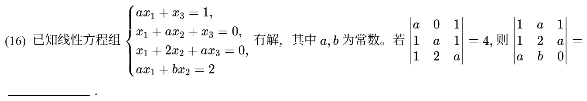
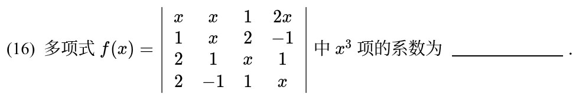
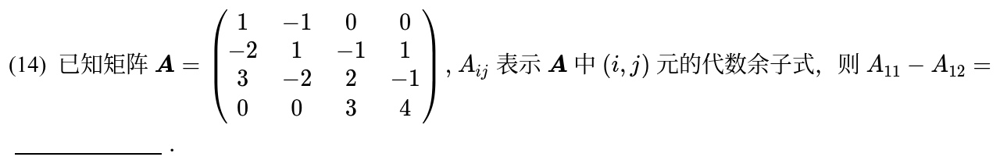
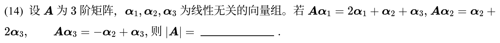
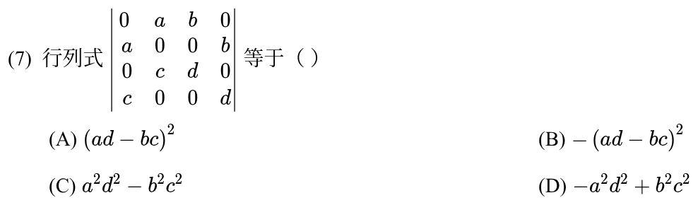
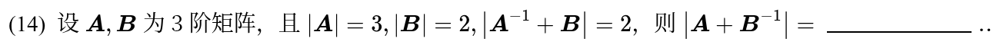

[矩阵运算、逆矩阵与初等变换 »](02-matrices.md)

# 线性代数 · 行列式

> **本章共 10 题**
> 
> - **核心必做（建议按顺序攻克关键方法）**：  
>   [第 09 题](#q09)（行交换与伴随行列式） → [第 07 题](#q07)（行列变换算行列式） → [第 04 题](#q04)（余子式组合） → [第 10 题](#q10)（提矩阵因子）
> 
> - **分流与刷题建议**：  
>   - **较难挑战**：[第 02 题](#q02)（多项式行列式取系数）  
>   - **重在看思路**：[第 01 题](#q01)（方程组提供行关系）  
>   - **首轮可跳过**：[第 08 题](#q08)（技巧较偏或综合度高，首轮不必死磕）  
> 
> - **过关目标**：会变形和按行展开，不能只会整式硬算。

---

### 01 · 2023年

> *方程组可解与行列式填空。方程组有解且方程数大于未知数数，增广矩阵行列式必为 0。利用按行展开与行列式性质建立两个行列式的倍数联系。*

答案与解析

**答案 $8$。** 方程组有解，故四阶增广矩阵的最后一列是前三列的线性组合，行列式为零。沿最后一列展开，第一行号为负、第四行号为正，得 $-D+2\cdot4=0$，其中 $D$ 即所求三阶行列式。

---

### 02 · 2021年

> *4阶多项式行列式系数。求 $x^3$ 项系数，根据行列式定义，只有主对角线或次对角线包含 $x$ 的乘积项才可能贡献 $x^3$，按项分析最快。*

答案与解析

**答案 $-5$。** 仅取三个含 $x$ 的因子。第 2、3、4 行的 $x$ 只在对角线。若第 1 行也取对角线则是四次项；贡献三次项的排列只有交换第 1、2 列或第 1、4 列对应的主对角取法，贡献分别为 $-x^3$ 和 $-4x^3$。

---

### 03 · 2020年

答案与解析

**答案 $a^2(a^2-4)$。** 块写成 $\begin{pmatrix}aI&C\\C&aI\end{pmatrix}$，其中 $C=\begin{pmatrix}-1&1\\1&-1\end{pmatrix}$ 的特征值为 $0,-2$。对任一 $C$ 的特征向量 $v$，拼成 $(v,v)$ 和 $(v,-v)$，分别对应特征值 $a+\lambda,a-\lambda$。四个特征值的乘积即得。

---

### 04 · 2019年

答案与解析

- **第一笔观察**：先别急着分别算 $A_{11}$ 和 $A_{12}$！直接看 $A$ 的第一行元素：$(1, -1, 0, 0)$。
- **按第一行展开定理**：
  $$|A| = 1\cdot A_{11} + (-1)\cdot A_{12} + 0\cdot A_{13} + 0\cdot A_{14} = A_{11} - A_{12}.$$
  因此题目要算的 $A_{11}-A_{12}$ **就是 $|A|$ 本身**！
- **计算 $|A|$**：
  $$|A| = \begin{vmatrix}1&-1&0&0\\-2&1&-1&1\\3&-2&2&-1\\0&0&3&4\end{vmatrix} \xrightarrow{c_2+c_1} \begin{vmatrix}1&0&0&0\\-2&-1&-1&1\\3&1&2&-1\\0&0&3&4\end{vmatrix} = \begin{vmatrix}-1&-1&1\\1&2&-1\\0&3&4\end{vmatrix} \xrightarrow{r_2+r_1} \begin{vmatrix}-1&-1&1\\0&1&0\\0&3&4\end{vmatrix} = (-1)\cdot 1 \cdot 4 = -4.$$
- **答案**：$-4$。

---

### 05 · 2018年

答案与解析

**答案 $6$。** 在以 $\alpha_1,\alpha_2,\alpha_3$ 为基的坐标下，$A$ 的矩阵为 $\begin{pmatrix}2&0&0\\1&1&-1\\1&2&1\end{pmatrix}$。它与 $A$ 相似，行列式相同，按首行展开得 $2(1+2)=6$。

---

### 06 · 2015年

> *特征值映射性质题。$A$ 的特征值代入多项式直接算得 $B$ 的三个特征值为 3, 7, 1，矩阵行列式等于全部特征值之积，乘起来得 21。*

答案与解析

**答案 $21$。** $A^2-A+I$ 的特征值由 $\lambda^2-\lambda+1$ 映射得到 $3,7,1$，行列式为其乘积。

---

### 07 · 2014年

答案与解析

**第一步怎么落笔**

- **触发条件**：4 阶行列式每行恰有 2 个非零元，且第 1、3 行的非零元都在第 2、3 列，第 2、4 行的非零元都在第 1、4 列。
- **第一笔**：**用行列互换把同列结构的行聚到一起，化成 2×2 分块对角行列式**，每换一次立刻在外面记一个负号。

**完整推演**

记原行列式为 $D$：
1. **交换第 1 行与第 2 行**（第 1 次交换，乘 $-1$）：
   $$D = -\begin{vmatrix} a & 0 & 0 & b \\ 0 & a & b & 0 \\ 0 & c & d & 0 \\ c & 0 & 0 & d \end{vmatrix}.$$
2. **交换第 2 行与第 4 行**（第 2 次交换，再乘 $-1$，累计符号 $+1$）：
   $$D = +\begin{vmatrix} a & 0 & 0 & b \\ c & 0 & 0 & d \\ 0 & c & d & 0 \\ 0 & a & b & 0 \end{vmatrix}.$$
3. **交换第 2 列与第 4 列**（第 3 次交换，再乘 $-1$，累计符号 $-1$）：
   $$D = -\begin{vmatrix} a & b & 0 & 0 \\ c & d & 0 & 0 \\ 0 & 0 & d & c \\ 0 & 0 & b & a \end{vmatrix}.$$
4. **套分块对角行列式公式**：
   $$D = -\begin{vmatrix} a & b \\ c & d \end{vmatrix}\begin{vmatrix} d & c \\ b & a \end{vmatrix} = -(ad-bc)(da-cb) = -(ad-bc)^2.$$
   故应选 **（B）**。

> **速验技巧（特值法）**：取 $a=d=1,\ b=c=0$，原行列式变成 $\begin{vmatrix}0&1&0&0\\1&0&0&0\\0&0&1&0\\0&0&0&1\end{vmatrix}$，只需交换第 1、2 行即得单位阵，值为 $-1$，立刻排除值为 $1$ 的（A）（C）；再取 $a=b=d=1,\ c=-1$，此时（D）$= -a^2d^2+b^2c^2 = 0$，而原行列式等于 $-4$（与（B）$=-(ad-bc)^2=-4$ 一致），瞬间锁定（B）。

**选择题关键干扰项拆解**

- **（A）$(ad-bc)^2$（最高频错选）**：算出了两个 $2\times 2$ 子块都是 $ad-bc$，但**漏算了归块过程中的奇数次行列互换**（共 3 次交换，带出一个负号）。
- **（C）$a^2d^2 - b^2c^2$ 与（D）$-a^2d^2 + b^2c^2$**：错把两块分别算成了 $ad-bc$ 和 $ad+bc$，或按第一行展开时把余子式的正负号标错。

---

### 08 · 2013年

答案与解析

**答案 $-1$。** 题设为 $A^*=-A^T$，故 $AA^T=-|A|I$。若 $|A|=0$，则 $AA^T=0$ 使所有行的平方范数都为零，违背非零假设。两边取行列式得 $|A|^2=(-|A|)^3$，除去非零因子即得。

---

### 09 · 2012年

答案与解析

**第一步怎么落笔**

- **触发条件**：已知 3 阶矩阵的 $|A|=3$，求 $|BA^*|$，且 $B$ 由 $A$ 经一次初等行变换得到。
- **第一笔**：直接套行列式乘法公式拆分目标式，把 $|B|$ 与 $|A^*|$ 分别表达为 $|A|$ 的函数：
  $$|BA^*| = |B|\cdot |A^*|.$$

**完整推演**

1. **求 $|B|$**：交换 $A$ 的第一行与第二行得到 $B$，等价于 $B = E(1,2)A$。互换两行行列式变号，故
   $$|B| = -|A| = -3.$$
2. **求 $|A^*|$**：对 $n$ 阶矩阵有 $|A^*| = |A|^{n-1}$。本题 $n=3$，故
   $$|A^*| = |A|^{3-1} = 3^2 = 9.$$
3. **合并**：
   $$|BA^*| = |B|\cdot |A^*| = (-3)\times 9 = -27.$$
   （也可直接用矩阵乘法视角：$B = E(1,2)A \implies BA^* = E(1,2)AA^* = E(1,2)(|A|E) = 3E(1,2)$，再取 3 阶行列式得 $|3E(1,2)| = 3^3 |E(1,2)| = 27\times(-1) = -27$，两条路完全一致。）

---

### 10 · 2010年

答案与解析

**答案 $3$。** 注意乘法顺序，$(A^{-1}+B)A=I+BA=B(A+B^{-1})$。取行列式得 $2\cdot3=2|A+B^{-1}|$，所以为 3。

---

[矩阵运算、逆矩阵与初等变换 »](02-matrices.md)
