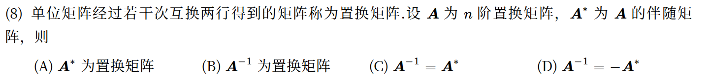
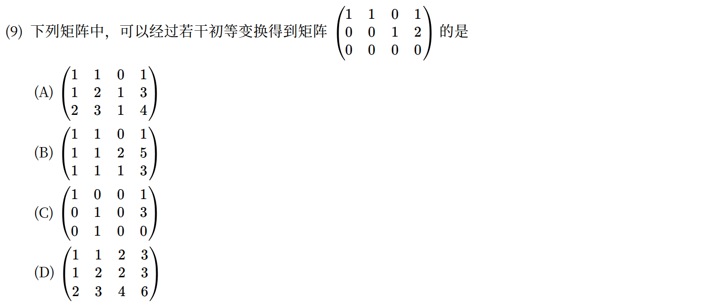
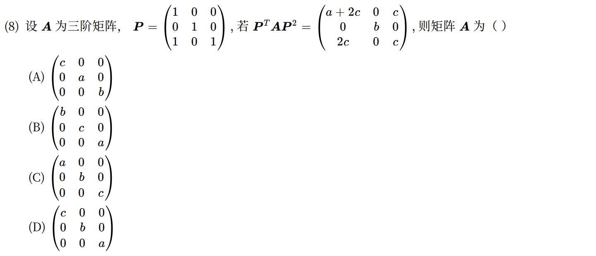
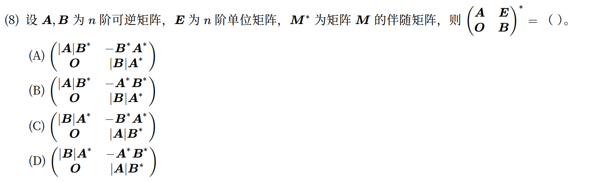
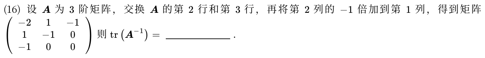
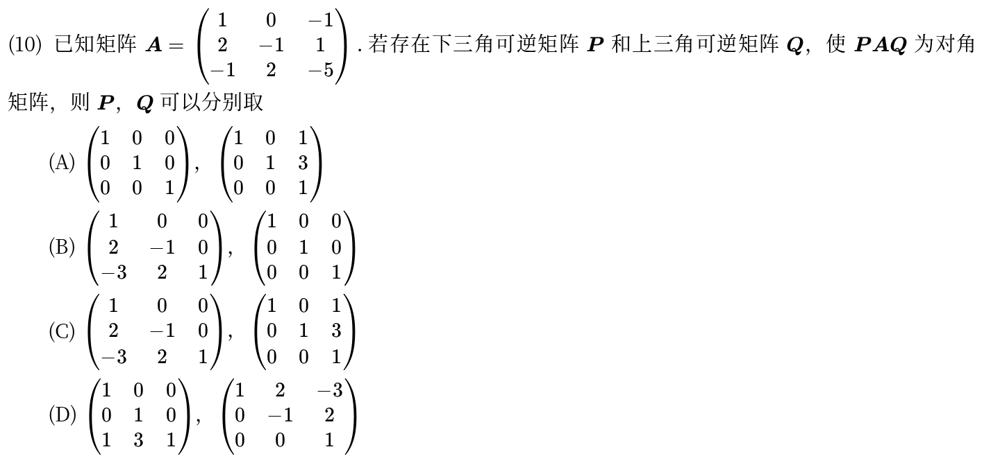
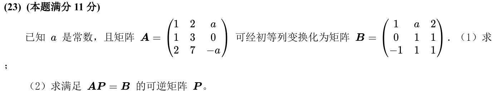
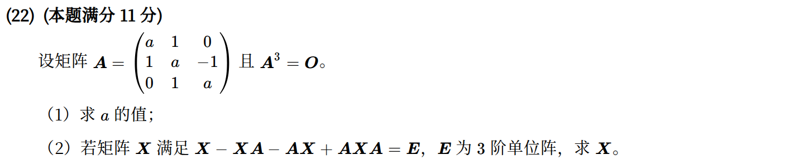
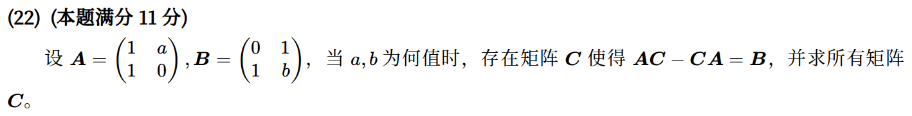
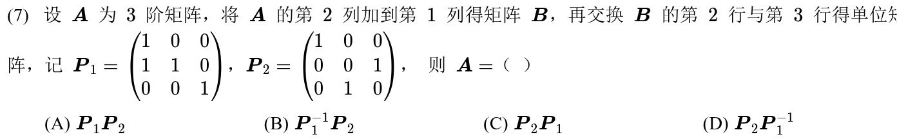

[« 行列式](01-determinants.md)　　[向量组、线性相关与秩 »](03-vectors-rank.md)

# 线性代数 · 矩阵运算、逆矩阵与初等变换

> **必会·按此顺序**：[2011-07](#q2011-7)（分清左乘与右乘） → [2024-08](#q2024-8)（矩阵乘法顺序） → [2026-08](#q2026-8)（逆矩阵与伴随矩阵） → [2018-23](#q2018-23)（列变换求变换矩阵）  
> **冲一冲**：[2015-22](#q2015-22)（幂零矩阵与方程因式分解）  
> **见识·先会开题**：[2023-08](#q2023-8)（分块矩阵先求逆再求伴随）  
> **首轮过关**：能把行、列操作还原为矩阵乘法，并独立求出变换矩阵。

---

## 2026年

### 01 · 2026-08 · 选择题

> 置换矩阵性质题。置换矩阵每行每列恰有一个 1，由初等变换性质可知必为正交矩阵，即 ；其行列式为 ，伴随矩阵立可判定。

*关联章节：[行列式](01-determinants.md)*

---

## 2025年

### 02 · 2025-09 · 选择题

---

## 2024年

### 03 · 2024-08 · 选择题

*关联章节：[特征值、特征向量与相似](05-eigenvalues-similarity.md)*

---

## 2023年

### 04 · 2023-08 · 选择题

---

## 2022年

### 05 · 2022-16 · 填空题

---

## 2021年

### 06 · 2021-10 · 选择题

---

## 2018年

### 07 · 2018-23 · 解答题

> 初等列变换与矩阵方程大题。列变换相当于右乘初等矩阵 。把  做行初等变换求出 ，转置即可得 。

*关联章节：[线性方程组](04-linear-systems.md)*

---

## 2015年

### 08 · 2015-22 · 解答题

> 幂零矩阵与可逆矩阵方程。由  联想因式分解 ；把方程因式分解配凑成 ，两边求逆秒解 。

*关联章节：[特征值、特征向量与相似](05-eigenvalues-similarity.md)*

---

## 2013年

### 09 · 2013-22 · 解答题

*关联章节：[线性方程组](04-linear-systems.md)*

---

## 2011年

### 10 · 2011-07 · 选择题

---

## 交叉考点索引

以下题目主归其他章节，点击跳转到对应章节题目；不计入本章主收录题数：

- [2026年 · 第10题](05-eigenvalues-similarity.md)（主章节：特征值、特征向量与相似）
- [2026年 · 第22题](03-vectors-rank.md)（主章节：向量组、线性相关与秩）
- [2023年 · 第22题](05-eigenvalues-similarity.md)（主章节：特征值、特征向量与相似）
- [2022年 · 第8题](05-eigenvalues-similarity.md)（主章节：特征值、特征向量与相似）
- [2020年 · 第23题](05-eigenvalues-similarity.md)（主章节：特征值、特征向量与相似）
- [2016年 · 第23题](05-eigenvalues-similarity.md)（主章节：特征值、特征向量与相似）
- [2014年 · 第22题](04-linear-systems.md)（主章节：线性方程组）
- [2013年 · 第7题](03-vectors-rank.md)（主章节：向量组、线性相关与秩）
- [2011年 · 第8题](04-linear-systems.md)（主章节：线性方程组）

[« 行列式](01-determinants.md)　　[向量组、线性相关与秩 »](03-vectors-rank.md)
