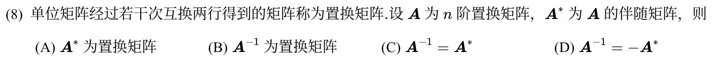
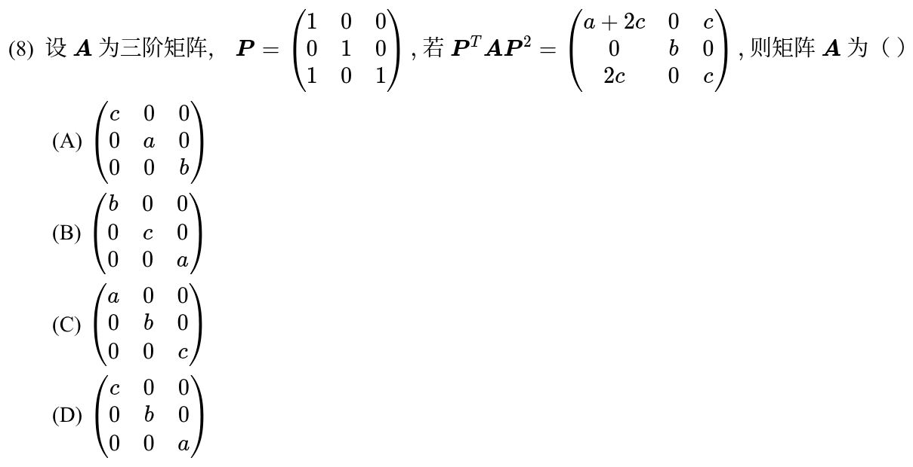
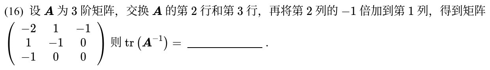
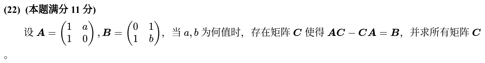

[« 行列式](01-determinants.md)　　[向量组、线性相关与秩 »](03-vectors-rank.md)

# 线性代数 · 矩阵运算、逆矩阵与初等变换

> **本章共 10 题**
> 
> - **核心必做（建议按顺序攻克关键方法）**：  
>   [第 10 题](#q10)（分清左乘与右乘） → [第 03 题](#q03)（矩阵乘法顺序） → [第 01 题](#q01)（逆矩阵与伴随矩阵） → [第 07 题](#q07)（列变换求变换矩阵）
> 
> - **分流与刷题建议**：  
>   - **较难挑战**：[第 08 题](#q08)（幂零矩阵与方程因式分解）  
>   - **重在看思路**：[第 04 题](#q04)（分块矩阵先求逆再求伴随）  
>   - **首轮可跳过**：[第 09 题](#q09)（技巧较偏或综合度高，首轮不必死磕）  
> 
> - **过关目标**：能把行、列操作还原为矩阵乘法，并独立求出变换矩阵。

---

### 01 · 2026年

> *置换矩阵性质题。置换矩阵每行每列恰有一个 1，由初等变换性质可知必为正交矩阵，即 $A^{-1} = A^T$；其行列式为 $\pm 1$，伴随矩阵立可判定。*

答案与解析

- **第一笔翻译定义**：$A$ 是由单位矩阵 $E$ 经过若干次互换两行得到的，因此可写成有限个对换初等矩阵的乘积：
  $$A = P_k P_{k-1}\cdots P_1,$$
  其中每个对换矩阵 $P_i$ 满足 $P_i^{-1} = P_i = P_i^T$，且 $|P_i| = -1$。
- **逐项检验**：
  - 求逆：$A^{-1} = P_1^{-1}\cdots P_{k-1}^{-1}P_k^{-1} = P_1\cdots P_{k-1}P_k$，仍然是若干个对换初等矩阵的乘积，即对 $E$ 经若干次互换两行得到，因此 **$A^{-1}$ 必为置换矩阵**，**（B）正确**。
  - 排除（A）（C）（D）：由 $A^* = |A|A^{-1} = (-1)^k A^{-1}$，当 $k$ 为奇数（如 $A$ 仅交换两行）时，$|A|=-1$，$A^* = -A^{-1}$ 含元素 $-1$，不是置换矩阵（排除 A），且 $A^{-1} = -A^*$（排除 C）；当 $k$ 为偶数（如 $A=E$）时，$|A|=1$，$A^{-1} = A^*$（排除 D）。
- **答案**：**（B）**。

---

### 02 · 2025年

答案与解析

**题面待核。若限定初等行变换，答案 B。** B 的第二、三行各减第一行，变成 $(0,0,2,4)$、$(0,0,1,2)$，继续消元即可。若把当前转写“初等变换”理解成允许行、列两类变换，则 A、B、D 都是秩 2 并与目标矩阵等价。仓库题图未限定行变换，需要核对独立原卷。

---

### 03 · 2024年

答案与解析

**第一步怎么落笔**

- **触发条件**：矩阵方程 $P^T A P^2 = C$，其中 $P = \begin{pmatrix}1&0&0\\0&1&0\\1&0&1\end{pmatrix}$ 是最简单的**倍加初等矩阵** $E_{31}(1)$。
- **第一笔**：直接利用倍加初等矩阵的幂与转置公式，把 $A = (P^T)^{-1} C (P^2)^{-1}$ 翻译成**两步初等变换**（一次行倍加、一次列倍加），十秒出答案。

**完整推演**

1. **写出左右逆因子**：
   - $P = E_{31}(1)$（把第 1 行加到第 3 行），故 $P^2 = E_{31}(2)$，其逆为
     $$(P^2)^{-1} = E_{31}(-2) = \begin{pmatrix}1&0&0\\0&1&0\\-2&0&1\end{pmatrix}.$$
     **右乘 $(P^2)^{-1}$** 等价于列变换：**把第 3 列的 $(-2)$ 倍加到第 1 列**（注意右乘倍加阵 $E_{31}(k)$ 时，是把第 3 列乘 $k$ 加到第 1 列！）。
   - $P^T = E_{13}(1) = \begin{pmatrix}1&0&1\\0&1&0\\0&0&1\end{pmatrix}$，其逆为
     $$(P^T)^{-1} = E_{13}(-1) = \begin{pmatrix}1&0&-1\\0&1&0\\0&0&1\end{pmatrix}.$$
     **左乘 $(P^T)^{-1}$** 等价于行变换：**把第 3 行的 $(-1)$ 倍加到第 1 行**。
2. **对右边矩阵 $C = \begin{pmatrix}a+2c&0&c\\0&b&0\\2c&0&c\end{pmatrix}$ 依次做这两步变换**：
   - 先左乘 $(P^T)^{-1}$（$r_1 - r_3$）：
     $$\begin{pmatrix}a+2c&0&c\\0&b&0\\2c&0&c\end{pmatrix} \xrightarrow{r_1 - r_3} \begin{pmatrix}a&0&0\\0&b&0\\2c&0&c\end{pmatrix}.$$
   - 再右乘 $(P^2)^{-1}$（$c_1 - 2c_3$）：
     $$\begin{pmatrix}a&0&0\\0&b&0\\2c&0&c\end{pmatrix} \xrightarrow{c_1 - 2c_3} \begin{pmatrix}a&0&0\\0&b&0\\0&0&c\end{pmatrix}.$$
   因此 $A = \operatorname{diag}(a, b, c)$，选 **（C）**。

> **反向检验（零出错率）**：把选项（C）的 $A=\operatorname{diag}(a,b,c)$ 代回 $P^T A P^2$，因为 $P^T = E_{13}(1)$（行 1 加行 3）、$P^2 = E_{31}(2)$（列 1 加 2 倍列 3）：
> $$\begin{pmatrix}a&0&0\\0&b&0\\0&0&c\end{pmatrix} \xrightarrow{r_1+r_3} \begin{pmatrix}a&0&c\\0&b&0\\0&0&c\end{pmatrix} \xrightarrow{c_1+2c_3} \begin{pmatrix}a+2c&0&c\\0&b&0\\2c&0&c\end{pmatrix},$$
> 与题干右端完全一致！

**选择题关键干扰项拆解**

- **（D）$\operatorname{diag}(c, b, a)$**：把右乘 $E_{31}(-2)$ 的方向搞反，误以为是“第 1 列乘 $-2$ 加到第 3 列”，导致 $a,c$ 位置错位。
- **（A）、（B）**：只看对角元排列猜答案，没注意到原矩阵第 2 行、第 2 列只有 $(2,2)$ 元非零且等于 $b$，而 $P$ 在第 2 行/列为单位块，因此 $A$ 的 $(2,2)$ 元必为 $b$，可直接秒杀排除（A）（B）。

---

### 04 · 2023年

答案与解析

**答案 D。** 设所给块矩阵为 $M$，直接乘回可验证 $M^{-1}=\begin{pmatrix}A^{-1}&-A^{-1}B^{-1}\\0&B^{-1}\end{pmatrix}$，而 $|M|=|A||B|$。乘上行列式并用 $A^*=|A|A^{-1}$ 即得 D。右上角的顺序由块乘法决定。

---

### 05 · 2022年

答案与解析

**答案 $-1$。** 倒序撤销列变换与行交换，得 $A=\begin{pmatrix}-1&1&-1\\-1&0&0\\0&-1&0\end{pmatrix}$。解 $Ax=b$ 得 $x=(-b_2,-b_3,-b_1+b_2-b_3)^T$，故逆矩阵的对角元为 $0,0,-1$。

---

### 06 · 2021年

答案与解析

**答案 C。** 用所列非单位下三角矩阵 $P$ 左乘，恰得 $\begin{pmatrix}1&0&-1\\0&1&-3\\0&0&0\end{pmatrix}$。随后右乘 C 的 $Q$ 相当于把第 1 列与三倍第 2 列加到第 3 列，得到 $\operatorname{diag}(1,1,0)$。

---

### 07 · 2018年

> *初等列变换与矩阵方程大题。列变换相当于右乘初等矩阵 $P$。把 $(A^T | B^T)$ 做行初等变换求出 $P^T$，转置即可得 $P$。*

答案与解析

**第（1）问：怎么用“初等列变换”锁定参数 $a$？**

- **触发条件**：$A$ 可经初等列变换化为 $B$ $\iff$ 存在可逆矩阵 $P$ 使得 $AP = B$ $\iff$ $r(A)=r(B)=r(A,B)$（且 $A,B$ 列向量组等价）。
- **第一步怎么落笔**：先算 $|A|$ 或直接对增广矩阵 $(A\mid B)$ 做初等行变换！先算行列式最快：
  $$|A| = \begin{vmatrix}1&2&a\\1&3&0\\2&7&-a\end{vmatrix} \xrightarrow[r_3-2r_1]{r_2-r_1} \begin{vmatrix}1&2&a\\0&1&-a\\0&3&-3a\end{vmatrix} = 0.$$
  因为 $|A| \equiv 0$（对任意 $a$ 都不可逆），而 $B = AP$ 且 $|P|\neq 0$，所以必有 $|B| = |A||P| = 0$。
- **由 $|B|=0$ 定出 $a$**：
  $$|B| = \begin{vmatrix}1&a&2\\0&1&1\\-1&1&1\end{vmatrix} \xrightarrow{r_3+r_1} \begin{vmatrix}1&a&2\\0&1&1\\0&a+1&3\end{vmatrix} = 3 - (a+1) = 2 - a.$$
  令 $|B|=0$，得
  $$a = 2.$$
- **必须补一步充分性验证**（解答题拿满分的必要动作）：$|A|=|B|=0$ 只是必要条件，还要验证 $a=2$ 时 $A$ 确实能经初等列变换化为 $B$（即 $r(A)=r(B)=r(A,B)$）。事实上，下面第（2）问把 $(A\mid B)$ 化成行最简形时会自动验证这一点。

**第（2）问：不可逆时如何求出所有满足 $AP=B$ 的可逆矩阵 $P$？**

- **触发条件**：$a=2$ 时 $r(A)=2<3$，$A$ 不可逆，绝对不能写 $P=A^{-1}B$。
- **第一步怎么落笔**：把 $P$ 按列分块记为 $P = (\boldsymbol{p}_1, \boldsymbol{p}_2, \boldsymbol{p}_3)$，则 $AP=B$ 等价于同时求解三个线性方程组 $A\boldsymbol{p}_1=\boldsymbol{b}_1$、$A\boldsymbol{p}_2=\boldsymbol{b}_2$、$A\boldsymbol{p}_3=\boldsymbol{b}_3$，因此直接对 $(A\mid B)$ 做初等行变换化成行最简形！
- **完整推演**：
  当 $a=2$ 时，
  $$(A\mid B) = \left(\begin{array}{ccc|ccc} 1&2&2 & 1&2&2 \\ 1&3&0 & 0&1&1 \\ 2&7&-2 & -1&1&1 \end{array}\right) \xrightarrow[r_3-2r_1]{r_2-r_1} \left(\begin{array}{ccc|ccc} 1&2&2 & 1&2&2 \\ 0&1&-2 & -1&-1&-1 \\ 0&3&-6 & -3&-3&-3 \end{array}\right)$$
  $$\xrightarrow[r_1-2r_2]{r_3-3r_2} \left(\begin{array}{ccc|ccc} 1&0&6 & 3&4&4 \\ 0&1&-2 & -1&-1&-1 \\ 0&0&0 & 0&0&0 \end{array}\right).$$
  由此同时确认 $r(A)=r(B)=r(A,B)=2$（第（1）问充分性成立！）。

  读出齐次方程组 $A\boldsymbol{x}=\boldsymbol{0}$ 的基础解系为 $\boldsymbol{\xi} = (-6, 2, 1)^T$，三个非齐次方程组的特解分别为 $(3,-1,0)^T$、$(4,-1,0)^T$、$(4,-1,0)^T$。因此满足 $AP=B$ 的全部矩阵为：
  $$P = \begin{pmatrix} 3-6k_1 & 4-6k_2 & 4-6k_3 \\ -1+2k_1 & -1+2k_2 & -1+2k_3 \\ k_1 & k_2 & k_3 \end{pmatrix}, \qquad k_1, k_2, k_3 \in \mathbb{R}.$$

- **最后一步（千万别漏！）：加上“$P$ 可逆”的条件 $|P|\neq 0$**：
  $$|P| = \begin{vmatrix} 3-6k_1 & 4-6k_2 & 4-6k_3 \\ -1+2k_1 & -1+2k_2 & -1+2k_3 \\ k_1 & k_2 & k_3 \end{vmatrix} \xrightarrow[r_2-2r_3]{r_1+6r_3} \begin{vmatrix} 3 & 4 & 4 \\ -1 & -1 & -1 \\ k_1 & k_2 & k_3 \end{vmatrix} \xrightarrow{c_3-c_2} \begin{vmatrix} 3 & 4 & 0 \\ -1 & -1 & 0 \\ k_1 & k_2 & k_3-k_2 \end{vmatrix} = k_3 - k_2.$$
  因此 $P$ 可逆的充要条件是 $k_2 \neq k_3$。
  - 若只需给出一个满足条件的可逆矩阵 $P$，取 $k_1=k_2=0, k_3=1$ 得 $P = \begin{pmatrix}3&4&-2\\-1&-1&1\\0&0&1\end{pmatrix}$；
  - 写全解则答：上述 $P$，其中 $k_1, k_2, k_3$ 为任意实数且 $k_2 \neq k_3$。

---

### 08 · 2015年

> *幂零矩阵与可逆矩阵方程。由 $A^3=O$ 联想因式分解 $(E-A)(E+A+A^2)=E$；把方程因式分解配凑成 $(E-A)X(E-A)=E$，两边求逆秒解 $X$。*

答案与解析

**解。** （1）$A^3=0$ 迫使全部特征值为零，所以迹 $3a=0$。

（2）原式因式分解为 $(I-A)X(I-A)=I$。由 $A^3=0$，$(I-A)^{-1}=I+A+A^2$，故 $X=I+2A+3A^2$。代 $a=0$ 即得
$$
X=\begin{pmatrix}4&2&-3\\2&1&-2\\3&2&-2\end{pmatrix}.
$$

---

### 09 · 2013年

答案与解析

**解。** 取迹得 $\operatorname{tr}B=b=0$。两边左乘 $A$ 后再取迹，左边仍为零（矩阵乘积的迹可循环），所以 $\operatorname{tr}(AB)=a+1=0$，即 $a=-1$。代回逐元素比较，得到所有解
$$
C=\begin{pmatrix}1+s+t&-s\\s&t\end{pmatrix},\qquad s,t\in\mathbb R.
$$
直接相乘可验这些矩阵均满足原式。

---

### 10 · 2011年

答案与解析

**第一步怎么落笔**

- **触发条件**：对 $A$ 依次做一次列变换、一次行变换得到单位矩阵 $E$，并直接给出了 $P_1, P_2$。
- **第一笔**：**先核对 $P_1, P_2$ 分别对应哪一步变换**，再按“左行右列”写出连接 $A$ 与 $E$ 的等式。

**完整推演**

1. **核对初等矩阵**：
   - 将 $E$ 的第 2 列加到第 1 列，第 1 列变为 $(1,1,0)^T$，正好得到 $P_1 = \begin{pmatrix}1&0&0\\1&1&0\\0&0&1\end{pmatrix}$。
     因为是**列变换**，所以右乘 $P_1$：
     $$B = A P_1.$$
   - 交换 $E$ 的第 2 行与第 3 行，正好得到 $P_2 = \begin{pmatrix}1&0&0\\0&0&1\\0&1&0\end{pmatrix}$。
     因为是**行变换**，所以左乘 $P_2$：
     $$P_2 B = E \implies P_2 A P_1 = E.$$
2. **从等式反解 $A$**：
   等式两边左乘 $P_2^{-1}$、右乘 $P_1^{-1}$：
   $$A = P_2^{-1} E P_1^{-1} = P_2^{-1} P_1^{-1}.$$
   因为 $P_2$ 是对换初等矩阵，满足 $P_2^2 = E$，即 $P_2^{-1} = P_2$。代入得
   $$A = P_2 P_1^{-1}.$$
   故应选 **（D）**。

**选择题关键干扰项拆解**

- **（B）$P_1^{-1}P_2$（最高频错选）**：误把两步变换都写在同一侧（例如写成 $P_2 P_1 A = E$），反解时写成 $A = (P_2 P_1)^{-1} = P_1^{-1} P_2^{-1} = P_1^{-1}P_2$。牢记**左行右列**，列变换绝不能放到 $A$ 左边。
- **（C）$P_2 P_1$**：忘对 $P_1$ 取逆，以为从 $P_2 A P_1 = E$ 移项过来 $P_1$ 不变。
- **（A）$P_1 P_2$**：既忘取逆又搞反了左右顺序。

---

[« 行列式](01-determinants.md)　　[向量组、线性相关与秩 »](03-vectors-rank.md)
