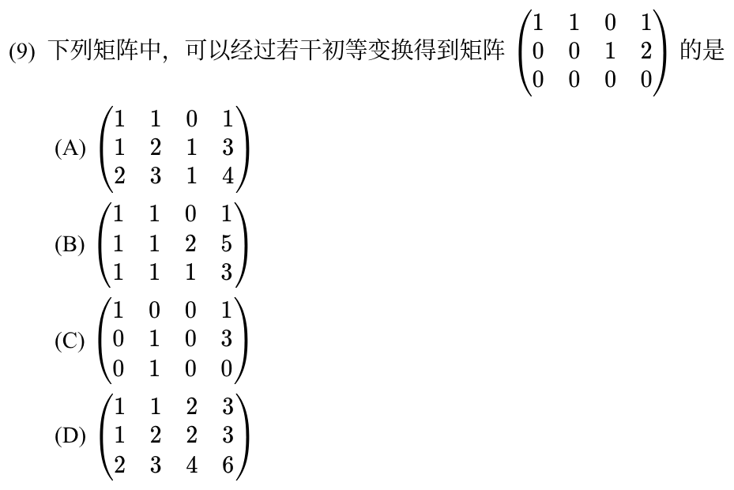
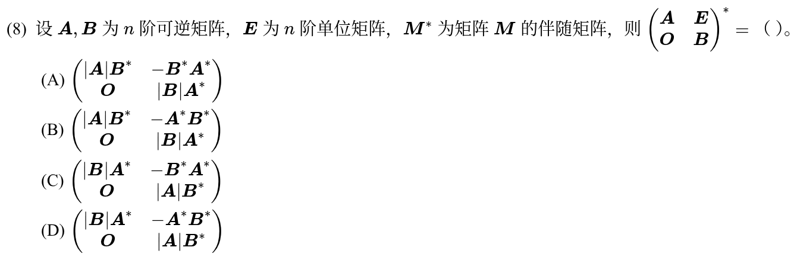
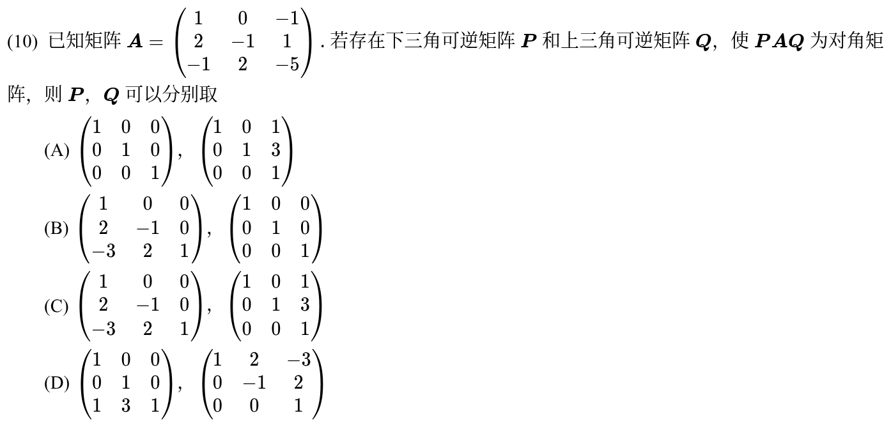
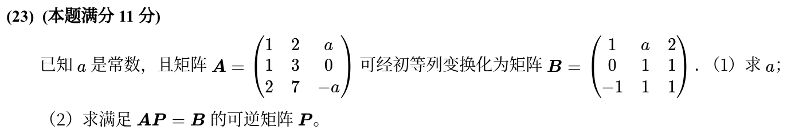
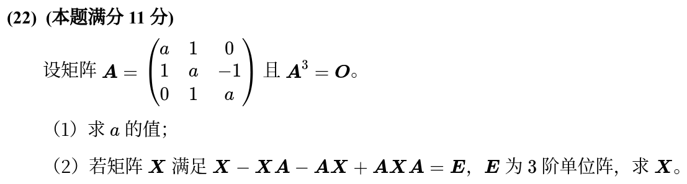
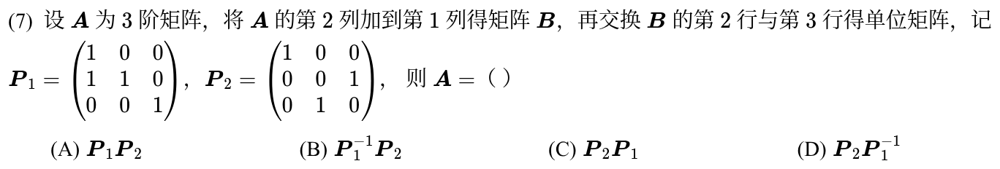

[« 行列式](01-determinants.md)　　[向量组、线性相关与秩 »](03-vectors-rank.md)

# 线性代数 · 矩阵运算、逆矩阵与初等变换

> **本章共 10 题**
> 
> - **核心必做（建议按顺序攻克关键方法）**：  
>   [第 10 题](#q10)（分清左乘与右乘） → [第 03 题](#q03)（矩阵乘法顺序） → [第 01 题](#q01)（逆矩阵与伴随矩阵） → [第 07 题](#q07)（列变换求变换矩阵）
> 
> - **分流与刷题建议**：  
>   - **较难挑战**：[第 08 题](#q08)（幂零矩阵与方程因式分解）  
>   - **重在看思路**：[第 04 题](#q04)（分块矩阵先求逆再求伴随）  
>   - **首轮可跳过**：[第 09 题](#q09)（技巧较偏或综合度高，首轮不必死磕）  
> 
> - **过关目标**：能把行、列操作还原为矩阵乘法，并独立求出变换矩阵。

---

### 01 · 2026年

> *置换矩阵性质题。置换矩阵每行每列恰有一个 1，由初等变换性质可知必为正交矩阵，即 $A^{-1} = A^T$；其行列式为 $\pm 1$，伴随矩阵立可判定。*

答案与解析

- **第一笔翻译定义**：$A$ 是由单位矩阵 $E$ 经过若干次互换两行得到的，因此可写成有限个对换初等矩阵的乘积：
  $$A = P_k P_{k-1}\cdots P_1,$$
  其中每个对换矩阵 $P_i$ 满足 $P_i^{-1} = P_i = P_i^T$，且 $|P_i| = -1$。
- **逐项检验**：
  - 求逆：$A^{-1} = P_1^{-1}\cdots P_{k-1}^{-1}P_k^{-1} = P_1\cdots P_{k-1}P_k$，仍然是若干个对换初等矩阵的乘积，即对 $E$ 经若干次互换两行得到，因此 **$A^{-1}$ 必为置换矩阵**，**（B）正确**。
  - 排除（A）（C）（D）：由 $A^* = |A|A^{-1} = (-1)^k A^{-1}$，当 $k$ 为奇数（如 $A$ 仅交换两行）时，$|A|=-1$，$A^* = -A^{-1}$ 含元素 $-1$，不是置换矩阵（排除 A），且 $A^{-1} = -A^*$（排除 C）；当 $k$ 为偶数（如 $A=E$）时，$|A|=1$，$A^{-1} = A^*$（排除 D）。
- **答案**：**（B）**。

---

### 02 · 2025年

答案与解析

**题面待核**（按当前题面“初等变换”无唯一解；若原卷限定为“初等行变换”，则答案选 **（B）**）

- **题面核查说明**：当前转写仅写“经过若干初等变换”，未限定为“初等行变换”。若同时允许初等行变换与初等列变换，则矩阵等价仅取决于秩：目标矩阵 $M=\begin{pmatrix} 1 & 1 & 0 & 1 \\ 0 & 0 & 1 & 2 \\ 0 & 0 & 0 & 0 \end{pmatrix}$ 的秩为 $2$，经计算选项（A）（B）（D）的秩均为 $2$（仅（C）的秩为 $3$），因此（A）（B）（D）均与 $M$ 等价，无唯一选项。
- **按“初等行变换”意图的推演**：目标矩阵 $M$ 本身已是行最简形，两矩阵行等价当且仅当它们有相同的行最简形。对（B）做初等行变换：
  $$\begin{pmatrix} 1 & 1 & 0 & 1 \\ 1 & 1 & 2 & 5 \\ 1 & 1 & 1 & 3 \end{pmatrix} \xrightarrow[r_3-r_1]{r_2-r_1} \begin{pmatrix} 1 & 1 & 0 & 1 \\ 0 & 0 & 2 & 4 \\ 0 & 0 & 1 & 2 \end{pmatrix} \xrightarrow[r_2\leftrightarrow r_3]{r_2-2r_3} \begin{pmatrix} 1 & 1 & 0 & 1 \\ 0 & 0 & 1 & 2 \\ 0 & 0 & 0 & 0 \end{pmatrix} = M.$$
  而（A）的行最简形为 $\begin{pmatrix} 1 & 0 & -1 & -1 \\ 0 & 1 & 1 & 2 \\ 0 & 0 & 0 & 0 \end{pmatrix}$，（D）的行最简形为 $\begin{pmatrix} 1 & 0 & 2 & 3 \\ 0 & 1 & 0 & 0 \\ 0 & 0 & 0 & 0 \end{pmatrix}$，（C）满秩为 $3$，均与 $M$ 不行等价。故在“初等行变换”前提下唯一选 **（B）**。
- **易错提示**：看到目标矩阵是标准的行最简形时，考场意图通常是检验行等价（即同解方程组/相同行空间）；核对原卷时需确认题干是否漏印“行”字。

---

### 03 · 2024年

答案与解析

**第一步怎么落笔**

- **触发条件**：矩阵方程 $P^T A P^2 = C$，其中 $P = \begin{pmatrix}1&0&0\\0&1&0\\1&0&1\end{pmatrix}$ 是最简单的**倍加初等矩阵** $E_{31}(1)$。
- **第一笔**：直接利用倍加初等矩阵的幂与转置公式，把 $A = (P^T)^{-1} C (P^2)^{-1}$ 翻译成**两步初等变换**（一次行倍加、一次列倍加），十秒出答案。

**完整推演**

1. **写出左右逆因子**：
   - $P = E_{31}(1)$（把第 1 行加到第 3 行），故 $P^2 = E_{31}(2)$，其逆为
     $$(P^2)^{-1} = E_{31}(-2) = \begin{pmatrix}1&0&0\\0&1&0\\-2&0&1\end{pmatrix}.$$
     **右乘 $(P^2)^{-1}$** 等价于列变换：**把第 3 列的 $(-2)$ 倍加到第 1 列**（注意右乘倍加阵 $E_{31}(k)$ 时，是把第 3 列乘 $k$ 加到第 1 列！）。
   - $P^T = E_{13}(1) = \begin{pmatrix}1&0&1\\0&1&0\\0&0&1\end{pmatrix}$，其逆为
     $$(P^T)^{-1} = E_{13}(-1) = \begin{pmatrix}1&0&-1\\0&1&0\\0&0&1\end{pmatrix}.$$
     **左乘 $(P^T)^{-1}$** 等价于行变换：**把第 3 行的 $(-1)$ 倍加到第 1 行**。
2. **对右边矩阵 $C = \begin{pmatrix}a+2c&0&c\\0&b&0\\2c&0&c\end{pmatrix}$ 依次做这两步变换**：
   - 先左乘 $(P^T)^{-1}$（$r_1 - r_3$）：
     $$\begin{pmatrix}a+2c&0&c\\0&b&0\\2c&0&c\end{pmatrix} \xrightarrow{r_1 - r_3} \begin{pmatrix}a&0&0\\0&b&0\\2c&0&c\end{pmatrix}.$$
   - 再右乘 $(P^2)^{-1}$（$c_1 - 2c_3$）：
     $$\begin{pmatrix}a&0&0\\0&b&0\\2c&0&c\end{pmatrix} \xrightarrow{c_1 - 2c_3} \begin{pmatrix}a&0&0\\0&b&0\\0&0&c\end{pmatrix}.$$
   因此 $A = \operatorname{diag}(a, b, c)$，选 **（C）**。

> **反向检验（零出错率）**：把选项（C）的 $A=\operatorname{diag}(a,b,c)$ 代回 $P^T A P^2$，因为 $P^T = E_{13}(1)$（行 1 加行 3）、$P^2 = E_{31}(2)$（列 1 加 2 倍列 3）：
> $$\begin{pmatrix}a&0&0\\0&b&0\\0&0&c\end{pmatrix} \xrightarrow{r_1+r_3} \begin{pmatrix}a&0&c\\0&b&0\\0&0&c\end{pmatrix} \xrightarrow{c_1+2c_3} \begin{pmatrix}a+2c&0&c\\0&b&0\\2c&0&c\end{pmatrix},$$
> 与题干右端完全一致！

**选择题关键干扰项拆解**

- **（D）$\operatorname{diag}(c, b, a)$**：把右乘 $E_{31}(-2)$ 的方向搞反，误以为是“第 1 列乘 $-2$ 加到第 3 列”，导致 $a,c$ 位置错位。
- **（A）、（B）**：只看对角元排列猜答案，没注意到原矩阵第 2 行、第 2 列只有 $(2,2)$ 元非零且等于 $b$，而 $P$ 在第 2 行/列为单位块，因此 $A$ 的 $(2,2)$ 元必为 $b$，可直接秒杀排除（A）（B）。

---

### 04 · 2023年

答案与解析

**答案**：**（D）** $\begin{pmatrix} |B|A^* & -A^*B^* \\ O & |A|B^* \end{pmatrix}$

- **切入点与推演**：已知 $A,B$ 可逆，分块上三角矩阵 $M = \begin{pmatrix} A & E \\ O & B \end{pmatrix}$ 可逆，直接用核心公式 $M^* = |M|M^{-1}$ 求解，避免逐块算代数余子式。
  1. **求行列式**：由分块上三角矩阵的行列式公式，
     $$|M| = |A|\cdot |B|.$$
  2. **求分块逆矩阵**：设 $M^{-1} = \begin{pmatrix} X & Y \\ O & Z \end{pmatrix}$，由 $\begin{pmatrix} A & E \\ O & B \end{pmatrix}\begin{pmatrix} X & Y \\ O & Z \end{pmatrix} = \begin{pmatrix} E & O \\ O & E \end{pmatrix}$，得
     $$AX = E \implies X = A^{-1}, \qquad BZ = E \implies Z = B^{-1},$$
     $$AY + Z = O \implies Y = -A^{-1}Z = -A^{-1}B^{-1}.$$
     故 $M^{-1} = \begin{pmatrix} A^{-1} & -A^{-1}B^{-1} \\ O & B^{-1} \end{pmatrix}$。
  3. **乘上 $|M|=|A||B|$ 并换回伴随矩阵**（利用 $|A|A^{-1}=A^*,\ |B|B^{-1}=B^*$）：
     $$M^* = |A||B|\begin{pmatrix} A^{-1} & -A^{-1}B^{-1} \\ O & B^{-1} \end{pmatrix} = \begin{pmatrix} |B|(|A|A^{-1}) & -(|A|A^{-1})(|B|B^{-1}) \\ O & |A|(|B|B^{-1}) \end{pmatrix} = \begin{pmatrix} |B|A^* & -A^*B^* \\ O & |A|B^* \end{pmatrix}.$$
  对照选项得 **（D）**。
- **干扰项 / 易错提示**：（A）（B）把主对角块误写成 $|A|B^*, |B|A^*$（混淆了 $2$ 阶普通矩阵伴随“主对角互换”的规律）；（C）把右上角顺序写反成 $-B^*A^*$，注意 $Y = -A^{-1}B^{-1}$ 中 $A^{-1}$ 在左、$B^{-1}$ 在右。

---

### 05 · 2022年

答案与解析

**答案**：$-1$

- **切入点与推演**：把题述初等变换写成矩阵乘法，倒序逆变换还原 $A$，再求 $A^{-1}$ 的主对角元之和。
  1. **还原矩阵 $A$**：记结果矩阵为 $B = \begin{pmatrix} -2 & 1 & -1 \\ 1 & -1 & 0 \\ -1 & 0 & 0 \end{pmatrix}$。题述操作为“交换第 $2,3$ 行（左乘 $P_{23}$），再将第 $2$ 列的 $-1$ 倍加到第 $1$ 列（右乘 $E_{21}(-1)$）”，故倒序撤销：
     - 先撤销列变换（将第 $2$ 列的 $+1$ 倍加到第 $1$ 列，$c_1+c_2$）：
       $$B = \begin{pmatrix} -2 & 1 & -1 \\ 1 & -1 & 0 \\ -1 & 0 & 0 \end{pmatrix} \xrightarrow{c_1+c_2} \begin{pmatrix} -1 & 1 & -1 \\ 0 & -1 & 0 \\ -1 & 0 & 0 \end{pmatrix};$$
     - 再撤销行交换（交换第 $2,3$ 行，$r_2\leftrightarrow r_3$）：
       $$A = \begin{pmatrix} -1 & 1 & -1 \\ -1 & 0 & 0 \\ 0 & -1 & 0 \end{pmatrix}.$$
  2. **求 $A^{-1}$ 与 $\operatorname{tr}(A^{-1})$**：用初等行变换对 $(A\mid E)$ 求逆（或直接解 $A\boldsymbol{x}=\boldsymbol{b}$）：
     由 $-x_1=b_2 \implies x_1=-b_2$，$-x_2=b_3 \implies x_2=-b_3$，$-x_1+x_2-x_3=b_1 \implies x_3=-b_1+b_2-b_3$，得
     $$A^{-1} = \begin{pmatrix} 0 & -1 & 0 \\ 0 & 0 & -1 \\ -1 & 1 & -1 \end{pmatrix}.$$
     因此 $\operatorname{tr}(A^{-1}) = 0 + 0 + (-1) = -1$。
- **易错点**：还原 $A$ 时列变换的逆操作是 $c_1+c_2$（不是 $c_1-c_2$）；也可以直接利用 $P_{23}AE_{21}(-1)=B \implies A^{-1} = E_{21}(-1)B^{-1}P_{23}$，但先还原 $A$ 再求逆不易搞反顺序。

---

### 06 · 2021年

答案与解析

**答案**：**（C）** $P=\begin{pmatrix}1 & 0 & 0 \\ 2 & -1 & 0 \\ -3 & 2 & 1\end{pmatrix}$，$Q=\begin{pmatrix}1 & 0 & 1 \\ 0 & 1 & 3 \\ 0 & 0 & 1\end{pmatrix}$

- **切入点与推演**：下三角可逆矩阵 $P$ 左乘 $A$ 对应“只用上方行向下消元（或倍乘）”，上三角可逆矩阵 $Q$ 右乘 $A$ 对应“只用左侧列向右消元（或倍乘）”。因此只需对 $A$ 先做向下行消元化为上三角，再做向右列消元化为对角阵，并同步记录 $P$ 与 $Q$。
  1. **向下行消元求 $P$**（在 $(A\mid E)$ 上操作）：
     $$\begin{pmatrix} 1 & 0 & -1 & \vline & 1 & 0 & 0 \\ 2 & -1 & 1 & \vline & 0 & 1 & 0 \\ -1 & 2 & -5 & \vline & 0 & 0 & 1 \end{pmatrix} \xrightarrow[r_3+r_1]{r_2-2r_1} \begin{pmatrix} 1 & 0 & -1 & \vline & 1 & 0 & 0 \\ 0 & -1 & 3 & \vline & -2 & 1 & 0 \\ 0 & 2 & -6 & \vline & 1 & 0 & 1 \end{pmatrix} \xrightarrow[r_2\times(-1)]{r_3+2r_2} \begin{pmatrix} 1 & 0 & -1 & \vline & 1 & 0 & 0 \\ 0 & 1 & -3 & \vline & 2 & -1 & 0 \\ 0 & 0 & 0 & \vline & -3 & 2 & 1 \end{pmatrix}.$$
     即取 $P = \begin{pmatrix} 1 & 0 & 0 \\ 2 & -1 & 0 \\ -3 & 2 & 1 \end{pmatrix}$ 时，$PA = \begin{pmatrix} 1 & 0 & -1 \\ 0 & 1 & -3 \\ 0 & 0 & 0 \end{pmatrix}$。
  2. **向右列消元求 $Q$**：要消去 $PA$ 第 $3$ 列的 $-1$ 和 $-3$，需对 $PA$ 做 $c_3 + c_1$ 与 $c_3 + 3c_2$，同步对单位阵 $E$ 做相同列变换即得
     $$Q = \begin{pmatrix} 1 & 0 & 1 \\ 0 & 1 & 3 \\ 0 & 0 & 1 \end{pmatrix}, \qquad PAQ = \begin{pmatrix} 1 & 0 & 0 \\ 0 & 1 & 0 \\ 0 & 0 & 0 \end{pmatrix}.$$
  对照选项得 **（C）**。
- **干扰项 / 易错提示**：（A）中 $P=E$ 未消去 $A$ 下三角的非零元；（B）中 $Q=E$ 未消去 $PA$ 上三角的 $-1,-3$；（D）将 $P,Q$ 的角色与转置结构混淆。考场上也可直接用选项中的 $P$ 左乘 $A$ 快速验证。

---

### 07 · 2018年

> *初等列变换与矩阵方程大题。列变换相当于右乘初等矩阵 $P$。把 $(A^T | B^T)$ 做行初等变换求出 $P^T$，转置即可得 $P$。*

答案与解析

**第（1）问：怎么用“初等列变换”锁定参数 $a$？**

- **触发条件**：$A$ 可经初等列变换化为 $B$ $\iff$ 存在可逆矩阵 $P$ 使得 $AP = B$ $\iff$ $r(A)=r(B)=r(A,B)$（且 $A,B$ 列向量组等价）。
- **第一步怎么落笔**：先算 $|A|$ 或直接对增广矩阵 $(A\mid B)$ 做初等行变换！先算行列式最快：
  $$|A| = \begin{vmatrix}1&2&a\\1&3&0\\2&7&-a\end{vmatrix} \xrightarrow[r_3-2r_1]{r_2-r_1} \begin{vmatrix}1&2&a\\0&1&-a\\0&3&-3a\end{vmatrix} = 0.$$
  因为 $|A| \equiv 0$（对任意 $a$ 都不可逆），而 $B = AP$ 且 $|P|\neq 0$，所以必有 $|B| = |A||P| = 0$。
- **由 $|B|=0$ 定出 $a$**：
  $$|B| = \begin{vmatrix}1&a&2\\0&1&1\\-1&1&1\end{vmatrix} \xrightarrow{r_3+r_1} \begin{vmatrix}1&a&2\\0&1&1\\0&a+1&3\end{vmatrix} = 3 - (a+1) = 2 - a.$$
  令 $|B|=0$，得
  $$a = 2.$$
- **必须补一步充分性验证**（解答题拿满分的必要动作）：$|A|=|B|=0$ 只是必要条件，还要验证 $a=2$ 时 $A$ 确实能经初等列变换化为 $B$（即 $r(A)=r(B)=r(A,B)$）。事实上，下面第（2）问把 $(A\mid B)$ 化成行最简形时会自动验证这一点。

**第（2）问：不可逆时如何求出所有满足 $AP=B$ 的可逆矩阵 $P$？**

- **触发条件**：$a=2$ 时 $r(A)=2<3$，$A$ 不可逆，绝对不能写 $P=A^{-1}B$。
- **第一步怎么落笔**：把 $P$ 按列分块记为 $P = (\boldsymbol{p}_1, \boldsymbol{p}_2, \boldsymbol{p}_3)$，则 $AP=B$ 等价于同时求解三个线性方程组 $A\boldsymbol{p}_1=\boldsymbol{b}_1$、$A\boldsymbol{p}_2=\boldsymbol{b}_2$、$A\boldsymbol{p}_3=\boldsymbol{b}_3$，因此直接对 $(A\mid B)$ 做初等行变换化成行最简形！
- **完整推演**：
  当 $a=2$ 时，
  $$(A\mid B) = \left(\begin{array}{ccc|ccc} 1&2&2 & 1&2&2 \\ 1&3&0 & 0&1&1 \\ 2&7&-2 & -1&1&1 \end{array}\right) \xrightarrow[r_3-2r_1]{r_2-r_1} \left(\begin{array}{ccc|ccc} 1&2&2 & 1&2&2 \\ 0&1&-2 & -1&-1&-1 \\ 0&3&-6 & -3&-3&-3 \end{array}\right)$$
  $$\xrightarrow[r_1-2r_2]{r_3-3r_2} \left(\begin{array}{ccc|ccc} 1&0&6 & 3&4&4 \\ 0&1&-2 & -1&-1&-1 \\ 0&0&0 & 0&0&0 \end{array}\right).$$
  由此同时确认 $r(A)=r(B)=r(A,B)=2$（第（1）问充分性成立！）。

  读出齐次方程组 $A\boldsymbol{x}=\boldsymbol{0}$ 的基础解系为 $\boldsymbol{\xi} = (-6, 2, 1)^T$，三个非齐次方程组的特解分别为 $(3,-1,0)^T$、$(4,-1,0)^T$、$(4,-1,0)^T$。因此满足 $AP=B$ 的全部矩阵为：
  $$P = \begin{pmatrix} 3-6k_1 & 4-6k_2 & 4-6k_3 \\ -1+2k_1 & -1+2k_2 & -1+2k_3 \\ k_1 & k_2 & k_3 \end{pmatrix}, \qquad k_1, k_2, k_3 \in \mathbb{R}.$$

- **最后一步（千万别漏！）：加上“$P$ 可逆”的条件 $|P|\neq 0$**：
  $$|P| = \begin{vmatrix} 3-6k_1 & 4-6k_2 & 4-6k_3 \\ -1+2k_1 & -1+2k_2 & -1+2k_3 \\ k_1 & k_2 & k_3 \end{vmatrix} \xrightarrow[r_2-2r_3]{r_1+6r_3} \begin{vmatrix} 3 & 4 & 4 \\ -1 & -1 & -1 \\ k_1 & k_2 & k_3 \end{vmatrix} \xrightarrow{c_3-c_2} \begin{vmatrix} 3 & 4 & 0 \\ -1 & -1 & 0 \\ k_1 & k_2 & k_3-k_2 \end{vmatrix} = k_3 - k_2.$$
  因此 $P$ 可逆的充要条件是 $k_2 \neq k_3$。
  - 若只需给出一个满足条件的可逆矩阵 $P$，取 $k_1=k_2=0, k_3=1$ 得 $P = \begin{pmatrix}3&4&-2\\-1&-1&1\\0&0&1\end{pmatrix}$；
  - 写全解则答：上述 $P$，其中 $k_1, k_2, k_3$ 为任意实数且 $k_2 \neq k_3$。

---

### 08 · 2015年

> *幂零矩阵与可逆矩阵方程。由 $A^3=O$ 联想因式分解 $(E-A)(E+A+A^2)=E$；把方程因式分解配凑成 $(E-A)X(E-A)=E$，两边求逆秒解 $X$。*

答案与解析

**结论速览**：（1）$a = 0$；（2）$X = \begin{pmatrix} 4 & 2 & -3 \\ 2 & 1 & -2 \\ 3 & 2 & -2 \end{pmatrix}$。

- **（1）求 $a$ 的值**：
  由 $A^3 = O$ 可知，若 $\lambda$ 是 $A$ 的任一特征值，则 $\lambda^3 = 0 \implies \lambda = 0$，即 $A$ 的全部特征值均为 $0$。
  由矩阵的迹等于特征值之和，得
  $$\operatorname{tr}(A) = 3a = 0 \implies a = 0.$$
  （验证：当 $a=0$ 时，$A = \begin{pmatrix} 0 & 1 & 0 \\ 1 & 0 & -1 \\ 0 & 1 & 0 \end{pmatrix}$，算得 $A^2 = \begin{pmatrix} 1 & 0 & -1 \\ 0 & 0 & 0 \\ 1 & 0 & -1 \end{pmatrix}$，$A^3 = A^2A = O$，满足题设。）
- **（2）求矩阵 $X$**：
  将矩阵方程因式分解：
  $$X - XA - AX + AXA = (E - A)X(E - A) = E.$$
  由 $A^3 = O$，利用立方差公式 $E - A^3 = (E - A)(E + A + A^2) = E$，可知 $E - A$ 可逆，且
  $$(E - A)^{-1} = E + A + A^2.$$
  方程两边分别左乘、右乘 $(E - A)^{-1}$，再利用 $A^3 = A^4 = O$ 展开化简：
  $$X = (E - A)^{-1} E (E - A)^{-1} = (E + A + A^2)^2 = E + 2A + 3A^2 + 2A^3 + A^4 = E + 2A + 3A^2.$$
  代入 $a=0$ 时的 $A$ 与 $A^2$：
  $$X = \begin{pmatrix} 1 & 0 & 0 \\ 0 & 1 & 0 \\ 0 & 0 & 1 \end{pmatrix} + 2\begin{pmatrix} 0 & 1 & 0 \\ 1 & 0 & -1 \\ 0 & 1 & 0 \end{pmatrix} + 3\begin{pmatrix} 1 & 0 & -1 \\ 0 & 0 & 0 \\ 1 & 0 & -1 \end{pmatrix} = \begin{pmatrix} 4 & 2 & -3 \\ 2 & 1 & -2 \\ 3 & 2 & -2 \end{pmatrix}.$$
- **核心思路与避坑**：看到幂零条件 $A^k=O$，立刻联想两件事：① 特征值全为 $0$（迹与行列式均为 $0$）；② $(E-A)^{-1} = E + A + \cdots + A^{k-1}$。第（2）问展开 $(E+A+A^2)^2$ 时，系数为 $1, 2, 3$（因为 $A^2$ 来自 $E\cdot A^2 + A\cdot A + A^2\cdot E$），别误写成 $1, 2, 2$。

---

### 09 · 2013年

答案与解析

**结论速览**：当且仅当 $a = -1,\ b = 0$ 时存在矩阵 $C$，所有解为 $C = \begin{pmatrix} 1 + k_1 + k_2 & -k_1 \\ k_1 & k_2 \end{pmatrix}$（$k_1, k_2 \in \mathbb{R}$）。

- **完整解答**：
  设 $C = \begin{pmatrix} x_1 & x_2 \\ x_3 & x_4 \end{pmatrix}$，代入矩阵方程 $AC - CA = B$：
  $$AC = \begin{pmatrix} 1 & a \\ 1 & 0 \end{pmatrix}\begin{pmatrix} x_1 & x_2 \\ x_3 & x_4 \end{pmatrix} = \begin{pmatrix} x_1+ax_3 & x_2+ax_4 \\ x_1 & x_2 \end{pmatrix},$$
  $$CA = \begin{pmatrix} x_1 & x_2 \\ x_3 & x_4 \end{pmatrix}\begin{pmatrix} 1 & a \\ 1 & 0 \end{pmatrix} = \begin{pmatrix} x_1+x_2 & ax_1 \\ x_3+x_4 & ax_3 \end{pmatrix}.$$
  逐元素比较 $AC - CA = \begin{pmatrix} 0 & 1 \\ 1 & b \end{pmatrix}$，得到关于 $(x_1, x_2, x_3, x_4)^T$ 的线性方程组：
  $$\begin{cases} -x_2 + ax_3 = 0, \\ -ax_1 + x_2 + ax_4 = 1, \\ x_1 - x_3 - x_4 = 1, \\ x_2 - ax_3 = b. \end{cases}$$
  1. **确定参数 $a, b$**：
     对增广矩阵做初等行变换（或先用迹技巧快速锁定：由 $\operatorname{tr}(AC-CA)=0$ 得 $\operatorname{tr}(B)=b=0$；再左乘 $A$ 取迹，由 $\operatorname{tr}(A^2C-ACA)=0$ 得 $\operatorname{tr}(AB)=a+1=0 \implies a=-1$）：
     - 将第 $1$ 个方程与第 $4$ 个方程相加，立得 $0 = b \implies b = 0$；
     - 将第 $3$ 个方程乘以 $a$ 加到第 $2$ 个方程，得 $x_2 - ax_3 = a + 1$，与第 $1$ 个方程 $-x_2 + ax_3 = 0$ 相加，得 $0 = a + 1 \implies a = -1$。
     故方程组有解的充要条件为 $a = -1,\ b = 0$。
  2. **求所有矩阵 $C$**：
     将 $a = -1,\ b = 0$ 代回方程组，独立方程仅剩两个：
     $$\begin{cases} x_2 + x_3 = 0, \\ x_1 - x_3 - x_4 = 1. \end{cases}$$
     令自由变量 $x_3 = k_1,\ x_4 = k_2$（$k_1, k_2 \in \mathbb{R}$），则 $x_2 = -k_1,\ x_1 = 1 + k_1 + k_2$。
     因此所有满足条件的矩阵为
     $$C = \begin{pmatrix} 1 + k_1 + k_2 & -k_1 \\ k_1 & k_2 \end{pmatrix}, \qquad k_1, k_2 \in \mathbb{R}.$$
- **核心思路与避坑**：遇到 $AC - CA = B$ 形式的换位子方程，用 $\operatorname{tr}(XY)=\operatorname{tr}(YX)$ 可秒出必要条件 $\operatorname{tr}(B)=0$ 与 $\operatorname{tr}(AB)=0$，但考场解答题必须把 $a,b$ 代回原线性方程组求出通解（同时自然验证了充分性），不可只写必要条件。

---

### 10 · 2011年

答案与解析

**第一步怎么落笔**

- **触发条件**：对 $A$ 依次做一次列变换、一次行变换得到单位矩阵 $E$，并直接给出了 $P_1, P_2$。
- **第一笔**：**先核对 $P_1, P_2$ 分别对应哪一步变换**，再按“左行右列”写出连接 $A$ 与 $E$ 的等式。

**完整推演**

1. **核对初等矩阵**：
   - 将 $E$ 的第 2 列加到第 1 列，第 1 列变为 $(1,1,0)^T$，正好得到 $P_1 = \begin{pmatrix}1&0&0\\1&1&0\\0&0&1\end{pmatrix}$。
     因为是**列变换**，所以右乘 $P_1$：
     $$B = A P_1.$$
   - 交换 $E$ 的第 2 行与第 3 行，正好得到 $P_2 = \begin{pmatrix}1&0&0\\0&0&1\\0&1&0\end{pmatrix}$。
     因为是**行变换**，所以左乘 $P_2$：
     $$P_2 B = E \implies P_2 A P_1 = E.$$
2. **从等式反解 $A$**：
   等式两边左乘 $P_2^{-1}$、右乘 $P_1^{-1}$：
   $$A = P_2^{-1} E P_1^{-1} = P_2^{-1} P_1^{-1}.$$
   因为 $P_2$ 是对换初等矩阵，满足 $P_2^2 = E$，即 $P_2^{-1} = P_2$。代入得
   $$A = P_2 P_1^{-1}.$$
   故应选 **（D）**。

**选择题关键干扰项拆解**

- **（B）$P_1^{-1}P_2$（最高频错选）**：误把两步变换都写在同一侧（例如写成 $P_2 P_1 A = E$），反解时写成 $A = (P_2 P_1)^{-1} = P_1^{-1} P_2^{-1} = P_1^{-1}P_2$。牢记**左行右列**，列变换绝不能放到 $A$ 左边。
- **（C）$P_2 P_1$**：忘对 $P_1$ 取逆，以为从 $P_2 A P_1 = E$ 移项过来 $P_1$ 不变。
- **（A）$P_1 P_2$**：既忘取逆又搞反了左右顺序。

---

[« 行列式](01-determinants.md)　　[向量组、线性相关与秩 »](03-vectors-rank.md)
