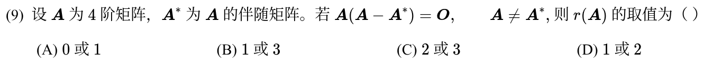
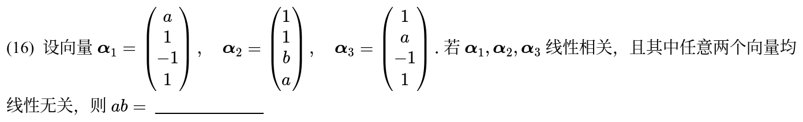
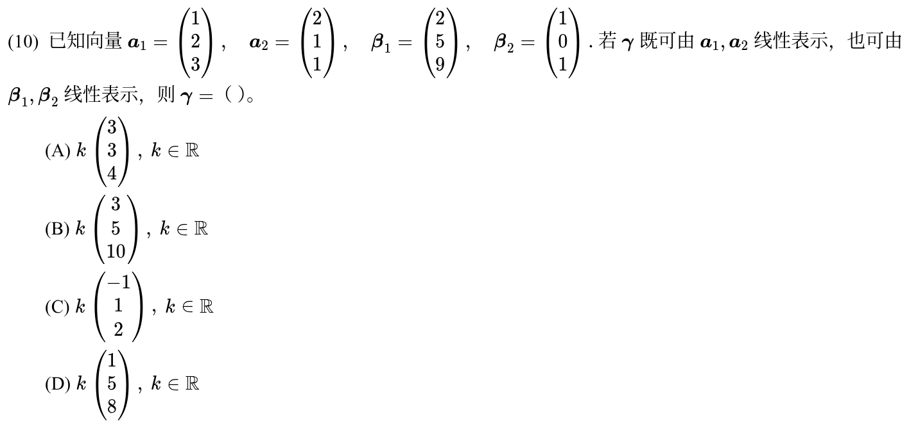
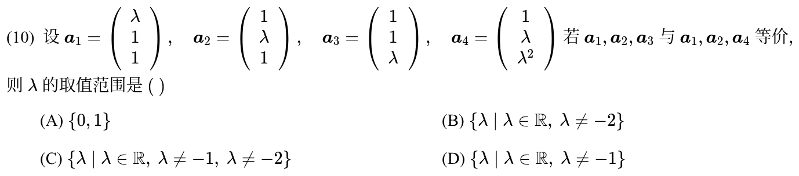
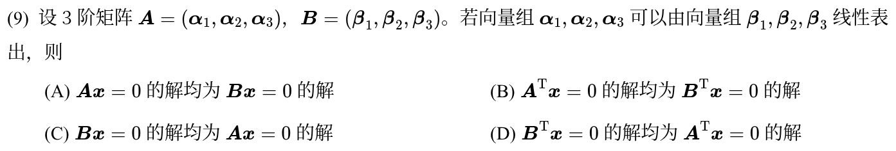
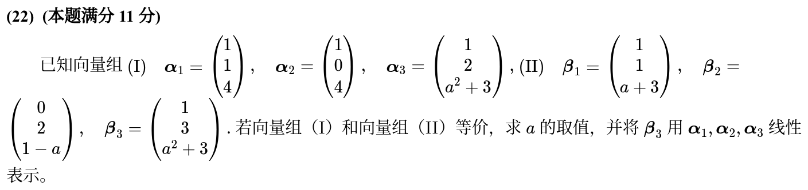
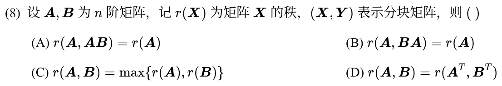
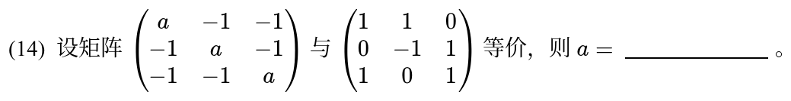
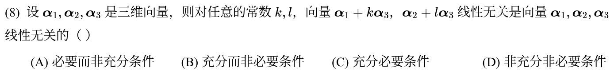

[« 矩阵运算、逆矩阵与初等变换](02-matrices.md)　　[线性方程组 »](04-linear-systems.md)

# 线性代数 · 向量组、线性相关与秩

> **本章共 16 题**
> 
> - **核心必做（建议按顺序攻克关键方法）**：  
>   [第 16 题](#q16)（线性表示与无关个数） → [第 10 题](#q10)（列空间与秩） → [第 07 题](#q07)（表出与转置解空间） → [第 04 题](#q04)（含参数的相关与秩）
> 
> - **分流与刷题建议**：  
>   - **较难挑战**：[第 09 题](#q09)（向量组等价分类讨论）  
>   - **重在看思路**：[第 01 题](#q01)（极大无关组接满秩分解与矩阵幂）  
>   - **首轮可跳过**：[第 02 题](#q02)（技巧较偏或综合度高，首轮不必死磕）  
> 
> - **过关目标**：会用行化简找秩、判断表出，能解释解空间包含的方向。

---

### 01 · 2026年

> *最新线代解答题。第一问行变换化阶梯形证极大无关组；第二问列出分解 $A=GH$（满秩分解），利用结合律 $A^{10} = G(HG)^9 H$ 降成 2 阶矩阵的幂。*

答案与解析

**解。** 前两向量从第二分量与第一分量看出线性无关。又 $\alpha_3=\alpha_2-\alpha_1$、$\alpha_4=\alpha_1-\alpha_2$，所以前两者构成极大线性无关组，且
$$
H=\begin{pmatrix}1&0&-1&1\\0&1&1&-1\end{pmatrix}.
$$
把四阶矩阵的幂缩到二阶。$HG=\begin{pmatrix}1&-1\\0&1\end{pmatrix}=I+N$，其中 $N^2=0$，故
$$
A^{10}=G(HG)^9H=G(I+9N)H=
\begin{pmatrix}1&-8&-9&9\\0&-1&-1&1\\-1&9&10&-10\\-1&7&8&-8\end{pmatrix}.
$$

---

### 02 · 2025年

答案与解析

**答案 D。** 设 $r(BA)=k$，则 $r(AB)=k+1$。若 $A$ 或 $B$ 可逆，$AB,BA$ 相似，秩相同，矛盾。故 $r(AB)\le2$，从而 $r(BA)\le1$。又 $ABA=A(BA)$、$BAB=(BA)B$，把两者叠成系数矩阵后秩最多为 2，三元齐次方程必有公共非零解。其余结论可用 $A=E_{11},B=E_{12}$ 反驳：$AB=B,BA=0$，两者有公共非零解 $e_3$，且 $(A+B)e_3=0$。

---

### 03 · 2024年

答案与解析

**答案 D。** 若 $A$ 可逆，$A(A-A^*)=0$ 强迫 $A=A^*$，矛盾。故 $A^2=AA^*=0$，从 $\operatorname{im}A\subseteq\ker A$ 得 $r(A)\le2$。秩为 0 时 $A=A^*=0$，也被排除。仅一个二阶零特征值的 Jordan 块，或两个这样的块，分别给出秩 1、2 的例子，此时 $A^*=0$。

---

### 04 · 2024年

答案与解析

**第一步怎么落笔**

- **触发条件**：3 个 4 维向量线性相关，且任意两个线性无关。
- **第一笔**：**先看 $\boldsymbol{\alpha}_1$ 和 $\boldsymbol{\alpha}_3$ 的对称结构**：
  - 若 $a=1$，则 $\boldsymbol{\alpha}_1 = \boldsymbol{\alpha}_3 = (1,1,-1,1)^T$，违背“任意两个线性无关”，因此先锁死 **$a \neq 1$**；
  - 既然 $\boldsymbol{\alpha}_1, \boldsymbol{\alpha}_3$ 线性无关，而全体线性相关，那么 **$\boldsymbol{\alpha}_2$ 必可由 $\boldsymbol{\alpha}_1, \boldsymbol{\alpha}_3$ 线性表示**：
    $$\boldsymbol{\alpha}_2 = c_1\boldsymbol{\alpha}_1 + c_3\boldsymbol{\alpha}_3.$$

**完整推演**

把 $\boldsymbol{\alpha}_2 = c_1\boldsymbol{\alpha}_1 + c_3\boldsymbol{\alpha}_3$ 按 4 个分量写出（不盲目做复杂消元，直接盯分量和！）：
$$\begin{cases} c_1 a + c_3 = 1 & (1) \\ c_1 + c_3 a = 1 & (2) \\ -c_1 - c_3 = b & (3) \\ c_1 + c_3 = a & (4) \end{cases}$$
1. **看（3）式与（4）式**：两式相加直接消去 $c_1, c_3$，得
   $$b + a = 0 \implies b = -a.$$
2. **看（1）式与（2）式**：两式相加，得
   $$(a+1)(c_1 + c_3) = 2.$$
   把（4）式的 $c_1 + c_3 = a$ 代入上式：
   $$a(a+1) = 2 \implies a^2 + a - 2 = 0 \implies (a+2)(a-1) = 0.$$
3. **用“任意两个线性无关”筛根**：
   - 前面已排除 $a = 1$（此时 $\boldsymbol{\alpha}_1 = \boldsymbol{\alpha}_3$）；
   - 故唯一可能为 $a = -2$，从而 $b = -a = 2$。
4. **回代检验**：当 $a=-2, b=2$ 时，$\boldsymbol{\alpha}_1=(-2,1,-1,1)^T$，$\boldsymbol{\alpha}_2=(1,1,2,-2)^T$，$\boldsymbol{\alpha}_3=(1,-2,-1,1)^T$。易见 $c_1=c_3=-1$ 使 $\boldsymbol{\alpha}_2 = -\boldsymbol{\alpha}_1 - \boldsymbol{\alpha}_3$，且任意两列均不成比例，全部条件满足！
   因此：
   $$ab = (-2)\times 2 = -4.$$

---

### 05 · 2023年

答案与解析

- **方法一（三维几何法向量速杀）**：$\boldsymbol{\gamma}$ 既在 $\operatorname{span}(\boldsymbol{\alpha}_1,\boldsymbol{\alpha}_2)$ 内又在 $\operatorname{span}(\boldsymbol{\beta}_1,\boldsymbol{\beta}_2)$ 内，即 $\boldsymbol{\gamma}$ 沿两平面的交线方向。
  - 平面 1 法向量 $\boldsymbol{n}_1 = \boldsymbol{\alpha}_1\times\boldsymbol{\alpha}_2 = (1,2,3)^T\times(2,1,1)^T = (-1, 5, -3)^T$；
  - 平面 2 法向量 $\boldsymbol{n}_2 = \boldsymbol{\beta}_1\times\boldsymbol{\beta}_2 = (2,5,9)^T\times(1,0,1)^T = (5, 7, -5)^T$；
  - 交线方向 $\boldsymbol{n}_1\times\boldsymbol{n}_2 = (-4, -20, -32)^T = -4(1, 5, 8)^T$。
- **方法二（线性方程组法）**：设 $\boldsymbol{\gamma} = x_1\boldsymbol{\alpha}_1+x_2\boldsymbol{\alpha}_2 = y_1\boldsymbol{\beta}_1+y_2\boldsymbol{\beta}_2$，解齐次方程组 $(\boldsymbol{\alpha}_1,\boldsymbol{\alpha}_2,-\boldsymbol{\beta}_1,-\boldsymbol{\beta}_2)\boldsymbol{z}=\boldsymbol{0}$，得 $x_1 = 3k, x_2 = -k$，代入得 $\boldsymbol{\gamma} = 3k(1,2,3)^T - k(2,1,1)^T = k(1, 5, 8)^T$。
- **答案**：**（D）**。

---

### 06 · 2022年

答案与解析

**答案 C，$\lambda\ne-1,-2$。** 两组的三阶行列式分别为 $(\lambda-1)^2(\lambda+2)$ 和 $(\lambda-1)^2(\lambda+1)^2$。两者都非零时均张成整个空间。$\lambda=1$ 时四向量相同，仍等价。$\lambda=-2,-1$ 时恰有一组满秩，故均应排除。

---

### 07 · 2021年

> *向量表出与方程解空间选择题。向量组 $A$ 能被 $B$ 线性表出意味着 $A=BC$。转置后 $A^T = C^T B^T$，从而 $B^T x=0$ 的解必定是 $A^T x=0$ 的解。*

答案与解析

**第一步怎么落笔**

- **触发条件**：列向量组 $\boldsymbol{\alpha}_1,\boldsymbol{\alpha}_2,\boldsymbol{\alpha}_3$ 可由 $\boldsymbol{\beta}_1,\boldsymbol{\beta}_2,\boldsymbol{\beta}_3$ 线性表出，选项都在比较 $A\boldsymbol{x}=\boldsymbol{0}$、$B\boldsymbol{x}=\boldsymbol{0}$、$A^T\boldsymbol{x}=\boldsymbol{0}$、$B^T\boldsymbol{x}=\boldsymbol{0}$ 的解空间包含关系。
- **第一笔**：**写矩阵乘法 $A = BC$，立刻取转置得 $A^T = C^T B^T$！**

**完整推演**

1. **翻译题干**：因为 $A=(\boldsymbol{\alpha}_1,\boldsymbol{\alpha}_2,\boldsymbol{\alpha}_3)$ 的每一列都可由 $B=(\boldsymbol{\beta}_1,\boldsymbol{\beta}_2,\boldsymbol{\beta}_3)$ 的列线性表出，所以存在 3 阶矩阵 $C$，使得
   $$A = BC.$$
2. **取转置**：
   $$A^T = (BC)^T = C^T B^T.$$
3. **验证解空间包含方向**：若 $\boldsymbol{x}$ 是 $B^T\boldsymbol{x}=\boldsymbol{0}$ 的任意解，则左乘 $C^T$ 得
   $$A^T\boldsymbol{x} = C^T(B^T\boldsymbol{x}) = C^T\boldsymbol{0} = \boldsymbol{0},$$
   即 $\boldsymbol{x}$ 必为 $A^T\boldsymbol{x}=\boldsymbol{0}$ 的解。因此 **$B^T\boldsymbol{x}=\boldsymbol{0}$ 的解均为 $A^T\boldsymbol{x}=\boldsymbol{0}$ 的解**，选 **（D）**。

> **几何直觉（防搞反方向）**：$B^T\boldsymbol{x}=\boldsymbol{0}$ 意味着 $\boldsymbol{x}$ 与 $\boldsymbol{\beta}_1,\boldsymbol{\beta}_2,\boldsymbol{\beta}_3$ 全部正交；既然每个 $\boldsymbol{\alpha}_i$ 都是 $\boldsymbol{\beta}_1,\boldsymbol{\beta}_2,\boldsymbol{\beta}_3$ 的线性组合，那么 $\boldsymbol{x}$ 必然也与每个 $\boldsymbol{\alpha}_i$ 正交，即 $A^T\boldsymbol{x}=\boldsymbol{0}$！

**选择题关键干扰项拆解**

- **（B）$A^T\boldsymbol{x}=\boldsymbol{0}$ 的解均为 $B^T\boldsymbol{x}=\boldsymbol{0}$ 的解（最高频错选）**：把 $A=BC$ 的包含方向搞反了。特例验证：取 $A=O$（显然可由任意 $B$ 表出），$B=E$。此时 $A^T\boldsymbol{x}=\boldsymbol{0}$ 的解是全体 $\mathbb{R}^3$，而 $B^T\boldsymbol{x}=\boldsymbol{0}$ 只有零解，直接淘汰（B），同时也淘汰（A）！
- **（A）与（C）**：$A=BC$ 右乘 $\boldsymbol{x}$ 得 $A\boldsymbol{x} = B(C\boldsymbol{x})$，既推不出 $A\boldsymbol{x}=\boldsymbol{0}\implies B\boldsymbol{x}=\boldsymbol{0}$（取 $A=O, B=E$ 淘汰 A），也推不出 $B\boldsymbol{x}=\boldsymbol{0}\implies A\boldsymbol{x}=\boldsymbol{0}$（取 $B=\begin{pmatrix}1&0&0\\0&0&0\\0&0&0\end{pmatrix}$，$C=\begin{pmatrix}0&1&0\\0&0&0\\0&0&0\end{pmatrix}$，则 $A=BC=\begin{pmatrix}0&1&0\\0&0&0\\0&0&0\end{pmatrix}$，取 $\boldsymbol{x}=(0,1,0)^T$ 满足 $B\boldsymbol{x}=\boldsymbol{0}$ 但 $A\boldsymbol{x}=(1,0,0)^T\neq\boldsymbol{0}$，淘汰 C）。

---

### 08 · 2019年

答案与解析

**答案 A。** 基础解系有 2 个向量，故 $4-r(A)=2$。秩为 2 时三阶子式全为零，伴随矩阵的每个元素都是三阶代数余子式，因此 $A^*=0$。

---

### 09 · 2019年

> *两向量组等价大题。两向量组等价充分必要条件是秩相等且可互相线性表出，联立大矩阵做行初等变换同时解决秩与表出系数。*

答案与解析

- **第一步：先算 $|A|$ 与 $|B|$ 找分界点**：
  - $|A| = \begin{vmatrix}1&1&1\\1&0&2\\4&4&a^2+3\end{vmatrix} = -(a^2-1) = 1 - a^2$；
  - $|B| = \begin{vmatrix}1&0&1\\1&2&3\\a+3&1-a&a^2+3\end{vmatrix} = 2(a^2-1)$。
- **第二步：分类讨论等价性**（$r(A)=r(B)=r(A,B)$）：
  1. 当 $a \neq \pm 1$ 时：$|A|\neq 0$ 且 $|B|\neq 0$，故 $r(A)=r(B)=3$，两个向量组都等价于 $\mathbb{R}^3$ 的基，**必等价**；
  2. 当 $a = 1$ 时：$A=\begin{pmatrix}1&1&1\\1&0&2\\4&4&4\end{pmatrix}$，$B=\begin{pmatrix}1&0&1\\1&2&3\\4&0&4\end{pmatrix}$，对 $(A\mid B)$ 做行变换易得 $r(A)=r(B)=r(A,B)=2$，**等价**；
  3. 当 $a = -1$ 时：$A=\begin{pmatrix}1&1&1\\1&0&2\\4&4&4\end{pmatrix}$（满足第 3 行 $= 4\times$ 第 1 行），而 $\boldsymbol{\beta}_1=(1,1,2)^T$ 不满足此关系，故 $r(A,B)=3 > r(A)=2$，**不等价**。
  综上，$a$ 的取值为 **$a \neq -1$**。
- **第三步：用 $\boldsymbol{\alpha}_1,\boldsymbol{\alpha}_2,\boldsymbol{\alpha}_3$ 表示 $\boldsymbol{\beta}_3$（务必区分 $a\neq\pm 1$ 与 $a=1$！）**：
  - 观察 $\boldsymbol{\beta}_3 - \boldsymbol{\alpha}_3 = (0,1,0)^T = \boldsymbol{\alpha}_1 - \boldsymbol{\alpha}_2$，故有一组特解 $\boldsymbol{\beta}_3 = \boldsymbol{\alpha}_1 - \boldsymbol{\alpha}_2 + \boldsymbol{\alpha}_3$。
  - 当 $a \neq \pm 1$ 时，$\boldsymbol{\alpha}_1,\boldsymbol{\alpha}_2,\boldsymbol{\alpha}_3$ 线性无关，表示唯一：
    $$\boldsymbol{\beta}_3 = \boldsymbol{\alpha}_1 - \boldsymbol{\alpha}_2 + \boldsymbol{\alpha}_3.$$
  - 当 $a = 1$ 时，$\boldsymbol{\alpha}_3 = 2\boldsymbol{\alpha}_1 - \boldsymbol{\alpha}_2$（即 $2\boldsymbol{\alpha}_1 - \boldsymbol{\alpha}_2 - \boldsymbol{\alpha}_3 = \boldsymbol{0}$），表示不唯一，全部表示式为：
    $$\boldsymbol{\beta}_3 = (1+2k)\boldsymbol{\alpha}_1 - (1+k)\boldsymbol{\alpha}_2 + (1-k)\boldsymbol{\alpha}_3, \qquad k\in\mathbb{R}.$$

---

### 10 · 2018年

答案与解析

**第一步怎么落笔**

- **触发条件**：比较 $n$ 阶矩阵 $A, B$ 拼成的分块矩阵的秩。
- **第一笔**：观察（A）中的 $(A, AB)$——右边块 $AB$ 的每一列都是 $A$ 的列向量的线性组合，因此用**分块初等列变换**可直接把 $AB$ 消成零块！

**完整推演**

对分块矩阵 $(A, AB)$ 右乘可逆分块矩阵 $\begin{pmatrix}E & -B \\ O & E\end{pmatrix}$：
$$(A,\ AB)\begin{pmatrix}E & -B \\ O & E\end{pmatrix} = (A,\ -AB + AB) = (A,\ O).$$
因为右乘可逆矩阵不改变矩阵的秩，所以
$$r(A,\ AB) = r(A,\ O) = r(A).$$
故 **（A）恒成立**。
（从向量组角度看同样一目了然：$AB$ 的列向量组可由 $A$ 的列向量组线性表示，故把 $AB$ 的列拼到 $A$ 后面不会增加列空间的维数。）

**选择题关键干扰项拆解（2 阶 0-1 反例秒杀）**

- **（B）$r(A, BA) = r(A)$（错）**：$BA$ 是**左乘** $B$，改变的是行组合而不是列组合！反例：取 $A=\begin{pmatrix}1&0\\0&0\end{pmatrix}$，$B=\begin{pmatrix}0&0\\1&0\end{pmatrix}$，则 $BA=\begin{pmatrix}0&0\\1&0\end{pmatrix}$，$r(A)=1$，而 $r(A, BA) = r\begin{pmatrix}1&0&0&0\\0&0&1&0\end{pmatrix} = 2 \neq 1$。
- **（C）$r(A, B) = \max\{r(A), r(B)\}$（错）**：把两个列空间正交的秩 1 矩阵拼在一起，秩会相加而不是取最大。反例：$A=\begin{pmatrix}1&0\\0&0\end{pmatrix}$，$B=\begin{pmatrix}0&0\\0&1\end{pmatrix}$，则 $\max\{r(A),r(B)\}=1$，但 $r(A,B)=2$。
- **（D）$r(A, B) = r(A^T, B^T)$（错，极易误判！）**：虽然 $r(A)=r(A^T)$、$r(B)=r(B^T)$，但**水平拼接**要求比的是列空间之和，转置后变成行空间之和，两者未必同维！反例：$A=\begin{pmatrix}1&0\\0&0\end{pmatrix}$，$B=\begin{pmatrix}0&1\\0&0\end{pmatrix}$，则 $r(A,B)=1$（非零元全在第 1 行）；而 $A^T=\begin{pmatrix}1&0\\0&0\end{pmatrix}$，$B^T=\begin{pmatrix}0&0\\1&0\end{pmatrix}$，故 $r(A^T,B^T)=2 \neq 1$。

---

### 11 · 2016年

答案与解析

**答案 $2$。** 右矩阵的第三行是前两行之和，前两行独立，故秩为 2。左矩阵可写成 $(a+1)I-J$，特征值为 $a-2,a+1,a+1$。只有 $a=2$ 时恰好两个非零特征值。

---

### 12 · 2014年

答案与解析

**答案 A。** 若三向量无关，则 $s(\alpha_1+k\alpha_3)+t(\alpha_2+l\alpha_3)=0$ 迫使 $s=t=0$，故条件必要。反例取 $\alpha_3=0$ 且 $\alpha_1,\alpha_2$ 独立，此条件对任意 $k,l$ 均成立，但三向量相关。

---

### 13 · 2013年

答案与解析

**答案 B。** $C=AB$ 表示 $C$ 的各列是 $A$ 各列的线性组合；再由 $A=CB^{-1}$ 得反向包含，故列空间相同。右乘可逆矩阵通常只保持行秩，未必保持行空间本身。

---

### 14 · 2012年

答案与解析

**答案 C。** $\alpha_1,\alpha_3,\alpha_4$ 的前两分量全在同一方向，投影后只有一维，所以原向量组至多两维（再加第三坐标方向）。其余组分别可用 $c_1=1$ 或 $c_3+c_4\ne0$ 举例使行列式非零。

---

### 15 · 2011年

答案与解析

**解。** （I）三个 $\alpha$ 的行列式为 1，所以它们张成整个空间。若三个 $\beta$ 也满秩就能表示全部 $\alpha$，与条件矛盾。令 $\det(\beta_1,\beta_2,\beta_3)=a-5=0$，得 $a=5$。

（II）向量 $(r,s,t)^T$ 用 $\alpha$ 表示时，第三个系数为 $c_3=t-r-s$，其余为 $c_1=r-c_3,\ c_2=s-3c_3$。代入得
$$
\beta_1=2\alpha_1+4\alpha_2-\alpha_3,\quad
\beta_2=\alpha_1+2\alpha_2,\quad
\beta_3=5\alpha_1+10\alpha_2-2\alpha_3.
$$

---

### 16 · 2010年

答案与解析

**第一步怎么落笔**

- **触发条件**：向量组 I（$r$ 个向量）可由向量组 II（$s$ 个向量）线性表示，问 $r$ 与 $s$ 的大小关系。
- **第一笔**：立刻写出秩的基本不等式链：
  $$r(\text{I}) \le r(\text{II}) \le s.$$

**完整推演**

- **检验（A）**：若向量组 I 线性无关，则 $r(\text{I}) = r$。代入不等式链直接得
  $$r = r(\text{I}) \le r(\text{II}) \le s \implies r \le s.$$
  故 **（A）恒成立**。

**选择题关键干扰项拆解（极简反例）**

- **（B）若 I 线性相关，则 $r > s$（错）**：线性相关只说明 $r(\text{I}) < r$，完全可能 $r \le s$。反例：取 I 为 $\{\boldsymbol{0}\}$（$r=1$，线性相关），II 为 $\{\boldsymbol{e}_1\}$（$s=1$），I 可由 II 线性表示，但 $r = s = 1$，不满足 $r > s$。
- **（C）若 II 线性无关，则 $r \le s$（错）**：II 线性无关只说明 $r(\text{II}) = s$，但 I 可以把同一个向量重复写很多次从而使 $r > s$。反例：II 为 $\{\boldsymbol{e}_1\}$（$s=1$），I 为 $\{\boldsymbol{e}_1, 2\boldsymbol{e}_1\}$（$r=2$），此时 $r > s$。
- **（D）若 II 线性相关，则 $r > s$（错）**：反例：II 为 $\{\boldsymbol{e}_1, \boldsymbol{e}_1\}$（$s=2$，线性相关），I 为 $\{\boldsymbol{e}_1\}$（$r=1$），此时 $r < s$。

---

[« 矩阵运算、逆矩阵与初等变换](02-matrices.md)　　[线性方程组 »](04-linear-systems.md)
