[« 矩阵运算、逆矩阵与初等变换](02-matrices.md)　　[线性方程组 »](04-linear-systems.md)

# 线性代数 · 向量组、线性相关与秩

> 2010—2026年 · 16 道完整真题 · 年份从新到旧（2026→2010）  
> 题型分布：选择题 11 题 · 填空题 2 题 · 解答题 3 题  
> 考查范围：线性表示、向量组等价、极大无关组、矩阵秩与秩分解

---

## 2026年

### 01 · 2026-22 · 解答题

> 最新线代解答题。第一问行变换化阶梯形证极大无关组；第二问列出分解 （满秩分解），利用结合律  降成 2 阶矩阵的幂。

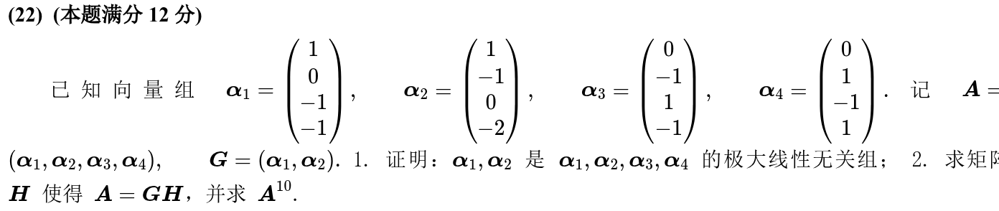

*关联章节：[矩阵运算、逆矩阵与初等变换](02-matrices.md)*

---

## 2025年

### 02 · 2025-10 · 选择题

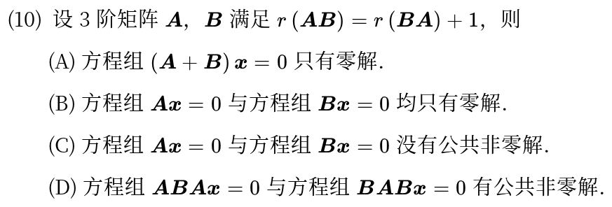

*关联章节：[线性方程组](04-linear-systems.md)*

---

## 2024年

### 03 · 2024-09 · 选择题

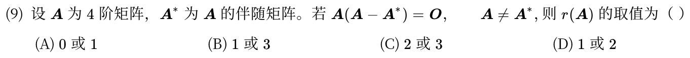

---

### 04 · 2024-16 · 填空题

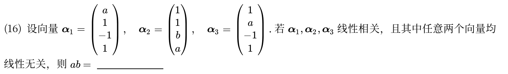

---

## 2023年

### 05 · 2023-10 · 选择题

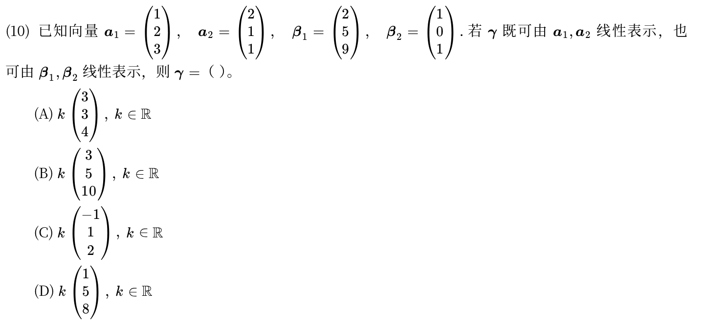

---

## 2022年

### 06 · 2022-10 · 选择题

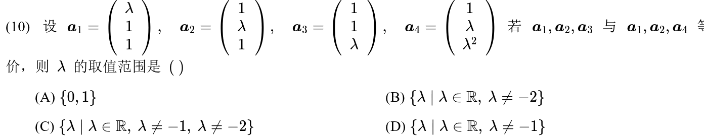

---

## 2021年

### 07 · 2021-09 · 选择题

> 向量表出与方程解空间选择题。向量组  能被  线性表出意味着 。转置后 ，从而  的解必定是  的解。

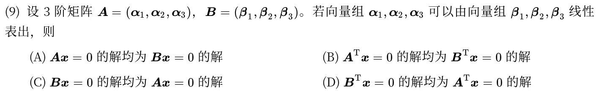

*关联章节：[线性方程组](04-linear-systems.md)*

---

## 2019年

### 08 · 2019-07 · 选择题

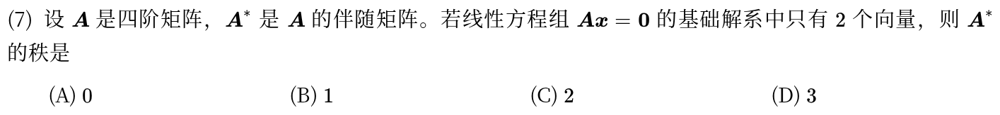

---

### 09 · 2019-22 · 解答题

> 两向量组等价大题。两向量组等价充分必要条件是秩相等且可互相线性表出，联立大矩阵做行初等变换同时解决秩与表出系数。

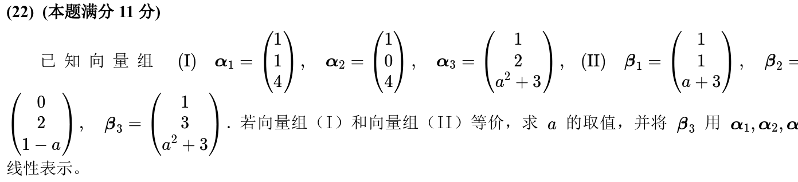

---

## 2018年

### 10 · 2018-08 · 选择题

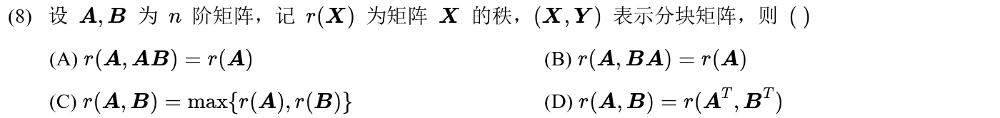

---

## 2016年

### 11 · 2016-14 · 填空题

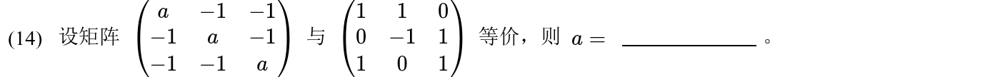

---

## 2014年

### 12 · 2014-08 · 选择题

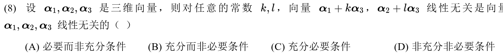

---

## 2013年

### 13 · 2013-07 · 选择题

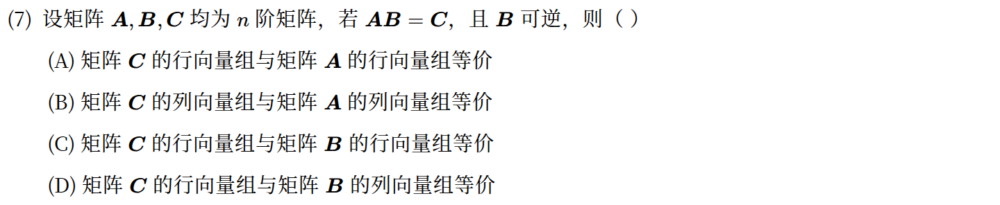

*关联章节：[矩阵运算、逆矩阵与初等变换](02-matrices.md)*

---

## 2012年

### 14 · 2012-07 · 选择题

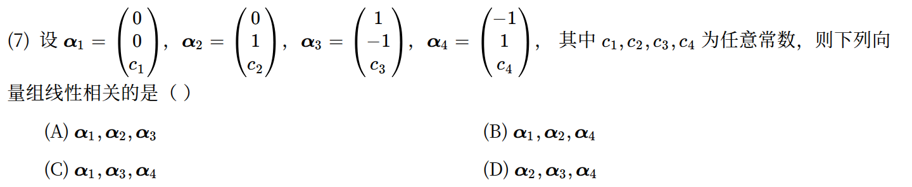

---

## 2011年

### 15 · 2011-22 · 解答题

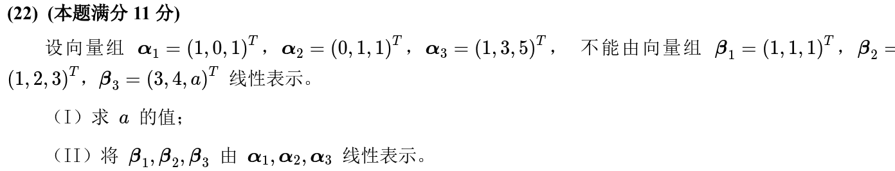

---

## 2010年

### 16 · 2010-07 · 选择题

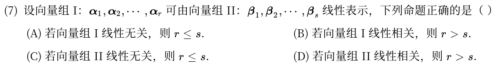

---

## 交叉考点索引

以下题目主归其他章节，点击跳转到对应章节题目；不计入本章主收录题数：

- [2026年 · 第9题](04-linear-systems.md)（主章节：线性方程组）
- [2026年 · 第10题](05-eigenvalues-similarity.md)（主章节：特征值、特征向量与相似）
- [2026年 · 第16题](06-quadratic-forms.md)（主章节：二次型）
- [2018年 · 第14题](01-determinants.md)（主章节：行列式）
- [2018年 · 第22题](06-quadratic-forms.md)（主章节：二次型）
- [2017年 · 第22题](04-linear-systems.md)（主章节：线性方程组）
- [2016年 · 第22题](04-linear-systems.md)（主章节：线性方程组）
- [2016年 · 第23题](05-eigenvalues-similarity.md)（主章节：特征值、特征向量与相似）
- [2013年 · 第23题](06-quadratic-forms.md)（主章节：二次型）
- [2012年 · 第23题](06-quadratic-forms.md)（主章节：二次型）
- [2011年 · 第8题](04-linear-systems.md)（主章节：线性方程组）

[« 矩阵运算、逆矩阵与初等变换](02-matrices.md)　　[线性方程组 »](04-linear-systems.md)
