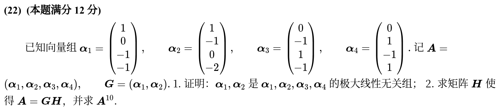
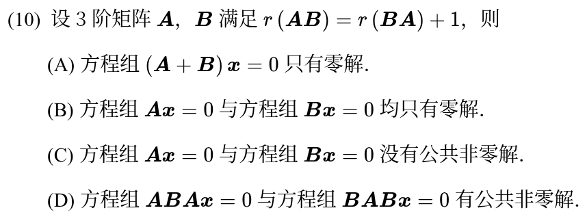
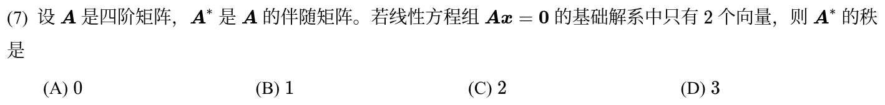
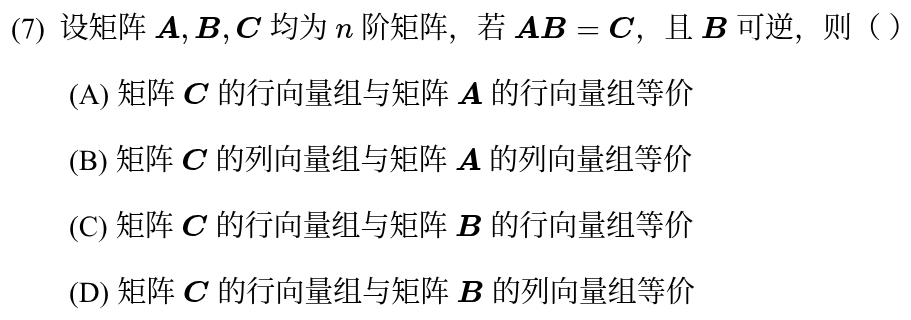
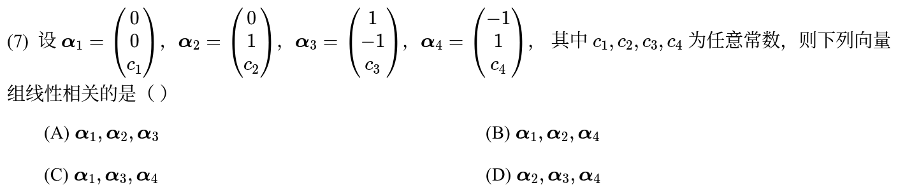
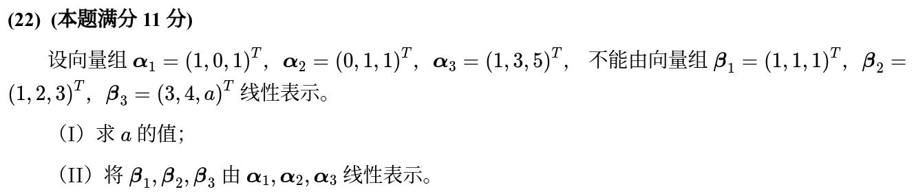
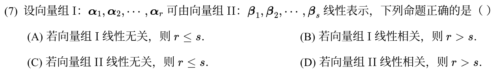

[« 矩阵运算、逆矩阵与初等变换](02-matrices.md)　　[线性方程组 »](04-linear-systems.md)

# 线性代数 · 向量组、线性相关与秩

> **本章共 16 题**
> 
> - **核心必做（建议按顺序攻克关键方法）**：  
>   [第 16 题](#q16)（线性表示与无关个数） → [第 10 题](#q10)（列空间与秩） → [第 07 题](#q07)（表出与转置解空间） → [第 04 题](#q04)（含参数的相关与秩）
> 
> - **分流与刷题建议**：  
>   - **较难挑战**：[第 09 题](#q09)（向量组等价分类讨论）  
>   - **重在看思路**：[第 01 题](#q01)（极大无关组接满秩分解与矩阵幂）  
>   - **首轮可跳过**：[第 02 题](#q02)（技巧较偏或综合度高，首轮不必死磕）  
> 
> - **过关目标**：会用行化简找秩、判断表出，能解释解空间包含的方向。

---

### 01 · 2026年

> *最新线代解答题。第一问行变换化阶梯形证极大无关组；第二问列出分解 $A=GH$（满秩分解），利用结合律 $A^{10} = G(HG)^9 H$ 降成 2 阶矩阵的幂。*

答案与解析

**结论速览**：（1）$\boldsymbol\alpha_1,\boldsymbol\alpha_2$ 线性无关且 $\boldsymbol\alpha_3=\boldsymbol\alpha_2-\boldsymbol\alpha_1,\ \boldsymbol\alpha_4=\boldsymbol\alpha_1-\boldsymbol\alpha_2$，故为极大线性无关组；（2）$H = \begin{pmatrix} 1 & 0 & -1 & 1 \\ 0 & 1 & 1 & -1 \end{pmatrix}$，$A^{10} = \begin{pmatrix} 1 & -8 & -9 & 9 \\ 0 & -1 & -1 & 1 \\ -1 & 9 & 10 & -10 \\ -1 & 7 & 8 & -8 \end{pmatrix}$。

- **（1）证明 $\boldsymbol\alpha_1,\boldsymbol\alpha_2$ 是极大线性无关组**：
  对矩阵 $A = (\boldsymbol\alpha_1, \boldsymbol\alpha_2, \boldsymbol\alpha_3, \boldsymbol\alpha_4)$ 做初等行变换化为行最简形：
  $$A = \begin{pmatrix} 1 & 1 & 0 & 0 \\ 0 & -1 & -1 & 1 \\ -1 & 0 & 1 & -1 \\ -1 & -2 & -1 & 1 \end{pmatrix} \xrightarrow[r_4+r_1]{r_3+r_1} \begin{pmatrix} 1 & 1 & 0 & 0 \\ 0 & -1 & -1 & 1 \\ 0 & 1 & 1 & -1 \\ 0 & -1 & -1 & 1 \end{pmatrix} \xrightarrow[r_1+r_2,\ r_2\times(-1)]{r_3+r_2,\ r_4-r_2} \begin{pmatrix} 1 & 0 & -1 & 1 \\ 0 & 1 & 1 & -1 \\ 0 & 0 & 0 & 0 \\ 0 & 0 & 0 & 0 \end{pmatrix}.$$
  因为初等行变换不改变列向量间的线性关系，由行最简形可知：
  - 第 $1,2$ 列线性无关，且 $r(A)=2$；
  - $\boldsymbol\alpha_3 = -\boldsymbol\alpha_1 + \boldsymbol\alpha_2$，$\boldsymbol\alpha_4 = \boldsymbol\alpha_1 - \boldsymbol\alpha_2$。
  故 $\boldsymbol\alpha_1, \boldsymbol\alpha_2$ 是向量组 $\boldsymbol\alpha_1, \boldsymbol\alpha_2, \boldsymbol\alpha_3, \boldsymbol\alpha_4$ 的一个极大线性无关组。
- **（2）求矩阵 $H$ 与 $A^{10}$**：
  由第（1）问的列线性表示关系，直接读出满秩分解 $A = GH$ 中的 $H$：
  $$H = \begin{pmatrix} 1 & 0 & -1 & 1 \\ 0 & 1 & 1 & -1 \end{pmatrix}.$$
  利用结合律 $A^{10} = (GH)^{10} = G(HG)^9 H$，将 $4$ 阶高次幂降阶为 $2$ 阶矩阵幂：
  $$HG = \begin{pmatrix} 1 & 0 & -1 & 1 \\ 0 & 1 & 1 & -1 \end{pmatrix}\begin{pmatrix} 1 & 1 \\ 0 & -1 \\ -1 & 0 \\ -1 & -2 \end{pmatrix} = \begin{pmatrix} 1 & -1 \\ 0 & 1 \end{pmatrix} = E_2 + N,$$
  其中 $N = \begin{pmatrix} 0 & -1 \\ 0 & 0 \end{pmatrix}$ 满足 $N^2 = O$。由二项式展开得
  $$(HG)^9 = (E_2 + N)^9 = E_2 + 9N = \begin{pmatrix} 1 & -9 \\ 0 & 1 \end{pmatrix}.$$
  回代计算 $A^{10}$：
  $$A^{10} = G(HG)^9 H = \begin{pmatrix} 1 & 1 \\ 0 & -1 \\ -1 & 0 \\ -1 & -2 \end{pmatrix}\begin{pmatrix} 1 & -9 \\ 0 & 1 \end{pmatrix}\begin{pmatrix} 1 & 0 & -1 & 1 \\ 0 & 1 & 1 & -1 \end{pmatrix} = \begin{pmatrix} 1 & -8 \\ 0 & -1 \\ -1 & 9 \\ -1 & 7 \end{pmatrix}\begin{pmatrix} 1 & 0 & -1 & 1 \\ 0 & 1 & 1 & -1 \end{pmatrix} = \begin{pmatrix} 1 & -8 & -9 & 9 \\ 0 & -1 & -1 & 1 \\ -1 & 9 & 10 & -10 \\ -1 & 7 & 8 & -8 \end{pmatrix}.$$
- **核心思路与避坑**：看到低秩矩阵求高次幂 $A^k$ 且题干提前给好了满秩分解 $A=GH$，核心必是 $A^k = G(HG)^{k-1}H$（注意指数是 $k-1=9$ 而不是 $10$！）。

---

### 02 · 2025年

答案与解析

**答案**：**（D）** 方程组 $ABA\boldsymbol{x}=\boldsymbol{0}$ 与方程组 $BAB\boldsymbol{x}=\boldsymbol{0}$ 有公共非零解

- **切入点与推演**：由 $r(AB) = r(BA) + 1$ 立刻得到两个关键推论：
  1. **锁定 $r(BA)$ 的上界**：若 $A$ 可逆，则 $A^{-1}(AB)A = BA$，即 $AB \sim BA \implies r(AB)=r(BA)$，矛盾；同理 $B$ 亦不可逆。故 $r(A) \le 2,\ r(B) \le 2$，从而
     $$r(AB) \le \min\{r(A), r(B)\} \le 2 \implies r(BA) = r(AB) - 1 \le 1.$$
  2. **检验（D）**：两个齐次方程组 $ABA\boldsymbol{x}=\boldsymbol{0}$ 与 $BAB\boldsymbol{x}=\boldsymbol{0}$ 有公共非零解，等价于联立方程组 $\begin{pmatrix} ABA \\ BAB \end{pmatrix}\boldsymbol{x} = \boldsymbol{0}$ 有非零解，即系数矩阵秩严格小于 $3$。利用矩阵乘积与分块矩阵的秩不等式：
     $$r(ABA) = r(A(BA)) \le r(BA) \le 1, \qquad r(BAB) = r((BA)B) \le r(BA) \le 1,$$
     因此
     $$r\begin{pmatrix} ABA \\ BAB \end{pmatrix} \le r(ABA) + r(BAB) \le 1 + 1 = 2 < 3.$$
     故联立方程组必有非零解，**（D）恒成立**。
- **干扰项 / 易错提示**：取极简反例 $A = \begin{pmatrix}1&0&0\\0&0&0\\0&0&0\end{pmatrix},\ B = \begin{pmatrix}0&1&0\\0&0&0\\0&0&0\end{pmatrix}$，此时 $AB=B$（秩 $1$）、$BA=O$（秩 $0$）满足题设，但 $\boldsymbol{e}_3=(0,0,1)^T$ 是 $A\boldsymbol{x}=\boldsymbol{0}$、$B\boldsymbol{x}=\boldsymbol{0}$ 与 $(A+B)\boldsymbol{x}=\boldsymbol{0}$ 的公共非零解，一举排除（A）（B）（C）。

---

### 03 · 2024年

答案与解析

**答案**：**（D）** $1$ 或 $2$

- **切入点与推演**：把条件 $A(A-A^*)=O$ 展开为 $A^2 = AA^* = |A|E$，先判 $|A|$ 是否为零，再借秩不等式夹逼 $r(A)$。
  1. **必有 $|A|=0$**：若 $|A|\ne 0$，则 $A$ 可逆，由 $A(A-A^*)=O$ 左乘 $A^{-1}$ 得 $A-A^*=O$，与题设 $A\ne A^*$ 矛盾。因此 $|A|=0$。
  2. **推出 $A^2=O$ 并定上界**：由 $|A|=0$ 得 $AA^* = |A|E = O$，故 $A^2 = AA^* = O$。对 $4$ 阶矩阵套用 Sylvester 秩不等式：
     $$r(A) + r(A) \le 4 + r(A^2) = 4 \implies r(A) \le 2.$$
  3. **排除 $r(A)=0$ 并确认 $1,2$ 均可取**：
     - 若 $r(A)=0$，则 $A=O \implies A^*=O=A$，与 $A\ne A^*$ 矛盾，故 $r(A)\ne 0$；
     - 取 $A = \begin{pmatrix}0&1&0&0\\0&0&0&0\\0&0&0&0\\0&0&0&0\end{pmatrix}$（秩 $1$）或 $A = \begin{pmatrix}0&1&0&0\\0&0&0&0\\0&0&0&1\\0&0&0&0\end{pmatrix}$（秩 $2$），均有 $A^2=O,\ A^*=O\ne A$，满足题设。
  综上，$r(A)$ 的取值为 $1$ 或 $2$，选 **（D）**。
- **干扰项 / 易错提示**：（A）漏掉了排除 $r(A)=0$（此时 $A=A^*=O$ 违背 $A\ne A^*$）；（B）（C）忘记了 $A^2=O \implies r(A)\le n/2=2$ 这一高频结论。

---

### 04 · 2024年

答案与解析

**第一步怎么落笔**

- **触发条件**：3 个 4 维向量线性相关，且任意两个线性无关。
- **第一笔**：**先看 $\boldsymbol{\alpha}_1$ 和 $\boldsymbol{\alpha}_3$ 的对称结构**：
  - 若 $a=1$，则 $\boldsymbol{\alpha}_1 = \boldsymbol{\alpha}_3 = (1,1,-1,1)^T$，违背“任意两个线性无关”，因此先锁死 **$a \neq 1$**；
  - 既然 $\boldsymbol{\alpha}_1, \boldsymbol{\alpha}_3$ 线性无关，而全体线性相关，那么 **$\boldsymbol{\alpha}_2$ 必可由 $\boldsymbol{\alpha}_1, \boldsymbol{\alpha}_3$ 线性表示**：
    $$\boldsymbol{\alpha}_2 = c_1\boldsymbol{\alpha}_1 + c_3\boldsymbol{\alpha}_3.$$

**完整推演**

把 $\boldsymbol{\alpha}_2 = c_1\boldsymbol{\alpha}_1 + c_3\boldsymbol{\alpha}_3$ 按 4 个分量写出（不盲目做复杂消元，直接盯分量和！）：
$$\begin{cases} c_1 a + c_3 = 1 & (1) \\ c_1 + c_3 a = 1 & (2) \\ -c_1 - c_3 = b & (3) \\ c_1 + c_3 = a & (4) \end{cases}$$
1. **看（3）式与（4）式**：两式相加直接消去 $c_1, c_3$，得
   $$b + a = 0 \implies b = -a.$$
2. **看（1）式与（2）式**：两式相加，得
   $$(a+1)(c_1 + c_3) = 2.$$
   把（4）式的 $c_1 + c_3 = a$ 代入上式：
   $$a(a+1) = 2 \implies a^2 + a - 2 = 0 \implies (a+2)(a-1) = 0.$$
3. **用“任意两个线性无关”筛根**：
   - 前面已排除 $a = 1$（此时 $\boldsymbol{\alpha}_1 = \boldsymbol{\alpha}_3$）；
   - 故唯一可能为 $a = -2$，从而 $b = -a = 2$。
4. **回代检验**：当 $a=-2, b=2$ 时，$\boldsymbol{\alpha}_1=(-2,1,-1,1)^T$，$\boldsymbol{\alpha}_2=(1,1,2,-2)^T$，$\boldsymbol{\alpha}_3=(1,-2,-1,1)^T$。易见 $c_1=c_3=-1$ 使 $\boldsymbol{\alpha}_2 = -\boldsymbol{\alpha}_1 - \boldsymbol{\alpha}_3$，且任意两列均不成比例，全部条件满足！
   因此：
   $$ab = (-2)\times 2 = -4.$$

---

### 05 · 2023年

答案与解析

- **方法一（三维几何法向量速杀）**：$\boldsymbol{\gamma}$ 既在 $\operatorname{span}(\boldsymbol{\alpha}_1,\boldsymbol{\alpha}_2)$ 内又在 $\operatorname{span}(\boldsymbol{\beta}_1,\boldsymbol{\beta}_2)$ 内，即 $\boldsymbol{\gamma}$ 沿两平面的交线方向。
  - 平面 1 法向量 $\boldsymbol{n}_1 = \boldsymbol{\alpha}_1\times\boldsymbol{\alpha}_2 = (1,2,3)^T\times(2,1,1)^T = (-1, 5, -3)^T$；
  - 平面 2 法向量 $\boldsymbol{n}_2 = \boldsymbol{\beta}_1\times\boldsymbol{\beta}_2 = (2,5,9)^T\times(1,0,1)^T = (5, 7, -5)^T$；
  - 交线方向 $\boldsymbol{n}_1\times\boldsymbol{n}_2 = (-4, -20, -32)^T = -4(1, 5, 8)^T$。
- **方法二（线性方程组法）**：设 $\boldsymbol{\gamma} = x_1\boldsymbol{\alpha}_1+x_2\boldsymbol{\alpha}_2 = y_1\boldsymbol{\beta}_1+y_2\boldsymbol{\beta}_2$，解齐次方程组 $(\boldsymbol{\alpha}_1,\boldsymbol{\alpha}_2,-\boldsymbol{\beta}_1,-\boldsymbol{\beta}_2)\boldsymbol{z}=\boldsymbol{0}$，得 $x_1 = 3k, x_2 = -k$，代入得 $\boldsymbol{\gamma} = 3k(1,2,3)^T - k(2,1,1)^T = k(1, 5, 8)^T$。
- **答案**：**（D）**。

---

### 06 · 2022年

答案与解析

**答案**：**（C）** $\{\lambda \mid \lambda \in \mathbb{R},\ \lambda \ne -1,\ \lambda \ne -2\}$

- **切入点与推演**：两组都是 $3$ 个 $3$ 维列向量，先算各自拼成的 $3$ 阶行列式找出退化分界点，再逐个检验分界点处的等价性。
  1. **算两个行列式**：
     $$|(\boldsymbol\alpha_1,\boldsymbol\alpha_2,\boldsymbol\alpha_3)| = \begin{vmatrix} \lambda & 1 & 1 \\ 1 & \lambda & 1 \\ 1 & 1 & \lambda \end{vmatrix} = (\lambda+2)(\lambda-1)^2,$$
     $$|(\boldsymbol\alpha_1,\boldsymbol\alpha_2,\boldsymbol\alpha_4)| = \begin{vmatrix} \lambda & 1 & 1 \\ 1 & \lambda & \lambda \\ 1 & 1 & \lambda^2 \end{vmatrix} = \lambda(\lambda^3-\lambda) - (\lambda^2-\lambda) + (1-\lambda) = \lambda^4 - 2\lambda^2 + 1 = (\lambda-1)^2(\lambda+1)^2.$$
  2. **分类检验**：
     - 当 $\lambda \ne 1, -1, -2$ 时，两个行列式均非零，两组均满秩（秩均为 $3$），都是 $\mathbb{R}^3$ 的基，必等价；
     - 当 $\lambda = 1$ 时，$\boldsymbol\alpha_1=\boldsymbol\alpha_2=\boldsymbol\alpha_3=\boldsymbol\alpha_4=(1,1,1)^T$，两组完全相同，**等价**；
     - 当 $\lambda = -2$ 时，$|(\boldsymbol\alpha_1,\boldsymbol\alpha_2,\boldsymbol\alpha_3)|=0$（秩 $\le 2$），而 $|(\boldsymbol\alpha_1,\boldsymbol\alpha_2,\boldsymbol\alpha_4)|=9\ne 0$（秩 $=3$），秩不等故**不等价**；
     - 当 $\lambda = -1$ 时，$|(\boldsymbol\alpha_1,\boldsymbol\alpha_2,\boldsymbol\alpha_3)|=4\ne 0$（秩 $=3$），而 $|(\boldsymbol\alpha_1,\boldsymbol\alpha_2,\boldsymbol\alpha_4)|=0$（秩 $\le 2$），秩不等故**不等价**。
  综上，$\lambda \ne -1$ 且 $\lambda \ne -2$，选 **（C）**。
- **干扰项 / 易错提示**：算完两个行列式后，极易把公共零点 $\lambda=1$ 随手也排除掉——切记两行列式同时为 $0$ 时两组仍可能等价，必须单独代回验证！

---

### 07 · 2021年

> *向量表出与方程解空间选择题。向量组 $A$ 能被 $B$ 线性表出意味着 $A=BC$。转置后 $A^T = C^T B^T$，从而 $B^T x=0$ 的解必定是 $A^T x=0$ 的解。*

答案与解析

**第一步怎么落笔**

- **触发条件**：列向量组 $\boldsymbol{\alpha}_1,\boldsymbol{\alpha}_2,\boldsymbol{\alpha}_3$ 可由 $\boldsymbol{\beta}_1,\boldsymbol{\beta}_2,\boldsymbol{\beta}_3$ 线性表出，选项都在比较 $A\boldsymbol{x}=\boldsymbol{0}$、$B\boldsymbol{x}=\boldsymbol{0}$、$A^T\boldsymbol{x}=\boldsymbol{0}$、$B^T\boldsymbol{x}=\boldsymbol{0}$ 的解空间包含关系。
- **第一笔**：**写矩阵乘法 $A = BC$，立刻取转置得 $A^T = C^T B^T$！**

**完整推演**

1. **翻译题干**：因为 $A=(\boldsymbol{\alpha}_1,\boldsymbol{\alpha}_2,\boldsymbol{\alpha}_3)$ 的每一列都可由 $B=(\boldsymbol{\beta}_1,\boldsymbol{\beta}_2,\boldsymbol{\beta}_3)$ 的列线性表出，所以存在 3 阶矩阵 $C$，使得
   $$A = BC.$$
2. **取转置**：
   $$A^T = (BC)^T = C^T B^T.$$
3. **验证解空间包含方向**：若 $\boldsymbol{x}$ 是 $B^T\boldsymbol{x}=\boldsymbol{0}$ 的任意解，则左乘 $C^T$ 得
   $$A^T\boldsymbol{x} = C^T(B^T\boldsymbol{x}) = C^T\boldsymbol{0} = \boldsymbol{0},$$
   即 $\boldsymbol{x}$ 必为 $A^T\boldsymbol{x}=\boldsymbol{0}$ 的解。因此 **$B^T\boldsymbol{x}=\boldsymbol{0}$ 的解均为 $A^T\boldsymbol{x}=\boldsymbol{0}$ 的解**，选 **（D）**。

> **几何直觉（防搞反方向）**：$B^T\boldsymbol{x}=\boldsymbol{0}$ 意味着 $\boldsymbol{x}$ 与 $\boldsymbol{\beta}_1,\boldsymbol{\beta}_2,\boldsymbol{\beta}_3$ 全部正交；既然每个 $\boldsymbol{\alpha}_i$ 都是 $\boldsymbol{\beta}_1,\boldsymbol{\beta}_2,\boldsymbol{\beta}_3$ 的线性组合，那么 $\boldsymbol{x}$ 必然也与每个 $\boldsymbol{\alpha}_i$ 正交，即 $A^T\boldsymbol{x}=\boldsymbol{0}$！

**选择题关键干扰项拆解**

- **（B）$A^T\boldsymbol{x}=\boldsymbol{0}$ 的解均为 $B^T\boldsymbol{x}=\boldsymbol{0}$ 的解（最高频错选）**：把 $A=BC$ 的包含方向搞反了。特例验证：取 $A=O$（显然可由任意 $B$ 表出），$B=E$。此时 $A^T\boldsymbol{x}=\boldsymbol{0}$ 的解是全体 $\mathbb{R}^3$，而 $B^T\boldsymbol{x}=\boldsymbol{0}$ 只有零解，直接淘汰（B），同时也淘汰（A）！
- **（A）与（C）**：$A=BC$ 右乘 $\boldsymbol{x}$ 得 $A\boldsymbol{x} = B(C\boldsymbol{x})$，既推不出 $A\boldsymbol{x}=\boldsymbol{0}\implies B\boldsymbol{x}=\boldsymbol{0}$（取 $A=O, B=E$ 淘汰 A），也推不出 $B\boldsymbol{x}=\boldsymbol{0}\implies A\boldsymbol{x}=\boldsymbol{0}$（取 $B=\begin{pmatrix}1&0&0\\0&0&0\\0&0&0\end{pmatrix}$，$C=\begin{pmatrix}0&1&0\\0&0&0\\0&0&0\end{pmatrix}$，则 $A=BC=\begin{pmatrix}0&1&0\\0&0&0\\0&0&0\end{pmatrix}$，取 $\boldsymbol{x}=(0,1,0)^T$ 满足 $B\boldsymbol{x}=\boldsymbol{0}$ 但 $A\boldsymbol{x}=(1,0,0)^T\neq\boldsymbol{0}$，淘汰 C）。

---

### 08 · 2019年

答案与解析

**答案**：**（A）** $0$

- **切入点与推演**：由基础解系向量个数反推 $r(A)$，再直接套用伴随矩阵的秩定理。
  1. 方程组 $A\boldsymbol{x}=\boldsymbol{0}$ 为 $4$ 元齐次方程组，基础解系含 $2$ 个线性无关的解向量，故
     $$4 - r(A) = 2 \implies r(A) = 2.$$
  2. 对 $n$ 阶矩阵 $A$，伴随矩阵的秩由经典分段公式确定：
     $$r(A^*) = \begin{cases} n, & r(A) = n, \\ 1, & r(A) = n - 1, \\ 0, & r(A) \le n - 2. \end{cases}$$
     本题 $n=4$ 且 $r(A) = 2 = n - 2$，故 $A$ 的所有 $3$ 阶子式全为 $0$，从而 $A^* = O$，$r(A^*) = 0$，选 **（A）**。
- **干扰项 / 易错提示**：（B）是误记成了 $r(A)<n$ 时总有 $r(A^*)=1$；只有恰好 $r(A)=n-1$ 时才有 $r(A^*)=1$，一旦 $r(A)\le n-2$ 则必有 $A^*=O$。

---

### 09 · 2019年

> *两向量组等价大题。两向量组等价充分必要条件是秩相等且可互相线性表出，联立大矩阵做行初等变换同时解决秩与表出系数。*

答案与解析

**结论速览**：$a \neq -1$；当 $a \neq \pm 1$ 时，$\boldsymbol{\beta}_3 = \boldsymbol{\alpha}_1 - \boldsymbol{\alpha}_2 + \boldsymbol{\alpha}_3$（唯一）；当 $a = 1$ 时，$\boldsymbol{\beta}_3 = (1+2k)\boldsymbol{\alpha}_1 - (1+k)\boldsymbol{\alpha}_2 + (1-k)\boldsymbol{\alpha}_3$（$k \in \mathbb{R}$）。

- **第一步：先算 $|A|$ 与 $|B|$ 找分界点**：
  - $|A| = \begin{vmatrix}1&1&1\\1&0&2\\4&4&a^2+3\end{vmatrix} = -(a^2-1) = 1 - a^2$；
  - $|B| = \begin{vmatrix}1&0&1\\1&2&3\\a+3&1-a&a^2+3\end{vmatrix} = 2(a^2-1)$。
- **第二步：分类讨论等价性**（$r(A)=r(B)=r(A,B)$）：
  1. 当 $a \neq \pm 1$ 时：$|A|\neq 0$ 且 $|B|\neq 0$，故 $r(A)=r(B)=3$，两个向量组都等价于 $\mathbb{R}^3$ 的基，**必等价**；
  2. 当 $a = 1$ 时：$A=\begin{pmatrix}1&1&1\\1&0&2\\4&4&4\end{pmatrix}$，$B=\begin{pmatrix}1&0&1\\1&2&3\\4&0&4\end{pmatrix}$，对 $(A\mid B)$ 做行变换易得 $r(A)=r(B)=r(A,B)=2$，**等价**；
  3. 当 $a = -1$ 时：$A=\begin{pmatrix}1&1&1\\1&0&2\\4&4&4\end{pmatrix}$（满足第 3 行 $= 4\times$ 第 1 行），而 $\boldsymbol{\beta}_1=(1,1,2)^T$ 不满足此关系，故 $r(A,B)=3 > r(A)=2$，**不等价**。
  综上，$a$ 的取值为 **$a \neq -1$**。
- **第三步：用 $\boldsymbol{\alpha}_1,\boldsymbol{\alpha}_2,\boldsymbol{\alpha}_3$ 表示 $\boldsymbol{\beta}_3$（务必区分 $a\neq\pm 1$ 与 $a=1$！）**：
  - 观察 $\boldsymbol{\beta}_3 - \boldsymbol{\alpha}_3 = (0,1,0)^T = \boldsymbol{\alpha}_1 - \boldsymbol{\alpha}_2$，故有一组特解 $\boldsymbol{\beta}_3 = \boldsymbol{\alpha}_1 - \boldsymbol{\alpha}_2 + \boldsymbol{\alpha}_3$。
  - 当 $a \neq \pm 1$ 时，$\boldsymbol{\alpha}_1,\boldsymbol{\alpha}_2,\boldsymbol{\alpha}_3$ 线性无关，表示唯一：
    $$\boldsymbol{\beta}_3 = \boldsymbol{\alpha}_1 - \boldsymbol{\alpha}_2 + \boldsymbol{\alpha}_3.$$
  - 当 $a = 1$ 时，$\boldsymbol{\alpha}_3 = 2\boldsymbol{\alpha}_1 - \boldsymbol{\alpha}_2$（即 $2\boldsymbol{\alpha}_1 - \boldsymbol{\alpha}_2 - \boldsymbol{\alpha}_3 = \boldsymbol{0}$），表示不唯一，全部表示式为：
    $$\boldsymbol{\beta}_3 = (1+2k)\boldsymbol{\alpha}_1 - (1+k)\boldsymbol{\alpha}_2 + (1-k)\boldsymbol{\alpha}_3, \qquad k\in\mathbb{R}.$$

---

### 10 · 2018年

答案与解析

**答案**：**（A）** $r(A, AB) = r(A)$

**第一步怎么落笔**

- **触发条件**：比较 $n$ 阶矩阵 $A, B$ 拼成的分块矩阵的秩。
- **第一笔**：观察（A）中的 $(A, AB)$——右边块 $AB$ 的每一列都是 $A$ 的列向量的线性组合，因此用**分块初等列变换**可直接把 $AB$ 消成零块！

**完整推演**

对分块矩阵 $(A, AB)$ 右乘可逆分块矩阵 $\begin{pmatrix}E & -B \\ O & E\end{pmatrix}$：
$$(A,\ AB)\begin{pmatrix}E & -B \\ O & E\end{pmatrix} = (A,\ -AB + AB) = (A,\ O).$$
因为右乘可逆矩阵不改变矩阵的秩，所以
$$r(A,\ AB) = r(A,\ O) = r(A).$$
故 **（A）恒成立**。
（从向量组角度看同样一目了然：$AB$ 的列向量组可由 $A$ 的列向量组线性表示，故把 $AB$ 的列拼到 $A$ 后面不会增加列空间的维数。）

**选择题关键干扰项拆解（2 阶 0-1 反例秒杀）**

- **（B）$r(A, BA) = r(A)$（错）**：$BA$ 是**左乘** $B$，改变的是行组合而不是列组合！反例：取 $A=\begin{pmatrix}1&0\\0&0\end{pmatrix}$，$B=\begin{pmatrix}0&0\\1&0\end{pmatrix}$，则 $BA=\begin{pmatrix}0&0\\1&0\end{pmatrix}$，$r(A)=1$，而 $r(A, BA) = r\begin{pmatrix}1&0&0&0\\0&0&1&0\end{pmatrix} = 2 \neq 1$。
- **（C）$r(A, B) = \max\{r(A), r(B)\}$（错）**：把两个列空间正交的秩 1 矩阵拼在一起，秩会相加而不是取最大。反例：$A=\begin{pmatrix}1&0\\0&0\end{pmatrix}$，$B=\begin{pmatrix}0&0\\0&1\end{pmatrix}$，则 $\max\{r(A),r(B)\}=1$，但 $r(A,B)=2$。
- **（D）$r(A, B) = r(A^T, B^T)$（错，极易误判！）**：虽然 $r(A)=r(A^T)$、$r(B)=r(B^T)$，但**水平拼接**要求比的是列空间之和，转置后变成行空间之和，两者未必同维！反例：$A=\begin{pmatrix}1&0\\0&0\end{pmatrix}$，$B=\begin{pmatrix}0&1\\0&0\end{pmatrix}$，则 $r(A,B)=1$（非零元全在第 1 行）；而 $A^T=\begin{pmatrix}1&0\\0&0\end{pmatrix}$，$B^T=\begin{pmatrix}0&0\\1&0\end{pmatrix}$，故 $r(A^T,B^T)=2 \neq 1$。

---

### 11 · 2016年

答案与解析

**答案**：$2$

- **切入点与推演**：同型矩阵等价的充要条件是**秩相等**。先求右矩阵的秩，再令左矩阵取相同的秩即可锁定 $a$。
  1. **求右矩阵的秩**：记 $B = \begin{pmatrix} 1 & 1 & 0 \\ 0 & -1 & 1 \\ 1 & 0 & 1 \end{pmatrix}$，观察第 $1$ 行加第 $2$ 行恰等于第 $3$ 行，且前两行不成比例，故 $r(B) = 2$。
  2. **令左矩阵秩为 $2$**：记 $A = \begin{pmatrix} a & -1 & -1 \\ -1 & a & -1 \\ -1 & -1 & a \end{pmatrix}$，先算行列式（各列加到第 $1$ 列）：
     $$|A| = \begin{vmatrix} a-2 & -1 & -1 \\ a-2 & a & -1 \\ a-2 & -1 & a \end{vmatrix} = (a-2)\begin{vmatrix} 1 & -1 & -1 \\ 1 & a & -1 \\ 1 & -1 & a \end{vmatrix} = (a-2)(a+1)^2.$$
     因 $r(A)=r(B)=2<3$，必有 $|A|=0 \implies a=2$ 或 $a=-1$。逐一代回验秩：
     - 当 $a = -1$ 时，$A = \begin{pmatrix} -1 & -1 & -1 \\ -1 & -1 & -1 \\ -1 & -1 & -1 \end{pmatrix}$，秩为 $1 \ne 2$，舍去；
     - 当 $a = 2$ 时，$A = \begin{pmatrix} 2 & -1 & -1 \\ -1 & 2 & -1 \\ -1 & -1 & 2 \end{pmatrix}$，左上角 $2$ 阶子式 $\begin{vmatrix} 2 & -1 \\ -1 & 2 \end{vmatrix} = 3 \ne 0$，故 $r(A) = 2$，符合题意。
  因此 $a = 2$。
- **易错点**：算出 $|A|=(a-2)(a+1)^2=0$ 后务必代回验秩，不能直接把 $a=-1$ 也当作答案（$a=-1$ 时秩降为 $1$）。

---

### 12 · 2014年

答案与解析

**答案**：**（A）** 必要而非充分条件

- **切入点与推演**：把“$P$ 是 $Q$ 的什么条件”拆成“$Q \Rightarrow P$（必要性）”与“$P \Rightarrow Q$（充分性）”双向检验。
  1. **必要性（$Q \Rightarrow P$ 成立）**：设 $\boldsymbol\alpha_1, \boldsymbol\alpha_2, \boldsymbol\alpha_3$ 线性无关。对任意常数 $k, l$，若存在数 $x_1, x_2$ 使得
     $$x_1(\boldsymbol\alpha_1 + k\boldsymbol\alpha_3) + x_2(\boldsymbol\alpha_2 + l\boldsymbol\alpha_3) = \boldsymbol{0},$$
     整理得 $x_1\boldsymbol\alpha_1 + x_2\boldsymbol\alpha_2 + (kx_1 + lx_2)\boldsymbol\alpha_3 = \boldsymbol{0}$。由 $\boldsymbol\alpha_1, \boldsymbol\alpha_2, \boldsymbol\alpha_3$ 线性无关，必有 $x_1 = x_2 = 0$。故 $\boldsymbol\alpha_1+k\boldsymbol\alpha_3,\ \boldsymbol\alpha_2+l\boldsymbol\alpha_3$ 线性无关，必要性成立。
  2. **充分性（$P \Rightarrow Q$ 不成立）**：举极简反例，取 $\boldsymbol\alpha_1=(1,0,0)^T,\ \boldsymbol\alpha_2=(0,1,0)^T,\ \boldsymbol\alpha_3=(0,0,0)^T$。则对任意 $k,l$ 均有 $\boldsymbol\alpha_1+k\boldsymbol\alpha_3=\boldsymbol\alpha_1,\ \boldsymbol\alpha_2+l\boldsymbol\alpha_3=\boldsymbol\alpha_2$ 线性无关，但含零向量的 $\boldsymbol\alpha_1,\boldsymbol\alpha_2,\boldsymbol\alpha_3$ 线性相关。
  综上，为必要而非充分条件，选 **（A）**。
- **干扰项 / 易错提示**：容易受“对任意 $k,l$ 成立”的迷惑而误选（C）；只要取 $\boldsymbol\alpha_3=\boldsymbol{0}$（或 $\boldsymbol\alpha_3=\boldsymbol\alpha_1$ 且注意此时 $k=-1$ 会失效，因此必须取 $\boldsymbol\alpha_3=\boldsymbol{0}$！）就能瞬间击破充分性。

---

### 13 · 2013年

答案与解析

**答案**：**（B）** 矩阵 $C$ 的列向量组与矩阵 $A$ 的列向量组等价

- **切入点与推演**：牢记矩阵乘法的“列/行线性表示”翻译法则：
  1. 由 $C = AB$，矩阵 $C$ 的每一列都是 $A$ 的列向量的线性组合，即 **$C$ 的列向量组可由 $A$ 的列向量组线性表示**；
  2. 因为 $B$ 可逆，两边右乘 $B^{-1}$ 得 $A = CB^{-1}$，即 **$A$ 的列向量组也可由 $C$ 的列向量组线性表示**。
  两向量组可以互相线性表示，故 $C$ 的列向量组与 $A$ 的列向量组等价，选 **（B）**。
- **干扰项 / 易错提示**：口诀是“**左行右列**”——左乘可逆矩阵保**行**向量组等价（不保列等价），右乘可逆矩阵保**列**向量组等价（不保行等价）；（A）把行、列记反，（C）（D）因 $A$ 未必可逆，无法由 $C$ 反推出 $B$。

---

### 14 · 2012年

答案与解析

**答案**：**（C）** $\boldsymbol\alpha_1, \boldsymbol\alpha_3, \boldsymbol\alpha_4$

- **切入点与推演**：$3$ 个 $3$ 维向量线性相关当且仅当它们拼成的 $3$ 阶行列式为 $0$。题设 $c_1,c_2,c_3,c_4$ 为任意常数，因此要找“对一切 $c_i$ 行列式恒为 $0$”的那一组。
  观察前两行坐标：$\boldsymbol\alpha_1$ 为 $(0,0)^T$，$\boldsymbol\alpha_3$ 为 $(1,-1)^T$，$\boldsymbol\alpha_4$ 为 $(-1,1)^T$，前两行显然成比例！计算（C）组行列式：
  $$|(\boldsymbol\alpha_1,\boldsymbol\alpha_3,\boldsymbol\alpha_4)| = \begin{vmatrix} 0 & 1 & -1 \\ 0 & -1 & 1 \\ c_1 & c_3 & c_4 \end{vmatrix} = c_1\begin{vmatrix} 1 & -1 \\ -1 & 1 \end{vmatrix} = 0.$$
  无论 $c_1,c_3,c_4$ 取何值，行列式恒为 $0$，故 $\boldsymbol\alpha_1,\boldsymbol\alpha_3,\boldsymbol\alpha_4$ 必线性相关，选 **（C）**。
- **干扰项 / 易错提示**：验算其余三组行列式：$|(\boldsymbol\alpha_1,\boldsymbol\alpha_2,\boldsymbol\alpha_3)| = c_1$，$|(\boldsymbol\alpha_1,\boldsymbol\alpha_2,\boldsymbol\alpha_4)| = -c_1$，$|(\boldsymbol\alpha_2,\boldsymbol\alpha_3,\boldsymbol\alpha_4)| = c_3+c_4$，只要取 $c_1\ne 0$ 或 $c_3+c_4\ne 0$ 即线性无关，故（A）（B）（D）均不恒相关。

---

### 15 · 2011年

答案与解析

**结论速览**：（I）$a = 5$；（II）$\boldsymbol\beta_1 = 2\boldsymbol\alpha_1 + 4\boldsymbol\alpha_2 - \boldsymbol\alpha_3$，$\boldsymbol\beta_2 = \boldsymbol\alpha_1 + 2\boldsymbol\alpha_2$，$\boldsymbol\beta_3 = 5\boldsymbol\alpha_1 + 10\boldsymbol\alpha_2 - 2\boldsymbol\alpha_3$。

- **（I）求 $a$ 的值**：
  记 $A = (\boldsymbol\alpha_1, \boldsymbol\alpha_2, \boldsymbol\alpha_3),\ B = (\boldsymbol\beta_1, \boldsymbol\beta_2, \boldsymbol\beta_3)$。先计算 $|A|$：
  $$|A| = \begin{vmatrix} 1 & 0 & 1 \\ 0 & 1 & 3 \\ 1 & 1 & 5 \end{vmatrix} \xrightarrow{r_3-r_1-r_2} \begin{vmatrix} 1 & 0 & 1 \\ 0 & 1 & 3 \\ 0 & 0 & 1 \end{vmatrix} = 1 \ne 0.$$
  因为 $r(A)=3$，若 $|B|\ne 0$，则 $B$ 可逆，矩阵方程 $BX=A$ 有唯一解 $X=B^{-1}A$，即 $\boldsymbol\alpha_1,\boldsymbol\alpha_2,\boldsymbol\alpha_3$ 可由 $\boldsymbol\beta_1,\boldsymbol\beta_2,\boldsymbol\beta_3$ 线性表示，与题意矛盾。
  因此必有 $|B| = 0$：
  $$|B| = \begin{vmatrix} 1 & 1 & 3 \\ 1 & 2 & 4 \\ 1 & 3 & a \end{vmatrix} \xrightarrow[r_3-r_1]{r_2-r_1} \begin{vmatrix} 1 & 1 & 3 \\ 0 & 1 & 1 \\ 0 & 2 & a-3 \end{vmatrix} = (a - 3) - 2 = a - 5 = 0 \implies a = 5.$$
  （充分性验证：当 $a=5$ 时，$r(B)=2 < r(A)=3$，秩大的向量组不可能由秩小的向量组线性表示，故 $a=5$ 确为所求。）
- **（II）将 $\boldsymbol\beta_1,\boldsymbol\beta_2,\boldsymbol\beta_3$ 由 $\boldsymbol\alpha_1,\boldsymbol\alpha_2,\boldsymbol\alpha_3$ 线性表示**：
  即求矩阵 $C$ 使得 $AC = B$。对增广矩阵 $(A \mid B)$ 做初等行变换化为 $(E \mid C)$：
  $$\begin{pmatrix} 1 & 0 & 1 & \vline & 1 & 1 & 3 \\ 0 & 1 & 3 & \vline & 1 & 2 & 4 \\ 1 & 1 & 5 & \vline & 1 & 3 & 5 \end{pmatrix} \xrightarrow{r_3-r_1-r_2} \begin{pmatrix} 1 & 0 & 1 & \vline & 1 & 1 & 3 \\ 0 & 1 & 3 & \vline & 1 & 2 & 4 \\ 0 & 0 & 1 & \vline & -1 & 0 & -2 \end{pmatrix} \xrightarrow[r_2-3r_3]{r_1-r_3} \begin{pmatrix} 1 & 0 & 0 & \vline & 2 & 1 & 5 \\ 0 & 1 & 0 & \vline & 4 & 2 & 10 \\ 0 & 0 & 1 & \vline & -1 & 0 & -2 \end{pmatrix}.$$
  按列读出 $C = A^{-1}B$，得线性表示式：
  $$\boldsymbol\beta_1 = 2\boldsymbol\alpha_1 + 4\boldsymbol\alpha_2 - \boldsymbol\alpha_3, \qquad \boldsymbol\beta_2 = \boldsymbol\alpha_1 + 2\boldsymbol\alpha_2, \qquad \boldsymbol\beta_3 = 5\boldsymbol\alpha_1 + 10\boldsymbol\alpha_2 - 2\boldsymbol\alpha_3.$$
- **核心思路与避坑**：第（I）问中由“不能线性表示”得 $|B|=0$ 后，最好补一句 $r(B)=2<3=r(A)$ 验证充分性；第（II）问从 $(E\mid C)$ 读表示式时，**第 $j$ 列**对应 $\boldsymbol\beta_j$ 的系数，切勿按行误读。

---

### 16 · 2010年

答案与解析

**答案**：**（A）** 若向量组 I 线性无关，则 $r \le s$

**第一步怎么落笔**

- **触发条件**：向量组 I（$r$ 个向量）可由向量组 II（$s$ 个向量）线性表示，问 $r$ 与 $s$ 的大小关系。
- **第一笔**：立刻写出秩的基本不等式链：
  $$r(\text{I}) \le r(\text{II}) \le s.$$

**完整推演**

- **检验（A）**：若向量组 I 线性无关，则 $r(\text{I}) = r$。代入不等式链直接得
  $$r = r(\text{I}) \le r(\text{II}) \le s \implies r \le s.$$
  故 **（A）恒成立**。

**选择题关键干扰项拆解（极简反例）**

- **（B）若 I 线性相关，则 $r > s$（错）**：线性相关只说明 $r(\text{I}) < r$，完全可能 $r \le s$。反例：取 I 为 $\{\boldsymbol{0}\}$（$r=1$，线性相关），II 为 $\{\boldsymbol{e}_1\}$（$s=1$），I 可由 II 线性表示，但 $r = s = 1$，不满足 $r > s$。
- **（C）若 II 线性无关，则 $r \le s$（错）**：II 线性无关只说明 $r(\text{II}) = s$，但 I 可以把同一个向量重复写很多次从而使 $r > s$。反例：II 为 $\{\boldsymbol{e}_1\}$（$s=1$），I 为 $\{\boldsymbol{e}_1, 2\boldsymbol{e}_1\}$（$r=2$），此时 $r > s$。
- **（D）若 II 线性相关，则 $r > s$（错）**：反例：II 为 $\{\boldsymbol{e}_1, \boldsymbol{e}_1\}$（$s=2$，线性相关），I 为 $\{\boldsymbol{e}_1\}$（$r=1$），此时 $r < s$。

---

[« 矩阵运算、逆矩阵与初等变换](02-matrices.md)　　[线性方程组 »](04-linear-systems.md)
