[« 向量组、线性相关与秩](03-vectors-rank.md)　　[特征值、特征向量与相似 »](05-eigenvalues-similarity.md)

# 线性代数 · 线性方程组

> **本章共 11 题**
> 
> - **核心必做（建议按顺序攻克关键方法）**：  
>   [第 03 题](#q03)（参数与解的分类） → [第 11 题](#q11)（求参数再写通解） → [第 08 题](#q08)（基础解系与矩阵方程） → [第 02 题](#q02)（由列关系写通解）
> 
> - **分流与刷题建议**：  
>   - **较难挑战**：[第 06 题](#q06)（原方程无解但正规方程可解）  
>   - **重在看思路**：[第 04 题](#q04)（伴随矩阵的解空间与选基）  
>   - **题面存疑暂缓**：[第 07 题](#q07)（按现有题面算出的条件不在选项中，待核）（原卷转写存疑，首轮暂不安排）  
> 
> - **过关目标**：通解必须写全：一个特解加齐次通解，自由变量个数与秩吻合。

---

### 01 · 2026年

> *矩阵方程解的存在性。$AB=C$ 相当于 $C$ 的每一列都能由 $A$ 的列向量线性表出，即 $r(A)=r(A, C)$，把增广矩阵做初等行变换定参数。*

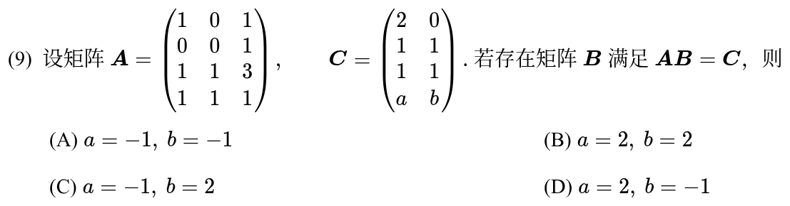

答案与解析

**答案 A。** $A$ 的第 4 行等于第 3 行减两倍第 2 行。右乘 $B$ 保留这个行关系，因此 $(a,b)=(1,1)-2(1,1)=(-1,-1)$。

---

### 02 · 2025年

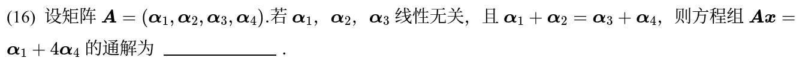

答案与解析

**第一步怎么落笔**

- **触发条件**：$A=(\boldsymbol{\alpha}_1,\boldsymbol{\alpha}_2,\boldsymbol{\alpha}_3,\boldsymbol{\alpha}_4)$ 共 4 列，已知 $\boldsymbol{\alpha}_1,\boldsymbol{\alpha}_2,\boldsymbol{\alpha}_3$ 线性无关，且 $\boldsymbol{\alpha}_1+\boldsymbol{\alpha}_2=\boldsymbol{\alpha}_3+\boldsymbol{\alpha}_4$。
- **第一笔**：**先定秩与解空间维数**——$\boldsymbol{\alpha}_4 = \boldsymbol{\alpha}_1+\boldsymbol{\alpha}_2-\boldsymbol{\alpha}_3$ 可由前三个线性无关向量表出，故 $r(A)=3$，从而 $A\boldsymbol{x}=\boldsymbol{0}$ 的基础解系恰含 **$4 - 3 = 1$ 个向量**！

**完整推演**

1. **读齐次基础解系**：把 $\boldsymbol{\alpha}_1+\boldsymbol{\alpha}_2=\boldsymbol{\alpha}_3+\boldsymbol{\alpha}_4$ 移项得
   $$1\cdot\boldsymbol{\alpha}_1 + 1\cdot\boldsymbol{\alpha}_2 + (-1)\cdot\boldsymbol{\alpha}_3 + (-1)\cdot\boldsymbol{\alpha}_4 = \boldsymbol{0},$$
   即 $A\begin{pmatrix}1\\1\\-1\\-1\end{pmatrix}=\boldsymbol{0}$。因为基础解系维数为 $1$，所以 $\boldsymbol{\xi}=(1,1,-1,-1)^T$ 就是 $A\boldsymbol{x}=\boldsymbol{0}$ 的一个基础解系。
2. **读非齐次特解**：方程组右端为 $\boldsymbol{\alpha}_1 + 4\boldsymbol{\alpha}_4$，直接写成矩阵乘积：
   $$A\begin{pmatrix}1\\0\\0\\4\end{pmatrix} = \boldsymbol{\alpha}_1 + 4\boldsymbol{\alpha}_4,$$
   故 $\boldsymbol{\eta}^* = (1,0,0,4)^T$ 是一个特解。
3. **合成通解**：
   $$\boldsymbol{x} = \begin{pmatrix}1\\0\\0\\4\end{pmatrix} + k\begin{pmatrix}1\\1\\-1\\-1\end{pmatrix}, \qquad k \in \mathbb{R}.$$
   （若把 $\boldsymbol{\alpha}_4=\boldsymbol{\alpha}_1+\boldsymbol{\alpha}_2-\boldsymbol{\alpha}_3$ 代入右端得 $5\boldsymbol{\alpha}_1+4\boldsymbol{\alpha}_2-4\boldsymbol{\alpha}_3$，写出特解 $(5,4,-4,0)^T$ 同样完全正确，两者仅相差 $4\boldsymbol{\xi}$。）

---

### 03 · 2022年

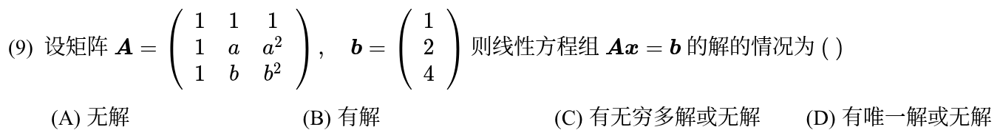

答案与解析

**第一步怎么落笔**

- **触发条件**：$A$ 是 3 阶**范德蒙矩阵**（转置形式），含参数 $a, b$，右端 $\boldsymbol{b}=(1,2,4)^T$ 是常数向量且三个分量**互不相等**。
- **第一笔**：直接写出 $|A|$ 的范德蒙因式分解：
  $$|A| = \begin{vmatrix}1&1&1\\1&a&a^2\\1&b&b^2\end{vmatrix} = (a-1)(b-1)(b-a).$$

**完整推演**

按 $|A|$ 是否为零分成两类：
1. **当 $|A|\neq 0$**（即 $1, a, b$ 互不相等）时：
   $r(A) = 3 = r(A\mid\boldsymbol{b})$，方程组有**唯一解**。
2. **当 $|A| = 0$**（即 $a=1$ 或 $b=1$ 或 $a=b$）时：
   - 若 $a=1$：第 1 行方程为 $x_1+x_2+x_3=1$，第 2 行方程为 $x_1+x_2+x_3=2$，两式左边完全相同而右边 $1\neq 2$，**矛盾无解**；
   - 若 $b=1$：第 1 行 $=1$，第 3 行 $=4$，**矛盾无解**；
   - 若 $a=b$：第 2 行 $=2$，第 3 行 $=4$，**矛盾无解**。

综上，无论 $a, b$ 取何实数，方程组**绝不可能有无穷多解**，只可能**有唯一解或无解**。故应选 **（D）**。

**选择题关键干扰项拆解**

- **（C）有无穷多解或无解**：忘记了 $1,a,b$ 互异时 $|A|\neq 0$ 有唯一解，或误把“$a,b$ 任意”当成“$|A|=0$”。
- **（B）有解** 与 **（A）无解**：只试了一组特值（如取 $a=2,b=3$ 以为恒有解，或取 $a=1$ 以为恒无解），没有做完参数分界讨论。

---

### 04 · 2020年

> *伴随矩阵方程基础解系。$A$ 不可逆且有非零代数余子式，故 $r(A)=3, r(A^*)=1$。方程组 $A^* x=0$ 的基础解系有 3 个向量，直接由 $A$ 的列向量构成。*

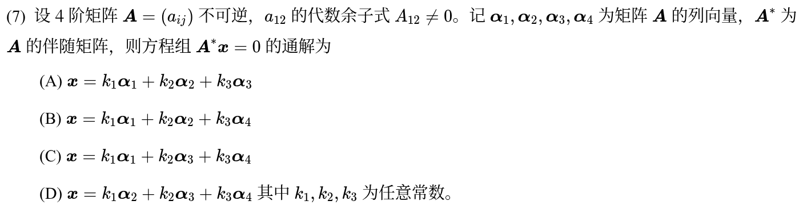

答案与解析

- **第一步定 $r(A^*)$ 与解空间维数**：$A$ 为 4 阶不可逆矩阵 $\implies |A|=0 \implies r(A)\le 3$；又 $A_{12}\neq 0$ 说明 $A$ 有一个非零 3 阶子式 $\implies r(A)\ge 3$。故 $r(A)=3$，从而 **$r(A^*)=1$**。因此 $A^*\boldsymbol{x}=\boldsymbol{0}$ 的基础解系含 $4-1=3$ 个线性无关解向量。
- **第二步找解向量**：由 $A^* A = |A|E = O$ 知 $A$ 的每一列 $\boldsymbol{\alpha}_1,\boldsymbol{\alpha}_2,\boldsymbol{\alpha}_3,\boldsymbol{\alpha}_4$ 都是 $A^*\boldsymbol{x}=\boldsymbol{0}$ 的解。
- **第三步用 $A_{12}\neq 0$ 定位哪 3 列线性无关**：$A_{12}$ 是划去 $A$ 的**第 1 行、第 2 列**后余下的 3 阶子式（带符号），它由第 **1、3、4 列**构成且行列式非零，因此 **$\boldsymbol{\alpha}_1, \boldsymbol{\alpha}_3, \boldsymbol{\alpha}_4$ 线性无关**，构成 $A^*\boldsymbol{x}=\boldsymbol{0}$ 的基础解系。
- **答案**：**（C）**（$k_1\boldsymbol{\alpha}_1 + k_2\boldsymbol{\alpha}_3 + k_3\boldsymbol{\alpha}_4$）。

---

### 05 · 2017年

> *特征值与方程组求解大题。结合矩阵乘以向量的条件求出特征值和特征向量，确定矩阵 $A$；第二问求 $Ax=b$ 的通解按标准初等行变换走。*

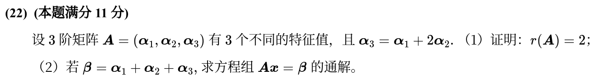

答案与解析

**解。** （1）列相关给出 $r(A)\le2$ 且 0 是特征值。三个特征值互异，所以零特征空间一维，故秩为 2。

（2）将 $\alpha_3=\alpha_1+2\alpha_2$ 代入。前两列独立，所以 $x_1+x_3=2,\ x_2+2x_3=3$，得 $x=(2,3,0)^T+t(-1,-2,1)^T$。

---

### 06 · 2016年

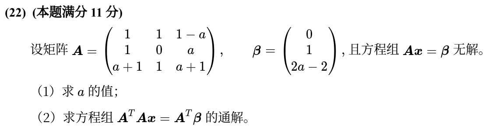

答案与解析

- **第（1）问**：对增广矩阵 $(A\mid\boldsymbol{\beta})$ 做初等行变换：
  $$\left(\begin{array}{ccc|c}1&1&1-a&0\\1&0&a&1\\a+1&1&a+1&2a-2\end{array}\right) \xrightarrow[r_3-(a+1)r_1]{r_2-r_1} \left(\begin{array}{ccc|c}1&1&1-a&0\\0&-1&2a-1&1\\0&-a&a^2+a&2a-2\end{array}\right) \xrightarrow{r_3-ar_2} \left(\begin{array}{ccc|c}1&1&1-a&0\\0&-1&2a-1&1\\0&0&-a(a-2)&a-2\end{array}\right).$$
  无解 $\iff -a(a-2)=0$ 且 $a-2\neq 0 \implies$ **$a = 0$**（注意 $a=2$ 时最后一行全零，有无穷多解，必须排除！）。
- **第（2）问**：$a=0$ 时，$A=\begin{pmatrix}1&1&1\\1&0&0\\1&1&1\end{pmatrix}$，$\boldsymbol{\beta}=\begin{pmatrix}0\\1\\-2\end{pmatrix}$。直接算
  $$A^T A = \begin{pmatrix}3&2&2\\2&2&2\\2&2&2\end{pmatrix}, \qquad A^T\boldsymbol{\beta} = \begin{pmatrix}-1\\-2\\-2\end{pmatrix}.$$
  化行最简形得 $\begin{pmatrix}1&0&0&1\\0&1&1&-2\\0&0&0&0\end{pmatrix}$，故通解为：
  $$\boldsymbol{x} = \begin{pmatrix}1\\-2\\0\end{pmatrix} + k\begin{pmatrix}0\\-1\\1\end{pmatrix}, \qquad k\in\mathbb{R}.$$
  （顺便注意几何意义：$A\boldsymbol{x}=\boldsymbol{\beta}$ 无解，但正规方程 $A^TA\boldsymbol{x}=A^T\boldsymbol{\beta}$ 恒有最小二乘解！）

---

### 07 · 2015年

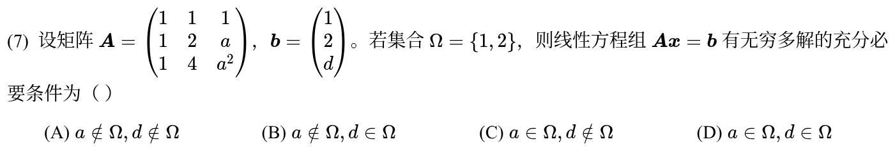

答案与解析

**题面待核。** 第 2、3 个方程分别减第 1 个，再消 $x_2$，末式为 $(a-1)(a-2)x_3=d-4$。因此有无穷多解的充要条件是 $a\in\{1,2\},d=4$。当前 C 只写 $d\notin\{1,2\}$，范围过宽，不能作为充要条件。

---

### 08 · 2014年

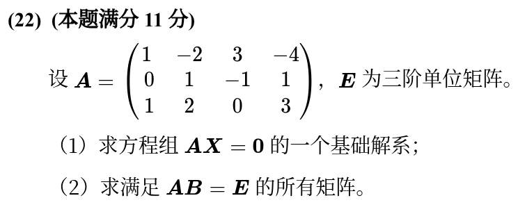

答案与解析

**第一步怎么落笔**

- **触发条件**：$A$ 是 $3\times 4$ 矩阵，第（1）问求 $A\boldsymbol{x}=\boldsymbol{0}$ 基础解系，第（2）问求所有满足 $AB=E$ 的 $4\times 3$ 矩阵 $B$。
- **第一笔**：**直接把 $A$ 与 3 阶单位阵 $E$ 拼成 $(A\mid E)$，一次性化成行最简形**，两问共用同一套消元结果，省时且不易算错！

**完整推演**

对 $(A\mid E)$ 做初等行变换：
$$(A\mid E) = \left(\begin{array}{cccc|ccc} 1 & -2 & 3 & -4 & 1 & 0 & 0 \\ 0 & 1 & -1 & 1 & 0 & 1 & 0 \\ 1 & 2 & 0 & 3 & 0 & 0 & 1 \end{array}\right) \xrightarrow{r_3-r_1} \left(\begin{array}{cccc|ccc} 1 & -2 & 3 & -4 & 1 & 0 & 0 \\ 0 & 1 & -1 & 1 & 0 & 1 & 0 \\ 0 & 4 & -3 & 7 & -1 & 0 & 1 \end{array}\right)$$
$$\xrightarrow{r_3-4r_2} \left(\begin{array}{cccc|ccc} 1 & -2 & 3 & -4 & 1 & 0 & 0 \\ 0 & 1 & -1 & 1 & 0 & 1 & 0 \\ 0 & 0 & 1 & 3 & -1 & -4 & 1 \end{array}\right) \xrightarrow[r_1-3r_3]{r_2+r_3} \left(\begin{array}{cccc|ccc} 1 & -2 & 0 & -13 & 4 & 12 & -3 \\ 0 & 1 & 0 & 4 & -1 & -3 & 1 \\ 0 & 0 & 1 & 3 & -1 & -4 & 1 \end{array}\right)$$
$$\xrightarrow{r_1+2r_2} \left(\begin{array}{cccc|ccc} 1 & 0 & 0 & -5 & 2 & 6 & -1 \\ 0 & 1 & 0 & 4 & -1 & -3 & 1 \\ 0 & 0 & 1 & 3 & -1 & -4 & 1 \end{array}\right).$$

- **第（1）问**：由左半部分行最简形知 $r(A)=3$，自由未知量个数为 $4-3=1$（取 $x_4$ 为自由未知量）。对应齐次方程组为 $x_1 = 5x_4,\ x_2 = -4x_4,\ x_3 = -3x_4$。令 $x_4=1$，得 $A\boldsymbol{x}=\boldsymbol{0}$ 的一个基础解系为：
  $$\boldsymbol{\xi} = \begin{pmatrix}5 \\ -4 \\ -3 \\ 1\end{pmatrix}.$$

- **第（2）问**：设 $B = (\boldsymbol{b}_1, \boldsymbol{b}_2, \boldsymbol{b}_3)$（$4\times 3$ 矩阵），则 $AB = E \iff A\boldsymbol{b}_j = \boldsymbol{e}_j$（$j=1,2,3$）。
  令自由未知量 $x_4 = 0$，从上面行最简形的右半部分立刻读出三个特解：
  $$\boldsymbol{\eta}_1 = \begin{pmatrix}2\\-1\\-1\\0\end{pmatrix}, \qquad \boldsymbol{\eta}_2 = \begin{pmatrix}6\\-3\\-4\\0\end{pmatrix}, \qquad \boldsymbol{\eta}_3 = \begin{pmatrix}-1\\1\\1\\0\end{pmatrix}.$$
  三列各自加上齐次通解 $k_j\boldsymbol{\xi}$（**注意三个参数 $k_1, k_2, k_3$ 必须相互独立！**），因此满足 $AB=E$ 的所有矩阵为：
  $$B = \begin{pmatrix} 2+5k_1 & 6+5k_2 & -1+5k_3 \\ -1-4k_1 & -3-4k_2 & 1-4k_3 \\ -1-3k_1 & -4-3k_2 & 1-3k_3 \\ k_1 & k_2 & k_3 \end{pmatrix}, \qquad k_1, k_2, k_3 \in \mathbb{R}.$$

---

### 09 · 2012年

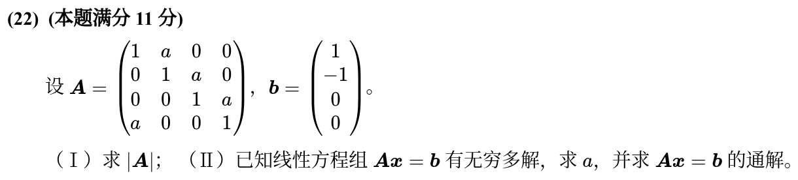

答案与解析

**解。** （I）行列式展开只有主对角线与四循环两项，得 $1-a^4$。

（II）无穷多解要求 $a=\pm1$。$a=1$ 时将四行交替加减，左端为零、右端为 2，不相容。$a=-1$ 时，方程给 $x_1=x_3=x_4=t,\ x_2=t-1$。通解为 $(0,-1,0,0)^T+t(1,1,1,1)^T$。

---

### 10 · 2011年

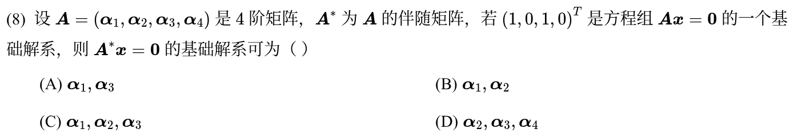

答案与解析

**答案 D。** $r(A)=3$，且 $A^*A=0$、$r(A^*)=1$，故 $\ker A^*=\operatorname{im}A$，维数为 3。唯一列关系来自零空间向量 $(1,0,1,0)^T$，即 $\alpha_1+\alpha_3=0$。删去 $\alpha_1$ 后其余三列无关。

---

### 11 · 2010年

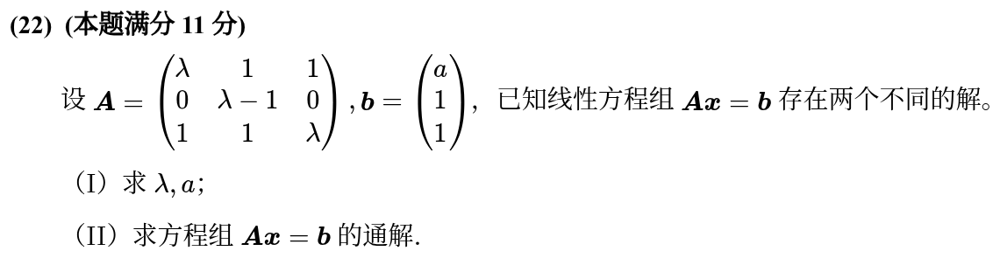

答案与解析

**第（I）问：由“存在两个不同的解”定出 $\lambda, a$**

- **第一步怎么落笔**：$A\boldsymbol{x}=\boldsymbol{b}$ 存在两个不同的解 $\implies$ 方程组有无穷多解 $\implies |A|=0$ 且 $r(A)=r(A\mid\boldsymbol{b})<3$。先按第 2 行展开算 $|A|$（第 2 行有两个 $0$，一步出因式分解！）：
  $$|A| = (\lambda - 1)\begin{vmatrix}\lambda & 1 \\ 1 & \lambda\end{vmatrix} = (\lambda - 1)(\lambda^2 - 1) = (\lambda - 1)^2(\lambda + 1).$$
  令 $|A|=0$，得两个候选值：$\lambda = 1$ 或 $\lambda = -1$。
- **逐一检验增广矩阵 $(A\mid\boldsymbol{b})$**：
  1. **当 $\lambda = 1$ 时**：增广矩阵第 2 行为 $(0,\ 0,\ 0 \mid 1)$，对应 $0=1$，方程组**无解**，舍去 $\lambda = 1$；
  2. **当 $\lambda = -1$ 时**：
     $$(A\mid\boldsymbol{b}) = \left(\begin{array}{ccc|c} -1 & 1 & 1 & a \\ 0 & -2 & 0 & 1 \\ 1 & 1 & -1 & 1 \end{array}\right) \xrightarrow{r_1+r_3} \left(\begin{array}{ccc|c} 0 & 2 & 0 & a+1 \\ 0 & -2 & 0 & 1 \\ 1 & 1 & -1 & 1 \end{array}\right) \xrightarrow{r_1+r_2} \left(\begin{array}{ccc|c} 0 & 0 & 0 & a+2 \\ 0 & -2 & 0 & 1 \\ 1 & 1 & -1 & 1 \end{array}\right).$$
     要使方程组有解（即 $r(A)=r(A\mid\boldsymbol{b})=2<3$），必须且只需 $a + 2 = 0 \implies a = -2$。

  因此 $\lambda = -1,\ a = -2$。

**第（II）问：求方程组 $A\boldsymbol{x}=\boldsymbol{b}$ 的通解**

把 $\lambda=-1, a=-2$ 时的阶梯形整理成行最简形：
$$\left(\begin{array}{ccc|c} 1 & 1 & -1 & 1 \\ 0 & -2 & 0 & 1 \\ 0 & 0 & 0 & 0 \end{array}\right) \xrightarrow{-\frac{1}{2}r_2} \left(\begin{array}{ccc|c} 1 & 1 & -1 & 1 \\ 0 & 1 & 0 & -\frac{1}{2} \\ 0 & 0 & 0 & 0 \end{array}\right) \xrightarrow{r_1-r_2} \left(\begin{array}{ccc|c} 1 & 0 & -1 & \frac{3}{2} \\ 0 & 1 & 0 & -\frac{1}{2} \\ 0 & 0 & 0 & 0 \end{array}\right).$$
取自由未知量 $x_3 = k$（$k\in\mathbb{R}$），得 $x_1 = \frac{3}{2} + k$，$x_2 = -\frac{1}{2}$，因此通解为：
$$\boldsymbol{x} = \begin{pmatrix}\frac{3}{2} \\ -\frac{1}{2} \\ 0\end{pmatrix} + k\begin{pmatrix}1 \\ 0 \\ 1\end{pmatrix}, \qquad k \in \mathbb{R}.$$

---

[« 向量组、线性相关与秩](03-vectors-rank.md)　　[特征值、特征向量与相似 »](05-eigenvalues-similarity.md)
