[« 向量组、线性相关与秩](03-vectors-rank.md)　　[特征值、特征向量与相似 »](05-eigenvalues-similarity.md)

# 线性代数 · 线性方程组

> **必会·按此顺序**：[2022-09](#q2022-9)（参数与解的分类） → [2010-22](#q2010-22)（求参数再写通解） → [2014-22](#q2014-22)（基础解系与矩阵方程） → [2025-16](#q2025-16)（由列关系写通解）  
> **冲一冲**：[2016-22](#q2016-22)（原方程无解但正规方程可解）  
> **见识·先会开题**：[2020-07](#q2020-7)（伴随矩阵的解空间与选基）  
> **待核·暂不安排**：[2015-07](#q2015-7)（按现有题面算出的条件不在选项中，待核）  
> **过关标准**：通解必须写全：一个特解加齐次通解，自由变量个数与秩吻合。

---

## 2026年

### 01 · 2026-09 · 选择题

> 矩阵方程解的存在性。 相当于  的每一列都能由  的列向量线性表出，即 ，把增广矩阵做初等行变换定参数。

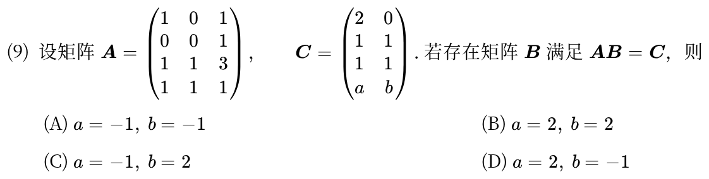

*关联章节：[向量组、线性相关与秩](03-vectors-rank.md)*

---

## 2025年

### 02 · 2025-16 · 填空题

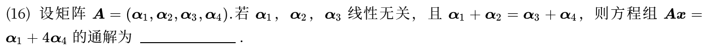

---

## 2022年

### 03 · 2022-09 · 选择题

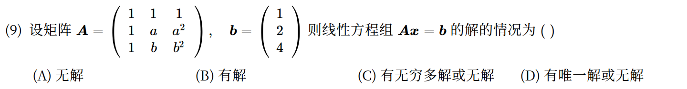

---

## 2020年

### 04 · 2020-07 · 选择题

> 伴随矩阵方程基础解系。 不可逆且有非零代数余子式，故 。方程组  的基础解系有 3 个向量，直接由  的列向量构成。

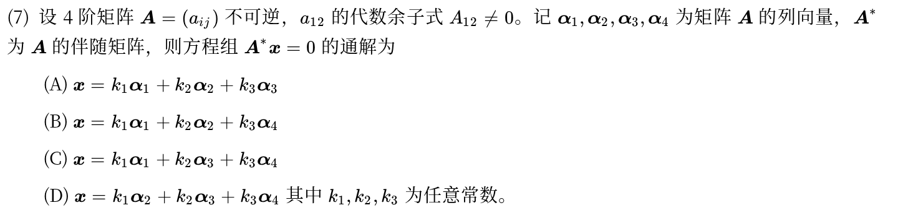

---

## 2017年

### 05 · 2017-22 · 解答题

> 特征值与方程组求解大题。结合矩阵乘以向量的条件求出特征值和特征向量，确定矩阵 ；第二问求  的通解按标准初等行变换走。

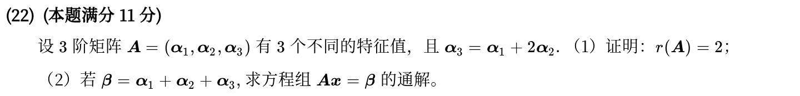

*关联章节：[向量组、线性相关与秩](03-vectors-rank.md) · [特征值、特征向量与相似](05-eigenvalues-similarity.md)*

---

## 2016年

### 06 · 2016-22 · 解答题

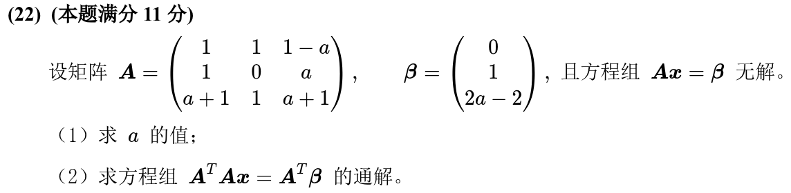

*关联章节：[向量组、线性相关与秩](03-vectors-rank.md)*

---

## 2015年

### 07 · 2015-07 · 选择题

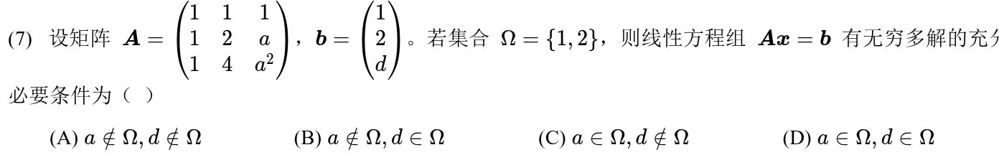

---

## 2014年

### 08 · 2014-22 · 解答题

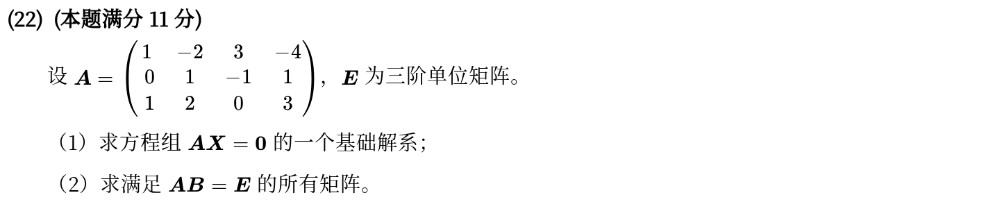

*关联章节：[矩阵运算、逆矩阵与初等变换](02-matrices.md)*

---

## 2012年

### 09 · 2012-22 · 解答题

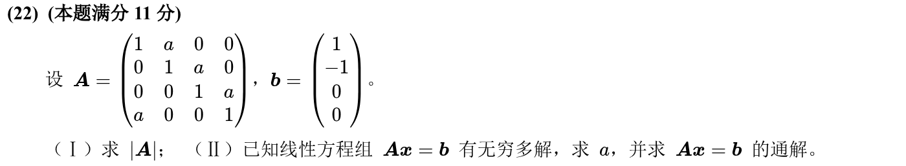

*关联章节：[行列式](01-determinants.md)*

---

## 2011年

### 10 · 2011-08 · 选择题

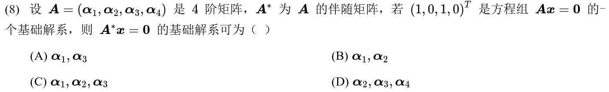

*关联章节：[向量组、线性相关与秩](03-vectors-rank.md) · [矩阵运算、逆矩阵与初等变换](02-matrices.md)*

---

## 2010年

### 11 · 2010-22 · 解答题

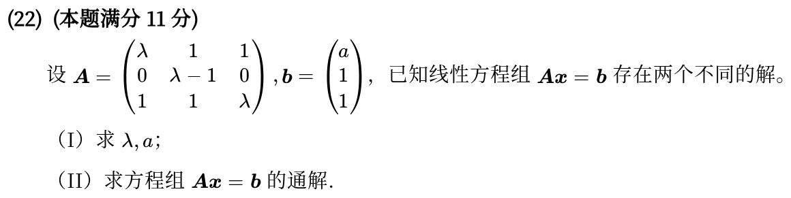

---

## 交叉考点索引

以下题目主归其他章节，点击跳转到对应章节题目；不计入本章主收录题数：

- [2025年 · 第10题](03-vectors-rank.md)（主章节：向量组、线性相关与秩）
- [2024年 · 第22题](06-quadratic-forms.md)（主章节：二次型）
- [2023年 · 第16题](01-determinants.md)（主章节：行列式）
- [2021年 · 第9题](03-vectors-rank.md)（主章节：向量组、线性相关与秩）
- [2018年 · 第22题](06-quadratic-forms.md)（主章节：二次型）
- [2018年 · 第23题](02-matrices.md)（主章节：矩阵运算、逆矩阵与初等变换）
- [2013年 · 第22题](02-matrices.md)（主章节：矩阵运算、逆矩阵与初等变换）

[« 向量组、线性相关与秩](03-vectors-rank.md)　　[特征值、特征向量与相似 »](05-eigenvalues-similarity.md)
