[« 线性方程组](04-linear-systems.md)　　[二次型 »](06-quadratic-forms.md)

# 线性代数 · 特征值、特征向量与相似

> **本章共 22 题**
> 
> - **核心必做（建议按顺序攻克关键方法）**：  
>   [第 13 题](#q13)（特征向量反求参数） → [第 07 题](#q07)（特征向量与对角元对应） → [第 04 题](#q04)（完整做一遍相似对角化） → [第 06 题](#q06)（重根与可对角化条件）
> 
> - **分流与刷题建议**：  
>   - **较难挑战**：[第 15 题](#q15)（对角化求高次幂及递推）  
>   - **重在看思路**：[第 17 题](#q17)（从三阶计算过渡到一般阶证明）  
>   - **首轮可跳过**：[第 03 题](#q03)、[第 09 题](#q09)、[第 10 题](#q10)（技巧较偏或综合度高，首轮不必死磕）  
>   - **题面存疑暂缓**：[第 05 题](#q05)（题面已有核对标记）、[第 11 题](#q11)（相似关系右端排成列向量，维度待核）（原卷转写存疑，首轮暂不安排）  
> 
> - **过关目标**：能求特征值、解特征向量并拼出可逆矩阵；重根要查向量个数。

---

### 01 · 2026年

> *反交换矩阵特征值性质题。由 $AB+BA=O$ 得 $AB=-BA$。利用特征值迹或行列式反号性质，或乘特征向量分析对称分布，迅速排除错误项。*

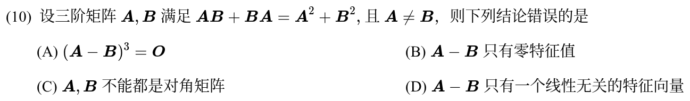

答案与解析

**答案 D。** 令 $N=A-B$，由条件得 $N^2=0$、$N\ne0$，所以 $N^3=0$ 且特征值全为零。若 $A,B$ 都是对角矩阵，$N^2=0$ 就迫使 $N=0$。又 $\operatorname{im}N\subseteq\ker N$，三阶下只能 $r(N)=1$，故零特征空间维数为 2。

---

### 02 · 2025年

> *实对称矩阵相似与行列式。实对称矩阵必可正交对角化。利用特征多项式或迹与行列式性质，建立 $a, b$ 的方程直接定解。*

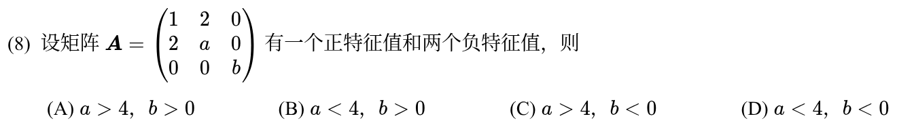

答案与解析

- **第一步：分块拆特征值**：$A = \operatorname{diag}(B,\ b)$，其中 $B = \begin{pmatrix}1&2\\2&a\end{pmatrix}$ 为实对称矩阵，故 $A$ 的三个特征值为 $B$ 的两个实特征值 $\lambda_1, \lambda_2$ 与 $b$。
- **第二步：判断 $B$ 能否有两个负特征值**：因为 $B$ 的 $(1,1)$ 元为 $1 > 0$（即 $\boldsymbol{e}_1^T B\boldsymbol{e}_1 = 1 > 0$），所以 $B$ 绝不是负定矩阵，**$B$ 至少有一个正特征值**！
- **第三步：按“1 正 2 负”锁死符号**：既然总计只有 **1 个正特征值** 和 **2 个负特征值**，那么：
  - $B$ 只能是 **1 正 1 负** $\implies |B| = \lambda_1\lambda_2 = a - 4 < 0 \implies a < 4$；
  - 剩下的特征值 $b$ 必须是负的 $\implies b < 0$。
- **答案**：**（D）**（$a < 4,\ b < 0$）。

---

### 03 · 2024年

答案与解析

**答案 B。** $AB=BA$ 保证 $B$ 把 $A$ 的每个特征空间映回自身。若 $A$ 有两个不同特征值，两条一维空间给出 $B$ 的两个独立特征向量。反过来取 $A=I$、$B=\operatorname{diag}(1,2)$，满足交换且 $B$ 可对角化，$A$ 却没有两个不同特征值。

---

### 04 · 2023年

> *向量外积型矩阵幂。条件是 $Ax = (a^T x) b$，说明矩阵 $A = ba^T$（秩 1 矩阵）。计算 $\mathrm{tr}(A)$ 得到非零特征值，矩阵幂直接用数乘规律搞定。*

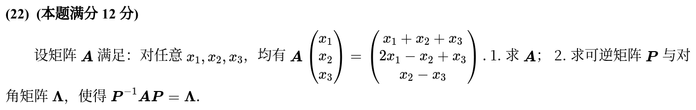

答案与解析

**第 1 问：由 $A\boldsymbol{x}$ 的表达式直接读出 $A$**

把等式右端按 $x_1, x_2, x_3$ 的系数写成矩阵乘积：
$$A\begin{pmatrix}x_1\\x_2\\x_3\end{pmatrix} = \begin{pmatrix}1\cdot x_1 + 1\cdot x_2 + 1\cdot x_3 \\ 2\cdot x_1 - 1\cdot x_2 + 1\cdot x_3 \\ 0\cdot x_1 + 1\cdot x_2 - 1\cdot x_3\end{pmatrix} = \begin{pmatrix}1&1&1\\2&-1&1\\0&1&-1\end{pmatrix}\begin{pmatrix}x_1\\x_2\\x_3\end{pmatrix}.$$
因对任意 $x_1,x_2,x_3$ 恒成立（等价于令 $\boldsymbol{x}$ 依次取 $\boldsymbol{e}_1,\boldsymbol{e}_2,\boldsymbol{e}_3$），故
$$A = \begin{pmatrix}1&1&1\\2&-1&1\\0&1&-1\end{pmatrix}.$$

**第 2 问：求可逆矩阵 $P$ 与对角矩阵 $\Lambda$ 使 $P^{-1}AP=\Lambda$**

1. **求特征值**：
   $$|\lambda E - A| = \begin{vmatrix}\lambda-1 & -1 & -1 \\ -2 & \lambda+1 & -1 \\ 0 & -1 & \lambda+1\end{vmatrix} \xrightarrow{c_2-c_3} \begin{vmatrix}\lambda-1 & 0 & -1 \\ -2 & \lambda+2 & -1 \\ 0 & -(\lambda+2) & \lambda+1\end{vmatrix}$$
   提取第 2 列公因子 $(\lambda+2)$：
   $$= (\lambda+2)\begin{vmatrix}\lambda-1 & 0 & -1 \\ -2 & 1 & -1 \\ 0 & -1 & \lambda+1\end{vmatrix} \xrightarrow{r_3+r_2} (\lambda+2)\begin{vmatrix}\lambda-1 & 0 & -1 \\ -2 & 1 & -1 \\ -2 & 0 & \lambda\end{vmatrix} = (\lambda+2)\big(\lambda(\lambda-1)-2\big)$$
   $$= (\lambda+2)(\lambda-2)(\lambda+1) = 0.$$
   得三个互异特征值：$\lambda_1 = 2,\ \lambda_2 = -1,\ \lambda_3 = -2$。
   （**双重验算**：$\lambda_1+\lambda_2+\lambda_3 = 2-1-2 = -1 = \operatorname{tr}(A)$；$\lambda_1\lambda_2\lambda_3 = 4 = |A|$，完全正确！）

2. **逐个求特征向量**：
   - 当 $\lambda_1 = 2$ 时：
     $$2E - A = \begin{pmatrix}1&-1&-1\\-2&3&-1\\0&-1&3\end{pmatrix} \to \begin{pmatrix}1&-1&-1\\0&1&-3\\0&-1&3\end{pmatrix} \to \begin{pmatrix}1&0&-4\\0&1&-3\\0&0&0\end{pmatrix},$$
     得特征向量 $\boldsymbol{\alpha}_1 = (4, 3, 1)^T$（口算验算 $A\boldsymbol{\alpha}_1 = (8,6,2)^T = 2\boldsymbol{\alpha}_1$）。
   - 当 $\lambda_2 = -1$ 时：
     $$-E - A = \begin{pmatrix}-2&-1&-1\\-2&0&-1\\0&-1&0\end{pmatrix} \to \begin{pmatrix}2&0&1\\0&1&0\\0&0&0\end{pmatrix},$$
     得特征向量 $\boldsymbol{\alpha}_2 = (-1, 0, 2)^T$（口算验算 $A\boldsymbol{\alpha}_2 = (1,0,-2)^T = -\boldsymbol{\alpha}_2$）。
   - 当 $\lambda_3 = -2$ 时：
     $$-2E - A = \begin{pmatrix}-3&-1&-1\\-2&-1&-1\\0&-1&-1\end{pmatrix} \to \begin{pmatrix}1&0&0\\0&1&1\\0&0&0\end{pmatrix},$$
     得特征向量 $\boldsymbol{\alpha}_3 = (0, -1, 1)^T$（口算验算 $A\boldsymbol{\alpha}_3 = (0,2,-2)^T = -2\boldsymbol{\alpha}_3$）。

3. **拼出 $P$ 与 $\Lambda$**：
   $$P = \begin{pmatrix}4 & -1 & 0 \\ 3 & 0 & -1 \\ 1 & 2 & 1\end{pmatrix}, \qquad \Lambda = \begin{pmatrix}2 & 0 & 0 \\ 0 & -1 & 0 \\ 0 & 0 & -2\end{pmatrix},$$
   满足 $P^{-1}AP = \Lambda$。

---

### 05 · 2022年

> ⚠️ **题面待核对**：原年度转写稿存在疑点，本次保留题面，作答前请核对独立原题来源。

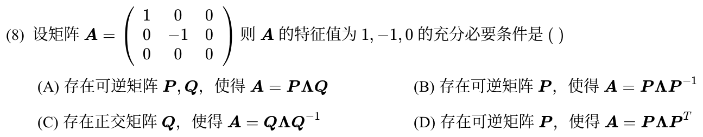

答案与解析

**题面待核。** 当前转写把 $A$ 写成了已知对角矩阵，选项中的 $\Lambda$ 却未定义。若原题给的是 $\Lambda=\operatorname{diag}(1,-1,0)$，并询问一般三阶 $A$ 的特征值，则答案 B。三个互异特征值使三个特征向量线性无关，故可相似对角化；相似又保特征值。C 还要求正交相似，对一般矩阵过强；A、D 不保具体特征值。

---

### 06 · 2021年

> *相似对角化大题。矩阵有重特征值时，可对角化的充要条件是重特征值对应的特征矩阵满足 $n - r(\lambda E - A) = \text{重数}$，列出秩方程定参数。*

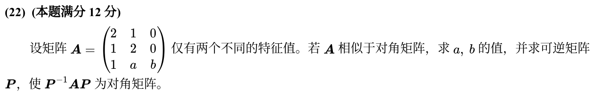

答案与解析

**第一步怎么落笔**

- **触发条件**：$A = \begin{pmatrix}2&1&0\\1&2&0\\1&a&b\end{pmatrix}$ 是**分块下三角矩阵**，仅有 2 个不同特征值，且可相似对角化。
- **第一笔**：按第 3 列直接展开特征多项式：
  $$|\lambda E - A| = (\lambda - b)\begin{vmatrix}\lambda-2 & -1 \\ -1 & \lambda-2\end{vmatrix} = (\lambda - b)(\lambda - 1)(\lambda - 3) = 0.$$
  全部特征值为 $1,\ 3,\ b$。
  因为“仅有 2 个不同特征值”，所以 **$b$ 必有两种可能：$b = 1$ 或 $b = 3$**！

**完整推演（必须完整讨论两支！）**

##### 情况一：$b = 1$（特征值为 $\lambda_1 = \lambda_2 = 1,\ \lambda_3 = 3$）

1. **由可相似对角化定 $a$**：二重特征值 $\lambda = 1$ 必须有 2 个线性无关特征向量 $\iff r(E - A) = 3 - 2 = 1$。
   $$E - A = \begin{pmatrix}-1 & -1 & 0 \\ -1 & -1 & 0 \\ -1 & -a & 0\end{pmatrix}.$$
   显然 $r(E-A)=1 \iff$ 第 3 行与第 1 行成比例 $\iff a = 1$。
2. **求特征向量与 $P$**：
   - 当 $\lambda=1$ 时，$E-A \to \begin{pmatrix}1&1&0\\0&0&0\\0&0&0\end{pmatrix}$，得两个线性无关特征向量 $\boldsymbol{\alpha}_1 = (-1, 1, 0)^T$，$\boldsymbol{\alpha}_2 = (0, 0, 1)^T$；
   - 当 $\lambda=3$ 时，$3E-A = \begin{pmatrix}1&-1&0\\-1&1&0\\-1&-1&2\end{pmatrix} \to \begin{pmatrix}1&0&-1\\0&1&-1\\0&0&0\end{pmatrix}$，得特征向量 $\boldsymbol{\alpha}_3 = (1, 1, 1)^T$。
   - 拼出 $P_1 = \begin{pmatrix}-1&0&1\\1&0&1\\0&1&1\end{pmatrix}$，使 $P_1^{-1}AP_1 = \operatorname{diag}(1, 1, 3)$。

##### 情况二：$b = 3$（特征值为 $\lambda_1 = \lambda_2 = 3,\ \lambda_3 = 1$）

1. **由可相似对角化定 $a$**：二重特征值 $\lambda = 3$ 必须满足 $r(3E - A) = 3 - 2 = 1$。
   $$3E - A = \begin{pmatrix}1 & -1 & 0 \\ -1 & 1 & 0 \\ -1 & -a & 0\end{pmatrix}.$$
   第 1 行是 $(1,-1,0)$，第 3 行是 $(-1,-a,0)$，成比例 $\iff -a = 1 \iff a = -1$。
2. **求特征向量与 $P$**：
   - 当 $\lambda=3$ 时，$3E-A \to \begin{pmatrix}1&-1&0\\0&0&0\\0&0&0\end{pmatrix}$，得两个线性无关特征向量 $\boldsymbol{\beta}_1 = (1, 1, 0)^T$，$\boldsymbol{\beta}_2 = (0, 0, 1)^T$；
   - 当 $\lambda=1$ 时，$E-A = \begin{pmatrix}-1&-1&0\\-1&-1&0\\-1&1&-2\end{pmatrix} \to \begin{pmatrix}1&0&1\\0&1&-1\\0&0&0\end{pmatrix}$，得特征向量 $\boldsymbol{\beta}_3 = (1, -1, -1)^T$。
   - 拼出 $P_2 = \begin{pmatrix}1&0&1\\1&0&-1\\0&1&-1\end{pmatrix}$，使 $P_2^{-1}AP_2 = \operatorname{diag}(3, 3, 1)$。

综上，共有两组解：$(a, b) = (1, 1)$（对应 $P_1$）或 $(a, b) = (-1, 3)$（对应 $P_2$）。

---

### 07 · 2020年

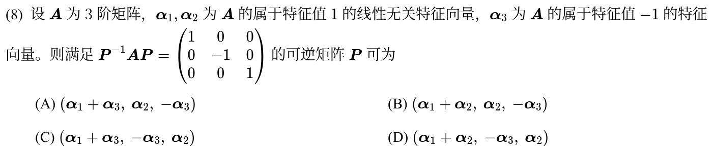

答案与解析

**第一步怎么落笔**

- **触发条件**：已知 $\boldsymbol{\alpha}_1,\boldsymbol{\alpha}_2$ 是 $\lambda=1$ 的线性无关特征向量，$\boldsymbol{\alpha}_3$ 是 $\lambda=-1$ 的特征向量，要求 $P^{-1}AP = \operatorname{diag}(1, -1, 1)$。
- **第一笔**：改写为 $A(\boldsymbol{p}_1,\boldsymbol{p}_2,\boldsymbol{p}_3) = (\boldsymbol{p}_1,\ -\boldsymbol{p}_2,\ \boldsymbol{p}_3)$，即：
  - $\boldsymbol{p}_1, \boldsymbol{p}_3$ 必须是属于 $\lambda=1$ 的线性无关特征向量；
  - $\boldsymbol{p}_2$ 必须是属于 $\lambda=-1$ 的特征向量（即 $c\boldsymbol{\alpha}_3,\ c\neq 0$）。

**完整推演**

直接检验 **（D）** $P = (\boldsymbol{\alpha}_1+\boldsymbol{\alpha}_2,\ -\boldsymbol{\alpha}_3,\ \boldsymbol{\alpha}_2)$：
1. **归属与位置**：
   - 第 1 列：$A(\boldsymbol{\alpha}_1+\boldsymbol{\alpha}_2) = \boldsymbol{\alpha}_1+\boldsymbol{\alpha}_2 = 1\cdot(\boldsymbol{\alpha}_1+\boldsymbol{\alpha}_2)$（对应 $\lambda_1=1$）；
   - 第 2 列：$A(-\boldsymbol{\alpha}_3) = -A\boldsymbol{\alpha}_3 = -(-\boldsymbol{\alpha}_3) = (-1)(-\boldsymbol{\alpha}_3)$（对应 $\lambda_2=-1$）；
   - 第 3 列：$A\boldsymbol{\alpha}_2 = 1\cdot\boldsymbol{\alpha}_2$（对应 $\lambda_3=1$）。
2. **可逆性（列线性无关）**：
   $$(\boldsymbol{\alpha}_1+\boldsymbol{\alpha}_2,\ -\boldsymbol{\alpha}_3,\ \boldsymbol{\alpha}_2) = (\boldsymbol{\alpha}_1,\ \boldsymbol{\alpha}_2,\ \boldsymbol{\alpha}_3)\begin{pmatrix}1&0&0\\1&0&1\\0&-1&0\end{pmatrix}.$$
   因为 $\boldsymbol{\alpha}_1,\boldsymbol{\alpha}_2,\boldsymbol{\alpha}_3$ 线性无关（属于不同特征值的线性无关向量合并仍线性无关），且过渡矩阵行列式 $\begin{vmatrix}1&0&0\\1&0&1\\0&-1&0\end{vmatrix} = 1\neq 0$，所以 $P$ 可逆。故应选 **（D）**。

**选择题关键干扰项拆解**

- **（A）与（C）**：第 1 列都是 $\boldsymbol{\alpha}_1+\boldsymbol{\alpha}_3$。由于 $\boldsymbol{\alpha}_1$ 与 $\boldsymbol{\alpha}_3$ 属于**不同特征值**（$1$ 与 $-1$），$A(\boldsymbol{\alpha}_1+\boldsymbol{\alpha}_3) = \boldsymbol{\alpha}_1 - \boldsymbol{\alpha}_3$，绝不是 $\boldsymbol{\alpha}_1+\boldsymbol{\alpha}_3$ 的倍数，直接秒杀淘汰！
- **（B）$(\boldsymbol{\alpha}_1+\boldsymbol{\alpha}_2,\ \boldsymbol{\alpha}_2,\ -\boldsymbol{\alpha}_3)$（最高频错选）**：三列都是合法特征向量且线性无关，但**顺序错了**！它算出来的是 $P^{-1}AP = \operatorname{diag}(1, 1, -1)$，而不是题目要求的 $\operatorname{diag}(1, -1, 1)$。

---

### 08 · 2020年

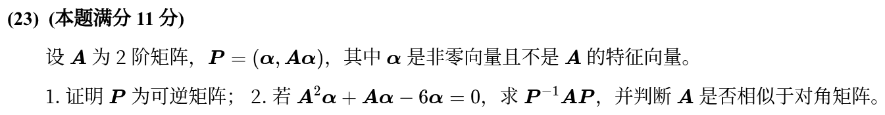

答案与解析

**解。** （1）若 $A\alpha$ 与非零 $\alpha$ 线性相关，则 $A\alpha=\lambda\alpha$，违背题意，所以 $P$ 可逆。

（2）$A$ 把基的第一向量送到第二向量，把第二向量送到 $6\alpha-A\alpha$。因此
$$
P^{-1}AP=\begin{pmatrix}0&6\\1&-1\end{pmatrix}.
$$
特征方程为 $\lambda^2+\lambda-6=0$，有两个不同实根 $2,-3$，故 $A$ 可对角化。

---

### 09 · 2019年

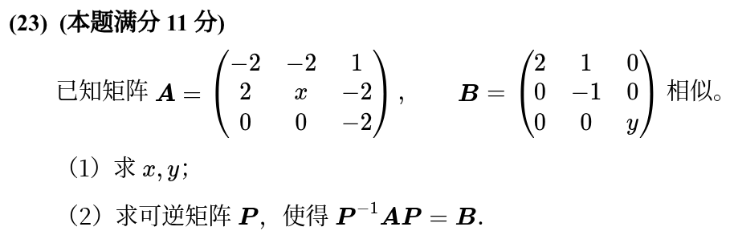

答案与解析

**解。** （1）$A$ 含特征值 $-2$，故上三角的 $B$ 必有 $y=-2$。由迹相等 $x-4=2-1-2$，得 $x=3$。

（2）取 $A$ 对应 $2,-1,-2$ 的特征向量 $u=(-1,2,0)^T,v=(-2,1,0)^T,w=(-1,2,4)^T$。取 $P=(u,v+u/3,w)$，其列仍无关，且 $(A+I)(v+u/3)=u$，因此第二列关系是 $A p_2=p_1-p_2$，和 $B$ 的第二列一致。其余两列直接由特征向量关系得出，所以 $AP=PB$。

---

### 10 · 2018年

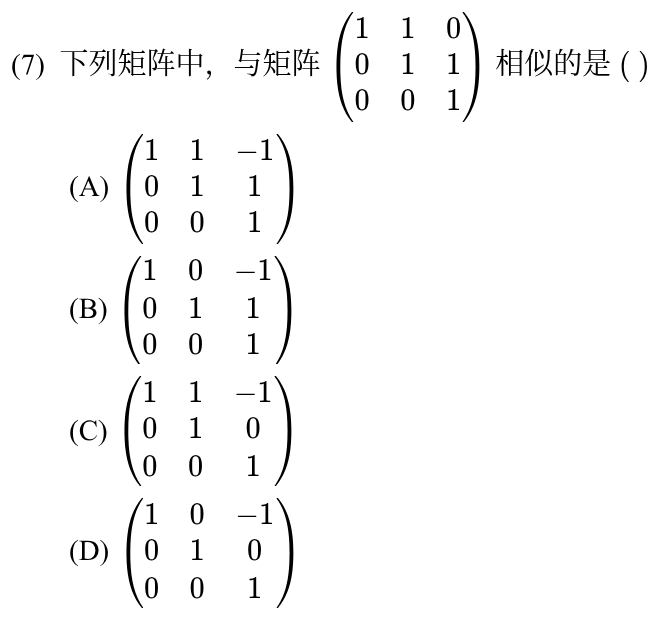

答案与解析

- **第一步：先查相似必要条件**：题干矩阵 $J = \begin{pmatrix}1&1&0\\0&1&1\\0&0&1\end{pmatrix}$ 与四个选项都是主对角元全为 $1$ 的上三角矩阵，特征值全为 $1,1,1$，迹与行列式都相等，无法区分。
- **第二步：升级判据——比 $r(E - M)$**：
  $$J - E = \begin{pmatrix}0&1&0\\0&0&1\\0&0&0\end{pmatrix} \implies r(J - E) = 2.$$
  逐项减去 $E$ 算秩：
  - **（A）**：$\begin{pmatrix}0&1&-1\\0&0&1\\0&0&0\end{pmatrix}$，秩为 **$2$**（且 $(A-E)^2 = \begin{pmatrix}0&0&1\\0&0&0\\0&0&0\end{pmatrix}\neq O$，与 $J$ 同为一个 3 阶若尔当块，必相似！）；
  - **（B）**：$\begin{pmatrix}0&0&-1\\0&0&1\\0&0&0\end{pmatrix}$，秩为 $1 \neq 2$，排除；
  - **（C）**：$\begin{pmatrix}0&1&-1\\0&0&0\\0&0&0\end{pmatrix}$，秩为 $1 \neq 2$，排除；
  - **（D）**：$\begin{pmatrix}0&0&-1\\0&0&0\\0&0&0\end{pmatrix}$，秩为 $1 \neq 2$，排除。
- **答案**：**（A）**。

---

### 11 · 2017年

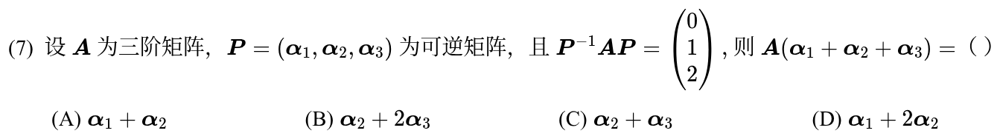

答案与解析

**题面待核。** 当前转写把 $P^{-1}AP$ 写成了列向量，矩阵尺寸不相容。若原意是 $P^{-1}AP(1,1,1)^T=(0,1,2)^T$，左乘 $P$ 即得 $A(\alpha_1+\alpha_2+\alpha_3)=\alpha_2+2\alpha_3$，此时答案 B。若原卷右端是 $\operatorname{diag}(0,1,2)$，右乘全 1 列向量后也会得到同一推导。

---

### 12 · 2017年

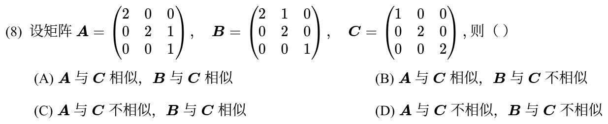

答案与解析

**答案 B。** 三个矩阵的特征值都是 $1,2,2$，须看重根 $2$ 的特征空间。$r(A-2I)=1$，故有两个独立的特征向量，$A$ 可对角化并与 $C$ 相似。$r(B-2I)=2$，对应特征空间只有一维，所以 $B$ 不可对角化。

---

### 13 · 2017年

答案与解析

**第一步怎么落笔**

- **触发条件**：已知 $A$ 的一个具体特征向量 $\boldsymbol{\alpha}=(1,1,2)^T$，求矩阵中的未知元 $a$。
- **第一笔**：直接套定义 $A\boldsymbol{\alpha} = \lambda\boldsymbol{\alpha}$：
  $$\begin{pmatrix}4&1&-2\\1&2&a\\3&1&-1\end{pmatrix}\begin{pmatrix}1\\1\\2\end{pmatrix} = \begin{pmatrix}4+1-4\\1+2+2a\\3+1-2\end{pmatrix} = \begin{pmatrix}1\\3+2a\\2\end{pmatrix} = \lambda\begin{pmatrix}1\\1\\2\end{pmatrix}.$$

**完整推演**

1. **由第 1 分量秒出 $\lambda$**：$1 = \lambda\cdot 1 \implies \lambda = 1$（同时用第 3 分量验算：$2 = 1\cdot 2$，完全吻合！）。
2. **由第 2 分量解出 $a$**：
   $$3 + 2a = 1 \cdot 1 \implies 2a = -2 \implies a = -1.$$

---

### 14 · 2016年

答案与解析

**答案 C。** 转置能得到另一组相似变换，逆与原矩阵之和则仍可沿用原来的同一个相似变换。反例取 $A=\operatorname{diag}(1,2)$，$B=\begin{pmatrix}1&1\\0&2\end{pmatrix}$，二者有相同互异特征值，故相似，但两者各自与转置之和的行列式分别为 8 和 7。

---

### 15 · 2016年

答案与解析

**解。** （1）$A$ 的三个互异特征值为 $0,-1,-2$。令 $m=2^{98}$，多项式 $(2-m)t+(1-m)t^2$ 在这三点等于 $t^{99}$，因此
$$
A^{99}=(2-m)A+(1-m)A^2
=\begin{pmatrix}2m-2&1-2m&2-m\\4m-2&1-4m&2-2m\\0&0&0\end{pmatrix}.
$$
（2）由 $B^2=BA$，左乘归纳得 $B^{100}=BA^{99}$。读乘积的三列，得 $\beta_1=(2m-2)\alpha_1+(4m-2)\alpha_2$，$\beta_2=(1-2m)\alpha_1+(1-4m)\alpha_2$，$\beta_3=(2-m)\alpha_1+(2-2m)\alpha_2$。

---

### 16 · 2015年

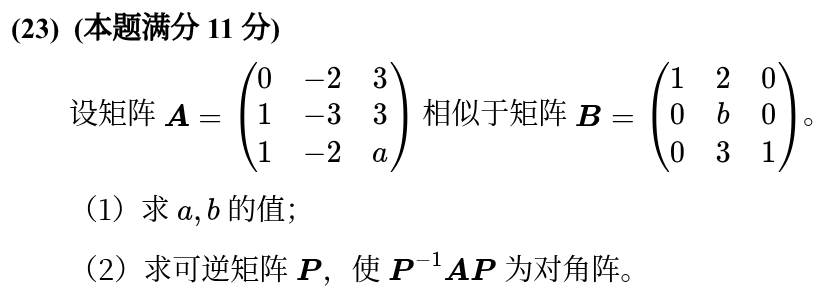

答案与解析

**题面待核。** （1）$B$ 有特征值 1，故 $\det(A-I)=6a-12=0$，得 $a=2$。再由迹相等 $a-3=b+2$，得必要候选 $b=-3$。

（2）代 $a=2$，$A$ 对应特征值 $1$ 的向量可取 $(1,1,1)^T$，特征值 $-1$ 的向量可取 $(2,1,0)^T$、$(-3,0,1)^T$。三列独立，直接验算 $AP=P\operatorname{diag}(1,-1,-1)$。但该谱与题给相似矩阵的 $1,1,-3$ 矛盾，因此原题的至少一个矩阵元素需独立核对。

---

### 17 · 2014年

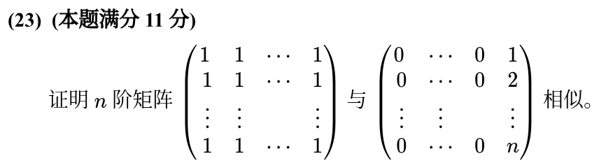

答案与解析

**证明。** 两矩阵都秩为 1，所以零特征空间均为 $n-1$ 维。第一矩阵在全 1 向量方向上特征值为 $n$；第二矩阵在 $(1,2,\ldots,n)^T$ 方向也为 $n$。各自从零特征空间取基，再加该非零特征向量，二者都相似于 $\operatorname{diag}(0,\ldots,0,n)$。

---

### 18 · 2013年

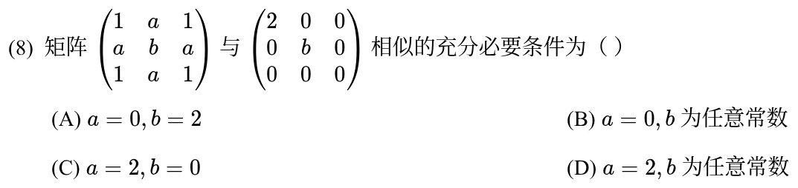

答案与解析

**答案 B。** 相似保 $\operatorname{tr}(A^2)$。题中两者的平方迹分别为 $4+b^2+4a^2$ 与 $4+b^2$，所以 $a=0$。此时第一、三坐标的块为全 1 的 $2\times2$ 矩阵，特征值 $2,0$，第二坐标独立为 $b$，故对任何 $b$ 都相似。

---

### 19 · 2012年

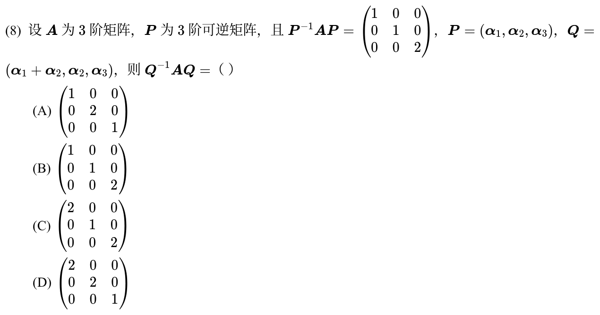

答案与解析

**答案 B。** 前两列均为特征值 1 的特征向量，非零和仍在同一特征空间。$Q$ 由 $P$ 把第二列加到第一列所得，仍可逆，三列的特征值顺序仍是 $1,1,2$。

---

### 20 · 2011年

答案与解析

**解。** （I）从两列关系读出 $v_1=(1,0,-1)^T$ 的特征值为 $-1$，$v_2=(1,0,1)^T$ 的特征值为 1。秩为 2，故第三特征值为 0；由实对称性，零特征向量可取与前两者正交的 $v_3=(0,1,0)^T$。各特征空间都是相应向量所张成的一维空间。

（II）谱分解 $A=-v_1v_1^T/2+v_2v_2^T/2$，即
$$
A=\begin{pmatrix}0&0&1\\0&0&0\\1&0&0\end{pmatrix}.
$$

---

### 21 · 2010年

答案与解析

**答案 D。** 实对称矩阵可对角化，$A^2+A=0$ 使每个特征值满足 $\lambda(\lambda+1)=0$。秩 3 意味着恰有三个非零特征值，故为 $-1,-1,-1,0$。

---

### 22 · 2010年

答案与解析

**解。** $Q$ 第一列对应特征向量 $(1,2,1)^T$，乘以 $A$ 得 $(2,5+a,4+2a)^T$，由首分量知特征值为 2，故 $a=-1$。代回验算，另两特征对可取 $(-4,(-1,0,1)^T)$、$(5,(1,-1,1)^T)$。三列均单位化后，一种取法是
$$
Q=\left(\frac{(1,2,1)^T}{\sqrt6},\frac{(-1,0,1)^T}{\sqrt2},\frac{(1,-1,1)^T}{\sqrt3}\right).
$$

---

[« 线性方程组](04-linear-systems.md)　　[二次型 »](06-quadratic-forms.md)
