# 线性代数 · 特征值、特征向量与相似

> 2010—2026年 · 22 道完整真题 · 年份从新到旧（2026→2010）  
> 题型分布：选择题 12 题 · 填空题 1 题 · 解答题 9 题  
> 考查范围：特征值和特征向量、相似关系、对角化及其矩阵幂应用

[查看对应网页版](05-eigenvalues-similarity.html) · [返回章节总目录](../README.md)

---

## 2026年

### 01 · 2026-10 · 选择题

> *反交换矩阵特征值性质题。由 $AB+BA=O$ 得 $AB=-BA$。利用特征值迹或行列式反号性质，或乘特征向量分析对称分布，迅速排除错误项。*

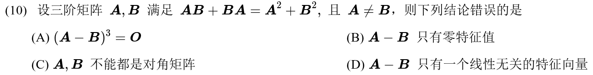

*关联章节：[矩阵运算、逆矩阵与初等变换](02-matrices.md) · [向量组、线性相关与秩](03-vectors-rank.md)*

---

## 2025年

### 02 · 2025-08 · 选择题

> *实对称矩阵相似与行列式。实对称矩阵必可正交对角化。利用特征多项式或迹与行列式性质，建立 $a, b$ 的方程直接定解。*

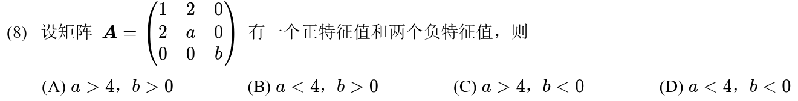

*关联章节：[二次型](06-quadratic-forms.md) · [行列式](01-determinants.md)*

---

## 2024年

### 03 · 2024-10 · 选择题

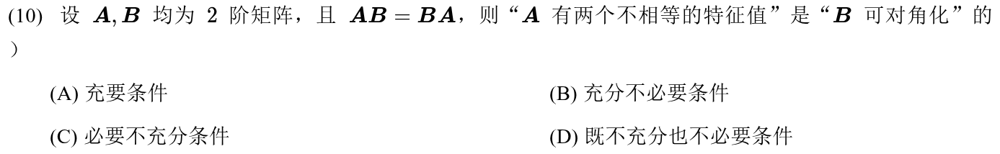

---

## 2023年

### 04 · 2023-22 · 解答题

> *向量外积型矩阵幂。条件是 $Ax = (a^T x) b$，说明矩阵 $A = ba^T$（秩 1 矩阵）。计算 $\mathrm{tr}(A)$ 得到非零特征值，矩阵幂直接用数乘规律搞定。*

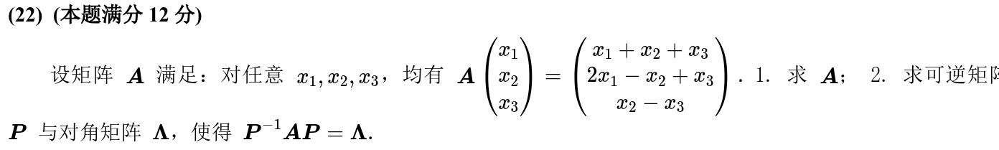

*关联章节：[矩阵运算、逆矩阵与初等变换](02-matrices.md)*

---

## 2022年

### 05 · 2022-08 · 选择题

> ⚠️ **题面待核对**：原年度转写稿存在疑点，本次保留题面，作答前请核对独立原题来源。

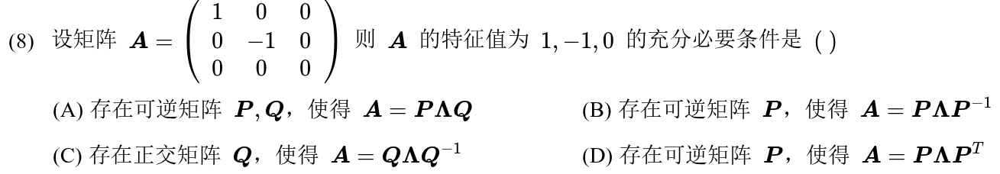

*关联章节：[矩阵运算、逆矩阵与初等变换](02-matrices.md)*

---

## 2021年

### 06 · 2021-22 · 解答题

> *相似对角化大题。矩阵有重特征值时，可对角化的充要条件是重特征值对应的特征矩阵满足 $n - r(\lambda E - A) = \text{重数}$，列出秩方程定参数。*

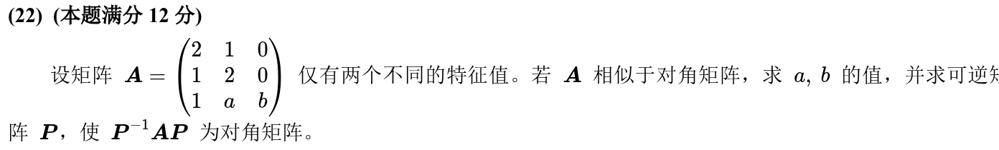

---

## 2020年

### 07 · 2020-08 · 选择题

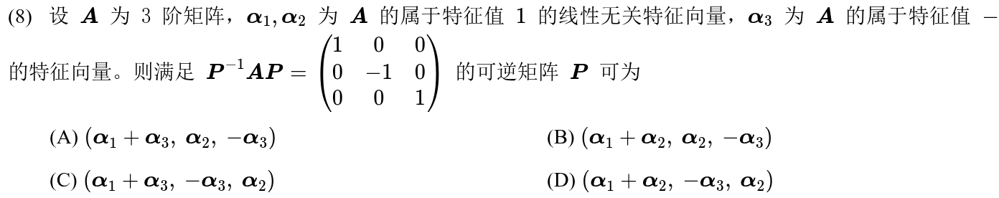

---

### 08 · 2020-23 · 解答题

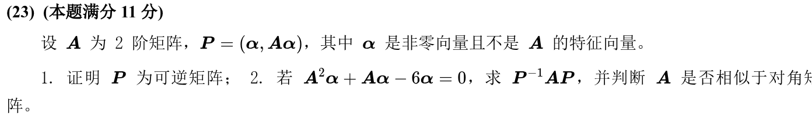

*关联章节：[矩阵运算、逆矩阵与初等变换](02-matrices.md)*

---

## 2019年

### 09 · 2019-23 · 解答题

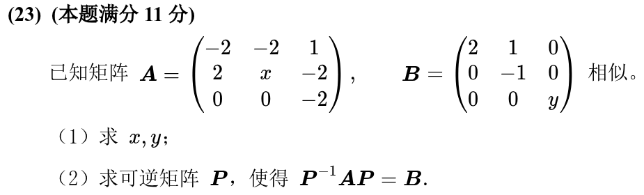

---

## 2018年

### 10 · 2018-07 · 选择题

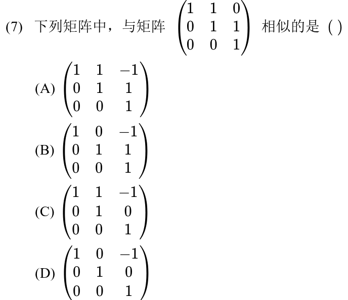

---

## 2017年

### 11 · 2017-07 · 选择题

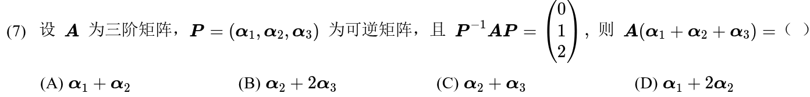

---

### 12 · 2017-08 · 选择题

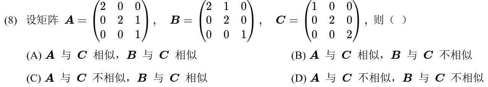

---

### 13 · 2017-14 · 填空题

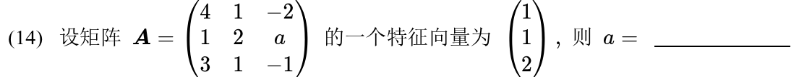

---

## 2016年

### 14 · 2016-07 · 选择题

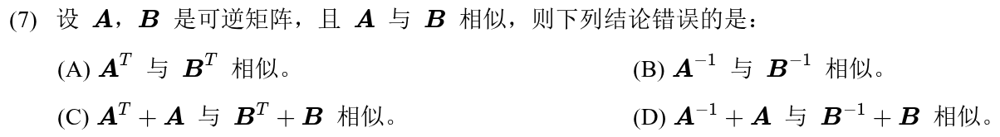

---

### 15 · 2016-23 · 解答题

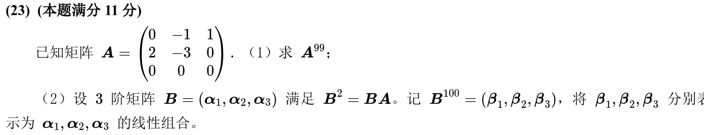

*关联章节：[矩阵运算、逆矩阵与初等变换](02-matrices.md) · [向量组、线性相关与秩](03-vectors-rank.md)*

---

## 2015年

### 16 · 2015-23 · 解答题

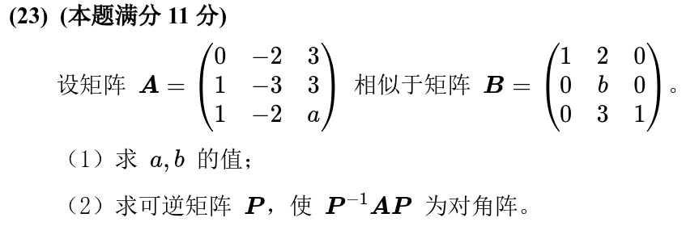

*关联章节：[行列式](01-determinants.md)*

---

## 2014年

### 17 · 2014-23 · 解答题

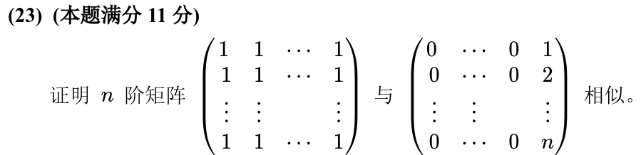

---

## 2013年

### 18 · 2013-08 · 选择题

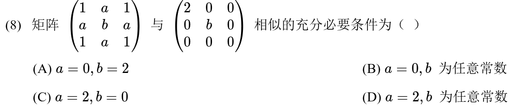

---

## 2012年

### 19 · 2012-08 · 选择题

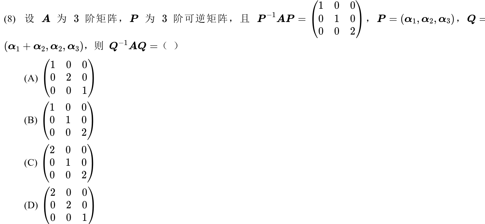

---

## 2011年

### 20 · 2011-23 · 解答题

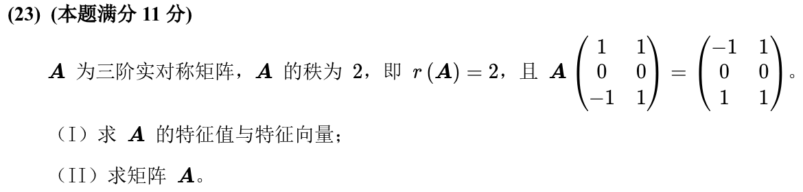

---

## 2010年

### 21 · 2010-08 · 选择题

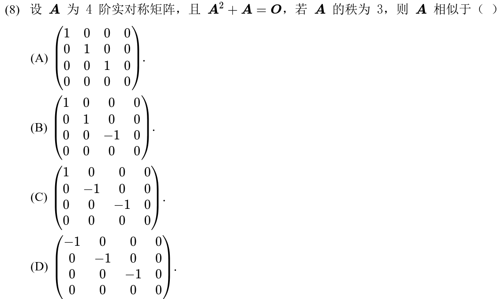

---

### 22 · 2010-23 · 解答题

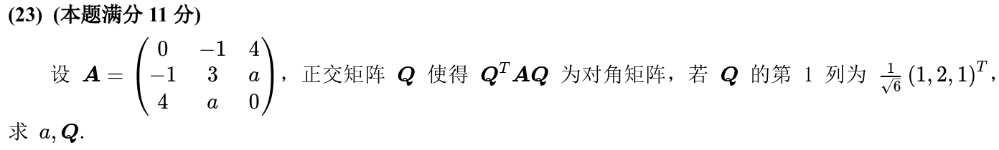

*关联章节：[二次型](06-quadratic-forms.md)*

---

## 交叉考点索引

以下题目主归其他章节，点击跳转到对应章节题目；不计入本章主收录题数：

- [2025年 · 第22题](06-quadratic-forms.md)（主章节：二次型）
- [2024年 · 第8题](02-matrices.md)（主章节：矩阵运算、逆矩阵与初等变换）
- [2024年 · 第22题](06-quadratic-forms.md)（主章节：二次型）
- [2022年 · 第22题](06-quadratic-forms.md)（主章节：二次型）
- [2020年 · 第22题](06-quadratic-forms.md)（主章节：二次型）
- [2018年 · 第14题](01-determinants.md)（主章节：行列式）
- [2017年 · 第22题](04-linear-systems.md)（主章节：线性方程组）
- [2017年 · 第23题](06-quadratic-forms.md)（主章节：二次型）
- [2015年 · 第14题](01-determinants.md)（主章节：行列式）
- [2015年 · 第22题](02-matrices.md)（主章节：矩阵运算、逆矩阵与初等变换）
- [2013年 · 第23题](06-quadratic-forms.md)（主章节：二次型）
- [2012年 · 第23题](06-quadratic-forms.md)（主章节：二次型）
