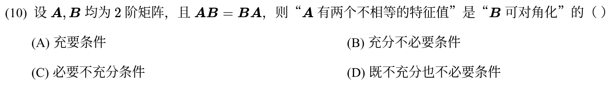
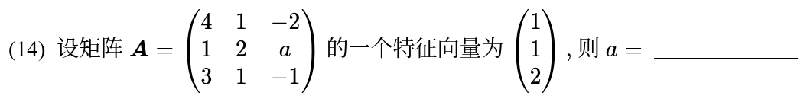
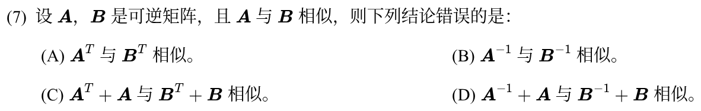
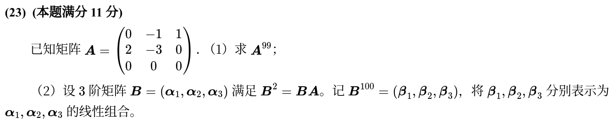
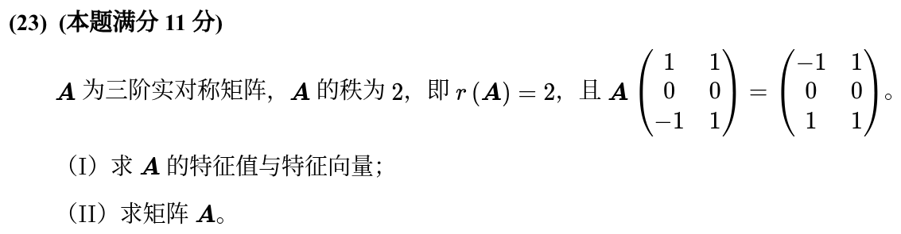
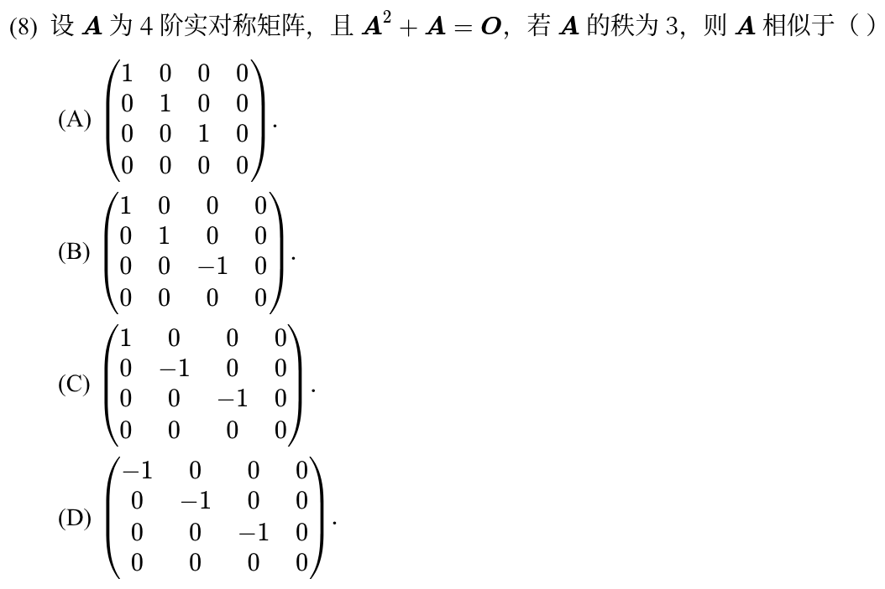
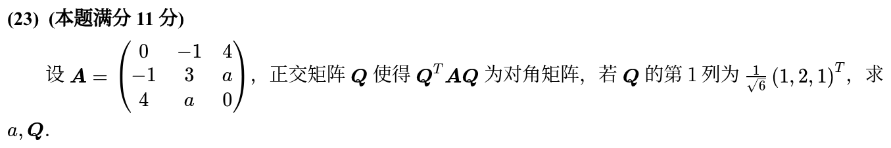

[« 线性方程组](04-linear-systems.md)　　[二次型 »](06-quadratic-forms.md)

# 线性代数 · 特征值、特征向量与相似

> **本章共 22 题**
> 
> - **核心必做（建议按顺序攻克关键方法）**：  
>   [第 13 题](#q13)（特征向量反求参数） → [第 07 题](#q07)（特征向量与对角元对应） → [第 04 题](#q04)（完整做一遍相似对角化） → [第 06 题](#q06)（重根与可对角化条件）
> 
> - **分流与刷题建议**：  
>   - **较难挑战**：[第 15 题](#q15)（对角化求高次幂及递推）  
>   - **重在看思路**：[第 17 题](#q17)（从三阶计算过渡到一般阶证明）  
>   - **首轮可跳过**：[第 03 题](#q03)、[第 09 题](#q09)、[第 10 题](#q10)（技巧较偏或综合度高，首轮不必死磕）  
>   - **题面存疑暂缓**：[第 05 题](#q05)（题面已有核对标记）、[第 11 题](#q11)（相似关系右端排成列向量，维度待核）（原卷转写存疑，首轮暂不安排）  
> 
> - **过关目标**：能求特征值、解特征向量并拼出可逆矩阵；重根要查向量个数。

---

### 01 · 2026年

> *反交换矩阵特征值性质题。由 $AB+BA=O$ 得 $AB=-BA$。利用特征值迹或行列式反号性质，或乘特征向量分析对称分布，迅速排除错误项。*

答案与解析

**答案**：**（D）** $A-B$ 只有一个线性无关的特征向量

- **切入点与推演**：把题设条件移项配方，记 $N = A - B$，则
  $$(A - B)^2 = A^2 - AB - BA + B^2 = O \implies N^2 = O, \qquad N \ne O.$$
  据此逐项验证：
  - **（A）正确**：$N^3 = N^2 \cdot N = O$；
  - **（B）正确**：若 $\lambda$ 是 $N$ 的特征值，则 $\lambda^2 = 0 \implies \lambda = 0$，即 $N$ 只有零特征值；
  - **（C）正确**：若 $A,B$ 均为对角矩阵，则 $N=A-B$ 也是对角矩阵，由 $N^2=O$ 必得主对角元平方全为 $0$，即 $N=O$，与 $A\ne B$ 矛盾；
  - **（D）错误**：对 $3$ 阶非零矩阵 $N$，由 $N^2 = O$ 套用秩不等式 $r(N)+r(N)\le 3 \implies r(N) \le \frac{3}{2}$，又 $N \ne O \implies r(N) \ge 1$，故必有 $r(N)=1$。于是零特征值对应的齐次方程组 $N\boldsymbol{x}=\boldsymbol{0}$ 的基础解系含
    $$3 - r(N) = 3 - 1 = 2$$
    个线性无关的特征向量，而非 $1$ 个。
  故结论错误的是 **（D）**。
- **干扰项 / 易错提示**：本题选“错误的是”，易误以为不可对角化的幂零矩阵只有 $1$ 个特征向量——对 $3$ 阶满足 $N^2=O$ 的非零矩阵，秩只能是 $1$，因此零特征空间维数必为 $3-1=2$。

---

### 02 · 2025年

> *实对称矩阵相似与行列式。实对称矩阵必可正交对角化。利用特征多项式或迹与行列式性质，建立 $a, b$ 的方程直接定解。*

答案与解析

- **第一步：分块拆特征值**：$A = \operatorname{diag}(B,\ b)$，其中 $B = \begin{pmatrix}1&2\\2&a\end{pmatrix}$ 为实对称矩阵，故 $A$ 的三个特征值为 $B$ 的两个实特征值 $\lambda_1, \lambda_2$ 与 $b$。
- **第二步：判断 $B$ 能否有两个负特征值**：因为 $B$ 的 $(1,1)$ 元为 $1 > 0$（即 $\boldsymbol{e}_1^T B\boldsymbol{e}_1 = 1 > 0$），所以 $B$ 绝不是负定矩阵，**$B$ 至少有一个正特征值**！
- **第三步：按“1 正 2 负”锁死符号**：既然总计只有 **1 个正特征值** 和 **2 个负特征值**，那么：
  - $B$ 只能是 **1 正 1 负** $\implies |B| = \lambda_1\lambda_2 = a - 4 < 0 \implies a < 4$；
  - 剩下的特征值 $b$ 必须是负的 $\implies b < 0$。
- **答案**：**（D）**（$a < 4,\ b < 0$）。

---

### 03 · 2024年

答案与解析

**答案**：**（B）** 充分不必要条件

- **切入点与推演**：利用可交换矩阵的核心性质——若 $AB=BA$ 且 $A\boldsymbol\alpha=\lambda\boldsymbol\alpha$，则 $A(B\boldsymbol\alpha) = B(A\boldsymbol\alpha) = \lambda(B\boldsymbol\alpha)$，即 $B$ 保持 $A$ 的每个特征子空间不变。
  1. **充分性成立**：设 $2$ 阶矩阵 $A$ 有两个不相等的特征值 $\lambda_1 \ne \lambda_2$，对应的特征向量为 $\boldsymbol\alpha_1, \boldsymbol\alpha_2$（线性无关）。因为每个特征子空间都是 $1$ 维的，由 $A(B\boldsymbol\alpha_i) = \lambda_i(B\boldsymbol\alpha_i)$ 可知 $B\boldsymbol\alpha_i$ 必与 $\boldsymbol\alpha_i$ 共线，即存在数 $\mu_1, \mu_2$ 使得
     $$B\boldsymbol\alpha_1 = \mu_1\boldsymbol\alpha_1, \qquad B\boldsymbol\alpha_2 = \mu_2\boldsymbol\alpha_2.$$
     故 $\boldsymbol\alpha_1, \boldsymbol\alpha_2$ 同时也是 $B$ 的两个线性无关的特征向量，因此 $B$ 可相似对角化。
  2. **必要性不成立**：取反例 $A = E = \begin{pmatrix}1&0\\0&1\end{pmatrix},\ B = \begin{pmatrix}1&0\\0&2\end{pmatrix}$。显然 $AB=BA$ 且 $B$ 可对角化，但 $A$ 只有二重特征值 $1$，不具有两个不等的特征值。
  综上为充分不必要条件，选 **（B）**。
- **干扰项 / 易错提示**：证明充分性时别忘记“特征子空间是 $1$ 维的”这一关键前提——若 $A$ 有重特征值（如 $A=E$），$B$ 不必把单个特征向量映到自身倍数，甚至 $B$ 未必可对角化（如 $A=E,\ B=\begin{pmatrix}1&1\\0&1\end{pmatrix}$）。

---

### 04 · 2023年

> *向量外积型矩阵幂。条件是 $Ax = (a^T x) b$，说明矩阵 $A = ba^T$（秩 1 矩阵）。计算 $\mathrm{tr}(A)$ 得到非零特征值，矩阵幂直接用数乘规律搞定。*

答案与解析

**第 1 问：由 $A\boldsymbol{x}$ 的表达式直接读出 $A$**

把等式右端按 $x_1, x_2, x_3$ 的系数写成矩阵乘积：
$$A\begin{pmatrix}x_1\\x_2\\x_3\end{pmatrix} = \begin{pmatrix}1\cdot x_1 + 1\cdot x_2 + 1\cdot x_3 \\ 2\cdot x_1 - 1\cdot x_2 + 1\cdot x_3 \\ 0\cdot x_1 + 1\cdot x_2 - 1\cdot x_3\end{pmatrix} = \begin{pmatrix}1&1&1\\2&-1&1\\0&1&-1\end{pmatrix}\begin{pmatrix}x_1\\x_2\\x_3\end{pmatrix}.$$
因对任意 $x_1,x_2,x_3$ 恒成立（等价于令 $\boldsymbol{x}$ 依次取 $\boldsymbol{e}_1,\boldsymbol{e}_2,\boldsymbol{e}_3$），故
$$A = \begin{pmatrix}1&1&1\\2&-1&1\\0&1&-1\end{pmatrix}.$$

**第 2 问：求可逆矩阵 $P$ 与对角矩阵 $\Lambda$ 使 $P^{-1}AP=\Lambda$**

1. **求特征值**：
   $$|\lambda E - A| = \begin{vmatrix}\lambda-1 & -1 & -1 \\ -2 & \lambda+1 & -1 \\ 0 & -1 & \lambda+1\end{vmatrix} \xrightarrow{c_2-c_3} \begin{vmatrix}\lambda-1 & 0 & -1 \\ -2 & \lambda+2 & -1 \\ 0 & -(\lambda+2) & \lambda+1\end{vmatrix}$$
   提取第 2 列公因子 $(\lambda+2)$：
   $$= (\lambda+2)\begin{vmatrix}\lambda-1 & 0 & -1 \\ -2 & 1 & -1 \\ 0 & -1 & \lambda+1\end{vmatrix} \xrightarrow{r_3+r_2} (\lambda+2)\begin{vmatrix}\lambda-1 & 0 & -1 \\ -2 & 1 & -1 \\ -2 & 0 & \lambda\end{vmatrix} = (\lambda+2)\big(\lambda(\lambda-1)-2\big)$$
   $$= (\lambda+2)(\lambda-2)(\lambda+1) = 0.$$
   得三个互异特征值：$\lambda_1 = 2,\ \lambda_2 = -1,\ \lambda_3 = -2$。
   （**双重验算**：$\lambda_1+\lambda_2+\lambda_3 = 2-1-2 = -1 = \operatorname{tr}(A)$；$\lambda_1\lambda_2\lambda_3 = 4 = |A|$，完全正确！）

2. **逐个求特征向量**：
   - 当 $\lambda_1 = 2$ 时：
     $$2E - A = \begin{pmatrix}1&-1&-1\\-2&3&-1\\0&-1&3\end{pmatrix} \to \begin{pmatrix}1&-1&-1\\0&1&-3\\0&-1&3\end{pmatrix} \to \begin{pmatrix}1&0&-4\\0&1&-3\\0&0&0\end{pmatrix},$$
     得特征向量 $\boldsymbol{\alpha}_1 = (4, 3, 1)^T$（口算验算 $A\boldsymbol{\alpha}_1 = (8,6,2)^T = 2\boldsymbol{\alpha}_1$）。
   - 当 $\lambda_2 = -1$ 时：
     $$-E - A = \begin{pmatrix}-2&-1&-1\\-2&0&-1\\0&-1&0\end{pmatrix} \to \begin{pmatrix}2&0&1\\0&1&0\\0&0&0\end{pmatrix},$$
     得特征向量 $\boldsymbol{\alpha}_2 = (-1, 0, 2)^T$（口算验算 $A\boldsymbol{\alpha}_2 = (1,0,-2)^T = -\boldsymbol{\alpha}_2$）。
   - 当 $\lambda_3 = -2$ 时：
     $$-2E - A = \begin{pmatrix}-3&-1&-1\\-2&-1&-1\\0&-1&-1\end{pmatrix} \to \begin{pmatrix}1&0&0\\0&1&1\\0&0&0\end{pmatrix},$$
     得特征向量 $\boldsymbol{\alpha}_3 = (0, -1, 1)^T$（口算验算 $A\boldsymbol{\alpha}_3 = (0,2,-2)^T = -2\boldsymbol{\alpha}_3$）。

3. **拼出 $P$ 与 $\Lambda$**：
   $$P = \begin{pmatrix}4 & -1 & 0 \\ 3 & 0 & -1 \\ 1 & 2 & 1\end{pmatrix}, \qquad \Lambda = \begin{pmatrix}2 & 0 & 0 \\ 0 & -1 & 0 \\ 0 & 0 & -2\end{pmatrix},$$
   满足 $P^{-1}AP = \Lambda$。

---

### 05 · 2022年

> ⚠️ **题面待核对**：原年度转写稿存在疑点，本次保留题面，作答前请核对独立原题来源。

答案与解析

**题面待核**（当前题面将对角阵误印为 $A$ 而选项中的 $\Lambda$ 未定义；按原卷标准意图 $\Lambda=\operatorname{diag}(1,-1,0)$、询问一般 $3$ 阶矩阵 $A$，答案选 **（B）**）

- **题面核查说明**：当前转写把已知对角阵写成了 $A=\operatorname{diag}(1,-1,0)$，导致选项中出现的 $\Lambda$ 未定义且命题本身退化为恒真。核对原题结构可知，应为“设 $\Lambda=\operatorname{diag}(1,-1,0)$，则 $3$ 阶矩阵 $A$ 的特征值为 $1,-1,0$ 的充分必要条件是”。
- **按原卷意图的推演**：
  1. **充分性**：若存在可逆矩阵 $P$ 使 $A = P\Lambda P^{-1}$（即 $A \sim \Lambda$），由于相似矩阵具有相同的特征值，故 $A$ 的特征值必为 $1,-1,0$。
  2. **必要性**：若 $3$ 阶矩阵 $A$ 的特征值为 $1,-1,0$，因其有 $3$ 个互不相同的特征值，故 $A$ 必可相似对角化，即存在可逆矩阵 $P$ 使得
     $$P^{-1}AP = \Lambda \iff A = P\Lambda P^{-1}.$$
  故 **（B）** 为充要条件。
- **干扰项 / 易错提示**：（A）等价仅保秩（$r(A)=2$），不保特征值；（C）要求正交相似（即要求 $A$ 为实对称矩阵），对一般非对称矩阵过强，仅充分不必要；（D）合同仅保正负惯性指数，不保特征值具体数值。

---

### 06 · 2021年

> *相似对角化大题。矩阵有重特征值时，可对角化的充要条件是重特征值对应的特征矩阵满足 $n - r(\lambda E - A) = \text{重数}$，列出秩方程定参数。*

答案与解析

**第一步怎么落笔**

- **触发条件**：$A = \begin{pmatrix}2&1&0\\1&2&0\\1&a&b\end{pmatrix}$ 是**分块下三角矩阵**，仅有 2 个不同特征值，且可相似对角化。
- **第一笔**：按第 3 列直接展开特征多项式：
  $$|\lambda E - A| = (\lambda - b)\begin{vmatrix}\lambda-2 & -1 \\ -1 & \lambda-2\end{vmatrix} = (\lambda - b)(\lambda - 1)(\lambda - 3) = 0.$$
  全部特征值为 $1,\ 3,\ b$。
  因为“仅有 2 个不同特征值”，所以 **$b$ 必有两种可能：$b = 1$ 或 $b = 3$**！

**完整推演（必须完整讨论两支！）**

##### 情况一：$b = 1$（特征值为 $\lambda_1 = \lambda_2 = 1,\ \lambda_3 = 3$）

1. **由可相似对角化定 $a$**：二重特征值 $\lambda = 1$ 必须有 2 个线性无关特征向量 $\iff r(E - A) = 3 - 2 = 1$。
   $$E - A = \begin{pmatrix}-1 & -1 & 0 \\ -1 & -1 & 0 \\ -1 & -a & 0\end{pmatrix}.$$
   显然 $r(E-A)=1 \iff$ 第 3 行与第 1 行成比例 $\iff a = 1$。
2. **求特征向量与 $P$**：
   - 当 $\lambda=1$ 时，$E-A \to \begin{pmatrix}1&1&0\\0&0&0\\0&0&0\end{pmatrix}$，得两个线性无关特征向量 $\boldsymbol{\alpha}_1 = (-1, 1, 0)^T$，$\boldsymbol{\alpha}_2 = (0, 0, 1)^T$；
   - 当 $\lambda=3$ 时，$3E-A = \begin{pmatrix}1&-1&0\\-1&1&0\\-1&-1&2\end{pmatrix} \to \begin{pmatrix}1&0&-1\\0&1&-1\\0&0&0\end{pmatrix}$，得特征向量 $\boldsymbol{\alpha}_3 = (1, 1, 1)^T$。
   - 拼出 $P_1 = \begin{pmatrix}-1&0&1\\1&0&1\\0&1&1\end{pmatrix}$，使 $P_1^{-1}AP_1 = \operatorname{diag}(1, 1, 3)$。

##### 情况二：$b = 3$（特征值为 $\lambda_1 = \lambda_2 = 3,\ \lambda_3 = 1$）

1. **由可相似对角化定 $a$**：二重特征值 $\lambda = 3$ 必须满足 $r(3E - A) = 3 - 2 = 1$。
   $$3E - A = \begin{pmatrix}1 & -1 & 0 \\ -1 & 1 & 0 \\ -1 & -a & 0\end{pmatrix}.$$
   第 1 行是 $(1,-1,0)$，第 3 行是 $(-1,-a,0)$，成比例 $\iff -a = 1 \iff a = -1$。
2. **求特征向量与 $P$**：
   - 当 $\lambda=3$ 时，$3E-A \to \begin{pmatrix}1&-1&0\\0&0&0\\0&0&0\end{pmatrix}$，得两个线性无关特征向量 $\boldsymbol{\beta}_1 = (1, 1, 0)^T$，$\boldsymbol{\beta}_2 = (0, 0, 1)^T$；
   - 当 $\lambda=1$ 时，$E-A = \begin{pmatrix}-1&-1&0\\-1&-1&0\\-1&1&-2\end{pmatrix} \to \begin{pmatrix}1&0&1\\0&1&-1\\0&0&0\end{pmatrix}$，得特征向量 $\boldsymbol{\beta}_3 = (1, -1, -1)^T$。
   - 拼出 $P_2 = \begin{pmatrix}1&0&1\\1&0&-1\\0&1&-1\end{pmatrix}$，使 $P_2^{-1}AP_2 = \operatorname{diag}(3, 3, 1)$。

综上，共有两组解：$(a, b) = (1, 1)$（对应 $P_1$）或 $(a, b) = (-1, 3)$（对应 $P_2$）。

---

### 07 · 2020年

答案与解析

**第一步怎么落笔**

- **触发条件**：已知 $\boldsymbol{\alpha}_1,\boldsymbol{\alpha}_2$ 是 $\lambda=1$ 的线性无关特征向量，$\boldsymbol{\alpha}_3$ 是 $\lambda=-1$ 的特征向量，要求 $P^{-1}AP = \operatorname{diag}(1, -1, 1)$。
- **第一笔**：改写为 $A(\boldsymbol{p}_1,\boldsymbol{p}_2,\boldsymbol{p}_3) = (\boldsymbol{p}_1,\ -\boldsymbol{p}_2,\ \boldsymbol{p}_3)$，即：
  - $\boldsymbol{p}_1, \boldsymbol{p}_3$ 必须是属于 $\lambda=1$ 的线性无关特征向量；
  - $\boldsymbol{p}_2$ 必须是属于 $\lambda=-1$ 的特征向量（即 $c\boldsymbol{\alpha}_3,\ c\neq 0$）。

**完整推演**

直接检验 **（D）** $P = (\boldsymbol{\alpha}_1+\boldsymbol{\alpha}_2,\ -\boldsymbol{\alpha}_3,\ \boldsymbol{\alpha}_2)$：
1. **归属与位置**：
   - 第 1 列：$A(\boldsymbol{\alpha}_1+\boldsymbol{\alpha}_2) = \boldsymbol{\alpha}_1+\boldsymbol{\alpha}_2 = 1\cdot(\boldsymbol{\alpha}_1+\boldsymbol{\alpha}_2)$（对应 $\lambda_1=1$）；
   - 第 2 列：$A(-\boldsymbol{\alpha}_3) = -A\boldsymbol{\alpha}_3 = -(-\boldsymbol{\alpha}_3) = (-1)(-\boldsymbol{\alpha}_3)$（对应 $\lambda_2=-1$）；
   - 第 3 列：$A\boldsymbol{\alpha}_2 = 1\cdot\boldsymbol{\alpha}_2$（对应 $\lambda_3=1$）。
2. **可逆性（列线性无关）**：
   $$(\boldsymbol{\alpha}_1+\boldsymbol{\alpha}_2,\ -\boldsymbol{\alpha}_3,\ \boldsymbol{\alpha}_2) = (\boldsymbol{\alpha}_1,\ \boldsymbol{\alpha}_2,\ \boldsymbol{\alpha}_3)\begin{pmatrix}1&0&0\\1&0&1\\0&-1&0\end{pmatrix}.$$
   因为 $\boldsymbol{\alpha}_1,\boldsymbol{\alpha}_2,\boldsymbol{\alpha}_3$ 线性无关（属于不同特征值的线性无关向量合并仍线性无关），且过渡矩阵行列式 $\begin{vmatrix}1&0&0\\1&0&1\\0&-1&0\end{vmatrix} = 1\neq 0$，所以 $P$ 可逆。故应选 **（D）**。

**选择题关键干扰项拆解**

- **（A）与（C）**：第 1 列都是 $\boldsymbol{\alpha}_1+\boldsymbol{\alpha}_3$。由于 $\boldsymbol{\alpha}_1$ 与 $\boldsymbol{\alpha}_3$ 属于**不同特征值**（$1$ 与 $-1$），$A(\boldsymbol{\alpha}_1+\boldsymbol{\alpha}_3) = \boldsymbol{\alpha}_1 - \boldsymbol{\alpha}_3$，绝不是 $\boldsymbol{\alpha}_1+\boldsymbol{\alpha}_3$ 的倍数，直接秒杀淘汰！
- **（B）$(\boldsymbol{\alpha}_1+\boldsymbol{\alpha}_2,\ \boldsymbol{\alpha}_2,\ -\boldsymbol{\alpha}_3)$（最高频错选）**：三列都是合法特征向量且线性无关，但**顺序错了**！它算出来的是 $P^{-1}AP = \operatorname{diag}(1, 1, -1)$，而不是题目要求的 $\operatorname{diag}(1, -1, 1)$。

---

### 08 · 2020年

答案与解析

**结论速览**：（1）用反证法证 $\boldsymbol\alpha, A\boldsymbol\alpha$ 线性无关即得 $P$ 可逆；（2）$P^{-1}AP = \begin{pmatrix} 0 & 6 \\ 1 & -1 \end{pmatrix}$，$A$ 相似于对角矩阵。

- **（1）证明 $P$ 为可逆矩阵**：
  $P = (\boldsymbol\alpha, A\boldsymbol\alpha)$ 为 $2$ 阶矩阵，要证 $P$ 可逆，只需证其列向量 $\boldsymbol\alpha, A\boldsymbol\alpha$ 线性无关。
  用反证法：假设存在不全为零的常数 $k_1, k_2$ 使得
  $$k_1\boldsymbol\alpha + k_2 A\boldsymbol\alpha = \boldsymbol{0}.$$
  - 若 $k_2 = 0$，则 $k_1 \ne 0$，得 $\boldsymbol\alpha = \boldsymbol{0}$，与题设 $\boldsymbol\alpha$ 为非零向量矛盾；
  - 若 $k_2 \ne 0$，则 $A\boldsymbol\alpha = -\dfrac{k_1}{k_2}\boldsymbol\alpha$，说明非零向量 $\boldsymbol\alpha$ 是 $A$ 的特征向量，与题设矛盾。
  因此 $k_1 = k_2 = 0$，即 $\boldsymbol\alpha, A\boldsymbol\alpha$ 线性无关，故 $P$ 可逆。
- **（2）求 $P^{-1}AP$ 并判断 $A$ 是否可相似对角化**：
  由题设 $A^2\boldsymbol\alpha + A\boldsymbol\alpha - 6\boldsymbol\alpha = \boldsymbol{0}$，得 $A(A\boldsymbol\alpha) = 6\boldsymbol\alpha - A\boldsymbol\alpha$。
  计算分块乘积 $AP$：
  $$AP = A(\boldsymbol\alpha, A\boldsymbol\alpha) = (A\boldsymbol\alpha, A^2\boldsymbol\alpha) = (A\boldsymbol\alpha,\ 6\boldsymbol\alpha - A\boldsymbol\alpha) = (\boldsymbol\alpha, A\boldsymbol\alpha)\begin{pmatrix} 0 & 6 \\ 1 & -1 \end{pmatrix} = P\begin{pmatrix} 0 & 6 \\ 1 & -1 \end{pmatrix}.$$
  由第（1）问知 $P$ 可逆，两边左乘 $P^{-1}$ 得
  $$P^{-1}AP = \begin{pmatrix} 0 & 6 \\ 1 & -1 \end{pmatrix}.$$
  求该矩阵（也即 $A$）的特征多项式：
  $$|\lambda E - P^{-1}AP| = \begin{vmatrix} \lambda & -6 \\ -1 & \lambda+1 \end{vmatrix} = \lambda^2 + \lambda - 6 = (\lambda - 2)(\lambda + 3).$$
  故 $A$ 有两个不相等的特征值 $\lambda_1 = 2,\ \lambda_2 = -3$，因此 $A$ 相似于对角矩阵 $\operatorname{diag}(2, -3)$。
- **核心思路与避坑**：第（1）问用反证法时务必分 $k_2=0$ 和 $k_2\ne 0$ 两步说明（不能直接除以 $k_2$）；第（2）问直接用 $AP = PB$ 拼矩阵，切忌去假设 $A$ 的元素。

---

### 09 · 2019年

答案与解析

**结论速览**：（1）$x = 3,\ y = -2$；（2）可取 $P = \begin{pmatrix} -3 & -7 & -1 \\ 6 & 5 & 2 \\ 0 & 0 & 4 \end{pmatrix}$（或 $P = \begin{pmatrix} -1 & -7/3 & -1 \\ 2 & 5/3 & 2 \\ 0 & 0 & 4 \end{pmatrix}$，不唯一）。

- **（1）求 $x, y$**：
  因为 $A \sim B$，所以 $A$ 与 $B$ 有相同的特征值与迹。
  由 $A$ 的分块上三角结构，按第 $3$ 行展开其主特征多项式，立刻读出 $-2$ 是 $A$ 的一个特征值；又 $B$ 为上三角矩阵，其特征值为 $2, -1, y$，因此必有
  $$y = -2.$$
  再由相似矩阵迹相等 $\operatorname{tr}(A) = \operatorname{tr}(B)$，得
  $$(-2) + x + (-2) = 2 + (-1) + (-2) \implies x - 4 = -1 \implies x = 3.$$
  （检验：$x=3$ 时，$A$ 左上角 $2\times 2$ 块 $\begin{pmatrix}-2&-2\\2&3\end{pmatrix}$ 的特征多项式为 $\lambda^2-\lambda-2=(\lambda-2)(\lambda+1)$，故 $A$ 的全部特征值恰为 $2,-1,-2$，与 $B$ 完全一致且均互异，确相似。）
- **（2）求可逆矩阵 $P$ 使 $P^{-1}AP = B$**：
  设 $P = (\boldsymbol{p}_1, \boldsymbol{p}_2, \boldsymbol{p}_3)$，将 $AP = PB$ 按列展开：
  $$A\boldsymbol{p}_1 = 2\boldsymbol{p}_1, \qquad A\boldsymbol{p}_2 = \boldsymbol{p}_1 - \boldsymbol{p}_2 \iff (A + E)\boldsymbol{p}_2 = \boldsymbol{p}_1, \qquad A\boldsymbol{p}_3 = -2\boldsymbol{p}_3.$$
  1. **求 $\boldsymbol{p}_1$**（$A$ 对应 $\lambda=2$ 的特征向量）：解 $(2E - A)\boldsymbol{x} = \boldsymbol{0}$，得基础解系 $(-1, 2, 0)^T$，为避免分数取 $\boldsymbol{p}_1 = (-3, 6, 0)^T$（或先取 $(-1, 2, 0)^T$）；
  2. **求 $\boldsymbol{p}_2$**（解非齐次方程组 $(A + E)\boldsymbol{p}_2 = \boldsymbol{p}_1$）：
     $$A + E = \begin{pmatrix} -1 & -2 & 1 \\ 2 & 4 & -2 \\ 0 & 0 & -1 \end{pmatrix},$$
     解 $(A+E)\boldsymbol{p}_2 = (-3, 6, 0)^T$：第 $3$ 行得 $x_3=0$，第 $1,2$ 行均化为 $x_1 + 2x_2 = 3$。取特解 $\boldsymbol{p}_2 = (-7, 5, 0)^T$（或更简特解 $(3, 0, 0)^T$，同样满足 $3 + 2\cdot 0 = 3$ 且与 $\boldsymbol{p}_1$ 线性无关！）；
  3. **求 $\boldsymbol{p}_3$**（$A$ 对应 $\lambda=-2$ 的特征向量）：解 $(-2E - A)\boldsymbol{x} = \boldsymbol{0}$，得 $\boldsymbol{p}_3 = (-1, 2, 4)^T$。
  拼成矩阵 $P = \begin{pmatrix} -3 & -7 & -1 \\ 6 & 5 & 2 \\ 0 & 0 & 4 \end{pmatrix}$（或取 $\boldsymbol{p}_1=(-1,2,0)^T,\ \boldsymbol{p}_2=(1,0,0)^T,\ \boldsymbol{p}_3=(-1,2,4)^T$ 对应的 $P=\begin{pmatrix}-1&1&-1\\2&0&2\\0&0&4\end{pmatrix}$），验证 $|P|\ne 0$ 且 $AP=PB$，即满足 $P^{-1}AP=B$。
- **核心思路与避坑**：当目标矩阵 $B$ 不是对角阵而含非零非对角元时，直接按列翻译 $AP=PB$ 比“各自对角化再相乘 $P=P_1P_2^{-1}$”快得多；注意取 $\boldsymbol{p}_2$ 后要检查 $|P|\ne 0$。

---

### 10 · 2018年

答案与解析

- **第一步：先查相似必要条件**：题干矩阵 $J = \begin{pmatrix}1&1&0\\0&1&1\\0&0&1\end{pmatrix}$ 与四个选项都是主对角元全为 $1$ 的上三角矩阵，特征值全为 $1,1,1$，迹与行列式都相等，无法区分。
- **第二步：升级判据——比 $r(E - M)$**：
  $$J - E = \begin{pmatrix}0&1&0\\0&0&1\\0&0&0\end{pmatrix} \implies r(J - E) = 2.$$
  逐项减去 $E$ 算秩：
  - **（A）**：$\begin{pmatrix}0&1&-1\\0&0&1\\0&0&0\end{pmatrix}$，秩为 **$2$**（且 $(A-E)^2 = \begin{pmatrix}0&0&1\\0&0&0\\0&0&0\end{pmatrix}\neq O$，与 $J$ 同为一个 3 阶若尔当块，必相似！）；
  - **（B）**：$\begin{pmatrix}0&0&-1\\0&0&1\\0&0&0\end{pmatrix}$，秩为 $1 \neq 2$，排除；
  - **（C）**：$\begin{pmatrix}0&1&-1\\0&0&0\\0&0&0\end{pmatrix}$，秩为 $1 \neq 2$，排除；
  - **（D）**：$\begin{pmatrix}0&0&-1\\0&0&0\\0&0&0\end{pmatrix}$，秩为 $1 \neq 2$，排除。
- **答案**：**（A）**。

---

### 11 · 2017年

答案与解析

**题面待核**（当前转写将右端误写为 $3\times 1$ 列向量，与 $3\times 3$ 矩阵 $P^{-1}AP$ 尺寸不相容；按原卷意图 $P^{-1}AP=\operatorname{diag}(0,1,2)$，答案选 **（B）**）

- **题面核查说明**：题干左端 $P^{-1}AP$ 为 $3\times 3$ 方阵，但当前转写右端为列向量 $\begin{pmatrix}0\\1\\2\end{pmatrix}$，矩阵尺寸不相容，显系漏印对角阵的其余零元（即原题为 $P^{-1}AP=\operatorname{diag}(0,1,2)$，或原式为 $P^{-1}AP(1,1,1)^T=(0,1,2)^T$）。
- **按原卷意图 $P^{-1}AP=\operatorname{diag}(0,1,2)$ 的推演**：
  由 $P^{-1}AP = \operatorname{diag}(0, 1, 2)$ 两边左乘 $P = (\boldsymbol\alpha_1, \boldsymbol\alpha_2, \boldsymbol\alpha_3)$，得
  $$AP = P\begin{pmatrix} 0 & 0 & 0 \\ 0 & 1 & 0 \\ 0 & 0 & 2 \end{pmatrix} \implies A\boldsymbol\alpha_1 = \boldsymbol{0}, \quad A\boldsymbol\alpha_2 = \boldsymbol\alpha_2, \quad A\boldsymbol\alpha_3 = 2\boldsymbol\alpha_3.$$
  将三式相加：
  $$A(\boldsymbol\alpha_1 + \boldsymbol\alpha_2 + \boldsymbol\alpha_3) = A\boldsymbol\alpha_1 + A\boldsymbol\alpha_2 + A\boldsymbol\alpha_3 = \boldsymbol{0} + \boldsymbol\alpha_2 + 2\boldsymbol\alpha_3 = \boldsymbol\alpha_2 + 2\boldsymbol\alpha_3.$$
  故应选 **（B）**。
- **易错提示**：此类题的核心就是把 $P^{-1}AP=\Lambda$ 改写为 $AP=P\Lambda$，直接读出 $P$ 的各列作为特征向量对应的特征值，无需把 $A$ 显式求出来。

---

### 12 · 2017年

答案与解析

**答案**：**（B）** $A$ 与 $C$ 相似，$B$ 与 $C$ 不相似

- **切入点与推演**：$C=\operatorname{diag}(1,2,2)$ 是对角矩阵，因此“与 $C$ 相似”等价于“特征值为 $1,2,2$ 且**可相似对角化**”。
  观察 $A, B$ 均为上三角矩阵，主对角元直接给出两者特征值均为 $1, 2, 2$。单特征值 $1$ 必有 $1$ 个线性无关特征向量，故只需检验二重特征值 $\lambda=2$ 是否有 $2$ 个线性无关特征向量，即检查 $r(2E - M) \stackrel{?}{=} 3 - 2 = 1$：
  1. **检验 $A$**：
     $$2E - A = \begin{pmatrix} 0 & 0 & 0 \\ 0 & 0 & -1 \\ 0 & 0 & 1 \end{pmatrix} \implies r(2E - A) = 1.$$
     故 $\lambda=2$ 有 $3 - 1 = 2$ 个线性无关特征向量，$A$ 可对角化，从而 $A \sim C$。
  2. **检验 $B$**：
     $$2E - B = \begin{pmatrix} 0 & -1 & 0 \\ 0 & 0 & 0 \\ 0 & 0 & 1 \end{pmatrix} \implies r(2E - B) = 2 \ne 1.$$
     故 $\lambda=2$ 只有 $3 - 2 = 1$ 个线性无关特征向量，$B$ 不可对角化，从而 $B$ 与 $C$ 不相似。
  综上选 **（B）**。
- **干扰项 / 易错提示**：看上三角矩阵是否可对角化，切忌只看“上三角有没有非零元”——$A$ 中的非零元 $1$ 位于不同特征值 $(2,1)$ 的交叉位置，不影响对角化；而 $B$ 中的非零元 $1$ 位于相同特征值 $(2,2)$ 的 Jordan 块内，直接破坏对角化。

---

### 13 · 2017年

答案与解析

**第一步怎么落笔**

- **触发条件**：已知 $A$ 的一个具体特征向量 $\boldsymbol{\alpha}=(1,1,2)^T$，求矩阵中的未知元 $a$。
- **第一笔**：直接套定义 $A\boldsymbol{\alpha} = \lambda\boldsymbol{\alpha}$：
  $$\begin{pmatrix}4&1&-2\\1&2&a\\3&1&-1\end{pmatrix}\begin{pmatrix}1\\1\\2\end{pmatrix} = \begin{pmatrix}4+1-4\\1+2+2a\\3+1-2\end{pmatrix} = \begin{pmatrix}1\\3+2a\\2\end{pmatrix} = \lambda\begin{pmatrix}1\\1\\2\end{pmatrix}.$$

**完整推演**

1. **由第 1 分量秒出 $\lambda$**：$1 = \lambda\cdot 1 \implies \lambda = 1$（同时用第 3 分量验算：$2 = 1\cdot 2$，完全吻合！）。
2. **由第 2 分量解出 $a$**：
   $$3 + 2a = 1 \cdot 1 \implies 2a = -2 \implies a = -1.$$

---

### 14 · 2016年

答案与解析

**答案**：**（C）** $A^T + A$ 与 $B^T + B$ 相似

- **切入点与推演**：设 $P^{-1}AP = B$（$P$ 可逆），逐项检验能否用**同一个**可逆变换阵（或其转置/逆）把两矩阵联系起来：
  - **（A）正确**：对 $P^{-1}AP=B$ 两边取转置得 $P^T A^T (P^T)^{-1} = B^T$，记 $Q=(P^T)^{-1}$，则 $Q^{-1}A^T Q = B^T$，故 $A^T \sim B^T$；
  - **（B）正确**：对 $P^{-1}AP=B$ 两边取逆得 $P^{-1}A^{-1}P = B^{-1}$，故 $A^{-1} \sim B^{-1}$；
  - **（D）正确**：由 $P^{-1}AP=B$ 与 $P^{-1}A^{-1}P=B^{-1}$ 共用同一个 $P$，相加即得
    $$P^{-1}(A^{-1}+A)P = B^{-1} + B,$$
    故 $A^{-1}+A \sim B^{-1}+B$；
  - **（C）错误**：$A \sim B$ 用的是 $P$，而 $A^T \sim B^T$ 用的是 $(P^T)^{-1}$，一般 $P \ne (P^T)^{-1}$（除非 $P$ 为正交矩阵），两者不能直接相加！
    **反例**：取 $A = \begin{pmatrix}1&0\\0&2\end{pmatrix},\ B = \begin{pmatrix}1&1\\0&2\end{pmatrix}$。两者均有互异特征值 $1,2$，故 $A \sim B$；但
    $$A^T+A = \begin{pmatrix}2&0\\0&4\end{pmatrix}\quad (|A^T+A|=8), \qquad B^T+B = \begin{pmatrix}2&1\\1&4\end{pmatrix}\quad (|B^T+B|=7).$$
    行列式不等，故 $A^T+A$ 与 $B^T+B$ 不相似。
  故结论错误的是 **（C）**。
- **干扰项 / 易错提示**：相似关系的加法保持前提是**共用同一个相似变换矩阵 $P$**——$A$ 与 $A^{-1}$ 共用 $P$，所以（D）对；$A$ 与 $A^T$ 分别用 $P$ 与 $(P^T)^{-1}$，只有在正交相似时才一致，所以（C）错。

---

### 15 · 2016年

答案与解析

**结论速览**：（1）$A^{99} = \begin{pmatrix} 2^{99}-2 & 1-2^{99} & 2-2^{98} \\ 2^{100}-2 & 1-2^{100} & 2-2^{99} \\ 0 & 0 & 0 \end{pmatrix}$；（2）$\boldsymbol\beta_1 = (2^{99}-2)\boldsymbol\alpha_1 + (2^{100}-2)\boldsymbol\alpha_2$，$\boldsymbol\beta_2 = (1-2^{99})\boldsymbol\alpha_1 + (1-2^{100})\boldsymbol\alpha_2$，$\boldsymbol\beta_3 = (2-2^{98})\boldsymbol\alpha_1 + (2-2^{99})\boldsymbol\alpha_2$。

- **（1）求 $A^{99}$**：
  先求特征值：按第 $3$ 行展开
  $$|\lambda E - A| = \begin{vmatrix} \lambda & 1 & -1 \\ -2 & \lambda+3 & 0 \\ 0 & 0 & \lambda \end{vmatrix} = \lambda(\lambda^2 + 3\lambda + 2) = \lambda(\lambda+1)(\lambda+2),$$
  特征值为 $\lambda_1 = 0,\ \lambda_2 = -1,\ \lambda_3 = -2$（互异，故 $A$ 可对角化，且满足最小多项式 $A(A+E)(A+2E)=O$）。
  **高效解法（多项式余数法，免求特征向量与 $P^{-1}$）**：设
  $$t^{99} = q(t)\,t(t+1)(t+2) + c_2 t^2 + c_1 t + c_0.$$
  分别代入 $t = 0, -1, -2$：
  - $t = 0 \implies c_0 = 0$；
  - $t = -1 \implies c_2 - c_1 = -1$；
  - $t = -2 \implies 4c_2 - 2c_1 = -2^{99} \implies 2c_2 - c_1 = -2^{98}$。
  两式相减得 $c_2 = 1 - 2^{98}$，回代得 $c_1 = 2 - 2^{98}$。
  记 $m = 2^{98}$，算得 $A^2 = \begin{pmatrix} -2 & 3 & 0 \\ -6 & 7 & 2 \\ 0 & 0 & 0 \end{pmatrix}$，代入 $A^{99} = c_1 A + c_2 A^2$：
  $$A^{99} = (2-m)\begin{pmatrix} 0 & -1 & 1 \\ 2 & -3 & 0 \\ 0 & 0 & 0 \end{pmatrix} + (1-m)\begin{pmatrix} -2 & 3 & 0 \\ -6 & 7 & 2 \\ 0 & 0 & 0 \end{pmatrix} = \begin{pmatrix} 2m-2 & 1-2m & 2-m \\ 4m-2 & 1-4m & 2-2m \\ 0 & 0 & 0 \end{pmatrix} = \begin{pmatrix} 2^{99}-2 & 1-2^{99} & 2-2^{98} \\ 2^{100}-2 & 1-2^{100} & 2-2^{99} \\ 0 & 0 & 0 \end{pmatrix}.$$
- **（2）将 $\boldsymbol\beta_1, \boldsymbol\beta_2, \boldsymbol\beta_3$ 用 $\boldsymbol\alpha_1, \boldsymbol\alpha_2, \boldsymbol\alpha_3$ 线性表示**：
  由 $B^2 = BA$ 递推：
  $$B^3 = B^2\cdot B = (BA)B = B(AB) \quad\text{不可换，应向右展开：}\quad B^3 = B\cdot B^2 = B^2 A = BA^2.$$
  数学归纳法得 $B^{100} = B A^{99}$，即
  $$(\boldsymbol\beta_1, \boldsymbol\beta_2, \boldsymbol\beta_3) = (\boldsymbol\alpha_1, \boldsymbol\alpha_2, \boldsymbol\alpha_3) A^{99}.$$
  按列读出 $A^{99}$ 的各列系数（第 $3$ 行为 $0$，故不含 $\boldsymbol\alpha_3$）：
  $$\boldsymbol\beta_1 = (2^{99}-2)\boldsymbol\alpha_1 + (2^{100}-2)\boldsymbol\alpha_2,$$
  $$\boldsymbol\beta_2 = (1-2^{99})\boldsymbol\alpha_1 + (1-2^{100})\boldsymbol\alpha_2,$$
  $$\boldsymbol\beta_3 = (2-2^{98})\boldsymbol\alpha_1 + (2-2^{99})\boldsymbol\alpha_2.$$
- **核心思路与避坑**：第（2）问归纳 $B^k = BA^{k-1}$ 时注意 $B$ 和 $A$ 未必可交换，必须把 $B^k = B^{k-1}\cdot B$ 写成 $B^{k-2}(B^2) = B^{k-2}BA = B^{k-1}A$；按列读系数时切忌按行误读。

---

### 16 · 2015年

答案与解析

**题面待核**（按当前转写的 $A,B$ 元素，不存在 $(a,b)$ 使 $A \sim B$；但若取必要候选 $a=2$，则 $A$ 自身可对角化）

- **（1）按当前题面求 $a, b$ 并揭示矛盾**：
  观察 $B = \begin{pmatrix} 1 & 2 & 0 \\ 0 & b & 0 \\ 0 & 3 & 1 \end{pmatrix}$，按第 $1$、$3$ 列展开得 $|\lambda E - B| = (\lambda - 1)^2(\lambda - b)$，故 $B$ 的特征值为 $1, 1, b$。
  若 $A \sim B$，则 $1$ 必为 $A$ 的特征值，且 $\operatorname{tr}(A)=\operatorname{tr}(B)$：
  $$|A - E| = \begin{vmatrix} -1 & -2 & 3 \\ 1 & -4 & 3 \\ 1 & -2 & a-1 \end{vmatrix} = 6a - 12 = 0 \implies a = 2,$$
  $$\operatorname{tr}(A) = a - 3 = -1 = \operatorname{tr}(B) = b + 2 \implies b = -3.$$
  **矛盾检验**：将 $a = 2$ 代回 $A = \begin{pmatrix} 0 & -2 & 3 \\ 1 & -3 & 3 \\ 1 & -2 & 2 \end{pmatrix}$，计算特征多项式得
  $$|\lambda E - A| = (\lambda - 1)(\lambda + 1)^2,$$
  即 $A$ 的特征值为 $1, -1, -1$，与 $B$ 在 $b=-3$ 时的特征值 $1, 1, -3$ **完全不符**！因此当前转写中 $A$ 或 $B$ 至少有一个元素有误，需核对 2015 年原卷。
- **（2）在 $a=2$ 下对当前矩阵 $A$ 相似对角化**：
  - 对应 $\lambda_1 = 1$：解 $(E - A)\boldsymbol{x} = \boldsymbol{0}$，得特征向量 $\boldsymbol\xi_1 = (1, 1, 1)^T$；
  - 对应 $\lambda_2 = \lambda_3 = -1$：$-E - A = \begin{pmatrix} -1 & 2 & -3 \\ -1 & 2 & -3 \\ -1 & 2 & -3 \end{pmatrix}$，秩为 $1$，解 $(-E-A)\boldsymbol{x}=\boldsymbol{0}$ 得两个线性无关特征向量 $\boldsymbol\xi_2 = (2, 1, 0)^T,\ \boldsymbol\xi_3 = (-3, 0, 1)^T$。
  取 $P = \begin{pmatrix} 1 & 2 & -3 \\ 1 & 1 & 0 \\ 1 & 0 & 1 \end{pmatrix}$（$|P|=-2\ne 0$），即有 $P^{-1}AP = \operatorname{diag}(1, -1, -1)$。
- **核对提示**：考场上由 $|A-E|=0$ 与迹相等算出 $a,b$ 后，务必代回验算 $A,B$ 全部特征值是否一致，本题正是通过这一步发现转写矛盾。

---

### 17 · 2014年

答案与解析

**结论速览**：证明两个秩为 $1$ 的矩阵均相似于同一个对角矩阵 $\Lambda = \operatorname{diag}(0, \ldots, 0, n)$，由相似的传递性即得证。

- **完整解答**：
  记题中两个 $n$ 阶矩阵分别为 $A = \begin{pmatrix} 1 & 1 & \cdots & 1 \\ 1 & 1 & \cdots & 1 \\ \vdots & \vdots & & \vdots \\ 1 & 1 & \cdots & 1 \end{pmatrix}$ 与 $B = \begin{pmatrix} 0 & \cdots & 0 & 1 \\ 0 & \cdots & 0 & 2 \\ \vdots & & \vdots & \vdots \\ 0 & \cdots & 0 & n \end{pmatrix}$。
  1. **求 $A$ 的特征值并证 $A \sim \Lambda$**：
     显然 $r(A) = 1$，故 $A\boldsymbol{x}=\boldsymbol{0}$ 的解空间维数为 $n - 1$，即 $0$ 至少是 $A$ 的 $(n-1)$ 重特征值且对应 $n - 1$ 个线性无关的特征向量。
     由迹等于特征值之和，$\operatorname{tr}(A) = n$，故剩余一个特征值为 $\lambda_n = n$（对应特征向量 $(1, 1, \ldots, 1)^T$）。
     因为 $n$ 与 $0$ 对应的线性无关特征向量共有 $(n-1) + 1 = n$ 个，故 $A$ 可相似对角化：
     $$A \sim \Lambda = \operatorname{diag}(0, \ldots, 0, n).$$
     （注：$A$ 亦为实对称矩阵，故必然可相似对角化。）
  2. **求 $B$ 的特征值并证 $B \sim \Lambda$**：
     $B$ 为上三角矩阵，直接读出其全部特征值为 $0, \ldots, 0$（$n-1$ 重）和 $n$（$1$ 重）。
     检验重根 $\lambda = 0$ 的特征空间维数：因 $r(0E - B) = r(B) = 1$，故 $\lambda = 0$ 对应 $n - r(B) = n - 1$ 个线性无关的特征向量；再结合单根 $\lambda = n$ 对应的 $1$ 个特征向量（如 $(1, 2, \ldots, n)^T$），$B$ 共有 $n$ 个线性无关的特征向量，因此
     $$B \sim \Lambda = \operatorname{diag}(0, \ldots, 0, n).$$
  3. **由传递性得证**：因为 $A \sim \Lambda$ 且 $B \sim \Lambda$，由矩阵相似的对称性与传递性，必有 $A \sim B$。
- **核心思路与避坑**：证明两矩阵相似的标准套路是“**桥接同一个对角阵 $\Lambda$**”；对于秩为 $1$ 的矩阵 $M = \boldsymbol\alpha\boldsymbol\beta^T$，当且仅当 $\operatorname{tr}(M) = \boldsymbol\beta^T\boldsymbol\alpha \ne 0$ 时可对角化为 $\operatorname{diag}(0,\ldots,0,\operatorname{tr}(M))$（若 $\operatorname{tr}(M)=0$ 则不可对角化）。

---

### 18 · 2013年

答案与解析

**答案**：**（B）** $a=0,\ b$ 为任意常数

- **切入点与推演**：左矩阵 $A = \begin{pmatrix} 1 & a & 1 \\ a & b & a \\ 1 & a & 1 \end{pmatrix}$ 是实对称矩阵，必可相似对角化，因此 $A$ 与对角矩阵 $B = \operatorname{diag}(2, b, 0)$ 相似的充要条件是**两者有完全相同的特征值**。
  1. **用特征多项式或平方迹锁定 $a$**：
     实对称矩阵相似必保持 $\operatorname{tr}(A^2) = \sum a_{ij}^2$ 相等（亦可用 $|\lambda E - A| = |\lambda E - B|$ 比较 $\lambda$ 的一次项系数）：
     $$\operatorname{tr}(A^2) = (1^2+a^2+1^2) + (a^2+b^2+a^2) + (1^2+a^2+1^2) = 4 + b^2 + 4a^2,$$
     $$\operatorname{tr}(B^2) = 2^2 + b^2 + 0^2 = 4 + b^2.$$
     由 $\operatorname{tr}(A^2) = \operatorname{tr}(B^2)$ 得 $4a^2 = 0 \implies a = 0$。
  2. **验证充分性**：当 $a = 0$ 时，
     $$A = \begin{pmatrix} 1 & 0 & 1 \\ 0 & b & 0 \\ 1 & 0 & 1 \end{pmatrix},$$
     按第 $2$ 行展开特征多项式得 $|\lambda E - A| = (\lambda - b)\bigl((\lambda - 1)^2 - 1\bigr) = \lambda(\lambda - 2)(\lambda - b)$，特征值恒为 $2, b, 0$（对任意常数 $b$ 均成立）。因 $A$ 实对称必可对角化，故对任意 $b$ 都有 $A \sim B$。
  综上，$a=0,\ b$ 为任意常数，选 **（B）**。
- **干扰项 / 易错提示**：若直接算 $|\lambda E - A| = \lambda(\lambda^2 - (b+2)\lambda + (2b - 2a^2))$ 并与 $\lambda(\lambda-2)(\lambda-b) = \lambda(\lambda^2 - (b+2)\lambda + 2b)$ 比较系数，一步即得 $-2a^2 = 0 \implies a=0$ 且 $b$ 任意，同样秒杀！切勿误以为重根 $b=2$ 或 $b=0$ 会破坏实对称矩阵的对角化。

---

### 19 · 2012年

答案与解析

**答案**：**（B）** $\begin{pmatrix} 1 & 0 & 0 \\ 0 & 1 & 0 \\ 0 & 0 & 2 \end{pmatrix}$

- **切入点与推演**：把 $P^{-1}AP = \operatorname{diag}(1,1,2)$ 改写为 $AP = P\operatorname{diag}(1,1,2)$，直接读出 $P$ 各列的特征向量关系：
  $$A\boldsymbol\alpha_1 = \boldsymbol\alpha_1, \qquad A\boldsymbol\alpha_2 = \boldsymbol\alpha_2, \qquad A\boldsymbol\alpha_3 = 2\boldsymbol\alpha_3.$$
  再看新矩阵 $Q = (\boldsymbol\alpha_1 + \boldsymbol\alpha_2,\ \boldsymbol\alpha_2,\ \boldsymbol\alpha_3)$（由 $P$ 做初等列变换 $c_1+c_2$ 得到，故 $Q$ 仍可逆）：
  $$A(\boldsymbol\alpha_1 + \boldsymbol\alpha_2) = A\boldsymbol\alpha_1 + A\boldsymbol\alpha_2 = \boldsymbol\alpha_1 + \boldsymbol\alpha_2, \qquad A\boldsymbol\alpha_2 = \boldsymbol\alpha_2, \qquad A\boldsymbol\alpha_3 = 2\boldsymbol\alpha_3.$$
  拼成矩阵即 $AQ = Q\operatorname{diag}(1, 1, 2)$，两边左乘 $Q^{-1}$ 得
  $$Q^{-1}AQ = \begin{pmatrix} 1 & 0 & 0 \\ 0 & 1 & 0 \\ 0 & 0 & 2 \end{pmatrix}.$$
  故应选 **（B）**。
- **干扰项 / 易错提示**：同属于**同一个特征值**（此处 $\lambda=1$）的特征向量的非零线性组合，仍是该特征值的特征向量；但若把不同特征值的特征向量相加（如 $\boldsymbol\alpha_1+\boldsymbol\alpha_3$），则不再是特征向量，结果就不再是对角阵。

---

### 20 · 2011年

答案与解析

**结论速览**：（I）特征值为 $-1, 1, 0$，对应全部特征向量分别为 $k_1(1,0,-1)^T,\ k_2(1,0,1)^T,\ k_3(0,1,0)^T$（$k_1,k_2,k_3 \ne 0$）；（II）$A = \begin{pmatrix} 0 & 0 & 1 \\ 0 & 0 & 0 \\ 1 & 0 & 0 \end{pmatrix}$。

- **（I）求 $A$ 的特征值与特征向量**：
  1. **直接按列读出两个特征值与特征向量**：将题设矩阵等式按列拆开，得
     $$A\begin{pmatrix} 1 \\ 0 \\ -1 \end{pmatrix} = \begin{pmatrix} -1 \\ 0 \\ 1 \end{pmatrix} = -1\cdot\begin{pmatrix} 1 \\ 0 \\ -1 \end{pmatrix}, \qquad A\begin{pmatrix} 1 \\ 0 \\ 1 \end{pmatrix} = \begin{pmatrix} 1 \\ 0 \\ 1 \end{pmatrix} = 1\cdot\begin{pmatrix} 1 \\ 0 \\ 1 \end{pmatrix}.$$
     故 $\lambda_1 = -1$ 对应特征向量 $\boldsymbol\xi_1 = (1, 0, -1)^T$，$\lambda_2 = 1$ 对应特征向量 $\boldsymbol\xi_2 = (1, 0, 1)^T$。
  2. **由秩与实对称性定出第三个特征值与特征向量**：
     因 $A$ 是 $3$ 阶实对称矩阵（可对角化）且 $r(A) = 2$，故 $A$ 恰有 $2$ 个非零特征值和 $1$ 个零特征值，从而 $\lambda_3 = 0$。
     实对称矩阵属于不同特征值的特征向量必正交，设 $\lambda_3 = 0$ 的特征向量为 $\boldsymbol\xi_3 = (x_1, x_2, x_3)^T$，由 $\boldsymbol\xi_3 \perp \boldsymbol\xi_1$ 且 $\boldsymbol\xi_3 \perp \boldsymbol\xi_2$：
     $$\begin{cases} x_1 - x_3 = 0, \\ x_1 + x_3 = 0 \end{cases} \implies x_1 = x_3 = 0,$$
     取 $\boldsymbol\xi_3 = (0, 1, 0)^T$。
  综上，$A$ 的特征值为 $-1, 1, 0$；对应的全部特征向量分别为 $k_1(1, 0, -1)^T,\ k_2(1, 0, 1)^T,\ k_3(0, 1, 0)^T$（其中 $k_1, k_2, k_3$ 为非零实数）。
- **（II）求矩阵 $A$**：
  将三个两两正交的特征向量单位化，构成正交矩阵 $Q$：
  $$Q = \begin{pmatrix} \frac{1}{\sqrt{2}} & \frac{1}{\sqrt{2}} & 0 \\ 0 & 0 & 1 \\ -\frac{1}{\sqrt{2}} & \frac{1}{\sqrt{2}} & 0 \end{pmatrix}, \qquad \Lambda = \begin{pmatrix} -1 & 0 & 0 \\ 0 & 1 & 0 \\ 0 & 0 & 0 \end{pmatrix}.$$
  由 $Q^TAQ = \Lambda$ 得
  $$A = Q\Lambda Q^T = \begin{pmatrix} \frac{1}{\sqrt{2}} & \frac{1}{\sqrt{2}} & 0 \\ 0 & 0 & 1 \\ -\frac{1}{\sqrt{2}} & \frac{1}{\sqrt{2}} & 0 \end{pmatrix}\begin{pmatrix} -1 & 0 & 0 \\ 0 & 1 & 0 \\ 0 & 0 & 0 \end{pmatrix}\begin{pmatrix} \frac{1}{\sqrt{2}} & 0 & -\frac{1}{\sqrt{2}} \\ \frac{1}{\sqrt{2}} & 0 & \frac{1}{\sqrt{2}} \\ 0 & 1 & 0 \end{pmatrix} = \begin{pmatrix} 0 & 0 & 1 \\ 0 & 0 & 0 \\ 1 & 0 & 0 \end{pmatrix}.$$
- **核心思路与避坑**：第（I）问写“全部特征向量”时必须带上非零任意常数 $k_i \ne 0$，只写一个特解会扣分；第（II）问用正交矩阵 $Q\Lambda Q^T$ 避免求逆，算完可立刻左乘 $(1,0,-1)^T$ 和 $(1,0,1)^T$ 验算。

---

### 21 · 2010年

答案与解析

**答案**：**（D）** $\operatorname{diag}(-1, -1, -1, 0)$

- **切入点与推演**：利用“矩阵方程定特征值候选集”+“实对称可对角化”+“秩定非零特征值个数”三步秒杀：
  1. **特征值候选集**：由 $A^2 + A = O$，若 $\lambda$ 是 $A$ 的特征值，则必满足
     $$\lambda^2 + \lambda = 0 \implies \lambda(\lambda + 1) = 0 \implies \lambda = 0 \text{ 或 } \lambda = -1.$$
     （此步已直接排除含特征值 $+1$ 的（A）（B）（C）！）
  2. **由秩定重数**：因为 $A$ 是 $4$ 阶实对称矩阵，故 $A$ 必可相似对角化，其秩等于非零特征值的个数。已知 $r(A) = 3$，因此非零特征值 $-1$ 恰有 $3$ 个，特征值 $0$ 有 $1$ 个。
  故 $A$ 相似于 $\operatorname{diag}(-1, -1, -1, 0)$，选 **（D）**。
- **干扰项 / 易错提示**：若粗心把 $A^2+A=O$ 的根记成 $\lambda=0, 1$（实为 $A^2-A=O$ 的根），就会误选（A）；另外注意“秩等于非零特征值个数”必须以**可对角化**（本题由实对称保证）为前提。

---

### 22 · 2010年

答案与解析

**结论速览**：$a = -1$，$Q = \begin{pmatrix} \frac{1}{\sqrt{6}} & -\frac{1}{\sqrt{2}} & \frac{1}{\sqrt{3}} \\ \frac{2}{\sqrt{6}} & 0 & -\frac{1}{\sqrt{3}} \\ \frac{1}{\sqrt{6}} & \frac{1}{\sqrt{2}} & \frac{1}{\sqrt{3}} \end{pmatrix}$（后两列可互换顺序或各自取负号，不唯一）。

- **完整解答**：
  1. **由 $Q$ 的第 $1$ 列定出 $a$**：
     因为 $Q^TAQ = \Lambda$ 为对角矩阵，所以 $Q$ 的第 $1$ 列 $\frac{1}{\sqrt{6}}(1,2,1)^T$ 是 $A$ 的单位特征向量，即 $\boldsymbol\alpha_1 = (1, 2, 1)^T$ 满足 $A\boldsymbol\alpha_1 = \lambda_1\boldsymbol\alpha_1$：
     $$A\boldsymbol\alpha_1 = \begin{pmatrix} 0 & -1 & 4 \\ -1 & 3 & a \\ 4 & a & 0 \end{pmatrix}\begin{pmatrix} 1 \\ 2 \\ 1 \end{pmatrix} = \begin{pmatrix} 2 \\ 5+a \\ 4+2a \end{pmatrix} = \lambda_1\begin{pmatrix} 1 \\ 2 \\ 1 \end{pmatrix}.$$
     比较第 $1$ 分量得 $\lambda_1 = 2$；代入第 $2$、$3$ 分量得 $5+a = 4,\ 4+2a = 2$，均解得
     $$a = -1.$$
  2. **求其余特征值与特征向量**：
     将 $a = -1$ 代入 $A = \begin{pmatrix} 0 & -1 & 4 \\ -1 & 3 & -1 \\ 4 & -1 & 0 \end{pmatrix}$，求特征多项式：
     $$|\lambda E - A| = \begin{vmatrix} \lambda & 1 & -4 \\ 1 & \lambda-3 & 1 \\ -4 & 1 & \lambda \end{vmatrix} \xrightarrow{c_1-c_3} \begin{vmatrix} \lambda+4 & 1 & -4 \\ 0 & \lambda-3 & 1 \\ -(\lambda+4) & 1 & \lambda \end{vmatrix} \xrightarrow{r_3+r_1} (\lambda+4)\begin{vmatrix} 1 & 1 & -4 \\ 0 & \lambda-3 & 1 \\ 0 & 2 & \lambda-4 \end{vmatrix} = (\lambda+4)(\lambda-2)(\lambda-5).$$
     故其余两个特征值为 $\lambda_2 = -4,\ \lambda_3 = 5$。
     - 对 $\lambda_2 = -4$：解 $(-4E - A)\boldsymbol{x} = \boldsymbol{0}$，得基础解系 $\boldsymbol\alpha_2 = (-1, 0, 1)^T$；
     - 对 $\lambda_3 = 5$：解 $(5E - A)\boldsymbol{x} = \boldsymbol{0}$，得基础解系 $\boldsymbol\alpha_3 = (1, -1, 1)^T$。
  3. **单位化并拼成正交矩阵 $Q$**：
     由于三个特征值互不相同且 $A$ 为实对称矩阵，$\boldsymbol\alpha_1, \boldsymbol\alpha_2, \boldsymbol\alpha_3$ 自动两两正交，只需分别单位化：
     $$\boldsymbol\eta_1 = \frac{1}{\sqrt{6}}\begin{pmatrix} 1 \\ 2 \\ 1 \end{pmatrix}, \qquad \boldsymbol\eta_2 = \frac{1}{\sqrt{2}}\begin{pmatrix} -1 \\ 0 \\ 1 \end{pmatrix}, \qquad \boldsymbol\eta_3 = \frac{1}{\sqrt{3}}\begin{pmatrix} 1 \\ -1 \\ 1 \end{pmatrix}.$$
     按题设把 $\boldsymbol\eta_1$ 放在第 $1$ 列，即得满足要求的正交矩阵：
     $$Q = \begin{pmatrix} \frac{1}{\sqrt{6}} & -\frac{1}{\sqrt{2}} & \frac{1}{\sqrt{3}} \\ \frac{2}{\sqrt{6}} & 0 & -\frac{1}{\sqrt{3}} \\ \frac{1}{\sqrt{6}} & \frac{1}{\sqrt{2}} & \frac{1}{\sqrt{3}} \end{pmatrix}.$$
- **核心思路与避坑**：切记题干已指定 $Q$ 的**第 $1$ 列**为 $\frac{1}{\sqrt{6}}(1,2,1)^T$，拼 $Q$ 时不可随意把该列放到第 $2$ 或第 $3$ 列；算完后检查任意两列内积是否为 $0$、各列模长是否为 $1$ 即可保满分。

---

[« 线性方程组](04-linear-systems.md)　　[二次型 »](06-quadratic-forms.md)
