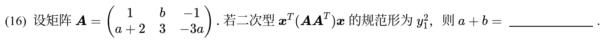
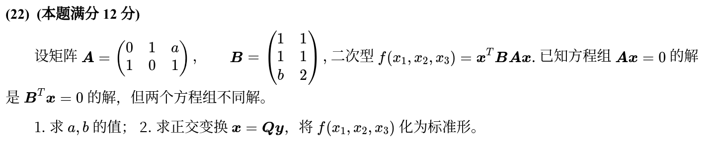
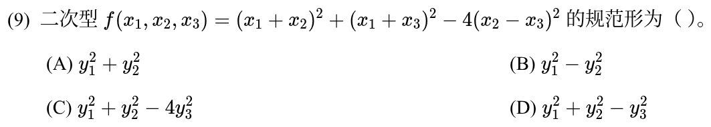
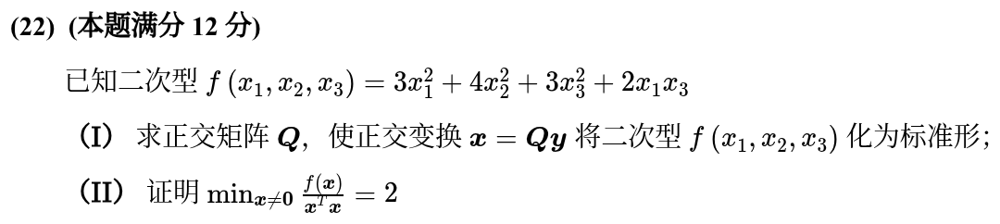
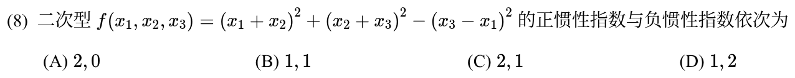
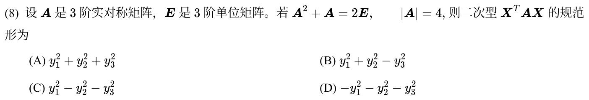
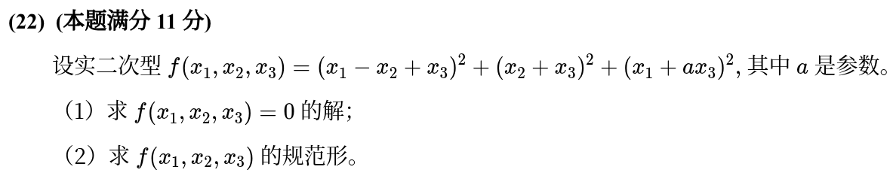
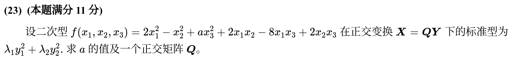
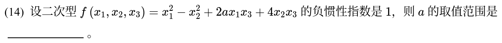
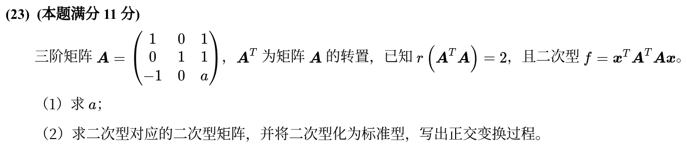

[« 特征值、特征向量与相似](05-eigenvalues-similarity.md)　　[函数极限与无穷小 »](../calculus/01-limits.md)

# 线性代数 · 二次型

> **本章共 16 题**
> 
> - **核心必做（建议按顺序攻克关键方法）**：  
>   [第 06 题](#q06)（正负惯性指数） → [第 08 题](#q08)（特征值符号与规范形） → [第 05 题](#q05)（正交化标准形及最小值） → [第 01 题](#q01)（平方和矩阵的秩）
> 
> - **分流与刷题建议**：  
>   - **较难挑战**：[第 02 题](#q02)（区分合同与正交相似）  
>   - **重在看思路**：[第 03 题](#q03)（非对称乘积先取对称部分）  
>   - **首轮可跳过**：[第 07 题](#q07)、[第 14 题](#q14)（技巧较偏或综合度高，首轮不必死磕）  
> 
> - **过关目标**：分清标准形与规范形；正交变换的列向量须正交且单位化。

---

### 01 · 2026年

> *规范形与惯性指数填空。规范形为 $y_1^2$ 说明正惯性指数为 1，负惯性指数为 0，即矩阵半正定且秩为 1。由所有 2 阶子式为 0 列方程定 $a, b$。*

---

### 02 · 2025年

> *合同与正交相似大题。合同说明正负惯性指数相同，定出参数范围；第二问正交相似说明特征值完全相同，用特征值相等列方程定正交矩阵 $Q$。*

---

### 03 · 2024年

> *解空间包含与正交对角化大题。方程组不同解但解包含，得出基础解系包含关系从而定出参数；对称化二次型矩阵 $M = \frac{BA+(BA)^T}{2}$ 后正交对角化。*

---

### 04 · 2023年

---

### 05 · 2022年

> *标准二次型正交变换大题。写出实对称矩阵，求特征值与特征向量；注意如果有重特征值必须用施密特正交化，单位化后拼成正交矩阵 $Q$。*

---

### 06 · 2021年

---

### 07 · 2020年

---

### 08 · 2019年

---

### 09 · 2018年

> *完全平方式求二次型参数。写出二次型矩阵，求秩为 2 或正定条件；配方法直接观察平方项系数，比硬算特征值快得多。*

---

### 10 · 2017年

---

### 11 · 2016年

---

### 12 · 2015年

---

### 13 · 2014年

---

### 14 · 2013年

---

### 15 · 2012年

---

### 16 · 2011年

---

[« 特征值、特征向量与相似](05-eigenvalues-similarity.md)　　[函数极限与无穷小 »](../calculus/01-limits.md)
