# 线性代数 · 二次型

> 2010—2026年 · 16 道完整真题 · 年份从新到旧（2026→2010）  
> 题型分布：选择题 5 题 · 填空题 3 题 · 解答题 8 题  
> 考查范围：标准形与规范形、惯性指数、合同与正交变换

[查看对应网页版](06-quadratic-forms.html) · [返回章节总目录](../README.md)

---

## 2026年

### 01 · 2026-16 · 填空题

> *规范形与惯性指数填空。规范形为 $y_1^2$ 说明正惯性指数为 1，负惯性指数为 0，即矩阵半正定且秩为 1。由所有 2 阶子式为 0 列方程定 $a, b$。*

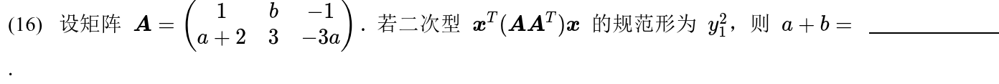

*关联章节：[向量组、线性相关与秩](03-vectors-rank.md)*

---

## 2025年

### 02 · 2025-22 · 解答题

> *合同与正交相似大题。合同说明正负惯性指数相同，定出参数范围；第二问正交相似说明特征值完全相同，用特征值相等列方程定正交矩阵 $Q$。*

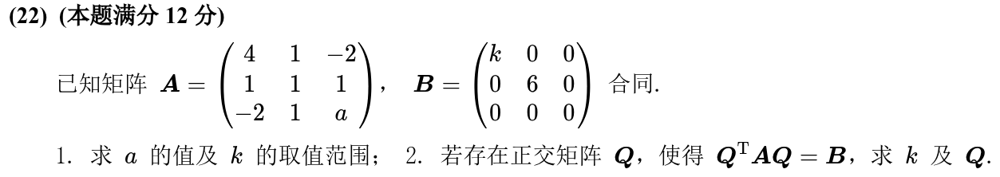

*关联章节：[特征值、特征向量与相似](05-eigenvalues-similarity.md)*

---

## 2024年

### 03 · 2024-22 · 解答题

> *解空间包含与正交对角化大题。方程组不同解但解包含，得出基础解系包含关系从而定出参数；对称化二次型矩阵 $M = \frac{BA+(BA)^T}{2}$ 后正交对角化。*

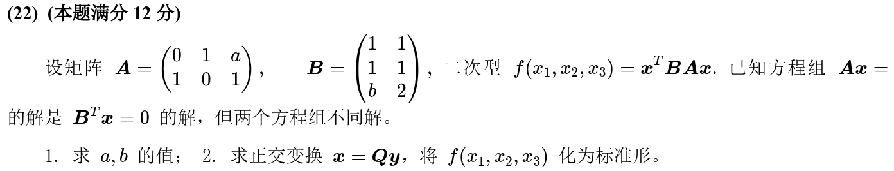

*关联章节：[线性方程组](04-linear-systems.md) · [特征值、特征向量与相似](05-eigenvalues-similarity.md)*

---

## 2023年

### 04 · 2023-09 · 选择题

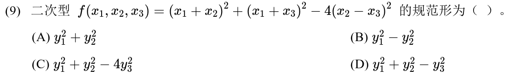

---

## 2022年

### 05 · 2022-22 · 解答题

> *标准二次型正交变换大题。写出实对称矩阵，求特征值与特征向量；注意如果有重特征值必须用施密特正交化，单位化后拼成正交矩阵 $Q$。*

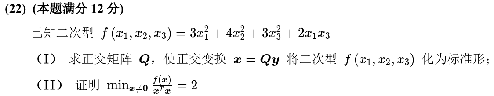

*关联章节：[特征值、特征向量与相似](05-eigenvalues-similarity.md)*

---

## 2021年

### 06 · 2021-08 · 选择题

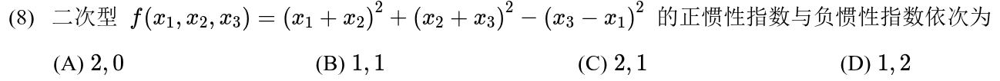

---

## 2020年

### 07 · 2020-22 · 解答题

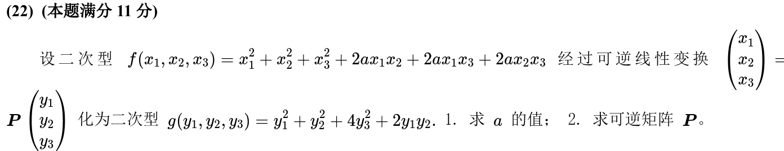

*关联章节：[特征值、特征向量与相似](05-eigenvalues-similarity.md)*

---

## 2019年

### 08 · 2019-08 · 选择题

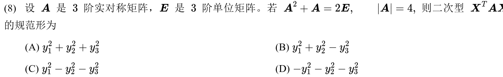

---

## 2018年

### 09 · 2018-22 · 解答题

> *完全平方式求二次型参数。写出二次型矩阵，求秩为 2 或正定条件；配方法直接观察平方项系数，比硬算特征值快得多。*

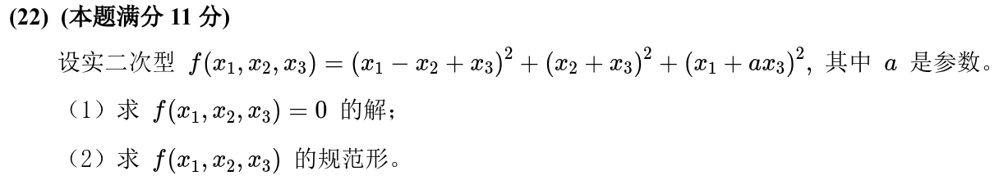

*关联章节：[线性方程组](04-linear-systems.md) · [向量组、线性相关与秩](03-vectors-rank.md)*

---

## 2017年

### 10 · 2017-23 · 解答题

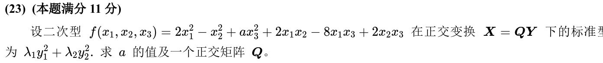

*关联章节：[特征值、特征向量与相似](05-eigenvalues-similarity.md)*

---

## 2016年

### 11 · 2016-08 · 选择题

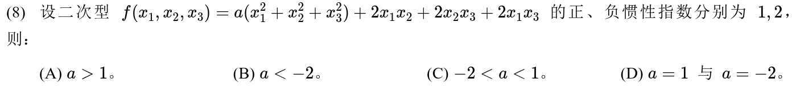

---

## 2015年

### 12 · 2015-08 · 选择题

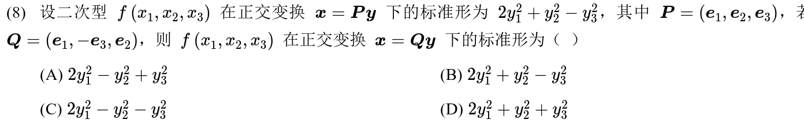

---

## 2014年

### 13 · 2014-14 · 填空题

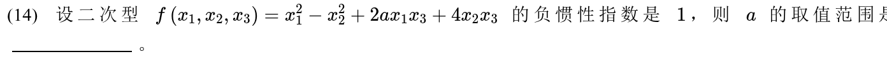

---

## 2013年

### 14 · 2013-23 · 解答题

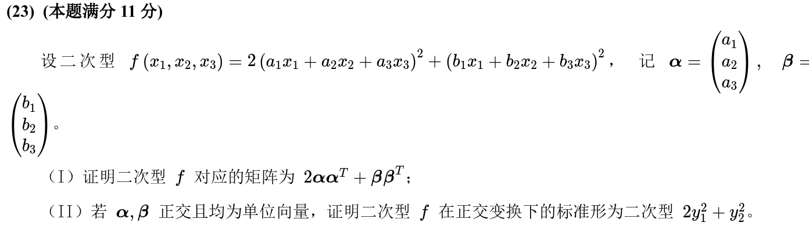

*关联章节：[向量组、线性相关与秩](03-vectors-rank.md) · [特征值、特征向量与相似](05-eigenvalues-similarity.md)*

---

## 2012年

### 15 · 2012-23 · 解答题

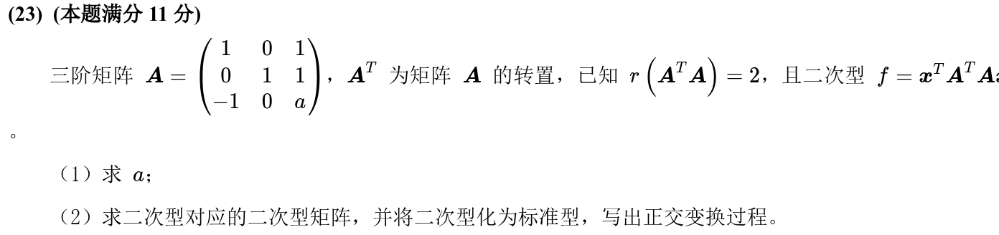

*关联章节：[向量组、线性相关与秩](03-vectors-rank.md) · [特征值、特征向量与相似](05-eigenvalues-similarity.md)*

---

## 2011年

### 16 · 2011-14 · 填空题

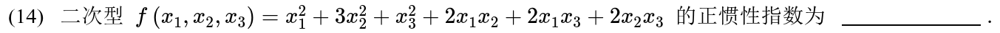

---

## 交叉考点索引

以下题目主归其他章节，点击跳转到对应章节题目；不计入本章主收录题数：

- [2025年 · 第8题](05-eigenvalues-similarity.md)（主章节：特征值、特征向量与相似）
- [2010年 · 第23题](05-eigenvalues-similarity.md)（主章节：特征值、特征向量与相似）
