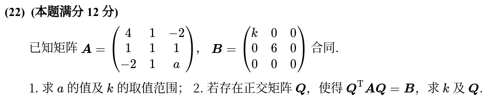
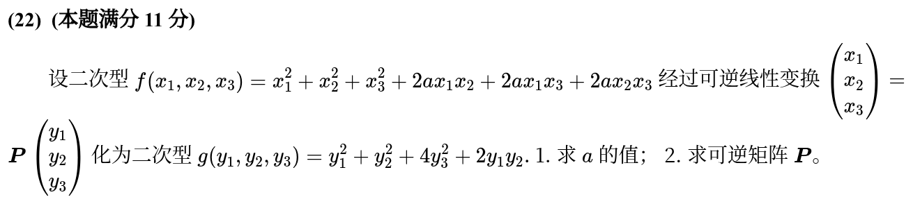
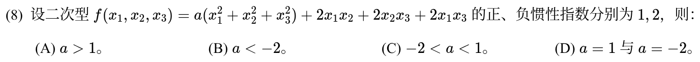
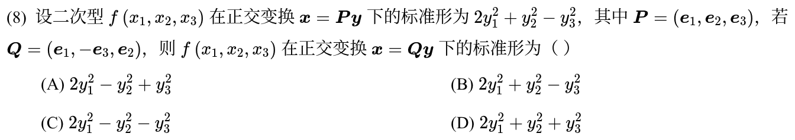
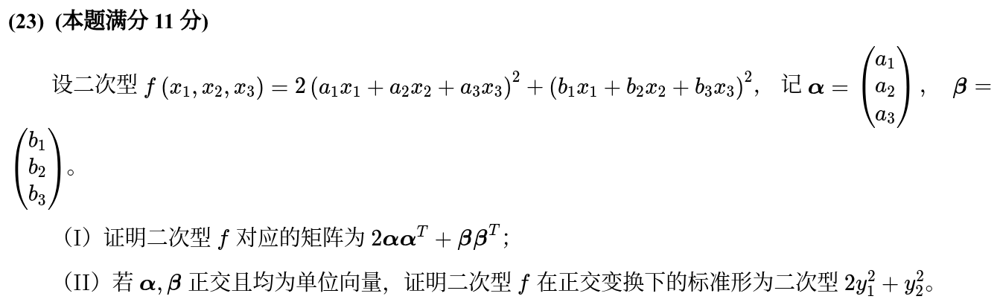

[« 特征值、特征向量与相似](05-eigenvalues-similarity.md)　　[函数极限与无穷小 »](../calculus/01-limits.md)

# 线性代数 · 二次型

> **本章共 16 题**
> 
> - **核心必做（建议按顺序攻克关键方法）**：  
>   [第 06 题](#q06)（正负惯性指数） → [第 08 题](#q08)（特征值符号与规范形） → [第 05 题](#q05)（正交化标准形及最小值） → [第 01 题](#q01)（平方和矩阵的秩）
> 
> - **分流与刷题建议**：  
>   - **较难挑战**：[第 02 题](#q02)（区分合同与正交相似）  
>   - **重在看思路**：[第 03 题](#q03)（非对称乘积先取对称部分）  
>   - **首轮可跳过**：[第 07 题](#q07)、[第 14 题](#q14)（技巧较偏或综合度高，首轮不必死磕）  
> 
> - **过关目标**：分清标准形与规范形；正交变换的列向量须正交且单位化。

---

### 01 · 2026年

> *规范形与惯性指数填空。规范形为 $y_1^2$ 说明正惯性指数为 1，负惯性指数为 0，即矩阵半正定且秩为 1。由所有 2 阶子式为 0 列方程定 $a, b$。*

答案与解析

**第一步怎么落笔**

- **触发条件**：$A$ 是 $2\times 3$ 矩阵，二次型 $\boldsymbol{x}^T(AA^T)\boldsymbol{x}$ 的规范形为 $y_1^2$。
- **第一笔**：**秒用半正定性 + 秩定理**：
  $$\boldsymbol{x}^T(AA^T)\boldsymbol{x} = \|A^T\boldsymbol{x}\|^2 \ge 0 \implies AA^T \text{ 半正定，无负特征值}.$$
  因此它的规范形为 $y_1^2$（正惯性指数 $1$、负惯性指数 $0$）当且仅当：
  $$r(AA^T) = 1 \iff r(A) = 1!$$

**完整推演**

因为 $A = \begin{pmatrix}1 & b & -1 \\ a+2 & 3 & -3a\end{pmatrix}$ 只有两行且第 1 行非零，故 $r(A)=1 \iff$ 第 2 行是第 1 行的常数倍：
$$\frac{a+2}{1} = \frac{3}{b} = \frac{-3a}{-1} = 3a.$$
1. 由 $a + 2 = 3a \implies 2a = 2 \implies a = 1$；
2. 代入 $\frac{3}{b} = 3a = 3 \implies b = 1$。
因此：
$$a + b = 1 + 1 = 2.$$

---

### 02 · 2025年

> *合同与正交相似大题。合同说明正负惯性指数相同，定出参数范围；第二问正交相似说明特征值完全相同，用特征值相等列方程定正交矩阵 $Q$。*

答案与解析

**结论速览**：（1）$a = 4,\ k > 0$；（2）$k = 3$，$Q = \begin{pmatrix} \frac{1}{\sqrt{3}} & -\frac{1}{\sqrt{2}} & \frac{1}{\sqrt{6}} \\ \frac{1}{\sqrt{3}} & 0 & -\frac{2}{\sqrt{6}} \\ \frac{1}{\sqrt{3}} & \frac{1}{\sqrt{2}} & \frac{1}{\sqrt{6}} \end{pmatrix}$（各列可独立取负号，但列次序须与 $k, 6, 0$ 一一对应）。

- **（1）求 $a$ 的值及 $k$ 的取值范围**：
  两实对称矩阵合同的充要条件是**正、负惯性指数分别相等**（特别地，秩相等）。
  1. **由 $|A|=0$ 定 $a$**：因 $B=\operatorname{diag}(k,6,0)$ 不可逆，故 $|A|=0$：
     $$|A| = \begin{vmatrix} 4 & 1 & -2 \\ 1 & 1 & 1 \\ -2 & 1 & a \end{vmatrix} = 4(a-1) - (a+2) - 2(1+2) = 3a - 12 = 0 \implies a = 4.$$
  2. **由惯性指数定 $k$ 的范围**：当 $a=4$ 时，$A$ 的一阶、二阶顺序主子式分别为
     $$\Delta_1 = 4 > 0, \qquad \Delta_2 = \begin{vmatrix} 4 & 1 \\ 1 & 1 \end{vmatrix} = 3 > 0,$$
     而 $|A|=0$，故 $A$ 的秩为 $2$ 且正惯性指数为 $2$、负惯性指数为 $0$（亦可通过特征值验证：$\lambda=3,6,0$）。
     因此 $B=\operatorname{diag}(k,6,0)$ 也必须恰有 $2$ 个正特征值与 $1$ 个零特征值，故 $k > 0$。
- **（2）求 $k$ 及正交矩阵 $Q$ 使 $Q^TAQ = B$**：
  因为 $Q$ 是正交矩阵，$Q^TAQ = Q^{-1}AQ = B$，即 $A$ 与 $B$ 不仅合同而且**相似**，故迹相等：
  $$\operatorname{tr}(A) = 4 + 1 + 4 = 9 = \operatorname{tr}(B) = k + 6 + 0 \implies k = 3.$$
  此时 $B = \operatorname{diag}(3, 6, 0)$，$A$ 的三个互异特征值为 $\lambda_1 = 3,\ \lambda_2 = 6,\ \lambda_3 = 0$。分别求解 $(\lambda_i E - A)\boldsymbol{x}=\boldsymbol{0}$：
  - $\lambda_1 = 3$：基础解系 $\boldsymbol\alpha_1 = (1, 1, 1)^T$，单位化得 $\boldsymbol\eta_1 = \frac{1}{\sqrt{3}}(1, 1, 1)^T$；
  - $\lambda_2 = 6$：基础解系 $\boldsymbol\alpha_2 = (-1, 0, 1)^T$，单位化得 $\boldsymbol\eta_2 = \frac{1}{\sqrt{2}}(-1, 0, 1)^T$；
  - $\lambda_3 = 0$：基础解系 $\boldsymbol\alpha_3 = (1, -2, 1)^T$，单位化得 $\boldsymbol\eta_3 = \frac{1}{\sqrt{6}}(1, -2, 1)^T$。
  （因特征值互异且 $A$ 实对称，三向量自动两两正交。）按 $B$ 对角元 $3, 6, 0$ 的次序拼成正交矩阵：
  $$Q = \begin{pmatrix} \frac{1}{\sqrt{3}} & -\frac{1}{\sqrt{2}} & \frac{1}{\sqrt{6}} \\ \frac{1}{\sqrt{3}} & 0 & -\frac{2}{\sqrt{6}} \\ \frac{1}{\sqrt{3}} & \frac{1}{\sqrt{2}} & \frac{1}{\sqrt{6}} \end{pmatrix}.$$
- **核心思路与避坑**：第（1）问“合同”只保正负惯性指数（得出范围 $k>0$）；第（2）问“正交合同”同时也是“相似”（得出定值 $k=3$），拼 $Q$ 时列顺序必须严格对应 $3, 6, 0$！

---

### 03 · 2024年

> *解空间包含与正交对角化大题。方程组不同解但解包含，得出基础解系包含关系从而定出参数；对称化二次型矩阵 $M = \frac{BA+(BA)^T}{2}$ 后正交对角化。*

答案与解析

- **第 1 问（串联方程组同解与秩）**：
  - $A = \begin{pmatrix}0&1&a\\1&0&1\end{pmatrix}$ 的前两列线性无关，故 $r(A)=2$，$A\boldsymbol{x}=\boldsymbol{0}$ 的解空间维数为 $3-2=1$，基础解系为 $\boldsymbol{\xi}=(-1, -a, 1)^T$。
  - 已知“$A\boldsymbol{x}=\boldsymbol{0}$ 的解均为 $B^T\boldsymbol{x}=\boldsymbol{0}$ 的解，但不同解”，说明 $B^T\boldsymbol{x}=\boldsymbol{0}$ 的解空间严格大于 $1$ 维 $\implies 3 - r(B^T) > 1 \implies r(B^T) = 1$。
  - 看 $B^T = \begin{pmatrix}1&1&b\\1&1&2\end{pmatrix}$：$r(B^T)=1 \iff$ **$b = 2$**。
  - 再把 $\boldsymbol{\xi}=(-1,-a,1)^T$ 代入 $B^T\boldsymbol{\xi}=\boldsymbol{0}$：$-1 - a + 2 = 0 \implies$ **$a = 1$**。
- **第 2 问（秩 1 实对称矩阵秒杀正交对角化！）**：
  - 代入 $a=1, b=2$，算得 $BA = \begin{pmatrix}1&1\\1&1\\2&2\end{pmatrix}\begin{pmatrix}0&1&1\\1&0&1\end{pmatrix} = \begin{pmatrix}1&1&2\\1&1&2\\2&2&4\end{pmatrix} = \begin{pmatrix}1\\1\\2\end{pmatrix}(1, 1, 2)$。
  - 注意 $BA$ **恰好是对称矩阵**，且秩为 $1$！因此特征值直接读出：$\lambda_1 = \operatorname{tr}(BA) = 1+1+4 = 6$，$\lambda_2 = \lambda_3 = 0$。
  - $\lambda_1=6$ 的单位特征向量：$\boldsymbol{q}_1 = \frac{1}{\sqrt{6}}(1, 1, 2)^T$；
  - $\lambda_2=\lambda_3=0$ 解 $x_1+x_2+2x_3=0$，取正交基础解系 $(1,-1,0)^T$ 与 $(1,1,-1)^T$（验证内积全为 $0$！），单位化得 $\boldsymbol{q}_2 = \frac{1}{\sqrt{2}}(1,-1,0)^T$，$\boldsymbol{q}_3 = \frac{1}{\sqrt{3}}(1,1,-1)^T$。
  - 拼出正交矩阵 $Q = \begin{pmatrix}\frac{1}{\sqrt{6}}&\frac{1}{\sqrt{2}}&\frac{1}{\sqrt{3}}\\\frac{1}{\sqrt{6}}&-\frac{1}{\sqrt{2}}&\frac{1}{\sqrt{3}}\\\frac{2}{\sqrt{6}}&0&-\frac{1}{\sqrt{3}}\end{pmatrix}$，在 $\boldsymbol{x}=Q\boldsymbol{y}$ 下标准形为 **$f = 6y_1^2$**。

---

### 04 · 2023年

答案与解析

- **第一笔避坑**：先查三个平方里的线性形式 $x_1+x_2,\ x_1+x_3,\ x_2-x_3$——立见 $(x_1+x_2)-(x_1+x_3)=x_2-x_3$，**线性相关**！直接排除（C）（D）！
- **降维定惯性指数**：作可逆变换 $y_1 = x_1+x_2,\ y_2 = x_1+x_3,\ y_3 = x_3$，则 $x_2-x_3 = y_1-y_2$，代入得
  $$f = y_1^2 + y_2^2 - 4(y_1-y_2)^2 = -3y_1^2 + 8y_1y_2 - 3y_2^2.$$
  对应 2 阶对称阵 $\begin{pmatrix}-3&4\\4&-3\end{pmatrix}$ 的行列式为 $(-3)(-3)-4^2 = -7 < 0$，故两特征值一正一负（$p=1, q=1$），规范形为 **$y_1^2 - y_2^2$**。
- **答案**：**（B）**。

---

### 05 · 2022年

> *标准二次型正交变换大题。写出实对称矩阵，求特征值与特征向量；注意如果有重特征值必须用施密特正交化，单位化后拼成正交矩阵 $Q$。*

答案与解析

**第（I）问：求正交矩阵 $Q$ 将 $f$ 化为标准形**

1. **写出二次型矩阵**（注意 $2x_1x_3$ 的系数 $2$ 均分到 $(1,3)$ 和 $(3,1)$ 元，各为 $1$）：
   $$A = \begin{pmatrix}3 & 0 & 1 \\ 0 & 4 & 0 \\ 1 & 0 & 3\end{pmatrix}.$$
2. **求特征值**（按第 2 行直接展开）：
   $$|\lambda E - A| = (\lambda - 4)\begin{vmatrix}\lambda-3 & -1 \\ -1 & \lambda-3\end{vmatrix} = (\lambda - 4)\big((\lambda-3)^2 - 1\big) = (\lambda - 4)^2(\lambda - 2) = 0.$$
   得特征值 $\lambda_1 = 2,\ \lambda_2 = \lambda_3 = 4$（验算：$\operatorname{tr}(A)=10=2+4+4$）。
3. **求特征向量并正交化、单位化**：
   - 当 $\lambda_1 = 2$ 时：$2E - A = \begin{pmatrix}-1&0&-1\\0&-2&0\\-1&0&-1\end{pmatrix} \to \begin{pmatrix}1&0&1\\0&1&0\\0&0&0\end{pmatrix}$，得特征向量 $\boldsymbol{\alpha}_1 = (1, 0, -1)^T$。
     单位化得 $\boldsymbol{q}_1 = \frac{1}{\sqrt{2}}(1, 0, -1)^T$。
   - 当 $\lambda_2 = \lambda_3 = 4$ 时：$4E - A = \begin{pmatrix}1&0&-1\\0&0&0\\-1&0&1\end{pmatrix} \to \begin{pmatrix}1&0&-1\\0&0&0\\0&0&0\end{pmatrix}$，得两个线性无关特征向量 $\boldsymbol{\alpha}_2 = (0, 1, 0)^T$，$\boldsymbol{\alpha}_3 = (1, 0, 1)^T$。
     **检查正交性**：$\boldsymbol{\alpha}_2^T \boldsymbol{\alpha}_3 = 0$，**已经正交**，无需再做施密特正交化！
     单位化得 $\boldsymbol{q}_2 = (0, 1, 0)^T$，$\boldsymbol{q}_3 = \frac{1}{\sqrt{2}}(1, 0, 1)^T$。
4. **拼出正交矩阵 $Q$**：
   $$Q = (\boldsymbol{q}_1,\ \boldsymbol{q}_2,\ \boldsymbol{q}_3) = \begin{pmatrix}\frac{1}{\sqrt{2}} & 0 & \frac{1}{\sqrt{2}} \\ 0 & 1 & 0 \\ -\frac{1}{\sqrt{2}} & 0 & \frac{1}{\sqrt{2}}\end{pmatrix}.$$
   在正交变换 $\boldsymbol{x} = Q\boldsymbol{y}$ 下，二次型化为标准形：
   $$f = 2y_1^2 + 4y_2^2 + 4y_3^2.$$

**第（II）问：证明 $\min_{\boldsymbol{x}\neq\boldsymbol{0}} \frac{f(\boldsymbol{x})}{\boldsymbol{x}^T\boldsymbol{x}} = 2$**

1. **利用正交变换保内积给出下界**：
   作第（I）问中的正交变换 $\boldsymbol{x} = Q\boldsymbol{y}$。因为 $Q$ 是正交矩阵（$Q^T Q = E$），故 $\boldsymbol{x}\neq\boldsymbol{0} \iff \boldsymbol{y}\neq\boldsymbol{0}$，且
   $$\boldsymbol{x}^T\boldsymbol{x} = (Q\boldsymbol{y})^T(Q\boldsymbol{y}) = \boldsymbol{y}^T(Q^T Q)\boldsymbol{y} = \boldsymbol{y}^T\boldsymbol{y} = y_1^2 + y_2^2 + y_3^2 > 0.$$
   因此对一切 $\boldsymbol{x}\neq\boldsymbol{0}$，有
   $$\frac{f(\boldsymbol{x})}{\boldsymbol{x}^T\boldsymbol{x}} = \frac{2y_1^2 + 4y_2^2 + 4y_3^2}{y_1^2 + y_2^2 + y_3^2} \ge \frac{2(y_1^2 + y_2^2 + y_3^2)}{y_1^2 + y_2^2 + y_3^2} = 2.$$
2. **证明等号可以取到（得分关键步！）**：
   取 $\boldsymbol{y}_0 = (1, 0, 0)^T$，即取 $\boldsymbol{x}_0 = Q\boldsymbol{y}_0 = \frac{1}{\sqrt{2}}(1, 0, -1)^T \neq \boldsymbol{0}$，代入得
   $$\frac{f(\boldsymbol{x}_0)}{\boldsymbol{x}_0^T\boldsymbol{x}_0} = \frac{2\cdot 1^2 + 0 + 0}{1^2 + 0 + 0} = 2.$$
   综上，必有 $\min_{\boldsymbol{x}\neq\boldsymbol{0}} \frac{f(\boldsymbol{x})}{\boldsymbol{x}^T\boldsymbol{x}} = 2$。

---

### 06 · 2021年

答案与解析

**第一步怎么落笔**

- **触发条件**：二次型已经写成三个平方项的代数和 $(x_1+x_2)^2 + (x_2+x_3)^2 - (x_3-x_1)^2$。
- **第一笔**：**先查三个线性形式的关系**！一眼看出：
  $$(x_2 + x_3) - (x_1 + x_2) = x_3 - x_1.$$
  三个线性形式**线性相关**！绝对不能直接令 $y_1=x_1+x_2,\ y_2=x_2+x_3,\ y_3=x_3-x_1$（变换矩阵不可逆）！

**完整推演**

1. **做合法可逆线性变换降维**：
   令 $y_1 = x_1 + x_2,\ y_2 = x_2 + x_3,\ y_3 = x_3$（变换矩阵 $\begin{pmatrix}1&1&0\\0&1&1\\0&0&1\end{pmatrix}$ 上三角且行列式为 $1\neq 0$，**可逆**！），则 $x_3 - x_1 = y_2 - y_1$。代入原二次型：
   $$f = y_1^2 + y_2^2 - (y_2 - y_1)^2 = y_1^2 + y_2^2 - (y_2^2 - 2y_1 y_2 + y_1^2) = 2y_1 y_2.$$
2. **对 $2y_1 y_2$ 配方**：
   再作可逆变换 $y_1 = z_1 + z_2,\ y_2 = z_1 - z_2,\ y_3 = z_3$，得
   $$f = 2(z_1 + z_2)(z_1 - z_2) = 2z_1^2 - 2z_2^2.$$
   因此正惯性指数 $p = 1$，负惯性指数 $q = 1$，选 **（B）**。

> **双保险验算（矩阵法）**：展开得 $f = 2x_2^2 + 2x_1x_2 + 2x_1x_3 + 2x_2x_3$，矩阵 $A = \begin{pmatrix}0&1&1\\1&2&1\\1&1&0\end{pmatrix}$。易见第 1 行 + 第 3 行 = 第 2 行 $\implies |A|=0$（必有特征值 $0$，$p+q\le 2$），且左上 2 阶主子式 $\begin{vmatrix}0&1\\1&2\end{vmatrix} = -1 < 0 \implies$ 必一正一负，立刻得 $p=1, q=1$！

**选择题关键干扰项拆解**

- **（C）$2, 1$（头号陷阱！）**：没检查变换可逆性，看到题干里“两个正平方、一个负平方”就直接填 $p=2, q=1$。
- **（A）$2, 0$** 与 **（D）$1, 2$**：展开或配方法算错符号。

---

### 07 · 2020年

答案与解析

**结论速览**：（1）$a = -\dfrac{1}{2}$；（2）可取 $P = \begin{pmatrix} 1 & 2 & \frac{2}{\sqrt{3}} \\ 0 & 1 & \frac{4}{\sqrt{3}} \\ 0 & 1 & 0 \end{pmatrix}$（不唯一，验证 $|P|\ne 0$ 且 $P^TAP=B$ 即可）。

- **（1）求 $a$ 的值**：
  两二次型经可逆线性变换互相转化，等价于它们的矩阵**合同**，故正、负惯性指数必分别相等。
  1. **求 $g$ 的惯性指数**：将 $g$ 配方：
     $$g(y_1, y_2, y_3) = (y_1 + y_2)^2 + 4y_3^2,$$
     显然其正惯性指数 $p = 2$，负惯性指数 $q = 0$，秩为 $2$。
  2. **求 $f$ 的特征值并定 $a$**：$f$ 的二次型矩阵为
     $$A = \begin{pmatrix} 1 & a & a \\ a & 1 & a \\ a & a & 1 \end{pmatrix},$$
     其特征多项式为 $|\lambda E - A| = (\lambda - (1+2a))(\lambda - (1-a))^2$，故特征值为 $\lambda_1 = 1 + 2a,\ \lambda_2 = \lambda_3 = 1 - a$。
     要使 $A$ 恰有 $2$ 个正特征值与 $1$ 个零特征值：
     - 若 $1 - a = 0$（即 $a=1$），则零特征值为二重，秩为 $1 \ne 2$，舍去；
     - 故必有 $1 + 2a = 0$ 且 $1 - a > 0$，解得 $a = -\dfrac{1}{2}$（此时特征值为 $0, \frac{3}{2}, \frac{3}{2}$，正惯性指数为 $2$、负惯性指数为 $0$，符合题意）。
- **（2）求可逆矩阵 $P$**（配方法直出，最简无冗余）：
  将 $a = -\frac{1}{2}$ 代入 $f$ 并配方：
  $$f(x_1, x_2, x_3) = x_1^2 + x_2^2 + x_3^2 - x_1x_2 - x_1x_3 - x_2x_3 = \left(x_1 - \frac{1}{2}x_2 - \frac{1}{2}x_3\right)^2 + \frac{3}{4}(x_2 - x_3)^2.$$
  对照 $g(y_1, y_2, y_3) = (y_1 + y_2)^2 + (2y_3)^2$，令两个平方项直接对应相等，并补第三个独立线性方程 $x_3 = y_2$：
  $$\begin{cases} x_1 - \dfrac{1}{2}x_2 - \dfrac{1}{2}x_3 = y_1 + y_2, \\[0.4em] \dfrac{\sqrt{3}}{2}(x_2 - x_3) = 2y_3, \\[0.4em] x_3 = y_2. \end{cases}$$
  从下往上反解出 $x_1, x_2, x_3$：
  $$\begin{cases} x_1 = y_1 + 2y_2 + \dfrac{2}{\sqrt{3}}y_3, \\[0.4em] x_2 = y_2 + \dfrac{4}{\sqrt{3}}y_3, \\[0.4em] x_3 = y_2. \end{cases}$$
  故可逆矩阵可取
  $$P = \begin{pmatrix} 1 & 2 & \frac{2}{\sqrt{3}} \\ 0 & 1 & \frac{4}{\sqrt{3}} \\ 0 & 1 & 0 \end{pmatrix},$$
  检验 $|P| = -\frac{4}{\sqrt{3}} \ne 0$，确为可逆矩阵且将 $f$ 化为 $g$。
- **核心思路与避坑**：题目只要求“**可逆**线性变换”而非“正交变换”，用配方法把 $f$ 和 $g$ 都化成平方和再直接对齐，比先求正交矩阵再拼过渡矩阵省一半时间且不易算错；最后务必验证 $|P| \ne 0$。

---

### 08 · 2019年

答案与解析

**第一步怎么落笔**

- **触发条件**：$A$ 为 3 阶实对称矩阵，满足 $A^2 + A = 2E$ 且 $|A| = 4$。
- **第一笔**：设 $\lambda$ 为 $A$ 的任一特征值，则 $\lambda$ 必满足矩阵方程对应的代数方程：
  $$\lambda^2 + \lambda - 2 = 0 \implies (\lambda + 2)(\lambda - 1) = 0 \implies \lambda \in \{1,\ -2\}.$$

**完整推演**

1. **用 $|A|=4$ 锁死三个特征值的重数**：
   $A$ 是 3 阶实对称矩阵，必有 3 个实特征值 $\lambda_1, \lambda_2, \lambda_3 \in \{1, -2\}$，且满足
   $$\lambda_1 \lambda_2 \lambda_3 = |A| = 4.$$
   检验所有可能组合：
   - $(1, 1, 1) \implies$ 乘积 $1 \neq 4$；
   - $(1, 1, -2) \implies$ 乘积 $-2 \neq 4$；
   - $(1, -2, -2) \implies$ 乘积 $1\times(-2)\times(-2) = 4$（**唯一满足！**）；
   - $(-2, -2, -2) \implies$ 乘积 $-8 \neq 4$。
2. **直接读出规范形**：
   三个特征值为 $1, -2, -2$，有 **1 个正特征值、2 个负特征值**（$p=1, q=2$），故二次型 $\boldsymbol{X}^T A\boldsymbol{X}$ 的规范形为
   $$y_1^2 - y_2^2 - y_3^2.$$
   应选 **（C）**。

**选择题关键干扰项拆解**

- **（A）$y_1^2+y_2^2+y_3^2$**：只看到 $|A|=4>0$ 就误以为 $A$ 正定！注意 $|A|>0$ 只能说明**负特征值有偶数个**（0 个或 2 个），不能推出正定。
- **（B）$y_1^2+y_2^2-y_3^2$** 与 **（D）$-y_1^2-y_2^2-y_3^2$**：负特征值个数为奇数，此时 $|A|<0$，与 $|A|=4>0$ 直接矛盾，可一眼秒杀排除！

---

### 09 · 2018年

> *完全平方式求二次型参数。写出二次型矩阵，求秩为 2 或正定条件；配方法直接观察平方项系数，比硬算特征值快得多。*

答案与解析

**结论速览**：（1）当 $a \ne 2$ 时，只有零解 $(0,0,0)^T$；当 $a = 2$ 时，全部解为 $k(-2, -1, 1)^T$（$k \in \mathbb{R}$）；（2）当 $a \ne 2$ 时，规范形为 $y_1^2 + y_2^2 + y_3^2$；当 $a = 2$ 时，规范形为 $y_1^2 + y_2^2$。

- **（1）求 $f(x_1, x_2, x_3) = 0$ 的解**：
  因为 $f$ 是三个实数平方之和，所以 $f(x_1, x_2, x_3) = 0$ 当且仅当三个括号同时为零，即求解齐次线性方程组
  $$\begin{cases} x_1 - x_2 + x_3 = 0, \\ x_2 + x_3 = 0, \\ x_1 + ax_3 = 0. \end{cases}$$
  对系数矩阵 $C$ 做初等行变换（或先算行列式）：
  $$C = \begin{pmatrix} 1 & -1 & 1 \\ 0 & 1 & 1 \\ 1 & 0 & a \end{pmatrix} \xrightarrow{r_3-r_1} \begin{pmatrix} 1 & -1 & 1 \\ 0 & 1 & 1 \\ 0 & 1 & a-1 \end{pmatrix} \xrightarrow[r_1+r_2]{r_3-r_2} \begin{pmatrix} 1 & 0 & 2 \\ 0 & 1 & 1 \\ 0 & 0 & a-2 \end{pmatrix}.$$
  - 当 $a \ne 2$ 时，$r(C) = 3$，方程组只有零解：$(x_1, x_2, x_3)^T = (0, 0, 0)^T$；
  - 当 $a = 2$ 时，$r(C) = 2$，由 $x_1 = -2x_3,\ x_2 = -x_3$ 得通解：$(x_1, x_2, x_3)^T = k(-2, -1, 1)^T$（$k \in \mathbb{R}$）。
- **（2）求 $f(x_1, x_2, x_3)$ 的规范形**：
  二次型可写成 $f(\boldsymbol{x}) = (C\boldsymbol{x})^T(C\boldsymbol{x}) = \boldsymbol{x}^T (C^TC) \boldsymbol{x}$，显然对一切 $\boldsymbol{x}$ 均有 $f(\boldsymbol{x}) \ge 0$（半正定，负惯性指数为 $0$），且正惯性指数等于矩阵 $C^TC$ 的秩，即 $r(C^TC) = r(C)$：
  - 当 $a \ne 2$ 时，$r(C) = 3$（可逆变换 $\boldsymbol{y} = C\boldsymbol{x}$ 直接将 $f$ 化为规范形），规范形为
    $$y_1^2 + y_2^2 + y_3^2;$$
  - 当 $a = 2$ 时，$r(C) = 2$（此时 $x_1+2x_3 = (x_1-x_2+x_3)+(x_2+x_3)$，令 $z_1=x_1-x_2+x_3,\ z_2=x_2+x_3,\ z_3=x_3$ 可逆变换得 $f = z_1^2 + z_2^2 + (z_1+z_2)^2 = 2z_1^2 + 2z_1z_2 + 2z_2^2$，正惯性指数为 $2$），规范形为
    $$y_1^2 + y_2^2.$$
- **核心思路与避坑**：切忌直接把 $f$ 展开成二次型矩阵硬算特征值！看到“平方和”形式 $f = \boldsymbol{x}^T C^TC \boldsymbol{x}$，立刻用 $r(C^TC)=r(C)$ 且负惯性指数为 $0$，瞬间同时搞定两问。

---

### 10 · 2017年

答案与解析

**结论速览**：$a = 2$；正交矩阵可取 $Q = \begin{pmatrix} \frac{1}{\sqrt{3}} & -\frac{1}{\sqrt{2}} & \frac{1}{\sqrt{6}} \\ -\frac{1}{\sqrt{3}} & 0 & \frac{2}{\sqrt{6}} \\ \frac{1}{\sqrt{3}} & \frac{1}{\sqrt{2}} & \frac{1}{\sqrt{6}} \end{pmatrix}$（对应标准形 $-3y_1^2 + 6y_2^2$；前两列可互换，各列可取负号，但零特征值对应的列必须放在第 $3$ 列）。

- **完整解答**：
  1. **写出二次型矩阵并由 $|A|=0$ 求 $a$**：
     $$A = \begin{pmatrix} 2 & 1 & -4 \\ 1 & -1 & 1 \\ -4 & 1 & a \end{pmatrix}.$$
     因为正交变换下的标准形为 $\lambda_1 y_1^2 + \lambda_2 y_2^2$（缺少 $y_3^2$ 项），说明 $\lambda_3 = 0$ 是 $A$ 的特征值，即 $|A| = 0$：
     $$|A| = \begin{vmatrix} 2 & 1 & -4 \\ 1 & -1 & 1 \\ -4 & 1 & a \end{vmatrix} = 2(-a-1) - (a+4) - 4(1-4) = -3a + 6 = 0 \implies a = 2.$$
  2. **求 $A$ 的全部特征值与特征向量**：
     将 $a = 2$ 代入 $A = \begin{pmatrix} 2 & 1 & -4 \\ 1 & -1 & 1 \\ -4 & 1 & 2 \end{pmatrix}$，计算特征多项式：
     $$|\lambda E - A| = \begin{vmatrix} \lambda-2 & -1 & 4 \\ -1 & \lambda+1 & -1 \\ 4 & -1 & \lambda-2 \end{vmatrix} \xrightarrow{c_1-c_3} \begin{vmatrix} \lambda-6 & -1 & 4 \\ 0 & \lambda+1 & -1 \\ -(\lambda-6) & -1 & \lambda-2 \end{vmatrix} \xrightarrow{r_3+r_1} (\lambda-6)\begin{vmatrix} 1 & -1 & 4 \\ 0 & \lambda+1 & -1 \\ 0 & -2 & \lambda+2 \end{vmatrix} = \lambda(\lambda - 6)(\lambda + 3).$$
     故特征值为 $\lambda_1 = -3,\ \lambda_2 = 6,\ \lambda_3 = 0$。分别求基础解系：
     - $\lambda_1 = -3$：解 $(-3E - A)\boldsymbol{x}=\boldsymbol{0}$，得 $\boldsymbol\alpha_1 = (1, -1, 1)^T$；
     - $\lambda_2 = 6$：解 $(6E - A)\boldsymbol{x}=\boldsymbol{0}$，得 $\boldsymbol\alpha_2 = (-1, 0, 1)^T$；
     - $\lambda_3 = 0$：解 $A\boldsymbol{x}=\boldsymbol{0}$，得 $\boldsymbol\alpha_3 = (1, 2, 1)^T$。
  3. **单位化并构造正交矩阵 $Q$**：
     因三个特征值互异且 $A$ 实对称，$\boldsymbol\alpha_1, \boldsymbol\alpha_2, \boldsymbol\alpha_3$ 已两两正交。分别单位化并按 $\lambda_1=-3,\ \lambda_2=6,\ \lambda_3=0$ 的顺序排列：
     $$Q = \begin{pmatrix} \frac{1}{\sqrt{3}} & -\frac{1}{\sqrt{2}} & \frac{1}{\sqrt{6}} \\ -\frac{1}{\sqrt{3}} & 0 & \frac{2}{\sqrt{6}} \\ \frac{1}{\sqrt{3}} & \frac{1}{\sqrt{2}} & \frac{1}{\sqrt{6}} \end{pmatrix},$$
     此时正交变换 $\boldsymbol{X} = Q\boldsymbol{Y}$ 将 $f$ 化为标准形 $-3y_1^2 + 6y_2^2$。
- **核心思路与避坑**：标准形为 $\lambda_1 y_1^2 + \lambda_2 y_2^2$（$y_3^2$ 系数为 $0$），因此在拼 $Q$ 时**必须把零特征值对应的单位特征向量放在第 $3$ 列**，否则变换后标准形会变成 $\lambda_1 y_1^2 + \lambda_3 y_3^2$ 而扣分。

---

### 11 · 2016年

答案与解析

**答案**：**（C）** $-2 < a < 1$

- **切入点与推演**：写出对称二次型矩阵，利用“全 $1$ 矩阵加数量阵”直接秒出全部特征值，再用正、负惯性指数定出符号不等式。
  二次型矩阵为
  $$A = \begin{pmatrix} a & 1 & 1 \\ 1 & a & 1 \\ 1 & 1 & a \end{pmatrix} = (a - 1)E + \begin{pmatrix} 1 & 1 & 1 \\ 1 & 1 & 1 \\ 1 & 1 & 1 \end{pmatrix}.$$
  因为 $3$ 阶全 $1$ 矩阵的特征值为 $3, 0, 0$，所以 $A$ 的特征值为
  $$\lambda_1 = a + 2, \qquad \lambda_2 = \lambda_3 = a - 1.$$
  题目要求正惯性指数为 $1$、负惯性指数为 $2$，即 $3$ 个特征值恰有 $1$ 正 $2$ 负。因 $\lambda_2 = \lambda_3 = a - 1$ 同号，故必为两负、$\lambda_1 = a + 2$ 为一正：
  $$\begin{cases} a + 2 > 0, \\ a - 1 < 0 \end{cases} \implies -2 < a < 1.$$
  故应选 **（C）**。
- **干扰项 / 易错提示**：端点 $a = -2$ 和 $a = 1$ 会使特征值出现 $0$（秩降为 $2$ 或 $1$），正负惯性指数之和小于 $3$，故必须取严格不等号，排除（D）。

---

### 12 · 2015年

答案与解析

**答案**：**（A）** $2y_1^2 - y_2^2 + y_3^2$

- **切入点与推演**：把正交矩阵 $P, Q$ 的各列直接解读为二次型矩阵 $A$ 的单位特征向量，按列对应关系秒出新标准形。
  由 $P = (\boldsymbol{e}_1, \boldsymbol{e}_2, \boldsymbol{e}_3)$ 且 $P^TAP = \operatorname{diag}(2, 1, -1)$，知 $\boldsymbol{e}_1, \boldsymbol{e}_2, \boldsymbol{e}_3$ 是 $A$ 分别对应特征值 $2, 1, -1$ 的两两正交单位特征向量：
  $$A\boldsymbol{e}_1 = 2\boldsymbol{e}_1, \qquad A\boldsymbol{e}_2 = \boldsymbol{e}_2, \qquad A\boldsymbol{e}_3 = -\boldsymbol{e}_3.$$
  对于新正交矩阵 $Q = (\boldsymbol{e}_1, -\boldsymbol{e}_3, \boldsymbol{e}_2)$，其三列依然是两两正交的单位特征向量，对应的特征值依次为
  $$A\boldsymbol{e}_1 = 2\boldsymbol{e}_1, \qquad A(-\boldsymbol{e}_3) = -1\cdot(-\boldsymbol{e}_3), \qquad A\boldsymbol{e}_2 = 1\cdot\boldsymbol{e}_2.$$
  因此 $Q^TAQ = \operatorname{diag}(2, -1, 1)$，即在正交变换 $\boldsymbol{x} = Q\boldsymbol{y}$ 下的标准形为
  $$2y_1^2 - y_2^2 + y_3^2,$$
  选 **（A）**。
- **干扰项 / 易错提示**：易错在看到 $-\boldsymbol{e}_3$ 里的负号而把对应系数变号——切记特征向量取负号（$-\boldsymbol{e}_3$）后**特征值不变**（平方项 $(-y_2)^2 = y_2^2$），唯一改变的是第 $2,3$ 列的先后次序。

---

### 13 · 2014年

答案与解析

**答案**：$-2 \le a \le 2$（或 $[-2, 2]$）

- **切入点与推演**：二次型缺 $x_1x_2$ 交叉项，直接对 $x_1, x_2$ 各自配方法最快，立刻读出三个平方项系数。
  $$f(x_1, x_2, x_3) = (x_1^2 + 2ax_1x_3) - (x_2^2 - 4x_2x_3) = (x_1 + ax_3)^2 - a^2x_3^2 - (x_2 - 2x_3)^2 + 4x_3^2$$
  $$= (x_1 + ax_3)^2 - (x_2 - 2x_3)^2 + (4 - a^2)x_3^2.$$
  作可逆线性变换 $y_1 = x_1 + ax_3,\ y_2 = x_2 - 2x_3,\ y_3 = x_3$，得标准形
  $$f = y_1^2 - y_2^2 + (4 - a^2)y_3^2.$$
  前两项系数已为一正（$+1$）一负（$-1$），要使负惯性指数恰好为 $1$，第 $3$ 项系数不能为负，即
  $$4 - a^2 \ge 0 \implies -2 \le a \le 2.$$
- **易错点**：切忌丢掉等号！当 $4 - a^2 = 0$（即 $a = \pm 2$）时标准形为 $y_1^2 - y_2^2$，负惯性指数仍为 $1$（题目未要求二次型满秩）。

---

### 14 · 2013年

答案与解析

**结论速览**：（I）用 $(\boldsymbol\alpha^T\boldsymbol{x})^2 = \boldsymbol{x}^T\boldsymbol\alpha\boldsymbol\alpha^T\boldsymbol{x}$ 直接化出对称矩阵；（II）将 $\boldsymbol\alpha, \boldsymbol\beta$ 扩充为 $\mathbb{R}^3$ 的标准正交基构成正交矩阵 $Q = (\boldsymbol\alpha, \boldsymbol\beta, \boldsymbol\gamma)$，即得 $Q^TAQ = \operatorname{diag}(2, 1, 0)$。

- **（I）证明二次型 $f$ 对应的矩阵为 $2\boldsymbol\alpha\boldsymbol\alpha^T + \boldsymbol\beta\boldsymbol\beta^T$**：
  令 $\boldsymbol{x} = (x_1, x_2, x_3)^T$，则 $a_1x_1 + a_2x_2 + a_3x_3 = \boldsymbol\alpha^T\boldsymbol{x} = \boldsymbol{x}^T\boldsymbol\alpha$，$b_1x_1 + b_2x_2 + b_3x_3 = \boldsymbol\beta^T\boldsymbol{x} = \boldsymbol{x}^T\boldsymbol\beta$。于是
  $$f(x_1, x_2, x_3) = 2(\boldsymbol\alpha^T\boldsymbol{x})^2 + (\boldsymbol\beta^T\boldsymbol{x})^2 = 2(\boldsymbol{x}^T\boldsymbol\alpha)(\boldsymbol\alpha^T\boldsymbol{x}) + (\boldsymbol{x}^T\boldsymbol\beta)(\boldsymbol\beta^T\boldsymbol{x}) = \boldsymbol{x}^T(2\boldsymbol\alpha\boldsymbol\alpha^T + \boldsymbol\beta\boldsymbol\beta^T)\boldsymbol{x}.$$
  又因为 $(2\boldsymbol\alpha\boldsymbol\alpha^T + \boldsymbol\beta\boldsymbol\beta^T)^T = 2(\boldsymbol\alpha^T)^T\boldsymbol\alpha^T + (\boldsymbol\beta^T)^T\boldsymbol\beta^T = 2\boldsymbol\alpha\boldsymbol\alpha^T + \boldsymbol\beta\boldsymbol\beta^T$ 是实对称矩阵，由二次型与实对称矩阵的一一对应关系，二次型 $f$ 对应的矩阵恰为 $A = 2\boldsymbol\alpha\boldsymbol\alpha^T + \boldsymbol\beta\boldsymbol\beta^T$。
- **（II）证明 $f$ 在正交变换下的标准形为 $2y_1^2 + y_2^2$**：
  已知 $\boldsymbol\alpha, \boldsymbol\beta$ 是 $\mathbb{R}^3$ 中正交的单位向量（即 $\boldsymbol\alpha^T\boldsymbol\alpha = \boldsymbol\beta^T\boldsymbol\beta = 1,\ \boldsymbol\alpha^T\boldsymbol\beta = 0$）。
  取非零向量 $\boldsymbol\gamma$ 同时正交于 $\boldsymbol\alpha, \boldsymbol\beta$（即解齐次方程组 $\begin{pmatrix}\boldsymbol\alpha^T \\ \boldsymbol\beta^T\end{pmatrix}\boldsymbol{x} = \boldsymbol{0}$ 得非零解）并将其单位化，使 $\boldsymbol\alpha, \boldsymbol\beta, \boldsymbol\gamma$ 成为 $\mathbb{R}^3$ 的一组标准正交基，记正交矩阵
  $$Q = (\boldsymbol\alpha, \boldsymbol\beta, \boldsymbol\gamma).$$
  作正交变换 $\boldsymbol{x} = Q\boldsymbol{y} = y_1\boldsymbol\alpha + y_2\boldsymbol\beta + y_3\boldsymbol\gamma$，计算内积：
  $$\boldsymbol\alpha^T\boldsymbol{x} = y_1(\boldsymbol\alpha^T\boldsymbol\alpha) + y_2(\boldsymbol\alpha^T\boldsymbol\beta) + y_3(\boldsymbol\alpha^T\boldsymbol\gamma) = y_1,$$
  $$\boldsymbol\beta^T\boldsymbol{x} = y_1(\boldsymbol\beta^T\boldsymbol\alpha) + y_2(\boldsymbol\beta^T\boldsymbol\beta) + y_3(\boldsymbol\beta^T\boldsymbol\gamma) = y_2.$$
  代入 $f$ 即得
  $$f = 2(\boldsymbol\alpha^T\boldsymbol{x})^2 + (\boldsymbol\beta^T\boldsymbol{x})^2 = 2y_1^2 + y_2^2.$$
  （亦可直接算 $A\boldsymbol\alpha=2\boldsymbol\alpha,\ A\boldsymbol\beta=\boldsymbol\beta,\ A\boldsymbol\gamma=\boldsymbol{0}$，得 $Q^TAQ=\operatorname{diag}(2,1,0)$，结论相同。）
- **核心思路与避坑**：第（I）问证明完 $f = \boldsymbol{x}^T A \boldsymbol{x}$ 后，务必补一句 **$A^T = A$（对称性）**，这是考研阅卷的标准得分点！第（II）问也可直接用特征值法（验证 $A\boldsymbol\alpha=2\boldsymbol\alpha,\ A\boldsymbol\beta=\boldsymbol\beta$ 且 $r(A)\le 2$ 得特征值为 $2,1,0$）。

---

### 15 · 2012年

答案与解析

**结论速览**：（1）$a = -1$；（2）二次型矩阵 $B = A^TA = \begin{pmatrix} 2 & 0 & 2 \\ 0 & 1 & 1 \\ 2 & 1 & 3 \end{pmatrix}$，正交变换 $\boldsymbol{x} = Q\boldsymbol{y}$ 将 $f$ 化为标准形 $(3-\sqrt{3})y_1^2 + (3+\sqrt{3})y_2^2$。

- **（1）求 $a$**：
  因为 $A$ 为实矩阵，恒有 $r(A^TA) = r(A)$（由 $A^TA\boldsymbol{x}=\boldsymbol{0} \iff \|A\boldsymbol{x}\|^2 = 0 \iff A\boldsymbol{x}=\boldsymbol{0}$ 得两齐次方程组同解）。
  已知 $r(A^TA) = 2$，故 $r(A) = 2 < 3$，必有 $|A| = 0$：
  $$|A| = \begin{vmatrix} 1 & 0 & 1 \\ 0 & 1 & 1 \\ -1 & 0 & a \end{vmatrix} = 1\cdot(a + 1) = a + 1 = 0 \implies a = -1.$$
  （检验：$a=-1$ 时，$A$ 左上角 $2$ 阶子式为 $1 \ne 0$，故 $r(A)=2$，符合题意。）
- **（2）求二次型矩阵及正交变换化标准形**：
  1. **求二次型矩阵 $B = A^TA$**：
     $$B = A^TA = \begin{pmatrix} 1 & 0 & -1 \\ 0 & 1 & 0 \\ 1 & 1 & -1 \end{pmatrix}\begin{pmatrix} 1 & 0 & 1 \\ 0 & 1 & 1 \\ -1 & 0 & -1 \end{pmatrix} = \begin{pmatrix} 2 & 0 & 2 \\ 0 & 1 & 1 \\ 2 & 1 & 3 \end{pmatrix}.$$
  2. **求 $B$ 的特征值**：
     $$|\lambda E - B| = \begin{vmatrix} \lambda-2 & 0 & -2 \\ 0 & \lambda-1 & -1 \\ -2 & -1 & \lambda-3 \end{vmatrix} = (\lambda-2)\bigl[(\lambda-1)(\lambda-3) - 1\bigr] - 4(\lambda-1) = \lambda(\lambda^2 - 6\lambda + 6).$$
     解得特征值为 $\lambda_1 = 3 - \sqrt{3},\ \lambda_2 = 3 + \sqrt{3},\ \lambda_3 = 0$。
  3. **求各特征值对应的特征向量并单位化**：
     - 对 $\lambda_1 = 3 - \sqrt{3}$：解 $(\lambda_1 E - B)\boldsymbol{x}=\boldsymbol{0}$，由 $(1-\sqrt{3})x_1 - 2x_3 = 0$ 与 $(2-\sqrt{3})x_2 - x_3 = 0$，取 $x_3 = 1$ 得
       $$\boldsymbol\alpha_1 = \begin{pmatrix} -1-\sqrt{3} \\ 2+\sqrt{3} \\ 1 \end{pmatrix}, \qquad \|\boldsymbol\alpha_1\| = \sqrt{12 + 6\sqrt{3}} = \sqrt{3}(1 + \sqrt{3}), \qquad \boldsymbol\eta_1 = \frac{\boldsymbol\alpha_1}{\sqrt{12+6\sqrt{3}}};$$
     - 对 $\lambda_2 = 3 + \sqrt{3}$：同理取 $x_3 = 1$ 得
       $$\boldsymbol\alpha_2 = \begin{pmatrix} -1+\sqrt{3} \\ 2-\sqrt{3} \\ 1 \end{pmatrix}, \qquad \|\boldsymbol\alpha_2\| = \sqrt{12 - 6\sqrt{3}} = \sqrt{3}(\sqrt{3} - 1), \qquad \boldsymbol\eta_2 = \frac{\boldsymbol\alpha_2}{\sqrt{12-6\sqrt{3}}};$$
     - 对 $\lambda_3 = 0$：解 $B\boldsymbol{x}=\boldsymbol{0}$（等价于 $A\boldsymbol{x}=\boldsymbol{0}$），得
       $$\boldsymbol\alpha_3 = \begin{pmatrix} -1 \\ -1 \\ 1 \end{pmatrix}, \qquad \boldsymbol\eta_3 = \frac{1}{\sqrt{3}}\begin{pmatrix} -1 \\ -1 \\ 1 \end{pmatrix}.$$
  4. **写出正交变换与标准形**：
     因特征值互异，$\boldsymbol\eta_1, \boldsymbol\eta_2, \boldsymbol\eta_3$ 自动两两正交。令正交矩阵 $Q = (\boldsymbol\eta_1, \boldsymbol\eta_2, \boldsymbol\eta_3)$，则正交变换 $\boldsymbol{x} = Q\boldsymbol{y}$ 将二次型化为标准形
     $$f = (3 - \sqrt{3})y_1^2 + (3 + \sqrt{3})y_2^2.$$
- **核心思路与避坑**：本题特征值含根号 $\sqrt{3}$，考场化简 $\|\boldsymbol\alpha_{1,2}\|$ 时注意 $12 \pm 6\sqrt{3} = 3(4 \pm 2\sqrt{3}) = 3(\sqrt{3} \pm 1)^2$，可大幅化简最终表达式；求 $\lambda_3=0$ 的特征向量直接解 $A\boldsymbol{x}=\boldsymbol{0}$ 比解 $A^TA\boldsymbol{x}=\boldsymbol{0}$ 更省力。

---

### 16 · 2011年

答案与解析

**答案**：$2$

- **切入点与推演**：观察所有交叉项系数均为 $2$，直接把 $x_1^2 + x_2^2 + x_3^2 + 2x_1x_2 + 2x_1x_3 + 2x_2x_3$ 打包成完全平方 $(x_1 + x_2 + x_3)^2$，十秒出结果：
  $$f(x_1, x_2, x_3) = (x_1^2 + x_2^2 + x_3^2 + 2x_1x_2 + 2x_1x_3 + 2x_2x_3) + 2x_2^2 = (x_1 + x_2 + x_3)^2 + 2x_2^2.$$
  作可逆线性变换
  $$\begin{cases} y_1 = x_1 + x_2 + x_3, \\ y_2 = x_2, \\ y_3 = x_3 \end{cases} \qquad \left(\text{变换矩阵行列式为 } 1 \ne 0\right),$$
  得标准形 $f = y_1^2 + 2y_2^2$。因此正惯性指数为 $2$。
- **易错点**：配出两个平方项后，必须确认括号内的线性形式（$x_1+x_2+x_3$ 与 $x_2$）线性无关，才能保证所作线性变换可逆并直接读出正惯性指数。

---

[« 特征值、特征向量与相似](05-eigenvalues-similarity.md)　　[函数极限与无穷小 »](../calculus/01-limits.md)
