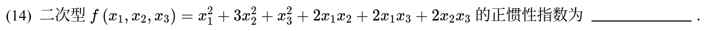

[« 特征值、特征向量与相似](05-eigenvalues-similarity.md)　　[函数极限与无穷小 »](../calculus/01-limits.md)

# 线性代数 · 二次型

> **本章共 16 题**
> 
> - **核心必做（建议按顺序攻克关键方法）**：  
>   [第 06 题](#q06)（正负惯性指数） → [第 08 题](#q08)（特征值符号与规范形） → [第 05 题](#q05)（正交化标准形及最小值） → [第 01 题](#q01)（平方和矩阵的秩）
> 
> - **分流与刷题建议**：  
>   - **较难挑战**：[第 02 题](#q02)（区分合同与正交相似）  
>   - **重在看思路**：[第 03 题](#q03)（非对称乘积先取对称部分）  
>   - **首轮可跳过**：[第 07 题](#q07)、[第 14 题](#q14)（技巧较偏或综合度高，首轮不必死磕）  
> 
> - **过关目标**：分清标准形与规范形；正交变换的列向量须正交且单位化。

---

### 01 · 2026年

> *规范形与惯性指数填空。规范形为 $y_1^2$ 说明正惯性指数为 1，负惯性指数为 0，即矩阵半正定且秩为 1。由所有 2 阶子式为 0 列方程定 $a, b$。*

答案与解析

**第一步怎么落笔**

- **触发条件**：$A$ 是 $2\times 3$ 矩阵，二次型 $\boldsymbol{x}^T(AA^T)\boldsymbol{x}$ 的规范形为 $y_1^2$。
- **第一笔**：**秒用半正定性 + 秩定理**：
  $$\boldsymbol{x}^T(AA^T)\boldsymbol{x} = \|A^T\boldsymbol{x}\|^2 \ge 0 \implies AA^T \text{ 半正定，无负特征值}.$$
  因此它的规范形为 $y_1^2$（正惯性指数 $1$、负惯性指数 $0$）当且仅当：
  $$r(AA^T) = 1 \iff r(A) = 1!$$

**完整推演**

因为 $A = \begin{pmatrix}1 & b & -1 \\ a+2 & 3 & -3a\end{pmatrix}$ 只有两行且第 1 行非零，故 $r(A)=1 \iff$ 第 2 行是第 1 行的常数倍：
$$\frac{a+2}{1} = \frac{3}{b} = \frac{-3a}{-1} = 3a.$$
1. 由 $a + 2 = 3a \implies 2a = 2 \implies a = 1$；
2. 代入 $\frac{3}{b} = 3a = 3 \implies b = 1$。
因此：
$$a + b = 1 + 1 = 2.$$

---

### 02 · 2025年

> *合同与正交相似大题。合同说明正负惯性指数相同，定出参数范围；第二问正交相似说明特征值完全相同，用特征值相等列方程定正交矩阵 $Q$。*

答案与解析

**解。** （1）合同保秩，故 $|A|=3a-12=0$，即 $a=4$。前两阶顺序主子式为 $4,3$，消元的合同主元为 $4,3/4,0$，正惯性指数为 2，故 $k>0$，且这个范围内惯性相同，确实合同。

（2）正交合同也是相似，迹不变给 $k+6=9$，即 $k=3$。对应 $3,6,0$ 的特征向量分别可取 $(1,1,1)^T,(-1,0,1)^T,(1,-2,1)^T$。各自单位化后按该顺序作为 $Q$ 的三列，即有 $Q^TAQ=B$。

---

### 03 · 2024年

> *解空间包含与正交对角化大题。方程组不同解但解包含，得出基础解系包含关系从而定出参数；对称化二次型矩阵 $M = \frac{BA+(BA)^T}{2}$ 后正交对角化。*

答案与解析

- **第 1 问（串联方程组同解与秩）**：
  - $A = \begin{pmatrix}0&1&a\\1&0&1\end{pmatrix}$ 的前两列线性无关，故 $r(A)=2$，$A\boldsymbol{x}=\boldsymbol{0}$ 的解空间维数为 $3-2=1$，基础解系为 $\boldsymbol{\xi}=(-1, -a, 1)^T$。
  - 已知“$A\boldsymbol{x}=\boldsymbol{0}$ 的解均为 $B^T\boldsymbol{x}=\boldsymbol{0}$ 的解，但不同解”，说明 $B^T\boldsymbol{x}=\boldsymbol{0}$ 的解空间严格大于 $1$ 维 $\implies 3 - r(B^T) > 1 \implies r(B^T) = 1$。
  - 看 $B^T = \begin{pmatrix}1&1&b\\1&1&2\end{pmatrix}$：$r(B^T)=1 \iff$ **$b = 2$**。
  - 再把 $\boldsymbol{\xi}=(-1,-a,1)^T$ 代入 $B^T\boldsymbol{\xi}=\boldsymbol{0}$：$-1 - a + 2 = 0 \implies$ **$a = 1$**。
- **第 2 问（秩 1 实对称矩阵秒杀正交对角化！）**：
  - 代入 $a=1, b=2$，算得 $BA = \begin{pmatrix}1&1\\1&1\\2&2\end{pmatrix}\begin{pmatrix}0&1&1\\1&0&1\end{pmatrix} = \begin{pmatrix}1&1&2\\1&1&2\\2&2&4\end{pmatrix} = \begin{pmatrix}1\\1\\2\end{pmatrix}(1, 1, 2)$。
  - 注意 $BA$ **恰好是对称矩阵**，且秩为 $1$！因此特征值直接读出：$\lambda_1 = \operatorname{tr}(BA) = 1+1+4 = 6$，$\lambda_2 = \lambda_3 = 0$。
  - $\lambda_1=6$ 的单位特征向量：$\boldsymbol{q}_1 = \frac{1}{\sqrt{6}}(1, 1, 2)^T$；
  - $\lambda_2=\lambda_3=0$ 解 $x_1+x_2+2x_3=0$，取正交基础解系 $(1,-1,0)^T$ 与 $(1,1,-1)^T$（验证内积全为 $0$！），单位化得 $\boldsymbol{q}_2 = \frac{1}{\sqrt{2}}(1,-1,0)^T$，$\boldsymbol{q}_3 = \frac{1}{\sqrt{3}}(1,1,-1)^T$。
  - 拼出正交矩阵 $Q = \begin{pmatrix}\frac{1}{\sqrt{6}}&\frac{1}{\sqrt{2}}&\frac{1}{\sqrt{3}}\\\frac{1}{\sqrt{6}}&-\frac{1}{\sqrt{2}}&\frac{1}{\sqrt{3}}\\\frac{2}{\sqrt{6}}&0&-\frac{1}{\sqrt{3}}\end{pmatrix}$，在 $\boldsymbol{x}=Q\boldsymbol{y}$ 下标准形为 **$f = 6y_1^2$**。

---

### 04 · 2023年

答案与解析

- **第一笔避坑**：先查三个平方里的线性形式 $x_1+x_2,\ x_1+x_3,\ x_2-x_3$——立见 $(x_1+x_2)-(x_1+x_3)=x_2-x_3$，**线性相关**！直接排除（C）（D）！
- **降维定惯性指数**：作可逆变换 $y_1 = x_1+x_2,\ y_2 = x_1+x_3,\ y_3 = x_3$，则 $x_2-x_3 = y_1-y_2$，代入得
  $$f = y_1^2 + y_2^2 - 4(y_1-y_2)^2 = -3y_1^2 + 8y_1y_2 - 3y_2^2.$$
  对应 2 阶对称阵 $\begin{pmatrix}-3&4\\4&-3\end{pmatrix}$ 的行列式为 $(-3)(-3)-4^2 = -7 < 0$，故两特征值一正一负（$p=1, q=1$），规范形为 **$y_1^2 - y_2^2$**。
- **答案**：**（B）**。

---

### 05 · 2022年

> *标准二次型正交变换大题。写出实对称矩阵，求特征值与特征向量；注意如果有重特征值必须用施密特正交化，单位化后拼成正交矩阵 $Q$。*

答案与解析

**第（I）问：求正交矩阵 $Q$ 将 $f$ 化为标准形**

1. **写出二次型矩阵**（注意 $2x_1x_3$ 的系数 $2$ 均分到 $(1,3)$ 和 $(3,1)$ 元，各为 $1$）：
   $$A = \begin{pmatrix}3 & 0 & 1 \\ 0 & 4 & 0 \\ 1 & 0 & 3\end{pmatrix}.$$
2. **求特征值**（按第 2 行直接展开）：
   $$|\lambda E - A| = (\lambda - 4)\begin{vmatrix}\lambda-3 & -1 \\ -1 & \lambda-3\end{vmatrix} = (\lambda - 4)\big((\lambda-3)^2 - 1\big) = (\lambda - 4)^2(\lambda - 2) = 0.$$
   得特征值 $\lambda_1 = 2,\ \lambda_2 = \lambda_3 = 4$（验算：$\operatorname{tr}(A)=10=2+4+4$）。
3. **求特征向量并正交化、单位化**：
   - 当 $\lambda_1 = 2$ 时：$2E - A = \begin{pmatrix}-1&0&-1\\0&-2&0\\-1&0&-1\end{pmatrix} \to \begin{pmatrix}1&0&1\\0&1&0\\0&0&0\end{pmatrix}$，得特征向量 $\boldsymbol{\alpha}_1 = (1, 0, -1)^T$。
     单位化得 $\boldsymbol{q}_1 = \frac{1}{\sqrt{2}}(1, 0, -1)^T$。
   - 当 $\lambda_2 = \lambda_3 = 4$ 时：$4E - A = \begin{pmatrix}1&0&-1\\0&0&0\\-1&0&1\end{pmatrix} \to \begin{pmatrix}1&0&-1\\0&0&0\\0&0&0\end{pmatrix}$，得两个线性无关特征向量 $\boldsymbol{\alpha}_2 = (0, 1, 0)^T$，$\boldsymbol{\alpha}_3 = (1, 0, 1)^T$。
     **检查正交性**：$\boldsymbol{\alpha}_2^T \boldsymbol{\alpha}_3 = 0$，**已经正交**，无需再做施密特正交化！
     单位化得 $\boldsymbol{q}_2 = (0, 1, 0)^T$，$\boldsymbol{q}_3 = \frac{1}{\sqrt{2}}(1, 0, 1)^T$。
4. **拼出正交矩阵 $Q$**：
   $$Q = (\boldsymbol{q}_1,\ \boldsymbol{q}_2,\ \boldsymbol{q}_3) = \begin{pmatrix}\frac{1}{\sqrt{2}} & 0 & \frac{1}{\sqrt{2}} \\ 0 & 1 & 0 \\ -\frac{1}{\sqrt{2}} & 0 & \frac{1}{\sqrt{2}}\end{pmatrix}.$$
   在正交变换 $\boldsymbol{x} = Q\boldsymbol{y}$ 下，二次型化为标准形：
   $$f = 2y_1^2 + 4y_2^2 + 4y_3^2.$$

**第（II）问：证明 $\min_{\boldsymbol{x}\neq\boldsymbol{0}} \frac{f(\boldsymbol{x})}{\boldsymbol{x}^T\boldsymbol{x}} = 2$**

1. **利用正交变换保内积给出下界**：
   作第（I）问中的正交变换 $\boldsymbol{x} = Q\boldsymbol{y}$。因为 $Q$ 是正交矩阵（$Q^T Q = E$），故 $\boldsymbol{x}\neq\boldsymbol{0} \iff \boldsymbol{y}\neq\boldsymbol{0}$，且
   $$\boldsymbol{x}^T\boldsymbol{x} = (Q\boldsymbol{y})^T(Q\boldsymbol{y}) = \boldsymbol{y}^T(Q^T Q)\boldsymbol{y} = \boldsymbol{y}^T\boldsymbol{y} = y_1^2 + y_2^2 + y_3^2 > 0.$$
   因此对一切 $\boldsymbol{x}\neq\boldsymbol{0}$，有
   $$\frac{f(\boldsymbol{x})}{\boldsymbol{x}^T\boldsymbol{x}} = \frac{2y_1^2 + 4y_2^2 + 4y_3^2}{y_1^2 + y_2^2 + y_3^2} \ge \frac{2(y_1^2 + y_2^2 + y_3^2)}{y_1^2 + y_2^2 + y_3^2} = 2.$$
2. **证明等号可以取到（得分关键步！）**：
   取 $\boldsymbol{y}_0 = (1, 0, 0)^T$，即取 $\boldsymbol{x}_0 = Q\boldsymbol{y}_0 = \frac{1}{\sqrt{2}}(1, 0, -1)^T \neq \boldsymbol{0}$，代入得
   $$\frac{f(\boldsymbol{x}_0)}{\boldsymbol{x}_0^T\boldsymbol{x}_0} = \frac{2\cdot 1^2 + 0 + 0}{1^2 + 0 + 0} = 2.$$
   综上，必有 $\min_{\boldsymbol{x}\neq\boldsymbol{0}} \frac{f(\boldsymbol{x})}{\boldsymbol{x}^T\boldsymbol{x}} = 2$。

---

### 06 · 2021年

答案与解析

**第一步怎么落笔**

- **触发条件**：二次型已经写成三个平方项的代数和 $(x_1+x_2)^2 + (x_2+x_3)^2 - (x_3-x_1)^2$。
- **第一笔**：**先查三个线性形式的关系**！一眼看出：
  $$(x_2 + x_3) - (x_1 + x_2) = x_3 - x_1.$$
  三个线性形式**线性相关**！绝对不能直接令 $y_1=x_1+x_2,\ y_2=x_2+x_3,\ y_3=x_3-x_1$（变换矩阵不可逆）！

**完整推演**

1. **做合法可逆线性变换降维**：
   令 $y_1 = x_1 + x_2,\ y_2 = x_2 + x_3,\ y_3 = x_3$（变换矩阵 $\begin{pmatrix}1&1&0\\0&1&1\\0&0&1\end{pmatrix}$ 上三角且行列式为 $1\neq 0$，**可逆**！），则 $x_3 - x_1 = y_2 - y_1$。代入原二次型：
   $$f = y_1^2 + y_2^2 - (y_2 - y_1)^2 = y_1^2 + y_2^2 - (y_2^2 - 2y_1 y_2 + y_1^2) = 2y_1 y_2.$$
2. **对 $2y_1 y_2$ 配方**：
   再作可逆变换 $y_1 = z_1 + z_2,\ y_2 = z_1 - z_2,\ y_3 = z_3$，得
   $$f = 2(z_1 + z_2)(z_1 - z_2) = 2z_1^2 - 2z_2^2.$$
   因此正惯性指数 $p = 1$，负惯性指数 $q = 1$，选 **（B）**。

> **双保险验算（矩阵法）**：展开得 $f = 2x_2^2 + 2x_1x_2 + 2x_1x_3 + 2x_2x_3$，矩阵 $A = \begin{pmatrix}0&1&1\\1&2&1\\1&1&0\end{pmatrix}$。易见第 1 行 + 第 3 行 = 第 2 行 $\implies |A|=0$（必有特征值 $0$，$p+q\le 2$），且左上 2 阶主子式 $\begin{vmatrix}0&1\\1&2\end{vmatrix} = -1 < 0 \implies$ 必一正一负，立刻得 $p=1, q=1$！

**选择题关键干扰项拆解**

- **（C）$2, 1$（头号陷阱！）**：没检查变换可逆性，看到题干里“两个正平方、一个负平方”就直接填 $p=2, q=1$。
- **（A）$2, 0$** 与 **（D）$1, 2$**：展开或配方法算错符号。

---

### 07 · 2020年

答案与解析

**解。** （1）$f$ 的矩阵是 $(1-a)I+aJ$（$J$ 全为 1），特征值为 $1+2a,1-a,1-a$。$g=(y_1+y_2)^2+4y_3^2$ 的惯性为两正一零，故只能 $a=-1/2$。

（2）取单位正交向量 $q_1=(1,-1,0)^T/\sqrt2$、$q_2=(1,1,-2)^T/\sqrt6$、$q_3=(1,1,1)^T/\sqrt3$。令
$$
x=\sqrt{2/3}(y_1+y_2)q_1+\sqrt{8/3}\,y_3q_2+(y_1-y_2)q_3.
$$
此变换可逆，代入 $f=\frac32[(q_1^Tx)^2+(q_2^Tx)^2]$ 正好得到 $g$。所求 $P$ 可取以上线性变换的系数矩阵。

---

### 08 · 2019年

答案与解析

**第一步怎么落笔**

- **触发条件**：$A$ 为 3 阶实对称矩阵，满足 $A^2 + A = 2E$ 且 $|A| = 4$。
- **第一笔**：设 $\lambda$ 为 $A$ 的任一特征值，则 $\lambda$ 必满足矩阵方程对应的代数方程：
  $$\lambda^2 + \lambda - 2 = 0 \implies (\lambda + 2)(\lambda - 1) = 0 \implies \lambda \in \{1,\ -2\}.$$

**完整推演**

1. **用 $|A|=4$ 锁死三个特征值的重数**：
   $A$ 是 3 阶实对称矩阵，必有 3 个实特征值 $\lambda_1, \lambda_2, \lambda_3 \in \{1, -2\}$，且满足
   $$\lambda_1 \lambda_2 \lambda_3 = |A| = 4.$$
   检验所有可能组合：
   - $(1, 1, 1) \implies$ 乘积 $1 \neq 4$；
   - $(1, 1, -2) \implies$ 乘积 $-2 \neq 4$；
   - $(1, -2, -2) \implies$ 乘积 $1\times(-2)\times(-2) = 4$（**唯一满足！**）；
   - $(-2, -2, -2) \implies$ 乘积 $-8 \neq 4$。
2. **直接读出规范形**：
   三个特征值为 $1, -2, -2$，有 **1 个正特征值、2 个负特征值**（$p=1, q=2$），故二次型 $\boldsymbol{X}^T A\boldsymbol{X}$ 的规范形为
   $$y_1^2 - y_2^2 - y_3^2.$$
   应选 **（C）**。

**选择题关键干扰项拆解**

- **（A）$y_1^2+y_2^2+y_3^2$**：只看到 $|A|=4>0$ 就误以为 $A$ 正定！注意 $|A|>0$ 只能说明**负特征值有偶数个**（0 个或 2 个），不能推出正定。
- **（B）$y_1^2+y_2^2-y_3^2$** 与 **（D）$-y_1^2-y_2^2-y_3^2$**：负特征值个数为奇数，此时 $|A|<0$，与 $|A|=4>0$ 直接矛盾，可一眼秒杀排除！

---

### 09 · 2018年

> *完全平方式求二次型参数。写出二次型矩阵，求秩为 2 或正定条件；配方法直接观察平方项系数，比硬算特征值快得多。*

答案与解析

**解。** （1）平方和为零要求三项同时为零。前两式给 $x_2=-x_3,\ x_1=-2x_3$，第三式变成 $(a-2)x_3=0$。故 $a\ne2$ 时只有零解；$a=2$ 时解为 $t(-2,-1,1)$。

（2）平方项对应的线性映射秩分别为 3 或 2。二次型半正定，正惯性指数等于该秩，所以规范形分别为 $y_1^2+y_2^2+y_3^2$ 或 $y_1^2+y_2^2$。

---

### 10 · 2017年

答案与解析

**解。** 二次型矩阵为 $\begin{pmatrix}2&1&-4\\1&-1&1\\-4&1&a\end{pmatrix}$。正交标准形含零项，故行列式 $6-3a=0$，得 $a=2$。代入后验算三个特征对为 $(-3,(1,-1,1)^T),(6,(-1,0,1)^T),(0,(1,2,1)^T)$。将这三列分别除以 $\sqrt3,\sqrt2,\sqrt6$ 得到 $Q$，对应标准形 $-3y_1^2+6y_2^2$。

---

### 11 · 2016年

答案与解析

**答案 C。** 矩阵为 $(a-1)I+J$，全 1 矩阵 $J$ 在 $(1,1,1)^T$ 方向上特征值 3，在垂直子空间上为 0。故二次型的特征值为 $a+2,a-1,a-1$，一正两负要求 $a+2>0$ 且 $a-1<0$。

---

### 12 · 2015年

答案与解析

**答案 A。** 把新基的三列换回旧坐标，原坐标分别是 $y_1,y_3,-y_2$。代入原标准形，得到 $2y_1^2-y_2^2+y_3^2$。向量方向取反对平方项无影响，列次序则决定系数位置。

---

### 13 · 2014年

答案与解析

**答案 $-2\le a\le2$。** 配方得 $(x_1+ax_3)^2-(x_2-2x_3)^2+(4-a^2)x_3^2$。前两项已一正一负，最后一项须非负才不会新增一个负惯性项，零系数也允许。

---

### 14 · 2013年

答案与解析

**证明。** （I）令 $x=(x_1,x_2,x_3)^T$，则 $(\alpha^Tx)^2=x^T\alpha\alpha^Tx$，另一平方同理，故矩阵为 $2\alpha\alpha^T+\beta\beta^T$。

（II）把正交单位向量 $\alpha,\beta$ 补成标准正交基 $\alpha,\beta,\gamma$，用 $x=(\alpha,\beta,\gamma)y$。此时 $\alpha^Tx=y_1,\beta^Tx=y_2$，代入标准形即为 $2y_1^2+y_2^2$。

---

### 15 · 2012年

答案与解析

**解。** （1）$\ker(A^TA)=\ker A$，因为 $x^TA^TAx=\|Ax\|^2$。故 $r(A)=2$，由 $|A|=a+1=0$ 得 $a=-1$；此时前两行独立，秩确为 2。

（2）$A^TA=\begin{pmatrix}2&0&2\\0&1&1\\2&1&3\end{pmatrix}$，特征多项式为 $\lambda(\lambda^2-6\lambda+6)$。对应 $3-\sqrt3,3+\sqrt3,0$ 的向量可取
$$
(-1-\sqrt3,2+\sqrt3,1)^T,\quad
(-1+\sqrt3,2-\sqrt3,1)^T,\quad (-1,-1,1)^T.
$$
三向量两两正交，逐列单位化组成 $Q$。用 $x=Qy$ 得标准形 $(3-\sqrt3)y_1^2+(3+\sqrt3)y_2^2$。

---

### 16 · 2011年

答案与解析

**答案 $2$。** 原式等于 $(x_1+x_2+x_3)^2+2x_2^2$，两个线性形式独立，补一个坐标组成可逆变换，得到两正一零。

---

[« 特征值、特征向量与相似](05-eigenvalues-similarity.md)　　[函数极限与无穷小 »](../calculus/01-limits.md)
