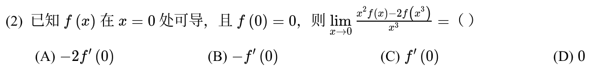
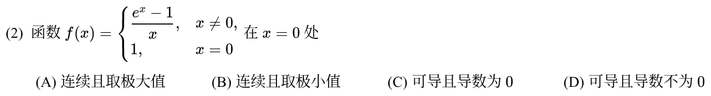
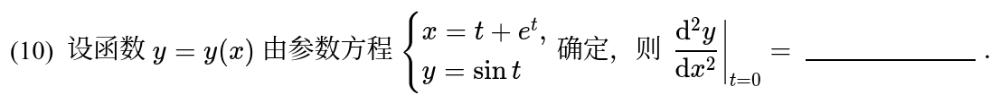
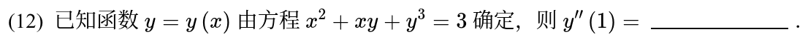
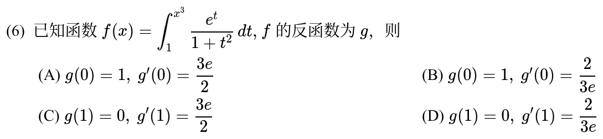
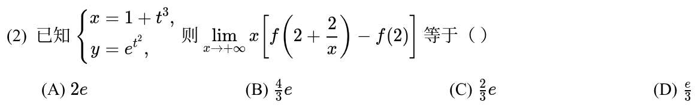

# 导数定义、可导性与求导法则

> 本章专题：聚焦[导数定义、可导性与求导法则](../../chapters/calculus/04-derivatives.md)
> 课程参考：[武忠祥 17 堂课专题 5 已读笔记](../../wu/17/notes/27-05-derivative-definition.md)（P55—65，全 29 页）、[武忠祥 26 选填第 2 课已读笔记](../../wu/xt/notes/02-orders-continuity.md)（第 27—35 页）

导数这一章最容易踩的坑有两个极端：面对**抽象函数或分段点**，习惯性直接套洛必达或把去心导函数极限冒充点上导数，结果在“只给一点可导”或“未核对实际点值”处直接失分；面对**参数方程、隐函数或反函数求导**，又容易忘除 $x'(t)$、忘先代点求 $y_0$，或搞反原函数与反函数的对应点。

动笔前先按题干信息走一遍决策表（参考[专题 5 第 2—26 页](../../wu/17/notes/27-05-derivative-definition.md#一这节课的路线先界定信息再用信息)）：

| 题目类型 | 题设允许的信息级别 | 第一步落笔动作 | 常见误区 |
| :--- | :--- | :--- | :--- |
| **抽象函数极限（仅给某点可导）** | 只有该点的点值与一阶差商极限，**没有**邻域导数或 $f''$ | 围绕已知点值 $f(x_0)$ 拆项，把每一块配成标准差商 $\frac{f(x_0+h)-f(x_0)}{h}$ | 对“仅在一点可导”的函数滥用洛必达；或看到分母 $x^2,x^3$ 就误以为需要高阶导 |
| **分段点/补定义点可导性与极值** | 需先核对连续性与实际点值 $f(x_0)$ | 先验连续，再直接写差商定义 $\lim_{x\to x_0}\frac{f(x)-f(x_0)}{x-x_0}$（必要时分左右导数） | 不检查实际点值就把去心导函数极限当导数；或泰勒展开阶数不够把非零导数抹成 $0$ |
| **参数方程求一、二阶导数** | $x=x(t),\ y=y(t)$ 满足 $x'(t)\neq 0$ | 先写 $\frac{dy}{dx}=\frac{y'(t)}{x'(t)}$；二阶导必写 $\frac{d^2y}{dx^2}=\frac{d}{dt}\!\left(\frac{dy}{dx}\right)\cdot\frac{1}{x'(t)}$ | 求二阶导时漏乘 $\frac{1}{x'(t)}$；或题干给 $x_0$ 时忘记先反解对应的 $t_0$ |
| **隐函数在具体点求二阶导数** | 方程 $F(x,y)=0$ 局部确定 $y(x)$ | ① 代 $x_0$ 解出 $y_0$；② 两边求导一次**立即代点**得 $y'(x_0)$；③ 再求导一次代点得 $y''(x_0)$ | 硬把 $y'$ 解成分式再对分式求商导，计算量翻倍且极易算错 |
| **反函数与变上限积分求导** | $g = f^{-1}$ 且 $f'(x_0)\neq 0$ | 先解 $f(x_0)=y_0$ 找准原函数对应点 $x_0$，再用 $g'(y_0)=\frac{1}{f'(x_0)}$ | 把 $y_0$ 直接代入 $f'$ 错写成 $\frac{1}{f'(y_0)}$；或忘对变上限复合函数乘上限导数 |

下面用四道真题依次打通这四条主线：**抽象函数配差商**、**分段补定义点用定义判可导与极值**、**参数方程二阶导**、**隐函数逐次求导代点**。

---

## 一、抽象函数极限：只给“在一点可导”，就必须回到差商定义

### 判断链

1. **严禁越权求导**：题干只说“$f(x)$ 在 $x=0$ 处可导”，既不保证 $f$ 在 $0$ 的去心邻域可导，也不保证 $f'$ 在 $0$ 处连续——**不能使用洛必达法则**。
2. **拆回标准差商**：把目标式拆成若干项，使每一项都呈现 $\frac{f(0+h)-f(0)}{h}$ 的形式（其中 $h\to 0$ 且在去心邻域非零），再乘以对应的系数。
3. **核对点值条件**：$f(0)=0$ 是拆项后差商分子恰好对齐 $f(h)-f(0)$ 的关键前提（参考[专题 5 第 7—9 页例 1](../../wu/17/notes/27-05-derivative-definition.md#三第714页从可用局部信息走到极限)）。

---

### 例 1：[2011 年第 2 题](../../chapters/calculus/04-derivatives.md#q2011-2)（选择题）

> **来源对照**：与[武忠祥专题 5 第 7—9 页例 1](../../wu/17/notes/27-05-derivative-definition.md#三第714页从可用局部信息走到极限)（只给一点可导、按已知点值拆成一阶差商，不因分母高次就误用洛必达或要求高阶导）属于**同法迁移**。
> **建议先自己拆项配差商**，再往下核对。

**原题**（[在章节题单中查看](../../chapters/calculus/04-derivatives.md#q2011-2)）：

#### 第一步与完整推演

- **触发条件**：已知 $f(x)$ 仅在 $x=0$ 处可导且 $f(0)=0$，分子两项分别为 $x^2 f(x)$ 与 $-2f(x^3)$，除以分母 $x^3$ 后恰好各自配成一阶差商。
- **第一步落笔**：按分母 $x^3$ 拆分两项并补出 $f(0)=0$：
  $$\frac{x^2 f(x) - 2f(x^3)}{x^3} = \frac{f(x) - f(0)}{x - 0} - 2\cdot\frac{f(x^3) - f(0)}{x^3 - 0}.$$
- **取极限收尾**：当 $x\to 0$ 时，对第二项令 $h = x^3$，有 $h\to 0$ 且 $x\neq 0 \implies h\neq 0$，由导数定义得
  $$\lim_{x\to 0}\frac{f(x)-f(0)}{x} = f'(0), \qquad \lim_{x\to 0}\frac{f(x^3)-f(0)}{x^3} = \lim_{h\to 0}\frac{f(h)-f(0)}{h} = f'(0).$$
  两项极限均存在，故
  $$\lim_{x\to 0}\frac{x^2 f(x) - 2f(x^3)}{x^3} = f'(0) - 2f'(0) = -f'(0).$$
  选 **（B）**。

> **选择题交叉检验**：取特例 $f(x) = x$（满足在 $0$ 处可导、$f(0)=0$、$f'(0)=1$），原式 $= \frac{x^3 - 2x^3}{x^3} = -1 = -f'(0)$，可迅速交叉核对（但不能用特例替代上面的一般证明）。

#### 选择题关键干扰项拆解

- **（A）$-2f'(0)$**：只算了第二项，把第一项 $\frac{x^2 f(x)}{x^3} = \frac{f(x)}{x}$ 漏算或错当成 $0$。
- **（C）$f'(0)$**：丢掉第二项前面的系数 $2$ 或正负号算反。
- **（D）$0$**：对 $f(x^3)$ 误用洛必达漏写链式因子 $3x^2$，或误把 $f(x^3)$ 当成 $x^3$ 的高阶无穷小。

#### 条件变式检验

- **变式 1**：若去掉条件 $f(0)=0$，极限还一定存在吗？
  **不一定（一般不存在）。** 若 $f(0) = c \neq 0$，则分子 $\to -2c \neq 0$ 而分母 $x^3 \to 0$，极限发散为无穷。
- **变式 2**：若把分母从 $x^3$ 改成 $x^2$（其余条件不变），极限是多少？
  原式 $= f(x) - 2x\cdot\frac{f(x^3)}{x^3} \to 0 - 0\cdot f'(0) = 0$。

---

## 二、分段补定义点：先验连续，再用定义算差商，不要被“可去形态”迷惑

### 判断链

1. **先查连续性**：算出 $\lim_{x\to x_0} f(x)$，核对是否等于实际点值 $f(x_0)$。
2. **用定义算 $f'(x_0)$**：直接写 $\lim_{x\to x_0}\frac{f(x)-f(x_0)}{x-x_0}$。若分子出现同主项抵消，展开到**高于分母一阶**的泰勒项即可一步读出导数。
3. **顺手排除极值选项**：一旦算出 $f'(x_0) \neq 0$，由费马引理（可导极值点必为驻点）立刻排除所有极值选项（参考[专题 5 第 18—20 页](../../wu/17/notes/27-05-derivative-definition.md#第1820页例1定义法与求导代入各在什么条件下成立)）。

---

### 例 2：[2021 年第 2 题](../../chapters/calculus/04-derivatives.md#q2021-2)（选择题）

> **来源对照**：与[武忠祥专题 5 第 18—20 页例 1](../../wu/17/notes/27-05-derivative-definition.md#第1820页例1定义法与求导代入各在什么条件下成立)同属分段补定义点处的差商定义法，属于**同法迁移**。

**原题**（[在章节题单中查看](../../chapters/calculus/04-derivatives.md#q2021-2)）：

#### 第一步与完整推演

- **触发条件**：$x=0$ 为单独补定义的点，且选项同时区分“连续取极值”与“可导且导数是否为 $0$”，最直接的入口就是先验连续再算 $f'(0)$。
- **第一步落笔**：
  1. **核对连续性**：
     $$\lim_{x\to 0} f(x) = \lim_{x\to 0}\frac{e^x - 1}{x} = 1 = f(0),$$
     故 $f(x)$ 在 $x=0$ 处连续。
  2. **按导数定义算 $f'(0)$**：
     $$f'(0) = \lim_{x\to 0}\frac{f(x) - f(0)}{x - 0} = \lim_{x\to 0}\frac{\frac{e^x - 1}{x} - 1}{x} = \lim_{x\to 0}\frac{e^x - 1 - x}{x^2}.$$
     由泰勒展开 $e^x = 1 + x + \frac{1}{2}x^2 + o(x^2)$（或一次洛必达），得
     $$f'(0) = \lim_{x\to 0}\frac{\frac{1}{2}x^2 + o(x^2)}{x^2} = \frac{1}{2} \neq 0.$$
- **收尾结论**：$f(x)$ 在 $x=0$ 处可导，且 $f'(0) = \frac{1}{2} \neq 0$，选 **（D）**。

#### 选择题关键干扰项拆解

- **（C）可导且导数为 $0$**：在差商 $\frac{\frac{e^x-1}{x}-1}{x}$ 中误把 $e^x-1$ 局部等价替换成 $x$，得出分子恒为 $0$，抹掉了关键的二阶项 $\frac{1}{2}x^2$。
- **（A）（B）连续且取极大/极小值**：既然 $f'(0) = \frac{1}{2} > 0$，由导数保号性知 $x=0$ 右侧 $f(x)>f(0)$、左侧 $f(x)<f(0)$，既非极大值也非极小值（也直接违背费马引理“可导极值点必有 $f'(0)=0$”）。

#### 条件变式检验

- **变式 1**：若把函数改成偶函数 $f(x)=\begin{cases}\frac{e^{x^2}-1}{x^2},&x\neq 0,\\ 1,&x=0,\end{cases}$ 在 $x=0$ 处性质如何？
  此时 $f(x) = 1 + \frac{1}{2}x^2 + o(x^2)$，可得 $f'(0)=0$ 且对一切 $x\neq 0$ 有 $f(x)>1=f(0)$，因此**可导、导数为 $0$ 且取严格极小值**。
- **变式 2**：若把 $f(0)$ 的定义值从 $1$ 改成 $0$，在 $x=0$ 处还连续、可导吗？
  **不连续、更不可导**（$x=0$ 变为可去间断点）。

---

## 三、参数方程二阶导：每次对 $x$ 求导都要再除一次 $x'(t)$

### 判断链

1. **一阶导**：在 $x'(t)\neq 0$ 的区间内，$\frac{dy}{dx} = \frac{y'(t)}{x'(t)}$。
2. **二阶导（核心易错点）**：$\frac{dy}{dx}$ 是 $t$ 的函数，对 $x$ 再求导必须用链式法则：
   $$\frac{d^2y}{dx^2} = \frac{d}{dx}\!\left(\frac{dy}{dx}\right) = \frac{\dfrac{d}{dt}\!\left(\dfrac{dy}{dx}\right)}{x'(t)} = \frac{y''(t)x'(t) - y'(t)x''(t)}{\big[x'(t)\big]^3}.$$
3. **代值时机**：若题目求具体点 $t=t_0$ 的值，求完 $\frac{d}{dt}\!\left(\frac{dy}{dx}\right)$ 的分子后**直接代入 $t=t_0$**，不必费力化简通式。

---

### 例 3：[2017 年第 10 题](../../chapters/calculus/04-derivatives.md#q2017-10)（填空题）

> **来源对照**：参数方程二阶求导的标准链式法则应用（独立真题推演，衔接[专题 5](../../wu/17/notes/27-05-derivative-definition.md)导数运算法则）。

**原题**（[在章节题单中查看](../../chapters/calculus/04-derivatives.md#q2017-10)）：

#### 第一步与完整推演

- **触发条件**：给定参数方程 $x=t+e^t,\ y=\sin t$，求 $t=0$ 处的二阶导数。
- **第一步落笔**：先算一阶导数（$x'(t) = 1 + e^t > 0$ 处处非零）：
  $$\frac{dy}{dx} = \frac{y'(t)}{x'(t)} = \frac{\cos t}{1 + e^t}.$$
- **再对 $x$ 求导（务必再除以 $x'(t)$）**：
  $$\begin{aligned}
  \frac{d^2y}{dx^2} &= \frac{d}{dt}\!\left(\frac{\cos t}{1 + e^t}\right)\cdot\frac{1}{x'(t)} \\
  &= \frac{-\sin t(1 + e^t) - \cos t \cdot e^t}{(1 + e^t)^2} \cdot \frac{1}{1 + e^t} \\
  &= \frac{-\sin t(1 + e^t) - e^t\cos t}{(1 + e^t)^3}.
  \end{aligned}$$
- **代入 $t = 0$**：
  $$\left.\frac{d^2y}{dx^2}\right|_{t=0} = \frac{0 - 1 \cdot 1}{(1 + 1)^3} = -\frac{1}{8}.$$

> **常见失误提醒**：如果漏乘最后的 $\frac{1}{x'(t)}$，会算出 $-\frac{1}{4}$，恰好差一个因子 $x'(0)=2$。

#### 条件变式检验

- **变式 1**：若把题干改成求 $\left.\frac{d^2y}{dx^2}\right|_{x=1}$，第一步多做什么？
  先解方程 $t + e^t = 1$：因为 $x'(t)=1+e^t>0$ 严格递增，易观察到唯一实根 $t=0$，再代入上式仍得 $-\frac{1}{8}$。
- **变式 2**：若把 $x=t+e^t$ 改成 $x=t-e^t$，还能在 $t=0$ 处用同一公式吗？
  **不能。** 此时 $x'(0) = 1 - e^0 = 0$，分母为 $0$，参数方程在该点不满足常规二阶求导公式的前提。

---

## 四、隐函数求具体点二阶导：先定 $y_0$，每求一次导立刻代点

### 判断链

求隐函数在某一点 $x_0$ 处的 $y''(x_0)$，最省算力也最不容易出错的顺序是**逐次求导 + 逐次代点**（参考[专题 5 第 13 页例 3](../../wu/17/notes/27-05-derivative-definition.md#第13页例3隐函数先拿到所需的局部系数)）：

1. **定 $y_0$**：把 $x=x_0$ 代入原方程解出 $y_0 = y(x_0)$（同时确认实根唯一性）。
2. **一阶求导并代点**：方程两边对 $x$ 求导（牢记 $y$ 是 $x$ 的函数，遇到 $y^k$ 必乘 $y'$），立即代入 $(x_0, y_0)$ 算出数值 $y'(x_0)$。
3. **二阶求导并代点**：对一阶导方程**原样再对 $x$ 求导**（不要先解出 $y'$ 写成复杂分式！），立即代入 $(x_0, y_0, y'(x_0))$ 线性解出 $y''(x_0)$。

---

### 例 4：[2022 年第 12 题](../../chapters/calculus/04-derivatives.md#q2022-12)（填空题）

> **来源对照**：与[武忠祥专题 5 第 13 页例 3](../../wu/17/notes/27-05-derivative-definition.md#第13页例3隐函数先拿到所需的局部系数)（隐函数不求显式、逐次求导代点直接拿高阶导数值）属于**同法迁移**。

**原题**（[在章节题单中查看](../../chapters/calculus/04-derivatives.md#q2022-12)）：

#### 第一步与完整推演

- **触发条件**：隐函数方程 $x^2 + xy + y^3 = 3$，只求 $x=1$ 处的二阶导数 $y''(1)$。
- **第一步落笔（定 $y(1)$）**：将 $x=1$ 代入原方程，得
  $$1 + y + y^3 = 3 \iff y^3 + y - 2 = 0 \iff (y-1)(y^2+y+2) = 0.$$
  因为 $y^2 + y + 2 = \left(y+\frac{1}{2}\right)^2 + \frac{7}{4} > 0$，故有唯一实根 $y(1) = 1$（且 $F_y(1,1) = 1 + 3\cdot 1^2 = 4 \neq 0$，局部光滑隐函数存在）。
- **第二步（两边对 $x$ 求导一次，立刻代点）**：
  $$2x + y + xy' + 3y^2 y' = 0.$$
  代入 $x=1,\ y=1$：
  $$2 + 1 + y'(1) + 3y'(1) = 0 \implies 4y'(1) = -3 \implies y'(1) = -\frac{3}{4}.$$
- **第三步（对一阶导方程再对 $x$ 求导，立刻代点）**：
  $$2 + y' + y' + xy'' + 6y(y')^2 + 3y^2 y'' = 0,$$
  即
  $$2 + 2y' + 6y(y')^2 + (x + 3y^2)y'' = 0.$$
  代入 $x=1,\ y=1,\ y'(1) = -\frac{3}{4}$：
  $$2 + 2\left(-\frac{3}{4}\right) + 6\cdot 1\cdot\left(-\frac{3}{4}\right)^2 + (1 + 3)y''(1) = 0.$$
  逐项通分计算：
  $$2 - \frac{3}{2} + \frac{27}{8} + 4y''(1) = 0 \implies \frac{4}{8} + \frac{27}{8} + 4y''(1) = 0 \implies \frac{31}{8} + 4y''(1) = 0,$$
  解得
  $$y''(1) = -\frac{31}{32}.$$

#### 条件变式检验

- **变式**：若把方程中的 $y^3$ 改成 $y^2$（即 $x^2 + xy + y^2 = 3$），还能不加说明直接问 $y''(1)$ 吗？
  **不能。** 代入 $x=1$ 得 $y^2 + y - 2 = 0$，有两个不同实根 $y=1$ 与 $y=-2$，方程在 $x=1$ 附近确定两支隐函数，必须额外给定 $y(1)$ 的值，二阶导数才唯一确定。

---

## 五、回练与过关标准

### 1. 真题回练一：[2026 年第 6 题](../../chapters/calculus/04-derivatives.md#q2026-6)（选择题）

点击核对要点与答案

- **第一步（找准原函数与反函数的对应点）**：令积分上限等于下限，即 $x^3 = 1 \implies x = 1$，此时 $f(1) = \int_1^1 \frac{e^t}{1+t^2}\,dt = 0$。由反函数定义立刻得 $g(0) = 1$（先排除 C、D）。
- **第二步（变上限积分求导，勿漏乘上限导数 $3x^2$）**：
  $$f'(x) = \frac{e^{x^3}}{1 + x^6}\cdot (x^3)' = \frac{3x^2 e^{x^3}}{1 + x^6}.$$
  代入 $x = 1$ 得 $f'(1) = \frac{3e}{2} \neq 0$。
- **第三步（反函数求导公式）**：
  $$g'(0) = \frac{1}{f'(g(0))} = \frac{1}{f'(1)} = \frac{2}{3e}.$$
- **答案**：**（B）**（干扰项 A 忘记取倒数，C/D 把 $f(1)=0$ 错写成 $g(1)=0$）。

### 2. 真题回练二：[2024 年第 2 题](../../chapters/calculus/04-derivatives.md#q2024-2)（选择题）

点击核对要点与答案

- **第一步（把无穷远极限化成导数定义）**：令 $h = \frac{2}{x}$，则 $x\to +\infty$ 时 $h\to 0^+$，且 $x = \frac{2}{h}$，于是
  $$\lim_{x\to +\infty} x\left[f\!\left(2+\frac{2}{x}\right) - f(2)\right] = 2\lim_{h\to 0^+}\frac{f(2+h) - f(2)}{h} = 2f'(2).$$
- **第二步（参数方程反解 $t_0$ 并求一阶导）**：由 $x = 1 + t^3 = 2$ 得唯一实根 $t = 1$；参数方程一阶导数为
  $$f'(x) = \frac{dy/dt}{dx/dt} = \frac{2t e^{t^2}}{3t^2} = \frac{2e^{t^2}}{3t}.$$
  代入 $t = 1$ 得 $f'(2) = \frac{2}{3}e$。
- **第三步（乘回系数 $2$）**：$2f'(2) = \frac{4}{3}e$。
- **答案**：**（B）**（干扰项 C 漏乘了系数 $2$，D 算错 $y'(t)$ 漏了 $2t$ 的因子 $2$）。

### 过关标准

合上讲义，面对新的导数概念与求导法则题，能够独立完成以下四步即算过关：
1. 看到“仅在一点可导”的抽象函数极限，绝不误用洛必达，而是能围绕已知点值拆成标准一阶差商；
2. 遇到分段点或补定义点，能先核对连续性与实际点值，再按差商定义算出准确导数，并结合费马引理排除极值误判；
3. 遇到参数方程二阶导，能自觉补上最后的 $\frac{1}{x'(t)}$；遇到隐函数具体点二阶导，能做到“先定 $y_0$，一阶求导后立刻代点，二阶求导后再代点”；
4. 遇到反函数求导，能先把 $y_0$ 准确还原回原函数自变量 $x_0$，再取 $f'(x_0)$ 的倒数。
