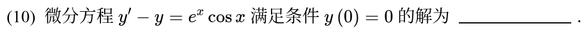
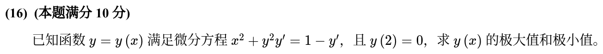
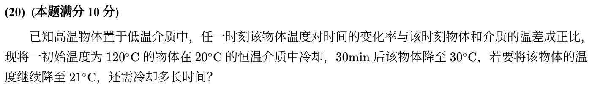
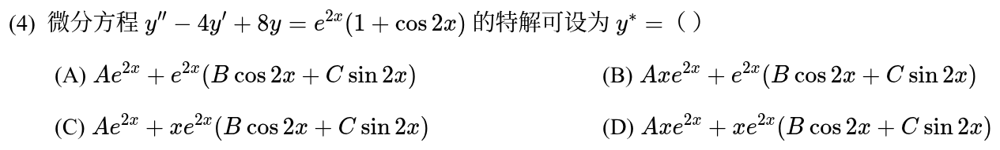
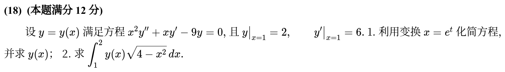
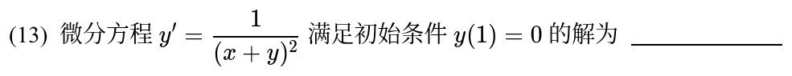
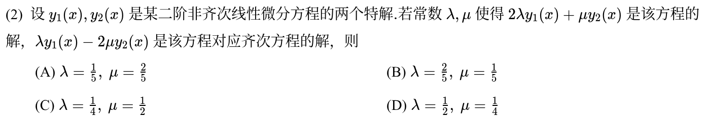

# 一阶与高阶微分方程

> 跨章主题：串联[一阶微分方程](../../chapters/calculus/14-first-order-ode.md)与[高阶微分方程与线性结构](../../chapters/calculus/15-higher-order-ode.md)

解微分方程最容易卡壳的不是“不会积分”，而是**第一步认错方程类型**：把能分离变量的硬套线性公式、把需要换元 $u = x+y$ 或 $x=e^t$ 的硬展开、设二阶非齐次特解时漏查特征根重数 $k$，或者在应用题里解出总时间 $t$ 却忘了减去已经过去的 $30\text{ min}$。

拿到一道微分方程题，按下面的**类型识别决策表**从上往下快速定位入口：

| 方程形态 / 设问 | 第一步先判什么 | 标准解法 / 入口 | 高频失分点 |
| :--- | :--- | :--- | :--- |
| **一阶：$g(y)y' = f(x)$ 或 $y'=f(ax+by+c)$** | 能否直接把 $x,y$ 分到等号两侧；若含 $ax+by$ 整体，先令 $u=ax+by$ | 分离变量直接两边积分；**若只求隐函数极值，不必反解显式 $y(x)$**，直接用 $y'=0$ 与隐式方程求极值 | 强行反解三次方程 $y(x)$；初值代入求常数 $C$ 时算错符号 |
| **一阶线性：$y' + P(x)y = Q(x)$** | 看 $y$ 与 $y'$ 是否均为一次；若对 $y$ 非线性，反过来把 $x$ 看成 $y$ 的函数检查 $\frac{\mathrm{d}x}{\mathrm{d}y}+P(y)x=Q(y)$ | 通解公式 $y = e^{-\int P\,\mathrm{d}x}\left(\int Q e^{\int P\,\mathrm{d}x}\,\mathrm{d}x + C\right)$，或直接乘积分因子 $e^{\int P\,\mathrm{d}x}$ 凑全导数 | 公式里漏掉 $P(x)$ 前面的负号（如 $y'-y=Q$ 中 $P=-1$，积分因子是 $e^{-x}$ 不是 $e^x$）；漏写常数 $C$ 再代初值 |
| **物理/几何建模题（变化率、冷却、切线）** | 把文字里的“变化率”“成正比”翻译成 $\frac{\mathrm{d}T}{\mathrm{d}t} = -k(T-T_0)$，并圈出**所有边界条件与最终设问** | 建方程 $\to$ 分离变量求解 $\to$ 用两个条件定 $C$ 和 $k$ $\to$ 回看题干问的是“总时间”还是“**还需**时间” | 忘记写冷却时的负号（或令 $k>0$）；把总时间当成“还需时间” |
| **二阶常系数非齐次特解设定** | **先求齐次特征方程的根**，再按叠加原理把右端拆成若干标准项 $e^{\alpha x}(P_m\cos\beta x + Q_n\sin\beta x)$ | 逐项检查 $\alpha \pm i\beta$ 是特征方程的几重根（$k=0,1,2$），分别乘 $x^k$ 再相加 | 不拆分右端而整体瞎乘 $x$；把实数根 $\lambda=2$ 与复根 $2\pm 2i$ 混为一谈 |
| **欧拉方程 $x^2 y'' + a x y' + b y = f(x)$** | 看到 $x^k y^{(k)}$ 配对（或题干明示 $x=e^t$） | 令 $x = e^t$（$x>0$），用算子公式 $xy' = \frac{\mathrm{d}y}{\mathrm{d}t}$、$x^2 y'' = \frac{\mathrm{d}^2y}{\mathrm{d}t^2} - \frac{\mathrm{d}y}{\mathrm{d}t}$ 化为常系数方程 | 漏掉 $x^2 y''$ 变换里的 $-\frac{\mathrm{d}y}{\mathrm{d}t}$；初值条件 $y'|_{x=1}$ 换成对 $t$ 求导时忘乘 $x$（或直接换回 $x$ 再代初值更稳） |
| **线性微分方程解的结构** | 记牢非齐次线性算子 $L[y]=f(x)$ 的线性性 | 若 $y_1, y_2$ 为非齐次特解，则 $L[c_1 y_1 + c_2 y_2] = (c_1+c_2)f(x)$：和为 $1$ 是非齐次解，和为 $0$ 是齐次解 | 把“非齐次特解的线性组合”和“齐次解的线性组合”混用 |

下面用五道真题把一阶线性、可分离变量与隐函数极值、冷却建模、二阶特解设定、欧拉方程完整走一遍。

---

## 一、一阶线性微分方程：凑积分因子比死背公式更不易错号

### 判断链

1. **先化标准型**：把方程写成 $y' + P(x)y = Q(x)$，明确读出 $P(x)$（连同正负号！）与 $Q(x)$。
2. **乘积分因子 $e^{\int P(x)\,\mathrm{d}x}$**：左边立刻合成 $\big(e^{\int P(x)\,\mathrm{d}x} y\big)'$，两边积分后**先保留常数 $C$**，再解出 $y$ 并代入初值定 $C$。
3. **特例提速**：若 $P(x)$ 是常数 $-a$ 且右端恰含 $e^{ax}$，乘积分因子 $e^{-ax}$ 后右端的指数直接约掉，一步出积分。

---

### 例 1：[2011 年第 10 题](../../chapters/calculus/14-first-order-ode.md#q2011-10)（填空题）

> **建议先自己读原题并写第一步**，再往下看推演。

**原题**（[在章节题单中查看](../../chapters/calculus/14-first-order-ode.md#q2011-10)）：

#### 触发条件与第一步落笔

- **触发条件**：标准一阶线性非齐次方程 $y' - y = e^x\cos x$，$P(x) = -1$，$Q(x) = e^x\cos x$，且右端含 $e^x$。
- **第一步怎么落笔**：方程两边同乘积分因子 $e^{\int (-1)\,\mathrm{d}x} = e^{-x}$，把左边合并成乘积的导数。

#### 完整推演

1. 两边同乘 $e^{-x}$：
   $$e^{-x} y' - e^{-x} y = \cos x \implies \left(e^{-x} y\right)' = \cos x.$$
2. 两边积分（务必带常数 $C$）：
   $$e^{-x} y = \int \cos x\,\mathrm{d}x = \sin x + C \implies y = e^x(\sin x + C).$$
3. 代入初值条件 $y(0) = 0$：
   $$0 = e^0(\sin 0 + C) = C \implies C = 0.$$
   故所求解为
   $$y = e^x \sin x.$$
   （复核：$y' - y = (e^x\sin x + e^x\cos x) - e^x\sin x = e^x\cos x$，且 $y(0)=0$，完全正确。）

#### 条件变式检验

- **变式**：若把初值 $y(0) = 0$ 改成 $y(0) = 2$，解会变成 $y = e^x\sin x + 2$ 吗？
  **错！** 常数 $C$ 在括号内，乘以 $e^x$ 后是 $y = e^x(\sin x + 2) = e^x\sin x + 2e^x$。这是套通解公式时最容易犯的“括号漏乘 $e^{-\int P\,\mathrm{d}x}$”错误。

---

## 二、可分离变量 + 隐函数极值：先分离积分定隐式方程，再直接用 $y'$ 判极值

### 判断链

1. **先分离变量**：把含 $y'$ 的项合并，整理成 $g(y)\,\mathrm{d}y = f(x)\,\mathrm{d}x$，积分并用初值定出 $C$，得到隐式方程 $G(y) = F(x)$。
2. **求极值不要硬解显式 $y(x)$**：
   - 直接从原微分方程写出 $y' = \frac{f(x)}{g(y)}$，若分母 $g(y) > 0$ 恒成立，则 $y'$ 处处有定义，驻点就是 $f(x) = 0$ 的根；
   - 直接看 $f(x)$ 在驻点左右的符号变化（或求 $y''$），判定极大值点与极小值点；
   - 最后只需把驻点 $x_0$ 代入隐式方程 $G(y) = F(x_0)$，解出对应的实根 $y(x_0)$（若 $G'(y) = g(y) > 0$ 严格单调，则实根**唯一**）。

---

### 例 2：[2014 年第 16 题](../../chapters/calculus/14-first-order-ode.md#q2014-16)（解答题，满分 10 分）

> **建议先自己读原题并写第一步**，再往下看推演。

**原题**（[在章节题单中查看](../../chapters/calculus/14-first-order-ode.md#q2014-16)）：

#### 触发条件与第一步落笔

- **触发条件**：方程 $x^2 + y^2 y' = 1 - y'$ 中 $y'$ 可以直接提公因式，且题目只问 $y(x)$ 的极大值与极小值，不要求写出显式表达式。
- **第一步怎么落笔**：合并含 $y'$ 的项，把方程改写成可分离变量形式。

#### 完整推演

1. **分离变量并求特解**：
   由 $x^2 + y^2 y' = 1 - y'$ 移项合并得
   $$(1 + y^2)y' = 1 - x^2 \implies (1 + y^2)\,\mathrm{d}y = (1 - x^2)\,\mathrm{d}x.$$
   两边积分：
   $$y + \frac{1}{3}y^3 = x - \frac{1}{3}x^3 + C.$$
   代入初值 $y(2) = 0$：
   $$0 = 2 - \frac{8}{3} + C \implies C = \frac{2}{3}.$$
   两边同乘 $3$，得隐式特解方程：
   $$y^3 + 3y = -x^3 + 3x + 2.$$
   （注：令 $G(y) = y^3 + 3y$，因为 $G'(y) = 3y^2 + 3 > 0$ 恒成立，对任意 $x\in\mathbb{R}$ 该方程唯一确定一个光滑函数 $y(x)$。）

2. **用原方程的 $y'$ 找驻点并判单调性**：
   由原方程直接得
   $$y' = \frac{1 - x^2}{1 + y^2}.$$
   因为分母 $1 + y^2 \ge 1 > 0$ 恒成立，$y'$ 的正负完全取决于分子 $1 - x^2$：
   - 令 $y' = 0 \implies 1 - x^2 = 0 \implies$ 驻点为 $x = -1$ 和 $x = 1$；
   - 当 $x < -1$ 时，$y' < 0$（递减）；
   - 当 $-1 < x < 1$ 时，$y' > 0$（递增）；
   - 当 $x > 1$ 时，$y' < 0$（递减）。
   因此：$x = -1$ 为极小值点，$x = 1$ 为极大值点。

3. **代回隐式方程算极值**：
   - 将 $x = -1$ 代入 $y^3 + 3y = -x^3 + 3x + 2$：
     $$y^3 + 3y = 1 - 3 + 2 = 0 \implies y(y^2 + 3) = 0 \implies y(-1) = 0.$$
   - 将 $x = 1$ 代入 $y^3 + 3y = -x^3 + 3x + 2$：
     $$y^3 + 3y = -1 + 3 + 2 = 4 \implies y^3 + 3y - 4 = 0 \implies (y - 1)(y^2 + y + 4) = 0.$$
     因 $y^2 + y + 4 = \left(y+\frac{1}{2}\right)^2 + \frac{15}{4} > 0$ 无实根，故唯一实根为 $y(1) = 1$。

   综上，$y(x)$ 的**极小值为 $y(-1) = 0$，极大值为 $y(1) = 1$**。

#### 条件变式检验

- **变式**：如果有人漏了“解微分方程求隐式关系”这一步，直接由 $y' = \frac{1-x^2}{1+y^2}$ 能判断出 $x=\pm 1$ 是极值点吗？
  **能判断出极值点的横坐标 $x=\pm 1$，但算不出极值（纵坐标）！** 因为不知道 $y(x)$ 满足哪条积分曲线，必须用初值 $y(2)=0$ 定出常数 $C$，才能算出 $y(-1)$ 和 $y(1)$ 的具体数值。

---

## 三、一阶微分方程应用建模：设变量、定符号、最后回看“总时间还是还需时间”

### 判断链

1. **定义函数与单位**：明确写出 $T(t)$ 表示冷却 $t\text{ min}$ 后的物体温度（单位 $^\circ\text{C}$）。
2. **翻译变化率并核对符号**：冷却过程温度下降，$\frac{\mathrm{d}T}{\mathrm{d}t} < 0$，温差 $T - 20 > 0$，故列为 $\frac{\mathrm{d}T}{\mathrm{d}t} = -k(T - 20)$（$k > 0$）。
3. **无需硬算 $\ln$ 数值，巧用指数幂关系**：遇到 $e^{-30k} = \frac{1}{10}$ 与 $e^{-kt_1} = \frac{1}{100}$ 时，直接写成 $\frac{1}{100} = \left(\frac{1}{10}\right)^2 = e^{-60k}$，一眼得 $t_1 = 60$。
4. **交卷前必做一步**：回头重读最后一句话，确认问的是 $t_1$ 还是 $t_1 - 30$。

---

### 例 3：[2015 年第 20 题](../../chapters/calculus/14-first-order-ode.md#q2015-20)（解答题，满分 10 分）

> **建议先自己读原题并写第一步**，再往下看推演。

**原题**（[在章节题单中查看](../../chapters/calculus/14-first-order-ode.md#q2015-20)）：

#### 触发条件与第一步落笔

- **触发条件**：牛顿冷却定律文字题——变化率与温差成正比，给初温、介质温度和 $30\text{ min}$ 后的温度，问继续降到 $21^\circ\text{C}$ **还需**多长时间。
- **第一步怎么落笔**：设 $t\text{ min}$ 时物体温度为 $T(t)$（$^\circ\text{C}$），列出微分方程与两个已知条件。

#### 完整推演

1. **建立微分方程模型**：
   由题意，物体温度 $T(t) > 20$ 且随时间下降，故
   $$\frac{\mathrm{d}T}{\mathrm{d}t} = -k(T - 20) \quad (k > 0), \qquad T(0) = 120, \quad T(30) = 30.$$

2. **分离变量求解**：
   $$\frac{\mathrm{d}(T - 20)}{T - 20} = -k\,\mathrm{d}t \implies \ln(T - 20) = -kt + C_1 \implies T(t) - 20 = C e^{-kt}.$$
   - 代入 $T(0) = 120$：$120 - 20 = C \implies C = 100$，即
     $$T(t) = 20 + 100 e^{-kt}.$$
   - 代入 $T(30) = 30$：$30 - 20 = 100 e^{-30k} \implies e^{-30k} = \frac{1}{10}$。

3. **求降至 $21^\circ\text{C}$ 的时刻与“还需时间”**：
   设降至 $21^\circ\text{C}$ 时的总时间为 $t_1$，则
   $$21 = 20 + 100 e^{-k t_1} \implies e^{-k t_1} = \frac{1}{100} = \left(\frac{1}{10}\right)^2 = \left(e^{-30k}\right)^2 = e^{-60k}.$$
   因为 $k > 0$，故 $t_1 = 60\text{ (min)}$。
   题目问的是“**还需冷却多长时间**”，故还需时间为
   $$\Delta t = t_1 - 30 = 60 - 30 = 30\text{ (min)}.$$

#### 条件变式检验

- **变式**：若介质温度不再恒为 $20^\circ\text{C}$，而是随时间缓慢上升 $T_{\text{介}}(t) = 20 + 0.1t$，还能用分离变量法吗？
  **不能！** 此时方程变为 $\frac{\mathrm{d}T}{\mathrm{d}t} + kT = k(20 + 0.1t)$，变成了**一阶线性非齐次微分方程**，必须改用积分因子 $e^{kt}$ 求解。

---

## 四、二阶常系数非齐次特解设定：先算特征根，再逐项叠加定 $k$

### 判断链

面对 $y'' + py' + qy = f(x)$ 设特解 $y^*$，严禁凭感觉直接猜，按三步机械执行：

1. **先解齐次特征方程** $r^2 + pr + q = 0$，写清特征根 $r_1, r_2$（实根还是共轭复根）。
2. **把右端 $f(x)$ 按加法拆成标准单项** $f_1(x) + f_2(x) + \cdots$，每项单独套公式（叠加原理）：
   - 若某项为 $P_m(x)e^{\lambda x}$：看实数 $\lambda$ 是特征方程的几重根（$k\in\{0,1,2\}$），设 $x^k Q_m(x) e^{\lambda x}$；
   - 若某项为 $e^{\alpha x}\big(P_m(x)\cos\beta x + Q_n(x)\sin\beta x\big)$（$\beta > 0$）：看复数 $\alpha \pm i\beta$ 是否为特征根（$k\in\{0,1\}$），设 $x^k e^{\alpha x}\big(R_l(x)\cos\beta x + S_l(x)\sin\beta x\big)$，其中 $l=\max(m,n)$。
3. **将各单项特解相加**即得 $y^*$。

---

### 例 4：[2017 年第 4 题](../../chapters/calculus/15-higher-order-ode.md#q2017-4)（选择题）

> **建议先自己读原题并写第一步**，再往下看推演。

**原题**（[在章节题单中查看](../../chapters/calculus/15-higher-order-ode.md#q2017-4)）：

#### 触发条件与第一步落笔

- **触发条件**：二阶常系数非齐次方程，右端 $e^{2x}(1 + \cos 2x)$ 可拆成两项之和，只问特解形式。
- **第一步怎么落笔**：解特征方程 $r^2 - 4r + 8 = 0$，同时把右端拆成 $f_1(x) = e^{2x}$ 和 $f_2(x) = e^{2x}\cos 2x$。

#### 完整推演

1. **求特征根**：
   $$r^2 - 4r + 8 = 0 \implies (r - 2)^2 = -4 \implies r_{1,2} = 2 \pm 2i.$$
2. **逐项设特解**：
   - 对 $f_1(x) = e^{2x}$：对应参数 $\lambda = 2$（即 $2 + 0i$）。因为特征根是 $2 \pm 2i$，所以 $\lambda = 2$ **不是特征根**（$k = 0$），故设
     $$y_1^* = A e^{2x}.$$
   - 对 $f_2(x) = e^{2x}\cos 2x$：对应参数 $\alpha \pm i\beta = 2 \pm 2i$，**恰好是特征方程的单根**（$k = 1$），故必须乘一个 $x$，设
     $$y_2^* = x e^{2x}(B\cos 2x + C\sin 2x).$$
3. **由叠加原理合并**：
   $$y^* = y_1^* + y_2^* = A e^{2x} + x e^{2x}(B\cos 2x + C\sin 2x).$$
故选择 **（C）**。

#### 选择题干扰项拆解

- **（A）**：两项都没乘 $x$——忘了检查 $2\pm 2i$ 是特征根。
- **（B）**：把 $k=1$ 乘错了项——误以为特征根实部是 $2$，就给 $e^{2x}$ 乘了 $x$，却没给 $e^{2x}\cos 2x$ 乘 $x$。
- **（D）**：两项都乘了 $x$——没有把 $e^{2x}(1+\cos 2x)$ 拆开单独判重数，而是把整个右端一锅端乘了 $x$。

#### 条件变式检验

- **变式**：若把左端方程改为 $y'' - 4y' + 4y = e^{2x}(1 + \cos 2x)$，特解形式怎么变？
  此时特征方程 $(r-2)^2 = 0$ 有**二重实根** $r_1 = r_2 = 2$：
  - 对 $f_1(x) = e^{2x}$：$\lambda = 2$ 是二重根（$k=2$），应设 $A x^2 e^{2x}$；
  - 对 $f_2(x) = e^{2x}\cos 2x$：$2 \pm 2i$ 不是特征根（$k=0$），应设 $e^{2x}(B\cos 2x + C\sin 2x)$。
  合并为 $y^* = A x^2 e^{2x} + e^{2x}(B\cos 2x + C\sin 2x)$。

---

## 五、欧拉方程 + 定积分综合：用 $x=e^t$ 化常系数，换回 $x$ 再代初值更稳

### 判断链

1. **欧拉方程标准代换**（在 $x>0$ 上令 $x = e^t$，即 $t = \ln x$）：
   $$\frac{\mathrm{d}y}{\mathrm{d}x} = \frac{1}{x}\frac{\mathrm{d}y}{\mathrm{d}t} \implies x y' = \frac{\mathrm{d}y}{\mathrm{d}t},$$
   $$\frac{\mathrm{d}^2y}{\mathrm{d}x^2} = -\frac{1}{x^2}\frac{\mathrm{d}y}{\mathrm{d}t} + \frac{1}{x^2}\frac{\mathrm{d}^2y}{\mathrm{d}t^2} \implies x^2 y'' = \frac{\mathrm{d}^2y}{\mathrm{d}t^2} - \frac{\mathrm{d}y}{\mathrm{d}t}.$$
2. **解常系数方程并立刻回代 $e^t = x$**：求出通解 $y(x)$ 后再代入 $x$ 的初值条件（避免在 $t$ 下转化导数初值时出错）。
3. **第（2）问衔接积分**：把解出的 $y(x)$ 代入定积分，观察含 $\sqrt{a^2-x^2}$ 与奇次幂 $x^3$ 的结构，优先直接令 $u = \sqrt{a^2-x^2}$ 根式换元，比三角换元快得多。

---

### 例 5：[2024 年第 18 题](../../chapters/calculus/15-higher-order-ode.md#q2024-18)（解答题，满分 12 分）

> **建议先自己读原题并写第一步**，再往下看推演。

**原题**（[在章节题单中查看](../../chapters/calculus/15-higher-order-ode.md#q2024-18)）：

#### 触发条件与第一步落笔

- **触发条件**：典型的二阶齐次欧拉方程 $x^2 y'' + x y' - 9y = 0$，题干已直接提示用变换 $x = e^t$；第（2）问依赖第（1）问的结果。
- **第一步怎么落笔**：按链式法则推导出 $xy'$ 与 $x^2y''$ 对 $t$ 的表达式（解答题建议写出推导过程，不漏步骤分）。

#### 完整推演

##### 第（1）问：化简方程并求 $y(x)$

由初值在 $x=1>0$ 处，令 $x = e^t$（即 $t = \ln x$），则：
$$\frac{\mathrm{d}y}{\mathrm{d}x} = \frac{\mathrm{d}y}{\mathrm{d}t}\cdot\frac{\mathrm{d}t}{\mathrm{d}x} = \frac{1}{x}\frac{\mathrm{d}y}{\mathrm{d}t} \implies x y' = \frac{\mathrm{d}y}{\mathrm{d}t},$$
$$\frac{\mathrm{d}^2y}{\mathrm{d}x^2} = \frac{\mathrm{d}}{\mathrm{d}x}\left(\frac{1}{x}\frac{\mathrm{d}y}{\mathrm{d}t}\right) = -\frac{1}{x^2}\frac{\mathrm{d}y}{\mathrm{d}t} + \frac{1}{x^2}\frac{\mathrm{d}^2y}{\mathrm{d}t^2} \implies x^2 y'' = \frac{\mathrm{d}^2y}{\mathrm{d}t^2} - \frac{\mathrm{d}y}{\mathrm{d}t}.$$
代入原方程 $x^2 y'' + xy' - 9y = 0$，一阶导项恰好抵消：
$$\left(\frac{\mathrm{d}^2y}{\mathrm{d}t^2} - \frac{\mathrm{d}y}{\mathrm{d}t}\right) + \frac{\mathrm{d}y}{\mathrm{d}t} - 9y = 0 \implies \frac{\mathrm{d}^2y}{\mathrm{d}t^2} - 9y = 0.$$
特征方程为 $r^2 - 9 = 0$，特征根 $r_1 = 3,\ r_2 = -3$，故通解为
$$y = C_1 e^{3t} + C_2 e^{-3t} = C_1 x^3 + C_2 x^{-3}.$$
求导得 $y'(x) = 3C_1 x^2 - 3C_2 x^{-4}$。代入初值 $y|_{x=1}=2,\ y'|_{x=1}=6$：
$$\begin{cases} C_1 + C_2 = 2, \\ 3C_1 - 3C_2 = 6 \implies C_1 - C_2 = 2. \end{cases}$$
解得 $C_1 = 2,\ C_2 = 0$。因此
$$y(x) = 2x^3.$$
（复核：$x^2(12x) + x(6x^2) - 9(2x^3) = 18x^3 - 18x^3 = 0$，且 $y(1)=2, y'(1)=6$，完全无误。）

##### 第（2）问：计算 $\int_1^2 y(x)\sqrt{4-x^2}\,\mathrm{d}x$

代入 $y(x) = 2x^3$：
$$I = \int_1^2 2x^3\sqrt{4-x^2}\,\mathrm{d}x.$$
注意到 $x^3\,\mathrm{d}x = x^2\cdot (x\,\mathrm{d}x)$，令 $u = \sqrt{4-x^2}$（则 $x^2 = 4 - u^2$，$x\,\mathrm{d}x = -u\,\mathrm{d}u$）。
当 $x = 1$ 时 $u = \sqrt{3}$；当 $x = 2$ 时 $u = 0$。于是
$$I = 2\int_{\sqrt{3}}^{0} (4 - u^2)\cdot u \cdot (-u\,\mathrm{d}u) = 2\int_0^{\sqrt{3}} (4u^2 - u^4)\,\mathrm{d}u$$
$$= 2\left[\frac{4}{3}u^3 - \frac{1}{5}u^5\right]_0^{\sqrt{3}} = 2\left(\frac{4}{3}\cdot 3\sqrt{3} - \frac{1}{5}\cdot 9\sqrt{3}\right) = 2\left(4\sqrt{3} - \frac{9}{5}\sqrt{3}\right) = \frac{22\sqrt{3}}{5}.$$

#### 条件变式检验

- **变式**：若把原方程中 $x^2 y'' + xy' - 9y = 0$ 里的 $+xy'$ 漏写或改成 $-xy'$，化简后的方程还这么简单吗？
  **变复杂了！** 改成 $x^2y'' - xy' - 9y = 0$ 后，代入 $x=e^t$ 会得到 $\frac{\mathrm{d}^2y}{\mathrm{d}t^2} - 2\frac{\mathrm{d}y}{\mathrm{d}t} - 9y = 0$，特征根变成无理数 $1\pm\sqrt{10}$。可见 $x^2y''$ 变换出来的 $-\frac{\mathrm{d}y}{\mathrm{d}t}$ 千万不能漏写。

---

## 六、回练与过关标准

### 1. 真题回练一（整体换元 $u = x+y$）：[2024 年第 13 题](../../chapters/calculus/14-first-order-ode.md#q2024-13)（填空题）

点击核对思路与答案

1. 右端只含 $x+y$，令 $u = x + y$，则 $y' = u' - 1$。
2. 代入原方程：$u' - 1 = \frac{1}{u^2} \implies u' = \frac{u^2 + 1}{u^2}$，分离变量得 $\frac{u^2}{u^2 + 1}\,\mathrm{d}u = \mathrm{d}x$。
3. 两边积分：$\int \left(1 - \frac{1}{u^2+1}\right)\mathrm{d}u = \int \mathrm{d}x \implies u - \arctan u = x + C$。
4. 回代 $u = x + y$，两边的 $x$ 约掉：$y - \arctan(x + y) = C$。
5. 代入初值 $y(1) = 0$：$0 - \arctan 1 = C \implies C = -\frac{\pi}{4}$。
6. 答案：$y - \arctan(x + y) = -\frac{\pi}{4}$（或写作 $\arctan(x + y) - y = \frac{\pi}{4}$）。

### 2. 真题回练二（线性微分方程解的结构）：[2026 年第 2 题](../../chapters/calculus/15-higher-order-ode.md#q2026-2)（选择题）

点击核对思路与答案

1. 设非齐次方程为 $L[y] = f(x)$（$f(x) \not\equiv 0$），已知 $L[y_1] = f(x),\ L[y_2] = f(x)$。
2. 由线性算子性质：
   - $2\lambda y_1 + \mu y_2$ 是原非齐次方程的解 $\implies L[2\lambda y_1 + \mu y_2] = (2\lambda + \mu)f(x) = f(x) \implies 2\lambda + \mu = 1$；
   - $\lambda y_1 - 2\mu y_2$ 是对应齐次方程的解 $\implies L[\lambda y_1 - 2\mu y_2] = (\lambda - 2\mu)f(x) = 0 \implies \lambda - 2\mu = 0$。
3. 联立解得 $\lambda = 2\mu \implies 5\mu = 1 \implies \mu = \frac{1}{5},\ \lambda = \frac{2}{5}$。
4. 答案：**（B）**。

### 过关标准

合上讲义，面对一道新的微分方程题时，能够独立完成以下四步即算过关：
1. 拿到一阶方程能在 10 秒内识别是**可分离变量、整体换元（$u=ax+by$）、还是线性方程**，并且积分因子与括号常数 $C$ 不出错号；
2. 遇到隐式微分方程求极值，能直接利用原方程的 $y'$ 判驻点与单调性，再代回隐式方程算极值，不盲目反解显式 $y(x)$；
3. 设二阶常系数非齐次特解时，严格执行“**先求特征根 $\to$ 拆分右端 $\to$ 逐项判重数 $k$**”三步，不被复合右端干扰；
4. 欧拉方程能默写并推导 $xy' = \frac{\mathrm{d}y}{\mathrm{d}t}$、$x^2y'' = \frac{\mathrm{d}^2y}{\mathrm{d}t^2} - \frac{\mathrm{d}y}{\mathrm{d}t}$，且应用题在写完最终答案前必核对设问口径（如“总时间”与“还需时间”）。
