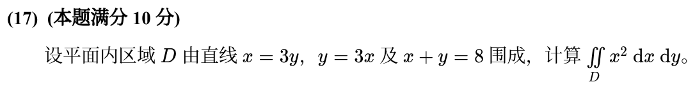
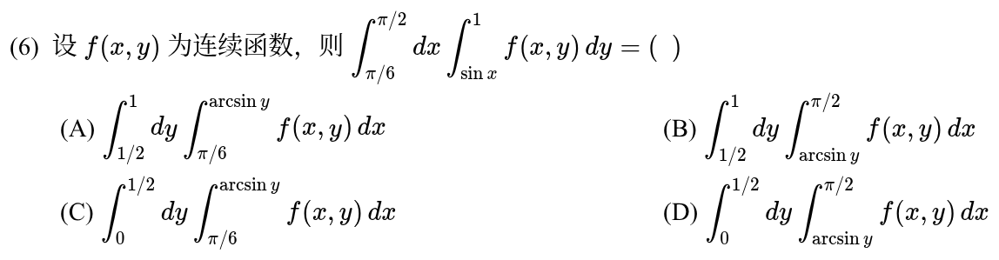
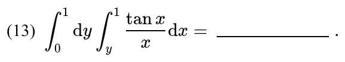
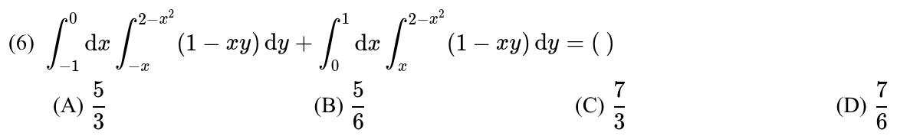
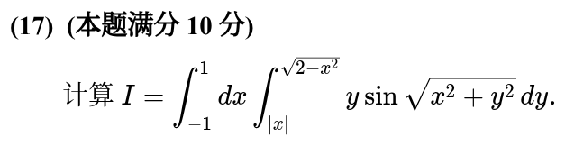
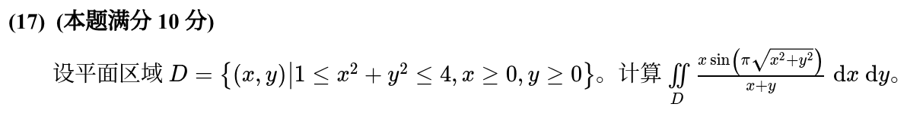
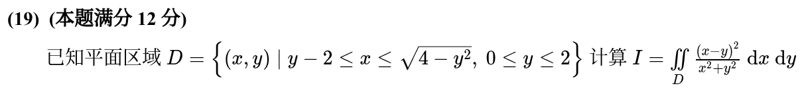

# 二重积分的换序、对称性与极坐标

> 章节主线：[二重积分](../../chapters/calculus/19-double-integrals.md)

二重积分在数二里几乎是每年一道客观题加一道解答题的“大户”。很多时候算不下去或者算得满头大汗，根本原因不是积分公式背不熟，而是**拿到题直接硬套直角坐标，没有先画区域草图、没有按正确优先级挑化简工具**。

拿到任何一道二重积分题，第一笔先**画草图定区域 $D$**，然后严格按下面的优先级做决策：

| 决策顺序 | 触发信号 | 第一笔怎么落 | 常见误区 |
| :--- | :--- | :--- | :--- |
| **1. 先看对称性（合并/轮换/奇偶）** | 区域关于 $x$ 轴、$y$ 轴或 $y=x$ 对称；或题目把对称区域拆成两块相加 | 先把拆分区域**合并成完整对称域**；再用**奇偶对称**（奇为 $0$、偶加倍）或**轮换对称**（$x \leftrightarrow y$ 互换相加消分母） | 区域对称但被积函数没拆奇偶项；偶函数化简忘了乘 $2$；区域不关于 $y=x$ 对称却乱用轮换对称 |
| **2. 再看能否直接换序** | 被积函数含 $\frac{\tan x}{x}, e^{x^2}, \frac{\sin y}{y}$ 等**积不出原函数**的项；或题干直接问交换积分次序 | 画出区域 $D$，确定新外层变量的**最值范围**，再用垂直/水平穿线读出新内层上下限 | 换序不画图靠脑补；把水平穿线的左右边界写反；漏算曲线交点导致外层限写错 |
| **3. 再看是否切极坐标** | 区域边界含圆/扇形/圆环（$x^2+y^2$），或被积函数含 $x^2+y^2, \sqrt{x^2+y^2}, \frac{y}{x}$ | 写出 $\theta$ 的起止射线与 $r(\theta)$ 的穿入穿出曲线，**面积元素 $\mathrm{d}x\mathrm{d}y = r\,\mathrm{d}r\mathrm{d}\theta$ 千万别漏 $r$** | 漏乘雅可比因子 $r$；圆心不在原点或直线边界时乱写 $r$ 上限；把 $|x|$ 对应的射线角度算错 |
| **4. 最后用直角坐标分块** | 区域由若干条直线围成（三角形/多边形），被积函数是多项式 | 标出全部顶点坐标，对比 $X$-型与 $Y$-型**谁分块更少、谁内层积分更短**再落笔 | 没找交点就把两段上边界混成一个积分 |

下面用五道真题把这四条决策路径逐一打通。

---

## 一、直角坐标分块：先画顶点，再选切分方向

### 判断链

1. 区域由多条直线围成时，**第一笔先两两联立求出全部顶点坐标**，把草图画准。
2. 观察竖直穿线（先 $y$ 后 $x$）与水平穿线（先 $x$ 后 $y$）各自需要拆成几块、每块上下/左右边界分别是哪条直线；若都拆成 2 块，优先选**外层变量与被积函数一致**的方向（例如被积函数是 $x^2$，先对 $y$ 积分只需乘以区间长度 $y_{\text{上}}-y_{\text{下}}$，大幅省去三次方展开！）。

---

### 例 1：[2013 年第 17 题](../../chapters/calculus/19-double-integrals.md#q2013-17)（解答题，满分 10 分）

> **建议先自己读原题并写第一步**，再往下看推演。

**原题**（[在章节题单中查看](../../chapters/calculus/19-double-integrals.md#q2013-17)）：

#### 触发条件与第一步

三条直线围成三角形，被积函数是纯 $x^2$。第一笔**两两联立求三个顶点**，并选择“先 $y$ 后 $x$”——这样内层对 $y$ 积分直接把 $x^2$ 提出来，完全避免 $\left[(8-y)^3 - (y/3)^3\right]$ 的繁琐展开。

#### 完整推演

1. **求三角形区域 $D$ 的三个顶点**：
   - $x = 3y$ 与 $y = 3x$ 交于 $O(0, 0)$；
   - $y = 3x$ 与 $x + y = 8$ 交于 $A(2, 6)$；
   - $x = 3y$ 与 $x + y = 8$ 交于 $B(6, 2)$。
2. **按 $X$-型切分区域**（以顶点 $A$ 的横坐标 $x=2$ 为分界）：
   - $D_1$：$0 \le x \le 2$，$\frac{x}{3} \le y \le 3x$；
   - $D_2$：$2 \le x \le 6$，$\frac{x}{3} \le y \le 8 - x$。
3. **分块计算**：
   $$\begin{aligned}
   \iint_D x^2\,\mathrm{d}x\mathrm{d}y &= \int_0^2 x^2\,\mathrm{d}x \int_{\frac{x}{3}}^{3x} \mathrm{d}y + \int_2^6 x^2\,\mathrm{d}x \int_{\frac{x}{3}}^{8-x} \mathrm{d}y \\
   &= \int_0^2 x^2\cdot\frac{8}{3}x\,\mathrm{d}x + \int_2^6 x^2\left(8 - \frac{4}{3}x\right)\mathrm{d}x \\
   &= \left[\frac{2}{3}x^4\right]_0^2 + \left[\frac{8}{3}x^3 - \frac{1}{3}x^4\right]_2^6 \\
   &= \frac{32}{3} + \frac{1}{3}\Big(8(216 - 8) - (1296 - 16)\Big) \\
   &= \frac{32}{3} + \frac{1664 - 1280}{3} = \frac{32}{3} + \frac{384}{3} = \frac{416}{3}.
   \end{aligned}$$

#### 条件变式检验

- **变式**：若把被积函数改为 $x^2 - y^2$，是否还需要分块硬算？
  **不需要！** 观察三条边界：$x=3y$ 与 $y=3x$ 互为关于 $y=x$ 的镜像，$x+y=8$ 自身关于 $y=x$ 对称，故区域 $D$ 关于 $y=x$ 对称。由轮换对称性，$\iint_D x^2\,\mathrm{d}x\mathrm{d}y = \iint_D y^2\,\mathrm{d}x\mathrm{d}y$，因此 $\iint_D (x^2 - y^2)\,\mathrm{d}x\mathrm{d}y = 0$，一步出答案。

---

## 二、交换积分次序：画图定外层最值，穿线读内层上下限

### 判断链

换序题只有两类考法——**纯换序选择题**和**“积不出来逼你换序”计算题**，但做法完全一致：
1. **由原积分限写出不等式组**，画出草图，标出所有交点坐标；
2. **先定新外层常数限**：取区域在新外层变量方向上的最小值与最大值；
3. **再做穿线定新内层函数限**：
   - 换成先 $x$ 后 $y$：画**水平向右**箭头，穿入曲线为下限，穿出曲线为上限；
   - 换成先 $y$ 后 $x$：画**竖直向上**箭头，穿入曲线为下限，穿出曲线为上限。

---

### 例 2：[2024 年第 6 题](../../chapters/calculus/19-double-integrals.md#q2024-6)（选择题）

> **建议先自己读原题并写第一步**，再往下看推演。

**原题**（[在章节题单中查看](../../chapters/calculus/19-double-integrals.md#q2024-6)）：

#### 触发条件与第一步

抽象连续函数 $f(x,y)$，选项全是先 $x$ 后 $y$ 的累次积分，属于纯换序题。第一笔先把原积分限翻译成区域不等式并标出端点：$\frac{\pi}{6} \le x \le \frac{\pi}{2}$，$\sin x \le y \le 1$。

#### 完整推演

1. **画出区域 $D$ 并标关键点**：
   在 $\left[\frac{\pi}{6}, \frac{\pi}{2}\right]$ 上，$y = \sin x$ 严格单调递增，从左端点 $\left(\frac{\pi}{6}, \frac{1}{2}\right)$ 上升到右端点 $\left(\frac{\pi}{2}, 1\right)$。
   区域 $D$ 位于曲线 $y = \sin x$ 的**上方**、水平直线 $y = 1$ 的**下方**、竖直直线 $x = \frac{\pi}{6}$ 的**右侧**。
2. **确定外层 $y$ 的范围**：
   $D$ 的最低点纵坐标为 $\sin\frac{\pi}{6} = \frac{1}{2}$，最高点纵坐标为 $1$，故 $\frac{1}{2} \le y \le 1$。
3. **水平向右穿线确定内层 $x$ 的范围**：
   对任意固定的 $y \in \left[\frac{1}{2}, 1\right]$，水平线从左边界 $x = \frac{\pi}{6}$ 穿入，从右边界 $y = \sin x$（在 $\left[\frac{\pi}{6}, \frac{\pi}{2}\right] \subset \left[-\frac{\pi}{2}, \frac{\pi}{2}\right]$ 上反解为 $x = \arcsin y$）穿出，故 $\frac{\pi}{6} \le x \le \arcsin y$。
4. **写出换序结果**：
   $$\int_{\frac{1}{2}}^{1}\mathrm{d}y \int_{\frac{\pi}{6}}^{\arcsin y} f(x,y)\,\mathrm{d}x.$$

故正确选项为 **（A）**。

#### 选择题干扰项拆解

- **（B）$\int_{1/2}^1 \mathrm{d}y \int_{\arcsin y}^{\pi/2} f(x,y)\,\mathrm{d}x$**：水平穿线左右边界写反，取成了曲线 $y=\sin x$ 右侧那块补集区域。
- **（C）$\int_0^{1/2}\mathrm{d}y \int_{\pi/6}^{\arcsin y} f(x,y)\,\mathrm{d}x$**：误把 $y$ 的下限当成 $0$，忘了左边界 $x=\frac{\pi}{6}$ 对应的最低点是 $y = \frac{1}{2}$。
- **（D）**：同时犯了 $y$ 范围错写为 $[0, \frac{1}{2}]$ 和 $x$ 穿线写反两个错误。

#### 条件变式检验

- **变式**：若把原题外层 $x$ 的范围改为 $\left[\frac{\pi}{2}, \frac{5\pi}{6}\right]$（仍在 $\sin x \le y \le 1$ 之间），内层反解还能写 $x = \arcsin y$ 吗？
  **不能！** 因为 $\arcsin y$ 的值域是 $\left[-\frac{\pi}{2}, \frac{\pi}{2}\right]$，在 $\left[\frac{\pi}{2}, \frac{5\pi}{6}\right]$ 上 $y=\sin x$ 的反函数必须是 **$x = \pi - \arcsin y$**，此时换序结果为 $\int_{1/2}^1 \mathrm{d}y \int_{\pi-\arcsin y}^{5\pi/6} f(x,y)\,\mathrm{d}x$。反三角函数换序务必核对主值区间！

---

### 例 3：[2017 年第 13 题](../../chapters/calculus/19-double-integrals.md#q2017-13)（填空题）

> **建议先自己读原题并写第一步**，再往下看推演。

**原题**（[在章节题单中查看](../../chapters/calculus/19-double-integrals.md#q2017-13)）：

#### 触发条件与第一步

内层积分 $\int_y^1 \frac{\tan x}{x}\,\mathrm{d}x$ **没有初等原函数**——这是最经典的“强迫换序”信号。第一笔立刻把积分区域写成不等式并交换次序为“先 $y$ 后 $x$”，让内层积分乘出一个 $x$ 把分母约掉！

#### 完整推演

1. **翻译并改写积分区域**：
   原区域为 $0 \le y \le 1,\; y \le x \le 1$（顶点为 $(0,0), (1,0), (1,1)$ 的直角三角形）。
   换成先 $y$ 后 $x$：$0 \le x \le 1,\; 0 \le y \le x$。
2. **换序计算**：
   $$\begin{aligned}
   \int_0^1 \mathrm{d}y \int_y^1 \frac{\tan x}{x}\,\mathrm{d}x &= \int_0^1 \mathrm{d}x \int_0^x \frac{\tan x}{x}\,\mathrm{d}y \\
   &= \int_0^1 \frac{\tan x}{x} \cdot x\,\mathrm{d}x = \int_0^1 \tan x\,\mathrm{d}x \\
   &= \Big[-\ln|\cos x|\Big]_0^1 = -\ln(\cos 1).
   \end{aligned}$$
   （因为 $0 < 1 < \frac{\pi}{2}$，$\cos 1 > 0$，绝对值可直接去掉；写成 $\ln(\sec 1)$ 亦等价。）

故应填 **$-\ln(\cos 1)$**。

#### 条件变式检验

- **变式**：若把原题改成 $\int_0^1 \mathrm{d}y \int_0^y \frac{\tan x}{x}\,\mathrm{d}x$，换序后还能消掉分母 $x$ 吗？
  换序后变为 $\int_0^1 \mathrm{d}x \int_x^1 \frac{\tan x}{x}\,\mathrm{d}y = \int_0^1 \frac{1-x}{x}\tan x\,\mathrm{d}x$，其中 $\frac{\tan x}{x}$ 项依然无法用初等函数积分。可见“换序消分母”依赖的是内层积分区间长度恰好为 $x$（即 $y$ 从 $0$ 积到 $x$）。

---

## 三、对称性化简与极坐标：先合并对称，再看圆弧与 $\sqrt{x^2+y^2}$

### 判断链

1. **看到两个同被积函数的累次积分相加**：不要分别硬算！第一笔先画出两块区域，看它们拼接后是否构成一个**关于坐标轴对称的完整区域**。一旦对称，立刻把被积函数拆成“奇项（直接划零）+ 偶项（加倍只算一半）”。
2. **看到 $\sqrt{x^2+y^2}$ 或 $\sqrt{R^2-x^2}$**：优先切极坐标 $x = r\cos\theta,\; y = r\sin\theta,\; \mathrm{d}x\mathrm{d}y = r\,\mathrm{d}r\mathrm{d}\theta$。
   - 若下限是 $y = |x|$，它在第一、二象限分别对应射线 $\theta = \frac{\pi}{4}$ 与 $\theta = \frac{3\pi}{4}$；
   - 若区域关于 $y$ 轴对称且被积函数关于 $x$ 是偶函数，可以先用对称性缩到第一象限再切极坐标，也可直接从 $\frac{\pi}{4}$ 积到 $\frac{3\pi}{4}$。

---

### 例 4：[2018 年第 6 题](../../chapters/calculus/19-double-integrals.md#q2018-6)（选择题）

> **建议先自己读原题并写第一步**，再往下看推演。

**原题**（[在章节题单中查看](../../chapters/calculus/19-double-integrals.md#q2018-6)）：

#### 触发条件与第一步

两个积分的被积函数完全相同（都是 $1 - xy$），区间分别是 $[-1, 0]$ 与 $[0, 1]$，上边界都是 $2-x^2$，下边界分别是 $-x$ 与 $x$（合起来就是 $|x|$）。第一笔立刻**合并为一个二重积分**，利用区域关于 $y$ 轴对称把 $-xy$ 直接划掉！

#### 完整推演

1. **合并积分区域**：
   两块区域拼接成完整区域
   $$D = \{(x,y) \mid -1 \le x \le 1,\; |x| \le y \le 2 - x^2\}.$$
   显然 $D$ **关于 $y$ 轴对称**。
2. **利用奇偶对称性化简**：
   - $-xy$ 关于 $x$ 是**奇函数** $\implies \iint_D (-xy)\,\mathrm{d}x\mathrm{d}y = 0$；
   - $1$ 关于 $x$ 是**偶函数** $\implies$ 只需算右半区域 $D_1 = \{(x,y) \mid 0 \le x \le 1,\; x \le y \le 2-x^2\}$ 的面积再乘以 $2$：
   $$\begin{aligned}
   \iint_D (1 - xy)\,\mathrm{d}x\mathrm{d}y &= \iint_D 1\,\mathrm{d}x\mathrm{d}y = 2\int_0^1 (2 - x^2 - x)\,\mathrm{d}x \\
   &= 2\left[2x - \frac{x^3}{3} - \frac{x^2}{2}\right]_0^1 = 2\left(2 - \frac{1}{3} - \frac{1}{2}\right) = 2\cdot\frac{7}{6} = \frac{7}{3}.
   \end{aligned}$$

故正确选项为 **（C）**。

#### 选择题干扰项拆解

- **（D）$\frac{7}{6}$（最高频错选）**：用对称性只算了右半区域 $[0,1]$ 的积分，**最后忘了乘以 $2$**。
- **（A）$\frac{5}{3}$ / （B）$\frac{5}{6}$**：计算定积分时把 $2 - \frac{1}{3} - \frac{1}{2}$ 算错（例如漏算 $2$ 或把下限 $x$ 的符号弄反）。

#### 条件变式检验

- **变式**：若把题干中两个积分中间的“$+$”号改成“$-$”号，还能直接把 $-xy$ 划零吗？
  **不能！** 改成减号后相当于把左半区域的被积函数变号，反而变成了奇偶反转：$1$ 在左右两半互相抵消为 $0$，而 $-xy$ 在左右两半同号叠加，结果变成 $2\int_0^1 \mathrm{d}x \int_x^{2-x^2} xy\,\mathrm{d}y$（此时只留 $xy$ 项，不再是面积）。所以用对称性前必须确认两块是**同号相加**。

---

### 例 5：[2026 年第 17 题](../../chapters/calculus/19-double-integrals.md#q2026-17)（解答题，满分 10 分）

> **建议先自己读原题并写第一步**，再往下看推演。

**原题**（[在章节题单中查看](../../chapters/calculus/19-double-integrals.md#q2026-17)）：

#### 触发条件与第一步

积分上限是 $\sqrt{2 - x^2}$（圆 $x^2+y^2=2$ 的上半圆），下限是 $|x|$（射线 $\theta = \frac{\pi}{4}$ 与 $\theta = \frac{3\pi}{4}$），被积函数又含 $\sin\sqrt{x^2+y^2}$——**区域与被积函数双重指向极坐标**！第一笔画出扇形草图，确认交点 $(-1,1)$ 与 $(1,1)$ 恰好落在圆 $x^2+y^2=2$ 上，从而整个区域就是一个完整扇形。

#### 完整推演

1. **画出积分区域 $D$ 并转极坐标**：
   原区域为 $D = \{(x,y) \mid -1 \le x \le 1,\; |x| \le y \le \sqrt{2-x^2}\}$。
   联立 $y = |x|$ 与 $x^2+y^2 = 2$ 得交点 $(1,1)$ 与 $(-1,1)$，正好对应 $x = \pm 1$。
   因此 $D$ 是圆心在原点、半径为 $\sqrt{2}$、极角从 $\frac{\pi}{4}$ 到 $\frac{3\pi}{4}$ 的扇形：
   $$D = \left\{(r,\theta) \;\middle|\; \frac{\pi}{4} \le \theta \le \frac{3\pi}{4},\; 0 \le r \le \sqrt{2}\right\}.$$
2. **极坐标下分离变量**（注意 $y = r\sin\theta$，且 $\mathrm{d}x\mathrm{d}y = r\,\mathrm{d}r\mathrm{d}\theta$，合并得 $r^2$）：
   $$I = \int_{\frac{\pi}{4}}^{\frac{3\pi}{4}} \mathrm{d}\theta \int_0^{\sqrt{2}} (r\sin\theta)\sin r \cdot r\,\mathrm{d}r = \left(\int_{\frac{\pi}{4}}^{\frac{3\pi}{4}} \sin\theta\,\mathrm{d}\theta\right)\left(\int_0^{\sqrt{2}} r^2\sin r\,\mathrm{d}r\right).$$
3. **分别计算两个定积分**：
   - 极角部分：
     $$\int_{\frac{\pi}{4}}^{\frac{3\pi}{4}} \sin\theta\,\mathrm{d}\theta = \Big[-\cos\theta\Big]_{\frac{\pi}{4}}^{\frac{3\pi}{4}} = \frac{\sqrt{2}}{2} - \left(-\frac{\sqrt{2}}{2}\right) = \sqrt{2}.$$
   - 极径部分（两次分部积分）：
     $$\begin{aligned}
     \int_0^{\sqrt{2}} r^2\sin r\,\mathrm{d}r &= \Big[-r^2\cos r\Big]_0^{\sqrt{2}} + 2\int_0^{\sqrt{2}} r\cos r\,\mathrm{d}r \\
     &= -2\cos\sqrt{2} + 2\Big[r\sin r + \cos r\Big]_0^{\sqrt{2}} \\
     &= -2\cos\sqrt{2} + 2\sqrt{2}\sin\sqrt{2} + 2\cos\sqrt{2} - 2 \\
     &= 2\sqrt{2}\sin\sqrt{2} - 2.
     \end{aligned}$$
     （注意 $-2\cos\sqrt{2}$ 与 $+2\cos\sqrt{2}$ 恰好完全抵消！）
4. **相乘得最终结果**：
   $$I = \sqrt{2}\big(2\sqrt{2}\sin\sqrt{2} - 2\big) = 4\sin\sqrt{2} - 2\sqrt{2}.$$

#### 条件变式检验

- **变式**：若把题干被积函数中的 $y$ 改成 $x$，即计算 $\int_{-1}^1 \mathrm{d}x \int_{|x|}^{\sqrt{2-x^2}} x\sin\sqrt{x^2+y^2}\,\mathrm{d}y$，结果是多少？
  **直接为 $0$！** 因为区域 $D$ 关于 $y$ 轴对称，而被积函数 $x\sin\sqrt{x^2+y^2}$ 关于 $x$ 是奇函数（极坐标下表现为 $\int_{\pi/4}^{3\pi/4} \cos\theta\,\mathrm{d}\theta = 0$），根本无需算极径分部积分。

---

## 四、回练与过关标准

下面两道真题把**轮换对称 + 极坐标**与**区域拆分 + 极坐标**综合在一起。请先独立完成，再展开核对要点。

### 1. 真题回练：[2014 年第 17 题](../../chapters/calculus/19-double-integrals.md#q2014-17)（解答题，满分 10 分）

点击核对要点与答案

- **第一步用轮换对称性消分母 $x+y$**：
  区域 $D$ 是第一象限的圆环（$1 \le r \le 2,\; 0 \le \theta \le \frac{\pi}{2}$），关于直线 $y = x$ 对称。
  交换 $x, y$ 得 $I = \iint_D \frac{y\sin(\pi\sqrt{x^2+y^2})}{x+y}\,\mathrm{d}x\mathrm{d}y$，两式相加得
  $$2I = \iint_D \sin\left(\pi\sqrt{x^2+y^2}\right)\mathrm{d}x\mathrm{d}y.$$
- **第二步切极坐标 + 分部积分**：
  $$I = \frac{1}{2}\int_0^{\frac{\pi}{2}}\mathrm{d}\theta \int_1^2 r\sin(\pi r)\,\mathrm{d}r = \frac{\pi}{4}\left[-\frac{r\cos(\pi r)}{\pi} + \frac{\sin(\pi r)}{\pi^2}\right]_1^2 = \frac{\pi}{4}\left(-\frac{2}{\pi} - \frac{1}{\pi}\right) = -\frac{3}{4}.$$
- **答案**：$-\dfrac{3}{4}$。

### 2. 真题回练：[2022 年第 19 题](../../chapters/calculus/19-double-integrals.md#q2022-19)（解答题，满分 12 分）

点击核对要点与答案

- **第一步拆被积函数 + 拆区域**：
  把被积函数化为 $\frac{(x-y)^2}{x^2+y^2} = 1 - \frac{2xy}{x^2+y^2}$。
  区域 $D$ 由 $x=0$ 拆成两块：
  - $D_1$（第一象限四分之一圆）：$0 \le \theta \le \frac{\pi}{2},\; 0 \le r \le 2$，面积为 $\pi$；
  - $D_2$（第二象限等腰直角三角形，边界 $y-x=2$）：$\frac{\pi}{2} \le \theta \le \pi,\; 0 \le r \le \frac{2}{\sin\theta-\cos\theta}$，面积为 $2$。
  故常数项积分 $\iint_D 1\,\mathrm{d}x\mathrm{d}y = \pi + 2$。
- **第二步在极坐标下算 $J = \iint_D \frac{2xy}{x^2+y^2}\,\mathrm{d}x\mathrm{d}y = J_1 + J_2$**（注意 $\frac{2xy}{x^2+y^2} = \sin 2\theta$）：
  - $J_1 = \int_0^{\frac{\pi}{2}}\sin 2\theta\,\mathrm{d}\theta \int_0^2 r\,\mathrm{d}r = 1 \cdot 2 = 2$；
  - $J_2 = \int_{\frac{\pi}{2}}^{\pi} \sin 2\theta\,\mathrm{d}\theta \int_0^{\frac{2}{\sin\theta-\cos\theta}} r\,\mathrm{d}r = \int_{\frac{\pi}{2}}^{\pi} \frac{2\sin 2\theta}{1 - \sin 2\theta}\,\mathrm{d}\theta$。
    令 $t = \theta - \frac{\pi}{2} \in \left[0, \frac{\pi}{2}\right]$（则 $\sin 2\theta = -\sin 2t$）：
    $$J_2 = \int_0^{\frac{\pi}{2}} \frac{-2\sin 2t}{1 + \sin 2t}\,\mathrm{d}t = \int_0^{\frac{\pi}{2}}\left(-2 + \frac{2}{1+\sin 2t}\right)\mathrm{d}t = -\pi + 2.$$
    （其中 $\int_0^{\frac{\pi}{2}}\frac{2}{1+\sin 2t}\,\mathrm{d}t \xlongequal{u=2t} \int_0^\pi \frac{\mathrm{d}u}{1+\sin u} = 2\int_0^{\frac{\pi}{2}}\frac{\mathrm{d}w}{1+\cos w} = 2\big[\tan\frac{w}{2}\big]_0^{\frac{\pi}{2}} = 2$。）
- **第三步合并**：$I = (\pi + 2) - (J_1 + J_2) = (\pi + 2) - (4 - \pi) = 2\pi - 2$。
- **答案**：$2\pi - 2$。

### 过关标准

合上讲义，面对一道新的二重积分题，能够独立完成以下四步即算过关：
1. 动笔计算前先**画出积分区域草图并标清全部交点**；
2. 能按“**对称性（合并/奇偶/轮换）$\to$ 换序 $\to$ 极坐标 $\to$ 直角坐标分块**”的顺序做决策，不盲目硬算；
3. 换序时能正确写出外层最值与穿线上下限（含反三角函数主值区间核对），切极坐标时**绝不漏乘 $r$**；
4. 独立完成两道回练题，一次算对 $-\frac{3}{4}$ 与 $2\pi - 2$。
