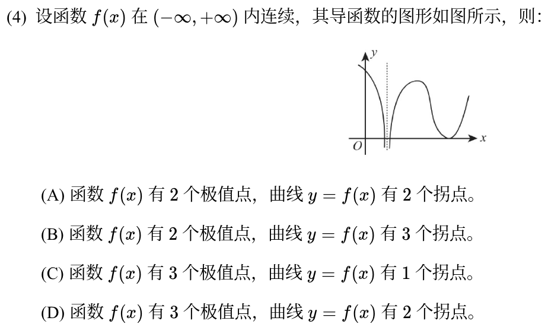
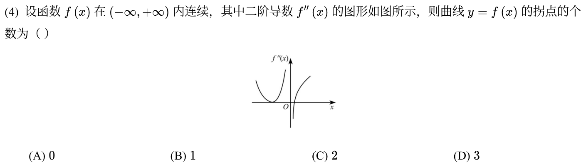
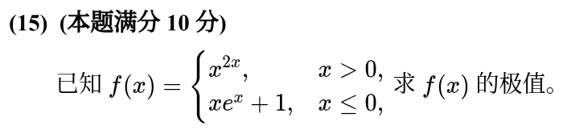
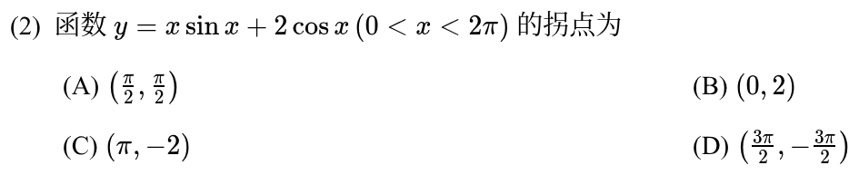
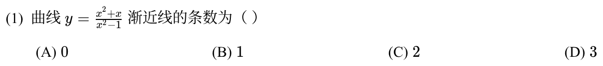
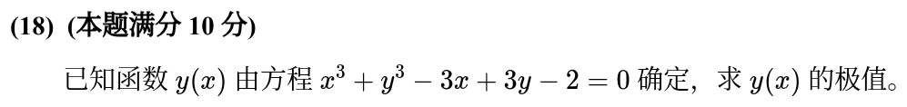
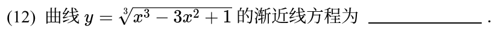

# 单调极值、凹凸拐点与曲线几何

> 跨章主题：串联[单调性、极值与零点个数](../../chapters/calculus/06-monotonicity-extrema.md)、[凹凸性与拐点](../../chapters/calculus/07-convexity.md)与[曲线几何与渐近线](../../chapters/calculus/09-curve-geometry.md)

这三章在数二真题里几乎年年以选择、填空或中档解答题出现，考的从来不是背“第一充分条件 / 第二充分条件”的字面定义，而是**在分段点、不可导点、可去间断点、隐函数方程和导函数图像面前，能不能不漏点、不多算点**。

做题时按下面这张排查表推进，可以避开 90% 的失分坑：

| 题型与设问 | 第一步先查什么 | 真正的判定依据 | 最常见失分坑 |
| :--- | :--- | :--- | :--- |
| **给 $f'(x)$ 或 $f''(x)$ 图像，数极值点 / 拐点个数** | 先看清纵轴画的是 **$f'(x)$ 还是 $f''(x)$**，再看题干是否给了 **$f(x)$ 连续** | 极值点看 **$f'$ 左右变号**；拐点看 **$f''$ 左右变号**（即 $f'$ 的单调性在左右切换） | 把“与 $x$ 轴相切不变号”算进去；或漏掉“$f'$ 或 $f''$ 在该点无定义（铅直渐近线）但 $f$ 连续且左右变号/单调切换”的点 |
| **显式 / 分段 / 隐函数求极值或拐点** | 先列全**所有可疑点**：驻点（$f'=0$ 或 $f''=0$）+ **不可导点 / 分段分界点** | 在分段点或无定义点必须用**左右一阶/二阶导数符号**（第一充分条件）判定，不能只用二阶导公式 | 漏查分段分界点 $x=0$；或隐函数代入驻点回原方程时漏查是否只有唯一实根 |
| **求渐近线条数或方程** | 按固定顺序查三类：**铅直 $\to$ 水平 $\to$ 斜渐近线**（左右无穷分开看） | 铅直看**无定义点极限是否为 $\infty$**；水平与斜渐近线在同一侧（$+\infty$ 或 $-\infty$）互斥 | 看到分母为 $0$ 就直接判铅直渐近线，**忘了先约公因式排除可去间断点**；或求斜渐近线时只算 $+\infty$ 忘了核对 $-\infty$ |

下面用五道典型真题把这三条主线一次打穿：先对比 **$f'(x)$ 图像题** 与 **$f''(x)$ 图像题** 的读图规则，再练**分段函数极值**、**显式函数拐点**，最后收口到**渐近线排坑**。

---

## 一、看导数图像数极值点与拐点：先分清纵轴是谁，再盯紧“变号”与“连续”

### 判断链

1. **若图是 $y = f'(x)$**：
   - **极值点** $\iff$ $f(x)$ 在该点连续，且 $f'(x)$ 在该点**左右异号**（图像**穿过** $x$ 轴，或跨过 $x$ 轴发生正负跳跃）；仅仅与 $x$ 轴**相切**不算，同侧趋于 $-\infty$ 也不算。
   - **拐点** $\iff$ $f(x)$ 在该点连续，且 $f'(x)$ 在该点**左右单调性改变**（即 $f''(x)$ 左右变号）。因此 $f'(x)$ 的**极值点**以及“一侧单调递减趋于 $-\infty$、另一侧从 $-\infty$ 单调递增”的**铅直渐近线处**，只要 $f(x)$ 连续，都是曲线 $y=f(x)$ 的拐点！
2. **若图是 $y = f''(x)$**：
   - **拐点** $\iff$ $f(x)$ 在该点连续，且 $f''(x)$ 在该点**左右异号**（穿过 $x$ 轴，或像 $x=0$ 那样一侧为正、另一侧为负的间断点）；与 $x$ 轴相切不变号的点**不是**拐点。

---

### 例 1：[2016 年第 4 题](../../chapters/calculus/06-monotonicity-extrema.md#q2016-4)（选择题——给 $f'(x)$ 图像）

> **建议先自己盯住原图逐点标记**（哪几个点 $f'$ 变号？哪几个点 $f'$ 单调性改变？），再往下核对。

**原题**（[在章节题单中查看](../../chapters/calculus/06-monotonicity-extrema.md#q2016-4)）：

#### 逐点扫描与完整推导

题干已知 $f(x)$ 在 $(-\infty, +\infty)$ 内**连续**，图中给出的是导函数 $y = f'(x)$ 的图像。从左到右标出 5 个关键横坐标 $0 < x_1 < x_0 < x_2 < x_3 < x_4$：

1. **$x_1$（$x$ 轴第一个穿过的零点）**：$f'(x)$ 从正变为负 $\implies$ **$f(x)$ 的极大值点**；两侧 $f'(x)$ 均单调递减（$f'' < 0$）$\implies$ 不是拐点。
2. **$x_0$（虚线铅直渐近线处）**：
   - 左右两侧 $f'(x)$ 均小于 $0$（同趋于 $-\infty$），$f'(x)$ **不变号** $\implies$ **不是极值点**；
   - 左侧 $f'(x)$ 严格递减（$f''(x) < 0$），右侧 $f'(x)$ 严格递增（$f''(x) > 0$），且题干保证 $f(x)$ 在 $x_0$ 处**连续** $\implies$ **$(x_0, f(x_0))$ 是拐点**！（本题最核心的隐藏点）
3. **$x_2$（$x$ 轴第二个穿过的零点）**：$f'(x)$ 从负变为正 $\implies$ **$f(x)$ 的极小值点**；两侧 $f'(x)$ 均单调递增（$f'' > 0$）$\implies$ 不是拐点。
4. **$x_3$（$f'(x)$ 的波峰 / 极大值点）**：$f'(x)$ 恒正不变号 $\implies$ 不是极值点；$f'(x)$ 由增变减（$f''$ 由正变负）$\implies$ **$(x_3, f(x_3))$ 是拐点**。
5. **$x_4$（$f'(x)$ 与 $x$ 轴相切的波谷 / 极小值点）**：
   - 左右两侧 $f'(x) \ge 0$ 不变号 $\implies$ **不是极值点**；
   - $f'(x)$ 由减变增（$f''$ 由负变正）$\implies$ **$(x_4, f(x_4))$ 是拐点**。

汇总：**极值点 2 个**（$x_1, x_2$），**拐点 3 个**（$x_0, x_3, x_4$），选 **（B）**。

#### 选择题干扰项拆解

- **（A）2 个极值点，2 个拐点（最常见错误）**：正确排除了相切点 $x_4$ 作为极值点，却把铅直渐近线 $x_0$ 处当成“导数不存在就没有拐点”漏掉了。
- **（D）3 个极值点，2 个拐点**：既把相切点 $x_4$ 误当成极值点（只看 $f'=0$ 不看变号），又漏掉了 $x_0$ 处的拐点。
- **（C）3 个极值点，1 个拐点**：同时漏掉了 $x_0$ 与 $x_4$ 两个拐点。

#### 条件变式检验

- **变式**：若把图中虚线 $x_0$ 处改为“左侧 $f'(x) \to -\infty$，右侧 $f'(x) \to +\infty$”（且 $f(x)$ 仍连续），结果如何变化？
  此时在 $x_0$ 处 $f'(x)$ 由负变正，$x_0$ **变为极小值点**（极值点增为 3 个）；但两侧 $f'(x)$ 均为递减（$f'' < 0$），$x_0$ **不再是拐点**（拐点减为 2 个）。

---

### 例 2：[2015 年第 4 题](../../chapters/calculus/07-convexity.md#q2015-4)（选择题——给 $f''(x)$ 图像）

> **对照上一题**：这一题纵轴直接换成 **$f''(x)$**，判定规则立刻切换为“找 $f''(x)$ 左右变号的点”。

**原题**（[在章节题单中查看](../../chapters/calculus/07-convexity.md#q2015-4)）：

#### 逐点扫描与完整推导

题干已知 $f(x)$ 在 $(-\infty, +\infty)$ 内**连续**，从左到右检查图中 $f''(x)$ 的三个关键位置：

1. **负半轴切点 $x_1 < 0$**：$f''(x)$ 在 $x_1$ 处与 $x$ 轴相切，左右两侧均有 $f''(x) > 0$（不变号）$\implies$ **不是拐点**。
2. **原点 $x = 0$**：虽然 $f''(0)$ 不存在，但当 $x \to 0^-$ 时 $f''(x) > 0$，当 $x \to 0^+$ 时 $f''(x) < 0$，二阶导数左右变号，且 $f(x)$ 在 $x = 0$ 处**连续** $\implies$ **$(0, f(0))$ 是拐点**。
3. **正半轴交点 $x_2 > 0$**：$f''(x)$ 穿过 $x$ 轴，由负变正 $\implies$ **$(x_2, f(x_2))$ 是拐点**。

综上，曲线 $y = f(x)$ 共有 **2 个拐点**，选 **（C）**。

#### 选择题干扰项拆解

- **（B）1**：漏掉了 $f''(x)$ 无定义的原点 $x = 0$（误以为拐点必须满足 $f''(x) = 0$）。
- **（D）3**：把负半轴与 $x$ 轴相切的点 $x_1$ 误算成了拐点（只看 $f''(x_1)=0$ 忘了检查左右变号）。

#### 条件变式检验

- **变式**：若去掉题干中的“$f(x)$ 在 $(-\infty, +\infty)$ 内连续”，改为 $f(x)$ 在 $x = 0$ 处无定义（如 $f(x) = \frac{1}{x}$ 在 $0$ 两侧凹凸性相反），原点还是拐点吗？
  **不是。** 拐点首先是曲线上的点，必须在 $x_0$ 处有定义且连续；去掉 $x=0$ 处的连续性后，拐点个数降为 1 个。

---

## 二、显式与分段函数求极值、拐点：不漏分界点，不漏区间限制

### 例 3：[2019 年第 15 题](../../chapters/calculus/06-monotonicity-extrema.md#q2019-15)（解答题，满分 10 分）

> **核心考法**：分段函数求极值，**最容易漏掉的不是两个驻点，而是分段分界点 $x = 0$**（不可导但连续，且左右导数变号）。

**原题**（[在章节题单中查看](../../chapters/calculus/06-monotonicity-extrema.md#q2019-15)）：

#### 第一步落笔与完整推导

1. **先检查分段点 $x = 0$ 的连续性**：
   $$f(0) = 0 \cdot e^0 + 1 = 1, \qquad \lim_{x\to 0^+} x^{2x} = \lim_{x\to 0^+} e^{2x\ln x} = e^0 = 1 = f(0).$$
   故 $f(x)$ 在 $(-\infty, +\infty)$ 上处处连续。
2. **分段求导，找全部驻点**：
   - 当 $x < 0$ 时：$f'(x) = (x + 1)e^x$。令 $f'(x) = 0$ 得驻点 $x = -1$；
     - 在 $(-\infty, -1)$ 上 $f'(x) < 0$；在 $(-1, 0)$ 上 $f'(x) > 0$。
   - 当 $x > 0$ 时：改写 $f(x) = e^{2x\ln x}$，求导得
     $$f'(x) = e^{2x\ln x}\cdot 2(\ln x + 1) = 2x^{2x}(\ln x + 1).$$
     令 $f'(x) = 0$ 得驻点 $x = \frac{1}{e}$；
     - 在 $\left(0, \frac{1}{e}\right)$ 上 $f'(x) < 0$；在 $\left(\frac{1}{e}, +\infty\right)$ 上 $f'(x) > 0$。
3. **汇总全部可疑点（两个驻点 + 分段点 $x = 0$）画单调符号表**：

| 区间 / 点 | $(-\infty, -1)$ | $-1$ | $(-1, 0)$ | $0$ | $\left(0, \frac{1}{e}\right)$ | $\frac{1}{e}$ | $\left(\frac{1}{e}, +\infty\right)$ |
| :---: | :---: | :---: | :---: | :---: | :---: | :---: | :---: |
| $f'(x)$ | $-$ | $0$ | $+$ | 不存在（右导 $-\infty$） | $-$ | $0$ | $+$ |
| $f(x)$ | $\searrow$ | **极小值** | $\nearrow$ | **极大值** | $\searrow$ | **极小值** | $\nearrow$ |

4. **写出全部极值**（注意题目问“极值”，必须算函数值）：
   - 极小值：$f(-1) = 1 - \frac{1}{e}$，以及 $f\left(\frac{1}{e}\right) = \left(\frac{1}{e}\right)^{2/e} = e^{-\frac{2}{e}}$；
   - 极大值：$f(0) = 1$。

#### 条件变式检验

- **变式**：若把 $x \le 0$ 那一段改为 $f(x) = xe^x + 2$（其余不变），$x = 0$ 还是极大值点吗？
  **仍然是极大值点！** 此时 $f(0) = 2$，而 $\lim_{x\to 0^+} f(x) = 1 < 2$，且在 $(-1, 0)$ 上 $f(x) < f(0) = 2$，在 $(0, \frac{1}{e})$ 上 $f(x) < 1 < 2$，满足局部极大值的**定义**（极值点甚至不要求连续，只需在某去心邻域内 $f(x) \le f(x_0)$；但若是改成 $xe^x$ 使 $f(0)=0 < 1$，则 $x=0$ 就不再是极大值点）。

---

### 例 4：[2019 年第 2 题](../../chapters/calculus/07-convexity.md#q2019-2)（选择题）

> **核心考法**：显式函数求拐点，除求对 $y''$ 外，还要同时盯住**定义区间 $(0, 2\pi)$ 的边界**和**拐点是坐标点 $(x_0, y_0)$**。

**原题**（[在章节题单中查看](../../chapters/calculus/07-convexity.md#q2019-2)）：

#### 第一步落笔与完整推导

1. **逐阶求导**（化简后再求二阶，减少项数）：
   $$y' = \sin x + x\cos x - 2\sin x = x\cos x - \sin x,$$
   $$y'' = \cos x - x\sin x - \cos x = -x\sin x.$$
2. **在开区间 $(0, 2\pi)$ 内解 $y'' = 0$ 并检验变号**：
   因为 $x \in (0, 2\pi)$ 时 $x > 0$，所以 $y'' = -x\sin x = 0 \iff \sin x = 0 \iff x = \pi$。
   - 当 $x \in (0, \pi)$ 时，$\sin x > 0 \implies y'' < 0$；
   - 当 $x \in (\pi, 2\pi)$ 时，$\sin x < 0 \implies y'' > 0$。
   二阶导数在 $x = \pi$ 两侧变号，故 $x = \pi$ 对应唯一拐点。
3. **代回原函数算纵坐标**：
   $$y(\pi) = \pi\sin\pi + 2\cos\pi = -2.$$
   故拐点为 $(\pi, -2)$，选 **（C）**。

#### 选择题干扰项拆解

- **（B）$(0, 2)$**：最阴险的区间陷阱——虽然在 $x = 0$ 处 $y''(0) = 0$，但一来 $0 \notin (0, 2\pi)$ 不在题干给定区间内；二来 $y'' = -x\sin x$ 在 $x=0$ 左右两边**同为负号**（偶函数性质），即使把定义域扩到 $\mathbb{R}$，$(0, 2)$ 也不是拐点！
- **（A）$\left(\frac{\pi}{2}, \frac{\pi}{2}\right)$** 与 **（D）$\left(\frac{3\pi}{2}, -\frac{3\pi}{2}\right)$**：把 $y''$ 错算成含 $\cos x$ 的表达式后解出的 $\cos x = 0$ 的根。

#### 条件变式检验

- **变式**：若把区间 $(0, 2\pi)$ 扩大为 $(-\pi, \pi)$，曲线在 $(-\pi, \pi)$ 内有几个拐点？
  **0 个！** 因为 $y'' = -x\sin x$ 在 $(-\pi, 0)$ 与 $(0, \pi)$ 上均严格小于 $0$（$x$ 与 $\sin x$ 同号），$x = 0$ 处虽然 $y''(0)=0$ 但不变号，全区间严格上凸，无拐点。

---

## 三、渐近线排坑：先约公因式，再按“铅直 $\to$ 水平 $\to$ 斜”顺序扫

### 例 5：[2012 年第 1 题](../../chapters/calculus/09-curve-geometry.md#q2012-1)（选择题）

> **核心考法**：有理分式求渐近线条数，第一笔必须**先因式分解检查有无可去间断点**，绝不能数完分母零点就直接下结论。

**原题**（[在章节题单中查看](../../chapters/calculus/09-curve-geometry.md#q2012-1)）：

#### 第一步落笔与完整推导

先对分子分母因式分解：
$$y = \frac{x(x + 1)}{(x - 1)(x + 1)}, \qquad x \neq \pm 1.$$

1. **查铅直渐近线（逐个核对无定义点 $x = -1$ 与 $x = 1$）**：
   - 在 $x = -1$ 处：
     $$\lim_{x\to -1} \frac{x^2 + x}{x^2 - 1} = \lim_{x\to -1} \frac{x}{x - 1} = \frac{-1}{-2} = \frac{1}{2} \neq \infty,$$
     因此 $x = -1$ 是**可去间断点**，**不是**铅直渐近线！
   - 在 $x = 1$ 处：
     $$\lim_{x\to 1} \frac{x^2 + x}{x^2 - 1} = \lim_{x\to 1} \frac{x}{x - 1} = \infty,$$
     故 $x = 1$ 是唯一一条铅直渐近线。
2. **查水平渐近线（$x \to \pm\infty$）**：
   $$\lim_{x\to \infty} \frac{x^2 + x}{x^2 - 1} = 1,$$
   左右无穷极限相同，得水平渐近线 $y = 1$（共 1 条）。
3. **查斜渐近线**：因为 $+\infty$ 与 $-\infty$ 两侧均已有水平渐近线，故无斜渐近线。

综上，共有 **2 条**渐近线（$x = 1$ 与 $y = 1$），选 **（C）**。

#### 选择题干扰项拆解

- **（D）3（头号陷阱）**：直接令分母 $x^2 - 1 = 0$ 得到 $x = 1$ 和 $x = -1$ 两条铅直渐近线，加上 $y = 1$ 误选 3。
- **（B）1**：漏查水平渐近线或只算了铅直渐近线。

#### 条件变式检验

- **变式**：若把分子改为 $x^2 + 2x$，即 $y = \frac{x^2 + 2x}{x^2 - 1}$，渐近线有几条？
  此时 $x = -1$ 与 $x = 1$ 均不能与分子约去，两者极限均为 $\infty$，铅直渐近线变为 2 条，加上水平渐近线 $y = 1$，共 **3 条**。

---

## 四、回练与过关标准

### 1. 真题回练一：[2017 年第 18 题](../../chapters/calculus/06-monotonicity-extrema.md#q2017-18)（解答题，满分 10 分——隐函数求极值）

点击核对思路与关键结果

1. **一阶隐函数求导**：方程两边对 $x$ 求导得 $3x^2 + 3y^2 y' - 3 + 3y' = 0$，即
   $$y' = \frac{1 - x^2}{y^2 + 1}.$$
   分母 $y^2 + 1 \ge 1 > 0$ 恒不为 $0$，因此 $y(x)$ 处处可导，无不可导点。
2. **求驻点并代回原方程解 $y$**：令 $y' = 0$ 得 $x = 1$ 或 $x = -1$。
   注意到辅助函数 $g(y) = y^3 + 3y$ 满足 $g'(y) = 3y^2 + 3 > 0$ 严格递增，故每个 $x$ 对应的实数 $y$ **唯一**：
   - $x = 1$ 时：$y^3 + 3y - 4 = 0 \implies (y - 1)(y^2 + y + 4) = 0 \implies y = 1$；
   - $x = -1$ 时：$y^3 + 3y = 0 \implies y(y^2 + 3) = 0 \implies y = 0$。
3. **二阶隐函数求导判别**（直接在 $x^2 + y^2 y' - 1 + y' = 0$ 两边求导，并在 $y' = 0$ 处简化，免去商的求导）：
   $$2x + 2y(y')^2 + (y^2 + 1)y'' = 0 \xrightarrow{y' = 0} y'' = -\frac{2x}{y^2 + 1}.$$
   - 在 $(1, 1)$ 处：$y''(1) = -1 < 0 \implies$ 极大值 $y(1) = 1$；
   - 在 $(-1, 0)$ 处：$y''(-1) = 2 > 0 \implies$ 极小值 $y(-1) = 0$。

### 2. 真题回练二：[2025 年第 12 题](../../chapters/calculus/09-curve-geometry.md#q2025-12)（填空题——斜渐近线）

点击核对思路与关键结果

1. **无铅直与水平渐近线**：奇次根式在 $\mathbb{R}$ 上处处连续，无铅直渐近线；当 $x \to \pm\infty$ 时 $y \to \pm\infty$，无水平渐近线。
2. **提主项配合泰勒展开一步求斜渐近线**（比直接套 $k, b$ 硬有理化更快）：当 $x \to \pm\infty$ 时，
   $$y = x\left(1 - \frac{3}{x} + \frac{1}{x^3}\right)^{\frac{1}{3}} = x\left[1 + \frac{1}{3}\left(-\frac{3}{x} + \frac{1}{x^3}\right) + o\left(\frac{1}{x}\right)\right] = x - 1 + o(1).$$
   因此无论是 $x \to +\infty$ 还是 $x \to -\infty$，均有 $k = \lim_{x\to \pm\infty}\frac{y}{x} = 1$、$b = \lim_{x\to \pm\infty}(y - x) = -1$。
3. **答案**：$y = x - 1$。

### 过关标准

合上讲义，面对极值、拐点与渐近线的新题时，能独立做到以下四点即算过关：
1. 拿到图像题，先确认纵轴是 $f'$ 还是 $f''$，能一眼区分“穿过变号”“相切不变号”和“$f$ 连续但导数无定义的铅直渐近线处”；
2. 遇到分段函数求极值/拐点，能自动把**分段分界点**列入可疑点列表，用左右导数符号独立检验；
3. 遇到隐函数求极值，能用原方程唯一确定 $y$，并在 $y'=0$ 处用隐函数二次求导快速算出 $y''$；
4. 求渐近线时，能先因式分解排除可去间断点，再按“铅直 $\to$ 水平 $\to$ 斜（左右无穷分开确认）”完整收口。
