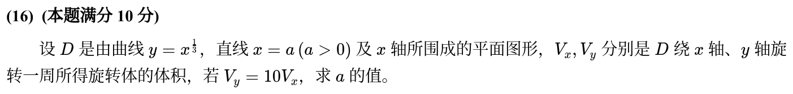
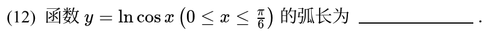
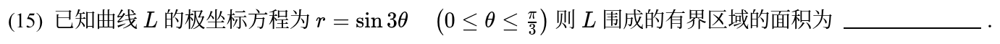
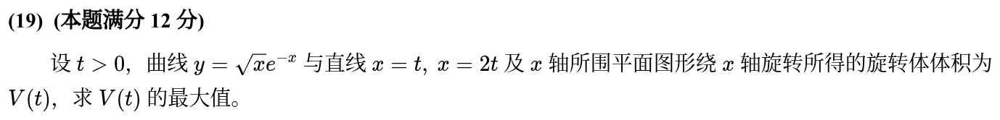
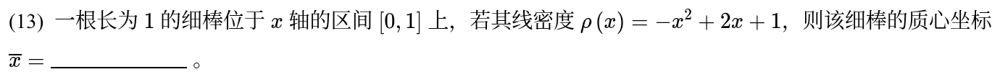
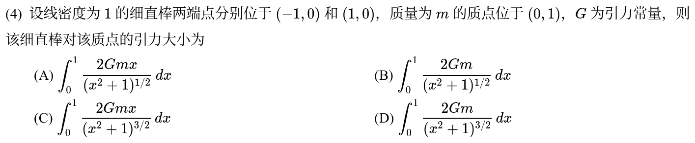

# 定积分几何与物理应用

> 单章深挖：对应[定积分几何与物理应用](../../chapters/calculus/13-integral-applications.md)

定积分应用题最容易翻车的地方不在后面的积分计算，而在**第一步列式**：画错区域草图、套错旋转体公式（把绕 $y$ 轴的壳层法与圆盘法混用）、极坐标忘查 $r(\theta)\ge 0$ 与周期边界、或者物理题里忘了把力做**矢量投影分解**。

拿到一道定积分应用题，先按下面的**建模决策表**选好坐标系与微元，再写积分式：

| 题目目标 | 首选微元与公式 | 什么时候换方法 / 关键触发 | 高频失分点 |
| :--- | :--- | :--- | :--- |
| **平面图形面积** | 直角坐标：$\int_a^b (y_{\text{上}} - y_{\text{下}})\,\mathrm{d}x$；极坐标：$\frac{1}{2}\int_\alpha^\beta r^2(\theta)\,\mathrm{d}\theta$ | 边界出现 $r=r(\theta)$ 或 $x^2+y^2$ 时优先极坐标；若 $x$ 更好表示为 $y$ 的函数，改对 $y$ 积分 | 极坐标直接把给定区间当闭合区间，未确认 $r(\theta)\ge 0$ 且不重复扫过同一区域 |
| **旋转体体积** | 绕 $x$ 轴：圆盘法 $\pi\int_a^b y^2\,\mathrm{d}x$；绕 $y$ 轴（区域在 $x\ge 0$）：**柱壳法** $2\pi\int_a^b x y\,\mathrm{d}x$ | 绕 $y$ 轴时，若反解 $x=\varphi(y)$ 麻烦或需分段，**一律优先柱壳法**；两法可互相验算 | 绕 $y$ 轴忘了乘 $2\pi$ 或漏了外半径减内半径（圆环法误写成 $\pi(R-r)^2$ 而不是 $\pi(R^2-r^2)$） |
| **平面曲线弧长** | 直角坐标：$\int_a^b \sqrt{1+(y')^2}\,\mathrm{d}x$；参数方程：$\int_\alpha^\beta \sqrt{(x')^2+(y')^2}\,\mathrm{d}t$ | 先化简根号内 $1+(y')^2$，考题几乎总能配成完全平方或三角恒等式（如 $1+\tan^2 x=\sec^2 x$） | 开根号时忘了检查正负号（需确保 $\sqrt{A^2}=|A|$）；参数方程漏写绝对值 |
| **含参几何量的最值** | 先把目标量写成**变限积分** $V(t)$ 或 $S(t)$ | **先用变限积分求导找唯一驻点 $t_0$**，最后只算 $V(t_0)$ 一次，**不要一上来就硬算含参不定积分** | 先把 $V(t)$ 积出来再求导，计算量翻倍且极易算错常数 |
| **物理应用（质心、做功、水压力、引力）** | 先取微小单元 $\mathrm{d}m = \rho(x)\,\mathrm{d}x$，写出微元量再积分 | 质心：$\bar{x}=\frac{\int x\rho(x)\,\mathrm{d}x}{\int \rho(x)\,\mathrm{d}x}$；引力：**先判对称性消去一维分量，再对保留方向做投影 $\cos\theta$** | 质心公式忘了除以总质量 $M$；引力题直接把标量大小 $\frac{Gm\,\mathrm{d}m}{r^2}$ 积分，**漏乘方向余弦 $\cos\theta$** |

下面用四道典型真题覆盖旋转体体积、弧长、极坐标面积与含参旋转体最值，再用两道物理应用真题做回练收口。

---

## 一、同一区域绕两轴旋转：绕 $x$ 轴用圆盘法，绕 $y$ 轴首选柱壳法

### 判断链

1. **先画草图定边界**：明确 $x$ 的范围 $[a, b]$ 与上下边界，确认区域完全位于坐标轴同侧（如第一象限）。
2. **绕 $x$ 轴**：区域紧贴 $x$ 轴（下边界 $y=0$），直接用圆盘法 $V_x = \pi\int_a^b y^2\,\mathrm{d}x$。
3. **绕 $y$ 轴**：
   - **柱壳法（推荐）**：在 $x$ 处取宽 $\mathrm{d}x$、高 $y(x)$ 的竖直薄条，绕 $y$ 轴转出薄圆筒，体积微元 $\mathrm{d}V_y = 2\pi x\cdot y(x)\,\mathrm{d}x$，无需反解 $x(y)$；
   - **圆环法（验算用）**：在 $y$ 处取水平薄条，外半径 $R=a$、内半径 $r=x(y)$，体积微元 $\mathrm{d}V_y = \pi(a^2 - x^2(y))\,\mathrm{d}y$。

---

### 例 1：[2013 年第 16 题](../../chapters/calculus/13-integral-applications.md#q2013-16)（解答题，满分 10 分）

> **建议先自己读原题并写第一步**，再往下看推演。

**原题**（[在章节题单中查看](../../chapters/calculus/13-integral-applications.md#q2013-16)）：

#### 触发条件与第一步落笔

- **触发条件**：曲边三角形 $D = \{(x,y)\mid 0 \le x \le a,\ 0 \le y \le x^{1/3}\}$（$a>0$），同时求 $V_x$ 和 $V_y$ 并通过 $V_y = 10 V_x$ 反求参数 $a$。
- **第一步怎么落笔**：确定积分区间 $[0,a]$，写出 $V_x$（圆盘法）与 $V_y$（柱壳法）两个积分表达式。

#### 完整推演

1. **求绕 $x$ 轴旋转体积 $V_x$（圆盘法）**：
   $$V_x = \pi \int_0^a \left(x^{\frac{1}{3}}\right)^2 \,\mathrm{d}x = \pi \int_0^a x^{\frac{2}{3}}\,\mathrm{d}x = \pi \left[\frac{3}{5} x^{\frac{5}{3}}\right]_0^a = \frac{3\pi}{5} a^{\frac{5}{3}}.$$

2. **求绕 $y$ 轴旋转体积 $V_y$（柱壳法）**：
   $$V_y = 2\pi \int_0^a x \cdot x^{\frac{1}{3}}\,\mathrm{d}x = 2\pi \int_0^a x^{\frac{4}{3}}\,\mathrm{d}x = 2\pi \left[\frac{3}{7} x^{\frac{7}{3}}\right]_0^a = \frac{6\pi}{7} a^{\frac{7}{3}}.$$
   （用圆环法交叉验算：曲线 $x = y^3$，$y \in [0, a^{1/3}]$，外半径 $a$，内半径 $y^3$，则
   $V_y = \pi \int_0^{a^{1/3}} (a^2 - y^6)\,\mathrm{d}y = \pi\left[a^2 y - \frac{1}{7}y^7\right]_0^{a^{1/3}} = \pi\left(a^{\frac{7}{3}} - \frac{1}{7}a^{\frac{7}{3}}\right) = \frac{6\pi}{7}a^{\frac{7}{3}}$，完全一致。）

3. **由 $V_y = 10 V_x$ 解出 $a$**：
   $$\frac{6\pi}{7} a^{\frac{7}{3}} = 10 \cdot \frac{3\pi}{5} a^{\frac{5}{3}} = 6\pi a^{\frac{5}{3}}.$$
   因为 $a > 0$，两边同除以 $6\pi a^{\frac{5}{3}}$ 得
   $$\frac{1}{7} a^{\frac{2}{3}} = 1 \implies a^{\frac{2}{3}} = 7 \implies a = 7^{\frac{3}{2}} = 7\sqrt{7}.$$

#### 条件变式检验

- **变式**：若把题干中“绕 $y$ 轴旋转”改为“绕直线 $x = a$ 旋转”，体积公式该如何改写？
  **柱壳半径变成 $a - x$**（不再是 $x$），体积为 $V_{x=a} = 2\pi \int_0^a (a - x)x^{\frac{1}{3}}\,\mathrm{d}x = 2\pi\left(\frac{3}{4} - \frac{3}{7}\right)a^{\frac{7}{3}} = \frac{9\pi}{14}a^{\frac{7}{3}}$。注意：如果改用圆盘法，绕 $x=a$ 旋转时半径直接是 $a - y^3$，表达式 $\pi\int_0^{a^{1/3}} (a - y^3)^2\,\mathrm{d}y$ 同样一次可算，但容易把 $(a-y^3)^2$ 错写成 $a^2 - y^6$。

---

## 二、平面曲线弧长：先化简 $\sqrt{1+(y')^2}$，开根号必查正负

### 判断链

1. **求导并代入**：先算 $y'$，再把 $1+(y')^2$ 化简到能**去根号**的形式（常见三角恒等式 $1+\tan^2 x = \sec^2 x$、双曲恒等式 $1+\sinh^2 x = \cosh^2 x$，或代数配平方 $(A-B)^2 + 4AB = (A+B)^2$）。
2. **去根号前必查符号**：根据 $x$ 的区间范围确定 $\sqrt{u^2} = u$ 还是 $-u$。
3. **背熟核心不定积分**：$\int \sec x\,\mathrm{d}x = \ln|\sec x + \tan x| + C$ 是弧长题的高频终结一步。

---

### 例 2：[2019 年第 12 题](../../chapters/calculus/13-integral-applications.md#q2019-12)（填空题）

> **建议先自己读原题并写第一步**，再往下看推演。

**原题**（[在章节题单中查看](../../chapters/calculus/13-integral-applications.md#q2019-12)）：

#### 触发条件与第一步落笔

- **触发条件**：显式直角坐标曲线 $y = \ln\cos x$，$x \in \left[0, \frac{\pi}{6}\right]$，求弧长。
- **第一步怎么落笔**：求导 $y'$，代入直角坐标弧长公式 $s = \int_a^b \sqrt{1+(y')^2}\,\mathrm{d}x$。

#### 完整推演

1. 求导与化简被积函数：
   $$y' = \frac{-\sin x}{\cos x} = -\tan x,$$
   $$\sqrt{1 + (y')^2} = \sqrt{1 + \tan^2 x} = \sqrt{\sec^2 x} = |\sec x|.$$
2. 核对区间符号：当 $x \in \left[0, \frac{\pi}{6}\right]$ 时，$\cos x > 0$，故 $\sec x > 0$，直接去掉绝对值得 $\sec x$。
3. 计算定积分：
   $$s = \int_0^{\frac{\pi}{6}} \sec x\,\mathrm{d}x = \Big[\ln|\sec x + \tan x|\Big]_0^{\frac{\pi}{6}} = \ln\left(\frac{2}{\sqrt{3}} + \frac{1}{\sqrt{3}}\right) - \ln(1 + 0) = \ln\sqrt{3} = \frac{1}{2}\ln 3.$$

#### 条件变式检验

- **变式**：若把区间改成 $-\frac{\pi}{6} \le x \le \frac{\pi}{6}$，弧长是多少？
  因为 $\sec x$ 是偶函数且在 $\left[-\frac{\pi}{6}, \frac{\pi}{6}\right]$ 上恒正，由对称性得 $s = 2\int_0^{\frac{\pi}{6}} \sec x\,\mathrm{d}x = \ln 3$。但如果区间跨过 $x = \frac{\pi}{2}$，曲线在 $\frac{\pi}{2}$ 处无定义（$\cos x = 0$），弧长发散。

---

## 三、极坐标面积：先确认 $r(\theta)\ge 0$ 与闭合范围，再用降幂公式积分

### 判断链

1. **检查极径非负与是否闭合**：在给定区间 $[\alpha, \beta]$ 上确认 $r(\theta) \ge 0$，看两端是否回到原点 $r(\alpha)=r(\beta)=0$（形成独立封闭花瓣），防止多算或漏算半瓣。
2. **套用扇形面积微元**：$\mathrm{d}S = \frac{1}{2}r^2(\theta)\,\mathrm{d}\theta$，千万别漏系数 $\frac{1}{2}$。
3. **三角平方优先降幂**：$\sin^2(k\theta) = \frac{1-\cos(2k\theta)}{2}$，若积分区间恰好覆盖 $\cos(2k\theta)$ 的整数个周期，余弦项积分为 $0$，一眼出答案。

---

### 例 3：[2022 年第 15 题](../../chapters/calculus/13-integral-applications.md#q2022-15)（填空题）

> **建议先自己读原题并写第一步**，再往下看推演。

**原题**（[在章节题单中查看](../../chapters/calculus/13-integral-applications.md#q2022-15)）：

#### 触发条件与第一步落笔

- **触发条件**：极坐标方程 $r = \sin 3\theta$，给定角度范围 $0 \le \theta \le \frac{\pi}{3}$。
- **第一步怎么落笔**：先检查 $3\theta \in [0, \pi]$ 时 $\sin 3\theta \ge 0$，且 $\theta=0$ 与 $\theta=\frac{\pi}{3}$ 处 $r=0$，说明曲线恰好围成一个完整的封闭叶形区域（三叶玫瑰线的一叶），无重叠，直接套极坐标面积公式。

#### 完整推演

$$S = \frac{1}{2}\int_0^{\frac{\pi}{3}} r^2(\theta)\,\mathrm{d}\theta = \frac{1}{2}\int_0^{\frac{\pi}{3}} \sin^2(3\theta)\,\mathrm{d}\theta.$$
利用降幂公式 $\sin^2(3\theta) = \frac{1 - \cos 6\theta}{2}$：
$$S = \frac{1}{4}\int_0^{\frac{\pi}{3}} (1 - \cos 6\theta)\,\mathrm{d}\theta = \frac{1}{4}\left[\theta - \frac{1}{6}\sin 6\theta\right]_0^{\frac{\pi}{3}} = \frac{1}{4}\left(\frac{\pi}{3} - 0\right) = \frac{\pi}{12}.$$
（也可换元 $u = 3\theta$，利用华里士公式：$S = \frac{1}{6}\int_0^\pi \sin^2 u\,\mathrm{d}u = \frac{1}{3}\int_0^{\frac{\pi}{2}}\sin^2 u\,\mathrm{d}u = \frac{1}{3}\cdot\frac{1}{2}\cdot\frac{\pi}{2} = \frac{\pi}{12}$。）

#### 条件变式检验

- **变式**：若把题干中的角度范围去掉，问“三叶玫瑰线 $r = \sin 3\theta$ 围成的**全部**有界区域的面积”，能直接算 $\frac{1}{2}\int_0^{2\pi} \sin^2(3\theta)\,\mathrm{d}\theta$ 吗？
  **不能！** 三叶玫瑰线在 $\theta \in [0, \pi]$ 上就已经把全部 3 片花瓣完整画完一遍（$r \ge 0$ 的区域有 3 个，每片面积都是 $\frac{\pi}{12}$，总面积为 $3\times\frac{\pi}{12} = \frac{\pi}{4}$）。如果积分到 $2\pi$，每一片花瓣会被重复扫两遍，算出错误结果 $\frac{\pi}{2}$。

---

## 四、含参旋转体最值：先对变限积分求导定驻点，最后只算一次定积分

### 判断链

1. **列式但不急着积分**：把旋转体体积写成含参数 $t$ 的变限积分 $V(t) = \pi\int_{\varphi_1(t)}^{\varphi_2(t)} y^2(x)\,\mathrm{d}x$。
2. **用变限积分求导找唯一驻点**：
   $$V'(t) = \pi\Big[y^2(\varphi_2(t))\varphi_2'(t) - y^2(\varphi_1(t))\varphi_1'(t)\Big].$$
   令 $V'(t)=0$ 解出驻点 $t_0$，并判断 $V'(t)$ 在 $t_0$ 左右变号情况（证明是**全局最大值**，而不仅仅是局部极大值）。
3. **代入 $t_0$ 算一次定积分**：把具体的数值 $t_0$ 代回积分上下限，一次算出 $V(t_0)$，避免带着字母 $t$ 做繁琐的分部积分。

---

### 例 4：[2024 年第 19 题](../../chapters/calculus/13-integral-applications.md#q2024-19)（解答题，满分 12 分）

> **建议先自己读原题并写第一步**，再往下看推演。

**原题**（[在章节题单中查看](../../chapters/calculus/13-integral-applications.md#q2024-19)）：

#### 触发条件与第一步落笔

- **触发条件**：$t > 0$，积分上下限均为 $t$ 的函数（$[t, 2t]$），目标是求旋转体体积 $V(t)$ 的最大值。
- **第一步怎么落笔**：写出绕 $x$ 轴旋转的体积变限积分表达式，**直接对 $t$ 求导**。

#### 完整推演

1. **列出 $V(t)$ 的变限积分表达式**：
   对 $x \in [t, 2t]$（$t > 0$），$y = \sqrt{x}e^{-x} > 0$，绕 $x$ 轴旋转的体积为
   $$V(t) = \pi \int_t^{2t} \left(\sqrt{x}e^{-x}\right)^2\,\mathrm{d}x = \pi \int_t^{2t} x e^{-2x}\,\mathrm{d}x, \qquad t > 0.$$

2. **变限积分求导，确定唯一最大值点**：
   $$V'(t) = \pi \Big[ (2t)e^{-4t} \cdot (2t)' - t e^{-2t} \cdot (t)' \Big] = \pi \left(4t e^{-4t} - t e^{-2t}\right) = \pi t e^{-4t} \left(4 - e^{2t}\right).$$
   因为 $t > 0$ 时 $\pi t e^{-4t} > 0$，所以 $V'(t)$ 的符号完全由 $4 - e^{2t}$ 决定：
   - 令 $V'(t) = 0 \implies e^{2t} = 4 \implies t = \ln 2$；
   - 当 $0 < t < \ln 2$ 时，$e^{2t} < 4 \implies V'(t) > 0$，$V(t)$ 严格单调递增；
   - 当 $t > \ln 2$ 时，$e^{2t} > 4 \implies V'(t) < 0$，$V(t)$ 严格单调递减。
   因此 $t = \ln 2$ 是 $V(t)$ 在 $(0, +\infty)$ 上的**唯一极大值点，也是全局最大值点**。

3. **代入 $t = \ln 2$ 计算最大值 $V(\ln 2)$**：
   先用分部积分求原函数：
   $$\int x e^{-2x}\,\mathrm{d}x = -\frac{1}{2}\int x\,\mathrm{d}(e^{-2x}) = -\frac{1}{2}x e^{-2x} + \frac{1}{2}\int e^{-2x}\,\mathrm{d}x = -\frac{2x+1}{4}e^{-2x} + C.$$
   将上下限 $x = \ln 2$（此时 $e^{-2x} = e^{-2\ln 2} = \frac{1}{4}$）与 $x = 2\ln 2$（此时 $e^{-2x} = e^{-4\ln 2} = \frac{1}{16}$）代入：
   $$V(\ln 2) = \pi \left[-\frac{2x+1}{4}e^{-2x}\right]_{\ln 2}^{2\ln 2} = \pi \left(\frac{2\ln 2 + 1}{4}\cdot\frac{1}{4} - \frac{4\ln 2 + 1}{4}\cdot\frac{1}{16}\right)$$
   $$= \frac{\pi}{64}\Big(4(2\ln 2 + 1) - (4\ln 2 + 1)\Big) = \frac{\pi(4\ln 2 + 3)}{64}.$$

#### 条件变式检验

- **变式**：若把条件 $t > 0$ 改成 $t \in [1, +\infty)$，$V(t)$ 的最大值还在 $t = \ln 2$ 处取到吗？
  **不在！** 因为 $\ln 2 \approx 0.693 < 1$，驻点落在区间 $[1, +\infty)$ 之外。在 $[1, +\infty)$ 上 $V'(t) < 0$ 恒成立，$V(t)$ 严格单调递减，最大值必须在左端点 $t = 1$ 处取到。写应用题最值时，务必确认驻点确实落在给定定义域内。

---

## 五、回练与过关标准（补齐物理应用）

### 1. 真题回练一（质心坐标）：[2014 年第 13 题](../../chapters/calculus/13-integral-applications.md#q2014-13)（填空题）

点击核对思路与答案

1. 线密度质心公式：$\bar{x} = \frac{\int_0^1 x\rho(x)\,\mathrm{d}x}{\int_0^1 \rho(x)\,\mathrm{d}x}$。
2. 总质量 $M = \int_0^1 (-x^2 + 2x + 1)\,\mathrm{d}x = -\frac{1}{3} + 1 + 1 = \frac{5}{3}$。
3. 静力矩 $M_y = \int_0^1 (-x^3 + 2x^2 + x)\,\mathrm{d}x = -\frac{1}{4} + \frac{2}{3} + \frac{1}{2} = \frac{11}{12}$。
4. 质心坐标：$\bar{x} = \frac{11/12}{5/3} = \frac{11}{20}$。

### 2. 真题回练二（万有引力矢量分解）：[2026 年第 4 题](../../chapters/calculus/13-integral-applications.md#q2026-4)（选择题）

点击核对思路与答案

1. 在细棒上取微元 $[x, x+\mathrm{d}x]$（$x\in[-1,1]$），微元质量 $\mathrm{d}m = 1\cdot\mathrm{d}x$，到质点 $(0,1)$ 的距离 $r = \sqrt{x^2+1}$。
2. 引力微元大小 $\mathrm{d}F = \frac{Gm\,\mathrm{d}x}{x^2+1}$。
3. **矢量投影**：由细棒关于 $y$ 轴对称，水平分量 $F_x = 0$；竖直向下分量需乘夹角余弦 $\cos\theta = \frac{1}{\sqrt{x^2+1}}$（注意不是 $\frac{x}{\sqrt{x^2+1}}$！），故
   $$\mathrm{d}F_y = \frac{Gm\,\mathrm{d}x}{x^2+1}\cdot\frac{1}{\sqrt{x^2+1}} = \frac{Gm}{(x^2+1)^{3/2}}\,\mathrm{d}x.$$
4. 利用偶函数对称性：$F = \int_{-1}^{1} \frac{Gm}{(x^2+1)^{3/2}}\,\mathrm{d}x = \int_0^1 \frac{2Gm}{(x^2+1)^{3/2}}\,\mathrm{d}x$。
5. 答案：**（D）**。（干扰项（C）错把竖直投影余弦写成了水平投影正弦 $\frac{x}{\sqrt{x^2+1}}$；（A）（B）分母幂次错。）

### 过关标准

合上讲义，面对一道新的定积分应用题时，能够独立完成以下四步即算过关：
1. 旋转体体积能立刻区分**绕 $x$ 轴（圆盘法）**与**绕 $y$ 轴（柱壳法优先）**，并会用圆环法交叉验算；
2. 弧长与极坐标面积在套公式前，能主动检查**去根号正负号**与**极径非负/闭合周期**；
3. 含参几何量求最值时，能养成**先对变限积分求导定驻点、再代值算一次积分**的习惯；
4. 物理应用题能规范写出**微元表达式**，质心不忘除以总质量，引力等矢量题先对称消元再乘方向余弦投影。
