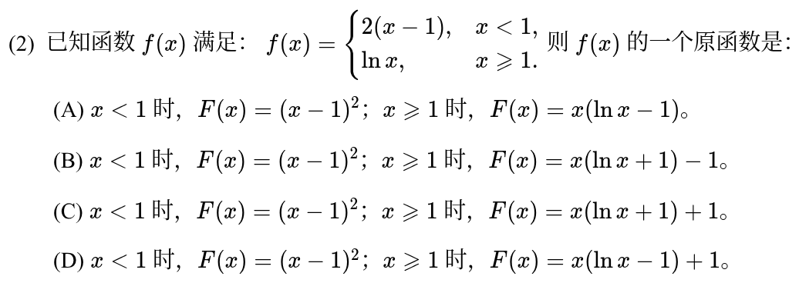
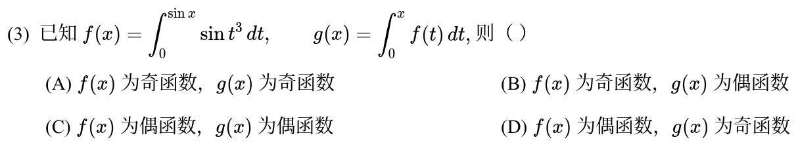
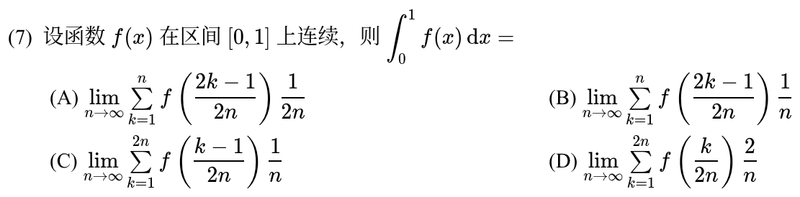
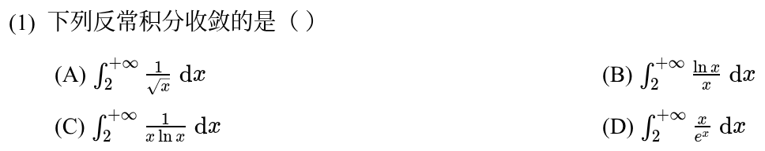
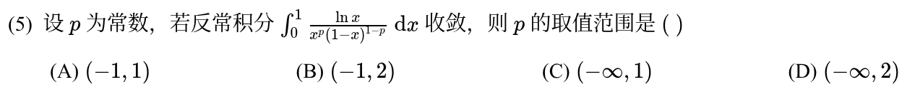
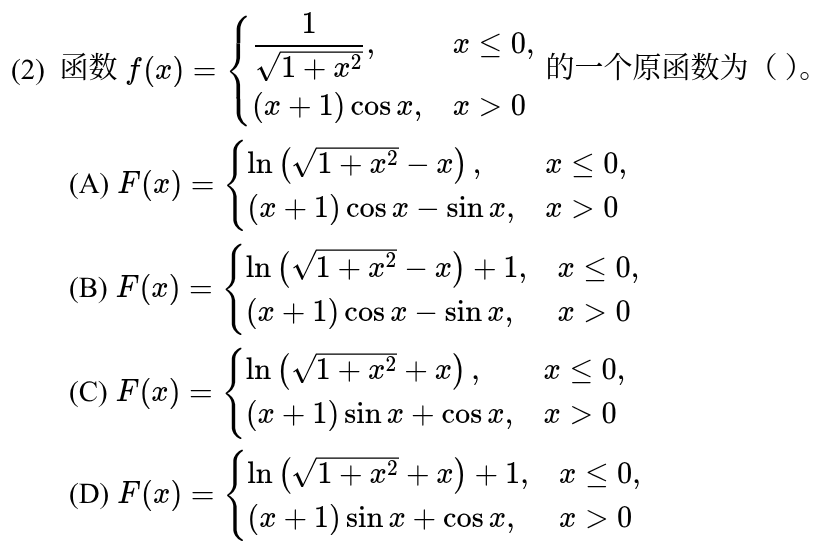
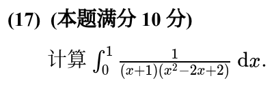
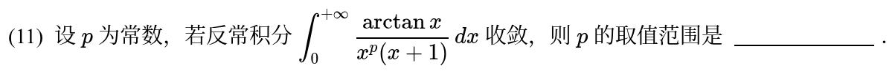

# 不定积分、定积分性质与反常积分

> 跨章主题：串联[不定积分与原函数](../../chapters/calculus/10-antiderivatives.md)、[定积分概念、性质与计算](../../chapters/calculus/11-definite-integrals.md)与[反常积分敛散性与计算](../../chapters/calculus/12-improper-integrals.md)

一元积分学里最常丢分的并不是“积分公式背不熟”，而是拿到题目后**先闷头硬算，没有先判断它考的是结构、性质还是敛散性**。例如：分段函数求原函数忘了在分段点拼连续；变限积分奇偶性硬拆开算；黎曼和极限数错步长 $\Delta x$ 与项数；反常积分漏查区间端点或内部的隐藏瑕点。

面对一道积分题，按下面的**实战决策顺序**先定入口，再落笔：

| 题型特征 | 第一步先查什么 | 核心工具 / 入口 | 高频失分点 |
| :--- | :--- | :--- | :--- |
| **求分段函数的原函数** | 先看分段点处 $f(x)$ 是否连续（存在原函数的必要条件之一：不能有第一类间断点），再逐段求不定积分 | 各段独立积分带不同常数 $C_1, C_2$，用**原函数处处可导必连续**（$F(x_0^-)=F(x_0^+)$）拼接常数 | 只验证各段导数对、忘了在分段点验证连续；或反过来只看连续忘了核对求导符号 |
| **变限积分的性质（奇偶、周期、单调、极值）** | 先看被积函数与上下限的对称性，**不要急着求原函数** | 变量代换 $t = -s$ 直接算 $f(-x)$，或结合求导公式 + 特殊点 $f(0)$ 判断 | 混淆“偶函数的原函数”与“**下限为 $0$ 的**偶函数变限积分”（只有下限为 $0$ 才必为奇函数）；漏看上限本身是奇/偶函数 |
| **极限与定积分定义互化（黎曼和）** | 先数清楚三件事：**积分区间 $[a,b]$、子区间个数 $N$、步长 $\Delta x = \frac{b-a}{N}$** | 把求和拆成 $\sum f(\xi_k)\Delta x$，缺系数先提常数出去；选择题可用常函数 $f(x)\equiv 1$ 瞬间排错 | 看到分母是 $2n$ 就以为步长是 $\frac{1}{2n}$，没检查求和上限到底是 $n$ 还是 $2n$ |
| **定积分直接计算（有理函数/无理/三角）** | 先看对称区间奇偶性、再看能否凑微分，最后才上分部或部分分式 | 有理真分式：先因式分解，再拆成一次因式 + 不可约二次因式（配方后拆出 $\ln$ 与 $\arctan$） | 二次分母配方后漏拆一次项导致丢掉 $\ln$ 项；换元后忘同步换上下限 |
| **反常积分敛散性判定（含参或选收敛）** | **第一步永远是找全所有反常点**（无穷远端点 + 区间内/端点使分母为 $0$ 或对数为无穷的瑕点），拆成单反常点积分 | 每个反常点单独做等价替换，对照两大标尺：无穷远 $\int_a^{+\infty}\frac{dx}{x^p\ln^q x}$ 与瑕点 $\int_a^b\frac{dx}{(x-a)^p|\ln(x-a)|^q}$ | **只看一端漏看另一端**（如 $(0,1)$ 上只查 $0^+$ 漏查 $1^-$）；把无穷远 $p>1$ 与瑕点 $p<1$ 记反 |

下面用五道真题把这五条线逐一打通。

---

## 一、分段函数求原函数：各段积分只是前半步，分段点连续才是锁死常数的关键

### 判断链

1. **先判原函数存在性**：若 $f(x)$ 在分段点 $x_0$ 有跳跃间断点，则 $f(x)$ 在含 $x_0$ 的区间上**不存在原函数**；若 $f(x)$ 连续，则原函数必存在且处处可导，从而**在 $x_0$ 处必连续**。
2. **分段积分各自带常数**：在左段求得 $F_1(x)+C_1$，右段求得 $F_2(x)+C_2$。
3. **用连续性拼接**：令 $\lim_{x\to x_0^-} F(x) = \lim_{x\to x_0^+} F(x) = F(x_0)$，求出 $C_2 - C_1$ 的唯一关系；选择题中还可直接结合“分段点连续 + 各段求导”双向验算。

---

### 例 1：[2016 年第 2 题](../../chapters/calculus/10-antiderivatives.md#q2016-2)（选择题）

> **建议先自己读原题并写第一步**，再往下看推演。

**原题**（[在章节题单中查看](../../chapters/calculus/10-antiderivatives.md#q2016-2)）：

#### 触发条件与第一步落笔

- **触发条件**：题干给分段函数 $f(x)$（分段点 $x=1$），求原函数 $F(x)$。先核对分段点连续性：$\lim_{x\to 1^-} 2(x-1) = 0 = \ln 1 = f(1)$，故 $f(x)$ 在 $\mathbb{R}$ 上连续，原函数存在且在 $x=1$ 处必连续。
- **第一步怎么落笔**：在 $x<1$ 与 $x\ge 1$ 上分别求不定积分，**明确写出两个独立常数 $C_1, C_2$**：
  - 当 $x < 1$ 时：
    $$\int 2(x-1)\,\mathrm{d}x = (x-1)^2 + C_1.$$
  - 当 $x \ge 1$ 时（分部积分）：
    $$\int \ln x\,\mathrm{d}x = x\ln x - \int x\cdot\frac{1}{x}\,\mathrm{d}x = x\ln x - x + C_2 = x(\ln x - 1) + C_2.$$

#### 完整推演与常数拼接

四个选项在 $x < 1$ 时都取 $F(x) = (x-1)^2$，即已固定 $C_1 = 0$。由此算左极限：
$$\lim_{x\to 1^-} F(x) = \lim_{x\to 1^-} (x-1)^2 = 0.$$
因为原函数 $F(x)$ 在 $x=1$ 处可导，必有 $F(x)$ 在 $x=1$ 处连续，所以
$$F(1) = \lim_{x\to 1^+} F(x) = 1\cdot(\ln 1 - 1) + C_2 = -1 + C_2 = 0 \implies C_2 = 1.$$
因此 $x \ge 1$ 时 $F(x) = x(\ln x - 1) + 1$。再复核 $x=1$ 处的导数：由导数极限定理，$F'_-(1) = 0 = F'_+(1) = f(1)$，确实成立。故选择 **（D）**。

#### 选择题干扰项拆解

- **（A）$x(\ln x - 1)$**：右段导数正确，但忘了拼连续性，$F(1^+) = -1 \neq 0 = F(1^-)$，在 $x=1$ 处不可导，不是原函数。
- **（B）$x(\ln x + 1) - 1$**：最隐蔽的干扰项——它在 $x=1$ 处恰好连续（$F(1^+)=0$），但把 $\int \ln x\,\mathrm{d}x$ 的负号记反了，求导得 $\ln x + 2 \neq \ln x$。
- **（C）$x(\ln x + 1) + 1$**：求导符号错且在 $x=1$ 处不连续（$F(1^+)=2$）。

#### 条件变式检验

- **变式**：若把题干中 $x \ge 1$ 时的 $f(x)=\ln x$ 改为 $f(x)=\ln x + 1$，其余不变，还能求出 $f(x)$ 在 $\mathbb{R}$ 上的原函数吗？
  **不能。** 此时 $\lim_{x\to 1^-} f(x) = 0 \neq 1 = f(1^+)$，$x=1$ 为跳跃间断点。由达布定理（导函数具有介值性），有跳跃间断点的函数在含 $x=1$ 的任何区间上都不存在原函数。

---

## 二、变限积分的奇偶性：用定义换元一步定性，别靠“记忆口诀”硬套复合上限

### 判断链

1. **标准下限为 $0$ 时**：若被积函数 $h(t)$ 为奇函数，则 $H(u) = \int_0^u h(t)\,\mathrm{d}t$ 为**偶函数**；若 $h(t)$ 为偶函数，则 $H(u) = \int_0^u h(t)\,\mathrm{d}t$ 为**奇函数**。
2. **上限是复合函数 $\varphi(x)$ 时**：先把变限积分写成复合结构 $f(x) = H(\varphi(x))$，直接算 $f(-x) = H(\varphi(-x))$，两步即可无误定性，**不要跳步口算**。
3. **验证通道（求导法）**：偶函数的导数是奇函数；奇函数的导数是偶函数。反过来，若 $F'(x)$ 为奇函数，则 $F(x)$ **必为偶函数**（常数项不影响偶性）；但若 $F'(x)$ 为偶函数，$F(x)$ 仅当 **$F(0)=0$** 时才是奇函数。

---

### 例 2：[2024 年第 3 题](../../chapters/calculus/11-definite-integrals.md#q2024-3)（选择题）

> **建议先自己读原题并写第一步**，再往下看推演。

**原题**（[在章节题单中查看](../../chapters/calculus/11-definite-integrals.md#q2024-3)）：

#### 触发条件与第一步落笔

- **触发条件**：两层变限积分，内层上限为 $\sin x$，外层上限为 $x$，下限均为 $0$，只问奇偶性而不求具体值。
- **第一步怎么落笔**：直接按定义计算 $f(-x)$，通过换元 $t = -s$ 把积分上限里的负号消掉。

#### 完整推演

1. **判断 $f(x)$ 的奇偶性**：
   被积函数 $h(t) = \sin(t^3)$ 满足 $h(-t) = \sin((-t)^3) = -\sin(t^3) = -h(t)$，为奇函数。
   直接代 $-x$：
   $$f(-x) = \int_0^{\sin(-x)} \sin t^3\,\mathrm{d}t = \int_0^{-\sin x} \sin t^3\,\mathrm{d}t.$$
   令 $t = -s$（$\mathrm{d}t = -\mathrm{d}s$，当 $t = -\sin x$ 时 $s = \sin x$）：
   $$f(-x) = \int_0^{\sin x} \sin(-s^3)\cdot(-\mathrm{d}s) = \int_0^{\sin x} \sin s^3\,\mathrm{d}s = f(x).$$
   因此 **$f(x)$ 为偶函数**。
   （求导复核：$f'(x) = \sin(\sin^3 x)\cdot\cos x$，满足 $f'(-x) = \sin(-\sin^3 x)\cos(-x) = -f'(x)$ 为奇函数，故 $f(x)$ 必为偶函数。）

2. **判断 $g(x)$ 的奇偶性**：
   因为 $f(t)$ 为偶函数，且 $g(x) = \int_0^x f(t)\,\mathrm{d}t$ 下限为 $0$，令 $t = -s$：
   $$g(-x) = \int_0^{-x} f(t)\,\mathrm{d}t = \int_0^x f(-s)(-\mathrm{d}s) = -\int_0^x f(s)\,\mathrm{d}s = -g(x).$$
   因此 **$g(x)$ 为奇函数**。

故选择 **（D）**。

#### 选择题干扰项拆解

- **（A）（B）**：误把 $f(x)$ 当成奇函数——常见错因是看到“$\sin x$ 是奇函数、$\sin t^3$ 也是奇函数”，凭直觉以为“奇复合奇还是奇”，忽略了**积分本身会把奇函数变成偶函数**（$H(u) = \int_0^u \sin t^3\,\mathrm{d}t$ 是偶函数，偶函数复合奇函数 $H(\sin x)$ 仍是偶函数）。
- **（C）**：算对了 $f(x)$ 是偶函数，却把“偶函数的变限积分（下限为 $0$）”错记成偶函数。

#### 条件变式检验

- **变式**：若把 $g(x) = \int_0^x f(t)\,\mathrm{d}t$ 改为 $g(x) = \int_1^x f(t)\,\mathrm{d}t$，其余不变，$g(x)$ 还是奇函数吗？
  **不是。** 此时 $g(x) = \int_0^x f(t)\,\mathrm{d}t - \int_0^1 f(t)\,\mathrm{d}t$。由于在 $(0,1)$ 上 $0 < \sin t < 1 < \pi$，被积函数 $\sin u^3 > 0$，故 $f(t) > 0$，常数 $C = \int_0^1 f(t)\,\mathrm{d}t > 0$，从而 $g(0) = -C \neq 0$，破坏了奇函数必满足 $g(0)=0$ 的性质，$g(x)$ 变为非奇非偶函数。

---

## 三、定积分定义（黎曼和）：锁定区间、份数、步长三要素

### 判断链

把极限 $\lim_{n\to\infty}\sum_{k=1}^{N} f(\xi_k)\cdot w_n$ 还原为定积分 $\int_a^b f(x)\,\mathrm{d}x$，必须同时核对三项：
1. **看自变量 $\xi_k$ 的首尾范围**：$k=1$ 时 $\xi_1 \to a$，$k=N$ 时 $\xi_N \to b$，确定积分区间 $[a,b]$；
2. **看相邻取点间距**：$\Delta x = \xi_{k+1} - \xi_k$（等分时等于 $\frac{b-a}{N}$）；
3. **核对权重 $w_n$ 与步长 $\Delta x$ 的比值**：只有 $w_n = \Delta x$ 时极限才等于 $\int_a^b f(x)\,\mathrm{d}x$；若 $w_n = c\cdot \Delta x$，结果就要乘系数 $c$。

> **考场秒杀复核**：令 $f(x) \equiv 1$，则目标值 $\int_0^1 1\,\mathrm{d}x = 1$，而求和直接变成“项数 $\times$ 权重”，立刻可验算系数是否正确。

---

### 例 3：[2021 年第 7 题](../../chapters/calculus/11-definite-integrals.md#q2021-7)（选择题）

> **建议先自己读原题并写第一步**，再往下看推演。

**原题**（[在章节题单中查看](../../chapters/calculus/11-definite-integrals.md#q2021-7)）：

#### 触发条件与第一步落笔

- **触发条件**：已知 $f(x)$ 在 $[0,1]$ 上连续（保证黎曼可积，任意取点与分法极限均相等），要求从四个黎曼和中选出等于 $\int_0^1 f(x)\,\mathrm{d}x$ 的一项。
- **第一步怎么落笔**：逐项核对“项数 $N$”与“步长 $\Delta x = \frac{1}{N}$”，并检查 $\xi_k$ 是否落在第 $k$ 个子区间内。

#### 完整推演

对区间 $[0,1]$ 作 $n$ 等分，第 $k$ 个子区间为 $\left[\frac{k-1}{n}, \frac{k}{n}\right]$（$k=1,2,\dots,n$），每个子区间长度为
$$\Delta x_k = \frac{1}{n}.$$
取每个子区间的中点作为样点：
$$\xi_k = \frac{1}{2}\left(\frac{k-1}{n} + \frac{k}{n}\right) = \frac{2k-1}{2n} \in \left[\frac{k-1}{n}, \frac{k}{n}\right].$$
因为 $f(x)$ 在 $[0,1]$ 上连续，由定积分定义：
$$\int_0^1 f(x)\,\mathrm{d}x = \lim_{n\to\infty} \sum_{k=1}^{n} f\left(\frac{2k-1}{2n}\right)\frac{1}{n}.$$
故选择 **（B）**。

#### 选择题干扰项拆解（含 $f(x)\equiv 1$ 速验）

- **（A）$\lim_{n\to\infty}\sum_{k=1}^{n} f\left(\frac{2k-1}{2n}\right)\frac{1}{2n}$**：看到 $\frac{2k-1}{2n}$ 分母有 $2n$，误把步长当成 $\frac{1}{2n}$。实际上相邻两点间距是 $\frac{2(k+1)-1}{2n} - \frac{2k-1}{2n} = \frac{1}{n}$，故（A）$= \frac{1}{2}\int_0^1 f(x)\,\mathrm{d}x$（取 $f\equiv 1$ 得 $n\cdot\frac{1}{2n}=\frac{1}{2}$）。
- **（C）$\lim_{n\to\infty}\sum_{k=1}^{2n} f\left(\frac{k-1}{2n}\right)\frac{1}{n}$**：把 $[0,1]$ 分成了 $2n$ 等份，正确步长应是 $\frac{1}{2n}$，而题中乘的是 $\frac{1}{n} = 2\cdot\frac{1}{2n}$，故（C）$= 2\int_0^1 f(x)\,\mathrm{d}x$（取 $f\equiv 1$ 得 $2n\cdot\frac{1}{n}=2$）。
- **（D）$\lim_{n\to\infty}\sum_{k=1}^{2n} f\left(\frac{k}{2n}\right)\frac{2}{n}$**：同样是 $2n$ 等份，乘的是 $\frac{2}{n} = 4\cdot\frac{1}{2n}$，故（D）$= 4\int_0^1 f(x)\,\mathrm{d}x$（取 $f\equiv 1$ 得 $2n\cdot\frac{2}{n}=4$）。

#### 条件变式检验

- **变式**：若把题干中“$f(x)$ 在 $[0,1]$ 上连续”改为“$f(x)$ 在 $[0,1]$ 上有界”，（B）中的极限还一定存在并等于 $\int_0^1 f(x)\,\mathrm{d}x$ 吗？
  **不一定。** 有界不保证可积（例如狄利克雷函数 $D(x)$ 在 $[0,1]$ 上有界但不可积，虽然所有有理中点处 $D\left(\frac{2k-1}{2n}\right)=1$ 使该极限等于 $1$，但 $\int_0^1 D(x)\,\mathrm{d}x$ 根本不存在）。必须具备可积条件（连续、或有界且只有有限个间断点），才能把定积分与特定分法下的黎曼和极限划等号。

---

## 四、反常积分敛散性：先拆全反常点，再用 $p$-$q$ 标尺逐点判定

### 判断链

处理任何反常积分 $\int_a^b f(x)\,\mathrm{d}x$ 的敛散性，严格按三步走：

1. **找全所有反常点并拆分**：
   - 无穷限（$-\infty$ 或 $+\infty$）；
   - 区间端点或内部使 $f(x)$ 无界的瑕点。
   **只要有一个反常点发散，原反常积分就发散**；所有拆分后的单反常点积分**同时收敛**，原积分才收敛（因此含参题最后取各点收敛条件的**交集**）。
2. **保号检查**：在每个反常点的充分小邻域内，确认被积函数不变号（或先取绝对值），才能使用比较审敛法（极限形式）。
3. **对照两大核心标尺（务必分清方向！）**：
   - **无穷远（$x \to +\infty$，$a > 1$）**：
     $$\int_a^{+\infty} \frac{\mathrm{d}x}{x^p (\ln x)^q} \text{ 收敛} \iff p > 1, \quad \text{或 } (p = 1 \text{ 且 } q > 1).$$
   - **有限瑕点（$x \to a^+$，$b > a$）**：
     $$\int_a^{b} \frac{\mathrm{d}x}{(x-a)^p |\ln(x-a)|^q} \text{ 收敛} \iff p < 1, \quad \text{或 } (p = 1 \text{ 且 } q > 1).$$
   - **指数压制**：当 $x \to +\infty$ 时，对任意多项式 $x^k$ 与 $\alpha > 0$，都有 $x^k e^{-\alpha x} = o\left(\frac{1}{x^2}\right)$，因此 $\int_a^{+\infty} x^k e^{-\alpha x}\,\mathrm{d}x$ 恒收敛。

---

### 例 4：[2015 年第 1 题](../../chapters/calculus/12-improper-integrals.md#q2015-1)（选择题）

> **建议先自己读原题并写第一步**，再往下看推演。

**原题**（[在章节题单中查看](../../chapters/calculus/12-improper-integrals.md#q2015-1)）：

#### 触发条件与第一步落笔

- **触发条件**：四个选项都是 $[2, +\infty)$ 上的正项无穷限反常积分（下限 $2 > 1$，避开了 $x=0$ 与 $x=1$ 的瑕点，唯一反常点只有 $+\infty$）。
- **第一步怎么落笔**：直接按 $x \to +\infty$ 的 $p$-$q$ 标尺与指数阶比较，逐项秒判，必要时直接算原函数验算。

#### 完整推演与干扰项拆解

- **（A）$\int_2^{+\infty} \frac{1}{\sqrt{x}}\,\mathrm{d}x$**：对应 $p = \frac{1}{2} \le 1$，**发散**（原函数 $2\sqrt{x} \to +\infty$）。
- **（B）$\int_2^{+\infty} \frac{\ln x}{x}\,\mathrm{d}x$**：对应 $p = 1, q = -1 \le 1$，**发散**；也可直接凑微分验证：
  $$\int_2^{+\infty} \ln x\,\mathrm{d}(\ln x) = \left.\frac{1}{2}(\ln x)^2\right|_2^{+\infty} = +\infty.$$
- **（C）$\int_2^{+\infty} \frac{1}{x\ln x}\,\mathrm{d}x$**：对应 $p = 1, q = 1 \le 1$，恰好踩在临界线上，**发散**；凑微分验证：
  $$\int_2^{+\infty} \frac{\mathrm{d}(\ln x)}{\ln x} = \left.\ln(\ln x)\right|_2^{+\infty} = +\infty.$$
- **（D）$\int_2^{+\infty} \frac{x}{e^x}\,\mathrm{d}x$**：指数衰减远快于任何幂函数，因为 $\lim_{x\to+\infty} x^2 \cdot \frac{x}{e^x} = \lim_{x\to+\infty} \frac{x^3}{e^x} = 0$，由比较审敛法（与 $\int_2^{+\infty} \frac{\mathrm{d}x}{x^2}$ 比）知其**收敛**。直接分部积分也可算出精确值：
  $$\int_2^{+\infty} x e^{-x}\,\mathrm{d}x = \left.-(x+1)e^{-x}\right|_2^{+\infty} = 0 - (-3e^{-2}) = \frac{3}{e^2}.$$

故选择 **（D）**。

#### 条件变式检验

- **变式**：把（C）改为 $\int_2^{+\infty} \frac{1}{x(\ln x)^2}\,\mathrm{d}x$，敛散性变了吗？
  **变了，转为收敛。** 此时 $p=1, q=2 > 1$，直接算原函数得 $\left.-\frac{1}{\ln x}\right|_2^{+\infty} = \frac{1}{\ln 2}$。这道题最容易记混的就是（C）的临界点 $q=1$ 发散、$q>1$ 收敛。

---

### 例 5：[2022 年第 5 题](../../chapters/calculus/12-improper-integrals.md#q2022-5)（选择题）

> **建议先自己读原题并写第一步**，再往下看推演。

**原题**（[在章节题单中查看](../../chapters/calculus/12-improper-integrals.md#q2022-5)）：

#### 触发条件与第一步落笔

- **触发条件**：有限区间 $[0,1]$ 上的含参反常积分，分母同时含有 $x^p$ 和 $(1-x)^{1-p}$，分子含有 $\ln x$。
- **第一步怎么落笔**：**先拆分两个潜在瑕点 $x=0^+$ 与 $x=1^-$**！取中间点 $\frac{1}{2}$ 将原积分拆成
  $$I = \int_0^{1/2} \frac{\ln x}{x^p(1-x)^{1-p}}\,\mathrm{d}x + \int_{1/2}^{1} \frac{\ln x}{x^p(1-x)^{1-p}}\,\mathrm{d}x = I_1 + I_2.$$
  同时注意在 $(0,1)$ 上 $\ln x < 0$，被积函数恒负不变号，因此可以直接对正函数 $g(x) = \frac{-\ln x}{x^p(1-x)^{1-p}}$ 使用等价无穷小比较审敛法。

#### 完整推演

1. **检查左端点 $x \to 0^+$（$I_1$ 的敛散性）**：
   当 $x \to 0^+$ 时，$(1-x)^{1-p} \to 1$，所以
   $$g(x) = \frac{-\ln x}{x^p(1-x)^{1-p}} \sim \frac{-\ln x}{x^p} = \frac{1}{x^p \left(\ln\frac{1}{x}\right)^{-1}}.$$
   对照有限瑕点 $p$-$q$ 标尺（此处 $q = -1 < 1$）：
   - 当 $p < 1$ 时，$I_1$ **收敛**（取 $\alpha \in (p, 1)$，有 $\lim_{x\to 0^+} x^\alpha \cdot \frac{-\ln x}{x^p} = \lim_{x\to 0^+} x^{\alpha - p}(-\ln x) = 0$，而 $\int_0^{1/2}\frac{\mathrm{d}x}{x^\alpha}$ 收敛）；
   - 当 $p = 1$ 时，$\int_0^{1/2}\frac{-\ln x}{x}\,\mathrm{d}x = \left.-\frac{1}{2}(\ln x)^2\right|_0^{1/2} = +\infty$，**发散**；
   - 当 $p > 1$ 时，比 $p=1$ 更大，显然**发散**。
   故 $I_1$ 收敛 $\iff$ **$p < 1$**。

2. **检查右端点 $x \to 1^-$（$I_2$ 的敛散性）**：
   当 $x \to 1^-$ 时，$x^p \to 1$，且分子 $\ln x = \ln\big(1 - (1-x)\big) \sim -(1-x)$，所以
   $$g(x) = \frac{-\ln x}{x^p(1-x)^{1-p}} \sim \frac{1-x}{(1-x)^{1-p}} = \frac{1}{(1-x)^{-p}}.$$
   对照有限瑕点标尺 $\int_{1/2}^1 \frac{\mathrm{d}x}{(1-x)^{\lambda}}$ 收敛 $\iff \lambda < 1$：
   此处 $\lambda = -p < 1 \iff$ **$p > -1$**。

3. **取交集**：
   原积分收敛 $\iff I_1$ 与 $I_2$ 同时收敛 $\iff p < 1$ 且 $p > -1$，即 $p \in (-1, 1)$。故选择 **（A）**。

#### 选择题干扰项拆解

- **（C）$(-\infty, 1)$（最常见错选）**：只查了左端点 $x \to 0^+$ 得到 $p < 1$，**忘了检查右端点 $x \to 1^-$**！
- **（B）$(-1, 2)$**：在 $x \to 0^+$ 时把 $-\ln x$ 当成 $x$ 的正幂次抵消了一阶，或者在 $x \to 1^-$ 时把符号算反。
- **（D）$(-\infty, 2)$**：既漏查了 $x \to 1^-$，又在 $x \to 0^+$ 算错了临界指数。

#### 条件变式检验

- **变式**：若把被积函数的分子 $\ln x$ 去掉，改为 $\int_0^1 \frac{1}{x^p(1-x)^{1-p}}\,\mathrm{d}x$，$p$ 的收敛范围会变成什么？
  - 在 $x \to 0^+$：$\frac{1}{x^p}$ 收敛 $\iff p < 1$；
  - 在 $x \to 1^-$：$\frac{1}{(1-x)^{1-p}}$ 收敛 $\iff 1-p < 1 \iff p > 0$。
  交集缩小为 **$(0, 1)$**！对比原题可以看出：分子的 $\ln x$ 在 $x \to 1^-$ 处贡献了一个一阶零点 $(1-x)$，把右端点的收敛下界从 $p > 0$ 放宽到了 $p > -1$；而在 $x \to 0^+$ 处 $\ln x$ 是对数发散因子，不改变 $p < 1$ 的开区间边界。

---

## 五、回练与过关标准

### 1. 真题回练一：[2023 年第 2 题](../../chapters/calculus/10-antiderivatives.md#q2023-2)（选择题）

点击核对思路与答案

1. 先核分段点 $x=0$：$f(0^-)=1=f(0^+)$，连续，故原函数必在 $x=0$ 处连续。
2. 左段 $x \le 0$：$\int \frac{\mathrm{d}x}{\sqrt{1+x^2}} = \ln\left(\sqrt{1+x^2}+x\right) + C_1$（注意 $\ln(\sqrt{1+x^2}-x)$ 求导会多一个负号，直接排除（A）（B））。
3. 右段 $x > 0$：分部积分得 $\int (x+1)\cos x\,\mathrm{d}x = (x+1)\sin x + \cos x + C_2$。
4. 选项（C）（D）右段均取 $C_2 = 0$，于是 $F(0^+) = 0 + \cos 0 = 1$；由 $F(0^-) = \ln 1 + C_1 = C_1 = 1$ 得 $C_1 = 1$。
5. 答案：**（D）**。

### 2. 真题回练二：[2025 年第 17 题](../../chapters/calculus/11-definite-integrals.md#q2025-17)（解答题，满分 10 分）

点击核对思路与答案

1. **有理函数部分分式拆分**：
   $$\frac{1}{(x+1)(x^2-2x+2)} = \frac{A}{x+1} + \frac{Bx+C}{x^2-2x+2}.$$
   令 $x=-1$ 得 $A = \frac{1}{1+2+2} = \frac{1}{5}$；通分对比系数得 $B = -\frac{1}{5}$，$C = \frac{3}{5}$。
2. **对不可约二次分母配方并拆出导数项**：
   $$x^2 - 2x + 2 = (x-1)^2 + 1, \qquad -x + 3 = -\frac{1}{2}(2x-2) + 2.$$
3. **逐项定积分**：
   $$\int_0^1 \frac{\mathrm{d}x}{(x+1)(x^2-2x+2)} = \frac{1}{5}\Big[\ln(x+1)\Big]_0^1 - \frac{1}{10}\Big[\ln(x^2-2x+2)\Big]_0^1 + \frac{2}{5}\Big[\arctan(x-1)\Big]_0^1$$
   $$= \frac{1}{5}\ln 2 - \frac{1}{10}(\ln 1 - \ln 2) + \frac{2}{5}\left(0 - \left(-\frac{\pi}{4}\right)\right) = \frac{3}{10}\ln 2 + \frac{\pi}{10}.$$

### 3. 真题回练三：[2026 年第 11 题](../../chapters/calculus/12-improper-integrals.md#q2026-11)（填空题）

点击核对思路与答案

1. **拆全两个反常点**（$x=0^+$ 与 $x=+\infty$）：拆成 $\int_0^1 + \int_1^{+\infty}$，被积函数在 $(0,+\infty)$ 恒正。
2. **$x \to 0^+$**：$\frac{\arctan x}{x^p(x+1)} \sim \frac{x}{x^p} = \frac{1}{x^{p-1}}$，收敛 $\iff p - 1 < 1 \iff p < 2$。
3. **$x \to +\infty$**：$\frac{\arctan x}{x^p(x+1)} \sim \frac{\pi/2}{x^{p+1}}$，收敛 $\iff p + 1 > 1 \iff p > 0$。
4. 取交集得：$p \in (0, 2)$（或写 $0 < p < 2$）。

### 过关标准

合上讲义，面对一道新的积分题时，能够独立完成以下四步即算过关：
1. 分段函数求原函数时，能先查分段点连续性，并在各段积分后**主动用 $F(x_0^-)=F(x_0^+)$ 拼接常数**；
2. 变限积分判奇偶性时，能通过 $t=-s$ 换元或“求导 + 查 $F(0)$”独立推导，不靠口诀猜复合上限；
3. 黎曼和极限题能一眼数清**区间、份数、步长**并用 $f\equiv 1$ 秒验系数；
4. 反常积分敛散性题能在动笔前先**列出全部反常点**，分别用等价替换与对应方向的 $p$-$q$ 标尺（无穷远 $p>1$、瑕点 $p<1$）取交集。
