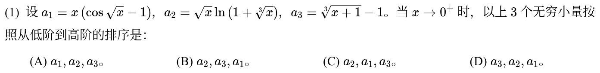
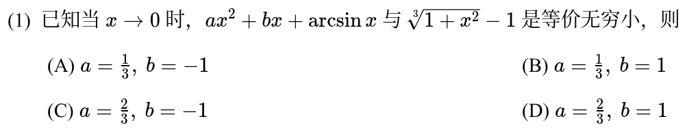
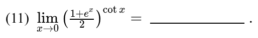
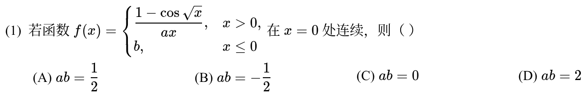
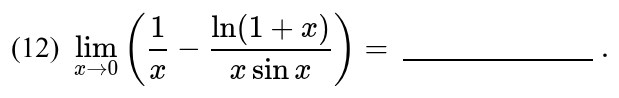
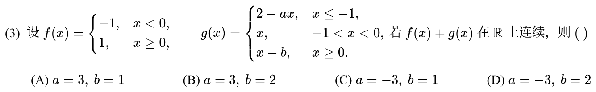

# 函数极限、无穷小与连续间断

> 跨章主题：串联[函数极限与无穷小](../../chapters/calculus/01-limits.md)与[连续性与间断点](../../chapters/calculus/03-continuity.md)
> 课程参考：[武忠祥 17 堂课专题 4 已读笔记](../../wu/17/notes/27-04-infinitesimal-orders.md)（全 30 页）、[武忠祥 26 选填第 1 课已读笔记](../../wu/xt/notes/01-functions-limits.md)（全 47 页）、[武忠祥 26 选填第 2 课已读笔记](../../wu/xt/notes/02-orders-continuity.md)（全 36 页）

拿到一道函数极限、无穷小比较或连续性判定题，最容易走弯路的不是“记不住等价公式”，而是**还没看清目标精度和结构障碍，就盲目套洛必达或把加减项各自拆开做等价代换**。

处理这一整条知识谱系，动笔前先按以下决策顺序定下第一行怎么写：

| 题目设问 / 结构特征 | 核心判断目标 | 第一步落笔动作 | 常见误区 |
| :--- | :--- | :--- | :--- |
| **无穷小阶的比较与排序** | 每个量的最低次非零幂次 $k$ | 分别化成 $c x^k + o(x^k)$（$c\neq 0$），只保留足以区分阶数的主项 | 把阶数高低与数值大小搞反；或按表达式里根号、对数的外形瞎猜 |
| **由等价/同阶条件反求参数** | 低阶系数消零 + 目标阶系数匹配 | 先确定基准量（右侧）的主项 $c x^k$，将含参侧展开到 $x^k$，令低于 $k$ 阶的总系数为 $0$，再匹配 $x^k$ 系数 | 漏消低阶项导致两量根本不同阶；或只顾阶数不管等价要求的系数相等 |
| **未定式极限计算**（$1^\infty$、$\infty-\infty$、$\frac{0}{0}$） | 消除未定障碍并保住抵消后的首个非零项 | $1^\infty$ 先写 $e^{\lim v(u-1)}$；$\infty-\infty$ 先通分；差值若同主项相消，立即改用泰勒展开或“减共同项” | 在加减法中直接局部等价代换把主项抹成 $0$；或对 $1^\infty$ 忽略指数放大倍数 |
| **分段点连续性与间断点分类** | 候选点处“左极限、右极限、点值”三者关系 | 先列全部候选点（分段点、无定义点），再逐点算左右极限；任一单侧无穷即可判第二类，两侧有限再比左右极限与点值 | 漏算单侧趋势或定义域限制；把“极限存在”直接当成“连续”而忘查点值 |

下面用四道真题把这四类入口完整走一遍：先看**单纯估阶排序**，再看**等价定参数**，接着看 **$1^\infty$ 幂指极限**，最后落到**分段点连续性闭合**。

---

## 一、无穷小排序：抓准每个量的最低次非零主项

### 判断链

1. **先看趋向与定义域**：若题设是 $x\to 0^+$，根式与分数幂均有实定义，且 $0 < x < 1$ 时幂次越大反而越小（衰减越快、阶数越高）。
2. **只算到首个非零项即停**：排序题只要各量阶数已经分开，只需要确认主项系数非零即可停手，不必展开更高次项（参考[专题 4 第 12—16 页](../../wu/17/notes/27-04-infinitesimal-orders.md#四第二部分排序逐例理解第1216页)）。
3. **核对排序方向**：题目问“从低阶到高阶”，即按幂次 $k$ **从小到大**排。

---

### 例 1：[2016 年第 1 题](../../chapters/calculus/01-limits.md#q2016-1)（选择题）

> **来源对照**：与[武忠祥专题 4 第 12 页例 1](../../wu/17/notes/27-04-infinitesimal-orders.md#四第二部分排序逐例理解第1216页)为**同题复现**；以下按原卷截图独立核算并拆解干扰项。
> **建议先自己读原题并标出三项阶数**，再往下核对。

**原题**（[在章节题单中查看](../../chapters/calculus/01-limits.md#q2016-1)）：

#### 第一步与触发条件

- **触发条件**：三项均为乘积或单个常见结构减 $1$，项内没有同主项抵消，可直接逐个用基本等价无穷小定主项。
- **第一步落笔**：分别写出 $a_1, a_2, a_3$ 在 $x\to 0^+$ 时的主项：
  1. 对 $a_1 = x(\cos\sqrt{x} - 1)$：因为 $x\to 0^+$ 时 $\sqrt{x}\to 0$，由 $1 - \cos u \sim \frac{1}{2}u^2$ 得
     $$a_1 = -x(1 - \cos\sqrt{x}) \sim -x \cdot \frac{1}{2}(\sqrt{x})^2 = -\frac{1}{2}x^2,$$
     主项非零，阶数为 **$2$**。
  2. 对 $a_2 = \sqrt{x}\ln(1+\sqrt[3]{x})$：因为 $\sqrt[3]{x}\to 0$，由 $\ln(1+u)\sim u$ 得
     $$a_2 \sim x^{\frac{1}{2}} \cdot x^{\frac{1}{3}} = x^{\frac{5}{6}},$$
     阶数为 **$\frac{5}{6}$**。
  3. 对 $a_3 = \sqrt[3]{x+1} - 1$：由 $(1+u)^\alpha - 1 \sim \alpha u$ 得
     $$a_3 = (1+x)^{\frac{1}{3}} - 1 \sim \frac{1}{3}x,$$
     阶数为 **$1$**。
- **按“从低阶到高阶”排序**：比较幂次 $\frac{5}{6} < 1 < 2$，故顺序为 $a_2, a_3, a_1$，选 **（B）**。

#### 选择题关键干扰项拆解

- **（C）$a_2, a_1, a_3$**：错把 $1 - \cos\sqrt{x}$ 漏平方（写成 $\frac{1}{2}\sqrt{x}$），导致误判 $a_1$ 为 $\frac{3}{2}$ 阶或更低。
- **（D）$a_3, a_2, a_1$**：把 $\frac{1}{2}+\frac{1}{3}=\frac{5}{6}$ 错算成 $\frac{1}{2}+\frac{1}{3}$ 大于 $1$，或误把 $a_3$ 的阶数看成 $\frac{1}{3}$。
- **（A）$a_1, a_2, a_3$**：未实际比较，或把“高阶”误当成“数值更大”（$x\to 0^+$ 时 $x^2$ 反而最小，阶数最高）。

#### 条件变式检验

- **变式 1**：若把趋向 $x\to 0^+$ 改成双侧 $x\to 0$，题目还成立吗？
  **不成立。** $a_1, a_2$ 中含有 $\sqrt{x}$，在 $x<0$ 侧无实数定义，因此本题单侧 $0^+$ 是定义域强制要求。
- **变式 2**：若把 $a_1$ 改为 $x(\cos x - 1)$，排序会变吗？
  此时 $a_1 \sim -\frac{1}{2}x^3$（$3$ 阶），仍高于 $a_3$（$1$ 阶）和 $a_2$（$\frac{5}{6}$ 阶），排序仍为 $a_2, a_3, a_1$。

---

## 二、等价定参数：低阶系数必须先消零，目标阶系数必须匹配

### 判断链

当题目给出“$A(x)$ 与 $B(x)$ 是等价无穷小”并求待定参数时，本质要求是 $\lim \frac{A(x)}{B(x)} = 1$：

1. **先定基准阶与系数**：把不含参数的基准量 $B(x)$ 化成 $c x^k + o(x^k)$（$c\neq 0$）。
2. **展开含参量到同阶 $x^k$**：按幂次合并同类项。
3. **两步列方程**：所有低于 $k$ 阶的系数之和必须为 $0$（否则比值发散），且 $x^k$ 项的系数之和必须等于 $c$（参考[选填第 2 课第 18 页例 15](../../wu/xt/notes/02-orders-continuity.md#例15第18页含参数低阶必须先消掉)）。

---

### 例 2：[2026 年第 1 题](../../chapters/calculus/01-limits.md#q2026-1)（选择题）

> **来源对照**：与[武忠祥选填第 2 课第 18 页例 15](../../wu/xt/notes/02-orders-continuity.md#例15第18页含参数低阶必须先消掉)及[专题 4 第 25—26 页例 4](../../wu/17/notes/27-04-infinitesimal-orders.md#第2526页例42015参数题题面核对先于答案移植)同属“等价条件约束低阶消零与主系数匹配”，属于**同法迁移**。
> **建议先自己算右侧主项并列系数方程**，再核对。

**原题**（[在章节题单中查看](../../chapters/calculus/01-limits.md#q2026-1)）：

#### 第一步与完整推演

- **触发条件**：右侧不含参数且为标准幂函数减 $1$，左侧含一次项与二次项参数，立即以右侧定目标阶数。
- **第一步落笔**：先算右侧主项。当 $x\to 0$ 时，
  $$\sqrt[3]{1+x^2} - 1 = (1+x^2)^{\frac{1}{3}} - 1 \sim \frac{1}{3}x^2.$$
  由此锁定目标：左侧必须是 **二阶无穷小**，且 $x^2$ 项系数为 **$\frac{1}{3}$**。
- **展开左侧到 $x^2$ 阶**：利用 $\arcsin x = x + o(x^2)$（实际 $\arcsin x = x + \frac{1}{6}x^3 + o(x^3)$，不含 $x^2$ 项），得
  $$ax^2 + bx + \arcsin x = (b + 1)x + ax^2 + o(x^2).$$
- **匹配系数**：由 $\lim_{x\to 0}\frac{(b+1)x + ax^2 + o(x^2)}{\frac{1}{3}x^2} = 1$，必须同时满足：
  $$\begin{cases} b + 1 = 0, \\ a = \dfrac{1}{3}, \end{cases} \implies a = \frac{1}{3},\quad b = -1.$$
  故选 **（A）**。

#### 选择题关键干扰项拆解

- **（B）$a = \frac{1}{3}, b = 1$**：把消去一次项的方程 $b+1=0$ 错解成 $b=1$，此时左侧主项为 $2x$（一阶），与右侧二阶根本不同阶。
- **（C）$a = \frac{2}{3}, b = -1$**：把 $(1+x^2)^{\frac{1}{3}}-1 \sim \frac{1}{3}x^2$ 误乘内部指数 $2$，错写成 $\frac{2}{3}x^2$。
- **（D）$a = \frac{2}{3}, b = 1$**：同时犯了系数错乘与符号错误。

#### 条件变式检验

- **变式 1**：若把题干的“等价无穷小”改为“同阶无穷小”，参数条件怎么变？
  只要求比值趋于有限非零常数，故仍须消去一次项（$b=-1$），但 $a$ 只需满足 **$a \neq 0$**，不再唯一等于 $\frac{1}{3}$。
- **变式 2**：若把左侧的 $\arcsin x$ 改成 $\ln(1+x)$，结果会变吗？
  **会变！** 因为 $\ln(1+x) = x - \frac{1}{2}x^2 + o(x^2)$ **带有二阶项 $-\frac{1}{2}x^2$**，此时 $a - \frac{1}{2} = \frac{1}{3} \implies a = \frac{5}{6}$。动笔前务必检查奇函数（如 $\sin x, \tan x, \arcsin x$ 无偶次项）与非奇函数（如 $\ln(1+x), e^x-1$ 有偶次项）的区别。

---

## 三、$1^\infty$ 型幂指极限：改写指数，让底数偏离 $1$ 承受指数放大

### 判断链

1. **先验型**：确认 $u(x)\to 1$、$v(x)\to \infty$，且底数在去心邻域内恒正。
2. **统一第一行**：直接化为
   $$\lim u(x)^{v(x)} = \exp\Big(\lim v(x)\ln u(x)\Big) = \exp\Big(\lim v(x)\big[u(x)-1\big]\Big)$$
   （此处 $\ln u = \ln\big(1+(u-1)\big) \sim u - 1$，因为整体是乘积结构，等价代换合法）。
3. **检查放大倍数**：指数 $v(x)$ 是几阶无穷大，就把 $u(x)-1$ 展开到对应的阶数（参考[选填第 1 课第 32—33 页、第 39—40 页](../../wu/xt/notes/01-functions-limits.md#第32页例13幂指式先把底数改到1附近)）。

---

### 例 3：[2022 年第 11 题](../../chapters/calculus/01-limits.md#q2022-11)（填空题）

> **来源对照**：与[武忠祥选填第 1 课第 32—33 页例 13—14 及第 39 页例 19](../../wu/xt/notes/01-functions-limits.md#第32页例13幂指式先把底数改到1附近)同属 $1^\infty$ 幂指极限框架，属于**同法迁移**。

**原题**（[在章节题单中查看](../../chapters/calculus/01-limits.md#q2022-11)）：

#### 第一步与完整推演

- **触发条件**：当 $x\to 0$ 时，底数 $\frac{1+e^x}{2}\to 1$（且恒正），指数 $\cot x = \frac{1}{\tan x}\to \infty$，属于标准 $1^\infty$ 型。
- **第一步落笔**：计算指数部分 $v(x)[u(x)-1]$ 的极限：
  $$u(x) - 1 = \frac{1+e^x}{2} - 1 = \frac{e^x - 1}{2}.$$
- **完整推演**：
  $$\lim_{x\to 0} \cot x \cdot \left(\frac{1+e^x}{2} - 1\right) = \lim_{x\to 0} \frac{e^x - 1}{2\tan x} = \lim_{x\to 0} \frac{x}{2x} = \frac{1}{2}.$$
  因此原极限为
  $$\lim_{x\to 0} \left(\frac{1+e^x}{2}\right)^{\cot x} = e^{\frac{1}{2}} \quad (\text{或写 }\sqrt{e}).$$

#### 条件变式检验

- **变式 1**：若把指数 $\cot x$ 改为 $\cot^2 x$，极限存在吗？
  **不存在。** 此时指数部分为 $\frac{e^x-1}{2\tan^2 x}\sim \frac{1}{2x}$，当 $x\to 0^+$ 时趋于 $+\infty$（原式趋 $+\infty$），当 $x\to 0^-$ 时趋于 $-\infty$（原式趋 $0$），左右极限不等。
- **变式 2**：若把底数改成 $\frac{e^x + e^{-x}}{2}$，指数仍为 $\cot x$，结果是多少？
  此时 $u(x)-1 = \cosh x - 1 \sim \frac{1}{2}x^2$，乘以 $\cot x\sim \frac{1}{x}$ 后趋于 $0$，原极限变为 $e^0 = 1$；只有把指数同步提到 $\cot^2 x$ 时，极限才回到 $e^{\frac{1}{2}}$。

---

## 四、分段点连续性：让左极限、右极限与点值三者闭合

### 判断链

1. **列候选点**：分段函数的连续性只需要重点检查分段点（各分段内部若由初等函数构成，只需确认分母不为 $0$、根号内非负等定义域要求）。
2. **逐点写三值**：对分段点 $x_0$，分别写出左极限 $f(x_0^-)$、右极限 $f(x_0^+)$ 和实际点值 $f(x_0)$。
3. **闭合列方程**：连续的充要条件是 $f(x_0^-) = f(x_0^+) = f(x_0)$。若题目含参数，切忌漏掉分母不为 $0$ 的隐含约束（参考[选填第 2 课第 20—26 页](../../wu/xt/notes/02-orders-continuity.md#四第2026页间断点分类依赖实际表达式)）。

---

### 例 4：[2017 年第 1 题](../../chapters/calculus/03-continuity.md#q2017-1)（选择题）

> **来源对照**：与[武忠祥选填第 2 课第 20—26 页](../../wu/xt/notes/02-orders-continuity.md#四第2026页间断点分类依赖实际表达式)的分段点连续性/间断点三要素核查同源，属于**同法迁移**。

**原题**（[在章节题单中查看](../../chapters/calculus/03-continuity.md#q2017-1)）：

#### 第一步与完整推演

- **触发条件**：分段函数在分界点 $x=0$ 处连续，且 $x>0$ 支含分母 $ax$（故隐含 $a\neq 0$）。
- **第一步落笔**：写出 $x=0$ 处的左极限、函数值与右极限：
  - 左侧及点值（对应 $x\le 0$ 支）：
    $$\lim_{x\to 0^-} f(x) = f(0) = b.$$
  - 右侧极限（对应 $x>0$ 支，利用 $1-\cos\sqrt{x} \sim \frac{1}{2}(\sqrt{x})^2 = \frac{1}{2}x$）：
    $$\lim_{x\to 0^+} f(x) = \lim_{x\to 0^+} \frac{1-\cos\sqrt{x}}{ax} = \lim_{x\to 0^+} \frac{\frac{1}{2}x}{ax} = \frac{1}{2a}.$$
- **闭合连续条件**：由 $\lim_{x\to 0^+} f(x) = \lim_{x\to 0^-} f(x) = f(0)$，得
  $$\frac{1}{2a} = b \iff ab = \frac{1}{2}.$$
  故选 **（A）**。

#### 选择题关键干扰项拆解

- **（B）$ab = -\frac{1}{2}$**：把 $1-\cos u\sim \frac{1}{2}u^2$ 的正负号记反（与 $\cos u - 1 \sim -\frac{1}{2}u^2$ 混淆）。
- **（C）$ab = 0$**：误以为分子 $1-\cos\sqrt{x}$ 是 $x$ 的高阶无穷小，错算出右极限为 $0$ 从而得 $b=0$。
- **（D）$ab = 2$**：把 $1-\cos u\sim \frac{1}{2}u^2$ 的系数 $\frac{1}{2}$ 记成 $2$，或把 $\frac{1}{2a}=b$ 移项出错。

#### 条件变式检验

- **变式 1**：若把分子改为 $1-\cos x$（分母仍是 $ax$，$a\neq 0$），在 $x=0$ 连续的条件是什么？
  此时右极限为 $\lim_{x\to 0^+}\frac{\frac{1}{2}x^2}{ax} = 0$，故连续当且仅当 $b=0$（此时 $a$ 任取非零实数，必有 $ab=0$）。
- **变式 2**：若把分母改成 $ax^2$（分子仍是 $1-\cos\sqrt{x}$），还能选到 $a,b$ 使函数在 $x=0$ 连续吗？
  **不能。** 此时 $\frac{1-\cos\sqrt{x}}{ax^2}\sim \frac{1}{2ax}\to \infty$（$x\to 0^+$），无论 $a,b$ 取何值，$x=0$ 都是第二类无穷间断点。

---

## 五、回练与过关标准

### 1. 真题回练一：[2026 年第 12 题](../../chapters/calculus/01-limits.md#q2026-12)（填空题）

点击核对要点与答案

- **第一步（$\infty-\infty$ 先通分）**：
  $$\frac{1}{x} - \frac{\ln(1+x)}{x\sin x} = \frac{\sin x - \ln(1+x)}{x\sin x}.$$
- **防踩坑（禁止对分子局部等价）**：$\sin x$ 与 $\ln(1+x)$ 的一阶主项都是 $x$，相减抵消，不能直接换成 $x-x=0$！
- **展开到首个非零阶（二阶）**：分母 $x\sin x \sim x^2$；分子
  $$\sin x - \ln(1+x) = \big(x + o(x^2)\big) - \left(x - \frac{1}{2}x^2 + o(x^2)\right) = \frac{1}{2}x^2 + o(x^2).$$
- **答案**：$\dfrac{1}{2}$。

### 2. 真题回练二：[2018 年第 3 题](../../chapters/calculus/03-continuity.md#q2018-3)（选择题）

点击核对要点与答案

- **第一步（先合并写出 $h(x) = f(x)+g(x)$ 的分段表达式）**：不要分别对 $f$ 和 $g$ 单独讨论（$f$ 在 $0$ 处本来就间断，靠 $g$ 的跳跃抵消掉）：
  $$h(x) = f(x)+g(x) = \begin{cases} 1 - ax, & x \le -1, \\ x - 1, & -1 < x < 0, \\ x + 1 - b, & x \ge 0. \end{cases}$$
- **逐个检查两个分段点**：
  1. 在 $x=-1$ 处连续：$h(-1^-) = h(-1) = 1 + a$，$h(-1^+) = -2 \implies 1+a = -2 \implies a = -3$；
  2. 在 $x=0$ 处连续：$h(0^-) = -1$，$h(0^+) = h(0) = 1 - b \implies 1-b = -1 \implies b = 2$。
- **答案**：**（D）** $a = -3,\ b = 2$。

### 过关标准

合上讲义，面对新的极限、无穷小或连续性题目，能够独立完成以下四步即算过关：
1. 排序与定参数题能先写出各量或基准量的**最低次非零主项**，并清楚说明“低阶必须消零、目标阶系数匹配”的逻辑；
2. 遇到加减法抵消（如 $\sin x - \ln(1+x)$）能立刻停手，不把局部等价代换误用于相减项，而是展开到首个非零阶；
3. 遇到 $1^\infty$ 幂指式能条件反射写出 $\exp(\lim v(u-1))$，并核对指数的放大阶数；
4. 遇到分段函数连续或间断点问题，能先写全合并后的分段式与候选点，再严格核对“左极限、右极限、实际点值”三者关系。
