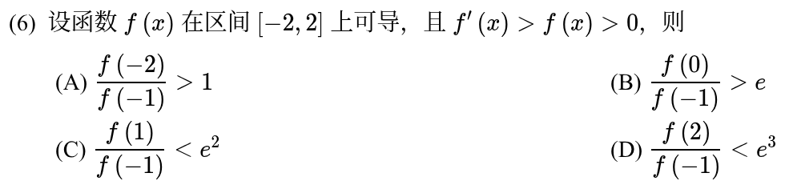
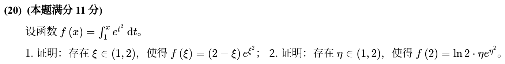
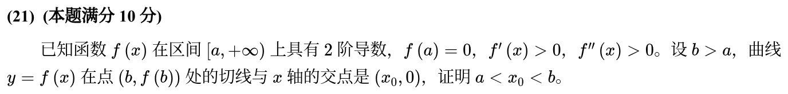
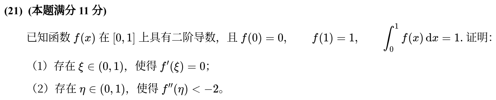
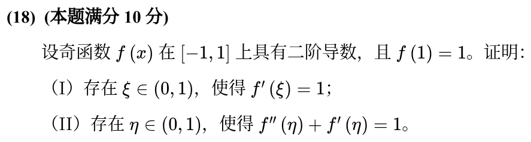

# 中值定理与不等式证明

> 对应章节：[中值定理、零点与不等式证明](../../chapters/calculus/05-mean-value-proofs.md)
> 课程参考：[武忠祥 17 堂课专题 8 已读笔记](../../wu/17/notes/27-08-inequalities.md)（讲义 P88—95，已核对全 25 页）

拿到一道中值定理或抽象不等式证明题，最容易卡住的不是“背不出罗尔、拉格朗日、柯西、泰勒四个公式”，而是**面对题干条件和目标等式/不等式时，不知道第一笔该先变形构造辅助函数、直接上中值定理，还是把某点做泰勒展开**。

按照真实做题时的判断顺序，先看**目标结构**，再选**最小够用的工具**（参考[专题 8 第 3 页方法清单](../../wu/17/notes/27-08-inequalities.md#一第3页的方法清单先看目标再选工具)）：

| 题面特征（目标或条件） | 首选入口 | 第一笔怎么落笔 | 常见误区 |
| :--- | :--- | :--- | :--- |
| **含 $f'(x) \pm \lambda f(x)$ 或 $f' \cdot g \pm f \cdot g'$**（一阶线性组合） | **积分因子 / 乘积导数构造辅助函数** | 凑出 $e^{\pm \lambda x}f(x)$、$g(x)f(x)$ 或 $\frac{f(x)}{g(x)}$，再看单调性或罗尔定理 | 看到 $f'(x) > f(x)$ 盲目移项去猜单调，或忘了检查 $f(x)$ 正负导致除法变号 |
| **目标为两个函数差商比值**（如 $\frac{f(b)-f(a)}{g(b)-g(a)}$ 或带 $\ln 2$、$b^2-a^2$ 等系数） | **柯西中值定理** | 把常数因子还原成 $g(b)-g(a)$，确认 $g'(x) \neq 0$ 后套用 | 硬用拉格朗日出现两个不同中值点 $\xi_1 \neq \xi_2$；或用积分中值定理丢掉开区间 $(a,b)$ 的严格性 |
| **同时给一阶导与二阶导符号，比较切线/弦线/割线斜率** | **拉格朗日中值定理** 或 **二阶泰勒展开** | 先把几何量（如切线截距 $x_0$）写成显式表达式，再比差商与端点导数，或在切点/中点展开消掉一次项 | 只画图直观说“凹函数在切线上方”而不写中值定理或泰勒余项的严格论证 |
| **给积分值与端点值，要证高阶导数（$f''$）的定量界** | **极值点（费马定理）+ 泰勒展开** | 先用零点/最值锁定内部驻点 $f'(x_0)=0$，再在 $x_0$ 处把端点做二阶泰勒展开消掉一次项 | 习惯性在 $x=0$ 展开，结果保留了未知的 $f'(0)$ 消不掉 |

下面用三道真题把这四条主线串起来：**第一题**看如何从 $f'(x) > f(x) > 0$ 一眼识别指数权函数；**第二题**看同一道大题里如何按目标外形分别触发罗尔定理与柯西中值定理；**第三题**看几何切线截距不等式如何同时用拉格朗日中值定理与二阶泰勒展开两条路打通。

---

## 一、微分不等式先凑单调结构：指数权函数怎么一眼看出来

### 触发条件与第一步

只要题干出现形如 $f'(x) > \lambda f(x)$、$f'(x) + p(x)f(x) > 0$ 的微分不等式，不要直接对 $f(x)$ 分类讨论，第一笔直接乘上积分因子 $e^{-\lambda x}$（或 $e^{\int p(x)\,dx}$），把不等式改写成**单个辅助函数的导数定号**：
$$\big(e^{-\lambda x}f(x)\big)' = e^{-\lambda x}\big(f'(x) - \lambda f(x)\big) > 0.$$
随后利用该辅助函数严格单调，把任意两点的比值 $\frac{f(x_2)}{f(x_1)}$ 与 $e^{\lambda(x_2 - x_1)}$ 精确挂钩。

---

### 例 1：[2020 年第 6 题](../../chapters/calculus/05-mean-value-proofs.md#q2020-6)（选择题）

> **来源对照**：属于[武忠祥专题 8 第 3—5 页](../../wu/17/notes/27-08-inequalities.md#二第47页目标变形决定辅助函数而非凭空构造)“先做合法变形构造可比较的单调辅助函数”的**同法迁移**；以下按原卷截图独立推演并逐项排除干扰项。
> **建议先自己读原题并写出辅助函数**，再往下核对。

**原题**（[在章节题单中查看](../../chapters/calculus/05-mean-value-proofs.md#q2020-6)）：

#### 第一步落笔与完整推导

1. **识别结构，构造辅助函数**：由 $f'(x) > f(x)$ 得 $f'(x) - f(x) > 0$。构造
   $$g(x) = e^{-x}f(x), \qquad x \in [-2, 2].$$
   因为 $f(x)$ 在 $[-2, 2]$ 上可导，所以 $g(x)$ 在 $[-2, 2]$ 上可导，且
   $$g'(x) = e^{-x}\big(f'(x) - f(x)\big) > 0.$$
   因此 $g(x)$ 在 $[-2, 2]$ 上**严格单调递增**。
   > **等价写法**：因为题干额外给了 $f(x) > 0$，也可以直接写成 $\frac{f'(x)}{f(x)} > 1$，即 $\big(\ln f(x) - x\big)' > 0$，同样推出 $\ln f(x) - x$ 严格递增。
2. **导出统一比较不等式**：对任意 $-2 \le x_1 < x_2 \le 2$，有 $g(x_2) > g(x_1)$，即
   $$e^{-x_2}f(x_2) > e^{-x_1}f(x_1).$$
   利用 $f(x_1) > 0$ 与 $e^{x_2} > 0$ 两边同除不变号，得
   $$\frac{f(x_2)}{f(x_1)} > e^{x_2 - x_1}.$$
3. **代入选项端点比对**：四个选项分母都是 $f(-1)$，取 $x_1 = -1$：
   - 当 $x_2 = 0 > -1$ 时：$\frac{f(0)}{f(-1)} > e^{0 - (-1)} = e$，与 **（B）** 完全一致。

#### 选择题干扰项拆解

- **（A）$\frac{f(-2)}{f(-1)} > 1$**：方向完全反了。由 $f'(x) > f(x) > 0$ 知 $f(x)$ 本身严格递增，且 $-2 < -1$，故 $f(-2) < f(-1)$，实际上 $\frac{f(-2)}{f(-1)} < e^{-1} < 1$。
- **（C）$\frac{f(1)}{f(-1)} < e^2$** 与 **（D）$\frac{f(2)}{f(-1)} < e^3$**：指数幂次 $1-(-1)=2$、$2-(-1)=3$ 都故意设成正确的临界值，专门抓“不等号方向写反”的失误；由统一不等式实际应有 $\frac{f(1)}{f(-1)} > e^2$、$\frac{f(2)}{f(-1)} > e^3$。
- **考场特例速验**：取满足条件的简单函数 $f(x) = e^{2x}$（$f'(x) = 2e^{2x} > e^{2x} > 0$），立刻算得 $\frac{f(-2)}{f(-1)} = e^{-2}$、$\frac{f(0)}{f(-1)} = e^2 > e$、$\frac{f(1)}{f(-1)} = e^4 > e^2$、$\frac{f(2)}{f(-1)} = e^6 > e^3$，一秒锁定 **（B）**。

#### 条件变式检验

- **变式**：若去掉题干中的“$> 0$”，只保留 $f'(x) > f(x)$，结论（B）还成立吗？
  **不成立。** 此时 $g(x) = e^{-x}f(x)$ 依然严格递增，仍能推出 $f(0) > e\,f(-1)$，但**不能两边同除以 $f(-1)$ 而不改不等号方向**。反例：取 $f(x) = -e^{-x}$，则 $f'(x) = e^{-x} > -e^{-x} = f(x)$ 满足条件，但 $f(-1) = -e < 0$、$f(0) = -1$，此时 $\frac{f(0)}{f(-1)} = \frac{1}{e} < e$，（B）失效。

---

## 二、罗尔与柯西如何按目标外形分流

### 触发条件与第一步

1. **只出现单个中值点 $\xi$，且是 $f(\xi)$ 与 $f'(\xi)$ 的线性组合**：先把 $f'(\xi)$ 显式代换出来，观察是不是某个乘积 $g(x)f(x)$ 或商的导数为 $0$，随后检查两端点是否恰好让该辅助函数取等值（常见为 $0$），走**罗尔定理**。
2. **出现 $\frac{f(b)-f(a)}{g(b)-g(a)}$ 的结构，或结论带 $\ln 2$、$e^2-e$、$b^2-a^2$ 等明显像某个初等函数两端差值的系数**：不要硬凑单一辅助函数，直接把该常数还原为 $g(b) - g(a)$，走**柯西中值定理**。

---

### 例 2：[2020 年第 20 题](../../chapters/calculus/05-mean-value-proofs.md#q2020-20)（解答题，满分 11 分）

> **来源对照**：属于中值定理综合题的典型真题，未在专题 8 中收录；核心思路与[专题 8 第 6 页例 3](../../wu/17/notes/27-08-inequalities.md#第6页例32002数二同一个夹逼两侧可以用不同工具)“按外形特征分别选用匹配的中值工具”一脉相承。
> **建议先自己读原题并写出两问各自选用的定理**，再往下核对。

**原题**（[在章节题单中查看](../../chapters/calculus/05-mean-value-proofs.md#q2020-20)）：

#### 先做公共预处理

由变上限积分求导公式，被积函数 $e^{t^2}$ 在 $\mathbb{R}$ 上连续，因此 $f(x) = \int_1^x e^{t^2}\,dt$ 在 $[1, 2]$ 上连续、可导，且
$$f(1) = 0, \qquad f'(x) = e^{x^2}.$$

#### 第（1）问：从目标反推乘积辅助函数（罗尔定理）

- **看外形定入口**：把 $e^{\xi^2}$ 识别为 $f'(\xi)$，目标等式即为
  $$f(\xi) - (2 - \xi)f'(\xi) = 0 \iff (2 - \xi)f'(\xi) - f(\xi) = 0.$$
  注意到 $(2 - x)' = -1$，左边正好是乘积 $(2 - x)f(x)$ 的导数！
- **第一步落笔**：构造辅助函数
  $$F(x) = (2 - x)f(x), \qquad x \in [1, 2].$$
- **完整证明**：
  $F(x)$ 在 $[1, 2]$ 上连续，在 $(1, 2)$ 内可导，且
  $$F(1) = (2 - 1)f(1) = 0, \qquad F(2) = (2 - 2)f(2) = 0.$$
  由罗尔定理，存在 $\xi \in (1, 2)$，使得 $F'(\xi) = 0$。因为
  $$F'(x) = -f(x) + (2 - x)f'(x) = (2 - x)e^{x^2} - f(x),$$
  代入 $x = \xi$ 即得 $(2 - \xi)e^{\xi^2} - f(\xi) = 0$，即 $f(\xi) = (2 - \xi)e^{\xi^2}$。

> **备选路线对比**：本题第（1）问也可以直接令 $G(x) = f(x) - (2 - x)e^{x^2}$，由 $G(1) = -e < 0$、$G(2) = \int_1^2 e^{t^2}\,dt > 0$ 用零点定理直接秒杀。但乘积构造法在抽象函数（未给出 $e^{t^2}$ 符号）时仍适用，两种视角都应掌握。

#### 第（2）问：把 $\ln 2$ 还原成 $\ln 2 - \ln 1$（柯西中值定理）

- **看外形定入口**：目标 $f(2) = \ln 2 \cdot \eta e^{\eta^2}$ 可改写为
  $$\frac{f(2) - f(1)}{\ln 2 - \ln 1} = \eta e^{\eta^2} = \frac{e^{\eta^2}}{1/\eta} = \frac{f'(\eta)}{(\ln x)'\big|_{x=\eta}}.$$
  分子分母完美对齐 $f(x)$ 与 $g(x) = \ln x$ 在 $[1, 2]$ 上的增量比，立刻触发**柯西中值定理**。
- **完整证明**：
  令 $g(x) = \ln x$。函数 $f(x)$ 与 $g(x)$ 在 $[1, 2]$ 上均连续，在 $(1, 2)$ 内均可导，且对任意 $x \in (1, 2)$ 有 $g'(x) = \frac{1}{x} \neq 0$。
  由柯西中值定理，存在 $\eta \in (1, 2)$，使得
  $$\frac{f(2) - f(1)}{g(2) - g(1)} = \frac{f'(\eta)}{g'(\eta)}.$$
  代入 $f(1) = 0$、$g(1) = \ln 1 = 0$、$g(2) = \ln 2$、$f'(\eta) = e^{\eta^2}$ 与 $g'(\eta) = \frac{1}{\eta}$，得
  $$\frac{f(2)}{\ln 2} = \frac{e^{\eta^2}}{1/\eta} = \eta e^{\eta^2},$$
  即 $f(2) = \ln 2 \cdot \eta e^{\eta^2}$。

> **避坑提醒**：有同学会把 $f(2)$ 写成 $\int_1^2 (te^{t^2}) \cdot \frac{1}{t}\,dt$ 再用推广的积分中值定理，但这只能先得到 $\eta \in [1, 2]$（闭区间），要进一步说明 $\eta$ 不取端点 $1, 2$ 还需要额外论证 $te^{t^2}$ 严格递增；而柯西中值定理一步就能严格落入开区间 $(1, 2)$。

#### 条件变式检验

- **变式**：若把题干中的积分下限从 $1$ 改为 $0$，即 $f(x) = \int_0^x e^{t^2}\,dt$，两问结论还成立吗？
  **第（2）问直接失效**（柯西中值定理给出的是 $f(2) - f(1) = \ln 2 \cdot \eta e^{\eta^2}$，左边不再是 $f(2)$）；**第（1）问中乘积辅助函数 $F(x)=(2-x)f(x)$ 也不再满足 $F(1)=F(2)$**（因为 $f(1) = \int_0^1 e^{t^2}\,dt > 0$，罗尔条件破坏；此时要看 $G(1) = f(1) - e$ 的符号来判断零点是否存在，而实际上 $\int_0^1 e^{t^2}\,dt < \int_0^1 e^t\,dt = e - 1 < e$，所以第（1）问用零点定理仍巧合成立，但原罗尔路线已失效）。

---

## 三、几何切线不等式：拉格朗日与二阶泰勒双路打通

### 触发条件与第一步

题干给出 $f'(x) > 0$、$f''(x) > 0$ 以及“某点切线与坐标轴交点”时，**第一笔永远是把几何对象翻译成代数表达式**（写出切线方程，显式解出 $x_0$）。解出来之后，双边不等式通常拆成两半处理：
- 只需单调性的一半，用 $f'(x) > 0$ 直接收尾；
- 涉及二阶导数 $f''(x) > 0$（曲率/凹凸性）的一半，立刻在**拉格朗日中值定理（比斜率）**和**二阶泰勒展开（切线在曲线下方）**之间二选一。

---

### 例 3：[2015 年第 21 题](../../chapters/calculus/05-mean-value-proofs.md#q2015-21)（解答题，满分 10 分）

> **来源对照**：属于[武忠祥专题 8 第 3 页与第 8—10 页](../../wu/17/notes/27-08-inequalities.md#一第3页的方法清单先看目标再选工具)“用 $f'' > 0$ 判定图像在切线上方 / 用中值定理与泰勒展开处理抽象二阶可导不等式”的**同法迁移**。
> **建议先自己写出 $x_0$ 的表达式**，再往下核对两种证明。

**原题**（[在章节题单中查看](../../chapters/calculus/05-mean-value-proofs.md#q2015-21)）：

#### 第一步落笔：显式解出切线横截距 $x_0$

曲线 $y = f(x)$ 在点 $(b, f(b))$ 处的切线方程为
$$y - f(b) = f'(b)(x - b).$$
令 $y = 0$，因为 $f'(b) > 0$（分母非零，合法相除），解得交点横坐标
$$x_0 = b - \frac{f(b)}{f'(b)}.$$

#### 证明右半边：$x_0 < b$（只用到 $f'(x) > 0$）

因为在 $[a, +\infty)$ 上 $f'(x) > 0$，所以 $f(x)$ 在 $[a, b]$ 上严格单调递增。由 $b > a$ 及 $f(a) = 0$，得
$$f(b) > f(a) = 0.$$
又 $f'(b) > 0$，故 $\frac{f(b)}{f'(b)} > 0$，从而
$$x_0 = b - \frac{f(b)}{f'(b)} < b.$$

#### 证明左半边：$x_0 > a$（两种等价入口）

把目标 $b - \frac{f(b)}{f'(b)} > a$ 等价变形（利用 $f'(b) > 0$ 与 $b - a > 0$）：
$$x_0 > a \iff \frac{f(b) - f(a)}{b - a} < f'(b).$$

- **解法一（拉格朗日中值定理——比割线与切线斜率）**：
  $f(x)$ 在 $[a, b]$ 上连续、在 $(a, b)$ 内可导，由拉格朗日中值定理，存在 $\xi \in (a, b)$，使得
  $$\frac{f(b) - f(a)}{b - a} = f'(\xi).$$
  因为 $f''(x) > 0$ 在 $[a, +\infty)$ 上恒成立，所以 $f'(x)$ 在 $[a, b]$ 上严格单调递增。由 $\xi < b$ 得 $f'(\xi) < f'(b)$，即
  $$\frac{f(b)}{b - a} < f'(b) \implies \frac{f(b)}{f'(b)} < b - a \implies x_0 = b - \frac{f(b)}{f'(b)} > a.$$
- **解法二（二阶泰勒展开——把“曲线在切线上方”代数化）**：
  以切点 $x = b$ 为展开点，将 $f(a)$ 展开到带拉格朗日余项的二阶泰勒公式：存在 $\xi \in (a, b)$，使得
  $$0 = f(a) = f(b) + f'(b)(a - b) + \frac{1}{2}f''(\xi)(a - b)^2.$$
  因为 $f''(\xi) > 0$ 且 $(a - b)^2 > 0$，所以余项严格为正，从而
  $$f(b) + f'(b)(a - b) < 0 \implies f(b) < f'(b)(b - a) \implies b - \frac{f(b)}{f'(b)} > a.$$

综合两半，证得 $a < x_0 < b$。

#### 条件变式检验

- **变式**：若把条件 $f''(x) > 0$ 改为 $f''(x) < 0$（其余条件 $f(a)=0, f'(x)>0, b>a$ 不变），$x_0$ 会落在哪个区间？
  **右半边 $x_0 < b$ 仍然成立**（只依赖 $f'(x) > 0$），但**左半边反向变为 $x_0 < a$**。因为 $f''(x) < 0$ 时 $f'(x)$ 严格递减，拉格朗日中值定理给出 $f'(\xi) > f'(b)$，从而 $\frac{f(b)}{f'(b)} > b - a$，即 $x_0 < a$（几何上，上凸曲线的切线位于曲线上方，切线与 $x$ 轴的交点落在 $a$ 的左侧）。

---

## 四、回练与过关标准

### 1. 真题回练一：[2019 年第 21 题](../../chapters/calculus/05-mean-value-proofs.md#q2019-21)（解答题，满分 11 分）

点击核对思路与关键步骤

- **第（1）问（两种干净入口）**：
  - **入口 A（最值点法，直接为第 2 问铺路）**：设 $f(x)$ 在闭区间 $[0, 1]$ 上的最大值为 $M = f(\xi)$。若 $M \le 1$，则对一切 $x \in [0, 1]$ 有 $f(x) \le 1$，又 $f(0) = 0 < 1$ 且 $f$ 连续，故 $\int_0^1 f(x)\,dx < \int_0^1 1\,dx = 1$，与已知矛盾！因此必有 $M > 1$。因为 $f(0) = 0 < M$ 且 $f(1) = 1 < M$，最大值点 $\xi$ 必落在开区间 $(0, 1)$ 内，由费马定理得 $f'(\xi) = 0$。
  - **入口 B（变上限函数罗尔法）**：令 $F(x) = \int_0^x f(t)\,dt - x$，则 $F(0) = F(1) = 0$，由罗尔定理存在 $c \in (0, 1)$ 使 $F'(c) = f(c) - 1 = 0$，即 $f(c) = 1 = f(1)$；再在 $[c, 1]$ 上对 $f$ 用罗尔定理，得 $\xi \in (c, 1) \subset (0, 1)$ 使 $f'(\xi) = 0$。
- **第（2）问（在最大值点 $\xi$ 处展开 $f(0)$）**：
  由入口 A 已有 $\xi \in (0, 1)$ 满足 $f(\xi) > 1$ 且 $f'(\xi) = 0$。将 $f(0)$ 在 $x = \xi$ 处作带拉格朗日余项的二阶泰勒展开：存在 $\eta \in (0, \xi) \subset (0, 1)$，使得
  $$0 = f(0) = f(\xi) + f'(\xi)(0 - \xi) + \frac{1}{2}f''(\eta)(0 - \xi)^2 = f(\xi) + \frac{1}{2}f''(\eta)\xi^2.$$
  解得
  $$f''(\eta) = -\frac{2f(\xi)}{\xi^2}.$$
  因为 $f(\xi) > 1$ 且 $0 < \xi < 1 \implies 0 < \xi^2 < 1$，故 $f''(\eta) < -\frac{2 \cdot 1}{1} = -2$。
  > **避坑点**：如果只用入口 B 得到 $f(c)=1$ 和 $f'(\xi)=0$，在 $[\xi_1, \xi]$ 上二次套拉格朗日只能得到 $f''(\eta) = -\frac{1}{c(\xi - \xi_1)}$，无法保证分母 $< \frac{1}{2}$；**必须用到 $f(\xi) > 1$ 这个比 $1$ 严格大的最大值点信息**。

### 2. 真题回练二：[2013 年第 18 题](../../chapters/calculus/05-mean-value-proofs.md#q2013-18)（解答题，满分 10 分）

点击核对思路与关键步骤

- **先挖掘“奇函数 + 二阶可导”的两个隐藏零值**：
  因为 $f(x)$ 是 $[-1, 1]$ 上的奇函数，所以 $f(0) = 0$；对 $f(-x) = -f(x)$ 连续求两次导得 $f'(-x) = f'(x)$（偶函数）、$f''(-x) = -f''(x)$（奇函数），从而 $f''(0) = 0$。
- **第（I）问**：在 $[0, 1]$ 上对 $f(x)$ 用拉格朗日中值定理，存在 $\xi \in (0, 1)$，使得
  $$f'(\xi) = \frac{f(1) - f(0)}{1 - 0} = 1.$$
- **第（II）问（注意区间是开区间 $(0, 1)$，不能只用 $[-\xi, \xi]$）**：
  目标 $f''(\eta) + f'(\eta) - 1 = 0$ 提示构造积分因子辅助函数
  $$H(x) = e^x\big(f'(x) - 1\big), \qquad x \in [0, \xi],$$
  则 $H'(x) = e^x\big(f''(x) + f'(x) - 1\big)$。已知 $H(\xi) = 0$，且在左端点 $x = 0$ 处利用 $f''(0) = 0$ 有
  $$H'(0) = f''(0) + f'(0) - 1 = f'(0) - 1 = H(0).$$
  按 $H(0)$ 的符号分三种情况，均能把 $\eta$ 严格锁在 $(0, \xi) \subset (0, 1)$ 内：
  1. 若 $H(0) = 0$：则 $H(0) = H(\xi) = 0$，在 $[0, \xi]$ 上用罗尔定理得 $\eta \in (0, \xi)$ 使 $H'(\eta) = 0$；
  2. 若 $H(0) > 0$：则 $H'(0) = H(0) > 0$，由导数定义知在 $0$ 的右侧附近存在点使 $H(x) > H(0) > 0 = H(\xi)$，故 $H(x)$ 在 $[0, \xi]$ 上的最大值必在内部某点 $\eta \in (0, \xi)$ 取得，由费马定理得 $H'(\eta) = 0$；
  3. 若 $H(0) < 0$：则 $H'(0) = H(0) < 0$，同理 $H(x)$ 在 $[0, \xi]$ 上的最小值必在内部某点 $\eta \in (0, \xi)$ 取得，由费马定理得 $H'(\eta) = 0$。
  综上，必存在 $\eta \in (0, 1)$ 使 $f''(\eta) + f'(\eta) = 1$。

### 过关标准

合上讲义，面对一道新的中值定理或不等式证明题，能独立做到以下四点即算过关：
1. 看到 $f' \pm \lambda f$ 或乘积导数外形，能第一时间写出对应的**积分因子/乘积辅助函数**，并检查除法时分母是否严格保号；
2. 看到带 $\ln 2$、$b^2 - a^2$ 等两端差值结构的等式，能主动切换到**柯西中值定理**，避免引入两个不相等的中值点；
3. 面对“切线/弦线”或“给积分值求 $f''$ 界”的问题，能先写出显式表达式或锁定内部极值点，再主动选择**能让未知一阶项消掉的展开点**做二阶泰勒展开；
4. 改动题干中一个正负条件、下限或二阶导符号，能直接说出原证明在哪一步断开。
