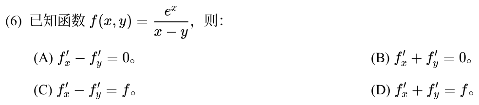
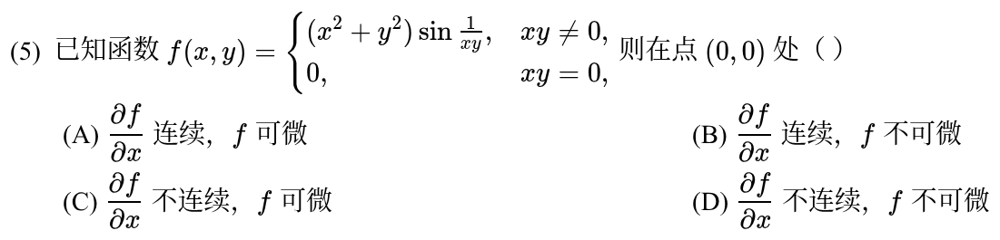
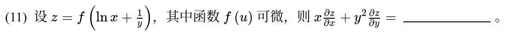
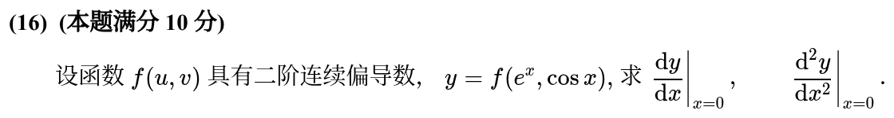
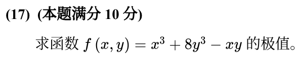
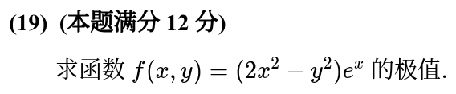
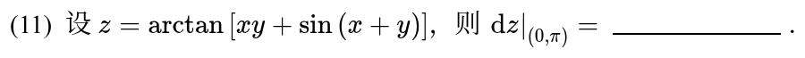
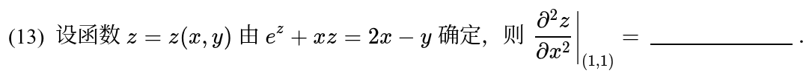
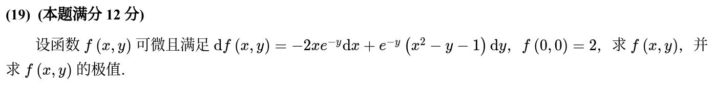

# 多元微分、复合隐函数求导与极值

> 跨章主题：串联[多元函数极限、偏导与全微分](../../chapters/calculus/16-multivariable-basics.md)、[多元复合函数与隐函数求导](../../chapters/calculus/17-chain-implicit.md)与[多元函数极值与最值](../../chapters/calculus/18-multivariable-extrema.md)

多元微分学在数二里几乎是每年必考的稳定得分板块，但失分点也高度集中：概念题里把“偏导连续 $\implies$ 可微”当成必要条件，二阶抽象复合求导漏掉外层记号或漏掉二阶项，极值大题里解驻点漏根或把 $AC-B^2$ 算错符号。

拿到一道多元微分题，第一笔先按**任务类型与正则性**选入口，不要闷头硬算：

| 题目类型 | 关键识别信号 | 第一笔怎么落 | 常见误区 |
| :--- | :--- | :--- | :--- |
| **基本偏导与关系判定** | 显式初等函数，问 $f'_x, f'_y$ 的线性关系或某点全微分 | 求偏导时先盯住“哪个变量是常数”，求某点偏导可**先代另一个变量的数值**再求一元导 | 对 $x-y$ 求 $y$ 偏导漏负号；求某点偏导硬算完整表达式徒增计算量 |
| **分段函数在原点处连续/偏导/可微性** | 分段点在 $(0,0)$，含 $\frac{1}{xy}$、$\sqrt{x^2+y^2}$ 等震荡或奇异因子 | **先按定义算 $f_x(0,0), f_y(0,0)$**；再按定义检验 $\lim_{\rho\to 0}\frac{\Delta z - f_x\Delta x - f_y\Delta y}{\rho}=0$ 判可微；最后求非原点偏导沿路径取极限判偏导连续 | 误把“偏导不连续”当成“不可微”；在分段点处直接对非零表达式套求导公式 |
| **抽象复合函数一/二阶求导** | 含抽象函数 $f(u)$ 或 $f(u,v)$，求偏导组合或某点一、二阶导数 | **先画变量依赖树**，统一用位置下标 $f'_1, f'_2, f''_{11}, f''_{12}, f''_{22}$；二阶求导时对 $f'_1, f'_2$ **再次套链式法则** | 混淆 $f'_1$ 与 $f'_x$；二阶求导忘记 $f'_1(u,v)$ 本身仍是 $(u,v)$ 的复合函数；提前代入 $x=0$ 再求二阶导 |
| **隐函数求偏导 / 二阶偏导** | 方程 $F(x,y,z)=0$ 确定 $z=z(x,y)$，求某点偏导或二阶偏导 | 先把给定 $(x_0, y_0)$ 代入原方程定出 $z_0$；对原方程两边直接求偏导，**边求边代入数值**，不要展开成冗长通式 | 忘记 $z$ 是 $x,y$ 的函数而漏乘 $z_x$；求二阶偏导时对一阶式先代数值再求导（必须先求完二阶式再代值） |
| **无条件极值（解答题主力）** | 问二元函数 $f(x,y)$ 的极值，无附加等式约束 | 1. 联立 $f_x=0, f_y=0$ 找齐**全部驻点**；2. 算 $A=f_{xx}, B=f_{xy}, C=f_{yy}$；3. 逐点判 $AC-B^2$ 符号与 $A$ 符号；4. 写明**极值点与极值** | 解方程组消元时漏掉 $x=0$ 或 $y=0$ 分支；把 $AC-B^2<0$ 误判为极值点；只算了极值点忘了代回求极值 |

下面按“概念与基础计算 $\to$ 抽象复合求导 $\to$ 无条件极值”三条线，用六道真题把所有核心动作走通。

---

## 一、偏导关系与“可微 vs 偏导连续”：先抓定义，不背伪等价

### 判断链

1. **显式函数求偏导关系**：对 $x$ 求偏导时把 $y$ 当常数，对 $y$ 求偏导时把 $x$ 当常数；遇到分母含 $x-y$ 或 $x+y$ 的结构，可优先留意 $\frac{\partial}{\partial x}(x-y) = 1$ 与 $\frac{\partial}{\partial y}(x-y) = -1$ 的**对消结构**。
2. **分段点处的四大概念逻辑链（必须分清箭头方向）**：
   $$\text{偏导数连续} \implies \text{可微} \implies \begin{cases} \text{连续} \\ \text{偏导数存在} \end{cases}$$
   **反方向全不成立！** 特别是：**偏导数不连续 $\nRightarrow$ 不可微**。因此只要题目在分段点处同时问“偏导连续性”和“可微性”，就必须**分别独立检验**，绝不能用“偏导不连续”直接否定可微。

---

### 例 1：[2016 年第 6 题](../../chapters/calculus/16-multivariable-basics.md#q2016-6)（选择题）

> **建议先自己读原题并写第一步**，再往下看推演。

**原题**（[在章节题单中查看](../../chapters/calculus/16-multivariable-basics.md#q2016-6)）：

#### 触发条件与第一步

看到分母是 $x-y$、分子只含 $e^x$，第一笔直接分别求 $f'_x$ 与 $f'_y$，重点盯住分母求导后的 $\frac{e^x}{(x-y)^2}$ 项符号，看两者相加还是相减能把二次分母消掉。

#### 完整推演

1. **对 $x$ 求偏导**（把 $y$ 视为常数，用商的求导法则）：
   $$f'_x = \frac{e^x(x-y) - e^x \cdot 1}{(x-y)^2} = \frac{e^x}{x-y} - \frac{e^x}{(x-y)^2} = f - \frac{e^x}{(x-y)^2}.$$
2. **对 $y$ 求偏导**（把 $x$ 视为常数，注意链式法则里 $\frac{\partial (x-y)}{\partial y} = -1$）：
   $$f'_y = e^x \cdot \left(-\frac{1}{(x-y)^2}\right)\cdot (-1) = \frac{e^x}{(x-y)^2}.$$
3. **两式相加消去二次分母**：
   $$f'_x + f'_y = \left(f - \frac{e^x}{(x-y)^2}\right) + \frac{e^x}{(x-y)^2} = f.$$

故正确选项为 **（D）**。

#### 选择题干扰项拆解

- **（C）$f'_x - f'_y = f$（最高频错选）**：算 $f'_y$ 时漏乘了内层导数 $-1$，把 $f'_y$ 算成了 $-\frac{e^x}{(x-y)^2}$，进而凑出 $f'_x - f'_y = f$。
- **（B）$f'_x + f'_y = 0$**：对 $x$ 求导时只求了分母 $(x-y)^{-1}$ 而漏了对分子 $e^x$ 求导。
- **（A）$f'_x - f'_y = 0$**：同时漏掉了分子求导与 $f'_y$ 的负号。

#### 条件变式检验

- **变式**：若把函数改为 $f(x,y) = \frac{e^x}{x+y}$，四个选项中哪一个成立？
  此时 $f'_x = f - \frac{e^x}{(x+y)^2}$，$f'_y = -\frac{e^x}{(x+y)^2}$，二次分母同号，需做**减法**才能对消：$f'_x - f'_y = f$，答案变为 **（C）**。

---

### 例 2：[2024 年第 5 题](../../chapters/calculus/16-multivariable-basics.md#q2024-5)（选择题）

> **建议先自己读原题并写第一步**，再往下看推演。

**原题**（[在章节题单中查看](../../chapters/calculus/16-multivariable-basics.md#q2024-5)）：

#### 触发条件与第一步

函数在 $xy=0$（即整条 $x$ 轴与 $y$ 轴）上分段定义为 $0$，询问在 $(0,0)$ 处 $\frac{\partial f}{\partial x}$ 的连续性与 $f$ 的可微性。**第一笔必须先用偏导定义算 $f_x(0,0)$ 和 $f_y(0,0)$**，绝不能直接对 $(x^2+y^2)\sin\frac{1}{xy}$ 求导后代 $(0,0)$。

#### 完整推演

1. **按定义求 $(0,0)$ 处的一阶偏导数**：
   因为当 $y=0$ 时 $xy=0$，恒有 $f(x,0)=0$；当 $x=0$ 时 $xy=0$，恒有 $f(0,y)=0$。故
   $$f_x(0,0) = \lim_{x\to 0}\frac{f(x,0)-f(0,0)}{x} = \lim_{x\to 0}\frac{0-0}{x} = 0,$$
   $$f_y(0,0) = \lim_{y\to 0}\frac{f(0,y)-f(0,0)}{y} = \lim_{y\to 0}\frac{0-0}{y} = 0.$$
2. **按定义检验 $f$ 在 $(0,0)$ 处的可微性**：
   线性主部为 $f_x(0,0)x + f_y(0,0)y = 0$，检验余项与 $\rho = \sqrt{x^2+y^2}$ 之比的极限：
   $$\frac{f(x,y) - f(0,0) - f_x(0,0)x - f_y(0,0)y}{\sqrt{x^2+y^2}} = \frac{f(x,y)}{\sqrt{x^2+y^2}}.$$
   分两类点估计绝对值（$(x,y)\neq (0,0)$）：
   - 当 $xy \neq 0$ 时：
     $$\left|\frac{f(x,y)}{\sqrt{x^2+y^2}}\right| = \sqrt{x^2+y^2}\left|\sin\frac{1}{xy}\right| \le \sqrt{x^2+y^2};$$
   - 当 $xy = 0$ 时：$\left|\frac{f(x,y)}{\sqrt{x^2+y^2}}\right| = 0 \le \sqrt{x^2+y^2}$。
   
   因此对一切 $(x,y) \neq (0,0)$ 都有 $0 \le \left|\frac{f(x,y)}{\sqrt{x^2+y^2}}\right| \le \sqrt{x^2+y^2} \to 0$（当 $(x,y)\to(0,0)$）。由夹逼准则，极限为 $0$，故 **$f$ 在 $(0,0)$ 处可微**。
3. **检验 $\frac{\partial f}{\partial x}$ 在 $(0,0)$ 处的连续性**：
   在 $xy \neq 0$ 的区域内直接求偏导：
   $$f_x(x,y) = 2x\sin\frac{1}{xy} + (x^2+y^2)\cos\frac{1}{xy}\cdot\left(-\frac{1}{x^2 y}\right) = 2x\sin\frac{1}{xy} - \frac{x^2+y^2}{x^2 y}\cos\frac{1}{xy}.$$
   取趋近路径 $y = x \to 0$（满足 $xy = x^2 \neq 0$）：
   $$f_x(x,x) = 2x\sin\frac{1}{x^2} - \frac{2}{x}\cos\frac{1}{x^2}.$$
   再取点列 $x_n = \frac{1}{\sqrt{2n\pi}} \to 0$，则 $\sin\frac{1}{x_n^2}=0$，$\cos\frac{1}{x_n^2}=1$，得
   $$f_x(x_n, x_n) = -2\sqrt{2n\pi} \to -\infty \neq 0 = f_x(0,0).$$
   因此 $\lim_{(x,y)\to(0,0)} f_x(x,y)$ 不存在，**$\frac{\partial f}{\partial x}$ 在 $(0,0)$ 处不连续**。

综上，选 **（C）**。

#### 选择题干扰项拆解

- **（D）$\frac{\partial f}{\partial x}$ 不连续，$f$ 不可微（最大陷阱）**：先算出 $f_x$ 不连续后，误以为“偏导不连续 $\implies$ 不可微”，把充分条件当成了充要条件。
- **（A）$\frac{\partial f}{\partial x}$ 连续，$f$ 可微**：先证出 $f$ 可微后，反推误以为“可微 $\implies$ 偏导连续”。
- **（B）$\frac{\partial f}{\partial x}$ 连续，$f$ 不可微**：由本题关于 $x,y$ 的对称性，若 $f_x$ 在 $(0,0)$ 连续则 $f_y$ 也必在 $(0,0)$ 连续，从而 $f$ 必可微，选项本身与定理矛盾，可直接秒排。

#### 条件变式检验

- **变式**：若把分子上的 $(x^2+y^2)$ 降次为 $\sqrt{x^2+y^2}$，即 $xy\neq 0$ 时 $f(x,y)=\sqrt{x^2+y^2}\sin\frac{1}{xy}$，结论如何变化？
  此时 $f_x(0,0)=f_y(0,0)=0$ 不变，但检验可微性时 $\frac{f(x,y)}{\sqrt{x^2+y^2}} = \sin\frac{1}{xy}$ 在 $(x,y)\to(0,0)$ 时震荡无极限，故 **$f$ 不可微**（且 $f_x$ 仍不连续），答案变为 **（D）**。可见决定可微性的关键是**振幅阶数是否严格高于 $\rho = \sqrt{x^2+y^2}$ 的 $1$ 次**。

---

## 二、抽象复合函数求导：统一位置记号，二阶求导再套链式法则

### 判断链

1. **一元外层抽象函数 $z = f(u(x,y))$**：只需记 $f'(u)$，用 $\frac{\partial z}{\partial x} = f'(u)u_x$、$\frac{\partial z}{\partial y} = f'(u)u_y$，带入目标线性组合看 $f'(u)$ 系数能否抵消。
2. **二元外层抽象函数 $y = f(u(x), v(x))$ 求二阶导**：
   - 坚决不用 $f'_u, f'_v$（一旦 $u,v$ 里出现 $x$ 或相同字母极易混乱），统一写成位置记号 $f'_1, f'_2, f''_{11}, f''_{12}, f''_{22}$；
   - **检查二阶连续偏导数条件**：题目给出“具有二阶连续偏导数” $\implies f''_{12} = f''_{21}$，合并交叉项；
   - **求某点处的二阶导数**：必须**先对一般 $x$ 求出完整 $\frac{\mathrm{d}^2 y}{\mathrm{d}x^2}$ 表达式，最后一步再代 $x=x_0$**，并且括号里的自变量同步换成 $(u(x_0), v(x_0))$！

---

### 例 3：[2012 年第 11 题](../../chapters/calculus/17-chain-implicit.md#q2012-11)（填空题）

> **建议先自己读原题并写第一步**，再往下看推演。

**原题**（[在章节题单中查看](../../chapters/calculus/17-chain-implicit.md#q2012-11)）：

#### 触发条件与第一步

外层 $f(u)$ 是一元可微函数，内层 $u = \ln x + \frac{1}{y}$。第一笔直接设中间变量 $u = \ln x + \frac{1}{y}$，分别写出 $\frac{\partial z}{\partial x}$ 与 $\frac{\partial z}{\partial y}$。

#### 完整推演

1. 令 $u = \ln x + \frac{1}{y}$，由复合函数链式法则：
   $$\frac{\partial z}{\partial x} = f'(u)\cdot \frac{\partial u}{\partial x} = \frac{1}{x}f'(u),$$
   $$\frac{\partial z}{\partial y} = f'(u)\cdot \frac{\partial u}{\partial y} = -\frac{1}{y^2}f'(u).$$
2. 代入所求表达式：
   $$x\frac{\partial z}{\partial x} + y^2\frac{\partial z}{\partial y} = x\cdot\frac{1}{x}f'(u) + y^2\cdot\left(-\frac{1}{y^2}f'(u)\right) = f'(u) - f'(u) = 0.$$

故应填 **$0$**。

#### 条件变式检验

- **变式**：若把题干改为 $z = x f\left(\ln x + \frac{1}{y}\right)$，求 $x\frac{\partial z}{\partial x} + y^2\frac{\partial z}{\partial y}$ 等于什么？
  此时 $\frac{\partial z}{\partial x} = f(u) + x\cdot\frac{1}{x}f'(u) = f(u) + f'(u)$，而 $\frac{\partial z}{\partial y} = -\frac{x}{y^2}f'(u)$，代入得 $x f(u) + x f'(u) - x f'(u) = x f(u) = z$。可见外层多了显式因子 $x$ 时，乘积求导多出的那一项不会消掉，结果由 $0$ 变为 $z$。

---

### 例 4：[2017 年第 16 题](../../chapters/calculus/17-chain-implicit.md#q2017-16)（解答题，满分 10 分）

> **建议先自己读原题并写第一步**，再往下看推演。

**原题**（[在章节题单中查看](../../chapters/calculus/17-chain-implicit.md#q2017-16)）：

#### 触发条件与第一步

二元抽象函数 $f(u,v)$ 复合了一元变量 $x$（$u=e^x, v=\cos x$），且要求在 $x=0$ 处的一阶与二阶导数。第一笔先列出依赖链 $y \to (u,v) \to x$，并算出 $x=0$ 时两个中间变量的值：$u(0)=e^0=1$，$v(0)=\cos 0=1$（防止最后把 $(1,1)$ 误写成 $(0,0)$！）。

#### 完整推演

1. **求一阶导数及 $x=0$ 处的值**：
   记 $f'_1, f'_2$ 分别表示 $f$ 对第 1、第 2 个自变量的偏导数。由链式法则：
   $$\frac{\mathrm{d}y}{\mathrm{d}x} = f'_1(e^x, \cos x)\cdot e^x + f'_2(e^x, \cos x)\cdot (-\sin x) = e^x f'_1 - \sin x\, f'_2.$$
   令 $x = 0$，此时 $e^0 = 1$，$\cos 0 = 1$，$\sin 0 = 0$，得
   $$\left.\frac{\mathrm{d}y}{\mathrm{d}x}\right|_{x=0} = 1\cdot f'_1(1,1) - 0\cdot f'_2(1,1) = f'_1(1,1).$$
2. **求二阶导数及 $x=0$ 处的值**：
   对 $\frac{\mathrm{d}y}{\mathrm{d}x} = e^x f'_1(e^x,\cos x) - \sin x\, f'_2(e^x,\cos x)$ 两边再次关于 $x$ 求导（**乘积法则 + 链式法则**）：
   $$\begin{aligned}
   \frac{\mathrm{d}^2 y}{\mathrm{d}x^2} &= e^x f'_1 + e^x\Big(f''_{11}\cdot e^x + f''_{12}\cdot (-\sin x)\Big) \\
   &\quad - \cos x\, f'_2 - \sin x\Big(f''_{21}\cdot e^x + f''_{22}\cdot (-\sin x)\Big).
   \end{aligned}$$
   因为 $f(u,v)$ 具有**二阶连续偏导数**，所以 $f''_{12} = f''_{21}$，整理得
   $$\frac{\mathrm{d}^2 y}{\mathrm{d}x^2} = e^x f'_1 - \cos x\, f'_2 + e^{2x} f''_{11} - 2e^x\sin x\, f''_{12} + \sin^2 x\, f''_{22}.$$
   令 $x = 0$（注意此时 $\cos 0 = 1$，因此 $-f'_2(1,1)$ 项**不会消失**！），得
   $$\left.\frac{\mathrm{d}^2 y}{\mathrm{d}x^2}\right|_{x=0} = f'_1(1,1) - f'_2(1,1) + f''_{11}(1,1).$$

> **高频扣分点警示**：不要因为 $\left.\frac{\mathrm{d}y}{\mathrm{d}x}\right|_{x=0}$ 中 $-\sin x\, f'_2$ 这一项在 $x=0$ 时为 $0$，就在求二阶导前把它删掉！$-\sin x$ 求导后变成 $-\cos x$，在 $x=0$ 处贡献了 $-f'_2(1,1)$。

#### 条件变式检验

- **变式**：若把题干中 $y = f(e^x, \cos x)$ 改为 $y = f(e^x, \sin x)$，求 $\left.\frac{\mathrm{d}^2 y}{\mathrm{d}x^2}\right|_{x=0}$ 会多出哪些二阶偏导项？
  此时 $u(0)=1, v(0)=0$，一阶导为 $e^x f'_1 + \cos x\, f'_2$。在 $x=0$ 时 $v'(0)=\cos 0 = 1 \neq 0$，$v''(0)=-\sin 0 = 0$，于是二阶导在 $x=0$ 处变成 $f'_1(1,0) + f''_{11}(1,0) + 2f''_{12}(1,0) + f''_{22}(1,0)$，混合偏导与 $f''_{22}$ 全部保留，而 $f'_2$ 消失。

---

## 三、二元无条件极值：驻点不漏解，黑塞判别式一步到位

### 判断链

求光滑二元函数 $f(x,y)$ 的无条件极值，标准四步不容跳步：
1. **求一阶偏导并解驻点方程组** $f_x(x,y)=0,\; f_y(x,y)=0$：
   - 遇到乘积项（如 $e^x$ 恒大于 $0$，可直接约去；遇到 $x(\cdots)=0$ 或 $y(\cdots)=0$，必须**拆分支讨论**，绝不能两边同除以 $x$ 或 $y$！）。
2. **求二阶偏导** $A = f_{xx},\; B = f_{xy},\; C = f_{yy}$。
3. **逐个驻点算判别式 $\Delta = AC - B^2$**：
   - $AC - B^2 > 0$ 且 $A < 0 \implies$ **极大值点**；
   - $AC - B^2 > 0$ 且 $A > 0 \implies$ **极小值点**；
   - $AC - B^2 < 0 \implies$ **不是极值点**（鞍点）；
   - $AC - B^2 = 0 \implies$ 失效，必须回退用定义或沿不同路径检验 $f(x,y)-f(x_0,y_0)$ 符号。
4. **代回原函数算出极值**，写清“在点 $(x_0,y_0)$ 处取得极大/极小值 $\cdots$”。

---

### 例 5：[2020 年第 17 题](../../chapters/calculus/18-multivariable-extrema.md#q2020-17)（解答题，满分 10 分）

> **建议先自己读原题并写第一步**，再往下看推演。

**原题**（[在章节题单中查看](../../chapters/calculus/18-multivariable-extrema.md#q2020-17)）：

#### 触发条件与第一步

多项式函数在 $\mathbb{R}^2$ 上处处具有任意阶连续偏导数，无边界约束。第一笔直接算 $f_x, f_y$ 并令其为 $0$，利用一次项直接消元解出全部驻点。

#### 完整推演

1. **求驻点**：
   $$\begin{cases} f_x(x,y) = 3x^2 - y = 0, \\ f_y(x,y) = 24y^2 - x = 0. \end{cases}$$
   由第一式得 $y = 3x^2$，代入第二式：
   $$24(3x^2)^2 - x = 216x^4 - x = x(216x^3 - 1) = 0.$$
   因为 $216 = 6^3$，解得两个实根：
   - $x = 0 \implies y = 0$，得驻点 $P_1(0, 0)$；
   - $x = \frac{1}{6} \implies y = 3\cdot\frac{1}{36} = \frac{1}{12}$，得驻点 $P_2\left(\frac{1}{6}, \frac{1}{12}\right)$。
2. **求二阶偏导数**：
   $$A = f_{xx} = 6x, \qquad B = f_{xy} = -1, \qquad C = f_{yy} = 48y.$$
3. **逐点判别**：
   - 在 $P_1(0,0)$ 处：$A = 0,\; B = -1,\; C = 0$，
     $$AC - B^2 = 0 - (-1)^2 = -1 < 0,$$
     故 $(0,0)$ **不是极值点**。
   - 在 $P_2\left(\frac{1}{6}, \frac{1}{12}\right)$ 处：$A = 6\cdot\frac{1}{6} = 1,\; B = -1,\; C = 48\cdot\frac{1}{12} = 4$，
     $$AC - B^2 = 1\cdot 4 - (-1)^2 = 3 > 0, \quad \text{且 } A = 1 > 0,$$
     故 $\left(\frac{1}{6}, \frac{1}{12}\right)$ 是**极小值点**。
4. **计算极小值**：
   $$f\left(\frac{1}{6}, \frac{1}{12}\right) = \left(\frac{1}{6}\right)^3 + 8\left(\frac{1}{12}\right)^3 - \frac{1}{6}\cdot\frac{1}{12} = \frac{1}{216} + \frac{1}{216} - \frac{3}{216} = -\frac{1}{216}.$$

结论：函数在点 $\left(\frac{1}{6}, \frac{1}{12}\right)$ 处取得极小值 $-\frac{1}{216}$，无极大值。

#### 条件变式检验

- **变式**：若把函数改为 $f(x,y) = x^3 + 8y^3 + xy$（仅改交叉项符号），极值点与极值如何变化？
  此时 $y = -3x^2$，代入 $24y^2 + x = 0$ 得 $x(216x^3 + 1) = 0$，非零驻点变为 $\left(-\frac{1}{6}, -\frac{1}{12}\right)$。此时 $A = -1 < 0, B = 1, C = -4$，$AC - B^2 = 3 > 0$，由极小值点变为**极大值点**，极大值为 $+\frac{1}{216}$。

---

### 例 6：[2026 年第 19 题](../../chapters/calculus/18-multivariable-extrema.md#q2026-19)（解答题，满分 12 分）

> **建议先自己读原题并写第一步**，再往下看推演。

**原题**（[在章节题单中查看](../../chapters/calculus/18-multivariable-extrema.md#q2026-19)）：

#### 触发条件与第一步

多项式乘以 $e^x$ 的经典结构。求偏导时始终把公因子 $e^x$ 提在外面——因为 $e^x > 0$ 恒成立，解驻点时直接约掉 $e^x$，并且求二阶偏导时也只需套“$(P e^x)' = (P + P')e^x$”口诀，极不易算错。

#### 完整推演

1. **求一阶偏导并找驻点**：
   $$\begin{cases} f_x(x,y) = (2x^2 + 4x - y^2)e^x = 0, \\ f_y(x,y) = -2y e^x = 0. \end{cases}$$
   因为 $e^x > 0$ 恒成立，由第二式立刻得 $y = 0$。代入第一式得
   $$2x^2 + 4x = 2x(x+2) = 0 \implies x = 0 \text{ 或 } x = -2.$$
   故共有两个驻点：$P_1(0, 0)$ 与 $P_2(-2, 0)$。
2. **求二阶偏导数**（利用 $(Pe^x)' = (P+P')e^x$）：
   $$f_{xx} = (2x^2 + 8x + 4 - y^2)e^x, \qquad f_{xy} = -2y e^x, \qquad f_{yy} = -2e^x.$$
3. **逐点判别**：
   - 在 $P_1(0,0)$ 处：$A = 4,\; B = 0,\; C = -2$，
     $$AC - B^2 = 4\cdot(-2) - 0 = -8 < 0,$$
     故 $(0,0)$ **不是极值点**。
   - 在 $P_2(-2,0)$ 处：$A = (8 - 16 + 4)e^{-2} = -4e^{-2},\; B = 0,\; C = -2e^{-2}$，
     $$AC - B^2 = (-4e^{-2})(-2e^{-2}) - 0 = 8e^{-4} > 0, \quad \text{且 } A = -4e^{-2} < 0,$$
     故 $(-2, 0)$ 是**极大值点**。
4. **计算极大值**：
   $$f(-2, 0) = \big(2(-2)^2 - 0^2\big)e^{-2} = 8e^{-2}.$$

结论：函数在点 $(-2, 0)$ 处取得极大值 $8e^{-2}$，无极小值。

#### 条件变式检验

- **变式**：若把题干改成 $f(x,y) = (2x^2 + y^2)e^x$（把 $-y^2$ 改成 $+y^2$），两个驻点的极值性质会怎么变？
  驻点依然是 $(0,0)$ 与 $(-2,0)$，但 $C = +2e^x > 0$。于是：
  - 在 $(0,0)$ 处：$A=4>0, C=2>0, AC-B^2=8>0 \implies$ **$(0,0)$ 变成极小值点**（极小值 $0$）；
  - 在 $(-2,0)$ 处：$A=-4e^{-2}<0, C=2e^{-2}>0, AC-B^2=-8e^{-4}<0 \implies$ **$(-2,0)$ 变成非极值点（鞍点）**！
  两个驻点的角色完全互换。

---

## 四、回练与过关标准

下面三道真题分别对应本讲义的三个板块：**某点全微分（`c16`）**、**隐函数二阶偏导（`c17`）**、**由全微分还原原函数再求极值（`c16 + c18` 综合）**。请先独立完成，再展开核对要点。

### 1. 真题回练：[2020 年第 11 题](../../chapters/calculus/16-multivariable-basics.md#q2020-11)（填空题）

点击核对要点与答案

- **先代点算中间值提速**：令 $u = xy + \sin(x+y)$，在 $(0,\pi)$ 处 $u(0,\pi) = 0 + \sin\pi = 0$，故外层导数 $\frac{1}{1+u^2} = 1$。
- **算偏导（可先代另一变量）**：
  - $u_x(0,\pi) = \left.[y + \cos(x+y)]\right|_{(0,\pi)} = \pi + \cos\pi = \pi - 1$；
  - $u_y(0,\pi) = \left.[x + \cos(x+y)]\right|_{(0,\pi)} = 0 + \cos\pi = -1$。
- **答案**：$\left.\mathrm{d}z\right|_{(0,\pi)} = (\pi - 1)\mathrm{d}x - \mathrm{d}y$（注意不能漏写 $\mathrm{d}x, \mathrm{d}y$）。

### 2. 真题回练：[2023 年第 13 题](../../chapters/calculus/17-chain-implicit.md#q2023-13)（填空题）

点击核对要点与答案

- **第一步定 $z(1,1)$**：代入 $x=1, y=1$ 得 $e^z + z = 1$，由 $e^z+z$ 严格单调增知唯一解 $z(1,1) = 0$。
- **第二步求一阶式并代值**：两边对 $x$ 求偏导得 $(e^z + x)z_x + z = 2$。代入 $(1,1,0)$ 得 $2z_x(1,1) = 2 \implies z_x(1,1) = 1$。
- **第三步对一阶式再对 $x$ 求偏导**（千万别先代值再求导！）：
  $$(e^z z_x + 1)z_x + (e^z + x)z_{xx} + z_x = 0 \iff (e^z + x)z_{xx} + e^z z_x^2 + 2z_x = 0.$$
  代入 $x=1, z=0, z_x=1$：$2z_{xx} + 1 + 2 = 0 \implies z_{xx}(1,1) = -\frac{3}{2}$。
- **答案**：$-\dfrac{3}{2}$。

### 3. 真题回练：[2025 年第 19 题](../../chapters/calculus/18-multivariable-extrema.md#q2025-19)（解答题，满分 12 分）

点击核对要点与答案

- **第一步还原 $f(x,y)$**（偏积分法）：
  由 $f_x = -2x e^{-y}$ 对 $x$ 积分得 $f(x,y) = -x^2 e^{-y} + \varphi(y)$。
  再对 $y$ 求偏导与已知 $f_y$ 对照：
  $$x^2 e^{-y} + \varphi'(y) = e^{-y}(x^2 - y - 1) \implies \varphi'(y) = -(y+1)e^{-y}.$$
  分部积分得 $\varphi(y) = (y+2)e^{-y} + C$。由 $f(0,0)=2$ 得 $2 + C = 2 \implies C = 0$，故
  $$f(x,y) = (y + 2 - x^2)e^{-y}.$$
- **第二步求极值**（直接利用题干给定的 $f_x, f_y$ 找驻点）：
  - $f_x = -2x e^{-y} = 0 \implies x = 0$；
  - $f_y = (x^2 - y - 1)e^{-y} = 0 \implies y = -1$。唯一驻点 $(0, -1)$。
  - 二阶偏导：$f_{xx} = -2e^{-y}$，$f_{xy} = 2x e^{-y}$，$f_{yy} = (y - x^2)e^{-y}$。
  - 在 $(0,-1)$ 处：$A = -2e < 0,\; B = 0,\; C = -e < 0$，$AC - B^2 = 2e^2 > 0$，故 $(0,-1)$ 为**极大值点**，极大值 $f(0,-1) = e$。
- **答案**：$f(x,y) = (y + 2 - x^2)e^{-y}$；在 $(0,-1)$ 处取得极大值 $e$，无极小值。

### 过关标准

合上讲义，能够独立完成以下四项即算过关：
1. 面对原点分段函数，能严格按“**定义求偏导 $\to$ 定义判可微 $\to$ 路径判偏导连续**”三步走完，不混淆“偏导连续 $\implies$ 可微”的单向逻辑；
2. 面对二元抽象复合或隐函数二阶求导，能坚持**先求完整二阶表达式、最后再代入点值**，并正确写出混合偏导项与中间变量点值；
3. 面对无条件极值题，能找齐所有驻点（不漏 $x=0$ 或 $y=0$ 分支），零失误算出 $A,B,C$ 与 $AC-B^2$，并写清极值点与极值；
4. 独立完成三道回练题，全对且每题步骤无跳步。
