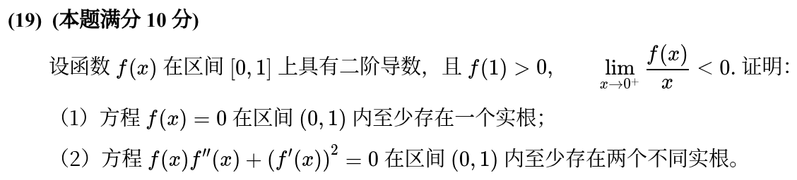
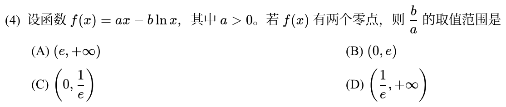

# 零点的存在性与个数

> 跨章主题：串联[中值定理、零点与不等式证明](../../chapters/calculus/05-mean-value-proofs.md)与[单调性、极值与零点个数](../../chapters/calculus/06-monotonicity-extrema.md)
> 课程参考：[武忠祥 17 堂课专题 9 已读笔记](../../wu/17/notes/27-09-roots.md)（P97—103，已核对全 20 页）

拿到一道问方程根（函数零点）的题，最容易卡住的地方不是“记不住定理”，而是**不知道第一步该用零点定理、罗尔定理，还是直接求导画单调表**。

处理所有零点问题，第一笔先分清题目要的是哪一种结论（参考[专题 9 第 2—3 页](../../wu/17/notes/27-09-roots.md#一第23页先把目标拆成下界和上界)）：

| 题目设问 | 需要的证据 | 常用入口 | 常见误区 |
| :--- | :--- | :--- | :--- |
| **至少有 $k$ 个根**（存在性） | **下界证据** | 闭区间端点异号（零点定理）、端点极限保号性、找够 $k+1$ 个等值点用罗尔定理 | 不需要证单调；但开区间/端点为 $0$ 时不能硬套 $f(a)f(b)<0$ |
| **至多有 $k$ 个根**（唯一性/上界） | **上界证据** | 区间内严格单调（至多 $1$ 根）、$n$ 阶导处处非零（反复罗尔推至多 $n$ 根） | 严格单调**不保证**根存在，必须配合值域跨 $0$ |
| **恰有 $k$ 个根**（精确个数） | **下界 + 上界闭合** | 用单调区间切分定义域：每段至多 $1$ 根，再逐段核对端点极限、驻点值与分界点 | 漏查参数分界、漏查驻点/分界点本身是否为零点、把“三个单调段”当成“三个根” |

下面用两道真题把这两条线完整走一遍：第一题看**如何拿存在性下界并用罗尔推进到导数组合**，第二题看**如何用单调性、最值与分界点锁死精确个数**。

---

## 一、只要“至少有几个”：先看端点附近的符号，再从目标反推辅助函数

### 判断链

1. **目标是原函数 $f(x)=0$ 至少一根**：先检查区间连续性与端点值。如果端点值本身就是 $0$（或区间是开的），不能直接写 $f(a)f(b)<0$，而要先用**极限保号性**在端点内侧找一个明确正负的内部点，把闭区间缩到内部后再用零点定理。
2. **目标是含导数组合的方程至少 $k$ 根**：不要凭空猜辅助函数。先观察目标表达式是不是某个乘积、商或指数权函数的导数 $H'(x)$；再算账——要用罗尔定理推出 $H'(x)=0$ 至少 $k$ 个不同实根，就必须先凑出 **$H(x)$ 的 $k+1$ 个按大小排好序的等值点（通常是零点）**。

---

### 例 1：[2017 年第 19 题](../../chapters/calculus/05-mean-value-proofs.md#q2017-19)（解答题，满分 10 分）

> **来源对照**：与[武忠祥专题 9 第 17 页例 10](../../wu/17/notes/27-09-roots.md#第17页例10先找中间零点再为导数准备三个零点)为**同题复现**；下文按原卷截图独立核对条件、分问与区间细节。
> **建议先自己读原题并写第一步**，再往下看推演。

**原题**（[在章节题单中查看](../../chapters/calculus/05-mean-value-proofs.md#q2017-19)）：

#### 第（1）问：为什么不能直接在 $[0,1]$ 上套零点定理？

- **先看条件给的正则性**：$f(x)$ 在 $[0,1]$ 上具有二阶导数 $\implies f(x)$ 与 $f'(x)$ 在 $[0,1]$ 上均连续、可导。
- **检查左端点 $x=0$**：已知 $\lim_{x\to 0^+} \frac{f(x)}{x} = A < 0$（极限存在且有限），又 $f(x)$ 在 $0$ 处右连续，所以
  $$f(0) = \lim_{x\to 0^+} f(x) = \lim_{x\to 0^+} \left(\frac{f(x)}{x} \cdot x\right) = A \cdot 0 = 0.$$
  既然 $f(0)=0$，就不满足 $f(0)f(1) < 0$，不能直接对 $[0,1]$ 宣称“端点异号”。
- **第一步怎么落笔**：利用极限的**局部保号性**。因为 $\lim_{x\to 0^+} \frac{f(x)}{x} < 0$，存在 $\delta \in (0,1)$，使得对一切 $x \in (0,\delta)$ 都有 $\frac{f(x)}{x} < 0$。取内部点 $x_0 = \frac{\delta}{2} \in (0,1)$，由 $x_0 > 0$ 得
  $$f(x_0) < 0.$$
- **收尾**：在闭区间 $[x_0, 1] \subset [0,1]$ 上，$f(x)$ 连续，且 $f(x_0) < 0 < f(1)$。由零点定理，存在 $c \in (x_0, 1) \subset (0,1)$，使得
  $$f(c) = 0.$$

> **注意**：这一问里顺手推出来的 $f(0)=0$ 并不是废话，它是第（2）问凑齐三个零点的关键起点。

#### 第（2）问：辅助函数从哪一项来？罗尔定理用在哪些区间？

- **从目标反推辅助函数**：目标方程是 $f(x)f''(x) + (f'(x))^2 = 0$。两项合在一起正好是乘积的导数结构：
  $$\big(f(x)f'(x)\big)' = f'(x)f'(x) + f(x)f''(x) = f(x)f''(x) + (f'(x))^2.$$
  因此构造辅助函数
  $$H(x) = f(x)f'(x), \qquad x \in [0,1].$$
  因为 $f(x)$ 在 $[0,1]$ 上有二阶导数，所以 $f(x)$ 与 $f'(x)$ 都在 $[0,1]$ 上连续且可导，从而 $H(x)$ 在 $[0,1]$ 上连续、在 $(0,1)$ 内可导，且 $H'(x) = f(x)f''(x) + (f'(x))^2$。
- **盘点零点缺口**：要证 $H'(x)=0$ 在 $(0,1)$ 内至少有 **2 个不同实根**，需要为 $H(x)$ 准备 **3 个严格有序的零点**，把区间切出 2 个互不相交的子区间。
  目前已知 $f(0)=0$ 与 $f(c)=0$（$0 < c < 1$），只能得到
  $$H(0) = f(0)f'(0) = 0, \qquad H(c) = f(c)f'(c) = 0,$$
  还差 **1 个** $H(x)$ 的零点。
- **补齐第三个零点**：$H(x) = f(x)f'(x)$ 为零有两条路——要么 $f(x)=0$，要么 $f'(x)=0$。在 $[0, c]$ 上对 $f(x)$ 用一次罗尔定理（$f$ 在 $[0,c]$ 连续、在 $(0,c)$ 可导，且 $f(0)=f(c)=0$），必存在 $\xi \in (0, c)$，使得 $f'(\xi) = 0$，从而
  $$H(\xi) = f(\xi)f'(\xi) = 0.$$
- **分段使用罗尔定理**：现在已有三个次序明确的零点 $0 < \xi < c < 1$，满足 $H(0) = H(\xi) = H(c) = 0$：
  1. 在 $[0, \xi]$ 上对 $H(x)$ 用罗尔定理：存在 $\eta_1 \in (0, \xi)$，使 $H'(\eta_1) = 0$；
  2. 在 $[\xi, c]$ 上对 $H(x)$ 用罗尔定理：存在 $\eta_2 \in (\xi, c)$，使 $H'(\eta_2) = 0$。
  因为 $0 < \eta_1 < \xi < \eta_2 < c < 1$，所以 $\eta_1 \neq \eta_2$，且均落在 $(0,1)$ 内，即原方程在 $(0,1)$ 内至少存在两个不同实根。

#### 条件变式检验（不背结论，看哪一步会失效）

- **变式 1**：若把条件 $\lim_{x\to 0^+} \frac{f(x)}{x} < 0$ 改成 $\lim_{x\to 0^+} \frac{f(x)}{x} > 0$（其余不变），结论还成立吗？
  **不成立。** 此时只能得到 $0^+$ 附近 $f(x) > 0$，与 $f(1) > 0$ 同号，无法触发零点定理。反例：$f(x) = x$ 满足全部改动后的条件，但在 $(0,1)$ 内既无 $f(x)=0$ 的根，也无 $f(x)f''(x)+(f'(x))^2 = 1 = 0$ 的根。
- **变式 2**：若仅已知 $f(x)$ 在 $[0,1]$ 上连续、在 $(0,1)$ 内可导（去掉“具有二阶导数”），哪一问仍成立？
  **第（1）问仍成立**（只用到了 $f$ 在 $[0,1]$ 上连续及 $0^+$ 处极限），但第（2）问中 $H(x)=f(x)f'(x)$ 未必可导，无法对 $H$ 使用罗尔定理。

---

## 二、要锁死“恰有几个”：单调区间控上界，最值与分界点控存在性

### 判断链

一旦题目问“**有两个零点**”“**恰有 $k$ 个实根**”，单靠零点定理和罗尔定理（只能给“至少”）就不够了，必须引入**上界工具**——最常用的是**按导数变号切分单调区间**：

1. **先写定义域**：特别是 $\ln x$、分母、偶次根号，避免把无定义点或无穷端点当实数代入。
2. **求导并检查参数分界**：如果驻点或导数符号依赖参数，必须先把“**导数恒正/恒负（无驻点、全域单调）**”的参数分支单独拆出来检验，不能默认驻点一定存在。
3. **画单调表 + 算两类关键值**：
   - 每个单调区间的**两端值或端点极限**（判断值域是否跨 $0$，决定该段是 $0$ 根还是 $1$ 根）；
   - 每个**驻点/分界点本身的函数值**（判断在分界点处是否恰好为 $0$，防止重复计数或漏掉“相切退化为单根”的临界值）。
4. **备选提速入口（参数可分离时）**：若能合法把参数孤立到等号一侧（如 $g(x) = \text{参数表达式}$），把“含参函数随参数变形”变成“固定曲线 $y=g(x)$ 与水平线交点”，可大幅减少重复讨论。

---

### 例 2：[2021 年第 4 题](../../chapters/calculus/06-monotonicity-extrema.md#q2021-4)（选择题）

> **来源对照**：与[武忠祥专题 9 第 12—14 页例 7](../../wu/17/notes/27-09-roots.md#例7ln-xax先选研究对象再分类)（$\ln x = ax$）结构同源、参数互为倒数，属于**同法迁移**；以下按原卷截图独立推演并核对选项。
> **建议先自己做一遍**，再展开或往下核对。

**原题**（[在章节题单中查看](../../chapters/calculus/06-monotonicity-extrema.md#q2021-4)）：

#### 解法一：直接求导，用单调区间、最小值与分界点锁定根数

1. **定义域**：由 $\ln x$ 知 $x \in (0, +\infty)$。
2. **求导并先查参数分界 $b = 0$**：
   $$f'(x) = a - \frac{b}{x} = \frac{ax - b}{x}, \qquad x > 0.$$
   因为 $a > 0$、$x > 0$，分母恒正，导数符号只看 $ax - b$：
   - **当 $b \le 0$ 时**：$ax - b > 0$ 对一切 $x > 0$ 恒成立，故 $f(x)$ 在 $(0, +\infty)$ 上**严格单调递增**，**至多有 1 个零点**（具体地，$b=0$ 时 $f(x)=ax>0$ 无零点；$b<0$ 时两端极限为 $-\infty$ 到 $+\infty$，恰有 1 个零点）。不可能有两个零点，直接排除 $b \le 0$。
   - **因此必有 $b > 0$**，此时驻点 $x_0 = \frac{b}{a} \in (0, +\infty)$ 确实落在定义域内。
3. **切分单调区间并核对端点极限**：
   - 在 $\left(0, \frac{b}{a}\right)$ 上：$f'(x) < 0$，$f(x)$ 严格单调递减 $\implies$ **至多 1 根**；
   - 在 $\left(\frac{b}{a}, +\infty\right)$ 上：$f'(x) > 0$，$f(x)$ 严格单调递增 $\implies$ **至多 1 根**；
   - 算两端极限（注意 $a > 0, b > 0$）：
     $$\lim_{x\to 0^+} (ax - b\ln x) = +\infty, \qquad \lim_{x\to +\infty} (ax - b\ln x) = \lim_{x\to +\infty} x\left(a - b\frac{\ln x}{x}\right) = +\infty.$$
4. **单独检查驻点（单调分界点）处的最小值**：
   $$f\left(\frac{b}{a}\right) = a\cdot \frac{b}{a} - b\ln\frac{b}{a} = b\left(1 - \ln\frac{b}{a}\right).$$
   因为 $b > 0$，最小值的符号只取决于 $1 - \ln\frac{b}{a}$，临界分界值是 $\frac{b}{a} = e$：
   - 若 $0 < \frac{b}{a} < e$：最小值 $f\left(\frac{b}{a}\right) > 0$，全区间 $f(x) > 0$ $\implies$ **0 个零点**；
   - 若 $\frac{b}{a} = e$：最小值 $f(e) = 0$，曲线仅在分界点 $x = e$ 处与 $x$ 轴相切 $\implies$ **1 个零点**（不能漏查等号！）；
   - 若 $\frac{b}{a} > e$：最小值 $f\left(\frac{b}{a}\right) < 0$，且分界点本身不是零点。此时：
     - 在 $\left(0, \frac{b}{a}\right)$ 上严格递减且由 $+\infty$ 降到负值 $\implies$ **恰有 1 根**；
     - 在 $\left(\frac{b}{a}, +\infty\right)$ 上严格递增且由负值升到 $+\infty$ $\implies$ **恰有 1 根**；
     - 合计 **恰有 2 个零点**。

   故 $\frac{b}{a} \in (e, +\infty)$，选 **（A）**。

#### 解法二：分离参数（同法迁移自专题 9 第 13 页）

既然已经排除 $b \le 0$，在 $x > 0$、$a > 0$、$b > 0$ 下，方程 $ax - b\ln x = 0$ 等价于
$$\frac{\ln x}{x} = \frac{a}{b}.$$
令固定函数 $g(x) = \frac{\ln x}{x}$（$x > 0$），则 $g'(x) = \frac{1 - \ln x}{x^2}$：
- $g(x)$ 在 $(0, e)$ 上严格递增、在 $(e, +\infty)$ 上严格递减，最大值 $g(e) = \frac{1}{e}$；
- $\lim_{x\to 0^+} g(x) = -\infty$，$\lim_{x\to +\infty} g(x) = 0^+$（从正侧趋于 $0$，不与 $x$ 轴在右端相交）。

因此水平线 $y = \frac{a}{b}$ 与 $y = g(x)$ 有两个交点，当且仅当
$$0 < \frac{a}{b} < \frac{1}{e} \iff \frac{b}{a} > e,$$
同样得 **（A）**。

#### 选择题关键干扰项拆解

- **（C）$\left(0, \frac{1}{e}\right)$（最容易踩的坑）**：这正是解法二中 **$\frac{a}{b}$** 的范围，而不是题目问的 **$\frac{b}{a}$**。分离参数后务必回头看一眼题干求的是比值还是倒数。
- **（B）$(0, e)$**：把最小值小于 $0$ 的不等式 $1 - \ln\frac{b}{a} < 0$ 写反了，对应的是 $0$ 个零点。
- **（D）$\left(\frac{1}{e}, +\infty\right)$**：把临界值 $e$ 与 $\frac{1}{e}$ 混用。

---

## 三、对照两道题：“至少有”与“恰有”到底差在什么地方？

把 2017 年第 19 题和 2021 年第 4 题放在一起对比，方法边界就非常清楚：

| 对比维度 | 2017 年第 19 题（至少 1 根 / 至少 2 根） | 2021 年第 4 题（恰有 2 根） |
| :--- | :--- | :--- |
| **函数类型** | 抽象函数（只给二阶可导与局部/端点符号） | 显式含参函数 $ax - b\ln x$ |
| **需要单调性吗？** | **不需要**——只要存在性下界（零点定理 + 罗尔定理） | **必须**——要用严格单调性把每段根数压到“至多 1 个” |
| **为什么不能只看端点？** | 左端点 $f(0)=0$，必须用保号性往内缩到 $x_0$ | 两个单调段之间有驻点 $x=\frac{b}{a}$，两端极限都趋 $+\infty$，能否过 $x$ 轴完全取决于驻点处最小值与 $0$ 的大小 |
| **最易漏掉的检查** | $H(x)=f(x)f'(x)$ 要证 2 根必须先凑够 3 个有序零点，并分别写明两个罗尔区间 | 参数分界 $b \le 0$ 必须先排除；临界值 $\frac{b}{a}=e$ 处最小值等于 $0$ 只有 1 根，必须剔除等号 |

---

## 四、回练与过关标准

### 1. 真题回练：[2015 年第 19 题](../../chapters/calculus/06-monotonicity-extrema.md#q2015-19)（解答题，满分 11 分）

**独立练习提示（先遮住，做完再核对要点）**：
- **先核定义域**：对一切 $x \in \mathbb{R}$，$x^2 \ge 0 > -1$，所以定义域是**全体实数 $(-\infty, +\infty)$**（不要误写成 $x > 0$）。
- **求导切分单调段**：$f'(x) = (2x-1)\sqrt{1+x^2}$，唯一驻点 $x = \frac{1}{2}$。
- **不硬算积分判断最小值符号**：直接观察特殊点 $f(1) = 0$，利用 $f$ 在 $\left(\frac{1}{2}, +\infty\right)$ 上严格递增，立刻得 $f\left(\frac{1}{2}\right) < f(1) = 0$；再看 $x \to -\infty$ 时 $f(x) \to +\infty$，即可闭合得出总根数为 **2 个**。

### 2. 条件变式自测（改 2021 年第 4 题）

把 [2021 年第 4 题](../../chapters/calculus/06-monotonicity-extrema.md#q2021-4) 改为：设 $f(x) = ax - b\ln x$（$a > 0$），若 $f(x)$ **恰有一个零点**，求 $\frac{b}{a}$ 的取值范围。

点击核对思路与结论

按前面的参数分界逐段检查：
1. $b < 0$：$f'(x) > 0$ 严格递增，$\lim_{x\to 0^+} f(x) = -\infty$，$\lim_{x\to +\infty} f(x) = +\infty$ $\implies$ **恰有 1 根**（满足，$\frac{b}{a} < 0$）；
2. $b = 0$：$f(x) = ax > 0$ $\implies$ **0 根**（不满足，必须挖掉 $0$！）；
3. $b > 0$：仅在最小值 $f\left(\frac{b}{a}\right) = 0$，即 $\frac{b}{a} = e$ 时 **恰有 1 根**。

合并得：$\frac{b}{a} \in (-\infty, 0) \cup \{e\}$。只要漏查 $b=0$ 或 $b<0$ 任一处，结果都会出错。

### 过关标准

合上讲义，面对一道新的零点题时，能够独立完成以下四步即算过关：
1. 先说出本题需要的是**下界（至少）**、**上界（至多）**还是**上下界闭合（恰有）**；
2. 存在性部分能明确写出**连续区间 + 异号依据**（含端点为 $0$ 或开区间时如何向内取点），或写出**辅助函数的反推来源 + 足够数量的有序零点 + 罗尔区间**；
3. 精确个数部分能独立写出**定义域、单调区间、两端极限**，并单独检查**参数分界与驻点/临界点处的函数值**；
4. 改动题干中一个符号、等号或可导条件后，能直接指出原证明在哪一步失效。
