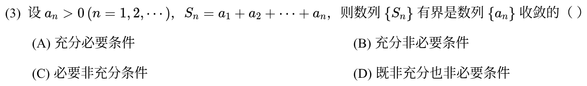
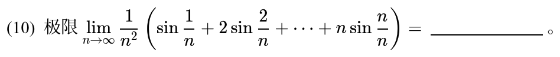
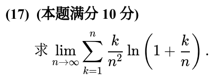
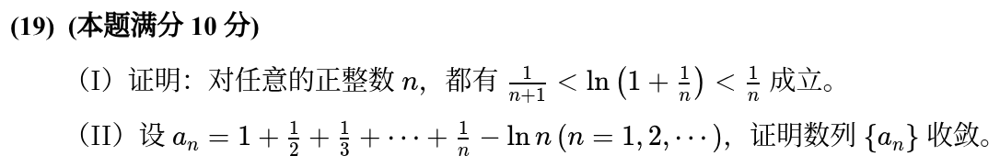
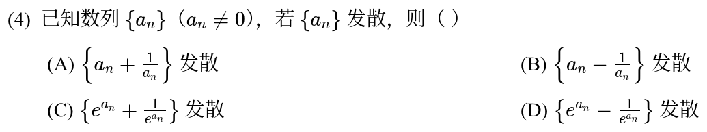
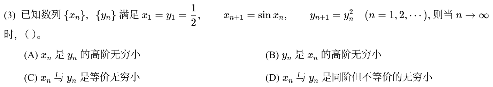

# 数列极限、递推收敛与和式极限

> 本章专题：聚焦[数列极限与递推收敛](../../chapters/calculus/02-sequences.md)
> 课程参考：[武忠祥 26 选填第 1 课已读笔记](../../wu/xt/notes/01-functions-limits.md)（第 18—31 页、第 41—46 页）、[武忠祥 26 选填第 2 课已读笔记](../../wu/xt/notes/02-orders-continuity.md)（第 19 页）

数列极限题型分化明显：概念选择题容易死在“把发散默认成趋于无穷”或“漏看条件到底落在原数列还是部分和上”；和式极限容易在“化定积分”与“夹逼”之间选错；解答题则常常要求用单调有界准则收口。

动笔前先按对象和设问走一遍决策表：

| 题目设问 / 结构特征 | 核心工具 | 第一步落笔动作 | 常见误区 |
| :--- | :--- | :--- | :--- |
| **抽象数列收敛/发散命题判定** | 单调有界、保号性、反函数连续性 + 反例库 | 先看条件约束的是哪一列（$a_n$ 还是 $S_n$）；逆推收敛必须查外层函数是否**严格单调满射且反函数连续**；否定命题优先试 $(-1)^n$、$2^{(-1)^n}$、$a_n\equiv 1$ | 把“发散”当成“趋于 $+\infty$”；把“$a_n>0$”误当成“$a_n$ 单调” |
| **规则和式极限** $\sum_{k=1}^n f\!\left(\frac{k}{n}\right)\frac{1}{n}$ | 定积分定义（黎曼和） | 提取步长 $\frac{1}{n}$，把余下项写成统一的采样变量 $\frac{k}{n}$ 的函数，标清积分区间（通常 $[0,1]$） | 凑不齐 $\frac{1}{n}$ 硬套积分；或漏算求和上限（如 $2n$ 对应 $[0,2]$） |
| **带低阶扰动的和式**（如分母 $n^2+k$） | 先夹逼、再化定积分 | 用 $k=1$ 和 $k=n$ 把扰动项夹成统一分母，两端同步化为同一积分 | 在解答题里不经证明直接“扔掉低阶项 $k$” |
| **递推数列或调和差收敛证明** | 单调有界准则 | 先证单调（作差 $a_{n+1}-a_n$ 或作商，常直接调用第（1）问不等式），再找对应方向的界（递减找下界、递增找上界） | 只证单调没找界，或找错了界的方向（递减却证了有上界） |
| **递推数列的无穷小阶比较** | 商数列 + 相邻比 | 先证两列均趋 $0$，再设 $z_n = \frac{y_n}{x_n}$，计算 $\frac{z_{n+1}}{z_n}$ 的极限 | 只凭直觉说“平方比正弦掉得快”而省略收敛与商数列论证 |

下面用四道真题依次打通这四条主线：**正项部分和的充分必要辨析**、**两道不同计算深度的和式化定积分**，以及**借不等式完成的单调有界收敛证明**。

---

## 一、抽象数列命题：先看条件作用在哪个对象上

### 判断链

1. **找准真正受控的对象**：看到 $a_n > 0$ 与 $S_n = \sum_{k=1}^n a_k$，条件 $a_n>0$ **并不保证** $\{a_n\}$ 单调，它保证的是 **$\{S_n\}$ 严格单调递增**。
2. **正向推导补齐桥梁**：要从 $\{S_n\}$ 的性质推到 $\{a_n\}$，必须通过恒等式 $a_n = S_n - S_{n-1}$（$n\ge 2$）搭桥。
3. **逆向检查先试最简反例**：检验“$\{a_n\}$ 收敛 $\Rightarrow \{S_n\}$ 有界”时，只需取常数列 $a_n = 1$（或调和数列 $a_n = \frac{1}{n}$）即可一击否决。

---

### 例 1：[2012 年第 3 题](../../chapters/calculus/02-sequences.md#q2012-3)（选择题）

> **来源对照**：与[武忠祥选填第 1 课第 27 页例 8](../../wu/xt/notes/01-functions-limits.md#第27页例8正项条件先作用在部分和上)为**同题复现**；以下按原卷截图独立核对充分性与必要性。
> **建议先自己判断两个方向**，再往下核对。

**原题**（[在章节题单中查看](../../chapters/calculus/02-sequences.md#q2012-3)）：

#### 第一步与完整推演

- **触发条件**：已知 $a_n > 0$，立刻写出 $S_{n+1} - S_n = a_{n+1} > 0$，即部分和数列 $\{S_n\}$ **严格单调递增**。
- **验证充分性**（$\{S_n\}$ 有界 $\implies \{a_n\}$ 收敛）：
  因为 $\{S_n\}$ 单调递增且有上界，由**单调有界准则**知 $\{S_n\}$ 收敛，设 $\lim_{n\to\infty} S_n = S$。
  由 $a_n = S_n - S_{n-1}$（$n\ge 2$），两边取极限得
  $$\lim_{n\to\infty} a_n = \lim_{n\to\infty} S_n - \lim_{n\to\infty} S_{n-1} = S - S = 0,$$
  故 $\{a_n\}$ 收敛（且极限必为 $0$）。**充分性成立。**
- **验证必要性**（$\{a_n\}$ 收敛 $\implies \{S_n\}$ 有界）：
  取反例 $a_n = 1$（满足 $a_n>0$ 且 $\lim_{n\to\infty} a_n = 1$ 收敛），但 $S_n = n \to +\infty$ 无界（即便要求 $a_n\to 0$，取 $a_n = \frac{1}{n}$ 时 $S_n$ 仍发散无界）。**必要性不成立。**

综合得“充分非必要条件”，选 **（B）**。

#### 选择题关键干扰项拆解

- **（A）充分必要条件**：把“数列 $\{a_n\}$ 收敛”与“级数 $\sum a_n$ 收敛”混为一谈；$\{a_n\}$ 收敛只要求通项有极限，甚至可以趋于非零常数 $1$，远推不出部分和有界。
- **（C）必要非充分条件**：把充分与必要的箭头方向读反了（“$P$ 是 $Q$ 的什么条件”中，$P\Rightarrow Q$ 是充分性，$Q\Rightarrow P$ 是必要性）。
- **（D）既非充分也非必要条件**：没有把 $a_n > 0$ 翻译成“$\{S_n\}$ 递增”，从而想不到调用单调有界准则。

#### 条件变式检验

- **变式 1**：若去掉条件 $a_n > 0$，充分性还成立吗？
  **不成立。** 反例：$a_n = (-1)^n$，此时 $S_n$ 在 $-1$ 与 $0$ 之间摆动，是有界数列，但 $\{a_n\}$ 发散。
- **变式 2**：若把题干改成“$\{S_n\}$ 有界是 $\{S_n\}$ 收敛的什么条件”（保留 $a_n>0$）？
  此时变为**充分必要条件**（递增数列有界 $\iff$ 收敛）。

---

## 二、和式极限：抽步长、凑采样点，再干净地算完定积分

### 判断链

1. **先确认能否精确化简**：若通项可裂项相消（如 $\frac{1}{k(k+1)}$），先直接求和（参考[选填第 1 课第 42 页例 22](../../wu/xt/notes/01-functions-limits.md#第42页例22可精确消去时不必硬凑黎曼和)）。
2. **标准黎曼和三要素**：若不能裂项，把原式改写成
   $$\frac{1}{n}\sum_{k=1}^{n} f\!\left(\frac{k}{n}\right),$$
   必须同时确认三点：① 步长 $\Delta x = \frac{1}{n}$；② 采样点 $x_k = \frac{k}{n}$ 覆盖固定区间 $[0,1]$；③ 被积函数 $f(x)$ 在 $[0,1]$ 上连续（保证可积）。
3. **算定积分时优先简化分部积分**：遇到 $x\ln(1+x)$ 这类“多项式 $\times$ 对数”，把 $x\,dx$ 凑成 $\frac{1}{2}d(x^2-1)$ 可以直接约掉分母 $1+x$，省掉多项式除法。

---

### 例 2：[2016 年第 10 题](../../chapters/calculus/02-sequences.md#q2016-10)（填空题）

> **来源对照**：与[武忠祥选填第 1 课第 41 页例 21](../../wu/xt/notes/01-functions-limits.md#第41页例21把求和改成同一个函数的取样)同属标准黎曼和化定积分结构，属于**同法迁移**。

**原题**（[在章节题单中查看](../../chapters/calculus/02-sequences.md#q2016-10)）：

#### 第一步与完整推演

- **触发条件**：和式第 $k$ 项为 $k\sin\frac{k}{n}$，外部因子为 $\frac{1}{n^2}$——恰好拆成步长 $\frac{1}{n}$ 与采样系数 $\frac{k}{n}$。
- **第一步落笔**：改写为标准黎曼和：
  $$\frac{1}{n^2}\sum_{k=1}^{n} k\sin\frac{k}{n} = \frac{1}{n}\sum_{k=1}^{n} \frac{k}{n}\sin\frac{k}{n}.$$
- **化为定积分并分部计算**：因为 $f(x) = x\sin x$ 在 $[0,1]$ 上连续，故
  $$\lim_{n\to\infty}\frac{1}{n}\sum_{k=1}^{n}\frac{k}{n}\sin\frac{k}{n} = \int_0^1 x\sin x\,dx.$$
  分部积分（令 $u=x,\ dv=\sin x\,dx$）：
  $$\int_0^1 x\sin x\,dx = \big[-x\cos x\big]_0^1 + \int_0^1 \cos x\,dx = -\cos 1 + \big[\sin x\big]_0^1 = \sin 1 - \cos 1.$$

#### 条件变式检验

- **变式 1**：若把外部因子 $\frac{1}{n^2}$ 改成 $\frac{1}{n}$，极限是多少？
  原式 $= n \cdot \left(\frac{1}{n}\sum_{k=1}^n\frac{k}{n}\sin\frac{k}{n}\right)$，括号内趋于 $\sin 1 - \cos 1 > 0$，乘以 $n$ 后发散到 $+\infty$。
- **变式 2**：若把 $\sin\frac{k}{n}$ 改成 $\sin\frac{k}{n^2}$（外部仍为 $\frac{1}{n^2}$），还能直接写成 $\int_0^1 x\sin x\,dx$ 吗？
  **不能！** 此时 $\frac{k}{n^2}\to 0$，不再在 $[0,1]$ 上铺开，应由 $\sin u \le u$ 得总和 $\le \frac{1}{n^4}\sum_{k=1}^n k^2 \sim \frac{1}{3n}\to 0$，改用夹逼得 $0$。

---

### 例 3：[2017 年第 17 题](../../chapters/calculus/02-sequences.md#q2017-17)（解答题，满分 10 分）

> **来源对照**：与[武忠祥选填第 1 课第 41 页例 21](../../wu/xt/notes/01-functions-limits.md#第41页例21把求和改成同一个函数的取样)同属定积分定义求极限，属于**同法迁移**；作为 10 分解答题，需要把“连续可积 $\to$ 定积分 $\to$ 分部积分”的每一步书写完整。

**原题**（[在章节题单中查看](../../chapters/calculus/02-sequences.md#q2017-17)）：

#### 第一步与完整推演

- **触发条件**：通项 $\frac{k}{n^2}\ln\left(1+\frac{k}{n}\right)$ 天然拆分为 $\frac{1}{n}\cdot \frac{k}{n}\ln\left(1+\frac{k}{n}\right)$。
- **第一步落笔**：
  $$\lim_{n\to\infty}\sum_{k=1}^{n}\frac{k}{n^2}\ln\left(1+\frac{k}{n}\right) = \lim_{n\to\infty}\frac{1}{n}\sum_{k=1}^{n}\frac{k}{n}\ln\left(1+\frac{k}{n}\right).$$
  由于被积函数 $f(x) = x\ln(1+x)$ 在 $[0,1]$ 上连续，由定积分定义得
  $$\text{原式} = \int_0^1 x\ln(1+x)\,dx.$$
- **分部积分（凑 $x^2-1$ 消除分母）**：利用 $x\,dx = \frac{1}{2}d(x^2-1)$，得
  $$\begin{aligned}
  \int_0^1 x\ln(1+x)\,dx &= \frac{1}{2}\int_0^1 \ln(1+x)\,d(x^2-1) \\
  &= \left[\frac{x^2-1}{2}\ln(1+x)\right]_0^1 - \frac{1}{2}\int_0^1 \frac{x^2-1}{1+x}\,dx \\
  &= 0 - \frac{1}{2}\int_0^1 (x-1)\,dx \\
  &= -\frac{1}{2}\left[\frac{x^2}{2} - x\right]_0^1 = -\frac{1}{2}\left(-\frac{1}{2}\right) = \frac{1}{4}.
  \end{aligned}$$

> **技巧注记**：这里凑 $d(x^2-1)$ 而不是 $d(x^2)$，既让边界项在 $x=1$ 和 $x=0$ 处**同时为 $0$**，又让分子 $x^2-1=(x-1)(x+1)$ 与分母 $1+x$ 干净约分，大幅降低计算失误率。

#### 条件变式检验

- **变式**：若把求和上限从 $n$ 改成 $2n$（通项不变），极限变为多少？
  此时采样点 $\frac{k}{n}$ 覆盖区间 $[0,2]$，极限变为
  $$\int_0^2 x\ln(1+x)\,dx = \left[\frac{x^2-1}{2}\ln(1+x)\right]_0^2 - \frac{1}{2}\int_0^2 (x-1)\,dx = \frac{3}{2}\ln 3 - 0 = \frac{3}{2}\ln 3.$$

---

## 三、单调有界收敛证明：用第一问的不等式双向锁死单调性与界

### 判断链

解答题里如果出现“（I）证明一个含 $n$ 的双边不等式；（II）证明某数列收敛”，两问之间几乎必然是**一侧管单调、另一侧累加管有界**：

1. **先拿（I）的双边不等式**：对数与分式的双边不等式 $\frac{1}{n+1}<\ln\left(1+\frac{1}{n}\right)<\frac{1}{n}$ 有两条最稳的证法——拉格朗日中值定理（对 $\ln x$ 在 $[n,n+1]$ 上使用），或单调函数的定积分夹逼。
2. **第（II）问先算 $a_{n+1}-a_n$**：整理成与第（I）问完全一致的差，直接调用一侧不等号定出单调方向。
3. **再用另一侧不等号裂项累加找界**：把 $\ln\left(1+\frac{1}{k}\right)=\ln(k+1)-\ln k$ 从 $k=1$ 加到 $n$，中间项全部抵消，立刻给出 $a_n$ 的显式下界（或上界）。

---

### 例 4：[2011 年第 19 题](../../chapters/calculus/02-sequences.md#q2011-19)（解答题，满分 10 分）

> **来源对照**：经典欧拉常数收敛性证明真题；其第（II）问“先证单调、再找界来源”的核查框架与[武忠祥选填第 1 课第 18、22 页](../../wu/xt/notes/01-functions-limits.md#第22页例3两列差趋0先替缺少的有界性找来源)完全相通。

**原题**（[在章节题单中查看](../../chapters/calculus/02-sequences.md#q2011-19)）：

#### 第（I）问：用拉格朗日中值定理一步到位

- **第一步落笔**：把 $\ln\left(1+\frac{1}{n}\right)$ 改写为函数差 $\ln(n+1) - \ln n$，设 $f(x) = \ln x$。
- **推演**：对任意正整数 $n$，$f(x)=\ln x$ 在闭区间 $[n, n+1]$ 上连续、在开区间 $(n, n+1)$ 内可导，且 $f'(x) = \frac{1}{x}$。由拉格朗日中值定理，存在 $\xi \in (n, n+1)$，使得
  $$\ln\left(1+\frac{1}{n}\right) = \ln(n+1) - \ln n = f'(\xi)\cdot\big((n+1)-n\big) = \frac{1}{\xi}.$$
  因为 $n < \xi < n+1$，取倒数即得
  $$\frac{1}{n+1} < \frac{1}{\xi} < \frac{1}{n} \implies \frac{1}{n+1} < \ln\left(1+\frac{1}{n}\right) < \frac{1}{n}.$$

> **等价证法（积分法）**：在 $[n, n+1]$ 上 $\frac{1}{n+1} < \frac{1}{x} < \frac{1}{n}$（仅端点取等），两边积分同样一步得 $\frac{1}{n+1} < \int_n^{n+1}\frac{1}{x}\,dx = \ln\left(1+\frac{1}{n}\right) < \frac{1}{n}$。

#### 第（II）问：单调性用左半边，下界用右半边累加

1. **证明单调递减**：对任意正整数 $n$，作差
   $$a_{n+1} - a_n = \frac{1}{n+1} - \big(\ln(n+1) - \ln n\big) = \frac{1}{n+1} - \ln\left(1+\frac{1}{n}\right).$$
   由第（I）问左半边不等式 $\frac{1}{n+1} < \ln\left(1+\frac{1}{n}\right)$，得 $a_{n+1} - a_n < 0$，即数列 $\{a_n\}$ **严格单调递减**。
2. **证明有下界**：由第（I）问右半边不等式，对 $k = 1, 2, \dots, n$ 均有
   $$\frac{1}{k} > \ln\left(1+\frac{1}{k}\right) = \ln(k+1) - \ln k.$$
   将这 $n$ 个不等式相加，右侧裂项相消：
   $$1 + \frac{1}{2} + \frac{1}{3} + \dots + \frac{1}{n} > \sum_{k=1}^{n}\big(\ln(k+1) - \ln k\big) = \ln(n+1) - \ln 1 = \ln(n+1).$$
   两边同减 $\ln n$，得
   $$a_n > \ln(n+1) - \ln n = \ln\left(1+\frac{1}{n}\right) > 0.$$
   因此 $\{a_n\}$ 有下界 $0$。
3. **结论**：数列 $\{a_n\}$ 单调递减且有下界，由**单调有界准则**知 $\{a_n\}$ 收敛。

#### 条件变式检验

- **变式 1**：若把 $a_n$ 改为 $b_n = 1+\frac{1}{2}+\dots+\frac{1}{n}-\ln(n+1)$，单调性和界的方向怎么变？
  此时 $b_{n+1}-b_n = \frac{1}{n+1}-\ln\left(1+\frac{1}{n+1}\right) > 0$（改用右半边，变为**严格单调递增**），且对 $k=1,\dots,n-1$ 累加左半边得 $\frac{1}{2}+\dots+\frac{1}{n} < \ln n$，故 $b_n < 1+\ln n-\ln(n+1) < 1$（改找**上界 $1$**），同样收敛且与 $a_n$ 同极限。
- **变式 2**：若把 $-\ln n$ 改为 $-\frac{1}{2}\ln n$，数列还收敛吗？
  **不收敛。** 此时新数列 $= a_n + \frac{1}{2}\ln n \to +\infty$（因为 $a_n$ 收敛于有限常数而 $\frac{1}{2}\ln n\to +\infty$）。

---

## 四、回练与过关标准

### 1. 真题回练一：[2024 年第 4 题](../../chapters/calculus/02-sequences.md#q2024-4)（选择题）

> 与[武忠祥选填第 1 课第 25 页例 6](../../wu/xt/notes/01-functions-limits.md#第25页例6发散也可能振荡反函数还要在有限极限处可用)为**同题复现**。

点击核对要点与答案

- **先用反证法检验严格单调满射函数**：对选项（D），令 $f(x) = e^x - e^{-x} = 2\sinh x$，它在 $\mathbb{R}$ 上严格递增、值域为整个 $(-\infty,+\infty)$，反函数 $f^{-1}(y) = \ln\!\left(\frac{y+\sqrt{y^2+4}}{2}\right)$ 在 $\mathbb{R}$ 上连续。若 $\{f(a_n)\}$ 收敛于有限数 $L$，则 $a_n = f^{-1}(f(a_n))\to f^{-1}(L)$ 也收敛，与 $\{a_n\}$ 发散矛盾！故（D）必发散。
- **三项反例逐一击破**（注意不要把发散只当成趋于 $\infty$）：
  - （A）取 $a_n = 2^{(-1)^n}$（发散且非零），则 $a_n + \frac{1}{a_n} \equiv \frac{5}{2}$ 收敛；
  - （B）取 $a_n = (-1)^n$，则 $a_n - \frac{1}{a_n} \equiv 0$ 收敛；
  - （C）取 $a_n = (-1)^n$，则 $e^{a_n} + e^{-a_n} \equiv e + e^{-1}$ 收敛。
- **答案**：**（D）**。

### 2. 真题回练二：[2023 年第 3 题](../../chapters/calculus/02-sequences.md#q2023-3)（选择题）

> 与[武忠祥选填第 2 课第 19 页例 16](../../wu/xt/notes/02-orders-continuity.md#例16第19页递推无穷小比较应构造商数列)为**同题复现**。

点击核对要点与答案

- **第一步（先证两列均正且趋于 $0$）**：由 $0<\sin u < u$（$u>0$）与 $0<y_1=\frac{1}{2}<1$，用单调有界准则易知 $x_n>0, y_n>0$ 均严格递减，且由极限方程 $A=\sin A$ 与 $B=B^2$（$0\le B < \frac{1}{2}$）得 $\lim x_n = 0$、$\lim y_n = 0$。
- **第二步（构造商数列 $z_n = \frac{y_n}{x_n}$ 算相邻比）**：
  $$\frac{z_{n+1}}{z_n} = \frac{y_{n+1}/y_n}{x_{n+1}/x_n} = \frac{y_n}{\sin x_n / x_n} \to \frac{0}{1} = 0 < 1.$$
  故存在 $N$ 使 $n\ge N$ 时 $0 < z_{n+1} \le \frac{1}{2}z_n$，从而 $z_n = \frac{y_n}{x_n} \to 0$，即 $y_n$ 是 $x_n$ 的高阶无穷小。
- **答案**：**（B）**。

### 过关标准

合上讲义，面对新的数列极限或和式题，能够独立完成以下四步即算过关：
1. 抽象数列命题能分清条件落在原数列还是部分和，遇到逆推收敛会检查“严格单调满射 + 反函数连续”，并熟练用 $(-1)^n, 2^{(-1)^n}, a_n\equiv 1$ 排查错项；
2. 和式极限能先看能否裂项，不能裂项时能准确抽出步长 $\frac{1}{n}$、采样点 $\frac{k}{n}$ 与积分区间，并顺畅完成分部积分；
3. 单调有界解答题能完整写出“作差/作商定单调方向 + 找对应方向的界 + 援引单调有界准则”三步闭环；
4. 递推无穷小比较能规范写出“先证趋 $0$ $\to$ 设商数列 $\to$ 算相邻比”的完整证明，而不是停留在直觉猜测。
