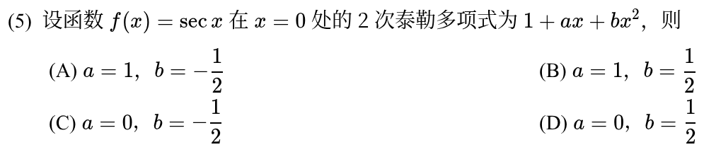
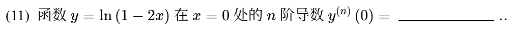
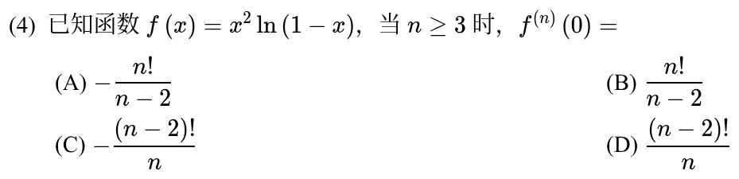
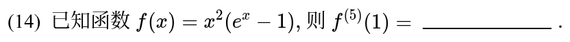
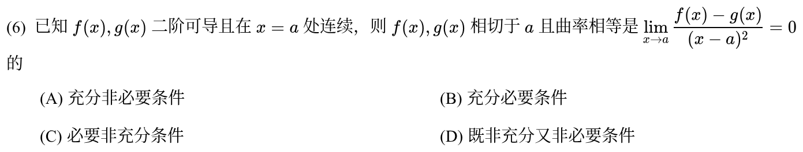
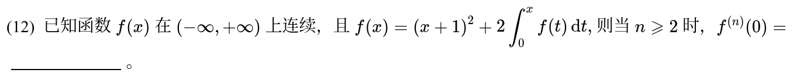

# 泰勒公式与高阶导数

> 对应章节：[泰勒公式与高阶导数](../../chapters/calculus/08-taylor.md)

数二里考泰勒公式和高阶导数，真正拉开速度与正确率差距的，不是“能不能硬算到 5 阶导数”，而是**拿到一道题能不能在 5 秒内选出最短路径**：什么时候该**直接用常见麦克劳林展开比系数**，什么时候该用**莱布尼茨公式**，什么时候该**先利用奇偶性或平移变量**，什么时候该**通过递推关系求 $f^{(n)}(0)$**。

按题面特征直接查下面这张决策表：

| 题面特征 | 首选入口 | 核心公式 / 触发动作 | 常见误区 |
| :--- | :--- | :--- | :--- |
| **求 $x=0$ 处低阶泰勒多项式**（2—3 次） | **常见展开四则/复合运算**（优先先查奇偶性） | 把 $\sec x = \frac{1}{\cos x}$、$\tan x$ 等写成已知展开的商或复合，截断到所需阶数 | 盲目硬求二阶、三阶导数算错符号；或漏掉 $\frac{1}{n!}$ 系数 |
| **求 $f^{(n)}(0)$，且 $f(x)$ 是幂函数 $\times$ 常见函数**（如 $x^2\ln(1-x)$、$\ln(1-2x)$） | **幂级数 / 麦克劳林展开比系数** | 展开后读取 $x^n$ 项系数 $a_n$，再用 **$f^{(n)}(0) = n!\,a_n$** 一步还原 | 忘记乘 **$n!$**；或把指标平移 $k+2 = n \implies k = n-2$ 算错成 $n+2$ |
| **求非零点 $f^{(k)}(x_0)$（$x_0 \neq 0$），且是多低次项 $\times e^x$ / $\sin x$** | **莱布尼茨公式**（低次多项式截断） | $(uv)^{(n)} = \sum_{k=0}^n C_n^k u^{(k)} v^{(n-k)}$，把次数最低的多项式设为 $u$，最多只留 2—3 项 | 在非零点 $x=1$ 处硬套 $x=0$ 的麦克劳林展开；或把常数项 $-x^2$ 忘了在 5 阶导时直接归零 |
| **给含变上限积分的方程，求 $f^{(n)}(0)$** | **逐阶求导建递推** | 反复求导直到多项式项消失，变成常系数递推 $f^{(n)}(x) = c f^{(n-1)}(x)$，再代入初值 | 漏算 $f(0), f'(0), f''(0)$ 的初值链，或递推起点 $n \ge 2$ 与 $n \ge 3$ 没对齐 |
| **判定 $\lim_{x\to a}\frac{f(x)-g(x)}{(x-a)^2} = 0$ 与相切、曲率的关系** | **佩亚诺余项泰勒展开** | 在 $x=a$ 处展到 2 阶：极限为 $0 \iff f, f', f''$ 在 $a$ 处全相等 | 把“曲率相等”（$|f''(a)| = |g''(a)|$）误当成 $f''(a) = g''(a)$，漏掉正负号相反的情况 |

下面用四道精选真题依次练熟**低阶泰勒多项式**、**标准型麦克劳林比系数**、**乘 $x^2$ 移项比系数**以及**非零点莱布尼茨公式**四条主线。

---

## 一、低阶泰勒多项式：先看奇偶性，再用已知展开截断

### 触发条件与第一步

求某个初等函数在 $x = 0$ 处的 $2$ 次或 $3$ 次泰勒多项式时，**先扫一眼奇偶性**：偶函数的奇次项系数必为 $0$，奇函数的偶次项系数必为 $0$。随后把函数改写为 $e^x, \sin x, \cos x, \ln(1+x), \frac{1}{1-u}$ 的简单组合，只保留到目标阶数即可。

---

### 例 1：[2021 年第 5 题](../../chapters/calculus/08-taylor.md#q2021-5)（选择题）

> **建议先自己心算 $a, b$ 的值（控制在 15 秒内）**，再往下核对两种解法与干扰项。

**原题**（[在章节题单中查看](../../chapters/calculus/08-taylor.md#q2021-5)）：

#### 解法一：奇偶性 + 已知展开直接截断（最快入口）

1. **偶函数秒杀一次项**：$f(x) = \sec x = \frac{1}{\cos x}$ 是偶函数，其在 $x = 0$ 处的泰勒多项式不含奇次项，立刻得 $a = 0$（直接排除 A、B）。
2. **用 $\cos x$ 展开与等比级数截断**：
   $$\sec x = \frac{1}{\cos x} = \frac{1}{1 - \frac{x^2}{2} + o(x^2)} = 1 + \frac{1}{2}x^2 + o(x^2).$$
   对照 $1 + ax + bx^2$，得 $a = 0$，$b = \frac{1}{2}$，选 **（D）**。

#### 解法二：直接求导代入公式（核对用）

- $f(0) = \sec 0 = 1$；
- $f'(x) = \sec x \tan x \implies f'(0) = 0 \implies a = f'(0) = 0$；
- $f''(x) = \sec x \tan^2 x + \sec^3 x \implies f''(0) = 1 \implies b = \frac{f''(0)}{2!} = \frac{1}{2}$。

#### 选择题干扰项拆解

- **（C）$a = 0, b = -\frac{1}{2}$**：把 $\sec x = \frac{1}{\cos x}$ 和 $\cos x = 1 - \frac{1}{2}x^2 + o(x^2)$ 的二次项符号混为一谈，忘了取倒数后 $\frac{1}{1-u} = 1 + u + \cdots$ 负负得正。
- **（A）与（B）**：没有利用偶函数性质，误以为 $a = 1$。

#### 条件变式检验

- **变式**：若题目改为求 $f(x) = \sec x$ 在 $x = 0$ 处的 **4 次泰勒多项式**，二次项之后的 $x^4$ 系数是多少？
  写到 4 阶：$\cos x = 1 - \frac{x^2}{2} + \frac{x^4}{24} + o(x^4)$，令 $u = \frac{x^2}{2} - \frac{x^4}{24} + o(x^4)$，则
  $$\frac{1}{1 - u} = 1 + u + u^2 + o(x^4) = 1 + \left(\frac{x^2}{2} - \frac{x^4}{24}\right) + \frac{x^4}{4} + o(x^4) = 1 + \frac{1}{2}x^2 + \frac{5}{24}x^4 + o(x^4).$$
  注意 $u^2$ 也会贡献 $\frac{1}{4}x^4$，不能只取 $1 + u$。

---

## 二、求 $f^{(n)}(0)$：麦克劳林展开比系数，牢记乘 $n!$ 与指标对齐

### 触发条件与第一步

只要目标是在 **$x = 0$ 处** 求任意阶导数 $f^{(n)}(0)$，且函数由 $\ln(1 \pm kx)$、$\frac{1}{1 \pm kx}$、$e^{kx}$、$\sin kx$、$\cos kx$ 及其与 $x^m$ 的乘积构成，**首选把函数展开成 $x$ 的幂级数 $\sum a_n x^n$**，然后直接读出
$$f^{(n)}(0) = n!\,a_n.$$

---

### 例 2：[2010 年第 11 题](../../chapters/calculus/08-taylor.md#q2010-11)（填空题）

**原题**（[在章节题单中查看](../../chapters/calculus/08-taylor.md#q2010-11)）：

#### 解法一：麦克劳林展开比系数（推荐）

由基本展开 $\ln(1 - u) = -\sum_{n=1}^{\infty} \frac{u^n}{n}$（$|u| < 1$），令 $u = 2x$，得
$$y = \ln(1 - 2x) = -\sum_{n=1}^{\infty} \frac{(2x)^n}{n} = -\sum_{n=1}^{\infty} \frac{2^n}{n} x^n.$$
比较 $x^n$ 项系数 $\frac{y^{(n)}(0)}{n!} = -\frac{2^n}{n}$，两边同乘 $n!$ 即得
$$y^{(n)}(0) = -\frac{2^n}{n} \cdot n! = -2^n(n - 1)!.$$

#### 解法二：直接求导归纳（验证 $n=1,2,3$）

- $y' = -\frac{2}{1 - 2x} \implies y'(0) = -2 = -2^1 \cdot 0!$；
- $y'' = -\frac{2^2 \cdot 1}{(1 - 2x)^2} \implies y''(0) = -4 = -2^2 \cdot 1!$；
- $y''' = -\frac{2^3 \cdot 2!}{(1 - 2x)^3} \implies y'''(0) = -16 = -2^3 \cdot 2!$；
归纳得 $y^{(n)}(x) = -\frac{2^n(n-1)!}{(1-2x)^n}$，代入 $x = 0$ 得 $-2^n(n-1)!$。

#### 条件变式检验

- **变式**：若把 $y = \ln(1 - 2x)$ 改为 $y = \ln(1 + 2x)$，结果怎么变？
  展开式变为 $\sum_{n=1}^{\infty} (-1)^{n-1}\frac{2^n}{n}x^n$，因此 $y^{(n)}(0) = (-1)^{n-1} 2^n (n - 1)!$。**记住口诀**：$\ln(1 - u)$ 全是负号（无交错），$\ln(1 + u)$ 才带 $(-1)^{n-1}$。

---

### 例 3：[2020 年第 4 题](../../chapters/calculus/08-taylor.md#q2020-4)（选择题）

> **对比上一题**：多了一个因子 $x^2$，展开后把 $x^2$ 乘进去做**指标平移**，比直接套莱布尼茨公式更不容易算错系数。

**原题**（[在章节题单中查看](../../chapters/calculus/08-taylor.md#q2020-4)）：

#### 解法一：幂级数展开 + 指标平移（最快）

由 $\ln(1 - x) = -\sum_{k=1}^{\infty} \frac{x^k}{k}$（$|x| < 1$），两边同乘 $x^2$：
$$f(x) = x^2\ln(1 - x) = -\sum_{k=1}^{\infty} \frac{x^{k+2}}{k}.$$
令 $n = k + 2$（则 $k = n - 2$，且当 $k \ge 1$ 时正好对应题干条件 $n \ge 3$）：
$$f(x) = -\sum_{n=3}^{\infty} \frac{x^n}{n - 2}.$$
比较 $x^n$ 项系数 $\frac{f^{(n)}(0)}{n!} = -\frac{1}{n - 2}$，得
$$f^{(n)}(0) = -\frac{n!}{n - 2},$$
选 **（A）**。

#### 解法二：莱布尼茨公式（交叉检验）

令 $u = x^2$、$v = \ln(1 - x)$，在 $x = 0$ 处只有 $u''(0) = 2$ 非零（$u(0) = u'(0) = 0$，且 $k \ge 3$ 时 $u^{(k)} \equiv 0$），因此莱布尼茨公式在 $x = 0$ 处**只剩 $k = 2$ 这一项**：
$$f^{(n)}(0) = C_n^2 \cdot u''(0) \cdot v^{(n-2)}(0) = \frac{n(n-1)}{2} \cdot 2 \cdot \big(-(n - 3)!\big) = -n(n - 1)(n - 3)! = -\frac{n!}{n - 2}.$$

#### 选择题干扰项拆解

- **（B）$\frac{n!}{n - 2}$**：符号错把 $\ln(1-x)$ 当成正项展开；只需代 $n = 3$ 速验：$f(x) = x^2(-x - \cdots) = -x^3 + o(x^3) \implies f'''(0) = -6 < 0$，立刻排除（B）（D）。
- **（C）$-\frac{(n - 2)!}{n}$**：套用 $n!$ 还原系数时把分子分母的阶乘与次数写反了；代 $n = 3$ 得 $-\frac{1}{3} \neq -6$，立刻排除。

#### 条件变式检验

- **变式**：若把题干条件“当 $n \ge 3$ 时”改为问 $f''(0)$ 和 $f'(0)$，答案是多少？
  由 $f(x) = -x^3 - \frac{1}{2}x^4 - \cdots$ 知 $x$ 与 $x^2$ 项系数均为 $0$，所以 $f'(0) = f''(0) = 0$（这也解释了为什么原题必须限定 $n \ge 3$，否则分母 $n - 2$ 在 $n = 2$ 时无意义）。

---

## 三、非零点高阶导数：优先莱布尼茨公式，先把低次多项式截断

### 触发条件与第一步

当题目要求 **$x_0 \neq 0$** 处的具体阶数导数（如 $f^{(5)}(1)$），且函数是**低次多项式 $\times$ 易求高阶导函数**（如 $e^x, \sin x, \cos x$）时，**不要硬去凑 $x - 1$ 的泰勒展开**，直接把多项式设为 $u$、指数/三角设为 $v$，用莱布尼茨公式，展开项数最多不超过“多项式次数 $+ 1$”。

---

### 例 4：[2024 年第 14 题](../../chapters/calculus/08-taylor.md#q2024-14)（填空题）

**原题**（[在章节题单中查看](../../chapters/calculus/08-taylor.md#q2024-14)）：

#### 第一步落笔与完整推导

1. **先拆项消掉低次多项式**：
   $$f(x) = x^2 e^x - x^2.$$
   因为 $-x^2$ 是 $2$ 次多项式，求 $5$ 阶导数时直接为 $0$，即 $(-x^2)^{(5)} = 0$。故只需计算 $(x^2 e^x)^{(5)}$。
2. **用莱布尼茨公式（取 $u = x^2$，$v = e^x$）**：
   $u' = 2x$，$u'' = 2$，$u^{(k)} = 0$（$k \ge 3$），而 $(e^x)^{(m)} = e^x$，因此只剩前 3 项：
   $$f^{(5)}(x) = C_5^0 x^2 e^x + C_5^1 (2x) e^x + C_5^2 (2) e^x = \big(x^2 + 10x + 20\big)e^x.$$
3. **代入 $x = 1$**：
   $$f^{(5)}(1) = (1 + 10 + 20)e = 31e.$$

#### 条件变式检验

- **变式**：如果把题干改为求 $f^{(5)}(0)$，哪种方法更快？
  在 $x = 0$ 处，直接用麦克劳林展开：$f(x) = x^2\left(x + \frac{x^2}{2!} + \frac{x^3}{3!} + \cdots\right)$，读取 $x^5$ 项系数为 $\frac{1}{3!}$，立刻得 $f^{(5)}(0) = \frac{5!}{3!} = 20$（与上面公式代入 $x=0$ 得 $20 e^0 = 20$ 完全一致！）。这正好体现了“$x=0$ 优先展开比系数，$x \neq 0$ 优先莱布尼茨”的分流原则。

---

## 四、回练与过关标准

### 1. 真题回练一：[2019 年第 6 题](../../chapters/calculus/08-taylor.md#q2019-6)（选择题——佩亚诺泰勒 + 曲率陷阱）

点击核对思路与结论

- **先翻译后件（极限条件）**：令 $h(x) = f(x) - g(x)$，在 $x = a$ 处作带佩亚诺余项的二阶泰勒展开：
  $$h(x) = h(a) + h'(a)(x - a) + \frac{h''(a)}{2}(x - a)^2 + o\big((x - a)^2\big).$$
  因此
  $$\lim_{x\to a}\frac{f(x) - g(x)}{(x - a)^2} = 0 \iff h(a) = 0,\; h'(a) = 0,\; h''(a) = 0 \iff f(a) = g(a),\; f'(a) = g'(a),\; f''(a) = g''(a).$$
- **再翻译前件（相切且曲率相等）**：
  - 相切于 $a$ $\iff f(a) = g(a)$ 且 $f'(a) = g'(a)$；
  - 曲率相等 $\iff \frac{|f''(a)|}{\big(1 + (f'(a))^2\big)^{3/2}} = \frac{|g''(a)|}{\big(1 + (g'(a))^2\big)^{3/2}} \iff |f''(a)| = |g''(a)|$（注意**绝对值**！）。
- **比对逻辑方向**：
  - 后件 $\implies$ 前件（$f''(a) = g''(a) \implies |f''(a)| = |g''(a)|$），故前件是**必要条件**；
  - 前件 $\not\implies$ 后件（反例：$a = 0$，$f(x) = x^2$，$g(x) = -x^2$，在 $0$ 处相切且曲率均为 $2$，但 $\lim_{x\to 0}\frac{x^2 - (-x^2)}{x^2} = 2 \neq 0$），故**不充分**。
- **答案**：**（C）必要非充分条件**。

### 2. 真题回练二：[2016 年第 12 题](../../chapters/calculus/08-taylor.md#q2016-12)（填空题——变上限积分方程递推求高阶导）

点击核对思路与结论

1. **逐阶求导并同步算 $x = 0$ 处的初值**：
   - 代 $x = 0$：$f(0) = 1^2 + 0 = 1$；
   - 求一阶导：$f'(x) = 2(x + 1) + 2f(x) \implies f'(0) = 2 + 2(1) = 4$；
   - 求二阶导：$f''(x) = 2 + 2f'(x) \implies f''(0) = 2 + 2(4) = 10$；
   - 求三阶及以上导数（$n \ge 3$）：常数 $2$ 求导归零，得纯递推关系
     $$f^{(n)}(x) = 2f^{(n-1)}(x) \implies f^{(n)}(0) = 2f^{(n-1)}(0).$$
2. **解递推并核对起点 $n = 2$**：
   对 $n \ge 3$，$f^{(n)}(0) = 2^{n-2} f''(0) = 10 \cdot 2^{n-2} = 5 \cdot 2^{n-1}$。
   回代 $n = 2$ 检验：$5 \cdot 2^{2-1} = 10 = f''(0)$，公式对一切 $n \ge 2$ 统一成立。
3. **答案**：$5 \cdot 2^{n-1}$。

### 过关标准

合上讲义，面对泰勒公式与高阶导数的新题，能独立做到以下四点即算过关：
1. 求 $x=0$ 处低阶泰勒多项式时，先查奇偶性再用常见展开截断，不再硬求高阶导；
2. 求 $f^{(n)}(0)$ 时，能熟练用麦克劳林展开 + 指标平移读出 $a_n$，并牢记乘 $n!$（顺手代 $n=1$ 或 $n=3$ 验算符号与阶乘）；
3. 求非零点 $f^{(k)}(x_0)$ 时，能先消去低次多余多项式，再用莱布尼茨公式把项数压到最少；
4. 遇到含变上限积分的方程或含曲率/高阶无穷小的命题，能分别迅速切换到“逐阶求导建递推”与“佩亚诺二阶泰勒展开”。
