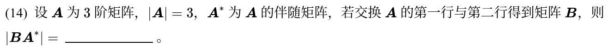
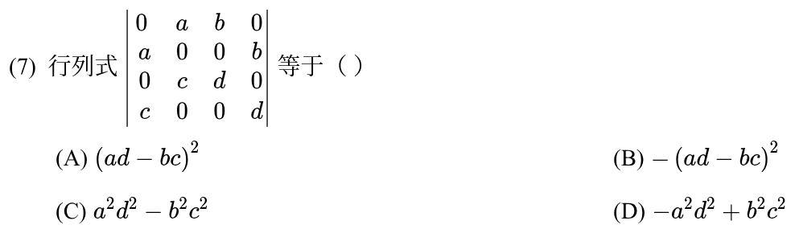
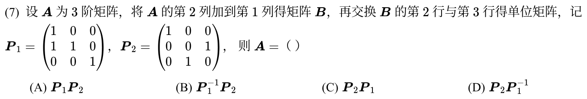
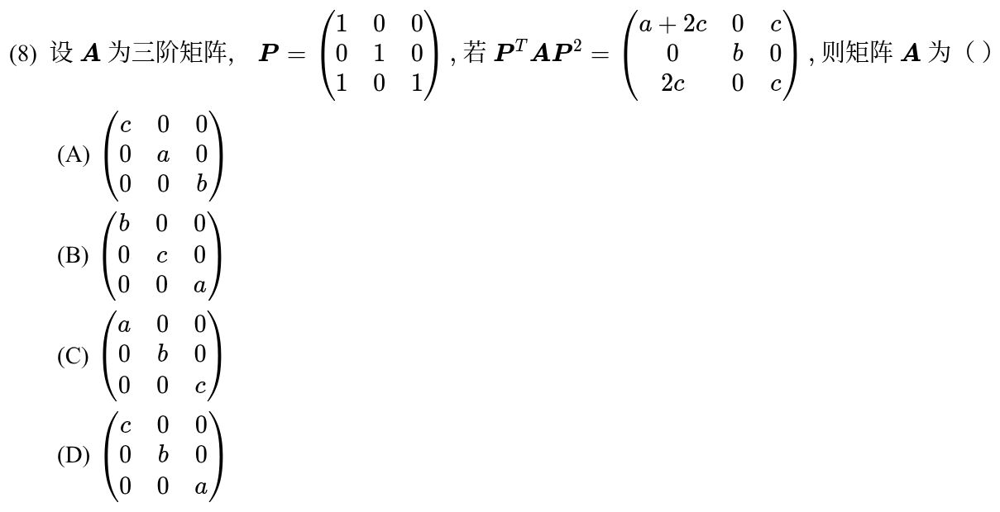
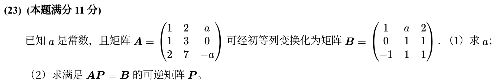
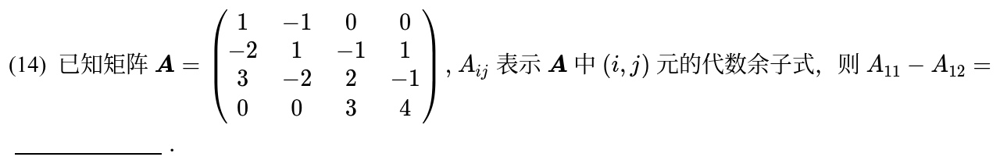
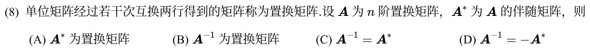

# 行列式计算与矩阵运算变换

> 跨章主题：串联[行列式](../../chapters/linear-algebra/01-determinants.md)与[矩阵](../../chapters/linear-algebra/02-matrices.md)

拿到一道行列式计算或矩阵运算变换题，最容易丢分的地方不是“公式背漏了”，而是**一上来就硬展开、硬乘矩阵、硬求逆，或者把初等行变换（左乘）与初等列变换（右乘）的方向搞反**。

处理这一主线的题目，第一笔先按**对象形态**分清入口：

| 题型信号 | 优先入口（第一笔） | 核心工具 | 高频坑点 |
| :--- | :--- | :--- | :--- |
| **抽象行列式 / 含伴随 $A^*$ / 互换行列** | **先拆再算**，绝不设具体元素 | $|AB|=|A||B|$、$|A^*|=|A|^{n-1}$、$|kA|=k^n|A|$、互换行/列变号 | 漏看阶数 $n$（误把 $|A^*|$ 写成 $|A|^n$ 或把 $|kA|$ 写成 $k|A|$） |
| **稀疏/对称/分块具体行列式** | **先换行换列归块，或看行/列元素直接凑展开** | 分块拉普拉斯公式 $\begin{vmatrix}A&O\\O&B\end{vmatrix}=|A||B|$、按零多的行/列展开 | **每交换一次两行或两列都要乘 $(-1)$**，只算块行列式漏掉总交换次数的符号 |
| **初等变换与初等矩阵（左行右列）** | **把每一步文字描述翻译成矩阵左乘/右乘等式** | 左乘 = 行变换，右乘 = 列变换；再从等式反解目标矩阵 | 忽略“先后顺序”（先乘的紧贴 $A$），或把求 $A$ 时左/右消元的逆矩阵顺序写反 |
| **矩阵方程 $P^T A P^2 = C$ / $AP = B$** | **能看结构直接逆变换消元；不可逆则转化为线性方程组** | 消去可逆初等因子（注意 $(E_{ij}(k))^{-1}=E_{ij}(-k)$）；$AP=B$ 按列拆解 $A\boldsymbol{p}_j=\boldsymbol{b}_j$ | 把 $AP=B$ 错当成 $A$ 可逆直接求 $A^{-1}B$；求一般可逆 $P$ 时漏写 $|P|\neq 0$ 的参数约束 |

下面用五道真题把**抽象行列式 $\to$ 稀疏分块行列式 $\to$ 初等矩阵左行右列 $\to$ 矩阵方程反解 $\to$ 列等价与可逆变换矩阵 $P$** 五个节点完整贯通。

---

## 一、行列式计算：抽象拆性质，具体归分块

### 判断链

1. **抽象矩阵的行列式**：只要题干给出 $|A|$、阶数 $n$、伴随矩阵 $A^*$ 或“交换两行/某行乘 $k$”，第一步立刻用初等矩阵或行列式乘法公式把复合行列式拆成单一因子的乘积。
2. **高阶稀疏行列式（含大量 $0$）**：不要急着按第一行直接展开。先观察非零元的分布——如果能通过若干次行交换、列交换把非零元聚集成对角块 $\begin{pmatrix}M_1&O\\O&M_2\end{pmatrix}$ 或副对角块，只要**严谨记录交换总次数 $m$**，答案一步就出：$(-1)^m |M_1||M_2|$。

---

### 例 1：[2012 年第 14 题](../../chapters/linear-algebra/01-determinants.md#q2012-14)（填空题）

> **建议先自己读原题并写第一步**，再往下核对推演。

**原题**（[在章节题单中查看](../../chapters/linear-algebra/01-determinants.md#q2012-14)）：

#### 第一步怎么落笔

- **触发条件**：已知 3 阶矩阵的 $|A|=3$，求 $|BA^*|$，且 $B$ 由 $A$ 经一次初等行变换得到。
- **第一笔**：直接套行列式乘法公式拆分目标式，把 $|B|$ 与 $|A^*|$ 分别表达为 $|A|$ 的函数：
  $$|BA^*| = |B|\cdot |A^*|.$$

#### 完整推演

1. **求 $|B|$**：交换 $A$ 的第一行与第二行得到 $B$，等价于 $B = E(1,2)A$。互换两行行列式变号，故
   $$|B| = -|A| = -3.$$
2. **求 $|A^*|$**：对 $n$ 阶矩阵有 $|A^*| = |A|^{n-1}$。本题 $n=3$，故
   $$|A^*| = |A|^{3-1} = 3^2 = 9.$$
3. **合并**：
   $$|BA^*| = |B|\cdot |A^*| = (-3)\times 9 = -27.$$
   （也可直接用矩阵乘法视角：$B = E(1,2)A \implies BA^* = E(1,2)AA^* = E(1,2)(|A|E) = 3E(1,2)$，再取 3 阶行列式得 $|3E(1,2)| = 3^3 |E(1,2)| = 27\times(-1) = -27$，两条路完全一致。）

#### 条件变式检验

- **变式**：若把题干中“交换 $A$ 的第一行与第二行”改为“将 $A$ 的第一行加到第二行”，$|BA^*|$ 变为多少？
  **变为 $27$。** 倍加初等变换不改变行列式的值，故 $|B| = |A| = 3$，从而 $|BA^*| = 3 \times 9 = 27$。若把阶数从 $3$ 阶改为 $4$ 阶（其余不变），则 $|A^*|=3^3=27$，$|BA^*| = -81$。

---

### 例 2：[2014 年第 7 题](../../chapters/linear-algebra/01-determinants.md#q2014-7)（选择题）

> **建议先自己做一遍，特别注意最后一步的符号**，再往下核对。

**原题**（[在章节题单中查看](../../chapters/linear-algebra/01-determinants.md#q2014-7)）：

#### 第一步怎么落笔

- **触发条件**：4 阶行列式每行恰有 2 个非零元，且第 1、3 行的非零元都在第 2、3 列，第 2、4 行的非零元都在第 1、4 列。
- **第一笔**：**用行列互换把同列结构的行聚到一起，化成 2×2 分块对角行列式**，每换一次立刻在外面记一个负号。

#### 完整推演

记原行列式为 $D$：
1. **交换第 1 行与第 2 行**（第 1 次交换，乘 $-1$）：
   $$D = -\begin{vmatrix} a & 0 & 0 & b \\ 0 & a & b & 0 \\ 0 & c & d & 0 \\ c & 0 & 0 & d \end{vmatrix}.$$
2. **交换第 2 行与第 4 行**（第 2 次交换，再乘 $-1$，累计符号 $+1$）：
   $$D = +\begin{vmatrix} a & 0 & 0 & b \\ c & 0 & 0 & d \\ 0 & c & d & 0 \\ 0 & a & b & 0 \end{vmatrix}.$$
3. **交换第 2 列与第 4 列**（第 3 次交换，再乘 $-1$，累计符号 $-1$）：
   $$D = -\begin{vmatrix} a & b & 0 & 0 \\ c & d & 0 & 0 \\ 0 & 0 & d & c \\ 0 & 0 & b & a \end{vmatrix}.$$
4. **套分块对角行列式公式**：
   $$D = -\begin{vmatrix} a & b \\ c & d \end{vmatrix}\begin{vmatrix} d & c \\ b & a \end{vmatrix} = -(ad-bc)(da-cb) = -(ad-bc)^2.$$
   故应选 **（B）**。

> **速验技巧（特值法）**：取 $a=d=1,\ b=c=0$，原行列式变成 $\begin{vmatrix}0&1&0&0\\1&0&0&0\\0&0&1&0\\0&0&0&1\end{vmatrix}$，只需交换第 1、2 行即得单位阵，值为 $-1$，立刻排除值为 $1$ 的（A）（C）；再取 $a=b=d=1,\ c=-1$，此时（D）$= -a^2d^2+b^2c^2 = 0$，而原行列式等于 $-4$（与（B）$=-(ad-bc)^2=-4$ 一致），瞬间锁定（B）。

#### 选择题关键干扰项拆解

- **（A）$(ad-bc)^2$（最高频错选）**：算出了两个 $2\times 2$ 子块都是 $ad-bc$，但**漏算了归块过程中的奇数次行列互换**（共 3 次交换，带出一个负号）。
- **（C）$a^2d^2 - b^2c^2$ 与（D）$-a^2d^2 + b^2c^2$**：错把两块分别算成了 $ad-bc$ 和 $ad+bc$，或按第一行展开时把余子式的正负号标错。

#### 条件变式检验

- **变式**：若把原行列式第 3 行的 $(0,c,d,0)$ 与第 4 行的 $(c,0,0,d)$ 对调，行列式值变为多少？
  **变为 $+(ad-bc)^2$。** 仅多了一次两行互换，整体乘 $-1$。

---

## 二、初等变换与矩阵方程：左行右列写等式，再按序消元

### 判断链

1. **看到“对 $A$ 做某某行变换 / 列变换得 $B$”**：不要凭感觉在脑子里倒推，第一时间把每一步变换翻译成**具体的初等矩阵左乘或右乘等式**。
   - **左行右列**：行变换 $\to$ 左乘初等矩阵；列变换 $\to$ 右乘初等矩阵。
   - **检验倍加初等矩阵的方法**：把单位阵 $E$ 按题干说的那一步变换操作一次，得到的就是对应的初等矩阵（例如“第 2 列加到第 1 列”对 $E$ 操作得 $\begin{pmatrix}1&0&0\\1&1&0\\0&0&1\end{pmatrix}$）。
2. **看到 $P^T A P^2 = C$ 等可逆矩阵夹击方程**：先确认左、右因子是否为初等矩阵或其幂。若是，直接把左右两边的逆矩阵分别左乘、右乘到右边，用**初等行/列变换**瞬间算出 $A$，绝不把 $A$ 设成 9 个未知数硬乘！
3. **看到“$A$ 可经初等列变换化为 $B$”且 $A$ 不可逆**：等价于存在可逆矩阵 $P$ 使 $AP=B$。此时不能写 $P=A^{-1}B$，而必须先用 $|A|=0 \implies |B|=0$（及 $r(A)=r(B)=r(A,B)$）定参数，再把 $AP=B$ 按列拆成线性方程组 $A\boldsymbol{p}_j = \boldsymbol{b}_j$ 求解通解，最后补上 $|P|\neq 0$。

---

### 例 3：[2011 年第 7 题](../../chapters/linear-algebra/02-matrices.md#q2011-7)（选择题）

> **建议先自己把两步变换写成矩阵等式**，再往下核对。

**原题**（[在章节题单中查看](../../chapters/linear-algebra/02-matrices.md#q2011-7)）：

#### 第一步怎么落笔

- **触发条件**：对 $A$ 依次做一次列变换、一次行变换得到单位矩阵 $E$，并直接给出了 $P_1, P_2$。
- **第一笔**：**先核对 $P_1, P_2$ 分别对应哪一步变换**，再按“左行右列”写出连接 $A$ 与 $E$ 的等式。

#### 完整推演

1. **核对初等矩阵**：
   - 将 $E$ 的第 2 列加到第 1 列，第 1 列变为 $(1,1,0)^T$，正好得到 $P_1 = \begin{pmatrix}1&0&0\\1&1&0\\0&0&1\end{pmatrix}$。
     因为是**列变换**，所以右乘 $P_1$：
     $$B = A P_1.$$
   - 交换 $E$ 的第 2 行与第 3 行，正好得到 $P_2 = \begin{pmatrix}1&0&0\\0&0&1\\0&1&0\end{pmatrix}$。
     因为是**行变换**，所以左乘 $P_2$：
     $$P_2 B = E \implies P_2 A P_1 = E.$$
2. **从等式反解 $A$**：
   等式两边左乘 $P_2^{-1}$、右乘 $P_1^{-1}$：
   $$A = P_2^{-1} E P_1^{-1} = P_2^{-1} P_1^{-1}.$$
   因为 $P_2$ 是对换初等矩阵，满足 $P_2^2 = E$，即 $P_2^{-1} = P_2$。代入得
   $$A = P_2 P_1^{-1}.$$
   故应选 **（D）**。

#### 选择题关键干扰项拆解

- **（B）$P_1^{-1}P_2$（最高频错选）**：误把两步变换都写在同一侧（例如写成 $P_2 P_1 A = E$），反解时写成 $A = (P_2 P_1)^{-1} = P_1^{-1} P_2^{-1} = P_1^{-1}P_2$。牢记**左行右列**，列变换绝不能放到 $A$ 左边。
- **（C）$P_2 P_1$**：忘对 $P_1$ 取逆，以为从 $P_2 A P_1 = E$ 移项过来 $P_1$ 不变。
- **（A）$P_1 P_2$**：既忘取逆又搞反了左右顺序。

#### 条件变式检验

- **变式**：若把第一步“将 $A$ 的第 2 列加到第 1 列”改为“将 $A$ 的第 1 行加到第 2 行”（其余不变），$A$ 等于什么？
  **等于 $P_1^{-1}P_2$（选 B）。** 此时对 $E$ 将第 1 行加到第 2 行得到的正是 $P_1$，两步都是行变换，依次左乘得 $P_2 P_1 A = E \implies A = P_1^{-1} P_2^{-1} = P_1^{-1}P_2$。

---

### 例 4：[2024 年第 8 题](../../chapters/linear-algebra/02-matrices.md#q2024-8)（选择题）

> **建议先自己观察 $P$ 是什么初等矩阵，写出 $P^T$ 与 $P^2$ 的逆**，再往下核对。

**原题**（[在章节题单中查看](../../chapters/linear-algebra/02-matrices.md#q2024-8)）：

#### 第一步怎么落笔

- **触发条件**：矩阵方程 $P^T A P^2 = C$，其中 $P = \begin{pmatrix}1&0&0\\0&1&0\\1&0&1\end{pmatrix}$ 是最简单的**倍加初等矩阵** $E_{31}(1)$。
- **第一笔**：直接利用倍加初等矩阵的幂与转置公式，把 $A = (P^T)^{-1} C (P^2)^{-1}$ 翻译成**两步初等变换**（一次行倍加、一次列倍加），十秒出答案。

#### 完整推演

1. **写出左右逆因子**：
   - $P = E_{31}(1)$（把第 1 行加到第 3 行），故 $P^2 = E_{31}(2)$，其逆为
     $$(P^2)^{-1} = E_{31}(-2) = \begin{pmatrix}1&0&0\\0&1&0\\-2&0&1\end{pmatrix}.$$
     **右乘 $(P^2)^{-1}$** 等价于列变换：**把第 3 列的 $(-2)$ 倍加到第 1 列**（注意右乘倍加阵 $E_{31}(k)$ 时，是把第 3 列乘 $k$ 加到第 1 列！）。
   - $P^T = E_{13}(1) = \begin{pmatrix}1&0&1\\0&1&0\\0&0&1\end{pmatrix}$，其逆为
     $$(P^T)^{-1} = E_{13}(-1) = \begin{pmatrix}1&0&-1\\0&1&0\\0&0&1\end{pmatrix}.$$
     **左乘 $(P^T)^{-1}$** 等价于行变换：**把第 3 行的 $(-1)$ 倍加到第 1 行**。
2. **对右边矩阵 $C = \begin{pmatrix}a+2c&0&c\\0&b&0\\2c&0&c\end{pmatrix}$ 依次做这两步变换**：
   - 先左乘 $(P^T)^{-1}$（$r_1 - r_3$）：
     $$\begin{pmatrix}a+2c&0&c\\0&b&0\\2c&0&c\end{pmatrix} \xrightarrow{r_1 - r_3} \begin{pmatrix}a&0&0\\0&b&0\\2c&0&c\end{pmatrix}.$$
   - 再右乘 $(P^2)^{-1}$（$c_1 - 2c_3$）：
     $$\begin{pmatrix}a&0&0\\0&b&0\\2c&0&c\end{pmatrix} \xrightarrow{c_1 - 2c_3} \begin{pmatrix}a&0&0\\0&b&0\\0&0&c\end{pmatrix}.$$
   因此 $A = \operatorname{diag}(a, b, c)$，选 **（C）**。

> **反向检验（零出错率）**：把选项（C）的 $A=\operatorname{diag}(a,b,c)$ 代回 $P^T A P^2$，因为 $P^T = E_{13}(1)$（行 1 加行 3）、$P^2 = E_{31}(2)$（列 1 加 2 倍列 3）：
> $$\begin{pmatrix}a&0&0\\0&b&0\\0&0&c\end{pmatrix} \xrightarrow{r_1+r_3} \begin{pmatrix}a&0&c\\0&b&0\\0&0&c\end{pmatrix} \xrightarrow{c_1+2c_3} \begin{pmatrix}a+2c&0&c\\0&b&0\\2c&0&c\end{pmatrix},$$
> 与题干右端完全一致！

#### 选择题关键干扰项拆解

- **（D）$\operatorname{diag}(c, b, a)$**：把右乘 $E_{31}(-2)$ 的方向搞反，误以为是“第 1 列乘 $-2$ 加到第 3 列”，导致 $a,c$ 位置错位。
- **（A）、（B）**：只看对角元排列猜答案，没注意到原矩阵第 2 行、第 2 列只有 $(2,2)$ 元非零且等于 $b$，而 $P$ 在第 2 行/列为单位块，因此 $A$ 的 $(2,2)$ 元必为 $b$，可直接秒杀排除（A）（B）。

#### 条件变式检验

- **变式**：若把题干中的 $P^T A P^2$ 改为 $P A P^T$（其余不变），$A$ 是否仍为对角矩阵？
  **不再是对角矩阵。** 计算 $P^{-1} C (P^T)^{-1}$：先 $r_3 - r_1$ 得 $\begin{pmatrix}a+2c&0&c\\0&b&0\\-a&0&0\end{pmatrix}$，再 $c_3 - c_1$ 得 $\begin{pmatrix}a+2c&0&-a-c\\0&b&0\\-a&0&a\end{pmatrix}$，非对角元不为零。这说明左右初等因子的转置位置绝对不能互换。

---

### 例 5：[2018 年第 23 题](../../chapters/linear-algebra/02-matrices.md#q2018-23)（解答题，满分 11 分）

> **建议先自己读原题并写第（1）问的第一步**，再往下核对完整解答。

**原题**（[在章节题单中查看](../../chapters/linear-algebra/02-matrices.md#q2018-23)）：

#### 第（1）问：怎么用“初等列变换”锁定参数 $a$？

- **触发条件**：$A$ 可经初等列变换化为 $B$ $\iff$ 存在可逆矩阵 $P$ 使得 $AP = B$ $\iff$ $r(A)=r(B)=r(A,B)$（且 $A,B$ 列向量组等价）。
- **第一步怎么落笔**：先算 $|A|$ 或直接对增广矩阵 $(A\mid B)$ 做初等行变换！先算行列式最快：
  $$|A| = \begin{vmatrix}1&2&a\\1&3&0\\2&7&-a\end{vmatrix} \xrightarrow[r_3-2r_1]{r_2-r_1} \begin{vmatrix}1&2&a\\0&1&-a\\0&3&-3a\end{vmatrix} = 0.$$
  因为 $|A| \equiv 0$（对任意 $a$ 都不可逆），而 $B = AP$ 且 $|P|\neq 0$，所以必有 $|B| = |A||P| = 0$。
- **由 $|B|=0$ 定出 $a$**：
  $$|B| = \begin{vmatrix}1&a&2\\0&1&1\\-1&1&1\end{vmatrix} \xrightarrow{r_3+r_1} \begin{vmatrix}1&a&2\\0&1&1\\0&a+1&3\end{vmatrix} = 3 - (a+1) = 2 - a.$$
  令 $|B|=0$，得
  $$a = 2.$$
- **必须补一步充分性验证**（解答题拿满分的必要动作）：$|A|=|B|=0$ 只是必要条件，还要验证 $a=2$ 时 $A$ 确实能经初等列变换化为 $B$（即 $r(A)=r(B)=r(A,B)$）。事实上，下面第（2）问把 $(A\mid B)$ 化成行最简形时会自动验证这一点。

#### 第（2）问：不可逆时如何求出所有满足 $AP=B$ 的可逆矩阵 $P$？

- **触发条件**：$a=2$ 时 $r(A)=2<3$，$A$ 不可逆，绝对不能写 $P=A^{-1}B$。
- **第一步怎么落笔**：把 $P$ 按列分块记为 $P = (\boldsymbol{p}_1, \boldsymbol{p}_2, \boldsymbol{p}_3)$，则 $AP=B$ 等价于同时求解三个线性方程组 $A\boldsymbol{p}_1=\boldsymbol{b}_1$、$A\boldsymbol{p}_2=\boldsymbol{b}_2$、$A\boldsymbol{p}_3=\boldsymbol{b}_3$，因此直接对 $(A\mid B)$ 做初等行变换化成行最简形！
- **完整推演**：
  当 $a=2$ 时，
  $$(A\mid B) = \left(\begin{array}{ccc|ccc} 1&2&2 & 1&2&2 \\ 1&3&0 & 0&1&1 \\ 2&7&-2 & -1&1&1 \end{array}\right) \xrightarrow[r_3-2r_1]{r_2-r_1} \left(\begin{array}{ccc|ccc} 1&2&2 & 1&2&2 \\ 0&1&-2 & -1&-1&-1 \\ 0&3&-6 & -3&-3&-3 \end{array}\right)$$
  $$\xrightarrow[r_1-2r_2]{r_3-3r_2} \left(\begin{array}{ccc|ccc} 1&0&6 & 3&4&4 \\ 0&1&-2 & -1&-1&-1 \\ 0&0&0 & 0&0&0 \end{array}\right).$$
  由此同时确认 $r(A)=r(B)=r(A,B)=2$（第（1）问充分性成立！）。

  读出齐次方程组 $A\boldsymbol{x}=\boldsymbol{0}$ 的基础解系为 $\boldsymbol{\xi} = (-6, 2, 1)^T$，三个非齐次方程组的特解分别为 $(3,-1,0)^T$、$(4,-1,0)^T$、$(4,-1,0)^T$。因此满足 $AP=B$ 的全部矩阵为：
  $$P = \begin{pmatrix} 3-6k_1 & 4-6k_2 & 4-6k_3 \\ -1+2k_1 & -1+2k_2 & -1+2k_3 \\ k_1 & k_2 & k_3 \end{pmatrix}, \qquad k_1, k_2, k_3 \in \mathbb{R}.$$

- **最后一步（千万别漏！）：加上“$P$ 可逆”的条件 $|P|\neq 0$**：
  $$|P| = \begin{vmatrix} 3-6k_1 & 4-6k_2 & 4-6k_3 \\ -1+2k_1 & -1+2k_2 & -1+2k_3 \\ k_1 & k_2 & k_3 \end{vmatrix} \xrightarrow[r_2-2r_3]{r_1+6r_3} \begin{vmatrix} 3 & 4 & 4 \\ -1 & -1 & -1 \\ k_1 & k_2 & k_3 \end{vmatrix} \xrightarrow{c_3-c_2} \begin{vmatrix} 3 & 4 & 0 \\ -1 & -1 & 0 \\ k_1 & k_2 & k_3-k_2 \end{vmatrix} = k_3 - k_2.$$
  因此 $P$ 可逆的充要条件是 $k_2 \neq k_3$。
  - 若只需给出一个满足条件的可逆矩阵 $P$，取 $k_1=k_2=0, k_3=1$ 得 $P = \begin{pmatrix}3&4&-2\\-1&-1&1\\0&0&1\end{pmatrix}$；
  - 写全解则答：上述 $P$，其中 $k_1, k_2, k_3$ 为任意实数且 $k_2 \neq k_3$。

#### 条件变式检验

- **变式**：若把题干中“$A$ 可经初等**列**变换化为 $B$”改为“$A$ 可经初等**行**变换化为 $B$”，第（1）问中 $a$ 还是 $2$ 吗？
  **不是！** 若 $PA=B$，则 $A$ 与 $B$ 行等价，即 $A\boldsymbol{x}=\boldsymbol{0}$ 与 $B\boldsymbol{x}=\boldsymbol{0}$ 同解。当 $a=2$ 时，$A\boldsymbol{x}=\boldsymbol{0}$ 的基础解系是 $(-6,2,1)^T$，代入 $B$ 的第 1 行得 $1(-6)+2(2)+2(1)=0$，但代入 $B$ 的第 2 行得 $0(-6)+1(2)+1(1)=3\neq 0$，所以 $a=2$ 时 $A, B$ **不**行等价！事实上，将 $A$ 化行阶梯形得第 2 行 $(0,1,-a)$，而 $B$ 的第 2 行是 $(0,1,1)$，若要行等价且 $r(A)=r(B)=2$，须检查 $B$ 的行空间与 $A$ 的行空间是否重合（经检验 $a=-1$ 时 $|B|=3\neq 0$，故不存在任何 $a$ 使 $A,B$ 行等价）。由此可见“行变换”与“列变换”的等价条件截然不同。

---

## 三、回练与过关标准

### 1. 真题回练一：[2019 年第 14 题](../../chapters/linear-algebra/01-determinants.md#q2019-14)（填空题）

点击核对思路与答案

- **第一笔观察**：先别急着分别算 $A_{11}$ 和 $A_{12}$！直接看 $A$ 的第一行元素：$(1, -1, 0, 0)$。
- **按第一行展开定理**：
  $$|A| = 1\cdot A_{11} + (-1)\cdot A_{12} + 0\cdot A_{13} + 0\cdot A_{14} = A_{11} - A_{12}.$$
  因此题目要算的 $A_{11}-A_{12}$ **就是 $|A|$ 本身**！
- **计算 $|A|$**：
  $$|A| = \begin{vmatrix}1&-1&0&0\\-2&1&-1&1\\3&-2&2&-1\\0&0&3&4\end{vmatrix} \xrightarrow{c_2+c_1} \begin{vmatrix}1&0&0&0\\-2&-1&-1&1\\3&1&2&-1\\0&0&3&4\end{vmatrix} = \begin{vmatrix}-1&-1&1\\1&2&-1\\0&3&4\end{vmatrix} \xrightarrow{r_2+r_1} \begin{vmatrix}-1&-1&1\\0&1&0\\0&3&4\end{vmatrix} = (-1)\cdot 1 \cdot 4 = -4.$$
- **答案**：$-4$。

### 2. 真题回练二：[2026 年第 8 题](../../chapters/linear-algebra/02-matrices.md#q2026-8)（选择题）

点击核对思路与答案

- **第一笔翻译定义**：$A$ 是由单位矩阵 $E$ 经过若干次互换两行得到的，因此可写成有限个对换初等矩阵的乘积：
  $$A = P_k P_{k-1}\cdots P_1,$$
  其中每个对换矩阵 $P_i$ 满足 $P_i^{-1} = P_i = P_i^T$，且 $|P_i| = -1$。
- **逐项检验**：
  - 求逆：$A^{-1} = P_1^{-1}\cdots P_{k-1}^{-1}P_k^{-1} = P_1\cdots P_{k-1}P_k$，仍然是若干个对换初等矩阵的乘积，即对 $E$ 经若干次互换两行得到，因此 **$A^{-1}$ 必为置换矩阵**，**（B）正确**。
  - 排除（A）（C）（D）：由 $A^* = |A|A^{-1} = (-1)^k A^{-1}$，当 $k$ 为奇数（如 $A$ 仅交换两行）时，$|A|=-1$，$A^* = -A^{-1}$ 含元素 $-1$，不是置换矩阵（排除 A），且 $A^{-1} = -A^*$（排除 C）；当 $k$ 为偶数（如 $A=E$）时，$|A|=1$，$A^{-1} = A^*$（排除 D）。
- **答案**：**（B）**。

### 过关标准

合上讲义，面对一道行列式或矩阵运算变换新题时，能独立完成以下四步即算过关：
1. 抽象行列式第一时间用 $|AB|=|A||B|$、$|A^*|=|A|^{n-1}$、$|kA|=k^n|A|$ 拆开，不漏阶数 $n$；
2. 稀疏/分块行列式归块时，**每次行列互换必记录一个 $(-1)$ 因子**，并用特值法快速验算符号；
3. 看到初等行/列变换描述，能无错写出**左行右列**矩阵等式并正确反解逆矩阵顺序；
4. 遇到 $AP=B$ 且 $A$ 不可逆时，知道用 $(A\mid B)$ 行最简形求通解，并补上 $|P|\neq 0$ 的可逆条件。
