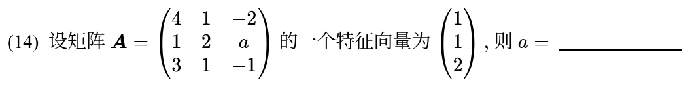
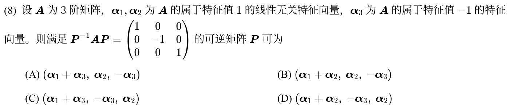
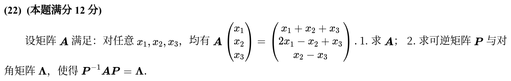
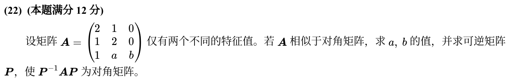
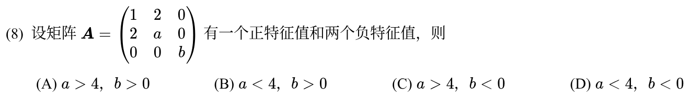
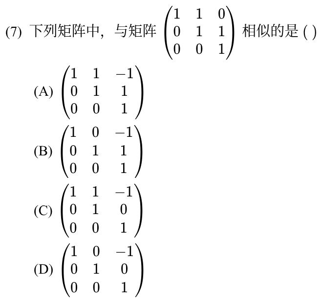

# 特征值、特征向量与相似对角化

> 章节定位：[特征值、特征向量与相似矩阵](../../chapters/linear-algebra/05-eigenvalues-similarity.md)

特征值与相似对角化这一章是线代大题的绝对主力，也是最容易因为“忽略细节”而白丢分的章节：**算错特征多项式展开、忘检验 $P$ 的列顺序与 $\Lambda$ 对角元顺序一致、把“不同特征值的特征向量相加”误当成特征向量、遇到重特征值忘记分两种情况讨论或忘查 $n-r(\lambda E-A)=k$**。

拿到一道特征值与相似对角化题，第一笔先按**题目形态**切入：

| 题型信号 | 优先入口（第一笔） | 核心判据 | 高频坑点 |
| :--- | :--- | :--- | :--- |
| **已知一个具体特征向量求参数** | **直接代定义 $A\boldsymbol{\alpha}=\lambda\boldsymbol{\alpha}$**（绝不先算 $|\lambda E-A|=0$！） | 用不含参数的行一步秒出 $\lambda$，再代回含参数的行定参数 | 忘了用剩余不含参数的行做一致性验算；或先算特征多项式把简单题做复杂 |
| **给定特征向量拼可逆阵 $P$ 使 $P^{-1}AP=\Lambda$** | **把 $P^{-1}AP=\Lambda$ 改写成 $AP=P\Lambda$ 按列对照** | 1. 第 $j$ 列必是 $\Lambda$ 第 $j$ 个对角元的特征向量 2. 同特征值的非零线性组合仍是特征向量，**不同特征值的和绝不是** 3. $P$ 的列必须线性无关 | 漏看 $\Lambda$ 对角元顺序（如 $\operatorname{diag}(1,-1,1)$ 与 $\operatorname{diag}(1,1,-1)$ 混了）；误把 $\boldsymbol{\alpha}_1+\boldsymbol{\alpha}_3$ 当特征向量 |
| **由线性变换 $A\boldsymbol{x}=\boldsymbol{y}$ 求 $A$ 并相似对角化** | **按列读系数写出 $A$** $\to$ 算 $|\lambda E-A|=0$ $\to$ 逐个解 $(\lambda_i E-A)\boldsymbol{x}=\boldsymbol{0}$ | $n$ 个互异特征值必可相似对角化；算完立刻用 $\operatorname{tr}(A)=\sum\lambda_i$ 与 $|A|=\prod\lambda_i$ 验算 | 展开 3 阶特征多项式时漏负号；写出 $P$ 后不检查每列是否真的满足 $A\boldsymbol{p}_j=\lambda_j\boldsymbol{p}_j$ |
| **含参矩阵“仅有 $k$ 个不同特征值且可相似对角化”** | **先利用分块三角结构直接读出全部特征值** $\to$ **分类讨论重根是谁** $\to$ 对重根用 $r(\lambda_0 E-A)=n-m$ 定参数 | 矩阵可相似对角化 $\iff$ 每个 $m$ 重特征值 $\lambda_0$ 满足 $r(\lambda_0 E-A)=n-m$ | **漏掉其中一种重根分支**（如 $b=1$ 与 $b=3$ 漏讨论一个！） |
| **非对角化矩阵的相似判定（如上三角阵）** | **先核特征值相同，再核 $r(\lambda E-A)$ 是否相等** | 相似矩阵必有相同的特征值、迹、行列式，且对任意 $\lambda$ 必有 $r(\lambda E-A)=r(\lambda E-B)$ | 只看特征值、迹、行列式全相等就以为相似，忘了比 $r(\lambda E-A)$ |

下面用四道真题把**定义直算 $\to$ $AP=P\Lambda$ 按列配对 $\to$ 线性变换写 $A$ 与完整对角化 $\to$ 分块三角阵重根分类讨论对角化**四条核心主线全部打通。

---

## 一、特征向量定义与 $AP=P\Lambda$ 按列配对

### 判断链

1. **题干直接给了具体特征向量 $\boldsymbol{\alpha}$**：不要算 $|\lambda E-A|=0$！直接写 $A\boldsymbol{\alpha}=\lambda\boldsymbol{\alpha}$，从不含参数的行一眼读出 $\lambda$，再代入含参数的行解出参数。
2. **题干问“使 $P^{-1}AP=\Lambda$ 的可逆矩阵 $P$”**：立刻改写成 $AP = P\Lambda$，逐列检查三条铁律：
   - **铁律 1（归属合法）**：同一特征值的特征向量的非零线性组合仍是该特征值的特征向量；**不同特征值的特征向量相加一定不是特征向量**；
   - **铁律 2（位置对齐）**：$P$ 的第 $j$ 列必须对应 $\Lambda$ 的第 $j$ 个对角元；
   - **铁律 3（列线性无关）**：$P$ 必须可逆（$|P|\neq 0$）。

---

### 例 1：[2017 年第 14 题](../../chapters/linear-algebra/05-eigenvalues-similarity.md#q2017-14)（填空题）

> **建议先自己用 $A\boldsymbol{\alpha}=\lambda\boldsymbol{\alpha}$ 的第 1 行秒出 $\lambda$**，再求 $a$。

**原题**（[在章节题单中查看](../../chapters/linear-algebra/05-eigenvalues-similarity.md#q2017-14)）：

#### 第一步怎么落笔

- **触发条件**：已知 $A$ 的一个具体特征向量 $\boldsymbol{\alpha}=(1,1,2)^T$，求矩阵中的未知元 $a$。
- **第一笔**：直接套定义 $A\boldsymbol{\alpha} = \lambda\boldsymbol{\alpha}$：
  $$\begin{pmatrix}4&1&-2\\1&2&a\\3&1&-1\end{pmatrix}\begin{pmatrix}1\\1\\2\end{pmatrix} = \begin{pmatrix}4+1-4\\1+2+2a\\3+1-2\end{pmatrix} = \begin{pmatrix}1\\3+2a\\2\end{pmatrix} = \lambda\begin{pmatrix}1\\1\\2\end{pmatrix}.$$

#### 完整推演

1. **由第 1 分量秒出 $\lambda$**：$1 = \lambda\cdot 1 \implies \lambda = 1$（同时用第 3 分量验算：$2 = 1\cdot 2$，完全吻合！）。
2. **由第 2 分量解出 $a$**：
   $$3 + 2a = 1 \cdot 1 \implies 2a = -2 \implies a = -1.$$

#### 条件变式检验

- **变式**：若把特征向量改为 $(0, 1, 2)^T$（第 1 分量为 $0$），还能从第 1 分量读出 $\lambda$ 吗？
  **不能！** 此时第 1 分量 $0=\lambda\cdot 0$ 恒成立，必须改用**非零分量所在且不含参数的行**（如第 3 行）先定 $\lambda$。

---

### 例 2：[2020 年第 8 题](../../chapters/linear-algebra/05-eigenvalues-similarity.md#q2020-8)（选择题）

> **建议先盯住目标对角阵 $\operatorname{diag}(1, -1, 1)$ 的第 2 列是 $-1$**，用三条铁律十秒排完三项。

**原题**（[在章节题单中查看](../../chapters/linear-algebra/05-eigenvalues-similarity.md#q2020-8)）：

#### 第一步怎么落笔

- **触发条件**：已知 $\boldsymbol{\alpha}_1,\boldsymbol{\alpha}_2$ 是 $\lambda=1$ 的线性无关特征向量，$\boldsymbol{\alpha}_3$ 是 $\lambda=-1$ 的特征向量，要求 $P^{-1}AP = \operatorname{diag}(1, -1, 1)$。
- **第一笔**：改写为 $A(\boldsymbol{p}_1,\boldsymbol{p}_2,\boldsymbol{p}_3) = (\boldsymbol{p}_1,\ -\boldsymbol{p}_2,\ \boldsymbol{p}_3)$，即：
  - $\boldsymbol{p}_1, \boldsymbol{p}_3$ 必须是属于 $\lambda=1$ 的线性无关特征向量；
  - $\boldsymbol{p}_2$ 必须是属于 $\lambda=-1$ 的特征向量（即 $c\boldsymbol{\alpha}_3,\ c\neq 0$）。

#### 完整推演

直接检验 **（D）** $P = (\boldsymbol{\alpha}_1+\boldsymbol{\alpha}_2,\ -\boldsymbol{\alpha}_3,\ \boldsymbol{\alpha}_2)$：
1. **归属与位置**：
   - 第 1 列：$A(\boldsymbol{\alpha}_1+\boldsymbol{\alpha}_2) = \boldsymbol{\alpha}_1+\boldsymbol{\alpha}_2 = 1\cdot(\boldsymbol{\alpha}_1+\boldsymbol{\alpha}_2)$（对应 $\lambda_1=1$）；
   - 第 2 列：$A(-\boldsymbol{\alpha}_3) = -A\boldsymbol{\alpha}_3 = -(-\boldsymbol{\alpha}_3) = (-1)(-\boldsymbol{\alpha}_3)$（对应 $\lambda_2=-1$）；
   - 第 3 列：$A\boldsymbol{\alpha}_2 = 1\cdot\boldsymbol{\alpha}_2$（对应 $\lambda_3=1$）。
2. **可逆性（列线性无关）**：
   $$(\boldsymbol{\alpha}_1+\boldsymbol{\alpha}_2,\ -\boldsymbol{\alpha}_3,\ \boldsymbol{\alpha}_2) = (\boldsymbol{\alpha}_1,\ \boldsymbol{\alpha}_2,\ \boldsymbol{\alpha}_3)\begin{pmatrix}1&0&0\\1&0&1\\0&-1&0\end{pmatrix}.$$
   因为 $\boldsymbol{\alpha}_1,\boldsymbol{\alpha}_2,\boldsymbol{\alpha}_3$ 线性无关（属于不同特征值的线性无关向量合并仍线性无关），且过渡矩阵行列式 $\begin{vmatrix}1&0&0\\1&0&1\\0&-1&0\end{vmatrix} = 1\neq 0$，所以 $P$ 可逆。故应选 **（D）**。

#### 选择题关键干扰项拆解

- **（A）与（C）**：第 1 列都是 $\boldsymbol{\alpha}_1+\boldsymbol{\alpha}_3$。由于 $\boldsymbol{\alpha}_1$ 与 $\boldsymbol{\alpha}_3$ 属于**不同特征值**（$1$ 与 $-1$），$A(\boldsymbol{\alpha}_1+\boldsymbol{\alpha}_3) = \boldsymbol{\alpha}_1 - \boldsymbol{\alpha}_3$，绝不是 $\boldsymbol{\alpha}_1+\boldsymbol{\alpha}_3$ 的倍数，直接秒杀淘汰！
- **（B）$(\boldsymbol{\alpha}_1+\boldsymbol{\alpha}_2,\ \boldsymbol{\alpha}_2,\ -\boldsymbol{\alpha}_3)$（最高频错选）**：三列都是合法特征向量且线性无关，但**顺序错了**！它算出来的是 $P^{-1}AP = \operatorname{diag}(1, 1, -1)$，而不是题目要求的 $\operatorname{diag}(1, -1, 1)$。

#### 条件变式检验

- **变式**：如果把选项（D）改为 $(\boldsymbol{\alpha}_1+\boldsymbol{\alpha}_2,\ -\boldsymbol{\alpha}_3,\ 2\boldsymbol{\alpha}_1+2\boldsymbol{\alpha}_2)$，还正确吗？
  **不正确！** 虽然三列归属和位置全对，但第 3 列是第 1 列的 2 倍，导致 $P$ **不可逆**，违反铁律 3！

---

## 二、具体矩阵的相似对角化与含参重根分类讨论

### 判断链

1. **标准对角化 4 步闭环**：
   - ① 求特征多项式 $|\lambda E-A|=0$ 得全部特征值 $\lambda_i$，**立即用 $\sum\lambda_i = \operatorname{tr}(A)$ 验算**；
   - ② 对每个 $\lambda_i$ 解 $(\lambda_i E-A)\boldsymbol{x}=\boldsymbol{0}$ 得基础解系，**把每个特征向量代回 $A\boldsymbol{p}_j=\lambda_j\boldsymbol{p}_j$ 口算验算**；
   - ③ 确认所有特征向量总数 $= n$；
   - ④ 按对应顺序拼出 $P$ 与 $\Lambda$。
2. **含参分块三角阵“仅有 2 个不同特征值且可相似对角化”**：
   - 利用分块三角阵行列式 $|\lambda E-A| = |\lambda E-A_{11}|\cdot|\lambda E-A_{22}|$ 直接读出全部特征值；
   - “仅有 2 个不同特征值” $\implies$ 含参特征值必等于另外两个特征值之一，**必须分两种情况讨论，绝不漏支**；
   - 在每种情况下，令二重特征值 $\lambda_0$ 满足 **$r(\lambda_0 E-A) = 3 - 2 = 1$** 即可锁定其余参数！

---

### 例 3：[2023 年第 22 题](../../chapters/linear-algebra/05-eigenvalues-similarity.md#q2023-22)（解答题，满分 12 分）

> **建议先自己写出矩阵 $A$ 并算特征值，用迹和行列式双重验算后再求 $P$**。

**原题**（[在章节题单中查看](../../chapters/linear-algebra/05-eigenvalues-similarity.md#q2023-22)）：

#### 第 1 问：由 $A\boldsymbol{x}$ 的表达式直接读出 $A$

把等式右端按 $x_1, x_2, x_3$ 的系数写成矩阵乘积：
$$A\begin{pmatrix}x_1\\x_2\\x_3\end{pmatrix} = \begin{pmatrix}1\cdot x_1 + 1\cdot x_2 + 1\cdot x_3 \\ 2\cdot x_1 - 1\cdot x_2 + 1\cdot x_3 \\ 0\cdot x_1 + 1\cdot x_2 - 1\cdot x_3\end{pmatrix} = \begin{pmatrix}1&1&1\\2&-1&1\\0&1&-1\end{pmatrix}\begin{pmatrix}x_1\\x_2\\x_3\end{pmatrix}.$$
因对任意 $x_1,x_2,x_3$ 恒成立（等价于令 $\boldsymbol{x}$ 依次取 $\boldsymbol{e}_1,\boldsymbol{e}_2,\boldsymbol{e}_3$），故
$$A = \begin{pmatrix}1&1&1\\2&-1&1\\0&1&-1\end{pmatrix}.$$

#### 第 2 问：求可逆矩阵 $P$ 与对角矩阵 $\Lambda$ 使 $P^{-1}AP=\Lambda$

1. **求特征值**：
   $$|\lambda E - A| = \begin{vmatrix}\lambda-1 & -1 & -1 \\ -2 & \lambda+1 & -1 \\ 0 & -1 & \lambda+1\end{vmatrix} \xrightarrow{c_2-c_3} \begin{vmatrix}\lambda-1 & 0 & -1 \\ -2 & \lambda+2 & -1 \\ 0 & -(\lambda+2) & \lambda+1\end{vmatrix}$$
   提取第 2 列公因子 $(\lambda+2)$：
   $$= (\lambda+2)\begin{vmatrix}\lambda-1 & 0 & -1 \\ -2 & 1 & -1 \\ 0 & -1 & \lambda+1\end{vmatrix} \xrightarrow{r_3+r_2} (\lambda+2)\begin{vmatrix}\lambda-1 & 0 & -1 \\ -2 & 1 & -1 \\ -2 & 0 & \lambda\end{vmatrix} = (\lambda+2)\big(\lambda(\lambda-1)-2\big)$$
   $$= (\lambda+2)(\lambda-2)(\lambda+1) = 0.$$
   得三个互异特征值：$\lambda_1 = 2,\ \lambda_2 = -1,\ \lambda_3 = -2$。
   （**双重验算**：$\lambda_1+\lambda_2+\lambda_3 = 2-1-2 = -1 = \operatorname{tr}(A)$；$\lambda_1\lambda_2\lambda_3 = 4 = |A|$，完全正确！）

2. **逐个求特征向量**：
   - 当 $\lambda_1 = 2$ 时：
     $$2E - A = \begin{pmatrix}1&-1&-1\\-2&3&-1\\0&-1&3\end{pmatrix} \to \begin{pmatrix}1&-1&-1\\0&1&-3\\0&-1&3\end{pmatrix} \to \begin{pmatrix}1&0&-4\\0&1&-3\\0&0&0\end{pmatrix},$$
     得特征向量 $\boldsymbol{\alpha}_1 = (4, 3, 1)^T$（口算验算 $A\boldsymbol{\alpha}_1 = (8,6,2)^T = 2\boldsymbol{\alpha}_1$）。
   - 当 $\lambda_2 = -1$ 时：
     $$-E - A = \begin{pmatrix}-2&-1&-1\\-2&0&-1\\0&-1&0\end{pmatrix} \to \begin{pmatrix}2&0&1\\0&1&0\\0&0&0\end{pmatrix},$$
     得特征向量 $\boldsymbol{\alpha}_2 = (-1, 0, 2)^T$（口算验算 $A\boldsymbol{\alpha}_2 = (1,0,-2)^T = -\boldsymbol{\alpha}_2$）。
   - 当 $\lambda_3 = -2$ 时：
     $$-2E - A = \begin{pmatrix}-3&-1&-1\\-2&-1&-1\\0&-1&-1\end{pmatrix} \to \begin{pmatrix}1&0&0\\0&1&1\\0&0&0\end{pmatrix},$$
     得特征向量 $\boldsymbol{\alpha}_3 = (0, -1, 1)^T$（口算验算 $A\boldsymbol{\alpha}_3 = (0,2,-2)^T = -2\boldsymbol{\alpha}_3$）。

3. **拼出 $P$ 与 $\Lambda$**：
   $$P = \begin{pmatrix}4 & -1 & 0 \\ 3 & 0 & -1 \\ 1 & 2 & 1\end{pmatrix}, \qquad \Lambda = \begin{pmatrix}2 & 0 & 0 \\ 0 & -1 & 0 \\ 0 & 0 & -2\end{pmatrix},$$
   满足 $P^{-1}AP = \Lambda$。

#### 条件变式检验

- **变式**：本题中能否把可逆矩阵 $P$ 换成**正交矩阵** $Q$ 使得 $Q^{-1}AQ = \Lambda$？
  **不能！** $A$ 不是实对称矩阵（例如 $a_{12}=1\neq 2=a_{21}$），其不同特征值的特征向量 $\boldsymbol{\alpha}_1=(4,3,1)^T$ 与 $\boldsymbol{\alpha}_3=(0,-1,1)^T$ 内积为 $-2\neq 0$，不正交，因此 $A$ 可相似对角化但不可正交对角化。

---

### 例 4：[2021 年第 22 题](../../chapters/linear-algebra/05-eigenvalues-similarity.md#q2021-22)（解答题，满分 12 分）

> **建议先看出 $A$ 的分块下三角结构，把 $b$ 的两种可能全部列出来，切忌漏支！**

**原题**（[在章节题单中查看](../../chapters/linear-algebra/05-eigenvalues-similarity.md#q2021-22)）：

#### 第一步怎么落笔

- **触发条件**：$A = \begin{pmatrix}2&1&0\\1&2&0\\1&a&b\end{pmatrix}$ 是**分块下三角矩阵**，仅有 2 个不同特征值，且可相似对角化。
- **第一笔**：按第 3 列直接展开特征多项式：
  $$|\lambda E - A| = (\lambda - b)\begin{vmatrix}\lambda-2 & -1 \\ -1 & \lambda-2\end{vmatrix} = (\lambda - b)(\lambda - 1)(\lambda - 3) = 0.$$
  全部特征值为 $1,\ 3,\ b$。
  因为“仅有 2 个不同特征值”，所以 **$b$ 必有两种可能：$b = 1$ 或 $b = 3$**！

#### 完整推演（必须完整讨论两支！）

##### 情况一：$b = 1$（特征值为 $\lambda_1 = \lambda_2 = 1,\ \lambda_3 = 3$）

1. **由可相似对角化定 $a$**：二重特征值 $\lambda = 1$ 必须有 2 个线性无关特征向量 $\iff r(E - A) = 3 - 2 = 1$。
   $$E - A = \begin{pmatrix}-1 & -1 & 0 \\ -1 & -1 & 0 \\ -1 & -a & 0\end{pmatrix}.$$
   显然 $r(E-A)=1 \iff$ 第 3 行与第 1 行成比例 $\iff a = 1$。
2. **求特征向量与 $P$**：
   - 当 $\lambda=1$ 时，$E-A \to \begin{pmatrix}1&1&0\\0&0&0\\0&0&0\end{pmatrix}$，得两个线性无关特征向量 $\boldsymbol{\alpha}_1 = (-1, 1, 0)^T$，$\boldsymbol{\alpha}_2 = (0, 0, 1)^T$；
   - 当 $\lambda=3$ 时，$3E-A = \begin{pmatrix}1&-1&0\\-1&1&0\\-1&-1&2\end{pmatrix} \to \begin{pmatrix}1&0&-1\\0&1&-1\\0&0&0\end{pmatrix}$，得特征向量 $\boldsymbol{\alpha}_3 = (1, 1, 1)^T$。
   - 拼出 $P_1 = \begin{pmatrix}-1&0&1\\1&0&1\\0&1&1\end{pmatrix}$，使 $P_1^{-1}AP_1 = \operatorname{diag}(1, 1, 3)$。

##### 情况二：$b = 3$（特征值为 $\lambda_1 = \lambda_2 = 3,\ \lambda_3 = 1$）

1. **由可相似对角化定 $a$**：二重特征值 $\lambda = 3$ 必须满足 $r(3E - A) = 3 - 2 = 1$。
   $$3E - A = \begin{pmatrix}1 & -1 & 0 \\ -1 & 1 & 0 \\ -1 & -a & 0\end{pmatrix}.$$
   第 1 行是 $(1,-1,0)$，第 3 行是 $(-1,-a,0)$，成比例 $\iff -a = 1 \iff a = -1$。
2. **求特征向量与 $P$**：
   - 当 $\lambda=3$ 时，$3E-A \to \begin{pmatrix}1&-1&0\\0&0&0\\0&0&0\end{pmatrix}$，得两个线性无关特征向量 $\boldsymbol{\beta}_1 = (1, 1, 0)^T$，$\boldsymbol{\beta}_2 = (0, 0, 1)^T$；
   - 当 $\lambda=1$ 时，$E-A = \begin{pmatrix}-1&-1&0\\-1&-1&0\\-1&1&-2\end{pmatrix} \to \begin{pmatrix}1&0&1\\0&1&-1\\0&0&0\end{pmatrix}$，得特征向量 $\boldsymbol{\beta}_3 = (1, -1, -1)^T$。
   - 拼出 $P_2 = \begin{pmatrix}1&0&1\\1&0&-1\\0&1&-1\end{pmatrix}$，使 $P_2^{-1}AP_2 = \operatorname{diag}(3, 3, 1)$。

综上，共有两组解：$(a, b) = (1, 1)$（对应 $P_1$）或 $(a, b) = (-1, 3)$（对应 $P_2$）。

#### 条件变式检验

- **变式**：若把题干中“仅有 2 个不同的特征值”改为“有 3 个不同的特征值”（即 $b\neq 1$ 且 $b\neq 3$），$a$ 还有约束吗？
  **没有任何约束！** 当 $b\neq 1, 3$ 时，$A$ 有 3 个互异特征值 $1, 3, b$，无论 $a$ 取何实数，$A$ 都**自动**可相似对角化。只有出现重特征值时，才需要用 $r(\lambda_0 E-A)=n-m$ 去约束非对角块里的参数 $a$。

---

## 三、回练与过关标准

### 1. 真题回练一：[2025 年第 8 题](../../chapters/linear-algebra/05-eigenvalues-similarity.md#q2025-8)（选择题）

点击核对思路与答案

- **第一步：分块拆特征值**：$A = \operatorname{diag}(B,\ b)$，其中 $B = \begin{pmatrix}1&2\\2&a\end{pmatrix}$ 为实对称矩阵，故 $A$ 的三个特征值为 $B$ 的两个实特征值 $\lambda_1, \lambda_2$ 与 $b$。
- **第二步：判断 $B$ 能否有两个负特征值**：因为 $B$ 的 $(1,1)$ 元为 $1 > 0$（即 $\boldsymbol{e}_1^T B\boldsymbol{e}_1 = 1 > 0$），所以 $B$ 绝不是负定矩阵，**$B$ 至少有一个正特征值**！
- **第三步：按“1 正 2 负”锁死符号**：既然总计只有 **1 个正特征值** 和 **2 个负特征值**，那么：
  - $B$ 只能是 **1 正 1 负** $\implies |B| = \lambda_1\lambda_2 = a - 4 < 0 \implies a < 4$；
  - 剩下的特征值 $b$ 必须是负的 $\implies b < 0$。
- **答案**：**（D）**（$a < 4,\ b < 0$）。

### 2. 真题回练二：[2018 年第 7 题](../../chapters/linear-algebra/05-eigenvalues-similarity.md#q2018-7)（选择题）

点击核对思路与答案

- **第一步：先查相似必要条件**：题干矩阵 $J = \begin{pmatrix}1&1&0\\0&1&1\\0&0&1\end{pmatrix}$ 与四个选项都是主对角元全为 $1$ 的上三角矩阵，特征值全为 $1,1,1$，迹与行列式都相等，无法区分。
- **第二步：升级判据——比 $r(E - M)$**：
  $$J - E = \begin{pmatrix}0&1&0\\0&0&1\\0&0&0\end{pmatrix} \implies r(J - E) = 2.$$
  逐项减去 $E$ 算秩：
  - **（A）**：$\begin{pmatrix}0&1&-1\\0&0&1\\0&0&0\end{pmatrix}$，秩为 **$2$**（且 $(A-E)^2 = \begin{pmatrix}0&0&1\\0&0&0\\0&0&0\end{pmatrix}\neq O$，与 $J$ 同为一个 3 阶若尔当块，必相似！）；
  - **（B）**：$\begin{pmatrix}0&0&-1\\0&0&1\\0&0&0\end{pmatrix}$，秩为 $1 \neq 2$，排除；
  - **（C）**：$\begin{pmatrix}0&1&-1\\0&0&0\\0&0&0\end{pmatrix}$，秩为 $1 \neq 2$，排除；
  - **（D）**：$\begin{pmatrix}0&0&-1\\0&0&0\\0&0&0\end{pmatrix}$，秩为 $1 \neq 2$，排除。
- **答案**：**（A）**。

### 过关标准

合上讲义，面对一道特征值与相似对角化新题时，能独立完成以下四步即算过关：
1. 已知具体特征向量求参数时，第一时间用 $A\boldsymbol{\alpha}=\lambda\boldsymbol{\alpha}$ 而不是算 $|\lambda E-A|=0$；
2. 拼对角化矩阵 $P$ 时，严格核对“**归属合法、位置对齐、列线性无关**”三条铁律；
3. 算完特征值与特征向量后，养成习惯用 $\operatorname{tr}(A)=\sum\lambda_i$ 与 $A\boldsymbol{p}_j=\lambda_j\boldsymbol{p}_j$ 口算复核；
4. 遇到含参重根矩阵可相似对角化时，不漏任何一种重根分支，且熟练用 $r(\lambda_0 E-A)=n-m$ 求解参数；遇到不可对角化矩阵的相似判定时，第一时间比较 $r(\lambda E-A)$。
