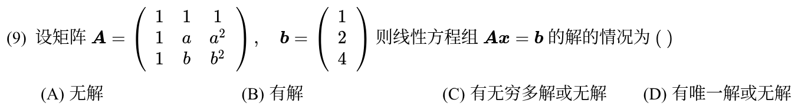
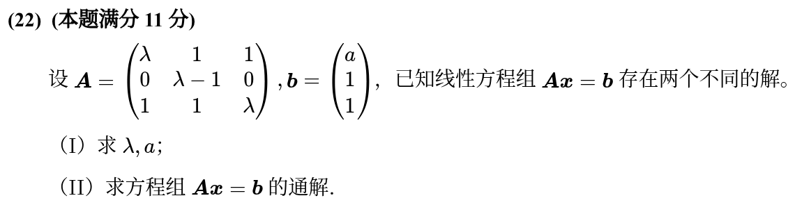
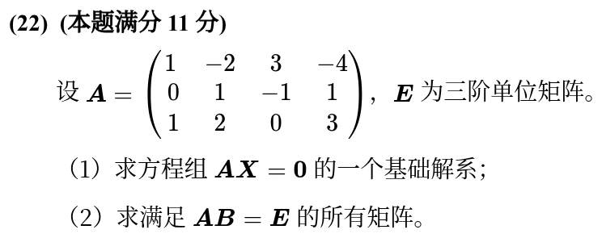
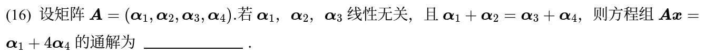
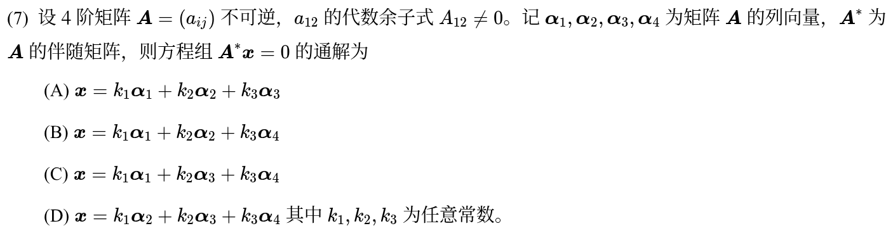
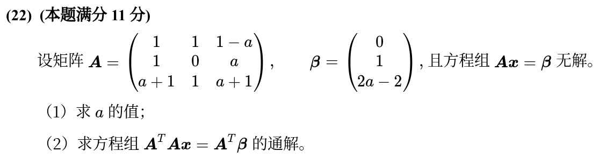

# 线性方程组解的结构与公共解同解

> 章节定位：[线性方程组](../../chapters/linear-algebra/04-linear-systems.md)

线性方程组这一章看似只是“高斯消元”，但真题真正拉分的地方在两件事：**（1）含参方程组的解的情况判定（唯一解 / 无穷多解 / 无解的边界）**，以及**（2）抽象解的结构（利用列向量关系、伴随矩阵、矩阵方程 $AB=E$ 与正规方程 $A^TA\boldsymbol{x}=A^T\boldsymbol{\beta}$ 直接读出基础解系与通解）**。

拿到一道线性方程组题，第一笔先按**已知信息形态**选定入口：

| 题型信号 | 优先入口（第一笔） | 核心判据 | 高频坑点 |
| :--- | :--- | :--- | :--- |
| **方阵 $A$ 含参，问“唯一解/无穷多解/无解”** | **先算 $|A|=0$ 锁定奇异点**，再把奇异点代回增广矩阵 $(A\mid\boldsymbol{b})$ 检查相容性 | $|A|\neq 0 \implies$ 唯一解；$|A|=0$ 时看 $r(A)$ 与 $r(A\mid\boldsymbol{b})$ 是否相等 | 看到“有两个不同解”或“无解”只令 $|A|=0$，忘了把每个根分别代入 $(A\mid\boldsymbol{b})$ 筛掉矛盾/有解的根 |
| **矩阵方程 $AB=E$（$A$ 非方阵）** | **对增广矩阵 $(A\mid E)$ 一次化成行最简形**，按列同时写出 $A\boldsymbol{b}_j=\boldsymbol{e}_j$ 的通解 | 通解 = 特解 + 齐次基础解系的线性组合；每一列有**各自独立**的自由参数 $k_1,k_2,k_3$ | 把三列的自由参数写成同一个 $k$（漏掉大部分解！） |
| **抽象列向量 $A=(\boldsymbol{\alpha}_1,\dots,\boldsymbol{\alpha}_n)$ 给线性关系** | **直接把线性关系翻译成 $A\boldsymbol{x}=\boldsymbol{0}$ 的非零解和 $A\boldsymbol{x}=\boldsymbol{b}$ 的特解** | 先定基础解系维数 $n-r(A)$，再把系数向量直接拼成通解 $\boldsymbol{\eta}^* + k\boldsymbol{\xi}$ | 没验证 $n-r(A)=1$ 就直接宣称只含一个自由参数 $k$ |
| **伴随方程 $A^*\boldsymbol{x}=\boldsymbol{0}$ 或正规方程 $A^TA\boldsymbol{x}=A^T\boldsymbol{\beta}$** | $A^*$ 看 $A^*A=|A|E$ 与非零余子式定位线性无关列；$A^TA\boldsymbol{x}=A^T\boldsymbol{\beta}$ 直接算系数阵或用 $A^TA\boldsymbol{x}=\boldsymbol{0}\iff A\boldsymbol{x}=\boldsymbol{0}$ | $r(A)=n-1 \implies r(A^*)=1 \implies \dim\ker(A^*)=n-1$；$A_{ij}\neq 0$ 删去第 $j$ 列余下 $n-1$ 列线性无关 | $A_{12}\neq 0$ 错删第 $1$ 列而非第 $2$ 列；以为 $A\boldsymbol{x}=\boldsymbol{\beta}$ 无解则 $A^TA\boldsymbol{x}=A^T\boldsymbol{\beta}$ 也无解（实际上后者**永远有解**！） |

下面用四道真题把**范德蒙奇异行冲突判定 $\to$ 含参方程“存在两个不同解” $\to$ 矩阵方程 $AB=E$ 全解 $\to$ 抽象列向量关系直读通解**四条核心路径完整打通。

---

## 一、含参方程组的解的情况：先算 $|A|=0$ 找奇异点，再回代 $(A\mid\boldsymbol{b})$ 逐一检验

### 判断链

1. **系数矩阵 $A$ 是方阵时**：第一步**永远先算 $|A|$**（范德蒙结构直接写因式分解，稀疏行直接按行展开）。
   - $|A|\neq 0 \implies$ 必有**唯一解**（绝不可能无解或无穷多解）；
   - $|A|=0 \implies$ 才进入“无解”或“无穷多解”的分岔，必须把 $|A|=0$ 的每一个分支代入增广矩阵 $(A\mid\boldsymbol{b})$ 看是否出现矛盾行 $(0,\dots,0\mid c\neq 0)$。
2. **听到“存在两个不同的解”**：立刻翻译成**有无穷多解** $\iff r(A)=r(A\mid\boldsymbol{b}) < n$（方阵时即 $|A|=0$ 且增广矩阵无矛盾行）。

---

### 例 1：[2022 年第 9 题](../../chapters/linear-algebra/04-linear-systems.md#q2022-9)（选择题）

> **建议先认出 $A$ 的行列式结构，再检查两行相等时右端 $\boldsymbol{b}$ 会发生什么**。

**原题**（[在章节题单中查看](../../chapters/linear-algebra/04-linear-systems.md#q2022-9)）：

#### 第一步怎么落笔

- **触发条件**：$A$ 是 3 阶**范德蒙矩阵**（转置形式），含参数 $a, b$，右端 $\boldsymbol{b}=(1,2,4)^T$ 是常数向量且三个分量**互不相等**。
- **第一笔**：直接写出 $|A|$ 的范德蒙因式分解：
  $$|A| = \begin{vmatrix}1&1&1\\1&a&a^2\\1&b&b^2\end{vmatrix} = (a-1)(b-1)(b-a).$$

#### 完整推演

按 $|A|$ 是否为零分成两类：
1. **当 $|A|\neq 0$**（即 $1, a, b$ 互不相等）时：
   $r(A) = 3 = r(A\mid\boldsymbol{b})$，方程组有**唯一解**。
2. **当 $|A| = 0$**（即 $a=1$ 或 $b=1$ 或 $a=b$）时：
   - 若 $a=1$：第 1 行方程为 $x_1+x_2+x_3=1$，第 2 行方程为 $x_1+x_2+x_3=2$，两式左边完全相同而右边 $1\neq 2$，**矛盾无解**；
   - 若 $b=1$：第 1 行 $=1$，第 3 行 $=4$，**矛盾无解**；
   - 若 $a=b$：第 2 行 $=2$，第 3 行 $=4$，**矛盾无解**。

综上，无论 $a, b$ 取何实数，方程组**绝不可能有无穷多解**，只可能**有唯一解或无解**。故应选 **（D）**。

#### 选择题关键干扰项拆解

- **（C）有无穷多解或无解**：忘记了 $1,a,b$ 互异时 $|A|\neq 0$ 有唯一解，或误把“$a,b$ 任意”当成“$|A|=0$”。
- **（B）有解** 与 **（A）无解**：只试了一组特值（如取 $a=2,b=3$ 以为恒有解，或取 $a=1$ 以为恒无解），没有做完参数分界讨论。

#### 条件变式检验

- **变式**：若把右端向量改为 $\boldsymbol{b}=(1, 1, 4)^T$（第 1、2 分量相等），结论怎么变？
  **三种情况（唯一解、无穷多解、无解）都可能出现！** 当 $a=1, b\neq 1$ 时，第 1、2 行方程完全重合（均为 $x_1+x_2+x_3=1$），与第 3 行联立得 $r(A)=r(A\mid\boldsymbol{b})=2 < 3$，此时出现**无穷多解**。

---

### 例 2：[2010 年第 22 题](../../chapters/linear-algebra/04-linear-systems.md#q2010-22)（解答题，满分 11 分）

> **建议先自己算 $|A|=0$ 定出 $\lambda$ 的候选值，再逐一检验增广矩阵**。

**原题**（[在章节题单中查看](../../chapters/linear-algebra/04-linear-systems.md#q2010-22)）：

#### 第（I）问：由“存在两个不同的解”定出 $\lambda, a$

- **第一步怎么落笔**：$A\boldsymbol{x}=\boldsymbol{b}$ 存在两个不同的解 $\implies$ 方程组有无穷多解 $\implies |A|=0$ 且 $r(A)=r(A\mid\boldsymbol{b})<3$。先按第 2 行展开算 $|A|$（第 2 行有两个 $0$，一步出因式分解！）：
  $$|A| = (\lambda - 1)\begin{vmatrix}\lambda & 1 \\ 1 & \lambda\end{vmatrix} = (\lambda - 1)(\lambda^2 - 1) = (\lambda - 1)^2(\lambda + 1).$$
  令 $|A|=0$，得两个候选值：$\lambda = 1$ 或 $\lambda = -1$。
- **逐一检验增广矩阵 $(A\mid\boldsymbol{b})$**：
  1. **当 $\lambda = 1$ 时**：增广矩阵第 2 行为 $(0,\ 0,\ 0 \mid 1)$，对应 $0=1$，方程组**无解**，舍去 $\lambda = 1$；
  2. **当 $\lambda = -1$ 时**：
     $$(A\mid\boldsymbol{b}) = \left(\begin{array}{ccc|c} -1 & 1 & 1 & a \\ 0 & -2 & 0 & 1 \\ 1 & 1 & -1 & 1 \end{array}\right) \xrightarrow{r_1+r_3} \left(\begin{array}{ccc|c} 0 & 2 & 0 & a+1 \\ 0 & -2 & 0 & 1 \\ 1 & 1 & -1 & 1 \end{array}\right) \xrightarrow{r_1+r_2} \left(\begin{array}{ccc|c} 0 & 0 & 0 & a+2 \\ 0 & -2 & 0 & 1 \\ 1 & 1 & -1 & 1 \end{array}\right).$$
     要使方程组有解（即 $r(A)=r(A\mid\boldsymbol{b})=2<3$），必须且只需 $a + 2 = 0 \implies a = -2$。

  因此 $\lambda = -1,\ a = -2$。

#### 第（II）问：求方程组 $A\boldsymbol{x}=\boldsymbol{b}$ 的通解

把 $\lambda=-1, a=-2$ 时的阶梯形整理成行最简形：
$$\left(\begin{array}{ccc|c} 1 & 1 & -1 & 1 \\ 0 & -2 & 0 & 1 \\ 0 & 0 & 0 & 0 \end{array}\right) \xrightarrow{-\frac{1}{2}r_2} \left(\begin{array}{ccc|c} 1 & 1 & -1 & 1 \\ 0 & 1 & 0 & -\frac{1}{2} \\ 0 & 0 & 0 & 0 \end{array}\right) \xrightarrow{r_1-r_2} \left(\begin{array}{ccc|c} 1 & 0 & -1 & \frac{3}{2} \\ 0 & 1 & 0 & -\frac{1}{2} \\ 0 & 0 & 0 & 0 \end{array}\right).$$
取自由未知量 $x_3 = k$（$k\in\mathbb{R}$），得 $x_1 = \frac{3}{2} + k$，$x_2 = -\frac{1}{2}$，因此通解为：
$$\boldsymbol{x} = \begin{pmatrix}\frac{3}{2} \\ -\frac{1}{2} \\ 0\end{pmatrix} + k\begin{pmatrix}1 \\ 0 \\ 1\end{pmatrix}, \qquad k \in \mathbb{R}.$$

#### 条件变式检验

- **变式**：若把题干中 $\boldsymbol{b}=(a, 1, 1)^T$ 改为 $\boldsymbol{b}=(a, 0, 1)^T$，求有无穷多解时的 $\lambda, a$。
  **此时 $\lambda = 1$ 也会复活！** 当 $\lambda=1$ 时，第 2 行变为 $(0,0,0\mid 0)$，第 1、3 行均为 $(1,1,1\mid \cdot)$，只要 $a=1$ 就有 $r(A)=r(A\mid\boldsymbol{b})=1$（两维解空间）；当 $\lambda=-1$ 时，由 $r_1+r_3$ 得 $(0,2,0\mid a+1)$ 与第 2 行 $(0,-2,0\mid 0)$ 联立，得 $a=-1$（一维解空间）。务必每个根都代回增广矩阵核查！

---

## 二、矩阵方程与抽象通解：用行最简形与线性关系直接读出“特解 + 基础解系”

### 判断链

1. **求解 $AB = E$（其中 $A$ 为 $m\times n$ 矩阵，$m < n$）**：
   把 $B$ 按列拆为 $B=(\boldsymbol{b}_1,\dots,\boldsymbol{b}_m)$，把 $E$ 按列拆为 $(\boldsymbol{e}_1,\dots,\boldsymbol{e}_m)$，则 $AB=E$ 等价于 $m$ 个同系数矩阵的非齐次线性方程组 $A\boldsymbol{b}_j = \boldsymbol{e}_j$（$j=1,\dots,m$）。
   **一步到位做法**：直接对 $(A\mid E)$ 做初等行变换化成行最简形，左半边读出 $A\boldsymbol{x}=\boldsymbol{0}$ 的基础解系，右半边直接读出每一列的一个特解，最后**给每一列配独立的自由参数**！
2. **已知 $A=(\boldsymbol{\alpha}_1,\dots,\boldsymbol{\alpha}_n)$ 的列线性关系求 $A\boldsymbol{x}=\boldsymbol{b}$ 通解**：
   - 先数秩 $r(A)$，算出基础解系维数 $n - r(A)$；
   - 把已知零线性组合的系数直接写成齐次基础解系 $\boldsymbol{\xi}$；
   - 把右端 $\boldsymbol{b}$ 写成列的线性组合，系数直接作为特解 $\boldsymbol{\eta}^*$。

---

### 例 3：[2014 年第 22 题](../../chapters/linear-algebra/04-linear-systems.md#q2014-22)（解答题，满分 11 分）

> **建议先自己对 $(A\mid E)$ 做初等行变换，一次解决两问**。

**原题**（[在章节题单中查看](../../chapters/linear-algebra/04-linear-systems.md#q2014-22)）：

#### 第一步怎么落笔

- **触发条件**：$A$ 是 $3\times 4$ 矩阵，第（1）问求 $A\boldsymbol{x}=\boldsymbol{0}$ 基础解系，第（2）问求所有满足 $AB=E$ 的 $4\times 3$ 矩阵 $B$。
- **第一笔**：**直接把 $A$ 与 3 阶单位阵 $E$ 拼成 $(A\mid E)$，一次性化成行最简形**，两问共用同一套消元结果，省时且不易算错！

#### 完整推演

对 $(A\mid E)$ 做初等行变换：
$$(A\mid E) = \left(\begin{array}{cccc|ccc} 1 & -2 & 3 & -4 & 1 & 0 & 0 \\ 0 & 1 & -1 & 1 & 0 & 1 & 0 \\ 1 & 2 & 0 & 3 & 0 & 0 & 1 \end{array}\right) \xrightarrow{r_3-r_1} \left(\begin{array}{cccc|ccc} 1 & -2 & 3 & -4 & 1 & 0 & 0 \\ 0 & 1 & -1 & 1 & 0 & 1 & 0 \\ 0 & 4 & -3 & 7 & -1 & 0 & 1 \end{array}\right)$$
$$\xrightarrow{r_3-4r_2} \left(\begin{array}{cccc|ccc} 1 & -2 & 3 & -4 & 1 & 0 & 0 \\ 0 & 1 & -1 & 1 & 0 & 1 & 0 \\ 0 & 0 & 1 & 3 & -1 & -4 & 1 \end{array}\right) \xrightarrow[r_1-3r_3]{r_2+r_3} \left(\begin{array}{cccc|ccc} 1 & -2 & 0 & -13 & 4 & 12 & -3 \\ 0 & 1 & 0 & 4 & -1 & -3 & 1 \\ 0 & 0 & 1 & 3 & -1 & -4 & 1 \end{array}\right)$$
$$\xrightarrow{r_1+2r_2} \left(\begin{array}{cccc|ccc} 1 & 0 & 0 & -5 & 2 & 6 & -1 \\ 0 & 1 & 0 & 4 & -1 & -3 & 1 \\ 0 & 0 & 1 & 3 & -1 & -4 & 1 \end{array}\right).$$

- **第（1）问**：由左半部分行最简形知 $r(A)=3$，自由未知量个数为 $4-3=1$（取 $x_4$ 为自由未知量）。对应齐次方程组为 $x_1 = 5x_4,\ x_2 = -4x_4,\ x_3 = -3x_4$。令 $x_4=1$，得 $A\boldsymbol{x}=\boldsymbol{0}$ 的一个基础解系为：
  $$\boldsymbol{\xi} = \begin{pmatrix}5 \\ -4 \\ -3 \\ 1\end{pmatrix}.$$

- **第（2）问**：设 $B = (\boldsymbol{b}_1, \boldsymbol{b}_2, \boldsymbol{b}_3)$（$4\times 3$ 矩阵），则 $AB = E \iff A\boldsymbol{b}_j = \boldsymbol{e}_j$（$j=1,2,3$）。
  令自由未知量 $x_4 = 0$，从上面行最简形的右半部分立刻读出三个特解：
  $$\boldsymbol{\eta}_1 = \begin{pmatrix}2\\-1\\-1\\0\end{pmatrix}, \qquad \boldsymbol{\eta}_2 = \begin{pmatrix}6\\-3\\-4\\0\end{pmatrix}, \qquad \boldsymbol{\eta}_3 = \begin{pmatrix}-1\\1\\1\\0\end{pmatrix}.$$
  三列各自加上齐次通解 $k_j\boldsymbol{\xi}$（**注意三个参数 $k_1, k_2, k_3$ 必须相互独立！**），因此满足 $AB=E$ 的所有矩阵为：
  $$B = \begin{pmatrix} 2+5k_1 & 6+5k_2 & -1+5k_3 \\ -1-4k_1 & -3-4k_2 & 1-4k_3 \\ -1-3k_1 & -4-3k_2 & 1-3k_3 \\ k_1 & k_2 & k_3 \end{pmatrix}, \qquad k_1, k_2, k_3 \in \mathbb{R}.$$

#### 条件变式检验

- **变式**：是否存在 $4\times 3$ 矩阵 $C$ 使得 $CA = E_4$（4 阶单位矩阵）？
  **不存在！** 因为 $r(CA) \le r(A) = 3 < 4 = r(E_4)$。矮胖矩阵（行满秩 $r=m<n$）有无穷多个右逆 $B$（$AB=E_m$），但绝不存在左逆！

---

### 例 4：[2025 年第 16 题](../../chapters/linear-algebra/04-linear-systems.md#q2025-16)（填空题）

> **建议先数清 $r(A)$ 与基础解系维数，再直接从等式读出 $\boldsymbol{\xi}$ 与 $\boldsymbol{\eta}^*$**。

**原题**（[在章节题单中查看](../../chapters/linear-algebra/04-linear-systems.md#q2025-16)）：

#### 第一步怎么落笔

- **触发条件**：$A=(\boldsymbol{\alpha}_1,\boldsymbol{\alpha}_2,\boldsymbol{\alpha}_3,\boldsymbol{\alpha}_4)$ 共 4 列，已知 $\boldsymbol{\alpha}_1,\boldsymbol{\alpha}_2,\boldsymbol{\alpha}_3$ 线性无关，且 $\boldsymbol{\alpha}_1+\boldsymbol{\alpha}_2=\boldsymbol{\alpha}_3+\boldsymbol{\alpha}_4$。
- **第一笔**：**先定秩与解空间维数**——$\boldsymbol{\alpha}_4 = \boldsymbol{\alpha}_1+\boldsymbol{\alpha}_2-\boldsymbol{\alpha}_3$ 可由前三个线性无关向量表出，故 $r(A)=3$，从而 $A\boldsymbol{x}=\boldsymbol{0}$ 的基础解系恰含 **$4 - 3 = 1$ 个向量**！

#### 完整推演

1. **读齐次基础解系**：把 $\boldsymbol{\alpha}_1+\boldsymbol{\alpha}_2=\boldsymbol{\alpha}_3+\boldsymbol{\alpha}_4$ 移项得
   $$1\cdot\boldsymbol{\alpha}_1 + 1\cdot\boldsymbol{\alpha}_2 + (-1)\cdot\boldsymbol{\alpha}_3 + (-1)\cdot\boldsymbol{\alpha}_4 = \boldsymbol{0},$$
   即 $A\begin{pmatrix}1\\1\\-1\\-1\end{pmatrix}=\boldsymbol{0}$。因为基础解系维数为 $1$，所以 $\boldsymbol{\xi}=(1,1,-1,-1)^T$ 就是 $A\boldsymbol{x}=\boldsymbol{0}$ 的一个基础解系。
2. **读非齐次特解**：方程组右端为 $\boldsymbol{\alpha}_1 + 4\boldsymbol{\alpha}_4$，直接写成矩阵乘积：
   $$A\begin{pmatrix}1\\0\\0\\4\end{pmatrix} = \boldsymbol{\alpha}_1 + 4\boldsymbol{\alpha}_4,$$
   故 $\boldsymbol{\eta}^* = (1,0,0,4)^T$ 是一个特解。
3. **合成通解**：
   $$\boldsymbol{x} = \begin{pmatrix}1\\0\\0\\4\end{pmatrix} + k\begin{pmatrix}1\\1\\-1\\-1\end{pmatrix}, \qquad k \in \mathbb{R}.$$
   （若把 $\boldsymbol{\alpha}_4=\boldsymbol{\alpha}_1+\boldsymbol{\alpha}_2-\boldsymbol{\alpha}_3$ 代入右端得 $5\boldsymbol{\alpha}_1+4\boldsymbol{\alpha}_2-4\boldsymbol{\alpha}_3$，写出特解 $(5,4,-4,0)^T$ 同样完全正确，两者仅相差 $4\boldsymbol{\xi}$。）

#### 条件变式检验

- **变式**：若把题干中的“$\boldsymbol{\alpha}_1,\boldsymbol{\alpha}_2,\boldsymbol{\alpha}_3$ 线性无关”删掉，还能说上面的就是全部通解吗？
  **不能！** 删掉线性无关后，只知道 $r(A) \le 3$，基础解系维数 $4 - r(A)$ 可能是 $2$、$3$ 甚至 $4$，仅靠一个向量 $(1,1,-1,-1)^T$ 无法张成整个齐次解空间。

---

## 三、回练与过关标准

### 1. 真题回练一：[2020 年第 7 题](../../chapters/linear-algebra/04-linear-systems.md#q2020-7)（选择题）

点击核对思路与答案

- **第一步定 $r(A^*)$ 与解空间维数**：$A$ 为 4 阶不可逆矩阵 $\implies |A|=0 \implies r(A)\le 3$；又 $A_{12}\neq 0$ 说明 $A$ 有一个非零 3 阶子式 $\implies r(A)\ge 3$。故 $r(A)=3$，从而 **$r(A^*)=1$**。因此 $A^*\boldsymbol{x}=\boldsymbol{0}$ 的基础解系含 $4-1=3$ 个线性无关解向量。
- **第二步找解向量**：由 $A^* A = |A|E = O$ 知 $A$ 的每一列 $\boldsymbol{\alpha}_1,\boldsymbol{\alpha}_2,\boldsymbol{\alpha}_3,\boldsymbol{\alpha}_4$ 都是 $A^*\boldsymbol{x}=\boldsymbol{0}$ 的解。
- **第三步用 $A_{12}\neq 0$ 定位哪 3 列线性无关**：$A_{12}$ 是划去 $A$ 的**第 1 行、第 2 列**后余下的 3 阶子式（带符号），它由第 **1、3、4 列**构成且行列式非零，因此 **$\boldsymbol{\alpha}_1, \boldsymbol{\alpha}_3, \boldsymbol{\alpha}_4$ 线性无关**，构成 $A^*\boldsymbol{x}=\boldsymbol{0}$ 的基础解系。
- **答案**：**（C）**（$k_1\boldsymbol{\alpha}_1 + k_2\boldsymbol{\alpha}_3 + k_3\boldsymbol{\alpha}_4$）。

### 2. 真题回练二：[2016 年第 22 题](../../chapters/linear-algebra/04-linear-systems.md#q2016-22)（解答题，满分 11 分）

点击核对思路与答案

- **第（1）问**：对增广矩阵 $(A\mid\boldsymbol{\beta})$ 做初等行变换：
  $$\left(\begin{array}{ccc|c}1&1&1-a&0\\1&0&a&1\\a+1&1&a+1&2a-2\end{array}\right) \xrightarrow[r_3-(a+1)r_1]{r_2-r_1} \left(\begin{array}{ccc|c}1&1&1-a&0\\0&-1&2a-1&1\\0&-a&a^2+a&2a-2\end{array}\right) \xrightarrow{r_3-ar_2} \left(\begin{array}{ccc|c}1&1&1-a&0\\0&-1&2a-1&1\\0&0&-a(a-2)&a-2\end{array}\right).$$
  无解 $\iff -a(a-2)=0$ 且 $a-2\neq 0 \implies$ **$a = 0$**（注意 $a=2$ 时最后一行全零，有无穷多解，必须排除！）。
- **第（2）问**：$a=0$ 时，$A=\begin{pmatrix}1&1&1\\1&0&0\\1&1&1\end{pmatrix}$，$\boldsymbol{\beta}=\begin{pmatrix}0\\1\\-2\end{pmatrix}$。直接算
  $$A^T A = \begin{pmatrix}3&2&2\\2&2&2\\2&2&2\end{pmatrix}, \qquad A^T\boldsymbol{\beta} = \begin{pmatrix}-1\\-2\\-2\end{pmatrix}.$$
  化行最简形得 $\begin{pmatrix}1&0&0&1\\0&1&1&-2\\0&0&0&0\end{pmatrix}$，故通解为：
  $$\boldsymbol{x} = \begin{pmatrix}1\\-2\\0\end{pmatrix} + k\begin{pmatrix}0\\-1\\1\end{pmatrix}, \qquad k\in\mathbb{R}.$$
  （顺便注意几何意义：$A\boldsymbol{x}=\boldsymbol{\beta}$ 无解，但正规方程 $A^TA\boldsymbol{x}=A^T\boldsymbol{\beta}$ 恒有最小二乘解！）

### 过关标准

合上讲义，面对一道线性方程组新题时，能独立完成以下四步即算过关：
1. 含参方阵方程组先算 $|A|=0$ 找奇异点，并把**每一个奇异点**代回 $(A\mid\boldsymbol{b})$ 区分“无穷多解”与“无解”；
2. 遇到 $AB=E$ 型矩阵方程，会用 $(A\mid E)$ 一次化行最简形，并给每一列分配**相互独立**的自由参数；
3. 遇到抽象列向量关系题，会先定 $r(A)$ 与基础解系维数 $n-r(A)$，再直接从系数读出特解与基础解系；
4. 遇到 $A^*\boldsymbol{x}=\boldsymbol{0}$ 时能准确利用 $A_{ij}\neq 0$ 删去第 $j$ 列找到 $n-1$ 个线性无关列。
