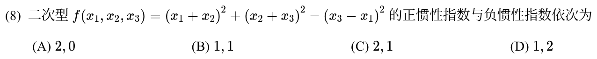
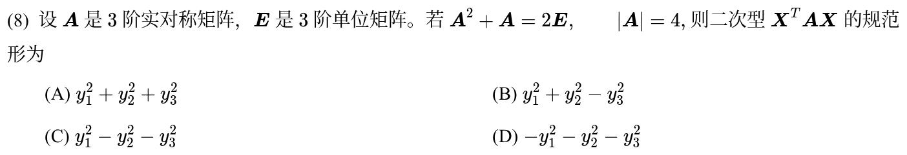
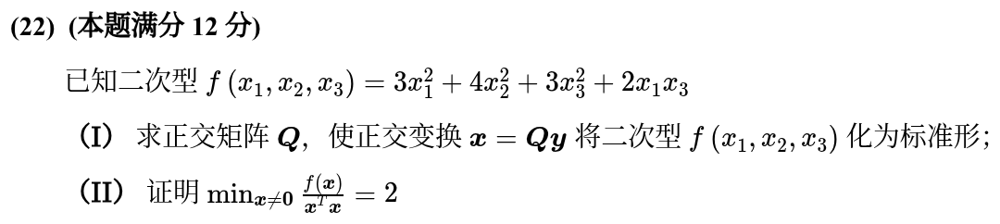
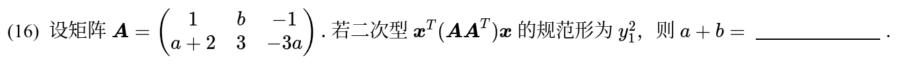
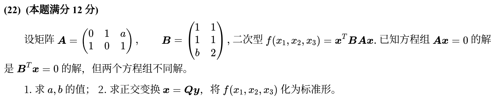
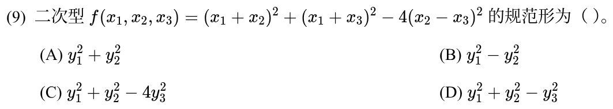

# 二次型标准形、规范形、合同与正定

> 章节定位：[二次型](../../chapters/linear-algebra/06-quadratic-forms.md)

二次型这一章是整个线性代数的大合流——它会把前面全部章节（矩阵乘法、秩、线性方程组同解、特征值与正交对角化）打包在一起考。最容易踩的坑有三个：**（1）看到一堆平方和就盲目数正负号，没检查里面的线性形式是否线性无关**；**（2）用正交变换化标准形时忘记对重特征值的特征向量做正交化与单位化**；**（3）证明瑞利商最值 $\min_{\boldsymbol{x}\neq\boldsymbol{0}}\frac{f(\boldsymbol{x})}{\boldsymbol{x}^T\boldsymbol{x}}=\lambda_{\min}$ 时只证了“$\ge \lambda_{\min}$”，漏证了“等号可以取到”**。

拿到一道二次型题，第一笔先按**题干形式**选入口：

| 题型信号 | 优先入口（第一笔） | 核心工具 | 高频坑点 |
| :--- | :--- | :--- | :--- |
| **给定几个线性式平方和，求正负惯性指数/规范形** | **第一步永远先查线性式是否线性无关！** | 若线性相关，把多余项用其余项线性表出代入，化成 2 元二次型看判别式/行列式 | 没查变换可逆性就直接数平方项前面的正负号（2021-8、2023-9 均专考此坑！） |
| **抽象实对称阵给多项式 $g(A)=O$ 与 $|A|$，求规范形** | **先用 $g(\lambda)=0$ 锁定特征值候选集**，再用 $|A|=\prod\lambda_i$ 唯一确定重数 | 惯性定理：规范形只取决于正、负特征值的个数 $(p, q)$ | 忘了检查所有组合的乘积，或混淆规范形（系数只能为 $\pm 1$）与标准形 |
| **具体二次型求正交变换 $\boldsymbol{x}=Q\boldsymbol{y}$ 化标准形 + 最值证明** | **写对称矩阵 $A$ $\to$ 求特征值与特征向量 $\to$ 重根正交化 $\to$ 全体单位化拼 $Q$** | 正交变换保内积 $\boldsymbol{x}^T\boldsymbol{x}=\boldsymbol{y}^T\boldsymbol{y}$，从而 $\frac{f(\boldsymbol{x})}{\boldsymbol{x}^T\boldsymbol{x}}=\frac{\sum\lambda_i y_i^2}{\sum y_i^2}$ | 1. 交叉项 $2a_{ij}x_ix_j$ 写进矩阵忘除以 $2$ 2. 证明最值时漏写“取 $\boldsymbol{y}=\boldsymbol{e}_1$（即 $\boldsymbol{x}=Q\boldsymbol{e}_1$）时等号成立” |
| **半正定阵 $A A^T$（或 $A^T A$）的规范形求参数** | **认出 $A A^T$ 必半正定**（特征值全 $\ge 0$），立刻把规范形条件翻译成**秩条件** | $\boldsymbol{x}^T(AA^T)\boldsymbol{x}=\|A^T\boldsymbol{x}\|^2\ge 0 \implies$ 负惯性指数 $q=0$，正惯性指数 $p=r(AA^T)=r(A)$ | 费劲去硬乘 $AA^T$ 算特征值，其实只需一行 $r(A)=1$（两行成比例）即可秒杀！ |

下面用四道真题把**平方和线性相关陷阱 $\to$ 抽象多项式定规范形 $\to$ 正交变换与瑞利商最值证明 $\to$ $AA^T$ 半正定秩速杀**四条核心路径完整串通。

---

## 一、求正负惯性指数与规范形：先查可逆性，抽象看特征值符号

### 判断链

1. **看到 $f(x_1,x_2,x_3) = c_1 L_1^2 + c_2 L_2^2 + c_3 L_3^2$**：
   千万不要直接数 $c_1, c_2, c_3$ 里有几个正几个负！惯性定理的前提是**坐标变换 $\boldsymbol{y}=C\boldsymbol{x}$ 必须可逆**（即 $L_1, L_2, L_3$ 线性无关）。
   - 若 $L_1, L_2, L_3$ 线性无关：直接数 $c_1,c_2,c_3$ 的正负个数即得 $(p, q)$；
   - 若 $L_1, L_2, L_3$ 线性相关：立刻把其中一个写成另外两个的线性组合代入，降维成 2 元二次型 $a y_1^2 + 2b y_1 y_2 + c y_2^2$，其矩阵 $\begin{pmatrix}a&b\\b&c\end{pmatrix}$ 行列式 $<0 \implies (p,q)=(1,1)$！
2. **看到抽象实对称矩阵 $A$ 满足多项式 $g(A)=O$**：
   任何特征值 $\lambda$ 必满足 $g(\lambda)=0$。列出全部候选特征值后，用 $|A|=\prod\lambda_i$（或 $r(A)$、$\operatorname{tr}(A)$）锁死每个特征值的重数，再数正负个数直接写出规范形。

---

### 例 1：[2021 年第 8 题](../../chapters/linear-algebra/06-quadratic-forms.md#q2021-8)（选择题）

> **建议先检验 $x_1+x_2,\ x_2+x_3,\ x_3-x_1$ 是否线性无关**，千万不要一眼选（C）！

**原题**（[在章节题单中查看](../../chapters/linear-algebra/06-quadratic-forms.md#q2021-8)）：

#### 第一步怎么落笔

- **触发条件**：二次型已经写成三个平方项的代数和 $(x_1+x_2)^2 + (x_2+x_3)^2 - (x_3-x_1)^2$。
- **第一笔**：**先查三个线性形式的关系**！一眼看出：
  $$(x_2 + x_3) - (x_1 + x_2) = x_3 - x_1.$$
  三个线性形式**线性相关**！绝对不能直接令 $y_1=x_1+x_2,\ y_2=x_2+x_3,\ y_3=x_3-x_1$（变换矩阵不可逆）！

#### 完整推演

1. **做合法可逆线性变换降维**：
   令 $y_1 = x_1 + x_2,\ y_2 = x_2 + x_3,\ y_3 = x_3$（变换矩阵 $\begin{pmatrix}1&1&0\\0&1&1\\0&0&1\end{pmatrix}$ 上三角且行列式为 $1\neq 0$，**可逆**！），则 $x_3 - x_1 = y_2 - y_1$。代入原二次型：
   $$f = y_1^2 + y_2^2 - (y_2 - y_1)^2 = y_1^2 + y_2^2 - (y_2^2 - 2y_1 y_2 + y_1^2) = 2y_1 y_2.$$
2. **对 $2y_1 y_2$ 配方**：
   再作可逆变换 $y_1 = z_1 + z_2,\ y_2 = z_1 - z_2,\ y_3 = z_3$，得
   $$f = 2(z_1 + z_2)(z_1 - z_2) = 2z_1^2 - 2z_2^2.$$
   因此正惯性指数 $p = 1$，负惯性指数 $q = 1$，选 **（B）**。

> **双保险验算（矩阵法）**：展开得 $f = 2x_2^2 + 2x_1x_2 + 2x_1x_3 + 2x_2x_3$，矩阵 $A = \begin{pmatrix}0&1&1\\1&2&1\\1&1&0\end{pmatrix}$。易见第 1 行 + 第 3 行 = 第 2 行 $\implies |A|=0$（必有特征值 $0$，$p+q\le 2$），且左上 2 阶主子式 $\begin{vmatrix}0&1\\1&2\end{vmatrix} = -1 < 0 \implies$ 必一正一负，立刻得 $p=1, q=1$！

#### 选择题关键干扰项拆解

- **（C）$2, 1$（头号陷阱！）**：没检查变换可逆性，看到题干里“两个正平方、一个负平方”就直接填 $p=2, q=1$。
- **（A）$2, 0$** 与 **（D）$1, 2$**：展开或配方法算错符号。

#### 条件变式检验

- **变式**：若把题干最后一项改为 $-(x_3 + x_1)^2$（把减号改加号），正负惯性指数变为多少？
  **变为 $2, 1$（此时选 C）！** 因为 $x_1+x_2,\ x_2+x_3,\ x_3+x_1$ 的系数矩阵行列式 $\begin{vmatrix}1&1&0\\0&1&1\\1&0&1\end{vmatrix} = 2 \neq 0$，**线性无关**，可直接做可逆线性变换 $y_1=x_1+x_2,\ y_2=x_2+x_3,\ y_3=x_3+x_1$ 得 $f=y_1^2+y_2^2-y_3^2$！

---

### 例 2：[2019 年第 8 题](../../chapters/linear-algebra/06-quadratic-forms.md#q2019-8)（选择题）

> **建议先解方程 $\lambda^2+\lambda-2=0$，再看哪三个数相乘等于 $4$**。

**原题**（[在章节题单中查看](../../chapters/linear-algebra/06-quadratic-forms.md#q2019-8)）：

#### 第一步怎么落笔

- **触发条件**：$A$ 为 3 阶实对称矩阵，满足 $A^2 + A = 2E$ 且 $|A| = 4$。
- **第一笔**：设 $\lambda$ 为 $A$ 的任一特征值，则 $\lambda$ 必满足矩阵方程对应的代数方程：
  $$\lambda^2 + \lambda - 2 = 0 \implies (\lambda + 2)(\lambda - 1) = 0 \implies \lambda \in \{1,\ -2\}.$$

#### 完整推演

1. **用 $|A|=4$ 锁死三个特征值的重数**：
   $A$ 是 3 阶实对称矩阵，必有 3 个实特征值 $\lambda_1, \lambda_2, \lambda_3 \in \{1, -2\}$，且满足
   $$\lambda_1 \lambda_2 \lambda_3 = |A| = 4.$$
   检验所有可能组合：
   - $(1, 1, 1) \implies$ 乘积 $1 \neq 4$；
   - $(1, 1, -2) \implies$ 乘积 $-2 \neq 4$；
   - $(1, -2, -2) \implies$ 乘积 $1\times(-2)\times(-2) = 4$（**唯一满足！**）；
   - $(-2, -2, -2) \implies$ 乘积 $-8 \neq 4$。
2. **直接读出规范形**：
   三个特征值为 $1, -2, -2$，有 **1 个正特征值、2 个负特征值**（$p=1, q=2$），故二次型 $\boldsymbol{X}^T A\boldsymbol{X}$ 的规范形为
   $$y_1^2 - y_2^2 - y_3^2.$$
   应选 **（C）**。

#### 选择题关键干扰项拆解

- **（A）$y_1^2+y_2^2+y_3^2$**：只看到 $|A|=4>0$ 就误以为 $A$ 正定！注意 $|A|>0$ 只能说明**负特征值有偶数个**（0 个或 2 个），不能推出正定。
- **（B）$y_1^2+y_2^2-y_3^2$** 与 **（D）$-y_1^2-y_2^2-y_3^2$**：负特征值个数为奇数，此时 $|A|<0$，与 $|A|=4>0$ 直接矛盾，可一眼秒杀排除！

#### 条件变式检验

- **变式**：若把条件 $|A|=4$ 改为 $|A|=-2$（其余不变），规范形是什么？
  **为 $y_1^2 + y_2^2 - y_3^2$（选 B）。** 此时三个特征值只能是 $1, 1, -2$（2 正 1 负）。

---

## 二、正交变换化标准形、瑞利商最值与半正定秩速杀

### 判断链

1. **正交变换化标准形 + 证明 $\min_{\boldsymbol{x}\neq\boldsymbol{0}}\frac{f(\boldsymbol{x})}{\boldsymbol{x}^T\boldsymbol{x}} = \lambda_{\min}$**：
   - 第（I）问走标准流程：写 $A \to$ 求特征值 $\to$ 求特征向量 $\to$ **同一重特征值的特征向量正交化**（若本来就正交则只需验证内积为 $0$）$\to$ 全体单位化得 $Q$；
   - 第（II）问两步必全：
     1. **下界不等式**：令 $\boldsymbol{x}=Q\boldsymbol{y}$（$Q$ 正交，$\boldsymbol{x}\neq\boldsymbol{0}\iff\boldsymbol{y}\neq\boldsymbol{0}$），利用 $\boldsymbol{x}^T\boldsymbol{x}=\boldsymbol{y}^T Q^T Q\boldsymbol{y}=\boldsymbol{y}^T\boldsymbol{y}$，得
        $$\frac{f(\boldsymbol{x})}{\boldsymbol{x}^T\boldsymbol{x}} = \frac{\lambda_1 y_1^2 + \lambda_2 y_2^2 + \lambda_3 y_3^2}{y_1^2 + y_2^2 + y_3^2} \ge \frac{\lambda_{\min}(y_1^2+y_2^2+y_3^2)}{y_1^2+y_2^2+y_3^2} = \lambda_{\min};$$
     2. **等号可达性（千万别漏！）**：指明当 $\boldsymbol{y}=(1,0,0)^T$（即 $\boldsymbol{x}=Q(1,0,0)^T$，属于 $\lambda_{\min}$ 的单位特征向量）时，上式取等号，故最小值确为 $\lambda_{\min}$。
2. **看到 $\boldsymbol{x}^T(AA^T)\boldsymbol{x}$ 的规范形**：
   直接利用**恒等式 $\boldsymbol{x}^T(AA^T)\boldsymbol{x} = (A^T\boldsymbol{x})^T(A^T\boldsymbol{x}) = \|A^T\boldsymbol{x}\|^2 \ge 0$**：
   - $AA^T$ 必为半正定矩阵，没有负特征值（$q=0$）；
   - 正惯性指数 $p = r(AA^T) = r(A)$！
   因此“规范形为 $y_1^2$” $\iff r(A) = 1$，瞬间跳过所有矩阵乘法和特征值计算！

---

### 例 3：[2022 年第 22 题](../../chapters/linear-algebra/06-quadratic-forms.md#q2022-22)（解答题，满分 12 分）

> **建议先自己写出对称矩阵 $A$，求出正交矩阵 $Q$ 后，完整写出第（II）问的“下界 + 可达性”两步证明**。

**原题**（[在章节题单中查看](../../chapters/linear-algebra/06-quadratic-forms.md#q2022-22)）：

#### 第（I）问：求正交矩阵 $Q$ 将 $f$ 化为标准形

1. **写出二次型矩阵**（注意 $2x_1x_3$ 的系数 $2$ 均分到 $(1,3)$ 和 $(3,1)$ 元，各为 $1$）：
   $$A = \begin{pmatrix}3 & 0 & 1 \\ 0 & 4 & 0 \\ 1 & 0 & 3\end{pmatrix}.$$
2. **求特征值**（按第 2 行直接展开）：
   $$|\lambda E - A| = (\lambda - 4)\begin{vmatrix}\lambda-3 & -1 \\ -1 & \lambda-3\end{vmatrix} = (\lambda - 4)\big((\lambda-3)^2 - 1\big) = (\lambda - 4)^2(\lambda - 2) = 0.$$
   得特征值 $\lambda_1 = 2,\ \lambda_2 = \lambda_3 = 4$（验算：$\operatorname{tr}(A)=10=2+4+4$）。
3. **求特征向量并正交化、单位化**：
   - 当 $\lambda_1 = 2$ 时：$2E - A = \begin{pmatrix}-1&0&-1\\0&-2&0\\-1&0&-1\end{pmatrix} \to \begin{pmatrix}1&0&1\\0&1&0\\0&0&0\end{pmatrix}$，得特征向量 $\boldsymbol{\alpha}_1 = (1, 0, -1)^T$。
     单位化得 $\boldsymbol{q}_1 = \frac{1}{\sqrt{2}}(1, 0, -1)^T$。
   - 当 $\lambda_2 = \lambda_3 = 4$ 时：$4E - A = \begin{pmatrix}1&0&-1\\0&0&0\\-1&0&1\end{pmatrix} \to \begin{pmatrix}1&0&-1\\0&0&0\\0&0&0\end{pmatrix}$，得两个线性无关特征向量 $\boldsymbol{\alpha}_2 = (0, 1, 0)^T$，$\boldsymbol{\alpha}_3 = (1, 0, 1)^T$。
     **检查正交性**：$\boldsymbol{\alpha}_2^T \boldsymbol{\alpha}_3 = 0$，**已经正交**，无需再做施密特正交化！
     单位化得 $\boldsymbol{q}_2 = (0, 1, 0)^T$，$\boldsymbol{q}_3 = \frac{1}{\sqrt{2}}(1, 0, 1)^T$。
4. **拼出正交矩阵 $Q$**：
   $$Q = (\boldsymbol{q}_1,\ \boldsymbol{q}_2,\ \boldsymbol{q}_3) = \begin{pmatrix}\frac{1}{\sqrt{2}} & 0 & \frac{1}{\sqrt{2}} \\ 0 & 1 & 0 \\ -\frac{1}{\sqrt{2}} & 0 & \frac{1}{\sqrt{2}}\end{pmatrix}.$$
   在正交变换 $\boldsymbol{x} = Q\boldsymbol{y}$ 下，二次型化为标准形：
   $$f = 2y_1^2 + 4y_2^2 + 4y_3^2.$$

#### 第（II）问：证明 $\min_{\boldsymbol{x}\neq\boldsymbol{0}} \frac{f(\boldsymbol{x})}{\boldsymbol{x}^T\boldsymbol{x}} = 2$

1. **利用正交变换保内积给出下界**：
   作第（I）问中的正交变换 $\boldsymbol{x} = Q\boldsymbol{y}$。因为 $Q$ 是正交矩阵（$Q^T Q = E$），故 $\boldsymbol{x}\neq\boldsymbol{0} \iff \boldsymbol{y}\neq\boldsymbol{0}$，且
   $$\boldsymbol{x}^T\boldsymbol{x} = (Q\boldsymbol{y})^T(Q\boldsymbol{y}) = \boldsymbol{y}^T(Q^T Q)\boldsymbol{y} = \boldsymbol{y}^T\boldsymbol{y} = y_1^2 + y_2^2 + y_3^2 > 0.$$
   因此对一切 $\boldsymbol{x}\neq\boldsymbol{0}$，有
   $$\frac{f(\boldsymbol{x})}{\boldsymbol{x}^T\boldsymbol{x}} = \frac{2y_1^2 + 4y_2^2 + 4y_3^2}{y_1^2 + y_2^2 + y_3^2} \ge \frac{2(y_1^2 + y_2^2 + y_3^2)}{y_1^2 + y_2^2 + y_3^2} = 2.$$
2. **证明等号可以取到（得分关键步！）**：
   取 $\boldsymbol{y}_0 = (1, 0, 0)^T$，即取 $\boldsymbol{x}_0 = Q\boldsymbol{y}_0 = \frac{1}{\sqrt{2}}(1, 0, -1)^T \neq \boldsymbol{0}$，代入得
   $$\frac{f(\boldsymbol{x}_0)}{\boldsymbol{x}_0^T\boldsymbol{x}_0} = \frac{2\cdot 1^2 + 0 + 0}{1^2 + 0 + 0} = 2.$$
   综上，必有 $\min_{\boldsymbol{x}\neq\boldsymbol{0}} \frac{f(\boldsymbol{x})}{\boldsymbol{x}^T\boldsymbol{x}} = 2$。

#### 条件变式检验

- **变式**：如果第（II）问改用一般可逆线性变换（如配方法 $\boldsymbol{x}=C\boldsymbol{y}$，但 $C$ 非正交）得到 $f=2y_1^2+4y_2^2+4y_3^2$，还能直接写 $\frac{f(\boldsymbol{x})}{\boldsymbol{x}^T\boldsymbol{x}} = \frac{2y_1^2+4y_2^2+4y_3^2}{y_1^2+y_2^2+y_3^2}$ 吗？
  **绝不可以！** 一般可逆矩阵不满足 $C^T C = E$，分母 $\boldsymbol{x}^T\boldsymbol{x} = \boldsymbol{y}^T(C^T C)\boldsymbol{y} \neq y_1^2+y_2^2+y_3^2$。只有**正交变换**才同时把分子对角化且保持分母 $\boldsymbol{x}^T\boldsymbol{x}=\boldsymbol{y}^T\boldsymbol{y}$ 不变！

---

### 例 4：[2026 年第 16 题](../../chapters/linear-algebra/06-quadratic-forms.md#q2026-16)（填空题）

> **建议先别急着把 $AA^T$ 乘出来！直接想清楚 $AA^T$ 的正负惯性指数与 $r(A)$ 的关系**。

**原题**（[在章节题单中查看](../../chapters/linear-algebra/06-quadratic-forms.md#q2026-16)）：

#### 第一步怎么落笔

- **触发条件**：$A$ 是 $2\times 3$ 矩阵，二次型 $\boldsymbol{x}^T(AA^T)\boldsymbol{x}$ 的规范形为 $y_1^2$。
- **第一笔**：**秒用半正定性 + 秩定理**：
  $$\boldsymbol{x}^T(AA^T)\boldsymbol{x} = \|A^T\boldsymbol{x}\|^2 \ge 0 \implies AA^T \text{ 半正定，无负特征值}.$$
  因此它的规范形为 $y_1^2$（正惯性指数 $1$、负惯性指数 $0$）当且仅当：
  $$r(AA^T) = 1 \iff r(A) = 1!$$

#### 完整推演

因为 $A = \begin{pmatrix}1 & b & -1 \\ a+2 & 3 & -3a\end{pmatrix}$ 只有两行且第 1 行非零，故 $r(A)=1 \iff$ 第 2 行是第 1 行的常数倍：
$$\frac{a+2}{1} = \frac{3}{b} = \frac{-3a}{-1} = 3a.$$
1. 由 $a + 2 = 3a \implies 2a = 2 \implies a = 1$；
2. 代入 $\frac{3}{b} = 3a = 3 \implies b = 1$。
因此：
$$a + b = 1 + 1 = 2.$$

#### 条件变式检验

- **变式**：如果把题干中的 $AA^T$ 改成 $A^T A$（此时变成 3 元二次型），规范形为 $y_1^2$ 时 $a+b$ 还是 $2$ 吗？
  **仍然是 $2$！** 因为 $r(A^TA) = r(AA^T) = r(A)$，且 $A^TA$ 同样半正定，规范形为 $y_1^2$ 依然等价于 $r(A)=1$。

---

## 三、回练与过关标准

### 1. 真题回练一：[2024 年第 22 题](../../chapters/linear-algebra/06-quadratic-forms.md#q2024-22)（解答题，满分 12 分）

点击核对思路与答案

- **第 1 问（串联方程组同解与秩）**：
  - $A = \begin{pmatrix}0&1&a\\1&0&1\end{pmatrix}$ 的前两列线性无关，故 $r(A)=2$，$A\boldsymbol{x}=\boldsymbol{0}$ 的解空间维数为 $3-2=1$，基础解系为 $\boldsymbol{\xi}=(-1, -a, 1)^T$。
  - 已知“$A\boldsymbol{x}=\boldsymbol{0}$ 的解均为 $B^T\boldsymbol{x}=\boldsymbol{0}$ 的解，但不同解”，说明 $B^T\boldsymbol{x}=\boldsymbol{0}$ 的解空间严格大于 $1$ 维 $\implies 3 - r(B^T) > 1 \implies r(B^T) = 1$。
  - 看 $B^T = \begin{pmatrix}1&1&b\\1&1&2\end{pmatrix}$：$r(B^T)=1 \iff$ **$b = 2$**。
  - 再把 $\boldsymbol{\xi}=(-1,-a,1)^T$ 代入 $B^T\boldsymbol{\xi}=\boldsymbol{0}$：$-1 - a + 2 = 0 \implies$ **$a = 1$**。
- **第 2 问（秩 1 实对称矩阵秒杀正交对角化！）**：
  - 代入 $a=1, b=2$，算得 $BA = \begin{pmatrix}1&1\\1&1\\2&2\end{pmatrix}\begin{pmatrix}0&1&1\\1&0&1\end{pmatrix} = \begin{pmatrix}1&1&2\\1&1&2\\2&2&4\end{pmatrix} = \begin{pmatrix}1\\1\\2\end{pmatrix}(1, 1, 2)$。
  - 注意 $BA$ **恰好是对称矩阵**，且秩为 $1$！因此特征值直接读出：$\lambda_1 = \operatorname{tr}(BA) = 1+1+4 = 6$，$\lambda_2 = \lambda_3 = 0$。
  - $\lambda_1=6$ 的单位特征向量：$\boldsymbol{q}_1 = \frac{1}{\sqrt{6}}(1, 1, 2)^T$；
  - $\lambda_2=\lambda_3=0$ 解 $x_1+x_2+2x_3=0$，取正交基础解系 $(1,-1,0)^T$ 与 $(1,1,-1)^T$（验证内积全为 $0$！），单位化得 $\boldsymbol{q}_2 = \frac{1}{\sqrt{2}}(1,-1,0)^T$，$\boldsymbol{q}_3 = \frac{1}{\sqrt{3}}(1,1,-1)^T$。
  - 拼出正交矩阵 $Q = \begin{pmatrix}\frac{1}{\sqrt{6}}&\frac{1}{\sqrt{2}}&\frac{1}{\sqrt{3}}\\\frac{1}{\sqrt{6}}&-\frac{1}{\sqrt{2}}&\frac{1}{\sqrt{3}}\\\frac{2}{\sqrt{6}}&0&-\frac{1}{\sqrt{3}}\end{pmatrix}$，在 $\boldsymbol{x}=Q\boldsymbol{y}$ 下标准形为 **$f = 6y_1^2$**。

### 2. 真题回练二：[2023 年第 9 题](../../chapters/linear-algebra/06-quadratic-forms.md#q2023-9)（选择题）

点击核对思路与答案

- **第一笔避坑**：先查三个平方里的线性形式 $x_1+x_2,\ x_1+x_3,\ x_2-x_3$——立见 $(x_1+x_2)-(x_1+x_3)=x_2-x_3$，**线性相关**！直接排除（C）（D）！
- **降维定惯性指数**：作可逆变换 $y_1 = x_1+x_2,\ y_2 = x_1+x_3,\ y_3 = x_3$，则 $x_2-x_3 = y_1-y_2$，代入得
  $$f = y_1^2 + y_2^2 - 4(y_1-y_2)^2 = -3y_1^2 + 8y_1y_2 - 3y_2^2.$$
  对应 2 阶对称阵 $\begin{pmatrix}-3&4\\4&-3\end{pmatrix}$ 的行列式为 $(-3)(-3)-4^2 = -7 < 0$，故两特征值一正一负（$p=1, q=1$），规范形为 **$y_1^2 - y_2^2$**。
- **答案**：**（B）**。

### 过关标准

合上讲义，面对一道二次型新题时，能独立完成以下四步即算过关：
1. 看到平方和求正负惯性指数/规范形，**第一反应先查各线性形式是否线性无关**，不盲数正负号；
2. 看到抽象实对称阵多项式 $g(A)=O$，能用 $g(\lambda)=0$ 配合 $|A|$、$r(A)$ 或 $\operatorname{tr}(A)$ 唯一锁定特征值分布；
3. 做正交变换化标准形与瑞利商最值证明时，能完整做到“重根正交化 + 全体单位化 + 下界不等式 + **取到等号的向量**”；
4. 看到 $AA^T$ 或 $A^TA$ 构成的二次型，能第一时间反应出**半正定性**，直接用 $p = r(A)$ 一步解题。
