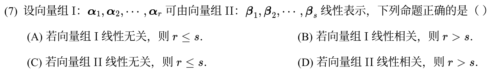
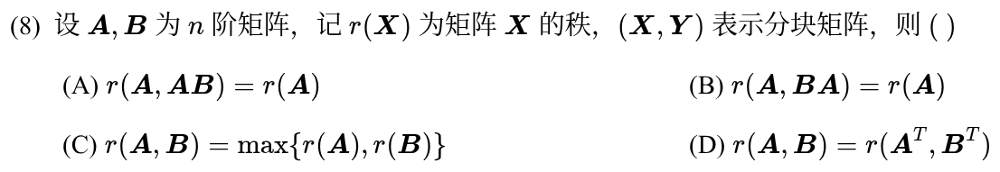
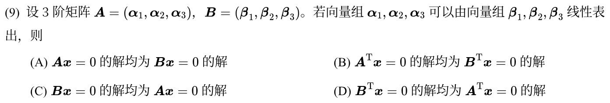
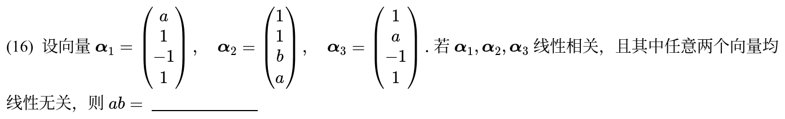
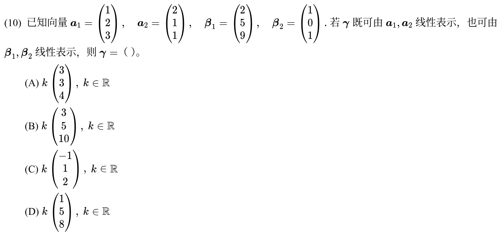
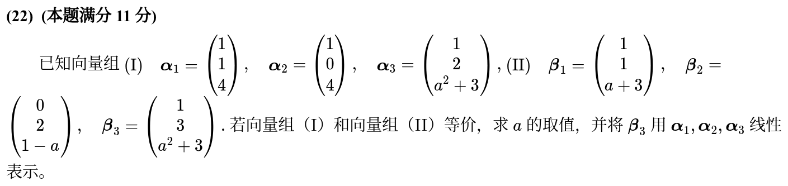

# 向量组线性相关性与矩阵的秩

> 章节定位：[向量组的线性相关性与矩阵的秩](../../chapters/linear-algebra/03-vectors-rank.md)

向量组与秩这一章最容易失分的原因，是**把“文字命题”和“矩阵等式”割裂开来**：看到“向量组 I 可由向量组 II 线性表示”就在脑子里空想，而不是第一时间写成矩阵乘法 $A = BC$；看到分块矩阵求秩就乱套“秩等于两块秩的最大值”，而忘了用**初等变换化零块**。

处理本章题目，第一笔先按**条件语言**做翻译：

| 题型信号 | 第一笔翻译（矩阵化） | 核心判据 | 高频坑点 |
| :--- | :--- | :--- | :--- |
| **向量组 I 可由 II 线性表示** | 立刻写 $A = BC$（$A$ 为 I 列拼，$B$ 为 II 列拼） | 1. 秩不等式：$r(\text{I}) \le r(\text{II})$ 2. 方程组包含：$B^T\boldsymbol{x}=\boldsymbol{0} \implies A^T\boldsymbol{x}=\boldsymbol{0}$ | 把“被表示”与“表示”的矩阵左右顺序写反；把 $r\le s$ 的方向套到“线性相关”或“II 线性无关”上 |
| **抽象分块矩阵的秩** | **先做分块初等变换消零块**，或用 $r(AB)\le \min\{r(A),r(B)\}$ | 右乘可逆分块阵 $\begin{pmatrix}E&-B\\O&E\end{pmatrix}$ 不改变秩；否命题一律举 **2 阶 0-1 反例** | 误以为 $r(A,B)=\max\{r(A),r(B)\}$ 或 $r(A,B)=r(A^T,B^T)$ |
| **具体含参向量组线性相关/任意两个无关** | 拼成矩阵 $A=(\boldsymbol{\alpha}_1,\dots,\boldsymbol{\alpha}_s)$，用**行特征关系**或**初等行变换**定秩 | “全体相关 + 任两个无关” $\iff$ $r(A)=2$ 且任意两列不成比例 | 只算一个 3 阶子式为 $0$，忘了检查“任意两列线性无关”把增根筛掉 |
| **向量组等价 / 公共线性表示向量** | 等价 $\iff r(A)=r(B)=r(A,B)$；公共表示 $\iff A\boldsymbol{x}=B\boldsymbol{y}$ | 先看 $|A|=0$ 与 $|B|=0$ 定分界参数，再分别检验非满秩点；公共表示可用法向量或齐次方程组求解 | 向量组线性相关时，线性表示式**不唯一**，漏写自由参数 $k$ |

下面用四道真题把**秩不等式与以少表多 $\to$ 分块矩阵的秩与 2 阶反例 $\to$ 线性表示与转置齐次方程组解空间 $\to$ 具体含参向量组的秩与任意两向量无关**四条核心链条完整串起来。

---

## 一、抽象命题的统一入口：写成 $A=BC$，再用秩不等式与 2 阶反例定真伪

### 判断链

1. **只要题干说“$\boldsymbol{\alpha}_1,\dots,\boldsymbol{\alpha}_r$ 可由 $\boldsymbol{\beta}_1,\dots,\boldsymbol{\beta}_s$ 线性表示”**：
   设 $A=(\boldsymbol{\alpha}_1,\dots,\boldsymbol{\alpha}_r)$，$B=(\boldsymbol{\beta}_1,\dots,\boldsymbol{\beta}_s)$，立刻翻译成：
   $$\exists C_{s\times r},\quad \text{使得}\quad A = BC.$$
   这一行等式同时送出两个杀手锏：
   - **秩链条**：$r(A) = r(BC) \le r(B) \le s$（若 I 线性无关，则 $r = r(A) \le s$，即“**以少表多，多必相关**”的逆否命题）；
   - **转置方程链条**：取转置得 $A^T = C^T B^T$，于是对任意列向量 $\boldsymbol{x}$，只要 $B^T\boldsymbol{x}=\boldsymbol{0}$，必有 $A^T\boldsymbol{x}=C^T(B^T\boldsymbol{x})=\boldsymbol{0}$。
2. **判断分块矩阵秩恒等式**：
   - 真命题用**分块初等变换**一行证明（如 $(A, AB)\begin{pmatrix}E&-B\\O&E\end{pmatrix}=(A, O)$）；
   - 假命题直接拿最简单的 2 阶矩阵 $E_{11}=\begin{pmatrix}1&0\\0&0\end{pmatrix},\ E_{12}=\begin{pmatrix}0&1\\0&0\end{pmatrix},\ E_{21}=\begin{pmatrix}0&0\\1&0\end{pmatrix},\ E_{22}=\begin{pmatrix}0&0\\0&1\end{pmatrix}$ 逐个击破。

---

### 例 1：[2010 年第 7 题](../../chapters/linear-algebra/03-vectors-rank.md#q2010-7)（选择题）

> **建议先自己写出秩的不等式链，再逐项检验**。

**原题**（[在章节题单中查看](../../chapters/linear-algebra/03-vectors-rank.md#q2010-7)）：

#### 第一步怎么落笔

- **触发条件**：向量组 I（$r$ 个向量）可由向量组 II（$s$ 个向量）线性表示，问 $r$ 与 $s$ 的大小关系。
- **第一笔**：立刻写出秩的基本不等式链：
  $$r(\text{I}) \le r(\text{II}) \le s.$$

#### 完整推演

- **检验（A）**：若向量组 I 线性无关，则 $r(\text{I}) = r$。代入不等式链直接得
  $$r = r(\text{I}) \le r(\text{II}) \le s \implies r \le s.$$
  故 **（A）恒成立**。

#### 选择题关键干扰项拆解（极简反例）

- **（B）若 I 线性相关，则 $r > s$（错）**：线性相关只说明 $r(\text{I}) < r$，完全可能 $r \le s$。反例：取 I 为 $\{\boldsymbol{0}\}$（$r=1$，线性相关），II 为 $\{\boldsymbol{e}_1\}$（$s=1$），I 可由 II 线性表示，但 $r = s = 1$，不满足 $r > s$。
- **（C）若 II 线性无关，则 $r \le s$（错）**：II 线性无关只说明 $r(\text{II}) = s$，但 I 可以把同一个向量重复写很多次从而使 $r > s$。反例：II 为 $\{\boldsymbol{e}_1\}$（$s=1$），I 为 $\{\boldsymbol{e}_1, 2\boldsymbol{e}_1\}$（$r=2$），此时 $r > s$。
- **（D）若 II 线性相关，则 $r > s$（错）**：反例：II 为 $\{\boldsymbol{e}_1, \boldsymbol{e}_1\}$（$s=2$，线性相关），I 为 $\{\boldsymbol{e}_1\}$（$r=1$），此时 $r < s$。

#### 条件变式检验

- **变式**：若在原题条件下再加一句“且向量组 I 与 II **等价**”，此时“若 II 线性无关，则 $r \le s$”成立吗？
  **仍不成立！** 同一反例 II $=\{\boldsymbol{e}_1\}$、I $=\{\boldsymbol{e}_1, 2\boldsymbol{e}_1\}$ 依然等价，且 $r=2 > s=1$。只有当“**I 与 II 等价且两者都线性无关**”时，才能推出 $r = s$。

---

### 例 2：[2018 年第 8 题](../../chapters/linear-algebra/03-vectors-rank.md#q2018-8)（选择题）

> **建议先尝试用分块初等变换化简（A）**，再给（B）（C）（D）各造一个 2 阶反例。

**原题**（[在章节题单中查看](../../chapters/linear-algebra/03-vectors-rank.md#q2018-8)）：

#### 第一步怎么落笔

- **触发条件**：比较 $n$ 阶矩阵 $A, B$ 拼成的分块矩阵的秩。
- **第一笔**：观察（A）中的 $(A, AB)$——右边块 $AB$ 的每一列都是 $A$ 的列向量的线性组合，因此用**分块初等列变换**可直接把 $AB$ 消成零块！

#### 完整推演

对分块矩阵 $(A, AB)$ 右乘可逆分块矩阵 $\begin{pmatrix}E & -B \\ O & E\end{pmatrix}$：
$$(A,\ AB)\begin{pmatrix}E & -B \\ O & E\end{pmatrix} = (A,\ -AB + AB) = (A,\ O).$$
因为右乘可逆矩阵不改变矩阵的秩，所以
$$r(A,\ AB) = r(A,\ O) = r(A).$$
故 **（A）恒成立**。
（从向量组角度看同样一目了然：$AB$ 的列向量组可由 $A$ 的列向量组线性表示，故把 $AB$ 的列拼到 $A$ 后面不会增加列空间的维数。）

#### 选择题关键干扰项拆解（2 阶 0-1 反例秒杀）

- **（B）$r(A, BA) = r(A)$（错）**：$BA$ 是**左乘** $B$，改变的是行组合而不是列组合！反例：取 $A=\begin{pmatrix}1&0\\0&0\end{pmatrix}$，$B=\begin{pmatrix}0&0\\1&0\end{pmatrix}$，则 $BA=\begin{pmatrix}0&0\\1&0\end{pmatrix}$，$r(A)=1$，而 $r(A, BA) = r\begin{pmatrix}1&0&0&0\\0&0&1&0\end{pmatrix} = 2 \neq 1$。
- **（C）$r(A, B) = \max\{r(A), r(B)\}$（错）**：把两个列空间正交的秩 1 矩阵拼在一起，秩会相加而不是取最大。反例：$A=\begin{pmatrix}1&0\\0&0\end{pmatrix}$，$B=\begin{pmatrix}0&0\\0&1\end{pmatrix}$，则 $\max\{r(A),r(B)\}=1$，但 $r(A,B)=2$。
- **（D）$r(A, B) = r(A^T, B^T)$（错，极易误判！）**：虽然 $r(A)=r(A^T)$、$r(B)=r(B^T)$，但**水平拼接**要求比的是列空间之和，转置后变成行空间之和，两者未必同维！反例：$A=\begin{pmatrix}1&0\\0&0\end{pmatrix}$，$B=\begin{pmatrix}0&1\\0&0\end{pmatrix}$，则 $r(A,B)=1$（非零元全在第 1 行）；而 $A^T=\begin{pmatrix}1&0\\0&0\end{pmatrix}$，$B^T=\begin{pmatrix}0&0\\1&0\end{pmatrix}$，故 $r(A^T,B^T)=2 \neq 1$。

#### 条件变式检验

- **变式**：如果把（B）中的水平分块 $(A, BA)$ 改为**竖直分块** $\begin{pmatrix}A \\ BA\end{pmatrix}$，等式 $r\begin{pmatrix}A \\ BA\end{pmatrix} = r(A)$ 成立吗？
  **成立！** 左乘可逆分块矩阵 $\begin{pmatrix}E&O\\-B&E\end{pmatrix}\begin{pmatrix}A\\BA\end{pmatrix}=\begin{pmatrix}A\\O\end{pmatrix}$，立刻得 $r\begin{pmatrix}A\\BA\end{pmatrix}=r(A)$。同理（D）的正确转置形式是 $r(A, B) = r\begin{pmatrix}A^T \\ B^T\end{pmatrix}$，而不是 $r(A^T, B^T)$。

---

### 例 3：[2021 年第 9 题](../../chapters/linear-algebra/03-vectors-rank.md#q2021-9)（选择题）

> **建议先自己把“线性表出”写成矩阵乘法 $A = BC$，再决定要不要取转置**。

**原题**（[在章节题单中查看](../../chapters/linear-algebra/03-vectors-rank.md#q2021-9)）：

#### 第一步怎么落笔

- **触发条件**：列向量组 $\boldsymbol{\alpha}_1,\boldsymbol{\alpha}_2,\boldsymbol{\alpha}_3$ 可由 $\boldsymbol{\beta}_1,\boldsymbol{\beta}_2,\boldsymbol{\beta}_3$ 线性表出，选项都在比较 $A\boldsymbol{x}=\boldsymbol{0}$、$B\boldsymbol{x}=\boldsymbol{0}$、$A^T\boldsymbol{x}=\boldsymbol{0}$、$B^T\boldsymbol{x}=\boldsymbol{0}$ 的解空间包含关系。
- **第一笔**：**写矩阵乘法 $A = BC$，立刻取转置得 $A^T = C^T B^T$！**

#### 完整推演

1. **翻译题干**：因为 $A=(\boldsymbol{\alpha}_1,\boldsymbol{\alpha}_2,\boldsymbol{\alpha}_3)$ 的每一列都可由 $B=(\boldsymbol{\beta}_1,\boldsymbol{\beta}_2,\boldsymbol{\beta}_3)$ 的列线性表出，所以存在 3 阶矩阵 $C$，使得
   $$A = BC.$$
2. **取转置**：
   $$A^T = (BC)^T = C^T B^T.$$
3. **验证解空间包含方向**：若 $\boldsymbol{x}$ 是 $B^T\boldsymbol{x}=\boldsymbol{0}$ 的任意解，则左乘 $C^T$ 得
   $$A^T\boldsymbol{x} = C^T(B^T\boldsymbol{x}) = C^T\boldsymbol{0} = \boldsymbol{0},$$
   即 $\boldsymbol{x}$ 必为 $A^T\boldsymbol{x}=\boldsymbol{0}$ 的解。因此 **$B^T\boldsymbol{x}=\boldsymbol{0}$ 的解均为 $A^T\boldsymbol{x}=\boldsymbol{0}$ 的解**，选 **（D）**。

> **几何直觉（防搞反方向）**：$B^T\boldsymbol{x}=\boldsymbol{0}$ 意味着 $\boldsymbol{x}$ 与 $\boldsymbol{\beta}_1,\boldsymbol{\beta}_2,\boldsymbol{\beta}_3$ 全部正交；既然每个 $\boldsymbol{\alpha}_i$ 都是 $\boldsymbol{\beta}_1,\boldsymbol{\beta}_2,\boldsymbol{\beta}_3$ 的线性组合，那么 $\boldsymbol{x}$ 必然也与每个 $\boldsymbol{\alpha}_i$ 正交，即 $A^T\boldsymbol{x}=\boldsymbol{0}$！

#### 选择题关键干扰项拆解

- **（B）$A^T\boldsymbol{x}=\boldsymbol{0}$ 的解均为 $B^T\boldsymbol{x}=\boldsymbol{0}$ 的解（最高频错选）**：把 $A=BC$ 的包含方向搞反了。特例验证：取 $A=O$（显然可由任意 $B$ 表出），$B=E$。此时 $A^T\boldsymbol{x}=\boldsymbol{0}$ 的解是全体 $\mathbb{R}^3$，而 $B^T\boldsymbol{x}=\boldsymbol{0}$ 只有零解，直接淘汰（B），同时也淘汰（A）！
- **（A）与（C）**：$A=BC$ 右乘 $\boldsymbol{x}$ 得 $A\boldsymbol{x} = B(C\boldsymbol{x})$，既推不出 $A\boldsymbol{x}=\boldsymbol{0}\implies B\boldsymbol{x}=\boldsymbol{0}$（取 $A=O, B=E$ 淘汰 A），也推不出 $B\boldsymbol{x}=\boldsymbol{0}\implies A\boldsymbol{x}=\boldsymbol{0}$（取 $B=\begin{pmatrix}1&0&0\\0&0&0\\0&0&0\end{pmatrix}$，$C=\begin{pmatrix}0&1&0\\0&0&0\\0&0&0\end{pmatrix}$，则 $A=BC=\begin{pmatrix}0&1&0\\0&0&0\\0&0&0\end{pmatrix}$，取 $\boldsymbol{x}=(0,1,0)^T$ 满足 $B\boldsymbol{x}=\boldsymbol{0}$ 但 $A\boldsymbol{x}=(1,0,0)^T\neq\boldsymbol{0}$，淘汰 C）。

#### 条件变式检验

- **变式**：若把题干改为“$A, B$ 的**行向量组**中，$A$ 的行向量组可由 $B$ 的行向量组线性表出”，应选哪一项？
  **选（C）！** 此时存在 $C$ 使 $A = CB$（左乘），于是只要 $B\boldsymbol{x}=\boldsymbol{0}$，必有 $A\boldsymbol{x}=C(B\boldsymbol{x})=\boldsymbol{0}$，即 $B\boldsymbol{x}=\boldsymbol{0}$ 的解均为 $A\boldsymbol{x}=\boldsymbol{0}$ 的解。记住口诀：**列表出 $\to$ 转置同解包含；行表出 $\to$ 原方程同解包含。**

---

## 二、具体含参向量组：用“结构特征 + 筛增根”锁死参数

### 判断链

面对 3 个 4 维具体含参向量，题目说“$\boldsymbol{\alpha}_1,\boldsymbol{\alpha}_2,\boldsymbol{\alpha}_3$ 线性相关，且其中任意两个均线性无关”，等价于两个独立条件同时成立：
1. **全体线性相关**：$r(\boldsymbol{\alpha}_1,\boldsymbol{\alpha}_2,\boldsymbol{\alpha}_3) \le 2$；
2. **任意两个线性无关**：任意两列不成比例（特别是当两列已经非常对称时，能一眼先排除使两列重合的参数值！）。

---

### 例 4：[2024 年第 16 题](../../chapters/linear-algebra/03-vectors-rank.md#q2024-16)（填空题）

> **建议先对比 $\boldsymbol{\alpha}_1$ 与 $\boldsymbol{\alpha}_3$ 的第 3、4 分量，看看能一眼秒掉哪个参数值**。

**原题**（[在章节题单中查看](../../chapters/linear-algebra/03-vectors-rank.md#q2024-16)）：

#### 第一步怎么落笔

- **触发条件**：3 个 4 维向量线性相关，且任意两个线性无关。
- **第一笔**：**先看 $\boldsymbol{\alpha}_1$ 和 $\boldsymbol{\alpha}_3$ 的对称结构**：
  - 若 $a=1$，则 $\boldsymbol{\alpha}_1 = \boldsymbol{\alpha}_3 = (1,1,-1,1)^T$，违背“任意两个线性无关”，因此先锁死 **$a \neq 1$**；
  - 既然 $\boldsymbol{\alpha}_1, \boldsymbol{\alpha}_3$ 线性无关，而全体线性相关，那么 **$\boldsymbol{\alpha}_2$ 必可由 $\boldsymbol{\alpha}_1, \boldsymbol{\alpha}_3$ 线性表示**：
    $$\boldsymbol{\alpha}_2 = c_1\boldsymbol{\alpha}_1 + c_3\boldsymbol{\alpha}_3.$$

#### 完整推演

把 $\boldsymbol{\alpha}_2 = c_1\boldsymbol{\alpha}_1 + c_3\boldsymbol{\alpha}_3$ 按 4 个分量写出（不盲目做复杂消元，直接盯分量和！）：
$$\begin{cases} c_1 a + c_3 = 1 & (1) \\ c_1 + c_3 a = 1 & (2) \\ -c_1 - c_3 = b & (3) \\ c_1 + c_3 = a & (4) \end{cases}$$
1. **看（3）式与（4）式**：两式相加直接消去 $c_1, c_3$，得
   $$b + a = 0 \implies b = -a.$$
2. **看（1）式与（2）式**：两式相加，得
   $$(a+1)(c_1 + c_3) = 2.$$
   把（4）式的 $c_1 + c_3 = a$ 代入上式：
   $$a(a+1) = 2 \implies a^2 + a - 2 = 0 \implies (a+2)(a-1) = 0.$$
3. **用“任意两个线性无关”筛根**：
   - 前面已排除 $a = 1$（此时 $\boldsymbol{\alpha}_1 = \boldsymbol{\alpha}_3$）；
   - 故唯一可能为 $a = -2$，从而 $b = -a = 2$。
4. **回代检验**：当 $a=-2, b=2$ 时，$\boldsymbol{\alpha}_1=(-2,1,-1,1)^T$，$\boldsymbol{\alpha}_2=(1,1,2,-2)^T$，$\boldsymbol{\alpha}_3=(1,-2,-1,1)^T$。易见 $c_1=c_3=-1$ 使 $\boldsymbol{\alpha}_2 = -\boldsymbol{\alpha}_1 - \boldsymbol{\alpha}_3$，且任意两列均不成比例，全部条件满足！
   因此：
   $$ab = (-2)\times 2 = -4.$$

#### 条件变式检验

- **变式**：若把题干中“且其中任意两个向量均线性无关”删掉，只留“$\boldsymbol{\alpha}_1,\boldsymbol{\alpha}_2,\boldsymbol{\alpha}_3$ 线性相关”，$ab$ 还是唯一确定的吗？
  **不再唯一！** 当 $a=1$ 时，$\boldsymbol{\alpha}_1 = \boldsymbol{\alpha}_3 = (1,1,-1,1)^T$，无论 $b$ 取任何实数，三个向量都线性相关，此时 $ab = b$ 可以取任意实数。这正是“任意两个线性无关”这个附加条件的核心作用。

---

## 三、回练与过关标准

### 1. 真题回练一：[2023 年第 10 题](../../chapters/linear-algebra/03-vectors-rank.md#q2023-10)（选择题）

点击核对思路与答案

- **方法一（三维几何法向量速杀）**：$\boldsymbol{\gamma}$ 既在 $\operatorname{span}(\boldsymbol{\alpha}_1,\boldsymbol{\alpha}_2)$ 内又在 $\operatorname{span}(\boldsymbol{\beta}_1,\boldsymbol{\beta}_2)$ 内，即 $\boldsymbol{\gamma}$ 沿两平面的交线方向。
  - 平面 1 法向量 $\boldsymbol{n}_1 = \boldsymbol{\alpha}_1\times\boldsymbol{\alpha}_2 = (1,2,3)^T\times(2,1,1)^T = (-1, 5, -3)^T$；
  - 平面 2 法向量 $\boldsymbol{n}_2 = \boldsymbol{\beta}_1\times\boldsymbol{\beta}_2 = (2,5,9)^T\times(1,0,1)^T = (5, 7, -5)^T$；
  - 交线方向 $\boldsymbol{n}_1\times\boldsymbol{n}_2 = (-4, -20, -32)^T = -4(1, 5, 8)^T$。
- **方法二（线性方程组法）**：设 $\boldsymbol{\gamma} = x_1\boldsymbol{\alpha}_1+x_2\boldsymbol{\alpha}_2 = y_1\boldsymbol{\beta}_1+y_2\boldsymbol{\beta}_2$，解齐次方程组 $(\boldsymbol{\alpha}_1,\boldsymbol{\alpha}_2,-\boldsymbol{\beta}_1,-\boldsymbol{\beta}_2)\boldsymbol{z}=\boldsymbol{0}$，得 $x_1 = 3k, x_2 = -k$，代入得 $\boldsymbol{\gamma} = 3k(1,2,3)^T - k(2,1,1)^T = k(1, 5, 8)^T$。
- **答案**：**（D）**。

### 2. 真题回练二：[2019 年第 22 题](../../chapters/linear-algebra/03-vectors-rank.md#q2019-22)（解答题，满分 11 分）

点击核对思路与答案

- **第一步：先算 $|A|$ 与 $|B|$ 找分界点**：
  - $|A| = \begin{vmatrix}1&1&1\\1&0&2\\4&4&a^2+3\end{vmatrix} = -(a^2-1) = 1 - a^2$；
  - $|B| = \begin{vmatrix}1&0&1\\1&2&3\\a+3&1-a&a^2+3\end{vmatrix} = 2(a^2-1)$。
- **第二步：分类讨论等价性**（$r(A)=r(B)=r(A,B)$）：
  1. 当 $a \neq \pm 1$ 时：$|A|\neq 0$ 且 $|B|\neq 0$，故 $r(A)=r(B)=3$，两个向量组都等价于 $\mathbb{R}^3$ 的基，**必等价**；
  2. 当 $a = 1$ 时：$A=\begin{pmatrix}1&1&1\\1&0&2\\4&4&4\end{pmatrix}$，$B=\begin{pmatrix}1&0&1\\1&2&3\\4&0&4\end{pmatrix}$，对 $(A\mid B)$ 做行变换易得 $r(A)=r(B)=r(A,B)=2$，**等价**；
  3. 当 $a = -1$ 时：$A=\begin{pmatrix}1&1&1\\1&0&2\\4&4&4\end{pmatrix}$（满足第 3 行 $= 4\times$ 第 1 行），而 $\boldsymbol{\beta}_1=(1,1,2)^T$ 不满足此关系，故 $r(A,B)=3 > r(A)=2$，**不等价**。
  综上，$a$ 的取值为 **$a \neq -1$**。
- **第三步：用 $\boldsymbol{\alpha}_1,\boldsymbol{\alpha}_2,\boldsymbol{\alpha}_3$ 表示 $\boldsymbol{\beta}_3$（务必区分 $a\neq\pm 1$ 与 $a=1$！）**：
  - 观察 $\boldsymbol{\beta}_3 - \boldsymbol{\alpha}_3 = (0,1,0)^T = \boldsymbol{\alpha}_1 - \boldsymbol{\alpha}_2$，故有一组特解 $\boldsymbol{\beta}_3 = \boldsymbol{\alpha}_1 - \boldsymbol{\alpha}_2 + \boldsymbol{\alpha}_3$。
  - 当 $a \neq \pm 1$ 时，$\boldsymbol{\alpha}_1,\boldsymbol{\alpha}_2,\boldsymbol{\alpha}_3$ 线性无关，表示唯一：
    $$\boldsymbol{\beta}_3 = \boldsymbol{\alpha}_1 - \boldsymbol{\alpha}_2 + \boldsymbol{\alpha}_3.$$
  - 当 $a = 1$ 时，$\boldsymbol{\alpha}_3 = 2\boldsymbol{\alpha}_1 - \boldsymbol{\alpha}_2$（即 $2\boldsymbol{\alpha}_1 - \boldsymbol{\alpha}_2 - \boldsymbol{\alpha}_3 = \boldsymbol{0}$），表示不唯一，全部表示式为：
    $$\boldsymbol{\beta}_3 = (1+2k)\boldsymbol{\alpha}_1 - (1+k)\boldsymbol{\alpha}_2 + (1-k)\boldsymbol{\alpha}_3, \qquad k\in\mathbb{R}.$$

### 过关标准

合上讲义，面对一道向量组与秩的新题时，能独立完成以下四步即算过关：
1. 看到“向量组 I 可由 II 线性表示”，能条件反射地写出 $A=BC$，并同时读出 $r(A)\le r(B)$ 与 $B^T\boldsymbol{x}=\boldsymbol{0}\implies A^T\boldsymbol{x}=\boldsymbol{0}$；
2. 遇到分块矩阵秩选择题，能用分块初等变换证真选项，并随手用 2 阶 0-1 矩阵（$E_{11}, E_{12}, E_{21}, E_{22}$）证伪其余三项；
3. 遇到含参具体向量组题，能把“任意两个线性无关”转化为排除增根的硬约束，不漏筛；
4. 求向量组等价与线性表示时，能先算行列式分出满秩与非满秩两支，并在非满秩支中写出含自由参数的完整表示式。
